# profile::folder_catalog

[Package atlas](index.md) · [Source](../../src/folder_catalog.rs)

## Declarations

Visibility is the declaration spelling; trait members and reexports require their enclosing interface. `cfg` is not evaluated.

| Symbol | Kind | Visibility | Test / cfg |
|---|---|---|---|
| [profile::folder_catalog::SessionConfig](../../src/folder_catalog.rs#L16) | struct_item | `pub` |  |
| [profile::folder_catalog::CatalogFolder](../../src/folder_catalog.rs#L26) | struct_item | `pub` |  |
| [profile::folder_catalog::Catalog](../../src/folder_catalog.rs#L34) | struct_item | `private` |  |
| [profile::folder_catalog::Catalog::default](../../src/folder_catalog.rs#L43) | function_item | `private` |  |
| [profile::folder_catalog::Relocation](../../src/folder_catalog.rs#L55) | struct_item | `private` |  |
| [profile::folder_catalog::CaptureIntent](../../src/folder_catalog.rs#L66) | struct_item | `private` |  |
| [profile::folder_catalog::FolderCapture](../../src/folder_catalog.rs#L73) | struct_item | `pub` |  |
| [profile::folder_catalog::FolderCapture::scope](../../src/folder_catalog.rs#L82) | function_item | `pub` |  |
| [profile::folder_catalog::FolderCapture::prepare](../../src/folder_catalog.rs#L88) | function_item | `pub` |  |
| [profile::folder_catalog::FolderCapture::finish](../../src/folder_catalog.rs#L112) | function_item | `pub` |  |
| [profile::folder_catalog::validate_capture_ledger](../../src/folder_catalog.rs#L117) | function_item | `private` |  |
| [profile::folder_catalog::FolderCatalog](../../src/folder_catalog.rs#L132) | struct_item | `pub` |  |
| [profile::folder_catalog::FolderCatalog::new](../../src/folder_catalog.rs#L138) | function_item | `pub` |  |
| [profile::folder_catalog::FolderCatalog::lock](../../src/folder_catalog.rs#L144) | function_item | `private` |  |
| [profile::folder_catalog::FolderCatalog::recover_capture](../../src/folder_catalog.rs#L150) | function_item | `private` |  |
| [profile::folder_catalog::FolderCatalog::read](../../src/folder_catalog.rs#L220) | function_item | `private` |  |
| [profile::folder_catalog::FolderCatalog::publish](../../src/folder_catalog.rs#L238) | function_item | `private` |  |
| [profile::folder_catalog::FolderCatalog::revision](../../src/folder_catalog.rs#L244) | function_item | `pub` |  |
| [profile::folder_catalog::FolderCatalog::folders](../../src/folder_catalog.rs#L249) | function_item | `pub` |  |
| [profile::folder_catalog::FolderCatalog::capture](../../src/folder_catalog.rs#L256) | function_item | `pub` |  |
| [profile::folder_catalog::FolderCatalog::begin_capture](../../src/folder_catalog.rs#L270) | function_item | `pub` |  |
| [profile::folder_catalog::FolderCatalog::capture_into](../../src/folder_catalog.rs#L298) | function_item | `private` |  |
| [profile::folder_catalog::FolderCatalog::resolve](../../src/folder_catalog.rs#L337) | function_item | `pub` |  |
| [profile::folder_catalog::FolderCatalog::resolve_legacy](../../src/folder_catalog.rs#L383) | function_item | `pub` |  |
| [profile::folder_catalog::FolderCatalog::relocate_alias](../../src/folder_catalog.rs#L426) | function_item | `pub` |  |
| [profile::folder_catalog::FolderCatalog::relocation](../../src/folder_catalog.rs#L488) | function_item | `pub` |  |
| [profile::folder_catalog::FolderCatalog::relocate](../../src/folder_catalog.rs#L509) | function_item | `pub` |  |
| [profile::folder_catalog::FolderCatalog::invalid](../../src/folder_catalog.rs#L553) | function_item | `private` |  |
| [profile::folder_catalog::tests::folder_capture_refuses_a_relocation_between_resolution_and_preparation](../../src/folder_catalog.rs#L565) | function_item | `private` | test; #[cfg(test)] |
| [profile::folder_catalog::tests::folder_capture_recovers_only_the_exact_committed_event_across_failure_boundaries](../../src/folder_catalog.rs#L596) | function_item | `private` | test; #[cfg(test)] |
| [profile::folder_catalog::tests::phase7_pre_catalog_relocation_recovery_imports_an_offline_legacy_address_once](../../src/folder_catalog.rs#L727) | function_item | `private` | test; #[cfg(test)] |

## Imports / reexports

| Local name | Source path | Visibility |
|---|---|---|
| `BTreeMap` | `std::collections::BTreeMap` | `private` |
| `fs` | `std::fs` | `private` |
| `Path` | `std::path::Path` | `private` |
| `PathBuf` | `std::path::PathBuf` | `private` |
| `Deserialize` | `serde::Deserialize` | `private` |
| `Serialize` | `serde::Serialize` | `private` |
| `AtomicPublisher` | `store::AtomicPublisher` | `private` |
| `FullSync` | `store::FullSync` | `private` |
| `NamedLock` | `store::NamedLock` | `private` |
| `ProfileError` | `crate::ProfileError` | `private` |
| `WorkspaceConfig` | `crate::WorkspaceConfig` | `private` |
| `WorkspaceFolder` | `crate::WorkspaceFolder` | `private` |
| `canonical_line` | `crate::canonical_line` | `private` |
| `digest` | `crate::digest` | `private` |
| `parse_canonical` | `crate::parse_canonical` | `private` |
| `*` | `super::*` | `private` |

## Module declarations

| Module | Visibility | Attributes |
|---|---|---|
| `profile::folder_catalog::tests` | `private` | #[cfg(test)] |

## Function call graphs

Edges below are syntactically resolved calls only, including private functions. Graphs partition callers into groups of 20; they are not execution order. All unresolved sites are listed below and in the JSON inventory.

```mermaid
flowchart TD
  n0["profile::folder_catalog::FolderCapture::finish"]
  n1["profile::folder_catalog::validate_capture_ledger"]
  n2["profile::folder_catalog::FolderCatalog::new"]
  n3["profile::folder_catalog::FolderCatalog::lock"]
  n4["profile::folder_catalog::FolderCatalog::recover_capture"]
  n5["profile::folder_catalog::FolderCatalog::read"]
  n6["profile::folder_catalog::FolderCatalog::publish"]
  n7["profile::folder_catalog::FolderCatalog::revision"]
  n8["profile::folder_catalog::FolderCatalog::folders"]
  n9["profile::folder_catalog::FolderCatalog::capture"]
  n10["profile::folder_catalog::FolderCatalog::begin_capture"]
  n11["profile::folder_catalog::FolderCatalog::capture_into"]
  n12["profile::folder_catalog::FolderCatalog::resolve"]
  n13["profile::folder_catalog::FolderCatalog::resolve_legacy"]
  n14["profile::folder_catalog::FolderCatalog::relocate_alias"]
  n15["profile::folder_catalog::Catalog::default"]
  n16["profile::folder_catalog::FolderCatalog::relocation"]
  n17["profile::folder_catalog::FolderCatalog::relocate"]
  n18["profile::folder_catalog::FolderCatalog::invalid"]
  n19["profile::folder_catalog::FolderCapture::scope"]
  n20["profile::folder_catalog::FolderCapture::prepare"]
  n21["profile::canonical_line"]
  n22["profile::digest"]
  n23["profile::parse_canonical"]
  n24["store::atomic::AtomicPublisher::replace"]
  n25["store::platform::NamedLock::exclusive"]
  n26["store::platform::FullSync::full_sync"]
  n27["store::tail::scan_valid_prefix"]
  n0 --> n2
  n3 --> n4
  n3 --> n25
  n4 --> n1
  n4 --> n5
  n4 --> n6
  n4 --> n18
  n4 --> n21
  n4 --> n22
  n4 --> n23
  n4 --> n26
  n4 --> n27
  n5 --> n23
  n6 --> n21
  n6 --> n24
  n7 --> n3
  n7 --> n5
  n8 --> n3
  n8 --> n5
  n9 --> n3
  n9 --> n5
  n9 --> n6
  n9 --> n11
  n9 --> n21
  n10 --> n3
  n10 --> n5
  n10 --> n11
  n10 --> n21
  n12 --> n3
  n12 --> n5
  n12 --> n18
  n13 --> n8
  n14 --> n3
  n14 --> n5
  n14 --> n6
  n14 --> n18
  n14 --> n21
  n16 --> n3
  n16 --> n5
  n16 --> n18
  n17 --> n3
  n17 --> n5
  n17 --> n6
  n17 --> n18
  n20 --> n1
  n20 --> n2
  n20 --> n21
  n20 --> n22
  n20 --> n24
```

Functions 1–20: 49 direct edges

Functions 21–21: 0 direct edges

## Call sites

Includes test functions (marked in declarations). Receiver-type-required sites need type analysis/manual tracing. Calls in closures are attributed to their enclosing function; their occurrence here does not mean the closure executes immediately.

| Caller | Callee expression | Source lines | Target / classification |
|---|---|---|---|
| `default` | `BTreeMap::new` | [47](../../src/folder_catalog.rs#L47), [48](../../src/folder_catalog.rs#L48) | external-constructor-callback-or-unresolved |
| `prepare` | `ledger             .strip_prefix(&self.root)             .map_err(&#124;_&#124; {                 FolderCatalog::new(&self.root).invalid("capture ledger is outside storage")             })?             .to_path_buf` | [89](../../src/folder_catalog.rs#L89) | receiver-type-required |
| `prepare` | `ledger             .strip_prefix(&self.root)             .map_err` | [89](../../src/folder_catalog.rs#L89) | receiver-type-required |
| `prepare` | `ledger             .strip_prefix` | [89](../../src/folder_catalog.rs#L89) | receiver-type-required |
| `prepare` | `FolderCatalog::new(&self.root).invalid` | [92](../../src/folder_catalog.rs#L92) | receiver-type-required |
| `prepare` | `FolderCatalog::new` | [92](../../src/folder_catalog.rs#L92) | [profile::folder_catalog::FolderCatalog::new](../../src/folder_catalog.rs#L138) |
| `prepare` | `validate_capture_ledger` | [95](../../src/folder_catalog.rs#L95) | [profile::folder_catalog::validate_capture_ledger](../../src/folder_catalog.rs#L117) |
| `prepare` | `event.seq` | [98](../../src/folder_catalog.rs#L98) | receiver-type-required |
| `prepare` | `digest` | [99](../../src/folder_catalog.rs#L99) | [profile::digest](../../src/lib.rs#L132) |
| `prepare` | `event.canonical_bytes().map_err` | [99](../../src/folder_catalog.rs#L99) | receiver-type-required |
| `prepare` | `event.canonical_bytes` | [99](../../src/folder_catalog.rs#L99) | receiver-type-required |
| `prepare` | `PathBuf::from` | [101](../../src/folder_catalog.rs#L101) | external-constructor-callback-or-unresolved |
| `prepare` | `error.to_string` | [102](../../src/folder_catalog.rs#L102) | receiver-type-required |
| `prepare` | `self.catalog.clone` | [105](../../src/folder_catalog.rs#L105) | receiver-type-required |
| `prepare` | `self.root.join` | [107](../../src/folder_catalog.rs#L107) | receiver-type-required |
| `prepare` | `AtomicPublisher::replace` | [108](../../src/folder_catalog.rs#L108) | [store::atomic::AtomicPublisher::replace](../../../store/src/atomic.rs#L16) |
| `prepare` | `canonical_line` | [108](../../src/folder_catalog.rs#L108) | [profile::canonical_line](../../src/lib.rs#L118) |
| `prepare` | `Ok` | [109](../../src/folder_catalog.rs#L109) | external-constructor-callback-or-unresolved |
| `finish` | `FolderCatalog::new(&self.root).recover_capture` | [113](../../src/folder_catalog.rs#L113) | receiver-type-required |
| `finish` | `FolderCatalog::new` | [113](../../src/folder_catalog.rs#L113) | [profile::folder_catalog::FolderCatalog::new](../../src/folder_catalog.rs#L138) |
| `validate_capture_ledger` | `ledger.components().collect::<Vec<_>>` | [118](../../src/folder_catalog.rs#L118) | receiver-type-required |
| `validate_capture_ledger` | `ledger.components` | [118](../../src/folder_catalog.rs#L118) | receiver-type-required |
| `validate_capture_ledger` | `parts.len` | [119](../../src/folder_catalog.rs#L119) | receiver-type-required |
| `validate_capture_ledger` | `parts[0].as_os_str` | [120](../../src/folder_catalog.rs#L120) | receiver-type-required |
| `validate_capture_ledger` | `parts[2].as_os_str` | [122](../../src/folder_catalog.rs#L122) | receiver-type-required |
| `validate_capture_ledger` | `Err` | [124](../../src/folder_catalog.rs#L124) | external-constructor-callback-or-unresolved |
| `validate_capture_ledger` | `ledger.to_path_buf` | [125](../../src/folder_catalog.rs#L125) | receiver-type-required |
| `validate_capture_ledger` | `"invalid capture ledger".into` | [126](../../src/folder_catalog.rs#L126) | receiver-type-required |
| `validate_capture_ledger` | `Ok` | [129](../../src/folder_catalog.rs#L129) | external-constructor-callback-or-unresolved |
| `new` | `storage_root.into` | [140](../../src/folder_catalog.rs#L140) | receiver-type-required |
| `lock` | `NamedLock::exclusive` | [145](../../src/folder_catalog.rs#L145) | [store::platform::NamedLock::exclusive](../../../store/src/platform.rs#L103) |
| `lock` | `self.root.join` | [145](../../src/folder_catalog.rs#L145) | receiver-type-required |
| `lock` | `self.recover_capture` | [146](../../src/folder_catalog.rs#L146) | [profile::folder_catalog::FolderCatalog::recover_capture](../../src/folder_catalog.rs#L150) |
| `lock` | `Ok` | [147](../../src/folder_catalog.rs#L147) | external-constructor-callback-or-unresolved |
| `recover_capture` | `self.root.join` | [151](../../src/folder_catalog.rs#L151), [159](../../src/folder_catalog.rs#L159), [216](../../src/folder_catalog.rs#L216) | receiver-type-required |
| `recover_capture` | `fs::read` | [152](../../src/folder_catalog.rs#L152), [177](../../src/folder_catalog.rs#L177) | external-constructor-callback-or-unresolved |
| `recover_capture` | `error.kind` | [154](../../src/folder_catalog.rs#L154) | receiver-type-required |
| `recover_capture` | `Ok` | [154](../../src/folder_catalog.rs#L154), [217](../../src/folder_catalog.rs#L217) | external-constructor-callback-or-unresolved |
| `recover_capture` | `Err` | [155](../../src/folder_catalog.rs#L155), [210](../../src/folder_catalog.rs#L210) | external-constructor-callback-or-unresolved |
| `recover_capture` | `error.into` | [155](../../src/folder_catalog.rs#L155) | receiver-type-required |
| `recover_capture` | `parse_canonical` | [157](../../src/folder_catalog.rs#L157) | [profile::parse_canonical](../../src/lib.rs#L73) |
| `recover_capture` | `validate_capture_ledger` | [158](../../src/folder_catalog.rs#L158) | [profile::folder_catalog::validate_capture_ledger](../../src/folder_catalog.rs#L117) |
| `recover_capture` | `active.exists` | [160](../../src/folder_catalog.rs#L160) | receiver-type-required |
| `recover_capture` | `self.root                 .join("archive")                 .join(                     intent                         .ledger                         .components()                         .nth(1)                         .expect("validated")                         .as_os_str(),                 )                 .join` | [163](../../src/folder_catalog.rs#L163) | receiver-type-required |
| `recover_capture` | `self.root                 .join("archive")                 .join` | [163](../../src/folder_catalog.rs#L163) | receiver-type-required |
| `recover_capture` | `self.root                 .join` | [163](../../src/folder_catalog.rs#L163) | receiver-type-required |
| `recover_capture` | `intent                         .ledger                         .components()                         .nth(1)                         .expect("validated")                         .as_os_str` | [166](../../src/folder_catalog.rs#L166) | receiver-type-required |
| `recover_capture` | `intent                         .ledger                         .components()                         .nth(1)                         .expect` | [166](../../src/folder_catalog.rs#L166) | receiver-type-required |
| `recover_capture` | `intent                         .ledger                         .components()                         .nth` | [166](../../src/folder_catalog.rs#L166) | receiver-type-required |
| `recover_capture` | `intent                         .ledger                         .components` | [166](../../src/folder_catalog.rs#L166) | receiver-type-required |
| `recover_capture` | `store::scan_valid_prefix` | [178](../../src/folder_catalog.rs#L178) | [store::tail::scan_valid_prefix](../../../store/src/tail.rs#L37) |
| `recover_capture` | `scan             .projection             .ok_or_else` | [179](../../src/folder_catalog.rs#L179) | receiver-type-required |
| `recover_capture` | `self.invalid` | [181](../../src/folder_catalog.rs#L181), [190](../../src/folder_catalog.rs#L190), [210](../../src/folder_catalog.rs#L210) | [profile::folder_catalog::FolderCatalog::invalid](../../src/folder_catalog.rs#L553) |
| `recover_capture` | `projection             .events             .iter()             .find(&#124;event&#124; event.seq() == intent.seq)             .map(&#124;event&#124; {                 event                     .canonical_bytes()                     .map(&#124;bytes&#124; digest(&bytes) == intent.event_sha256)                     .map_err(&#124;error&#124; self.invalid(error.to_string()))             })             .transpose()?             .unwrap_or` | [182](../../src/folder_catalog.rs#L182) | receiver-type-required |
| `recover_capture` | `projection             .events             .iter()             .find(&#124;event&#124; event.seq() == intent.seq)             .map(&#124;event&#124; {                 event                     .canonical_bytes()                     .map(&#124;bytes&#124; digest(&bytes) == intent.event_sha256)                     .map_err(&#124;error&#124; self.invalid(error.to_string()))             })             .transpose` | [182](../../src/folder_catalog.rs#L182) | receiver-type-required |
| `recover_capture` | `projection             .events             .iter()             .find(&#124;event&#124; event.seq() == intent.seq)             .map` | [182](../../src/folder_catalog.rs#L182) | receiver-type-required |
| `recover_capture` | `projection             .events             .iter()             .find` | [182](../../src/folder_catalog.rs#L182) | receiver-type-required |
| `recover_capture` | `projection             .events             .iter` | [182](../../src/folder_catalog.rs#L182) | receiver-type-required |
| `recover_capture` | `event.seq` | [185](../../src/folder_catalog.rs#L185) | receiver-type-required |
| `recover_capture` | `event                     .canonical_bytes()                     .map(&#124;bytes&#124; digest(&bytes) == intent.event_sha256)                     .map_err` | [187](../../src/folder_catalog.rs#L187) | receiver-type-required |
| `recover_capture` | `event                     .canonical_bytes()                     .map` | [187](../../src/folder_catalog.rs#L187) | receiver-type-required |
| `recover_capture` | `event                     .canonical_bytes` | [187](../../src/folder_catalog.rs#L187) | receiver-type-required |
| `recover_capture` | `digest` | [189](../../src/folder_catalog.rs#L189) | [profile::digest](../../src/lib.rs#L132) |
| `recover_capture` | `error.to_string` | [190](../../src/folder_catalog.rs#L190) | receiver-type-required |
| `recover_capture` | `FullSync::full_sync` | [197](../../src/folder_catalog.rs#L197) | [store::platform::FullSync::full_sync](../../../store/src/platform.rs#L31) |
| `recover_capture` | `fs::OpenOptions::new()                     .read(true)                     .write(true)                     .open` | [198](../../src/folder_catalog.rs#L198) | receiver-type-required |
| `recover_capture` | `fs::OpenOptions::new()                     .read(true)                     .write` | [198](../../src/folder_catalog.rs#L198) | receiver-type-required |
| `recover_capture` | `fs::OpenOptions::new()                     .read` | [198](../../src/folder_catalog.rs#L198) | receiver-type-required |
| `recover_capture` | `fs::OpenOptions::new` | [198](../../src/folder_catalog.rs#L198) | external-constructor-callback-or-unresolved |
| `recover_capture` | `self.read` | [203](../../src/folder_catalog.rs#L203) | [profile::folder_catalog::FolderCatalog::read](../../src/folder_catalog.rs#L220) |
| `recover_capture` | `self.publish` | [205](../../src/folder_catalog.rs#L205) | [profile::folder_catalog::FolderCatalog::publish](../../src/folder_catalog.rs#L238) |
| `recover_capture` | `canonical_line` | [207](../../src/folder_catalog.rs#L207), [208](../../src/folder_catalog.rs#L208) | [profile::canonical_line](../../src/lib.rs#L118) |
| `recover_capture` | `fs::remove_file` | [215](../../src/folder_catalog.rs#L215) | external-constructor-callback-or-unresolved |
| `recover_capture` | `fs::File::open(self.root.join("config"))?.sync_all` | [216](../../src/folder_catalog.rs#L216) | receiver-type-required |
| `recover_capture` | `fs::File::open` | [216](../../src/folder_catalog.rs#L216) | external-constructor-callback-or-unresolved |
| `read` | `self.root.join` | [221](../../src/folder_catalog.rs#L221) | receiver-type-required |
| `read` | `fs::read` | [222](../../src/folder_catalog.rs#L222) | external-constructor-callback-or-unresolved |
| `read` | `parse_canonical` | [224](../../src/folder_catalog.rs#L224) | [profile::parse_canonical](../../src/lib.rs#L73) |
| `read` | `Err` | [226](../../src/folder_catalog.rs#L226), [234](../../src/folder_catalog.rs#L234) | external-constructor-callback-or-unresolved |
| `read` | `Ok` | [231](../../src/folder_catalog.rs#L231), [233](../../src/folder_catalog.rs#L233) | external-constructor-callback-or-unresolved |
| `read` | `error.kind` | [233](../../src/folder_catalog.rs#L233) | receiver-type-required |
| `read` | `Catalog::default` | [233](../../src/folder_catalog.rs#L233) | external-constructor-callback-or-unresolved |
| `read` | `error.into` | [234](../../src/folder_catalog.rs#L234) | receiver-type-required |
| `publish` | `self.root.join` | [239](../../src/folder_catalog.rs#L239) | receiver-type-required |
| `publish` | `AtomicPublisher::replace` | [240](../../src/folder_catalog.rs#L240) | [store::atomic::AtomicPublisher::replace](../../../store/src/atomic.rs#L16) |
| `publish` | `canonical_line` | [240](../../src/folder_catalog.rs#L240) | [profile::canonical_line](../../src/lib.rs#L118) |
| `publish` | `Ok` | [241](../../src/folder_catalog.rs#L241) | external-constructor-callback-or-unresolved |
| `revision` | `self.lock` | [245](../../src/folder_catalog.rs#L245) | [profile::folder_catalog::FolderCatalog::lock](../../src/folder_catalog.rs#L144) |
| `revision` | `Ok` | [246](../../src/folder_catalog.rs#L246) | external-constructor-callback-or-unresolved |
| `revision` | `self.read` | [246](../../src/folder_catalog.rs#L246) | [profile::folder_catalog::FolderCatalog::read](../../src/folder_catalog.rs#L220) |
| `folders` | `self.lock` | [250](../../src/folder_catalog.rs#L250) | [profile::folder_catalog::FolderCatalog::lock](../../src/folder_catalog.rs#L144) |
| `folders` | `Ok` | [251](../../src/folder_catalog.rs#L251) | external-constructor-callback-or-unresolved |
| `folders` | `self.read()?.folders.into_values().collect` | [251](../../src/folder_catalog.rs#L251) | receiver-type-required |
| `folders` | `self.read()?.folders.into_values` | [251](../../src/folder_catalog.rs#L251) | receiver-type-required |
| `folders` | `self.read` | [251](../../src/folder_catalog.rs#L251) | [profile::folder_catalog::FolderCatalog::read](../../src/folder_catalog.rs#L220) |
| `capture` | `self.lock` | [257](../../src/folder_catalog.rs#L257) | [profile::folder_catalog::FolderCatalog::lock](../../src/folder_catalog.rs#L144) |
| `capture` | `self.read` | [258](../../src/folder_catalog.rs#L258) | [profile::folder_catalog::FolderCatalog::read](../../src/folder_catalog.rs#L220) |
| `capture` | `canonical_line` | [259](../../src/folder_catalog.rs#L259), [261](../../src/folder_catalog.rs#L261) | [profile::canonical_line](../../src/lib.rs#L118) |
| `capture` | `Self::capture_into` | [260](../../src/folder_catalog.rs#L260) | [profile::folder_catalog::FolderCatalog::capture_into](../../src/folder_catalog.rs#L298) |
| `capture` | `self.publish` | [263](../../src/folder_catalog.rs#L263) | [profile::folder_catalog::FolderCatalog::publish](../../src/folder_catalog.rs#L238) |
| `capture` | `Ok` | [265](../../src/folder_catalog.rs#L265) | external-constructor-callback-or-unresolved |
| `begin_capture` | `self.lock` | [275](../../src/folder_catalog.rs#L275) | [profile::folder_catalog::FolderCatalog::lock](../../src/folder_catalog.rs#L144) |
| `begin_capture` | `self.read` | [276](../../src/folder_catalog.rs#L276) | [profile::folder_catalog::FolderCatalog::read](../../src/folder_catalog.rs#L220) |
| `begin_capture` | `Err` | [280](../../src/folder_catalog.rs#L280) | external-constructor-callback-or-unresolved |
| `begin_capture` | `canonical_line` | [285](../../src/folder_catalog.rs#L285), [287](../../src/folder_catalog.rs#L287) | [profile::canonical_line](../../src/lib.rs#L118) |
| `begin_capture` | `Self::capture_into` | [286](../../src/folder_catalog.rs#L286) | [profile::folder_catalog::FolderCatalog::capture_into](../../src/folder_catalog.rs#L298) |
| `begin_capture` | `Ok` | [290](../../src/folder_catalog.rs#L290) | external-constructor-callback-or-unresolved |
| `begin_capture` | `self.root.clone` | [291](../../src/folder_catalog.rs#L291) | receiver-type-required |
| `capture_into` | `BTreeMap::new` | [299](../../src/folder_catalog.rs#L299) | external-constructor-callback-or-unresolved |
| `capture_into` | `seed.folder_ids().into_iter().zip` | [300](../../src/folder_catalog.rs#L300) | receiver-type-required |
| `capture_into` | `seed.folder_ids().into_iter` | [300](../../src/folder_catalog.rs#L300) | receiver-type-required |
| `capture_into` | `seed.folder_ids` | [300](../../src/folder_catalog.rs#L300) | receiver-type-required |
| `capture_into` | `seed.folder_paths` | [300](../../src/folder_catalog.rs#L300) | receiver-type-required |
| `capture_into` | `seed.id.clone` | [301](../../src/folder_catalog.rs#L301) | receiver-type-required |
| `capture_into` | `binding.clone` | [301](../../src/folder_catalog.rs#L301) | receiver-type-required |
| `capture_into` | `catalog.folders.values().find` | [302](../../src/folder_catalog.rs#L302) | receiver-type-required |
| `capture_into` | `catalog.folders.values` | [302](../../src/folder_catalog.rs#L302) | receiver-type-required |
| `capture_into` | `existing.map(&#124;folder&#124; folder.id.clone()).unwrap_or_else` | [303](../../src/folder_catalog.rs#L303) | receiver-type-required |
| `capture_into` | `existing.map` | [303](../../src/folder_catalog.rs#L303) | receiver-type-required |
| `capture_into` | `folder.id.clone` | [303](../../src/folder_catalog.rs#L303) | receiver-type-required |
| `capture_into` | `catalog.folders.values_mut` | [310](../../src/folder_catalog.rs#L310) | receiver-type-required |
| `capture_into` | `other.aliases.retain` | [312](../../src/folder_catalog.rs#L312) | receiver-type-required |
| `capture_into` | `catalog                 .folders                 .entry(id.clone())                 .or_insert_with` | [315](../../src/folder_catalog.rs#L315) | receiver-type-required |
| `capture_into` | `catalog                 .folders                 .entry` | [315](../../src/folder_catalog.rs#L315) | receiver-type-required |
| `capture_into` | `id.clone` | [317](../../src/folder_catalog.rs#L317), [319](../../src/folder_catalog.rs#L319) | receiver-type-required |
| `capture_into` | `path.to_owned` | [320](../../src/folder_catalog.rs#L320) | receiver-type-required |
| `capture_into` | `Vec::new` | [321](../../src/folder_catalog.rs#L321) | external-constructor-callback-or-unresolved |
| `capture_into` | `folder.aliases.contains` | [324](../../src/folder_catalog.rs#L324) | receiver-type-required |
| `capture_into` | `folder.aliases.push` | [325](../../src/folder_catalog.rs#L325) | receiver-type-required |
| `capture_into` | `folder.aliases.sort` | [326](../../src/folder_catalog.rs#L326) | receiver-type-required |
| `capture_into` | `folder_refs.insert` | [328](../../src/folder_catalog.rs#L328) | receiver-type-required |
| `capture_into` | `seed.clone` | [331](../../src/folder_catalog.rs#L331) | receiver-type-required |
| `resolve` | `self.lock` | [338](../../src/folder_catalog.rs#L338) | [profile::folder_catalog::FolderCatalog::lock](../../src/folder_catalog.rs#L144) |
| `resolve` | `self.read` | [339](../../src/folder_catalog.rs#L339) | [profile::folder_catalog::FolderCatalog::read](../../src/folder_catalog.rs#L220) |
| `resolve` | `scope.seed.clone` | [340](../../src/folder_catalog.rs#L340) | receiver-type-required |
| `resolve` | `Vec::new` | [341](../../src/folder_catalog.rs#L341) | external-constructor-callback-or-unresolved |
| `resolve` | `seed             .folder_paths()             .into_iter()             .map(str::to_owned)             .collect::<Vec<_>>` | [342](../../src/folder_catalog.rs#L342) | receiver-type-required |
| `resolve` | `seed             .folder_paths()             .into_iter()             .map` | [342](../../src/folder_catalog.rs#L342) | receiver-type-required |
| `resolve` | `seed             .folder_paths()             .into_iter` | [342](../../src/folder_catalog.rs#L342) | receiver-type-required |
| `resolve` | `seed             .folder_paths` | [342](../../src/folder_catalog.rs#L342) | receiver-type-required |
| `resolve` | `seed.folder_ids` | [347](../../src/folder_catalog.rs#L347) | receiver-type-required |
| `resolve` | `scope                 .folder_refs                 .get(&binding)                 .ok_or_else` | [348](../../src/folder_catalog.rs#L348) | receiver-type-required |
| `resolve` | `scope                 .folder_refs                 .get` | [348](../../src/folder_catalog.rs#L348) | receiver-type-required |
| `resolve` | `self.invalid` | [351](../../src/folder_catalog.rs#L351), [355](../../src/folder_catalog.rs#L355) | [profile::folder_catalog::FolderCatalog::invalid](../../src/folder_catalog.rs#L553) |
| `resolve` | `catalog                 .folders                 .get(id)                 .ok_or_else` | [352](../../src/folder_catalog.rs#L352) | receiver-type-required |
| `resolve` | `catalog                 .folders                 .get` | [352](../../src/folder_catalog.rs#L352) | receiver-type-required |
| `resolve` | `folders.push` | [356](../../src/folder_catalog.rs#L356) | receiver-type-required |
| `resolve` | `folder.path.clone` | [358](../../src/folder_catalog.rs#L358) | receiver-type-required |
| `resolve` | `old_paths                     .iter()                     .zip(&folders)                     .filter(&#124;(old, _)&#124; Path::new(root).starts_with(old))                     .max_by_key` | [363](../../src/folder_catalog.rs#L363) | receiver-type-required |
| `resolve` | `old_paths                     .iter()                     .zip(&folders)                     .filter` | [363](../../src/folder_catalog.rs#L363) | receiver-type-required |
| `resolve` | `old_paths                     .iter()                     .zip` | [363](../../src/folder_catalog.rs#L363) | receiver-type-required |
| `resolve` | `old_paths                     .iter` | [363](../../src/folder_catalog.rs#L363) | receiver-type-required |
| `resolve` | `Path::new(root).starts_with` | [366](../../src/folder_catalog.rs#L366) | receiver-type-required |
| `resolve` | `Path::new` | [366](../../src/folder_catalog.rs#L366), [369](../../src/folder_catalog.rs#L369), [370](../../src/folder_catalog.rs#L370) | external-constructor-callback-or-unresolved |
| `resolve` | `old.len` | [367](../../src/folder_catalog.rs#L367) | receiver-type-required |
| `resolve` | `Path::new(&new.path)                         .join(Path::new(root).strip_prefix(old).expect("checked"))                         .to_string_lossy()                         .into_owned` | [369](../../src/folder_catalog.rs#L369) | receiver-type-required |
| `resolve` | `Path::new(&new.path)                         .join(Path::new(root).strip_prefix(old).expect("checked"))                         .to_string_lossy` | [369](../../src/folder_catalog.rs#L369) | receiver-type-required |
| `resolve` | `Path::new(&new.path)                         .join` | [369](../../src/folder_catalog.rs#L369) | receiver-type-required |
| `resolve` | `Path::new(root).strip_prefix(old).expect` | [370](../../src/folder_catalog.rs#L370) | receiver-type-required |
| `resolve` | `Path::new(root).strip_prefix` | [370](../../src/folder_catalog.rs#L370) | receiver-type-required |
| `resolve` | `seed.cwd.clear` | [376](../../src/folder_catalog.rs#L376) | receiver-type-required |
| `resolve` | `Ok` | [378](../../src/folder_catalog.rs#L378) | external-constructor-callback-or-unresolved |
| `resolve_legacy` | `self.folders` | [387](../../src/folder_catalog.rs#L387) | [profile::folder_catalog::FolderCatalog::folders](../../src/folder_catalog.rs#L249) |
| `resolve_legacy` | `original.clone` | [388](../../src/folder_catalog.rs#L388) | receiver-type-required |
| `resolve_legacy` | `original             .folder_ids()             .into_iter()             .zip(original.folder_paths())             .map(&#124;(id, path)&#124; {                 let current = folders                     .iter()                     .find(&#124;folder&#124; folder.aliases.contains(&(original.id.clone(), id.clone())))                     .map_or(path, &#124;folder&#124; folder.path.as_str());                 WorkspaceFolder {                     id,                     path: current.to_owned(),                 }             })             .collect` | [389](../../src/folder_catalog.rs#L389) | receiver-type-required |
| `resolve_legacy` | `original             .folder_ids()             .into_iter()             .zip(original.folder_paths())             .map` | [389](../../src/folder_catalog.rs#L389) | receiver-type-required |
| `resolve_legacy` | `original             .folder_ids()             .into_iter()             .zip` | [389](../../src/folder_catalog.rs#L389) | receiver-type-required |
| `resolve_legacy` | `original             .folder_ids()             .into_iter` | [389](../../src/folder_catalog.rs#L389) | receiver-type-required |
| `resolve_legacy` | `original             .folder_ids` | [389](../../src/folder_catalog.rs#L389) | receiver-type-required |
| `resolve_legacy` | `original.folder_paths` | [392](../../src/folder_catalog.rs#L392) | receiver-type-required |
| `resolve_legacy` | `folders                     .iter()                     .find(&#124;folder&#124; folder.aliases.contains(&(original.id.clone(), id.clone())))                     .map_or` | [394](../../src/folder_catalog.rs#L394) | receiver-type-required |
| `resolve_legacy` | `folders                     .iter()                     .find` | [394](../../src/folder_catalog.rs#L394) | receiver-type-required |
| `resolve_legacy` | `folders                     .iter` | [394](../../src/folder_catalog.rs#L394) | receiver-type-required |
| `resolve_legacy` | `folder.aliases.contains` | [396](../../src/folder_catalog.rs#L396) | receiver-type-required |
| `resolve_legacy` | `original.id.clone` | [396](../../src/folder_catalog.rs#L396) | receiver-type-required |
| `resolve_legacy` | `id.clone` | [396](../../src/folder_catalog.rs#L396) | receiver-type-required |
| `resolve_legacy` | `folder.path.as_str` | [397](../../src/folder_catalog.rs#L397) | receiver-type-required |
| `resolve_legacy` | `current.to_owned` | [400](../../src/folder_catalog.rs#L400) | receiver-type-required |
| `resolve_legacy` | `seed.cwd.clear` | [404](../../src/folder_catalog.rs#L404) | receiver-type-required |
| `resolve_legacy` | `original                     .folder_paths()                     .into_iter()                     .zip(&seed.folders)                     .filter(&#124;(old, _)&#124; Path::new(root).starts_with(old))                     .max_by_key` | [407](../../src/folder_catalog.rs#L407) | receiver-type-required |
| `resolve_legacy` | `original                     .folder_paths()                     .into_iter()                     .zip(&seed.folders)                     .filter` | [407](../../src/folder_catalog.rs#L407) | receiver-type-required |
| `resolve_legacy` | `original                     .folder_paths()                     .into_iter()                     .zip` | [407](../../src/folder_catalog.rs#L407) | receiver-type-required |
| `resolve_legacy` | `original                     .folder_paths()                     .into_iter` | [407](../../src/folder_catalog.rs#L407) | receiver-type-required |
| `resolve_legacy` | `original                     .folder_paths` | [407](../../src/folder_catalog.rs#L407) | receiver-type-required |
| `resolve_legacy` | `Path::new(root).starts_with` | [411](../../src/folder_catalog.rs#L411) | receiver-type-required |
| `resolve_legacy` | `Path::new` | [411](../../src/folder_catalog.rs#L411), [414](../../src/folder_catalog.rs#L414), [415](../../src/folder_catalog.rs#L415) | external-constructor-callback-or-unresolved |
| `resolve_legacy` | `old.len` | [412](../../src/folder_catalog.rs#L412) | receiver-type-required |
| `resolve_legacy` | `Path::new(&new.path)                         .join(Path::new(root).strip_prefix(old).expect("checked"))                         .to_string_lossy()                         .into_owned` | [414](../../src/folder_catalog.rs#L414) | receiver-type-required |
| `resolve_legacy` | `Path::new(&new.path)                         .join(Path::new(root).strip_prefix(old).expect("checked"))                         .to_string_lossy` | [414](../../src/folder_catalog.rs#L414) | receiver-type-required |
| `resolve_legacy` | `Path::new(&new.path)                         .join` | [414](../../src/folder_catalog.rs#L414) | receiver-type-required |
| `resolve_legacy` | `Path::new(root).strip_prefix(old).expect` | [415](../../src/folder_catalog.rs#L415) | receiver-type-required |
| `resolve_legacy` | `Path::new(root).strip_prefix` | [415](../../src/folder_catalog.rs#L415) | receiver-type-required |
| `resolve_legacy` | `Ok` | [421](../../src/folder_catalog.rs#L421) | external-constructor-callback-or-unresolved |
| `relocate_alias` | `self.lock` | [433](../../src/folder_catalog.rs#L433) | [profile::folder_catalog::FolderCatalog::lock](../../src/folder_catalog.rs#L144) |
| `relocate_alias` | `self.read` | [434](../../src/folder_catalog.rs#L434) | [profile::folder_catalog::FolderCatalog::read](../../src/folder_catalog.rs#L220) |
| `relocate_alias` | `canonical_line` | [435](../../src/folder_catalog.rs#L435), [480](../../src/folder_catalog.rs#L480) | [profile::canonical_line](../../src/lib.rs#L118) |
| `relocate_alias` | `workspace.to_owned` | [436](../../src/folder_catalog.rs#L436) | receiver-type-required |
| `relocate_alias` | `binding.to_owned` | [436](../../src/folder_catalog.rs#L436) | receiver-type-required |
| `relocate_alias` | `catalog             .folders             .values()             .find` | [437](../../src/folder_catalog.rs#L437) | receiver-type-required |
| `relocate_alias` | `catalog             .folders             .values` | [437](../../src/folder_catalog.rs#L437), [472](../../src/folder_catalog.rs#L472) | receiver-type-required |
| `relocate_alias` | `folder.aliases.contains` | [440](../../src/folder_catalog.rs#L440) | receiver-type-required |
| `relocate_alias` | `folder.id.clone` | [442](../../src/folder_catalog.rs#L442), [452](../../src/folder_catalog.rs#L452) | receiver-type-required |
| `relocate_alias` | `Err` | [443](../../src/folder_catalog.rs#L443), [477](../../src/folder_catalog.rs#L477) | external-constructor-callback-or-unresolved |
| `relocate_alias` | `self.invalid` | [443](../../src/folder_catalog.rs#L443), [477](../../src/folder_catalog.rs#L477) | [profile::folder_catalog::FolderCatalog::invalid](../../src/folder_catalog.rs#L553) |
| `relocate_alias` | `catalog                     .folders                     .values()                     .find(&#124;folder&#124; folder.path == previous)                     .map(&#124;folder&#124; folder.id.clone())                     .unwrap_or_else` | [448](../../src/folder_catalog.rs#L448) | receiver-type-required |
| `relocate_alias` | `catalog                     .folders                     .values()                     .find(&#124;folder&#124; folder.path == previous)                     .map` | [448](../../src/folder_catalog.rs#L448) | receiver-type-required |
| `relocate_alias` | `catalog                     .folders                     .values()                     .find` | [448](../../src/folder_catalog.rs#L448) | receiver-type-required |
| `relocate_alias` | `catalog                     .folders                     .values` | [448](../../src/folder_catalog.rs#L448) | receiver-type-required |
| `relocate_alias` | `catalog                     .folders                     .entry(id.clone())                     .or_insert_with` | [459](../../src/folder_catalog.rs#L459) | receiver-type-required |
| `relocate_alias` | `catalog                     .folders                     .entry` | [459](../../src/folder_catalog.rs#L459) | receiver-type-required |
| `relocate_alias` | `id.clone` | [461](../../src/folder_catalog.rs#L461), [463](../../src/folder_catalog.rs#L463) | receiver-type-required |
| `relocate_alias` | `previous.to_owned` | [464](../../src/folder_catalog.rs#L464) | receiver-type-required |
| `relocate_alias` | `Vec::new` | [465](../../src/folder_catalog.rs#L465) | external-constructor-callback-or-unresolved |
| `relocate_alias` | `folder.aliases.push` | [467](../../src/folder_catalog.rs#L467) | receiver-type-required |
| `relocate_alias` | `folder.aliases.sort` | [468](../../src/folder_catalog.rs#L468) | receiver-type-required |
| `relocate_alias` | `catalog             .folders             .values()             .any` | [472](../../src/folder_catalog.rs#L472) | receiver-type-required |
| `relocate_alias` | `catalog.folders.get_mut(&id).expect` | [479](../../src/folder_catalog.rs#L479) | receiver-type-required |
| `relocate_alias` | `catalog.folders.get_mut` | [479](../../src/folder_catalog.rs#L479) | receiver-type-required |
| `relocate_alias` | `path.to_owned` | [479](../../src/folder_catalog.rs#L479) | receiver-type-required |
| `relocate_alias` | `self.publish` | [482](../../src/folder_catalog.rs#L482) | [profile::folder_catalog::FolderCatalog::publish](../../src/folder_catalog.rs#L238) |
| `relocate_alias` | `Ok` | [484](../../src/folder_catalog.rs#L484) | external-constructor-callback-or-unresolved |
| `relocation` | `self.lock` | [494](../../src/folder_catalog.rs#L494) | [profile::folder_catalog::FolderCatalog::lock](../../src/folder_catalog.rs#L144) |
| `relocation` | `self.read` | [495](../../src/folder_catalog.rs#L495) | [profile::folder_catalog::FolderCatalog::read](../../src/folder_catalog.rs#L220) |
| `relocation` | `catalog.relocations.get` | [496](../../src/folder_catalog.rs#L496) | receiver-type-required |
| `relocation` | `Err` | [498](../../src/folder_catalog.rs#L498) | external-constructor-callback-or-unresolved |
| `relocation` | `self.invalid` | [498](../../src/folder_catalog.rs#L498) | [profile::folder_catalog::FolderCatalog::invalid](../../src/folder_catalog.rs#L553) |
| `relocation` | `Ok` | [500](../../src/folder_catalog.rs#L500), [502](../../src/folder_catalog.rs#L502) | external-constructor-callback-or-unresolved |
| `relocation` | `Some` | [500](../../src/folder_catalog.rs#L500) | external-constructor-callback-or-unresolved |
| `relocation` | `receipt.id.clone` | [500](../../src/folder_catalog.rs#L500) | receiver-type-required |
| `relocation` | `catalog             .folders             .values()             .find(&#124;folder&#124; folder.path == previous)             .map` | [502](../../src/folder_catalog.rs#L502) | receiver-type-required |
| `relocation` | `catalog             .folders             .values()             .find` | [502](../../src/folder_catalog.rs#L502) | receiver-type-required |
| `relocation` | `catalog             .folders             .values` | [502](../../src/folder_catalog.rs#L502) | receiver-type-required |
| `relocation` | `folder.id.clone` | [506](../../src/folder_catalog.rs#L506) | receiver-type-required |
| `relocate` | `self.lock` | [517](../../src/folder_catalog.rs#L517) | [profile::folder_catalog::FolderCatalog::lock](../../src/folder_catalog.rs#L144) |
| `relocate` | `self.read` | [518](../../src/folder_catalog.rs#L518) | [profile::folder_catalog::FolderCatalog::read](../../src/folder_catalog.rs#L220) |
| `relocate` | `catalog.relocations.get` | [519](../../src/folder_catalog.rs#L519) | receiver-type-required |
| `relocate` | `Err` | [521](../../src/folder_catalog.rs#L521), [530](../../src/folder_catalog.rs#L530), [537](../../src/folder_catalog.rs#L537) | external-constructor-callback-or-unresolved |
| `relocate` | `self.invalid` | [521](../../src/folder_catalog.rs#L521), [530](../../src/folder_catalog.rs#L530), [535](../../src/folder_catalog.rs#L535), [537](../../src/folder_catalog.rs#L537) | [profile::folder_catalog::FolderCatalog::invalid](../../src/folder_catalog.rs#L553) |
| `relocate` | `Ok` | [523](../../src/folder_catalog.rs#L523) | external-constructor-callback-or-unresolved |
| `relocate` | `catalog             .folders             .values()             .any` | [525](../../src/folder_catalog.rs#L525) | receiver-type-required |
| `relocate` | `catalog             .folders             .values` | [525](../../src/folder_catalog.rs#L525) | receiver-type-required |
| `relocate` | `catalog             .folders             .get_mut(id)             .ok_or_else` | [532](../../src/folder_catalog.rs#L532) | receiver-type-required |
| `relocate` | `catalog             .folders             .get_mut` | [532](../../src/folder_catalog.rs#L532) | receiver-type-required |
| `relocate` | `path.to_owned` | [539](../../src/folder_catalog.rs#L539), [546](../../src/folder_catalog.rs#L546) | receiver-type-required |
| `relocate` | `catalog.relocations.insert` | [540](../../src/folder_catalog.rs#L540) | receiver-type-required |
| `relocate` | `rpc.to_owned` | [541](../../src/folder_catalog.rs#L541) | receiver-type-required |
| `relocate` | `hash.to_owned` | [543](../../src/folder_catalog.rs#L543) | receiver-type-required |
| `relocate` | `id.to_owned` | [544](../../src/folder_catalog.rs#L544) | receiver-type-required |
| `relocate` | `previous.to_owned` | [545](../../src/folder_catalog.rs#L545) | receiver-type-required |
| `relocate` | `self.publish` | [550](../../src/folder_catalog.rs#L550) | [profile::folder_catalog::FolderCatalog::publish](../../src/folder_catalog.rs#L238) |
| `invalid` | `self.root.join` | [555](../../src/folder_catalog.rs#L555) | receiver-type-required |
| `invalid` | `reason.into` | [556](../../src/folder_catalog.rs#L556) | receiver-type-required |
| `folder_capture_refuses_a_relocation_between_resolution_and_preparation` | `tempfile::tempdir().unwrap` | [566](../../src/folder_catalog.rs#L566) | receiver-type-required |
| `folder_capture_refuses_a_relocation_between_resolution_and_preparation` | `tempfile::tempdir` | [566](../../src/folder_catalog.rs#L566) | external-constructor-callback-or-unresolved |
| `folder_capture_refuses_a_relocation_between_resolution_and_preparation` | `crate::ConfigRepository::open(root.path()).unwrap` | [567](../../src/folder_catalog.rs#L567) | receiver-type-required |
| `folder_capture_refuses_a_relocation_between_resolution_and_preparation` | `crate::ConfigRepository::open` | [567](../../src/folder_catalog.rs#L567) | [profile::config::ConfigRepository::open](../../src/config.rs#L814) |
| `folder_capture_refuses_a_relocation_between_resolution_and_preparation` | `root.path` | [567](../../src/folder_catalog.rs#L567), [568](../../src/folder_catalog.rs#L568), [583](../../src/folder_catalog.rs#L583) | receiver-type-required |
| `folder_capture_refuses_a_relocation_between_resolution_and_preparation` | `FolderCatalog::new` | [568](../../src/folder_catalog.rs#L568) | external-constructor-callback-or-unresolved |
| `folder_capture_refuses_a_relocation_between_resolution_and_preparation` | `"ws".into` | [572](../../src/folder_catalog.rs#L572) | receiver-type-required |
| `folder_capture_refuses_a_relocation_between_resolution_and_preparation` | `"test".into` | [573](../../src/folder_catalog.rs#L573) | receiver-type-required |
| `folder_capture_refuses_a_relocation_between_resolution_and_preparation` | `Vec::new` | [575](../../src/folder_catalog.rs#L575) | external-constructor-callback-or-unresolved |
| `folder_capture_refuses_a_relocation_between_resolution_and_preparation` | `catalog.capture(&seed).unwrap` | [578](../../src/folder_catalog.rs#L578) | receiver-type-required |
| `folder_capture_refuses_a_relocation_between_resolution_and_preparation` | `catalog.capture` | [578](../../src/folder_catalog.rs#L578) | receiver-type-required |
| `folder_capture_refuses_a_relocation_between_resolution_and_preparation` | `catalog.revision().unwrap` | [579](../../src/folder_catalog.rs#L579) | receiver-type-required |
| `folder_capture_refuses_a_relocation_between_resolution_and_preparation` | `catalog.revision` | [579](../../src/folder_catalog.rs#L579) | receiver-type-required |
| `folder_capture_refuses_a_relocation_between_resolution_and_preparation` | `catalog             .relocate_alias("ws", "folder-0001", "/project/a", "/project/moved")             .unwrap` | [580](../../src/folder_catalog.rs#L580) | receiver-type-required |
| `folder_capture_refuses_a_relocation_between_resolution_and_preparation` | `catalog             .relocate_alias` | [580](../../src/folder_catalog.rs#L580) | receiver-type-required |
| `folder_capture_refuses_a_relocation_between_resolution_and_preparation` | `fs::read(root.path().join("config/folders.json")).unwrap` | [583](../../src/folder_catalog.rs#L583) | receiver-type-required |
| `folder_capture_refuses_a_relocation_between_resolution_and_preparation` | `fs::read` | [583](../../src/folder_catalog.rs#L583) | external-constructor-callback-or-unresolved |
| `folder_capture_refuses_a_relocation_between_resolution_and_preparation` | `root.path().join` | [583](../../src/folder_catalog.rs#L583) | receiver-type-required |
| `folder_capture_recovers_only_the_exact_committed_event_across_failure_boundaries` | `tempfile::tempdir().unwrap` | [607](../../src/folder_catalog.rs#L607) | receiver-type-required |
| `folder_capture_recovers_only_the_exact_committed_event_across_failure_boundaries` | `tempfile::tempdir` | [607](../../src/folder_catalog.rs#L607) | external-constructor-callback-or-unresolved |
| `folder_capture_recovers_only_the_exact_committed_event_across_failure_boundaries` | `crate::ConfigRepository::open(root.path()).unwrap` | [608](../../src/folder_catalog.rs#L608) | receiver-type-required |
| `folder_capture_recovers_only_the_exact_committed_event_across_failure_boundaries` | `crate::ConfigRepository::open` | [608](../../src/folder_catalog.rs#L608) | [profile::config::ConfigRepository::open](../../src/config.rs#L814) |
| `folder_capture_recovers_only_the_exact_committed_event_across_failure_boundaries` | `root.path` | [608](../../src/folder_catalog.rs#L608), [609](../../src/folder_catalog.rs#L609), [623](../../src/folder_catalog.rs#L623), [626](../../src/folder_catalog.rs#L626), [673](../../src/folder_catalog.rs#L673), [674](../../src/folder_catalog.rs#L674), [677](../../src/folder_catalog.rs#L677), [682](../../src/folder_catalog.rs#L682), [685](../../src/folder_catalog.rs#L685), [690](../../src/folder_catalog.rs#L690) | receiver-type-required |
| `folder_capture_recovers_only_the_exact_committed_event_across_failure_boundaries` | `FolderCatalog::new` | [609](../../src/folder_catalog.rs#L609), [690](../../src/folder_catalog.rs#L690) | external-constructor-callback-or-unresolved |
| `folder_capture_recovers_only_the_exact_committed_event_across_failure_boundaries` | `"ws".into` | [613](../../src/folder_catalog.rs#L613) | receiver-type-required |
| `folder_capture_recovers_only_the_exact_committed_event_across_failure_boundaries` | `"test".into` | [614](../../src/folder_catalog.rs#L614) | receiver-type-required |
| `folder_capture_recovers_only_the_exact_committed_event_across_failure_boundaries` | `Vec::new` | [615](../../src/folder_catalog.rs#L615), [667](../../src/folder_catalog.rs#L667) | external-constructor-callback-or-unresolved |
| `folder_capture_recovers_only_the_exact_committed_event_across_failure_boundaries` | `catalog.capture(&seed).unwrap` | [622](../../src/folder_catalog.rs#L622) | receiver-type-required |
| `folder_capture_recovers_only_the_exact_committed_event_across_failure_boundaries` | `catalog.capture` | [622](../../src/folder_catalog.rs#L622) | receiver-type-required |
| `folder_capture_recovers_only_the_exact_committed_event_across_failure_boundaries` | `fs::read(root.path().join("config/folders.json")).unwrap` | [623](../../src/folder_catalog.rs#L623) | receiver-type-required |
| `folder_capture_recovers_only_the_exact_committed_event_across_failure_boundaries` | `fs::read` | [623](../../src/folder_catalog.rs#L623), [646](../../src/folder_catalog.rs#L646) | external-constructor-callback-or-unresolved |
| `folder_capture_recovers_only_the_exact_committed_event_across_failure_boundaries` | `root.path().join` | [623](../../src/folder_catalog.rs#L623), [626](../../src/folder_catalog.rs#L626), [673](../../src/folder_catalog.rs#L673), [674](../../src/folder_catalog.rs#L674), [677](../../src/folder_catalog.rs#L677), [682](../../src/folder_catalog.rs#L682), [685](../../src/folder_catalog.rs#L685) | receiver-type-required |
| `folder_capture_recovers_only_the_exact_committed_event_across_failure_boundaries` | `root.path().join("threads").join(session).join` | [626](../../src/folder_catalog.rs#L626) | receiver-type-required |
| `folder_capture_recovers_only_the_exact_committed_event_across_failure_boundaries` | `root.path().join("threads").join` | [626](../../src/folder_catalog.rs#L626) | receiver-type-required |
| `folder_capture_recovers_only_the_exact_committed_event_across_failure_boundaries` | `fs::create_dir_all(ledger.parent().unwrap()).unwrap` | [627](../../src/folder_catalog.rs#L627) | receiver-type-required |
| `folder_capture_recovers_only_the_exact_committed_event_across_failure_boundaries` | `fs::create_dir_all` | [627](../../src/folder_catalog.rs#L627), [682](../../src/folder_catalog.rs#L682) | external-constructor-callback-or-unresolved |
| `folder_capture_recovers_only_the_exact_committed_event_across_failure_boundaries` | `ledger.parent().unwrap` | [627](../../src/folder_catalog.rs#L627), [684](../../src/folder_catalog.rs#L684) | receiver-type-required |
| `folder_capture_recovers_only_the_exact_committed_event_across_failure_boundaries` | `ledger.parent` | [627](../../src/folder_catalog.rs#L627), [684](../../src/folder_catalog.rs#L684) | receiver-type-required |
| `folder_capture_recovers_only_the_exact_committed_event_across_failure_boundaries` | `fs::write(&ledger, canonical_line("<genesis>", &genesis).unwrap()).unwrap` | [628](../../src/folder_catalog.rs#L628) | receiver-type-required |
| `folder_capture_recovers_only_the_exact_committed_event_across_failure_boundaries` | `fs::write` | [628](../../src/folder_catalog.rs#L628), [655](../../src/folder_catalog.rs#L655) | external-constructor-callback-or-unresolved |
| `folder_capture_recovers_only_the_exact_committed_event_across_failure_boundaries` | `canonical_line("<genesis>", &genesis).unwrap` | [628](../../src/folder_catalog.rs#L628) | receiver-type-required |
| `folder_capture_recovers_only_the_exact_committed_event_across_failure_boundaries` | `canonical_line` | [628](../../src/folder_catalog.rs#L628), [650](../../src/folder_catalog.rs#L650) | external-constructor-callback-or-unresolved |
| `folder_capture_recovers_only_the_exact_committed_event_across_failure_boundaries` | `seed.clone` | [629](../../src/folder_catalog.rs#L629) | receiver-type-required |
| `folder_capture_recovers_only_the_exact_committed_event_across_failure_boundaries` | `changed.folders.push` | [630](../../src/folder_catalog.rs#L630) | receiver-type-required |
| `folder_capture_recovers_only_the_exact_committed_event_across_failure_boundaries` | `"b".into` | [631](../../src/folder_catalog.rs#L631) | receiver-type-required |
| `folder_capture_recovers_only_the_exact_committed_event_across_failure_boundaries` | `"/project/b".into` | [632](../../src/folder_catalog.rs#L632) | receiver-type-required |
| `folder_capture_recovers_only_the_exact_committed_event_across_failure_boundaries` | `catalog.begin_capture(&changed, None).unwrap` | [634](../../src/folder_catalog.rs#L634) | receiver-type-required |
| `folder_capture_recovers_only_the_exact_committed_event_across_failure_boundaries` | `catalog.begin_capture` | [634](../../src/folder_catalog.rs#L634) | receiver-type-required |
| `folder_capture_recovers_only_the_exact_committed_event_across_failure_boundaries` | `schema::Event::from_value(                 schema::IJsonValue::parse(&serde_json::to_vec(&value).unwrap()).unwrap(),             )             .unwrap` | [636](../../src/folder_catalog.rs#L636) | receiver-type-required |
| `folder_capture_recovers_only_the_exact_committed_event_across_failure_boundaries` | `schema::Event::from_value` | [636](../../src/folder_catalog.rs#L636) | [schema::event::Event::from_value](../../../schema/src/event.rs#L179) |
| `folder_capture_recovers_only_the_exact_committed_event_across_failure_boundaries` | `schema::IJsonValue::parse(&serde_json::to_vec(&value).unwrap()).unwrap` | [637](../../src/folder_catalog.rs#L637) | receiver-type-required |
| `folder_capture_recovers_only_the_exact_committed_event_across_failure_boundaries` | `schema::IJsonValue::parse` | [637](../../src/folder_catalog.rs#L637) | [schema::ijson::IJsonValue::parse](../../../schema/src/ijson.rs#L16) |
| `folder_capture_recovers_only_the_exact_committed_event_across_failure_boundaries` | `serde_json::to_vec(&value).unwrap` | [637](../../src/folder_catalog.rs#L637) | receiver-type-required |
| `folder_capture_recovers_only_the_exact_committed_event_across_failure_boundaries` | `serde_json::to_vec` | [637](../../src/folder_catalog.rs#L637) | external-constructor-callback-or-unresolved |
| `folder_capture_recovers_only_the_exact_committed_event_across_failure_boundaries` | `staged.prepare(&ledger, &event).unwrap` | [640](../../src/folder_catalog.rs#L640) | receiver-type-required |
| `folder_capture_recovers_only_the_exact_committed_event_across_failure_boundaries` | `staged.prepare` | [640](../../src/folder_catalog.rs#L640) | receiver-type-required |
| `folder_capture_recovers_only_the_exact_committed_event_across_failure_boundaries` | `fs::read(&ledger).unwrap` | [646](../../src/folder_catalog.rs#L646) | receiver-type-required |
| `folder_capture_recovers_only_the_exact_committed_event_across_failure_boundaries` | `bytes.extend_from_slice` | [648](../../src/folder_catalog.rs#L648), [650](../../src/folder_catalog.rs#L650), [652](../../src/folder_catalog.rs#L652) | receiver-type-required |
| `folder_capture_recovers_only_the_exact_committed_event_across_failure_boundaries` | `canonical_line("<other>",&serde_json::json!({"v":1,"seq":2,"kind":"meta","ts":"2026-10-16T00:00:01.000Z","title":"other"})).unwrap` | [650](../../src/folder_catalog.rs#L650) | receiver-type-required |
| `folder_capture_recovers_only_the_exact_committed_event_across_failure_boundaries` | `event.canonical_bytes().unwrap` | [652](../../src/folder_catalog.rs#L652) | receiver-type-required |
| `folder_capture_recovers_only_the_exact_committed_event_across_failure_boundaries` | `event.canonical_bytes` | [652](../../src/folder_catalog.rs#L652) | receiver-type-required |
| `folder_capture_recovers_only_the_exact_committed_event_across_failure_boundaries` | `bytes.push` | [653](../../src/folder_catalog.rs#L653) | receiver-type-required |
| `folder_capture_recovers_only_the_exact_committed_event_across_failure_boundaries` | `fs::write(&ledger, &bytes).unwrap` | [655](../../src/folder_catalog.rs#L655) | receiver-type-required |
| `folder_capture_recovers_only_the_exact_committed_event_across_failure_boundaries` | `catalog.publish(&staged.catalog).unwrap` | [657](../../src/folder_catalog.rs#L657) | receiver-type-required |
| `folder_capture_recovers_only_the_exact_committed_event_across_failure_boundaries` | `catalog.publish` | [657](../../src/folder_catalog.rs#L657), [670](../../src/folder_catalog.rs#L670) | receiver-type-required |
| `folder_capture_recovers_only_the_exact_committed_event_across_failure_boundaries` | `staged.catalog.clone` | [660](../../src/folder_catalog.rs#L660) | receiver-type-required |
| `folder_capture_recovers_only_the_exact_committed_event_across_failure_boundaries` | `later.folders.insert` | [662](../../src/folder_catalog.rs#L662) | receiver-type-required |
| `folder_capture_recovers_only_the_exact_committed_event_across_failure_boundaries` | `"later".into` | [663](../../src/folder_catalog.rs#L663), [665](../../src/folder_catalog.rs#L665) | receiver-type-required |
| `folder_capture_recovers_only_the_exact_committed_event_across_failure_boundaries` | `"/project/later".into` | [666](../../src/folder_catalog.rs#L666) | receiver-type-required |
| `folder_capture_recovers_only_the_exact_committed_event_across_failure_boundaries` | `catalog.publish(&later).unwrap` | [670](../../src/folder_catalog.rs#L670) | receiver-type-required |
| `folder_capture_recovers_only_the_exact_committed_event_across_failure_boundaries` | `fs::remove_file(root.path().join("config/folders.json")).unwrap` | [673](../../src/folder_catalog.rs#L673) | receiver-type-required |
| `folder_capture_recovers_only_the_exact_committed_event_across_failure_boundaries` | `fs::remove_file` | [673](../../src/folder_catalog.rs#L673) | external-constructor-callback-or-unresolved |
| `folder_capture_recovers_only_the_exact_committed_event_across_failure_boundaries` | `fs::create_dir(root.path().join("config/folders.json")).unwrap` | [674](../../src/folder_catalog.rs#L674) | receiver-type-required |
| `folder_capture_recovers_only_the_exact_committed_event_across_failure_boundaries` | `fs::create_dir` | [674](../../src/folder_catalog.rs#L674) | external-constructor-callback-or-unresolved |
| `folder_capture_recovers_only_the_exact_committed_event_across_failure_boundaries` | `fs::remove_dir(root.path().join("config/folders.json")).unwrap` | [677](../../src/folder_catalog.rs#L677) | receiver-type-required |
| `folder_capture_recovers_only_the_exact_committed_event_across_failure_boundaries` | `fs::remove_dir` | [677](../../src/folder_catalog.rs#L677) | external-constructor-callback-or-unresolved |
| `folder_capture_recovers_only_the_exact_committed_event_across_failure_boundaries` | `drop` | [679](../../src/folder_catalog.rs#L679) | external-constructor-callback-or-unresolved |
| `folder_capture_recovers_only_the_exact_committed_event_across_failure_boundaries` | `fs::create_dir_all(root.path().join("archive")).unwrap` | [682](../../src/folder_catalog.rs#L682) | receiver-type-required |
| `folder_capture_recovers_only_the_exact_committed_event_across_failure_boundaries` | `fs::rename(                     ledger.parent().unwrap(),                     root.path().join("archive").join(session),                 )                 .unwrap` | [683](../../src/folder_catalog.rs#L683) | receiver-type-required |
| `folder_capture_recovers_only_the_exact_committed_event_across_failure_boundaries` | `fs::rename` | [683](../../src/folder_catalog.rs#L683) | external-constructor-callback-or-unresolved |
| `folder_capture_recovers_only_the_exact_committed_event_across_failure_boundaries` | `root.path().join("archive").join` | [685](../../src/folder_catalog.rs#L685) | receiver-type-required |
| `folder_capture_recovers_only_the_exact_committed_event_across_failure_boundaries` | `restarted.folders().unwrap` | [691](../../src/folder_catalog.rs#L691) | receiver-type-required |
| `folder_capture_recovers_only_the_exact_committed_event_across_failure_boundaries` | `restarted.folders` | [691](../../src/folder_catalog.rs#L691) | receiver-type-required |
| `phase7_pre_catalog_relocation_recovery_imports_an_offline_legacy_address_once` | `tempfile::tempdir().unwrap` | [728](../../src/folder_catalog.rs#L728) | receiver-type-required |
| `phase7_pre_catalog_relocation_recovery_imports_an_offline_legacy_address_once` | `tempfile::tempdir` | [728](../../src/folder_catalog.rs#L728) | external-constructor-callback-or-unresolved |
| `phase7_pre_catalog_relocation_recovery_imports_an_offline_legacy_address_once` | `crate::ConfigRepository::open(root.path()).unwrap` | [729](../../src/folder_catalog.rs#L729) | receiver-type-required |
| `phase7_pre_catalog_relocation_recovery_imports_an_offline_legacy_address_once` | `crate::ConfigRepository::open` | [729](../../src/folder_catalog.rs#L729) | [profile::config::ConfigRepository::open](../../src/config.rs#L814) |
| `phase7_pre_catalog_relocation_recovery_imports_an_offline_legacy_address_once` | `root.path` | [729](../../src/folder_catalog.rs#L729), [730](../../src/folder_catalog.rs#L730), [739](../../src/folder_catalog.rs#L739) | receiver-type-required |
| `phase7_pre_catalog_relocation_recovery_imports_an_offline_legacy_address_once` | `FolderCatalog::new` | [730](../../src/folder_catalog.rs#L730) | external-constructor-callback-or-unresolved |
| `phase7_pre_catalog_relocation_recovery_imports_an_offline_legacy_address_once` | `catalog             .relocate_alias(                 "legacy",                 "folder-0001",                 "/offline/original",                 "/mounted/restored",             )             .unwrap` | [731](../../src/folder_catalog.rs#L731), [740](../../src/folder_catalog.rs#L740) | receiver-type-required |
| `phase7_pre_catalog_relocation_recovery_imports_an_offline_legacy_address_once` | `catalog             .relocate_alias` | [731](../../src/folder_catalog.rs#L731), [740](../../src/folder_catalog.rs#L740) | receiver-type-required |
| `phase7_pre_catalog_relocation_recovery_imports_an_offline_legacy_address_once` | `std::fs::read(root.path().join("config/folders.json")).unwrap` | [739](../../src/folder_catalog.rs#L739) | receiver-type-required |
| `phase7_pre_catalog_relocation_recovery_imports_an_offline_legacy_address_once` | `std::fs::read` | [739](../../src/folder_catalog.rs#L739) | external-constructor-callback-or-unresolved |
| `phase7_pre_catalog_relocation_recovery_imports_an_offline_legacy_address_once` | `root.path().join` | [739](../../src/folder_catalog.rs#L739) | receiver-type-required |
| `phase7_pre_catalog_relocation_recovery_imports_an_offline_legacy_address_once` | `catalog.folders().unwrap` | [752](../../src/folder_catalog.rs#L752) | receiver-type-required |
| `phase7_pre_catalog_relocation_recovery_imports_an_offline_legacy_address_once` | `catalog.folders` | [752](../../src/folder_catalog.rs#L752) | receiver-type-required |
