# profile::folder_catalog

[Package atlas](index.md) · [Source](../../src/folder_catalog.rs)

## Declarations

Visibility is the declaration spelling; trait members and reexports require their enclosing interface. `cfg` is not evaluated.

| Symbol | Kind | Visibility | Test / cfg |
|---|---|---|---|
| [profile::folder_catalog::SessionConfig](../../src/folder_catalog.rs#L16) | struct_item | `pub` |  |
| [profile::folder_catalog::CatalogFolder](../../src/folder_catalog.rs#L26) | struct_item | `pub` |  |
| [profile::folder_catalog::Catalog](../../src/folder_catalog.rs#L34) | struct_item | `private` |  |
| [profile::folder_catalog::Catalog::default](../../src/folder_catalog.rs#L43) | function_item | `private` |  |
| [profile::folder_catalog::Relocation](../../src/folder_catalog.rs#L55) | struct_item | `private` |  |
| [profile::folder_catalog::FolderCatalog](../../src/folder_catalog.rs#L62) | struct_item | `pub` |  |
| [profile::folder_catalog::FolderCatalog::new](../../src/folder_catalog.rs#L68) | function_item | `pub` |  |
| [profile::folder_catalog::FolderCatalog::read](../../src/folder_catalog.rs#L74) | function_item | `private` |  |
| [profile::folder_catalog::FolderCatalog::publish](../../src/folder_catalog.rs#L92) | function_item | `private` |  |
| [profile::folder_catalog::FolderCatalog::folders](../../src/folder_catalog.rs#L98) | function_item | `pub` |  |
| [profile::folder_catalog::FolderCatalog::capture](../../src/folder_catalog.rs#L105) | function_item | `pub` |  |
| [profile::folder_catalog::FolderCatalog::resolve](../../src/folder_catalog.rs#L151) | function_item | `pub` |  |
| [profile::folder_catalog::FolderCatalog::resolve_legacy](../../src/folder_catalog.rs#L197) | function_item | `pub` |  |
| [profile::folder_catalog::FolderCatalog::relocate_alias](../../src/folder_catalog.rs#L240) | function_item | `pub` |  |
| [profile::folder_catalog::FolderCatalog::relocation](../../src/folder_catalog.rs#L302) | function_item | `pub` |  |
| [profile::folder_catalog::FolderCatalog::relocate](../../src/folder_catalog.rs#L323) | function_item | `pub` |  |
| [profile::folder_catalog::FolderCatalog::invalid](../../src/folder_catalog.rs#L367) | function_item | `private` |  |
| [profile::folder_catalog::tests::phase7_pre_catalog_relocation_recovery_imports_an_offline_legacy_address_once](../../src/folder_catalog.rs#L379) | function_item | `private` | test; #[cfg(test)] |

## Imports / reexports

| Local name | Source path | Visibility |
|---|---|---|
| `BTreeMap` | `std::collections::BTreeMap` | `private` |
| `fs` | `std::fs` | `private` |
| `Path` | `std::path::Path` | `private` |
| `PathBuf` | `std::path::PathBuf` | `private` |
| `Deserialize` | `serde::Deserialize` | `private` |
| `Serialize` | `serde::Serialize` | `private` |
| `AtomicPublisher` | `store::AtomicPublisher` | `private` |
| `NamedLock` | `store::NamedLock` | `private` |
| `ProfileError` | `crate::ProfileError` | `private` |
| `WorkspaceConfig` | `crate::WorkspaceConfig` | `private` |
| `WorkspaceFolder` | `crate::WorkspaceFolder` | `private` |
| `canonical_line` | `crate::canonical_line` | `private` |
| `digest` | `crate::digest` | `private` |
| `parse_canonical` | `crate::parse_canonical` | `private` |
| `*` | `super::*` | `private` |

## Module declarations

| Module | Visibility | Attributes |
|---|---|---|
| `profile::folder_catalog::tests` | `private` | #[cfg(test)] |

## Function call graphs

Edges below are syntactically resolved calls only, including private functions. Graphs partition callers into groups of 20; they are not execution order. All unresolved sites are listed below and in the JSON inventory.

```mermaid
flowchart TD
  n0["profile::folder_catalog::FolderCatalog::capture"]
  n1["profile::folder_catalog::FolderCatalog::resolve"]
  n2["profile::folder_catalog::FolderCatalog::resolve_legacy"]
  n3["profile::folder_catalog::FolderCatalog::relocate_alias"]
  n4["profile::folder_catalog::FolderCatalog::relocation"]
  n5["profile::folder_catalog::FolderCatalog::relocate"]
  n6["profile::folder_catalog::FolderCatalog::invalid"]
  n7["profile::folder_catalog::Catalog::default"]
  n8["profile::folder_catalog::FolderCatalog::new"]
  n9["profile::folder_catalog::FolderCatalog::read"]
  n10["profile::folder_catalog::FolderCatalog::publish"]
  n11["profile::folder_catalog::FolderCatalog::folders"]
  n12["profile::canonical_line"]
  n13["profile::parse_canonical"]
  n14["store::atomic::AtomicPublisher::replace"]
  n15["store::platform::NamedLock::exclusive"]
  n16["store::platform::NamedLock::shared"]
  n0 --> n9
  n0 --> n10
  n0 --> n12
  n0 --> n15
  n1 --> n6
  n1 --> n9
  n1 --> n16
  n2 --> n11
  n3 --> n6
  n3 --> n9
  n3 --> n10
  n3 --> n12
  n3 --> n15
  n4 --> n6
  n4 --> n9
  n4 --> n16
  n5 --> n6
  n5 --> n9
  n5 --> n10
  n5 --> n15
  n9 --> n13
  n10 --> n12
  n10 --> n14
  n11 --> n9
  n11 --> n16
```

Functions 1–12: 25 direct edges

## Call sites

Includes test functions (marked in declarations). Receiver-type-required sites need type analysis/manual tracing. Calls in closures are attributed to their enclosing function; their occurrence here does not mean the closure executes immediately.

| Caller | Callee expression | Source lines | Target / classification |
|---|---|---|---|
| `default` | `BTreeMap::new` | [47](../../src/folder_catalog.rs#L47), [48](../../src/folder_catalog.rs#L48) | external-constructor-callback-or-unresolved |
| `new` | `storage_root.into` | [70](../../src/folder_catalog.rs#L70) | receiver-type-required |
| `read` | `self.root.join` | [75](../../src/folder_catalog.rs#L75) | receiver-type-required |
| `read` | `fs::read` | [76](../../src/folder_catalog.rs#L76) | external-constructor-callback-or-unresolved |
| `read` | `parse_canonical` | [78](../../src/folder_catalog.rs#L78) | [profile::parse_canonical](../../src/lib.rs#L73) |
| `read` | `Err` | [80](../../src/folder_catalog.rs#L80), [88](../../src/folder_catalog.rs#L88) | external-constructor-callback-or-unresolved |
| `read` | `Ok` | [85](../../src/folder_catalog.rs#L85), [87](../../src/folder_catalog.rs#L87) | external-constructor-callback-or-unresolved |
| `read` | `error.kind` | [87](../../src/folder_catalog.rs#L87) | receiver-type-required |
| `read` | `Catalog::default` | [87](../../src/folder_catalog.rs#L87) | external-constructor-callback-or-unresolved |
| `read` | `error.into` | [88](../../src/folder_catalog.rs#L88) | receiver-type-required |
| `publish` | `self.root.join` | [93](../../src/folder_catalog.rs#L93) | receiver-type-required |
| `publish` | `AtomicPublisher::replace` | [94](../../src/folder_catalog.rs#L94) | [store::atomic::AtomicPublisher::replace](../../../store/src/atomic.rs#L16) |
| `publish` | `canonical_line` | [94](../../src/folder_catalog.rs#L94) | [profile::canonical_line](../../src/lib.rs#L118) |
| `publish` | `Ok` | [95](../../src/folder_catalog.rs#L95) | external-constructor-callback-or-unresolved |
| `folders` | `NamedLock::shared` | [99](../../src/folder_catalog.rs#L99) | [store::platform::NamedLock::shared](../../../store/src/platform.rs#L99) |
| `folders` | `self.root.join` | [99](../../src/folder_catalog.rs#L99) | receiver-type-required |
| `folders` | `Ok` | [100](../../src/folder_catalog.rs#L100) | external-constructor-callback-or-unresolved |
| `folders` | `self.read()?.folders.into_values().collect` | [100](../../src/folder_catalog.rs#L100) | receiver-type-required |
| `folders` | `self.read()?.folders.into_values` | [100](../../src/folder_catalog.rs#L100) | receiver-type-required |
| `folders` | `self.read` | [100](../../src/folder_catalog.rs#L100) | [profile::folder_catalog::FolderCatalog::read](../../src/folder_catalog.rs#L74) |
| `capture` | `NamedLock::exclusive` | [106](../../src/folder_catalog.rs#L106) | [store::platform::NamedLock::exclusive](../../../store/src/platform.rs#L103) |
| `capture` | `self.root.join` | [106](../../src/folder_catalog.rs#L106) | receiver-type-required |
| `capture` | `self.read` | [107](../../src/folder_catalog.rs#L107) | [profile::folder_catalog::FolderCatalog::read](../../src/folder_catalog.rs#L74) |
| `capture` | `canonical_line` | [108](../../src/folder_catalog.rs#L108), [140](../../src/folder_catalog.rs#L140) | [profile::canonical_line](../../src/lib.rs#L118) |
| `capture` | `BTreeMap::new` | [109](../../src/folder_catalog.rs#L109) | external-constructor-callback-or-unresolved |
| `capture` | `seed.folder_ids().into_iter().zip` | [110](../../src/folder_catalog.rs#L110) | receiver-type-required |
| `capture` | `seed.folder_ids().into_iter` | [110](../../src/folder_catalog.rs#L110) | receiver-type-required |
| `capture` | `seed.folder_ids` | [110](../../src/folder_catalog.rs#L110) | receiver-type-required |
| `capture` | `seed.folder_paths` | [110](../../src/folder_catalog.rs#L110) | receiver-type-required |
| `capture` | `seed.id.clone` | [111](../../src/folder_catalog.rs#L111) | receiver-type-required |
| `capture` | `binding.clone` | [111](../../src/folder_catalog.rs#L111) | receiver-type-required |
| `capture` | `catalog.folders.values().find` | [112](../../src/folder_catalog.rs#L112) | receiver-type-required |
| `capture` | `catalog.folders.values` | [112](../../src/folder_catalog.rs#L112) | receiver-type-required |
| `capture` | `existing.map(&#124;folder&#124; folder.id.clone()).unwrap_or_else` | [113](../../src/folder_catalog.rs#L113) | receiver-type-required |
| `capture` | `existing.map` | [113](../../src/folder_catalog.rs#L113) | receiver-type-required |
| `capture` | `folder.id.clone` | [113](../../src/folder_catalog.rs#L113) | receiver-type-required |
| `capture` | `catalog.folders.values_mut` | [120](../../src/folder_catalog.rs#L120) | receiver-type-required |
| `capture` | `other.aliases.retain` | [122](../../src/folder_catalog.rs#L122) | receiver-type-required |
| `capture` | `catalog                 .folders                 .entry(id.clone())                 .or_insert_with` | [125](../../src/folder_catalog.rs#L125) | receiver-type-required |
| `capture` | `catalog                 .folders                 .entry` | [125](../../src/folder_catalog.rs#L125) | receiver-type-required |
| `capture` | `id.clone` | [127](../../src/folder_catalog.rs#L127), [129](../../src/folder_catalog.rs#L129) | receiver-type-required |
| `capture` | `path.to_owned` | [130](../../src/folder_catalog.rs#L130) | receiver-type-required |
| `capture` | `Vec::new` | [131](../../src/folder_catalog.rs#L131) | external-constructor-callback-or-unresolved |
| `capture` | `folder.aliases.contains` | [134](../../src/folder_catalog.rs#L134) | receiver-type-required |
| `capture` | `folder.aliases.push` | [135](../../src/folder_catalog.rs#L135) | receiver-type-required |
| `capture` | `folder.aliases.sort` | [136](../../src/folder_catalog.rs#L136) | receiver-type-required |
| `capture` | `folder_refs.insert` | [138](../../src/folder_catalog.rs#L138) | receiver-type-required |
| `capture` | `self.publish` | [142](../../src/folder_catalog.rs#L142) | [profile::folder_catalog::FolderCatalog::publish](../../src/folder_catalog.rs#L92) |
| `capture` | `Ok` | [144](../../src/folder_catalog.rs#L144) | external-constructor-callback-or-unresolved |
| `capture` | `seed.clone` | [145](../../src/folder_catalog.rs#L145) | receiver-type-required |
| `resolve` | `NamedLock::shared` | [152](../../src/folder_catalog.rs#L152) | [store::platform::NamedLock::shared](../../../store/src/platform.rs#L99) |
| `resolve` | `self.root.join` | [152](../../src/folder_catalog.rs#L152) | receiver-type-required |
| `resolve` | `self.read` | [153](../../src/folder_catalog.rs#L153) | [profile::folder_catalog::FolderCatalog::read](../../src/folder_catalog.rs#L74) |
| `resolve` | `scope.seed.clone` | [154](../../src/folder_catalog.rs#L154) | receiver-type-required |
| `resolve` | `Vec::new` | [155](../../src/folder_catalog.rs#L155) | external-constructor-callback-or-unresolved |
| `resolve` | `seed             .folder_paths()             .into_iter()             .map(str::to_owned)             .collect::<Vec<_>>` | [156](../../src/folder_catalog.rs#L156) | receiver-type-required |
| `resolve` | `seed             .folder_paths()             .into_iter()             .map` | [156](../../src/folder_catalog.rs#L156) | receiver-type-required |
| `resolve` | `seed             .folder_paths()             .into_iter` | [156](../../src/folder_catalog.rs#L156) | receiver-type-required |
| `resolve` | `seed             .folder_paths` | [156](../../src/folder_catalog.rs#L156) | receiver-type-required |
| `resolve` | `seed.folder_ids` | [161](../../src/folder_catalog.rs#L161) | receiver-type-required |
| `resolve` | `scope                 .folder_refs                 .get(&binding)                 .ok_or_else` | [162](../../src/folder_catalog.rs#L162) | receiver-type-required |
| `resolve` | `scope                 .folder_refs                 .get` | [162](../../src/folder_catalog.rs#L162) | receiver-type-required |
| `resolve` | `self.invalid` | [165](../../src/folder_catalog.rs#L165), [169](../../src/folder_catalog.rs#L169) | [profile::folder_catalog::FolderCatalog::invalid](../../src/folder_catalog.rs#L367) |
| `resolve` | `catalog                 .folders                 .get(id)                 .ok_or_else` | [166](../../src/folder_catalog.rs#L166) | receiver-type-required |
| `resolve` | `catalog                 .folders                 .get` | [166](../../src/folder_catalog.rs#L166) | receiver-type-required |
| `resolve` | `folders.push` | [170](../../src/folder_catalog.rs#L170) | receiver-type-required |
| `resolve` | `folder.path.clone` | [172](../../src/folder_catalog.rs#L172) | receiver-type-required |
| `resolve` | `old_paths                     .iter()                     .zip(&folders)                     .filter(&#124;(old, _)&#124; Path::new(root).starts_with(old))                     .max_by_key` | [177](../../src/folder_catalog.rs#L177) | receiver-type-required |
| `resolve` | `old_paths                     .iter()                     .zip(&folders)                     .filter` | [177](../../src/folder_catalog.rs#L177) | receiver-type-required |
| `resolve` | `old_paths                     .iter()                     .zip` | [177](../../src/folder_catalog.rs#L177) | receiver-type-required |
| `resolve` | `old_paths                     .iter` | [177](../../src/folder_catalog.rs#L177) | receiver-type-required |
| `resolve` | `Path::new(root).starts_with` | [180](../../src/folder_catalog.rs#L180) | receiver-type-required |
| `resolve` | `Path::new` | [180](../../src/folder_catalog.rs#L180), [183](../../src/folder_catalog.rs#L183), [184](../../src/folder_catalog.rs#L184) | external-constructor-callback-or-unresolved |
| `resolve` | `old.len` | [181](../../src/folder_catalog.rs#L181) | receiver-type-required |
| `resolve` | `Path::new(&new.path)                         .join(Path::new(root).strip_prefix(old).expect("checked"))                         .to_string_lossy()                         .into_owned` | [183](../../src/folder_catalog.rs#L183) | receiver-type-required |
| `resolve` | `Path::new(&new.path)                         .join(Path::new(root).strip_prefix(old).expect("checked"))                         .to_string_lossy` | [183](../../src/folder_catalog.rs#L183) | receiver-type-required |
| `resolve` | `Path::new(&new.path)                         .join` | [183](../../src/folder_catalog.rs#L183) | receiver-type-required |
| `resolve` | `Path::new(root).strip_prefix(old).expect` | [184](../../src/folder_catalog.rs#L184) | receiver-type-required |
| `resolve` | `Path::new(root).strip_prefix` | [184](../../src/folder_catalog.rs#L184) | receiver-type-required |
| `resolve` | `seed.cwd.clear` | [190](../../src/folder_catalog.rs#L190) | receiver-type-required |
| `resolve` | `Ok` | [192](../../src/folder_catalog.rs#L192) | external-constructor-callback-or-unresolved |
| `resolve_legacy` | `self.folders` | [201](../../src/folder_catalog.rs#L201) | [profile::folder_catalog::FolderCatalog::folders](../../src/folder_catalog.rs#L98) |
| `resolve_legacy` | `original.clone` | [202](../../src/folder_catalog.rs#L202) | receiver-type-required |
| `resolve_legacy` | `original             .folder_ids()             .into_iter()             .zip(original.folder_paths())             .map(&#124;(id, path)&#124; {                 let current = folders                     .iter()                     .find(&#124;folder&#124; folder.aliases.contains(&(original.id.clone(), id.clone())))                     .map_or(path, &#124;folder&#124; folder.path.as_str());                 WorkspaceFolder {                     id,                     path: current.to_owned(),                 }             })             .collect` | [203](../../src/folder_catalog.rs#L203) | receiver-type-required |
| `resolve_legacy` | `original             .folder_ids()             .into_iter()             .zip(original.folder_paths())             .map` | [203](../../src/folder_catalog.rs#L203) | receiver-type-required |
| `resolve_legacy` | `original             .folder_ids()             .into_iter()             .zip` | [203](../../src/folder_catalog.rs#L203) | receiver-type-required |
| `resolve_legacy` | `original             .folder_ids()             .into_iter` | [203](../../src/folder_catalog.rs#L203) | receiver-type-required |
| `resolve_legacy` | `original             .folder_ids` | [203](../../src/folder_catalog.rs#L203) | receiver-type-required |
| `resolve_legacy` | `original.folder_paths` | [206](../../src/folder_catalog.rs#L206) | receiver-type-required |
| `resolve_legacy` | `folders                     .iter()                     .find(&#124;folder&#124; folder.aliases.contains(&(original.id.clone(), id.clone())))                     .map_or` | [208](../../src/folder_catalog.rs#L208) | receiver-type-required |
| `resolve_legacy` | `folders                     .iter()                     .find` | [208](../../src/folder_catalog.rs#L208) | receiver-type-required |
| `resolve_legacy` | `folders                     .iter` | [208](../../src/folder_catalog.rs#L208) | receiver-type-required |
| `resolve_legacy` | `folder.aliases.contains` | [210](../../src/folder_catalog.rs#L210) | receiver-type-required |
| `resolve_legacy` | `original.id.clone` | [210](../../src/folder_catalog.rs#L210) | receiver-type-required |
| `resolve_legacy` | `id.clone` | [210](../../src/folder_catalog.rs#L210) | receiver-type-required |
| `resolve_legacy` | `folder.path.as_str` | [211](../../src/folder_catalog.rs#L211) | receiver-type-required |
| `resolve_legacy` | `current.to_owned` | [214](../../src/folder_catalog.rs#L214) | receiver-type-required |
| `resolve_legacy` | `seed.cwd.clear` | [218](../../src/folder_catalog.rs#L218) | receiver-type-required |
| `resolve_legacy` | `original                     .folder_paths()                     .into_iter()                     .zip(&seed.folders)                     .filter(&#124;(old, _)&#124; Path::new(root).starts_with(old))                     .max_by_key` | [221](../../src/folder_catalog.rs#L221) | receiver-type-required |
| `resolve_legacy` | `original                     .folder_paths()                     .into_iter()                     .zip(&seed.folders)                     .filter` | [221](../../src/folder_catalog.rs#L221) | receiver-type-required |
| `resolve_legacy` | `original                     .folder_paths()                     .into_iter()                     .zip` | [221](../../src/folder_catalog.rs#L221) | receiver-type-required |
| `resolve_legacy` | `original                     .folder_paths()                     .into_iter` | [221](../../src/folder_catalog.rs#L221) | receiver-type-required |
| `resolve_legacy` | `original                     .folder_paths` | [221](../../src/folder_catalog.rs#L221) | receiver-type-required |
| `resolve_legacy` | `Path::new(root).starts_with` | [225](../../src/folder_catalog.rs#L225) | receiver-type-required |
| `resolve_legacy` | `Path::new` | [225](../../src/folder_catalog.rs#L225), [228](../../src/folder_catalog.rs#L228), [229](../../src/folder_catalog.rs#L229) | external-constructor-callback-or-unresolved |
| `resolve_legacy` | `old.len` | [226](../../src/folder_catalog.rs#L226) | receiver-type-required |
| `resolve_legacy` | `Path::new(&new.path)                         .join(Path::new(root).strip_prefix(old).expect("checked"))                         .to_string_lossy()                         .into_owned` | [228](../../src/folder_catalog.rs#L228) | receiver-type-required |
| `resolve_legacy` | `Path::new(&new.path)                         .join(Path::new(root).strip_prefix(old).expect("checked"))                         .to_string_lossy` | [228](../../src/folder_catalog.rs#L228) | receiver-type-required |
| `resolve_legacy` | `Path::new(&new.path)                         .join` | [228](../../src/folder_catalog.rs#L228) | receiver-type-required |
| `resolve_legacy` | `Path::new(root).strip_prefix(old).expect` | [229](../../src/folder_catalog.rs#L229) | receiver-type-required |
| `resolve_legacy` | `Path::new(root).strip_prefix` | [229](../../src/folder_catalog.rs#L229) | receiver-type-required |
| `resolve_legacy` | `Ok` | [235](../../src/folder_catalog.rs#L235) | external-constructor-callback-or-unresolved |
| `relocate_alias` | `NamedLock::exclusive` | [247](../../src/folder_catalog.rs#L247) | [store::platform::NamedLock::exclusive](../../../store/src/platform.rs#L103) |
| `relocate_alias` | `self.root.join` | [247](../../src/folder_catalog.rs#L247) | receiver-type-required |
| `relocate_alias` | `self.read` | [248](../../src/folder_catalog.rs#L248) | [profile::folder_catalog::FolderCatalog::read](../../src/folder_catalog.rs#L74) |
| `relocate_alias` | `canonical_line` | [249](../../src/folder_catalog.rs#L249), [294](../../src/folder_catalog.rs#L294) | [profile::canonical_line](../../src/lib.rs#L118) |
| `relocate_alias` | `workspace.to_owned` | [250](../../src/folder_catalog.rs#L250) | receiver-type-required |
| `relocate_alias` | `binding.to_owned` | [250](../../src/folder_catalog.rs#L250) | receiver-type-required |
| `relocate_alias` | `catalog             .folders             .values()             .find` | [251](../../src/folder_catalog.rs#L251) | receiver-type-required |
| `relocate_alias` | `catalog             .folders             .values` | [251](../../src/folder_catalog.rs#L251), [286](../../src/folder_catalog.rs#L286) | receiver-type-required |
| `relocate_alias` | `folder.aliases.contains` | [254](../../src/folder_catalog.rs#L254) | receiver-type-required |
| `relocate_alias` | `folder.id.clone` | [256](../../src/folder_catalog.rs#L256), [266](../../src/folder_catalog.rs#L266) | receiver-type-required |
| `relocate_alias` | `Err` | [257](../../src/folder_catalog.rs#L257), [291](../../src/folder_catalog.rs#L291) | external-constructor-callback-or-unresolved |
| `relocate_alias` | `self.invalid` | [257](../../src/folder_catalog.rs#L257), [291](../../src/folder_catalog.rs#L291) | [profile::folder_catalog::FolderCatalog::invalid](../../src/folder_catalog.rs#L367) |
| `relocate_alias` | `catalog                     .folders                     .values()                     .find(&#124;folder&#124; folder.path == previous)                     .map(&#124;folder&#124; folder.id.clone())                     .unwrap_or_else` | [262](../../src/folder_catalog.rs#L262) | receiver-type-required |
| `relocate_alias` | `catalog                     .folders                     .values()                     .find(&#124;folder&#124; folder.path == previous)                     .map` | [262](../../src/folder_catalog.rs#L262) | receiver-type-required |
| `relocate_alias` | `catalog                     .folders                     .values()                     .find` | [262](../../src/folder_catalog.rs#L262) | receiver-type-required |
| `relocate_alias` | `catalog                     .folders                     .values` | [262](../../src/folder_catalog.rs#L262) | receiver-type-required |
| `relocate_alias` | `catalog                     .folders                     .entry(id.clone())                     .or_insert_with` | [273](../../src/folder_catalog.rs#L273) | receiver-type-required |
| `relocate_alias` | `catalog                     .folders                     .entry` | [273](../../src/folder_catalog.rs#L273) | receiver-type-required |
| `relocate_alias` | `id.clone` | [275](../../src/folder_catalog.rs#L275), [277](../../src/folder_catalog.rs#L277) | receiver-type-required |
| `relocate_alias` | `previous.to_owned` | [278](../../src/folder_catalog.rs#L278) | receiver-type-required |
| `relocate_alias` | `Vec::new` | [279](../../src/folder_catalog.rs#L279) | external-constructor-callback-or-unresolved |
| `relocate_alias` | `folder.aliases.push` | [281](../../src/folder_catalog.rs#L281) | receiver-type-required |
| `relocate_alias` | `folder.aliases.sort` | [282](../../src/folder_catalog.rs#L282) | receiver-type-required |
| `relocate_alias` | `catalog             .folders             .values()             .any` | [286](../../src/folder_catalog.rs#L286) | receiver-type-required |
| `relocate_alias` | `catalog.folders.get_mut(&id).expect` | [293](../../src/folder_catalog.rs#L293) | receiver-type-required |
| `relocate_alias` | `catalog.folders.get_mut` | [293](../../src/folder_catalog.rs#L293) | receiver-type-required |
| `relocate_alias` | `path.to_owned` | [293](../../src/folder_catalog.rs#L293) | receiver-type-required |
| `relocate_alias` | `self.publish` | [296](../../src/folder_catalog.rs#L296) | [profile::folder_catalog::FolderCatalog::publish](../../src/folder_catalog.rs#L92) |
| `relocate_alias` | `Ok` | [298](../../src/folder_catalog.rs#L298) | external-constructor-callback-or-unresolved |
| `relocation` | `NamedLock::shared` | [308](../../src/folder_catalog.rs#L308) | [store::platform::NamedLock::shared](../../../store/src/platform.rs#L99) |
| `relocation` | `self.root.join` | [308](../../src/folder_catalog.rs#L308) | receiver-type-required |
| `relocation` | `self.read` | [309](../../src/folder_catalog.rs#L309) | [profile::folder_catalog::FolderCatalog::read](../../src/folder_catalog.rs#L74) |
| `relocation` | `catalog.relocations.get` | [310](../../src/folder_catalog.rs#L310) | receiver-type-required |
| `relocation` | `Err` | [312](../../src/folder_catalog.rs#L312) | external-constructor-callback-or-unresolved |
| `relocation` | `self.invalid` | [312](../../src/folder_catalog.rs#L312) | [profile::folder_catalog::FolderCatalog::invalid](../../src/folder_catalog.rs#L367) |
| `relocation` | `Ok` | [314](../../src/folder_catalog.rs#L314), [316](../../src/folder_catalog.rs#L316) | external-constructor-callback-or-unresolved |
| `relocation` | `Some` | [314](../../src/folder_catalog.rs#L314) | external-constructor-callback-or-unresolved |
| `relocation` | `receipt.id.clone` | [314](../../src/folder_catalog.rs#L314) | receiver-type-required |
| `relocation` | `catalog             .folders             .values()             .find(&#124;folder&#124; folder.path == previous)             .map` | [316](../../src/folder_catalog.rs#L316) | receiver-type-required |
| `relocation` | `catalog             .folders             .values()             .find` | [316](../../src/folder_catalog.rs#L316) | receiver-type-required |
| `relocation` | `catalog             .folders             .values` | [316](../../src/folder_catalog.rs#L316) | receiver-type-required |
| `relocation` | `folder.id.clone` | [320](../../src/folder_catalog.rs#L320) | receiver-type-required |
| `relocate` | `NamedLock::exclusive` | [331](../../src/folder_catalog.rs#L331) | [store::platform::NamedLock::exclusive](../../../store/src/platform.rs#L103) |
| `relocate` | `self.root.join` | [331](../../src/folder_catalog.rs#L331) | receiver-type-required |
| `relocate` | `self.read` | [332](../../src/folder_catalog.rs#L332) | [profile::folder_catalog::FolderCatalog::read](../../src/folder_catalog.rs#L74) |
| `relocate` | `catalog.relocations.get` | [333](../../src/folder_catalog.rs#L333) | receiver-type-required |
| `relocate` | `Err` | [335](../../src/folder_catalog.rs#L335), [344](../../src/folder_catalog.rs#L344), [351](../../src/folder_catalog.rs#L351) | external-constructor-callback-or-unresolved |
| `relocate` | `self.invalid` | [335](../../src/folder_catalog.rs#L335), [344](../../src/folder_catalog.rs#L344), [349](../../src/folder_catalog.rs#L349), [351](../../src/folder_catalog.rs#L351) | [profile::folder_catalog::FolderCatalog::invalid](../../src/folder_catalog.rs#L367) |
| `relocate` | `Ok` | [337](../../src/folder_catalog.rs#L337) | external-constructor-callback-or-unresolved |
| `relocate` | `catalog             .folders             .values()             .any` | [339](../../src/folder_catalog.rs#L339) | receiver-type-required |
| `relocate` | `catalog             .folders             .values` | [339](../../src/folder_catalog.rs#L339) | receiver-type-required |
| `relocate` | `catalog             .folders             .get_mut(id)             .ok_or_else` | [346](../../src/folder_catalog.rs#L346) | receiver-type-required |
| `relocate` | `catalog             .folders             .get_mut` | [346](../../src/folder_catalog.rs#L346) | receiver-type-required |
| `relocate` | `path.to_owned` | [353](../../src/folder_catalog.rs#L353), [360](../../src/folder_catalog.rs#L360) | receiver-type-required |
| `relocate` | `catalog.relocations.insert` | [354](../../src/folder_catalog.rs#L354) | receiver-type-required |
| `relocate` | `rpc.to_owned` | [355](../../src/folder_catalog.rs#L355) | receiver-type-required |
| `relocate` | `hash.to_owned` | [357](../../src/folder_catalog.rs#L357) | receiver-type-required |
| `relocate` | `id.to_owned` | [358](../../src/folder_catalog.rs#L358) | receiver-type-required |
| `relocate` | `previous.to_owned` | [359](../../src/folder_catalog.rs#L359) | receiver-type-required |
| `relocate` | `self.publish` | [364](../../src/folder_catalog.rs#L364) | [profile::folder_catalog::FolderCatalog::publish](../../src/folder_catalog.rs#L92) |
| `invalid` | `self.root.join` | [369](../../src/folder_catalog.rs#L369) | receiver-type-required |
| `invalid` | `reason.to_owned` | [370](../../src/folder_catalog.rs#L370) | receiver-type-required |
| `phase7_pre_catalog_relocation_recovery_imports_an_offline_legacy_address_once` | `tempfile::tempdir().unwrap` | [380](../../src/folder_catalog.rs#L380) | receiver-type-required |
| `phase7_pre_catalog_relocation_recovery_imports_an_offline_legacy_address_once` | `tempfile::tempdir` | [380](../../src/folder_catalog.rs#L380) | external-constructor-callback-or-unresolved |
| `phase7_pre_catalog_relocation_recovery_imports_an_offline_legacy_address_once` | `crate::ConfigRepository::open(root.path()).unwrap` | [381](../../src/folder_catalog.rs#L381) | receiver-type-required |
| `phase7_pre_catalog_relocation_recovery_imports_an_offline_legacy_address_once` | `crate::ConfigRepository::open` | [381](../../src/folder_catalog.rs#L381) | [profile::config::ConfigRepository::open](../../src/config.rs#L814) |
| `phase7_pre_catalog_relocation_recovery_imports_an_offline_legacy_address_once` | `root.path` | [381](../../src/folder_catalog.rs#L381), [382](../../src/folder_catalog.rs#L382), [391](../../src/folder_catalog.rs#L391) | receiver-type-required |
| `phase7_pre_catalog_relocation_recovery_imports_an_offline_legacy_address_once` | `FolderCatalog::new` | [382](../../src/folder_catalog.rs#L382) | external-constructor-callback-or-unresolved |
| `phase7_pre_catalog_relocation_recovery_imports_an_offline_legacy_address_once` | `catalog             .relocate_alias(                 "legacy",                 "folder-0001",                 "/offline/original",                 "/mounted/restored",             )             .unwrap` | [383](../../src/folder_catalog.rs#L383), [392](../../src/folder_catalog.rs#L392) | receiver-type-required |
| `phase7_pre_catalog_relocation_recovery_imports_an_offline_legacy_address_once` | `catalog             .relocate_alias` | [383](../../src/folder_catalog.rs#L383), [392](../../src/folder_catalog.rs#L392) | receiver-type-required |
| `phase7_pre_catalog_relocation_recovery_imports_an_offline_legacy_address_once` | `std::fs::read(root.path().join("config/folders.json")).unwrap` | [391](../../src/folder_catalog.rs#L391) | receiver-type-required |
| `phase7_pre_catalog_relocation_recovery_imports_an_offline_legacy_address_once` | `std::fs::read` | [391](../../src/folder_catalog.rs#L391) | external-constructor-callback-or-unresolved |
| `phase7_pre_catalog_relocation_recovery_imports_an_offline_legacy_address_once` | `root.path().join` | [391](../../src/folder_catalog.rs#L391) | receiver-type-required |
| `phase7_pre_catalog_relocation_recovery_imports_an_offline_legacy_address_once` | `catalog.folders().unwrap` | [404](../../src/folder_catalog.rs#L404) | receiver-type-required |
| `phase7_pre_catalog_relocation_recovery_imports_an_offline_legacy_address_once` | `catalog.folders` | [404](../../src/folder_catalog.rs#L404) | receiver-type-required |
