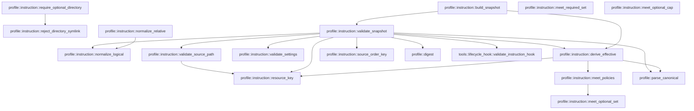

# profile::instruction

[Package atlas](index.md) · [Source](../../src/instruction.rs)

## Declarations

Visibility is the declaration spelling; trait members and reexports require their enclosing interface. `cfg` is not evaluated.

| Symbol | Kind | Visibility | Test / cfg |
|---|---|---|---|
| [profile::instruction::FORMAT](../../src/instruction.rs#L14) | const_item | `private` |  |
| [profile::instruction::MAX_FILES](../../src/instruction.rs#L15) | const_item | `private` |  |
| [profile::instruction::MAX_FILE_BYTES](../../src/instruction.rs#L16) | const_item | `private` |  |
| [profile::instruction::MAX_TOTAL_BYTES](../../src/instruction.rs#L17) | const_item | `private` |  |
| [profile::instruction::MAX_SCANS](../../src/instruction.rs#L18) | const_item | `private` |  |
| [profile::instruction::MAX_SAFE_INTEGER](../../src/instruction.rs#L19) | const_item | `private` |  |
| [profile::instruction::InstructionPolicy](../../src/instruction.rs#L23) | struct_item | `pub` |  |
| [profile::instruction::InstructionSettings](../../src/instruction.rs#L36) | struct_item | `pub` |  |
| [profile::instruction::InstructionSettings::decode](../../src/instruction.rs#L43) | function_item | `pub` |  |
| [profile::instruction::InstructionSettings::canonical_bytes](../../src/instruction.rs#L49) | function_item | `pub` |  |
| [profile::instruction::InstructionKind](../../src/instruction.rs#L57) | enum_item | `pub` |  |
| [profile::instruction::InstructionOrigin](../../src/instruction.rs#L67) | enum_item | `pub` |  |
| [profile::instruction::InstructionSource](../../src/instruction.rs#L75) | struct_item | `pub` |  |
| [profile::instruction::EffectiveInstructions](../../src/instruction.rs#L85) | struct_item | `pub` |  |
| [profile::instruction::InstructionSnapshot](../../src/instruction.rs#L95) | struct_item | `pub` |  |
| [profile::instruction::EffectivePolicy](../../src/instruction.rs#L103) | struct_item | `pub` |  |
| [profile::instruction::EffectivePolicy::digest](../../src/instruction.rs#L111) | function_item | `pub` |  |
| [profile::instruction::LaunchProfile](../../src/instruction.rs#L117) | struct_item | `pub` |  |
| [profile::instruction::LaunchProfile::resolve_and_publish_for_binding](../../src/instruction.rs#L131) | function_item | `pub` |  |
| [profile::instruction::InstructionSnapshot::canonical_bytes](../../src/instruction.rs#L171) | function_item | `pub` |  |
| [profile::instruction::InstructionSnapshot::digest](../../src/instruction.rs#L176) | function_item | `pub` |  |
| [profile::instruction::InstructionSnapshot::decode](../../src/instruction.rs#L180) | function_item | `pub` |  |
| [profile::instruction::InstructionSnapshot::publish](../../src/instruction.rs#L186) | function_item | `pub` |  |
| [profile::instruction::InstructionSnapshot::validate_against_config](../../src/instruction.rs#L199) | function_item | `pub` |  |
| [profile::instruction::InstructionSnapshot::meet_workspace_policy](../../src/instruction.rs#L253) | function_item | `pub` |  |
| [profile::instruction::InstructionResolver](../../src/instruction.rs#L274) | struct_item | `pub` |  |
| [profile::instruction::InstructionResolver::new](../../src/instruction.rs#L282) | function_item | `pub` |  |
| [profile::instruction::InstructionResolver::new_scoped](../../src/instruction.rs#L297) | function_item | `pub` |  |
| [profile::instruction::InstructionResolver::capture](../../src/instruction.rs#L312) | function_item | `pub` |  |
| [profile::instruction::InstructionResolver::capture_with_hook](../../src/instruction.rs#L316) | function_item | `pub` |  |
| [profile::instruction::InstructionResolver::scan](../../src/instruction.rs#L342) | function_item | `private` |  |
| [profile::instruction::scan_origin](../../src/instruction.rs#L403) | function_item | `private` |  |
| [profile::instruction::skill_text_resource](../../src/instruction.rs#L491) | function_item | `private` |  |
| [profile::instruction::collect_files](../../src/instruction.rs#L519) | function_item | `private` |  |
| [profile::instruction::maybe_source](../../src/instruction.rs#L551) | function_item | `private` |  |
| [profile::instruction::read_stable_file](../../src/instruction.rs#L596) | function_item | `private` |  |
| [profile::instruction::reject_directory_symlink](../../src/instruction.rs#L629) | function_item | `private` |  |
| [profile::instruction::require_optional_directory](../../src/instruction.rs#L643) | function_item | `private` |  |
| [profile::instruction::normalize_relative](../../src/instruction.rs#L654) | function_item | `private` |  |
| [profile::instruction::normalize_logical](../../src/instruction.rs#L676) | function_item | `private` |  |
| [profile::instruction::build_snapshot](../../src/instruction.rs#L691) | function_item | `private` |  |
| [profile::instruction::derive_effective](../../src/instruction.rs#L702) | function_item | `private` |  |
| [profile::instruction::resource_key](../../src/instruction.rs#L737) | function_item | `private` |  |
| [profile::instruction::meet_policies](../../src/instruction.rs#L748) | function_item | `private` |  |
| [profile::instruction::meet_optional_set](../../src/instruction.rs#L771) | function_item | `private` |  |
| [profile::instruction::meet_required_set](../../src/instruction.rs#L782) | function_item | `private` |  |
| [profile::instruction::meet_optional_cap](../../src/instruction.rs#L793) | function_item | `private` |  |
| [profile::instruction::validate_settings](../../src/instruction.rs#L801) | function_item | `private` |  |
| [profile::instruction::validate_snapshot](../../src/instruction.rs#L847) | function_item | `private` |  |
| [profile::instruction::validate_source_path](../../src/instruction.rs#L950) | function_item | `private` |  |
| [profile::instruction::source_order_key](../../src/instruction.rs#L970) | function_item | `private` |  |

## Imports / reexports

| Local name | Source path | Visibility |
|---|---|---|
| `BTreeMap` | `std::collections::BTreeMap` | `private` |
| `BTreeSet` | `std::collections::BTreeSet` | `private` |
| `fs` | `std::fs` | `private` |
| `OpenOptions` | `std::fs::OpenOptions` | `private` |
| `Read` | `std::io::Read` | `private` |
| `MetadataExt` | `std::os::unix::fs::MetadataExt` | `private` |
| `OpenOptionsExt` | `std::os::unix::fs::OpenOptionsExt` | `private` |
| `Component` | `std::path::Component` | `private` |
| `Path` | `std::path::Path` | `private` |
| `PathBuf` | `std::path::PathBuf` | `private` |
| `Deserialize` | `serde::Deserialize` | `private` |
| `Serialize` | `serde::Serialize` | `private` |
| `AssetRef` | `store::AssetRef` | `private` |
| `AssetStore` | `store::AssetStore` | `private` |
| `UnicodeNormalization` | `unicode_normalization::UnicodeNormalization` | `private` |
| `WorkspacePolicy` | `crate::config::WorkspacePolicy` | `private` |
| `ProfileError` | `crate::ProfileError` | `private` |
| `canonical_line` | `crate::canonical_line` | `private` |
| `digest` | `crate::digest` | `private` |
| `parse_canonical` | `crate::parse_canonical` | `private` |

## Module declarations

| Module | Visibility | Attributes |
|---|---|---|

## Function call graphs

Edges below are syntactically resolved calls only, including private functions. Graphs partition callers into groups of 20; they are not execution order. All unresolved sites are listed below and in the JSON inventory.

```mermaid
flowchart TD
  n0["profile::instruction::EffectivePolicy::digest"]
  n1["profile::instruction::LaunchProfile::resolve_and_publish_for_binding"]
  n2["profile::instruction::InstructionSnapshot::canonical_bytes"]
  n3["profile::instruction::InstructionSnapshot::digest"]
  n4["profile::instruction::InstructionSnapshot::decode"]
  n5["profile::instruction::InstructionSnapshot::publish"]
  n6["profile::instruction::InstructionSnapshot::validate_against_config"]
  n7["profile::instruction::InstructionSnapshot::meet_workspace_policy"]
  n8["profile::instruction::InstructionResolver::new"]
  n9["profile::instruction::InstructionResolver::new_scoped"]
  n10["profile::instruction::InstructionResolver::capture"]
  n11["profile::instruction::InstructionResolver::capture_with_hook"]
  n12["profile::instruction::InstructionResolver::scan"]
  n13["profile::instruction::scan_origin"]
  n14["profile::instruction::InstructionSettings::decode"]
  n15["profile::instruction::skill_text_resource"]
  n16["profile::instruction::InstructionSettings::canonical_bytes"]
  n17["profile::instruction::collect_files"]
  n18["profile::instruction::maybe_source"]
  n19["profile::instruction::read_stable_file"]
  n20["profile::instruction::require_optional_directory"]
  n21["profile::instruction::normalize_relative"]
  n22["profile::instruction::normalize_logical"]
  n23["profile::instruction::build_snapshot"]
  n24["profile::instruction::meet_required_set"]
  n25["profile::instruction::meet_optional_cap"]
  n26["profile::instruction::validate_settings"]
  n27["profile::instruction::validate_snapshot"]
  n28["profile::canonical_line"]
  n29["profile::digest"]
  n30["profile::parse_canonical"]
  n31["profile::scope::SessionScope::from_parts"]
  n0 --> n28
  n0 --> n29
  n1 --> n31
  n2 --> n27
  n2 --> n28
  n3 --> n2
  n3 --> n29
  n4 --> n27
  n4 --> n30
  n5 --> n2
  n7 --> n24
  n7 --> n25
  n10 --> n11
  n11 --> n12
  n11 --> n23
  n12 --> n13
  n13 --> n15
  n13 --> n17
  n13 --> n18
  n13 --> n20
  n14 --> n26
  n14 --> n30
  n16 --> n26
  n16 --> n28
  n17 --> n17
  n17 --> n20
  n17 --> n21
  n18 --> n19
  n18 --> n22
  n18 --> n26
  n18 --> n29
  n18 --> n30
```

Functions 1–20: 32 direct edges

Functions 21–35: 18 direct edges

## Call sites

Includes test functions (marked in declarations). Receiver-type-required sites need type analysis/manual tracing. Calls in closures are attributed to their enclosing function; their occurrence here does not mean the closure executes immediately.

| Caller | Callee expression | Source lines | Target / classification |
|---|---|---|---|
| `decode` | `parse_canonical` | [44](../../src/instruction.rs#L44) | [profile::parse_canonical](../../src/lib.rs#L67) |
| `decode` | `validate_settings` | [45](../../src/instruction.rs#L45) | [profile::instruction::validate_settings](../../src/instruction.rs#L801) |
| `decode` | `Path::new` | [45](../../src/instruction.rs#L45) | external-constructor-callback-or-unresolved |
| `decode` | `Ok` | [46](../../src/instruction.rs#L46) | external-constructor-callback-or-unresolved |
| `canonical_bytes` | `validate_settings` | [50](../../src/instruction.rs#L50) | [profile::instruction::validate_settings](../../src/instruction.rs#L801) |
| `canonical_bytes` | `Path::new` | [50](../../src/instruction.rs#L50) | external-constructor-callback-or-unresolved |
| `canonical_bytes` | `canonical_line` | [51](../../src/instruction.rs#L51) | [profile::canonical_line](../../src/lib.rs#L112) |
| `digest` | `Ok` | [112](../../src/instruction.rs#L112) | external-constructor-callback-or-unresolved |
| `digest` | `digest` | [112](../../src/instruction.rs#L112) | [profile::digest](../../src/lib.rs#L126) |
| `digest` | `canonical_line` | [112](../../src/instruction.rs#L112) | [profile::canonical_line](../../src/lib.rs#L112) |
| `resolve_and_publish_for_binding` | `assets             .root()             .parent()             .ok_or_else` | [138](../../src/instruction.rs#L138) | receiver-type-required |
| `resolve_and_publish_for_binding` | `assets             .root()             .parent` | [138](../../src/instruction.rs#L138) | receiver-type-required |
| `resolve_and_publish_for_binding` | `assets             .root` | [138](../../src/instruction.rs#L138) | receiver-type-required |
| `resolve_and_publish_for_binding` | `assets.root().to_path_buf` | [142](../../src/instruction.rs#L142) | receiver-type-required |
| `resolve_and_publish_for_binding` | `assets.root` | [142](../../src/instruction.rs#L142) | receiver-type-required |
| `resolve_and_publish_for_binding` | `"thread asset directory has no session folder".to_owned` | [143](../../src/instruction.rs#L143) | receiver-type-required |
| `resolve_and_publish_for_binding` | `crate::SessionScope::from_parts` | [145](../../src/instruction.rs#L145) | [profile::scope::SessionScope::from_parts](../../src/scope.rs#L102) |
| `resolve_and_publish_for_binding` | `folder_binding.map` | [148](../../src/instruction.rs#L148) | receiver-type-required |
| `resolve_and_publish_for_binding` | `scope.config` | [150](../../src/instruction.rs#L150) | receiver-type-required |
| `resolve_and_publish_for_binding` | `scope             .instructions(repository, user_agent_dir.as_ref(), &config)?             .capture` | [151](../../src/instruction.rs#L151) | receiver-type-required |
| `resolve_and_publish_for_binding` | `scope             .instructions` | [151](../../src/instruction.rs#L151) | receiver-type-required |
| `resolve_and_publish_for_binding` | `user_agent_dir.as_ref` | [152](../../src/instruction.rs#L152) | receiver-type-required |
| `resolve_and_publish_for_binding` | `instruction.validate_against_config` | [154](../../src/instruction.rs#L154) | receiver-type-required |
| `resolve_and_publish_for_binding` | `instruction.meet_workspace_policy` | [155](../../src/instruction.rs#L155) | receiver-type-required |
| `resolve_and_publish_for_binding` | `config.publish` | [156](../../src/instruction.rs#L156) | receiver-type-required |
| `resolve_and_publish_for_binding` | `instruction.publish` | [157](../../src/instruction.rs#L157) | receiver-type-required |
| `resolve_and_publish_for_binding` | `Ok` | [158](../../src/instruction.rs#L158) | external-constructor-callback-or-unresolved |
| `canonical_bytes` | `validate_snapshot` | [172](../../src/instruction.rs#L172) | [profile::instruction::validate_snapshot](../../src/instruction.rs#L847) |
| `canonical_bytes` | `canonical_line` | [173](../../src/instruction.rs#L173) | [profile::canonical_line](../../src/lib.rs#L112) |
| `digest` | `Ok` | [177](../../src/instruction.rs#L177) | external-constructor-callback-or-unresolved |
| `digest` | `digest` | [177](../../src/instruction.rs#L177) | [profile::digest](../../src/lib.rs#L126) |
| `digest` | `self.canonical_bytes` | [177](../../src/instruction.rs#L177) | [profile::instruction::InstructionSnapshot::canonical_bytes](../../src/instruction.rs#L171) |
| `decode` | `parse_canonical` | [181](../../src/instruction.rs#L181) | [profile::parse_canonical](../../src/lib.rs#L67) |
| `decode` | `validate_snapshot` | [182](../../src/instruction.rs#L182) | [profile::instruction::validate_snapshot](../../src/instruction.rs#L847) |
| `decode` | `Ok` | [183](../../src/instruction.rs#L183) | external-constructor-callback-or-unresolved |
| `publish` | `self.canonical_bytes` | [187](../../src/instruction.rs#L187) | [profile::instruction::InstructionSnapshot::canonical_bytes](../../src/instruction.rs#L171) |
| `publish` | `digest` | [188](../../src/instruction.rs#L188) | external-constructor-callback-or-unresolved |
| `publish` | `assets.publish` | [189](../../src/instruction.rs#L189) | receiver-type-required |
| `publish` | `Err` | [191](../../src/instruction.rs#L191) | external-constructor-callback-or-unresolved |
| `publish` | `Ok` | [196](../../src/instruction.rs#L196) | external-constructor-callback-or-unresolved |
| `validate_against_config` | `usize::try_from(workspace_index).map_err` | [205](../../src/instruction.rs#L205) | receiver-type-required |
| `validate_against_config` | `usize::try_from` | [205](../../src/instruction.rs#L205) | external-constructor-callback-or-unresolved |
| `validate_against_config` | `PathBuf::from` | [207](../../src/instruction.rs#L207), [215](../../src/instruction.rs#L215), [227](../../src/instruction.rs#L227), [232](../../src/instruction.rs#L232), [243](../../src/instruction.rs#L243) | external-constructor-callback-or-unresolved |
| `validate_against_config` | `config.workspace.cwd.len` | [213](../../src/instruction.rs#L213) | receiver-type-required |
| `validate_against_config` | `Err` | [214](../../src/instruction.rs#L214), [231](../../src/instruction.rs#L231), [242](../../src/instruction.rs#L242) | external-constructor-callback-or-unresolved |
| `validate_against_config` | `fs::canonicalize(root).map_err` | [226](../../src/instruction.rs#L226) | receiver-type-required |
| `validate_against_config` | `fs::canonicalize` | [226](../../src/instruction.rs#L226) | external-constructor-callback-or-unresolved |
| `validate_against_config` | `error.to_string` | [228](../../src/instruction.rs#L228) | receiver-type-required |
| `validate_against_config` | `canonical.to_str` | [230](../../src/instruction.rs#L230) | receiver-type-required |
| `validate_against_config` | `Some` | [230](../../src/instruction.rs#L230) | external-constructor-callback-or-unresolved |
| `validate_against_config` | `root.as_str` | [230](../../src/instruction.rs#L230) | receiver-type-required |
| `validate_against_config` | `"instruction writable root is not canonical".to_owned` | [233](../../src/instruction.rs#L233) | receiver-type-required |
| `validate_against_config` | `config                     .workspace                     .cwd                     .iter()                     .any` | [236](../../src/instruction.rs#L236) | receiver-type-required |
| `validate_against_config` | `config                     .workspace                     .cwd                     .iter` | [236](../../src/instruction.rs#L236) | receiver-type-required |
| `validate_against_config` | `canonical.starts_with` | [240](../../src/instruction.rs#L240) | receiver-type-required |
| `validate_against_config` | `Ok` | [249](../../src/instruction.rs#L249) | external-constructor-callback-or-unresolved |
| `meet_workspace_policy` | `instruction.network.unwrap_or` | [256](../../src/instruction.rs#L256) | receiver-type-required |
| `meet_workspace_policy` | `meet_required_set` | [257](../../src/instruction.rs#L257), [261](../../src/instruction.rs#L261) | [profile::instruction::meet_required_set](../../src/instruction.rs#L782) |
| `meet_workspace_policy` | `instruction.allowed_tools.as_deref` | [259](../../src/instruction.rs#L259) | receiver-type-required |
| `meet_workspace_policy` | `instruction.writable_roots.as_deref` | [263](../../src/instruction.rs#L263) | receiver-type-required |
| `meet_workspace_policy` | `meet_optional_cap` | [265](../../src/instruction.rs#L265) | [profile::instruction::meet_optional_cap](../../src/instruction.rs#L793) |
| `new` | `user_agent_dir.as_ref().to_path_buf` | [287](../../src/instruction.rs#L287) | receiver-type-required |
| `new` | `user_agent_dir.as_ref` | [287](../../src/instruction.rs#L287) | receiver-type-required |
| `new` | `cwd                 .into_iter()                 .map(&#124;value&#124; value.as_ref().to_path_buf())                 .collect` | [289](../../src/instruction.rs#L289) | receiver-type-required |
| `new` | `cwd                 .into_iter()                 .map` | [289](../../src/instruction.rs#L289) | receiver-type-required |
| `new` | `cwd                 .into_iter` | [289](../../src/instruction.rs#L289) | receiver-type-required |
| `new` | `value.as_ref().to_path_buf` | [291](../../src/instruction.rs#L291) | receiver-type-required |
| `new` | `value.as_ref` | [291](../../src/instruction.rs#L291) | receiver-type-required |
| `new_scoped` | `user_data_dir.as_ref().to_path_buf` | [303](../../src/instruction.rs#L303) | receiver-type-required |
| `new_scoped` | `user_data_dir.as_ref` | [303](../../src/instruction.rs#L303) | receiver-type-required |
| `new_scoped` | `Some` | [304](../../src/instruction.rs#L304) | external-constructor-callback-or-unresolved |
| `new_scoped` | `workspace_data_dir.as_ref().to_path_buf` | [304](../../src/instruction.rs#L304) | receiver-type-required |
| `new_scoped` | `workspace_data_dir.as_ref` | [304](../../src/instruction.rs#L304) | receiver-type-required |
| `new_scoped` | `cwd                 .into_iter()                 .map(&#124;value&#124; value.as_ref().to_path_buf())                 .collect` | [305](../../src/instruction.rs#L305) | receiver-type-required |
| `new_scoped` | `cwd                 .into_iter()                 .map` | [305](../../src/instruction.rs#L305) | receiver-type-required |
| `new_scoped` | `cwd                 .into_iter` | [305](../../src/instruction.rs#L305) | receiver-type-required |
| `new_scoped` | `value.as_ref().to_path_buf` | [307](../../src/instruction.rs#L307) | receiver-type-required |
| `new_scoped` | `value.as_ref` | [307](../../src/instruction.rs#L307) | receiver-type-required |
| `capture` | `self.capture_with_hook` | [313](../../src/instruction.rs#L313) | [profile::instruction::InstructionResolver::capture_with_hook](../../src/instruction.rs#L316) |
| `capture_with_hook` | `self.scan` | [322](../../src/instruction.rs#L322) | [profile::instruction::InstructionResolver::scan](../../src/instruction.rs#L342) |
| `capture_with_hook` | `after_scan` | [325](../../src/instruction.rs#L325), [331](../../src/instruction.rs#L331) | external-constructor-callback-or-unresolved |
| `capture_with_hook` | `Err` | [329](../../src/instruction.rs#L329), [337](../../src/instruction.rs#L337) | external-constructor-callback-or-unresolved |
| `capture_with_hook` | `previous.as_ref` | [332](../../src/instruction.rs#L332) | receiver-type-required |
| `capture_with_hook` | `Some` | [332](../../src/instruction.rs#L332), [335](../../src/instruction.rs#L335) | external-constructor-callback-or-unresolved |
| `capture_with_hook` | `build_snapshot` | [333](../../src/instruction.rs#L333) | [profile::instruction::build_snapshot](../../src/instruction.rs#L691) |
| `scan` | `Vec::new` | [343](../../src/instruction.rs#L343) | external-constructor-callback-or-unresolved |
| `scan` | `scan_origin` | [344](../../src/instruction.rs#L344), [351](../../src/instruction.rs#L351), [364](../../src/instruction.rs#L364) | [profile::instruction::scan_origin](../../src/instruction.rs#L403) |
| `scan` | `self.cwd.iter().enumerate` | [353](../../src/instruction.rs#L353) | receiver-type-required |
| `scan` | `self.cwd.iter` | [353](../../src/instruction.rs#L353) | receiver-type-required |
| `scan` | `fs::canonicalize(cwd).map_err` | [354](../../src/instruction.rs#L354) | receiver-type-required |
| `scan` | `fs::canonicalize` | [354](../../src/instruction.rs#L354) | external-constructor-callback-or-unresolved |
| `scan` | `cwd.clone` | [355](../../src/instruction.rs#L355) | receiver-type-required |
| `scan` | `error.to_string` | [356](../../src/instruction.rs#L356) | receiver-type-required |
| `scan` | `canonical.is_dir` | [358](../../src/instruction.rs#L358) | receiver-type-required |
| `scan` | `Err` | [359](../../src/instruction.rs#L359), [374](../../src/instruction.rs#L374), [381](../../src/instruction.rs#L381), [392](../../src/instruction.rs#L392) | external-constructor-callback-or-unresolved |
| `scan` | `"workspace cwd is not a directory".to_owned` | [361](../../src/instruction.rs#L361) | receiver-type-required |
| `scan` | `sources.len` | [373](../../src/instruction.rs#L373) | receiver-type-required |
| `scan` | `ProfileError::LimitExceeded` | [374](../../src/instruction.rs#L374), [381](../../src/instruction.rs#L381) | external-constructor-callback-or-unresolved |
| `scan` | `sources             .iter()             .map(&#124;source&#124; source.content.len() as u64)             .sum::<u64>` | [376](../../src/instruction.rs#L376) | receiver-type-required |
| `scan` | `sources             .iter()             .map` | [376](../../src/instruction.rs#L376) | receiver-type-required |
| `scan` | `sources             .iter` | [376](../../src/instruction.rs#L376) | receiver-type-required |
| `scan` | `source.content.len` | [378](../../src/instruction.rs#L378) | receiver-type-required |
| `scan` | `BTreeSet::new` | [385](../../src/instruction.rs#L385) | external-constructor-callback-or-unresolved |
| `scan` | `identities.insert` | [387](../../src/instruction.rs#L387) | receiver-type-required |
| `scan` | `source.origin.clone` | [388](../../src/instruction.rs#L388) | receiver-type-required |
| `scan` | `source.kind.clone` | [389](../../src/instruction.rs#L389) | receiver-type-required |
| `scan` | `source.path.clone` | [390](../../src/instruction.rs#L390) | receiver-type-required |
| `scan` | `PathBuf::from` | [393](../../src/instruction.rs#L393) | external-constructor-callback-or-unresolved |
| `scan` | `"instruction paths collide after NFC normalization".to_owned` | [394](../../src/instruction.rs#L394) | receiver-type-required |
| `scan` | `sources.sort_by_key` | [398](../../src/instruction.rs#L398) | receiver-type-required |
| `scan` | `Ok` | [399](../../src/instruction.rs#L399) | external-constructor-callback-or-unresolved |
| `scan_origin` | `require_optional_directory` | [409](../../src/instruction.rs#L409), [424](../../src/instruction.rs#L424), [428](../../src/instruction.rs#L428), [435](../../src/instruction.rs#L435) | [profile::instruction::require_optional_directory](../../src/instruction.rs#L643) |
| `scan_origin` | `Ok` | [410](../../src/instruction.rs#L410), [436](../../src/instruction.rs#L436), [488](../../src/instruction.rs#L488) | external-constructor-callback-or-unresolved |
| `scan_origin` | `root.join` | [412](../../src/instruction.rs#L412), [423](../../src/instruction.rs#L423), [427](../../src/instruction.rs#L427), [431](../../src/instruction.rs#L431) | receiver-type-required |
| `scan_origin` | `maybe_source` | [413](../../src/instruction.rs#L413), [438](../../src/instruction.rs#L438), [458](../../src/instruction.rs#L458), [478](../../src/instruction.rs#L478) | [profile::instruction::maybe_source](../../src/instruction.rs#L551) |
| `scan_origin` | `root.to_path_buf` | [421](../../src/instruction.rs#L421) | receiver-type-required |
| `scan_origin` | `agent.join` | [439](../../src/instruction.rs#L439), [450](../../src/instruction.rs#L450), [473](../../src/instruction.rs#L473) | receiver-type-required |
| `scan_origin` | `Vec::new` | [451](../../src/instruction.rs#L451), [474](../../src/instruction.rs#L474) | external-constructor-callback-or-unresolved |
| `scan_origin` | `collect_files` | [452](../../src/instruction.rs#L452), [475](../../src/instruction.rs#L475) | [profile::instruction::collect_files](../../src/instruction.rs#L519) |
| `scan_origin` | `files.sort_by` | [453](../../src/instruction.rs#L453), [476](../../src/instruction.rs#L476) | receiver-type-required |
| `scan_origin` | `left.0.as_bytes().cmp` | [453](../../src/instruction.rs#L453), [476](../../src/instruction.rs#L476) | receiver-type-required |
| `scan_origin` | `left.0.as_bytes` | [453](../../src/instruction.rs#L453), [476](../../src/instruction.rs#L476) | receiver-type-required |
| `scan_origin` | `right.0.as_bytes` | [453](../../src/instruction.rs#L453), [476](../../src/instruction.rs#L476) | receiver-type-required |
| `scan_origin` | `skill_text_resource` | [455](../../src/instruction.rs#L455) | [profile::instruction::skill_text_resource](../../src/instruction.rs#L491) |
| `scan_origin` | `kind.clone` | [461](../../src/instruction.rs#L461) | receiver-type-required |
| `scan_origin` | `agent             .file_name()             .is_some_and` | [468](../../src/instruction.rs#L468) | receiver-type-required |
| `scan_origin` | `agent             .file_name` | [468](../../src/instruction.rs#L468) | receiver-type-required |
| `skill_text_resource` | `relative.split('/').any` | [492](../../src/instruction.rs#L492) | receiver-type-required |
| `skill_text_resource` | `relative.split` | [492](../../src/instruction.rs#L492) | receiver-type-required |
| `skill_text_resource` | `part.starts_with` | [492](../../src/instruction.rs#L492) | receiver-type-required |
| `collect_files` | `require_optional_directory` | [524](../../src/instruction.rs#L524) | [profile::instruction::require_optional_directory](../../src/instruction.rs#L643) |
| `collect_files` | `Ok` | [525](../../src/instruction.rs#L525), [548](../../src/instruction.rs#L548) | external-constructor-callback-or-unresolved |
| `collect_files` | `fs::read_dir` | [527](../../src/instruction.rs#L527) | external-constructor-callback-or-unresolved |
| `collect_files` | `entry.path` | [529](../../src/instruction.rs#L529) | receiver-type-required |
| `collect_files` | `fs::symlink_metadata` | [530](../../src/instruction.rs#L530) | external-constructor-callback-or-unresolved |
| `collect_files` | `metadata.file_type().is_symlink` | [531](../../src/instruction.rs#L531) | receiver-type-required |
| `collect_files` | `metadata.file_type` | [531](../../src/instruction.rs#L531) | receiver-type-required |
| `collect_files` | `Err` | [532](../../src/instruction.rs#L532), [545](../../src/instruction.rs#L545) | external-constructor-callback-or-unresolved |
| `collect_files` | `ProfileError::Symlink` | [532](../../src/instruction.rs#L532) | external-constructor-callback-or-unresolved |
| `collect_files` | `metadata.is_dir` | [534](../../src/instruction.rs#L534) | receiver-type-required |
| `collect_files` | `collect_files` | [535](../../src/instruction.rs#L535) | [profile::instruction::collect_files](../../src/instruction.rs#L519) |
| `collect_files` | `metadata.is_file` | [536](../../src/instruction.rs#L536) | receiver-type-required |
| `collect_files` | `path                 .strip_prefix(root)                 .map_err` | [537](../../src/instruction.rs#L537) | receiver-type-required |
| `collect_files` | `path                 .strip_prefix` | [537](../../src/instruction.rs#L537) | receiver-type-required |
| `collect_files` | `path.clone` | [540](../../src/instruction.rs#L540) | receiver-type-required |
| `collect_files` | `"instruction path escaped its kind directory".to_owned` | [541](../../src/instruction.rs#L541) | receiver-type-required |
| `collect_files` | `output.push` | [543](../../src/instruction.rs#L543) | receiver-type-required |
| `collect_files` | `normalize_relative` | [543](../../src/instruction.rs#L543) | [profile::instruction::normalize_relative](../../src/instruction.rs#L654) |
| `collect_files` | `ProfileError::NotRegular` | [545](../../src/instruction.rs#L545) | external-constructor-callback-or-unresolved |
| `maybe_source` | `fs::symlink_metadata` | [558](../../src/instruction.rs#L558) | external-constructor-callback-or-unresolved |
| `maybe_source` | `metadata.file_type().is_symlink` | [560](../../src/instruction.rs#L560) | receiver-type-required |
| `maybe_source` | `metadata.file_type` | [560](../../src/instruction.rs#L560) | receiver-type-required |
| `maybe_source` | `Err` | [561](../../src/instruction.rs#L561), [564](../../src/instruction.rs#L564), [568](../../src/instruction.rs#L568), [576](../../src/instruction.rs#L576) | external-constructor-callback-or-unresolved |
| `maybe_source` | `ProfileError::Symlink` | [561](../../src/instruction.rs#L561) | external-constructor-callback-or-unresolved |
| `maybe_source` | `file.to_path_buf` | [561](../../src/instruction.rs#L561), [564](../../src/instruction.rs#L564), [572](../../src/instruction.rs#L572), [577](../../src/instruction.rs#L577) | receiver-type-required |
| `maybe_source` | `metadata.is_file` | [563](../../src/instruction.rs#L563) | receiver-type-required |
| `maybe_source` | `ProfileError::NotRegular` | [564](../../src/instruction.rs#L564) | external-constructor-callback-or-unresolved |
| `maybe_source` | `error.kind` | [567](../../src/instruction.rs#L567) | receiver-type-required |
| `maybe_source` | `Ok` | [567](../../src/instruction.rs#L567), [593](../../src/instruction.rs#L593) | external-constructor-callback-or-unresolved |
| `maybe_source` | `error.into` | [568](../../src/instruction.rs#L568) | receiver-type-required |
| `maybe_source` | `read_stable_file` | [570](../../src/instruction.rs#L570) | [profile::instruction::read_stable_file](../../src/instruction.rs#L596) |
| `maybe_source` | `String::from_utf8(bytes.clone()).map_err` | [571](../../src/instruction.rs#L571) | receiver-type-required |
| `maybe_source` | `String::from_utf8` | [571](../../src/instruction.rs#L571) | external-constructor-callback-or-unresolved |
| `maybe_source` | `bytes.clone` | [571](../../src/instruction.rs#L571) | receiver-type-required |
| `maybe_source` | `"instruction content is not UTF-8".to_owned` | [573](../../src/instruction.rs#L573) | receiver-type-required |
| `maybe_source` | `content.contains` | [575](../../src/instruction.rs#L575) | receiver-type-required |
| `maybe_source` | `"instruction content contains NUL".to_owned` | [578](../../src/instruction.rs#L578) | receiver-type-required |
| `maybe_source` | `parse_canonical` | [582](../../src/instruction.rs#L582) | [profile::parse_canonical](../../src/lib.rs#L67) |
| `maybe_source` | `validate_settings` | [583](../../src/instruction.rs#L583) | [profile::instruction::validate_settings](../../src/instruction.rs#L801) |
| `maybe_source` | `normalize_logical` | [585](../../src/instruction.rs#L585) | [profile::instruction::normalize_logical](../../src/instruction.rs#L676) |
| `maybe_source` | `sources.push` | [586](../../src/instruction.rs#L586) | receiver-type-required |
| `maybe_source` | `origin.clone` | [587](../../src/instruction.rs#L587) | receiver-type-required |
| `maybe_source` | `digest` | [591](../../src/instruction.rs#L591) | [profile::digest](../../src/lib.rs#L126) |
| `read_stable_file` | `OpenOptions::new()         .read(true)         .custom_flags(libc::O_CLOEXEC &#124; libc::O_NOFOLLOW)         .open` | [597](../../src/instruction.rs#L597) | receiver-type-required |
| `read_stable_file` | `OpenOptions::new()         .read(true)         .custom_flags` | [597](../../src/instruction.rs#L597) | receiver-type-required |
| `read_stable_file` | `OpenOptions::new()         .read` | [597](../../src/instruction.rs#L597) | receiver-type-required |
| `read_stable_file` | `OpenOptions::new` | [597](../../src/instruction.rs#L597) | external-constructor-callback-or-unresolved |
| `read_stable_file` | `file.metadata` | [601](../../src/instruction.rs#L601), [612](../../src/instruction.rs#L612) | receiver-type-required |
| `read_stable_file` | `before.is_file` | [602](../../src/instruction.rs#L602) | receiver-type-required |
| `read_stable_file` | `Err` | [603](../../src/instruction.rs#L603), [606](../../src/instruction.rs#L606), [615](../../src/instruction.rs#L615), [624](../../src/instruction.rs#L624) | external-constructor-callback-or-unresolved |
| `read_stable_file` | `ProfileError::NotRegular` | [603](../../src/instruction.rs#L603) | external-constructor-callback-or-unresolved |
| `read_stable_file` | `path.to_path_buf` | [603](../../src/instruction.rs#L603) | receiver-type-required |
| `read_stable_file` | `before.len` | [605](../../src/instruction.rs#L605), [610](../../src/instruction.rs#L610), [619](../../src/instruction.rs#L619) | receiver-type-required |
| `read_stable_file` | `ProfileError::LimitExceeded` | [606](../../src/instruction.rs#L606) | external-constructor-callback-or-unresolved |
| `read_stable_file` | `Vec::with_capacity` | [610](../../src/instruction.rs#L610) | external-constructor-callback-or-unresolved |
| `read_stable_file` | `file.read_to_end` | [611](../../src/instruction.rs#L611) | receiver-type-required |
| `read_stable_file` | `fs::symlink_metadata` | [613](../../src/instruction.rs#L613) | external-constructor-callback-or-unresolved |
| `read_stable_file` | `named.file_type().is_symlink` | [614](../../src/instruction.rs#L614) | receiver-type-required |
| `read_stable_file` | `named.file_type` | [614](../../src/instruction.rs#L614) | receiver-type-required |
| `read_stable_file` | `before.dev` | [617](../../src/instruction.rs#L617) | receiver-type-required |
| `read_stable_file` | `after.dev` | [617](../../src/instruction.rs#L617), [621](../../src/instruction.rs#L621) | receiver-type-required |
| `read_stable_file` | `before.ino` | [618](../../src/instruction.rs#L618) | receiver-type-required |
| `read_stable_file` | `after.ino` | [618](../../src/instruction.rs#L618), [622](../../src/instruction.rs#L622) | receiver-type-required |
| `read_stable_file` | `after.len` | [619](../../src/instruction.rs#L619) | receiver-type-required |
| `read_stable_file` | `before.modified` | [620](../../src/instruction.rs#L620) | receiver-type-required |
| `read_stable_file` | `after.modified` | [620](../../src/instruction.rs#L620) | receiver-type-required |
| `read_stable_file` | `named.dev` | [621](../../src/instruction.rs#L621) | receiver-type-required |
| `read_stable_file` | `named.ino` | [622](../../src/instruction.rs#L622) | receiver-type-required |
| `read_stable_file` | `Ok` | [626](../../src/instruction.rs#L626) | external-constructor-callback-or-unresolved |
| `reject_directory_symlink` | `fs::symlink_metadata` | [630](../../src/instruction.rs#L630) | external-constructor-callback-or-unresolved |
| `reject_directory_symlink` | `metadata.file_type().is_symlink` | [631](../../src/instruction.rs#L631) | receiver-type-required |
| `reject_directory_symlink` | `metadata.file_type` | [631](../../src/instruction.rs#L631) | receiver-type-required |
| `reject_directory_symlink` | `Err` | [632](../../src/instruction.rs#L632), [634](../../src/instruction.rs#L634) | external-constructor-callback-or-unresolved |
| `reject_directory_symlink` | `ProfileError::Symlink` | [632](../../src/instruction.rs#L632) | external-constructor-callback-or-unresolved |
| `reject_directory_symlink` | `path.to_path_buf` | [632](../../src/instruction.rs#L632), [635](../../src/instruction.rs#L635) | receiver-type-required |
| `reject_directory_symlink` | `metadata.is_dir` | [633](../../src/instruction.rs#L633) | receiver-type-required |
| `reject_directory_symlink` | `"expected instruction directory".to_owned` | [636](../../src/instruction.rs#L636) | receiver-type-required |
| `reject_directory_symlink` | `Ok` | [639](../../src/instruction.rs#L639) | external-constructor-callback-or-unresolved |
| `require_optional_directory` | `fs::symlink_metadata` | [644](../../src/instruction.rs#L644) | external-constructor-callback-or-unresolved |
| `require_optional_directory` | `reject_directory_symlink` | [646](../../src/instruction.rs#L646) | [profile::instruction::reject_directory_symlink](../../src/instruction.rs#L629) |
| `require_optional_directory` | `Ok` | [647](../../src/instruction.rs#L647), [649](../../src/instruction.rs#L649) | external-constructor-callback-or-unresolved |
| `require_optional_directory` | `error.kind` | [649](../../src/instruction.rs#L649) | receiver-type-required |
| `require_optional_directory` | `Err` | [650](../../src/instruction.rs#L650) | external-constructor-callback-or-unresolved |
| `require_optional_directory` | `error.into` | [650](../../src/instruction.rs#L650) | receiver-type-required |
| `normalize_relative` | `Vec::new` | [655](../../src/instruction.rs#L655) | external-constructor-callback-or-unresolved |
| `normalize_relative` | `path.components` | [656](../../src/instruction.rs#L656) | receiver-type-required |
| `normalize_relative` | `value.to_str().ok_or_else` | [659](../../src/instruction.rs#L659) | receiver-type-required |
| `normalize_relative` | `value.to_str` | [659](../../src/instruction.rs#L659) | receiver-type-required |
| `normalize_relative` | `path.to_path_buf` | [660](../../src/instruction.rs#L660), [667](../../src/instruction.rs#L667) | receiver-type-required |
| `normalize_relative` | `"instruction path is not UTF-8".to_owned` | [661](../../src/instruction.rs#L661) | receiver-type-required |
| `normalize_relative` | `values.push` | [663](../../src/instruction.rs#L663) | receiver-type-required |
| `normalize_relative` | `value.nfc().collect::<String>` | [663](../../src/instruction.rs#L663) | receiver-type-required |
| `normalize_relative` | `value.nfc` | [663](../../src/instruction.rs#L663) | receiver-type-required |
| `normalize_relative` | `Err` | [666](../../src/instruction.rs#L666) | external-constructor-callback-or-unresolved |
| `normalize_relative` | `"instruction path contains a non-normal component".to_owned` | [668](../../src/instruction.rs#L668) | receiver-type-required |
| `normalize_relative` | `normalize_logical` | [673](../../src/instruction.rs#L673) | [profile::instruction::normalize_logical](../../src/instruction.rs#L676) |
| `normalize_relative` | `values.join` | [673](../../src/instruction.rs#L673) | receiver-type-required |
| `normalize_logical` | `path.is_empty` | [677](../../src/instruction.rs#L677) | receiver-type-required |
| `normalize_logical` | `path.contains` | [678](../../src/instruction.rs#L678) | receiver-type-required |
| `normalize_logical` | `path             .split('/')             .any` | [679](../../src/instruction.rs#L679) | receiver-type-required |
| `normalize_logical` | `path             .split` | [679](../../src/instruction.rs#L679) | receiver-type-required |
| `normalize_logical` | `part.is_empty` | [681](../../src/instruction.rs#L681) | receiver-type-required |
| `normalize_logical` | `Err` | [683](../../src/instruction.rs#L683) | external-constructor-callback-or-unresolved |
| `normalize_logical` | `PathBuf::from` | [684](../../src/instruction.rs#L684) | external-constructor-callback-or-unresolved |
| `normalize_logical` | `"invalid logical instruction path".to_owned` | [685](../../src/instruction.rs#L685) | receiver-type-required |
| `normalize_logical` | `Ok` | [688](../../src/instruction.rs#L688) | external-constructor-callback-or-unresolved |
| `normalize_logical` | `path.nfc().collect` | [688](../../src/instruction.rs#L688) | receiver-type-required |
| `normalize_logical` | `path.nfc` | [688](../../src/instruction.rs#L688) | receiver-type-required |
| `build_snapshot` | `derive_effective` | [692](../../src/instruction.rs#L692) | [profile::instruction::derive_effective](../../src/instruction.rs#L702) |
| `build_snapshot` | `validate_snapshot` | [698](../../src/instruction.rs#L698) | [profile::instruction::validate_snapshot](../../src/instruction.rs#L847) |
| `build_snapshot` | `Ok` | [699](../../src/instruction.rs#L699) | external-constructor-callback-or-unresolved |
| `derive_effective` | `EffectiveInstructions::default` | [703](../../src/instruction.rs#L703) | external-constructor-callback-or-unresolved |
| `derive_effective` | `Vec::new` | [704](../../src/instruction.rs#L704) | external-constructor-callback-or-unresolved |
| `derive_effective` | `sources.iter().enumerate` | [705](../../src/instruction.rs#L705) | receiver-type-required |
| `derive_effective` | `sources.iter` | [705](../../src/instruction.rs#L705) | receiver-type-required |
| `derive_effective` | `effective.agents.push` | [708](../../src/instruction.rs#L708) | receiver-type-required |
| `derive_effective` | `effective                     .skills                     .insert` | [710](../../src/instruction.rs#L710) | receiver-type-required |
| `derive_effective` | `resource_key` | [712](../../src/instruction.rs#L712), [717](../../src/instruction.rs#L717), [722](../../src/instruction.rs#L722) | [profile::instruction::resource_key](../../src/instruction.rs#L737) |
| `derive_effective` | `effective                     .commands                     .insert` | [715](../../src/instruction.rs#L715) | receiver-type-required |
| `derive_effective` | `effective                     .hooks                     .insert` | [720](../../src/instruction.rs#L720) | receiver-type-required |
| `derive_effective` | `parse_canonical` | [726](../../src/instruction.rs#L726) | [profile::parse_canonical](../../src/lib.rs#L67) |
| `derive_effective` | `PathBuf::from` | [726](../../src/instruction.rs#L726) | external-constructor-callback-or-unresolved |
| `derive_effective` | `source.content.as_bytes` | [726](../../src/instruction.rs#L726) | receiver-type-required |
| `derive_effective` | `policies.push` | [728](../../src/instruction.rs#L728) | receiver-type-required |
| `derive_effective` | `meet_policies` | [733](../../src/instruction.rs#L733) | [profile::instruction::meet_policies](../../src/instruction.rs#L748) |
| `derive_effective` | `Ok` | [734](../../src/instruction.rs#L734) | external-constructor-callback-or-unresolved |
| `resource_key` | `source         .path         .strip_prefix(prefix)         .map(ToOwned::to_owned)         .ok_or_else` | [738](../../src/instruction.rs#L738) | receiver-type-required |
| `resource_key` | `source         .path         .strip_prefix(prefix)         .map` | [738](../../src/instruction.rs#L738) | receiver-type-required |
| `resource_key` | `source         .path         .strip_prefix` | [738](../../src/instruction.rs#L738) | receiver-type-required |
| `resource_key` | `PathBuf::from` | [743](../../src/instruction.rs#L743) | external-constructor-callback-or-unresolved |
| `meet_policies` | `Some` | [755](../../src/instruction.rs#L755), [760](../../src/instruction.rs#L760) | external-constructor-callback-or-unresolved |
| `meet_policies` | `network.unwrap_or` | [755](../../src/instruction.rs#L755) | receiver-type-required |
| `meet_policies` | `meet_optional_set` | [757](../../src/instruction.rs#L757), [758](../../src/instruction.rs#L758) | [profile::instruction::meet_optional_set](../../src/instruction.rs#L771) |
| `meet_policies` | `cap.map_or` | [760](../../src/instruction.rs#L760) | receiver-type-required |
| `meet_policies` | `current.min` | [760](../../src/instruction.rs#L760) | receiver-type-required |
| `meet_policies` | `tools.map` | [765](../../src/instruction.rs#L765) | receiver-type-required |
| `meet_policies` | `value.into_iter().collect` | [765](../../src/instruction.rs#L765), [766](../../src/instruction.rs#L766) | receiver-type-required |
| `meet_policies` | `value.into_iter` | [765](../../src/instruction.rs#L765), [766](../../src/instruction.rs#L766) | receiver-type-required |
| `meet_policies` | `roots.map` | [766](../../src/instruction.rs#L766) | receiver-type-required |
| `meet_optional_set` | `value.into_iter().collect::<BTreeSet<_>>` | [775](../../src/instruction.rs#L775) | receiver-type-required |
| `meet_optional_set` | `value.into_iter` | [775](../../src/instruction.rs#L775) | receiver-type-required |
| `meet_optional_set` | `Some` | [776](../../src/instruction.rs#L776) | external-constructor-callback-or-unresolved |
| `meet_optional_set` | `target.take` | [776](../../src/instruction.rs#L776) | receiver-type-required |
| `meet_optional_set` | `current.intersection(&value).cloned().collect` | [777](../../src/instruction.rs#L777) | receiver-type-required |
| `meet_optional_set` | `current.intersection(&value).cloned` | [777](../../src/instruction.rs#L777) | receiver-type-required |
| `meet_optional_set` | `current.intersection` | [777](../../src/instruction.rs#L777) | receiver-type-required |
| `meet_required_set` | `required.iter().cloned().collect::<BTreeSet<_>>` | [783](../../src/instruction.rs#L783) | receiver-type-required |
| `meet_required_set` | `required.iter().cloned` | [783](../../src/instruction.rs#L783) | receiver-type-required |
| `meet_required_set` | `required.iter` | [783](../../src/instruction.rs#L783) | receiver-type-required |
| `meet_required_set` | `constraint.iter().cloned().collect::<BTreeSet<_>>` | [786](../../src/instruction.rs#L786) | receiver-type-required |
| `meet_required_set` | `constraint.iter().cloned` | [786](../../src/instruction.rs#L786) | receiver-type-required |
| `meet_required_set` | `constraint.iter` | [786](../../src/instruction.rs#L786) | receiver-type-required |
| `meet_required_set` | `required.intersection(&constraint).cloned().collect` | [787](../../src/instruction.rs#L787) | receiver-type-required |
| `meet_required_set` | `required.intersection(&constraint).cloned` | [787](../../src/instruction.rs#L787) | receiver-type-required |
| `meet_required_set` | `required.intersection` | [787](../../src/instruction.rs#L787) | receiver-type-required |
| `meet_required_set` | `required.into_iter().collect` | [789](../../src/instruction.rs#L789) | receiver-type-required |
| `meet_required_set` | `required.into_iter` | [789](../../src/instruction.rs#L789) | receiver-type-required |
| `meet_optional_cap` | `Some` | [795](../../src/instruction.rs#L795), [796](../../src/instruction.rs#L796) | external-constructor-callback-or-unresolved |
| `meet_optional_cap` | `left.min` | [795](../../src/instruction.rs#L795) | receiver-type-required |
| `validate_settings` | `Err` | [803](../../src/instruction.rs#L803), [810](../../src/instruction.rs#L810), [819](../../src/instruction.rs#L819), [829](../../src/instruction.rs#L829), [837](../../src/instruction.rs#L837) | external-constructor-callback-or-unresolved |
| `validate_settings` | `path.to_path_buf` | [804](../../src/instruction.rs#L804), [811](../../src/instruction.rs#L811), [820](../../src/instruction.rs#L820), [830](../../src/instruction.rs#L830), [838](../../src/instruction.rs#L838) | receiver-type-required |
| `validate_settings` | `Some` | [809](../../src/instruction.rs#L809) | external-constructor-callback-or-unresolved |
| `validate_settings` | `"max_wall_seconds must be at least 1".to_owned` | [812](../../src/instruction.rs#L812) | receiver-type-required |
| `validate_settings` | `policy             .max_wall_seconds             .is_some_and` | [815](../../src/instruction.rs#L815) | receiver-type-required |
| `validate_settings` | `"max_wall_seconds exceeds the I-JSON safe-integer range".to_owned` | [821](../../src/instruction.rs#L821) | receiver-type-required |
| `validate_settings` | `[&policy.allowed_tools, &policy.writable_roots]             .into_iter()             .flatten` | [824](../../src/instruction.rs#L824) | receiver-type-required |
| `validate_settings` | `[&policy.allowed_tools, &policy.writable_roots]             .into_iter` | [824](../../src/instruction.rs#L824) | receiver-type-required |
| `validate_settings` | `values.iter().collect::<BTreeSet<_>>().len` | [828](../../src/instruction.rs#L828) | receiver-type-required |
| `validate_settings` | `values.iter().collect::<BTreeSet<_>>` | [828](../../src/instruction.rs#L828) | receiver-type-required |
| `validate_settings` | `values.iter` | [828](../../src/instruction.rs#L828) | receiver-type-required |
| `validate_settings` | `values.len` | [828](../../src/instruction.rs#L828) | receiver-type-required |
| `validate_settings` | `"instruction policy set contains duplicates".to_owned` | [831](../../src/instruction.rs#L831) | receiver-type-required |
| `validate_settings` | `policy.writable_roots.as_deref().unwrap_or_default` | [835](../../src/instruction.rs#L835) | receiver-type-required |
| `validate_settings` | `policy.writable_roots.as_deref` | [835](../../src/instruction.rs#L835) | receiver-type-required |
| `validate_settings` | `root.contains` | [836](../../src/instruction.rs#L836) | receiver-type-required |
| `validate_settings` | `Path::new(root).is_absolute` | [836](../../src/instruction.rs#L836) | receiver-type-required |
| `validate_settings` | `Path::new` | [836](../../src/instruction.rs#L836) | external-constructor-callback-or-unresolved |
| `validate_settings` | `"instruction writable root must be absolute".to_owned` | [839](../../src/instruction.rs#L839) | receiver-type-required |
| `validate_settings` | `Ok` | [844](../../src/instruction.rs#L844) | external-constructor-callback-or-unresolved |
| `validate_snapshot` | `Path::new` | [848](../../src/instruction.rs#L848), [928](../../src/instruction.rs#L928) | external-constructor-callback-or-unresolved |
| `validate_snapshot` | `Err` | [850](../../src/instruction.rs#L850), [856](../../src/instruction.rs#L856), [864](../../src/instruction.rs#L864), [871](../../src/instruction.rs#L871), [876](../../src/instruction.rs#L876), [887](../../src/instruction.rs#L887), [894](../../src/instruction.rs#L894), [900](../../src/instruction.rs#L900), [909](../../src/instruction.rs#L909), [919](../../src/instruction.rs#L919), [942](../../src/instruction.rs#L942) | external-constructor-callback-or-unresolved |
| `validate_snapshot` | `path.to_path_buf` | [851](../../src/instruction.rs#L851), [888](../../src/instruction.rs#L888), [910](../../src/instruction.rs#L910), [920](../../src/instruction.rs#L920), [943](../../src/instruction.rs#L943) | receiver-type-required |
| `validate_snapshot` | `snapshot.sources.len` | [855](../../src/instruction.rs#L855) | receiver-type-required |
| `validate_snapshot` | `ProfileError::LimitExceeded` | [856](../../src/instruction.rs#L856), [864](../../src/instruction.rs#L864), [871](../../src/instruction.rs#L871) | external-constructor-callback-or-unresolved |
| `validate_snapshot` | `snapshot         .sources         .iter()         .map(&#124;source&#124; source.content.len() as u64)         .sum::<u64>` | [858](../../src/instruction.rs#L858) | receiver-type-required |
| `validate_snapshot` | `snapshot         .sources         .iter()         .map` | [858](../../src/instruction.rs#L858) | receiver-type-required |
| `validate_snapshot` | `snapshot         .sources         .iter` | [858](../../src/instruction.rs#L858) | receiver-type-required |
| `validate_snapshot` | `source.content.len` | [861](../../src/instruction.rs#L861), [870](../../src/instruction.rs#L870) | receiver-type-required |
| `validate_snapshot` | `snapshot.sources.iter().enumerate` | [869](../../src/instruction.rs#L869) | receiver-type-required |
| `validate_snapshot` | `snapshot.sources.iter` | [869](../../src/instruction.rs#L869) | receiver-type-required |
| `validate_snapshot` | `source.content.contains` | [875](../../src/instruction.rs#L875) | receiver-type-required |
| `validate_snapshot` | `PathBuf::from` | [877](../../src/instruction.rs#L877), [901](../../src/instruction.rs#L901), [927](../../src/instruction.rs#L927), [934](../../src/instruction.rs#L934) | external-constructor-callback-or-unresolved |
| `validate_snapshot` | `"instruction content contains NUL".to_owned` | [878](../../src/instruction.rs#L878) | receiver-type-required |
| `validate_snapshot` | `source.content_sha256.len` | [881](../../src/instruction.rs#L881) | receiver-type-required |
| `validate_snapshot` | `source                 .content_sha256                 .bytes()                 .all` | [882](../../src/instruction.rs#L882) | receiver-type-required |
| `validate_snapshot` | `source                 .content_sha256                 .bytes` | [882](../../src/instruction.rs#L882) | receiver-type-required |
| `validate_snapshot` | `byte.is_ascii_hexdigit` | [885](../../src/instruction.rs#L885) | receiver-type-required |
| `validate_snapshot` | `byte.is_ascii_uppercase` | [885](../../src/instruction.rs#L885) | receiver-type-required |
| `validate_snapshot` | `digest` | [892](../../src/instruction.rs#L892) | [profile::digest](../../src/lib.rs#L126) |
| `validate_snapshot` | `source.content.as_bytes` | [892](../../src/instruction.rs#L892), [927](../../src/instruction.rs#L927), [932](../../src/instruction.rs#L932) | receiver-type-required |
| `validate_snapshot` | `source.content_sha256.clone` | [895](../../src/instruction.rs#L895) | receiver-type-required |
| `validate_snapshot` | `normalize_logical` | [899](../../src/instruction.rs#L899) | [profile::instruction::normalize_logical](../../src/instruction.rs#L676) |
| `validate_snapshot` | `"logical path is not NFC-normalized".to_owned` | [902](../../src/instruction.rs#L902) | receiver-type-required |
| `validate_snapshot` | `validate_source_path` | [905](../../src/instruction.rs#L905) | [profile::instruction::validate_source_path](../../src/instruction.rs#L950) |
| `validate_snapshot` | `source_order_key` | [914](../../src/instruction.rs#L914) | [profile::instruction::source_order_key](../../src/instruction.rs#L970) |
| `validate_snapshot` | `previous_key             .as_ref()             .is_some_and` | [915](../../src/instruction.rs#L915) | receiver-type-required |
| `validate_snapshot` | `previous_key             .as_ref` | [915](../../src/instruction.rs#L915) | receiver-type-required |
| `validate_snapshot` | `"sources are not in the deterministic discovery order".to_owned` | [921](../../src/instruction.rs#L921) | receiver-type-required |
| `validate_snapshot` | `Some` | [924](../../src/instruction.rs#L924) | external-constructor-callback-or-unresolved |
| `validate_snapshot` | `parse_canonical` | [927](../../src/instruction.rs#L927) | [profile::parse_canonical](../../src/lib.rs#L67) |
| `validate_snapshot` | `validate_settings` | [928](../../src/instruction.rs#L928) | [profile::instruction::validate_settings](../../src/instruction.rs#L801) |
| `validate_snapshot` | `resource_key` | [931](../../src/instruction.rs#L931) | [profile::instruction::resource_key](../../src/instruction.rs#L737) |
| `validate_snapshot` | `tools::validate_instruction_hook(source.content.as_bytes(), &logical).map_err` | [932](../../src/instruction.rs#L932) | receiver-type-required |
| `validate_snapshot` | `tools::validate_instruction_hook` | [932](../../src/instruction.rs#L932) | [tools::lifecycle_hook::validate_instruction_hook](../../../tools/src/lifecycle_hook.rs#L76) |
| `validate_snapshot` | `error.to_string` | [935](../../src/instruction.rs#L935) | receiver-type-required |
| `validate_snapshot` | `derive_effective` | [940](../../src/instruction.rs#L940) | [profile::instruction::derive_effective](../../src/instruction.rs#L702) |
| `validate_snapshot` | `"effective projection does not equal the deterministic source fold".to_owned` | [944](../../src/instruction.rs#L944) | receiver-type-required |
| `validate_snapshot` | `Ok` | [947](../../src/instruction.rs#L947) | external-constructor-callback-or-unresolved |
| `validate_source_path` | `source.path.starts_with` | [954](../../src/instruction.rs#L954), [955](../../src/instruction.rs#L955) | receiver-type-required |
| `validate_source_path` | `Ok` | [957](../../src/instruction.rs#L957), [959](../../src/instruction.rs#L959) | external-constructor-callback-or-unresolved |
| `validate_source_path` | `resource_key(source, "skills/").map` | [960](../../src/instruction.rs#L960) | receiver-type-required |
| `validate_source_path` | `resource_key` | [960](../../src/instruction.rs#L960), [961](../../src/instruction.rs#L961), [962](../../src/instruction.rs#L962) | [profile::instruction::resource_key](../../src/instruction.rs#L737) |
| `validate_source_path` | `resource_key(source, "commands/").map` | [961](../../src/instruction.rs#L961) | receiver-type-required |
| `validate_source_path` | `resource_key(source, "hooks/").map` | [962](../../src/instruction.rs#L962) | receiver-type-required |
| `validate_source_path` | `Err` | [963](../../src/instruction.rs#L963) | external-constructor-callback-or-unresolved |
| `validate_source_path` | `PathBuf::from` | [964](../../src/instruction.rs#L964) | external-constructor-callback-or-unresolved |
| `validate_source_path` | `"source kind does not match its logical path".to_owned` | [965](../../src/instruction.rs#L965) | receiver-type-required |
| `source_order_key` | `source.path.as_bytes().to_vec` | [983](../../src/instruction.rs#L983) | receiver-type-required |
| `source_order_key` | `source.path.as_bytes` | [983](../../src/instruction.rs#L983) | receiver-type-required |
