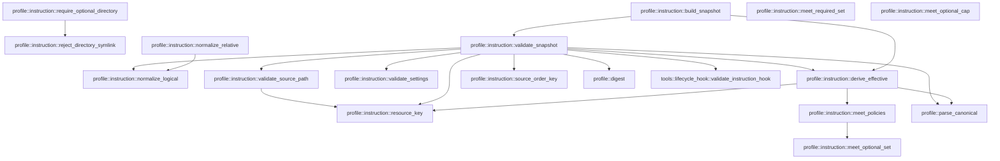

# profile::instruction

[Package atlas](index.md) · [Source](../../src/instruction.rs)

## Declarations

Visibility is the declaration spelling; trait members and reexports require their enclosing interface. `cfg` is not evaluated.

| Symbol | Kind | Visibility | Test / cfg |
|---|---|---|---|
| [profile::instruction::FORMAT](../../src/instruction.rs#L14) | const_item | `private` |  |
| [profile::instruction::MAX_FILES](../../src/instruction.rs#L15) | const_item | `private` |  |
| [profile::instruction::MAX_FILE_BYTES](../../src/instruction.rs#L16) | const_item | `private` |  |
| [profile::instruction::MAX_TOTAL_BYTES](../../src/instruction.rs#L17) | const_item | `private` |  |
| [profile::instruction::MAX_SCANS](../../src/instruction.rs#L18) | const_item | `private` |  |
| [profile::instruction::MAX_SAFE_INTEGER](../../src/instruction.rs#L19) | const_item | `private` |  |
| [profile::instruction::InstructionPolicy](../../src/instruction.rs#L23) | struct_item | `pub` |  |
| [profile::instruction::InstructionSettings](../../src/instruction.rs#L36) | struct_item | `pub` |  |
| [profile::instruction::InstructionSettings::decode](../../src/instruction.rs#L43) | function_item | `pub` |  |
| [profile::instruction::InstructionSettings::canonical_bytes](../../src/instruction.rs#L49) | function_item | `pub` |  |
| [profile::instruction::InstructionKind](../../src/instruction.rs#L57) | enum_item | `pub` |  |
| [profile::instruction::InstructionOrigin](../../src/instruction.rs#L67) | enum_item | `pub` |  |
| [profile::instruction::InstructionSource](../../src/instruction.rs#L75) | struct_item | `pub` |  |
| [profile::instruction::EffectiveInstructions](../../src/instruction.rs#L85) | struct_item | `pub` |  |
| [profile::instruction::InstructionSnapshot](../../src/instruction.rs#L95) | struct_item | `pub` |  |
| [profile::instruction::EffectivePolicy](../../src/instruction.rs#L103) | struct_item | `pub` |  |
| [profile::instruction::EffectivePolicy::digest](../../src/instruction.rs#L111) | function_item | `pub` |  |
| [profile::instruction::LaunchProfile](../../src/instruction.rs#L117) | struct_item | `pub` |  |
| [profile::instruction::LaunchProfile::resolve_and_publish_for_scope](../../src/instruction.rs#L131) | function_item | `pub` |  |
| [profile::instruction::InstructionSnapshot::canonical_bytes](../../src/instruction.rs#L158) | function_item | `pub` |  |
| [profile::instruction::InstructionSnapshot::digest](../../src/instruction.rs#L163) | function_item | `pub` |  |
| [profile::instruction::InstructionSnapshot::decode](../../src/instruction.rs#L167) | function_item | `pub` |  |
| [profile::instruction::InstructionSnapshot::publish](../../src/instruction.rs#L173) | function_item | `pub` |  |
| [profile::instruction::InstructionSnapshot::validate_against_config](../../src/instruction.rs#L186) | function_item | `pub` |  |
| [profile::instruction::InstructionSnapshot::meet_workspace_policy](../../src/instruction.rs#L240) | function_item | `pub` |  |
| [profile::instruction::InstructionResolver](../../src/instruction.rs#L261) | struct_item | `pub` |  |
| [profile::instruction::InstructionResolver::new](../../src/instruction.rs#L269) | function_item | `pub` |  |
| [profile::instruction::InstructionResolver::new_scoped](../../src/instruction.rs#L284) | function_item | `pub` |  |
| [profile::instruction::InstructionResolver::capture](../../src/instruction.rs#L299) | function_item | `pub` |  |
| [profile::instruction::InstructionResolver::capture_with_hook](../../src/instruction.rs#L303) | function_item | `pub` |  |
| [profile::instruction::InstructionResolver::scan](../../src/instruction.rs#L329) | function_item | `private` |  |
| [profile::instruction::scan_origin](../../src/instruction.rs#L390) | function_item | `private` |  |
| [profile::instruction::skill_text_resource](../../src/instruction.rs#L478) | function_item | `private` |  |
| [profile::instruction::collect_files](../../src/instruction.rs#L506) | function_item | `private` |  |
| [profile::instruction::maybe_source](../../src/instruction.rs#L538) | function_item | `private` |  |
| [profile::instruction::read_stable_file](../../src/instruction.rs#L583) | function_item | `private` |  |
| [profile::instruction::reject_directory_symlink](../../src/instruction.rs#L616) | function_item | `private` |  |
| [profile::instruction::require_optional_directory](../../src/instruction.rs#L630) | function_item | `private` |  |
| [profile::instruction::normalize_relative](../../src/instruction.rs#L641) | function_item | `private` |  |
| [profile::instruction::normalize_logical](../../src/instruction.rs#L663) | function_item | `private` |  |
| [profile::instruction::build_snapshot](../../src/instruction.rs#L678) | function_item | `private` |  |
| [profile::instruction::derive_effective](../../src/instruction.rs#L689) | function_item | `private` |  |
| [profile::instruction::resource_key](../../src/instruction.rs#L724) | function_item | `private` |  |
| [profile::instruction::meet_policies](../../src/instruction.rs#L735) | function_item | `private` |  |
| [profile::instruction::meet_optional_set](../../src/instruction.rs#L758) | function_item | `private` |  |
| [profile::instruction::meet_required_set](../../src/instruction.rs#L769) | function_item | `private` |  |
| [profile::instruction::meet_optional_cap](../../src/instruction.rs#L780) | function_item | `private` |  |
| [profile::instruction::validate_settings](../../src/instruction.rs#L788) | function_item | `private` |  |
| [profile::instruction::validate_snapshot](../../src/instruction.rs#L834) | function_item | `private` |  |
| [profile::instruction::validate_source_path](../../src/instruction.rs#L937) | function_item | `private` |  |
| [profile::instruction::source_order_key](../../src/instruction.rs#L957) | function_item | `private` |  |

## Imports / reexports

| Local name | Source path | Visibility |
|---|---|---|
| `BTreeMap` | `std::collections::BTreeMap` | `private` |
| `BTreeSet` | `std::collections::BTreeSet` | `private` |
| `fs` | `std::fs` | `private` |
| `OpenOptions` | `std::fs::OpenOptions` | `private` |
| `Read` | `std::io::Read` | `private` |
| `MetadataExt` | `std::os::unix::fs::MetadataExt` | `private` |
| `OpenOptionsExt` | `std::os::unix::fs::OpenOptionsExt` | `private` |
| `Component` | `std::path::Component` | `private` |
| `Path` | `std::path::Path` | `private` |
| `PathBuf` | `std::path::PathBuf` | `private` |
| `Deserialize` | `serde::Deserialize` | `private` |
| `Serialize` | `serde::Serialize` | `private` |
| `AssetRef` | `store::AssetRef` | `private` |
| `AssetStore` | `store::AssetStore` | `private` |
| `UnicodeNormalization` | `unicode_normalization::UnicodeNormalization` | `private` |
| `WorkspacePolicy` | `crate::config::WorkspacePolicy` | `private` |
| `ProfileError` | `crate::ProfileError` | `private` |
| `canonical_line` | `crate::canonical_line` | `private` |
| `digest` | `crate::digest` | `private` |
| `parse_canonical` | `crate::parse_canonical` | `private` |

## Module declarations

| Module | Visibility | Attributes |
|---|---|---|

## Function call graphs

Edges below are syntactically resolved calls only, including private functions. Graphs partition callers into groups of 20; they are not execution order. All unresolved sites are listed below and in the JSON inventory.

```mermaid
flowchart TD
  n0["profile::instruction::EffectivePolicy::digest"]
  n1["profile::instruction::LaunchProfile::resolve_and_publish_for_scope"]
  n2["profile::instruction::InstructionSnapshot::canonical_bytes"]
  n3["profile::instruction::InstructionSnapshot::digest"]
  n4["profile::instruction::InstructionSnapshot::decode"]
  n5["profile::instruction::InstructionSnapshot::publish"]
  n6["profile::instruction::InstructionSnapshot::validate_against_config"]
  n7["profile::instruction::InstructionSnapshot::meet_workspace_policy"]
  n8["profile::instruction::InstructionResolver::new"]
  n9["profile::instruction::InstructionResolver::new_scoped"]
  n10["profile::instruction::InstructionResolver::capture"]
  n11["profile::instruction::InstructionResolver::capture_with_hook"]
  n12["profile::instruction::InstructionResolver::scan"]
  n13["profile::instruction::scan_origin"]
  n14["profile::instruction::InstructionSettings::decode"]
  n15["profile::instruction::skill_text_resource"]
  n16["profile::instruction::InstructionSettings::canonical_bytes"]
  n17["profile::instruction::collect_files"]
  n18["profile::instruction::maybe_source"]
  n19["profile::instruction::read_stable_file"]
  n20["profile::instruction::require_optional_directory"]
  n21["profile::instruction::normalize_relative"]
  n22["profile::instruction::normalize_logical"]
  n23["profile::instruction::build_snapshot"]
  n24["profile::instruction::meet_required_set"]
  n25["profile::instruction::meet_optional_cap"]
  n26["profile::instruction::validate_settings"]
  n27["profile::instruction::validate_snapshot"]
  n28["profile::canonical_line"]
  n29["profile::digest"]
  n30["profile::parse_canonical"]
  n0 --> n28
  n0 --> n29
  n2 --> n27
  n2 --> n28
  n3 --> n2
  n3 --> n29
  n4 --> n27
  n4 --> n30
  n5 --> n2
  n7 --> n24
  n7 --> n25
  n10 --> n11
  n11 --> n12
  n11 --> n23
  n12 --> n13
  n13 --> n15
  n13 --> n17
  n13 --> n18
  n13 --> n20
  n14 --> n26
  n14 --> n30
  n16 --> n26
  n16 --> n28
  n17 --> n17
  n17 --> n20
  n17 --> n21
  n18 --> n19
  n18 --> n22
  n18 --> n26
  n18 --> n29
  n18 --> n30
```

Functions 1–20: 31 direct edges

Functions 21–35: 18 direct edges

## Call sites

Includes test functions (marked in declarations). Receiver-type-required sites need type analysis/manual tracing. Calls in closures are attributed to their enclosing function; their occurrence here does not mean the closure executes immediately.

| Caller | Callee expression | Source lines | Target / classification |
|---|---|---|---|
| `decode` | `parse_canonical` | [44](../../src/instruction.rs#L44) | [profile::parse_canonical](../../src/lib.rs#L67) |
| `decode` | `validate_settings` | [45](../../src/instruction.rs#L45) | [profile::instruction::validate_settings](../../src/instruction.rs#L788) |
| `decode` | `Path::new` | [45](../../src/instruction.rs#L45) | external-constructor-callback-or-unresolved |
| `decode` | `Ok` | [46](../../src/instruction.rs#L46) | external-constructor-callback-or-unresolved |
| `canonical_bytes` | `validate_settings` | [50](../../src/instruction.rs#L50) | [profile::instruction::validate_settings](../../src/instruction.rs#L788) |
| `canonical_bytes` | `Path::new` | [50](../../src/instruction.rs#L50) | external-constructor-callback-or-unresolved |
| `canonical_bytes` | `canonical_line` | [51](../../src/instruction.rs#L51) | [profile::canonical_line](../../src/lib.rs#L112) |
| `digest` | `Ok` | [112](../../src/instruction.rs#L112) | external-constructor-callback-or-unresolved |
| `digest` | `digest` | [112](../../src/instruction.rs#L112) | [profile::digest](../../src/lib.rs#L126) |
| `digest` | `canonical_line` | [112](../../src/instruction.rs#L112) | [profile::canonical_line](../../src/lib.rs#L112) |
| `resolve_and_publish_for_scope` | `scope.config` | [137](../../src/instruction.rs#L137) | receiver-type-required |
| `resolve_and_publish_for_scope` | `scope             .instructions(repository, user_agent_dir.as_ref(), &config)?             .capture` | [138](../../src/instruction.rs#L138) | receiver-type-required |
| `resolve_and_publish_for_scope` | `scope             .instructions` | [138](../../src/instruction.rs#L138) | receiver-type-required |
| `resolve_and_publish_for_scope` | `user_agent_dir.as_ref` | [139](../../src/instruction.rs#L139) | receiver-type-required |
| `resolve_and_publish_for_scope` | `instruction.validate_against_config` | [141](../../src/instruction.rs#L141) | receiver-type-required |
| `resolve_and_publish_for_scope` | `instruction.meet_workspace_policy` | [142](../../src/instruction.rs#L142) | receiver-type-required |
| `resolve_and_publish_for_scope` | `config.publish` | [143](../../src/instruction.rs#L143) | receiver-type-required |
| `resolve_and_publish_for_scope` | `instruction.publish` | [144](../../src/instruction.rs#L144) | receiver-type-required |
| `resolve_and_publish_for_scope` | `Ok` | [145](../../src/instruction.rs#L145) | external-constructor-callback-or-unresolved |
| `canonical_bytes` | `validate_snapshot` | [159](../../src/instruction.rs#L159) | [profile::instruction::validate_snapshot](../../src/instruction.rs#L834) |
| `canonical_bytes` | `canonical_line` | [160](../../src/instruction.rs#L160) | [profile::canonical_line](../../src/lib.rs#L112) |
| `digest` | `Ok` | [164](../../src/instruction.rs#L164) | external-constructor-callback-or-unresolved |
| `digest` | `digest` | [164](../../src/instruction.rs#L164) | [profile::digest](../../src/lib.rs#L126) |
| `digest` | `self.canonical_bytes` | [164](../../src/instruction.rs#L164) | [profile::instruction::InstructionSnapshot::canonical_bytes](../../src/instruction.rs#L158) |
| `decode` | `parse_canonical` | [168](../../src/instruction.rs#L168) | [profile::parse_canonical](../../src/lib.rs#L67) |
| `decode` | `validate_snapshot` | [169](../../src/instruction.rs#L169) | [profile::instruction::validate_snapshot](../../src/instruction.rs#L834) |
| `decode` | `Ok` | [170](../../src/instruction.rs#L170) | external-constructor-callback-or-unresolved |
| `publish` | `self.canonical_bytes` | [174](../../src/instruction.rs#L174) | [profile::instruction::InstructionSnapshot::canonical_bytes](../../src/instruction.rs#L158) |
| `publish` | `digest` | [175](../../src/instruction.rs#L175) | external-constructor-callback-or-unresolved |
| `publish` | `assets.publish` | [176](../../src/instruction.rs#L176) | receiver-type-required |
| `publish` | `Err` | [178](../../src/instruction.rs#L178) | external-constructor-callback-or-unresolved |
| `publish` | `Ok` | [183](../../src/instruction.rs#L183) | external-constructor-callback-or-unresolved |
| `validate_against_config` | `usize::try_from(workspace_index).map_err` | [192](../../src/instruction.rs#L192) | receiver-type-required |
| `validate_against_config` | `usize::try_from` | [192](../../src/instruction.rs#L192) | external-constructor-callback-or-unresolved |
| `validate_against_config` | `PathBuf::from` | [194](../../src/instruction.rs#L194), [202](../../src/instruction.rs#L202), [214](../../src/instruction.rs#L214), [219](../../src/instruction.rs#L219), [230](../../src/instruction.rs#L230) | external-constructor-callback-or-unresolved |
| `validate_against_config` | `config.workspace.cwd.len` | [200](../../src/instruction.rs#L200) | receiver-type-required |
| `validate_against_config` | `Err` | [201](../../src/instruction.rs#L201), [218](../../src/instruction.rs#L218), [229](../../src/instruction.rs#L229) | external-constructor-callback-or-unresolved |
| `validate_against_config` | `fs::canonicalize(root).map_err` | [213](../../src/instruction.rs#L213) | receiver-type-required |
| `validate_against_config` | `fs::canonicalize` | [213](../../src/instruction.rs#L213) | external-constructor-callback-or-unresolved |
| `validate_against_config` | `error.to_string` | [215](../../src/instruction.rs#L215) | receiver-type-required |
| `validate_against_config` | `canonical.to_str` | [217](../../src/instruction.rs#L217) | receiver-type-required |
| `validate_against_config` | `Some` | [217](../../src/instruction.rs#L217) | external-constructor-callback-or-unresolved |
| `validate_against_config` | `root.as_str` | [217](../../src/instruction.rs#L217) | receiver-type-required |
| `validate_against_config` | `"instruction writable root is not canonical".to_owned` | [220](../../src/instruction.rs#L220) | receiver-type-required |
| `validate_against_config` | `config                     .workspace                     .cwd                     .iter()                     .any` | [223](../../src/instruction.rs#L223) | receiver-type-required |
| `validate_against_config` | `config                     .workspace                     .cwd                     .iter` | [223](../../src/instruction.rs#L223) | receiver-type-required |
| `validate_against_config` | `canonical.starts_with` | [227](../../src/instruction.rs#L227) | receiver-type-required |
| `validate_against_config` | `Ok` | [236](../../src/instruction.rs#L236) | external-constructor-callback-or-unresolved |
| `meet_workspace_policy` | `instruction.network.unwrap_or` | [243](../../src/instruction.rs#L243) | receiver-type-required |
| `meet_workspace_policy` | `meet_required_set` | [244](../../src/instruction.rs#L244), [248](../../src/instruction.rs#L248) | [profile::instruction::meet_required_set](../../src/instruction.rs#L769) |
| `meet_workspace_policy` | `instruction.allowed_tools.as_deref` | [246](../../src/instruction.rs#L246) | receiver-type-required |
| `meet_workspace_policy` | `instruction.writable_roots.as_deref` | [250](../../src/instruction.rs#L250) | receiver-type-required |
| `meet_workspace_policy` | `meet_optional_cap` | [252](../../src/instruction.rs#L252) | [profile::instruction::meet_optional_cap](../../src/instruction.rs#L780) |
| `new` | `user_agent_dir.as_ref().to_path_buf` | [274](../../src/instruction.rs#L274) | receiver-type-required |
| `new` | `user_agent_dir.as_ref` | [274](../../src/instruction.rs#L274) | receiver-type-required |
| `new` | `cwd                 .into_iter()                 .map(&#124;value&#124; value.as_ref().to_path_buf())                 .collect` | [276](../../src/instruction.rs#L276) | receiver-type-required |
| `new` | `cwd                 .into_iter()                 .map` | [276](../../src/instruction.rs#L276) | receiver-type-required |
| `new` | `cwd                 .into_iter` | [276](../../src/instruction.rs#L276) | receiver-type-required |
| `new` | `value.as_ref().to_path_buf` | [278](../../src/instruction.rs#L278) | receiver-type-required |
| `new` | `value.as_ref` | [278](../../src/instruction.rs#L278) | receiver-type-required |
| `new_scoped` | `user_data_dir.as_ref().to_path_buf` | [290](../../src/instruction.rs#L290) | receiver-type-required |
| `new_scoped` | `user_data_dir.as_ref` | [290](../../src/instruction.rs#L290) | receiver-type-required |
| `new_scoped` | `Some` | [291](../../src/instruction.rs#L291) | external-constructor-callback-or-unresolved |
| `new_scoped` | `workspace_data_dir.as_ref().to_path_buf` | [291](../../src/instruction.rs#L291) | receiver-type-required |
| `new_scoped` | `workspace_data_dir.as_ref` | [291](../../src/instruction.rs#L291) | receiver-type-required |
| `new_scoped` | `cwd                 .into_iter()                 .map(&#124;value&#124; value.as_ref().to_path_buf())                 .collect` | [292](../../src/instruction.rs#L292) | receiver-type-required |
| `new_scoped` | `cwd                 .into_iter()                 .map` | [292](../../src/instruction.rs#L292) | receiver-type-required |
| `new_scoped` | `cwd                 .into_iter` | [292](../../src/instruction.rs#L292) | receiver-type-required |
| `new_scoped` | `value.as_ref().to_path_buf` | [294](../../src/instruction.rs#L294) | receiver-type-required |
| `new_scoped` | `value.as_ref` | [294](../../src/instruction.rs#L294) | receiver-type-required |
| `capture` | `self.capture_with_hook` | [300](../../src/instruction.rs#L300) | [profile::instruction::InstructionResolver::capture_with_hook](../../src/instruction.rs#L303) |
| `capture_with_hook` | `self.scan` | [309](../../src/instruction.rs#L309) | [profile::instruction::InstructionResolver::scan](../../src/instruction.rs#L329) |
| `capture_with_hook` | `after_scan` | [312](../../src/instruction.rs#L312), [318](../../src/instruction.rs#L318) | external-constructor-callback-or-unresolved |
| `capture_with_hook` | `Err` | [316](../../src/instruction.rs#L316), [324](../../src/instruction.rs#L324) | external-constructor-callback-or-unresolved |
| `capture_with_hook` | `previous.as_ref` | [319](../../src/instruction.rs#L319) | receiver-type-required |
| `capture_with_hook` | `Some` | [319](../../src/instruction.rs#L319), [322](../../src/instruction.rs#L322) | external-constructor-callback-or-unresolved |
| `capture_with_hook` | `build_snapshot` | [320](../../src/instruction.rs#L320) | [profile::instruction::build_snapshot](../../src/instruction.rs#L678) |
| `scan` | `Vec::new` | [330](../../src/instruction.rs#L330) | external-constructor-callback-or-unresolved |
| `scan` | `scan_origin` | [331](../../src/instruction.rs#L331), [338](../../src/instruction.rs#L338), [351](../../src/instruction.rs#L351) | [profile::instruction::scan_origin](../../src/instruction.rs#L390) |
| `scan` | `self.cwd.iter().enumerate` | [340](../../src/instruction.rs#L340) | receiver-type-required |
| `scan` | `self.cwd.iter` | [340](../../src/instruction.rs#L340) | receiver-type-required |
| `scan` | `fs::canonicalize(cwd).map_err` | [341](../../src/instruction.rs#L341) | receiver-type-required |
| `scan` | `fs::canonicalize` | [341](../../src/instruction.rs#L341) | external-constructor-callback-or-unresolved |
| `scan` | `cwd.clone` | [342](../../src/instruction.rs#L342) | receiver-type-required |
| `scan` | `error.to_string` | [343](../../src/instruction.rs#L343) | receiver-type-required |
| `scan` | `canonical.is_dir` | [345](../../src/instruction.rs#L345) | receiver-type-required |
| `scan` | `Err` | [346](../../src/instruction.rs#L346), [361](../../src/instruction.rs#L361), [368](../../src/instruction.rs#L368), [379](../../src/instruction.rs#L379) | external-constructor-callback-or-unresolved |
| `scan` | `"workspace cwd is not a directory".to_owned` | [348](../../src/instruction.rs#L348) | receiver-type-required |
| `scan` | `sources.len` | [360](../../src/instruction.rs#L360) | receiver-type-required |
| `scan` | `ProfileError::LimitExceeded` | [361](../../src/instruction.rs#L361), [368](../../src/instruction.rs#L368) | external-constructor-callback-or-unresolved |
| `scan` | `sources             .iter()             .map(&#124;source&#124; source.content.len() as u64)             .sum::<u64>` | [363](../../src/instruction.rs#L363) | receiver-type-required |
| `scan` | `sources             .iter()             .map` | [363](../../src/instruction.rs#L363) | receiver-type-required |
| `scan` | `sources             .iter` | [363](../../src/instruction.rs#L363) | receiver-type-required |
| `scan` | `source.content.len` | [365](../../src/instruction.rs#L365) | receiver-type-required |
| `scan` | `BTreeSet::new` | [372](../../src/instruction.rs#L372) | external-constructor-callback-or-unresolved |
| `scan` | `identities.insert` | [374](../../src/instruction.rs#L374) | receiver-type-required |
| `scan` | `source.origin.clone` | [375](../../src/instruction.rs#L375) | receiver-type-required |
| `scan` | `source.kind.clone` | [376](../../src/instruction.rs#L376) | receiver-type-required |
| `scan` | `source.path.clone` | [377](../../src/instruction.rs#L377) | receiver-type-required |
| `scan` | `PathBuf::from` | [380](../../src/instruction.rs#L380) | external-constructor-callback-or-unresolved |
| `scan` | `"instruction paths collide after NFC normalization".to_owned` | [381](../../src/instruction.rs#L381) | receiver-type-required |
| `scan` | `sources.sort_by_key` | [385](../../src/instruction.rs#L385) | receiver-type-required |
| `scan` | `Ok` | [386](../../src/instruction.rs#L386) | external-constructor-callback-or-unresolved |
| `scan_origin` | `require_optional_directory` | [396](../../src/instruction.rs#L396), [411](../../src/instruction.rs#L411), [415](../../src/instruction.rs#L415), [422](../../src/instruction.rs#L422) | [profile::instruction::require_optional_directory](../../src/instruction.rs#L630) |
| `scan_origin` | `Ok` | [397](../../src/instruction.rs#L397), [423](../../src/instruction.rs#L423), [475](../../src/instruction.rs#L475) | external-constructor-callback-or-unresolved |
| `scan_origin` | `root.join` | [399](../../src/instruction.rs#L399), [410](../../src/instruction.rs#L410), [414](../../src/instruction.rs#L414), [418](../../src/instruction.rs#L418) | receiver-type-required |
| `scan_origin` | `maybe_source` | [400](../../src/instruction.rs#L400), [425](../../src/instruction.rs#L425), [445](../../src/instruction.rs#L445), [465](../../src/instruction.rs#L465) | [profile::instruction::maybe_source](../../src/instruction.rs#L538) |
| `scan_origin` | `root.to_path_buf` | [408](../../src/instruction.rs#L408) | receiver-type-required |
| `scan_origin` | `agent.join` | [426](../../src/instruction.rs#L426), [437](../../src/instruction.rs#L437), [460](../../src/instruction.rs#L460) | receiver-type-required |
| `scan_origin` | `Vec::new` | [438](../../src/instruction.rs#L438), [461](../../src/instruction.rs#L461) | external-constructor-callback-or-unresolved |
| `scan_origin` | `collect_files` | [439](../../src/instruction.rs#L439), [462](../../src/instruction.rs#L462) | [profile::instruction::collect_files](../../src/instruction.rs#L506) |
| `scan_origin` | `files.sort_by` | [440](../../src/instruction.rs#L440), [463](../../src/instruction.rs#L463) | receiver-type-required |
| `scan_origin` | `left.0.as_bytes().cmp` | [440](../../src/instruction.rs#L440), [463](../../src/instruction.rs#L463) | receiver-type-required |
| `scan_origin` | `left.0.as_bytes` | [440](../../src/instruction.rs#L440), [463](../../src/instruction.rs#L463) | receiver-type-required |
| `scan_origin` | `right.0.as_bytes` | [440](../../src/instruction.rs#L440), [463](../../src/instruction.rs#L463) | receiver-type-required |
| `scan_origin` | `skill_text_resource` | [442](../../src/instruction.rs#L442) | [profile::instruction::skill_text_resource](../../src/instruction.rs#L478) |
| `scan_origin` | `kind.clone` | [448](../../src/instruction.rs#L448) | receiver-type-required |
| `scan_origin` | `agent             .file_name()             .is_some_and` | [455](../../src/instruction.rs#L455) | receiver-type-required |
| `scan_origin` | `agent             .file_name` | [455](../../src/instruction.rs#L455) | receiver-type-required |
| `skill_text_resource` | `relative.split('/').any` | [479](../../src/instruction.rs#L479) | receiver-type-required |
| `skill_text_resource` | `relative.split` | [479](../../src/instruction.rs#L479) | receiver-type-required |
| `skill_text_resource` | `part.starts_with` | [479](../../src/instruction.rs#L479) | receiver-type-required |
| `collect_files` | `require_optional_directory` | [511](../../src/instruction.rs#L511) | [profile::instruction::require_optional_directory](../../src/instruction.rs#L630) |
| `collect_files` | `Ok` | [512](../../src/instruction.rs#L512), [535](../../src/instruction.rs#L535) | external-constructor-callback-or-unresolved |
| `collect_files` | `fs::read_dir` | [514](../../src/instruction.rs#L514) | external-constructor-callback-or-unresolved |
| `collect_files` | `entry.path` | [516](../../src/instruction.rs#L516) | receiver-type-required |
| `collect_files` | `fs::symlink_metadata` | [517](../../src/instruction.rs#L517) | external-constructor-callback-or-unresolved |
| `collect_files` | `metadata.file_type().is_symlink` | [518](../../src/instruction.rs#L518) | receiver-type-required |
| `collect_files` | `metadata.file_type` | [518](../../src/instruction.rs#L518) | receiver-type-required |
| `collect_files` | `Err` | [519](../../src/instruction.rs#L519), [532](../../src/instruction.rs#L532) | external-constructor-callback-or-unresolved |
| `collect_files` | `ProfileError::Symlink` | [519](../../src/instruction.rs#L519) | external-constructor-callback-or-unresolved |
| `collect_files` | `metadata.is_dir` | [521](../../src/instruction.rs#L521) | receiver-type-required |
| `collect_files` | `collect_files` | [522](../../src/instruction.rs#L522) | [profile::instruction::collect_files](../../src/instruction.rs#L506) |
| `collect_files` | `metadata.is_file` | [523](../../src/instruction.rs#L523) | receiver-type-required |
| `collect_files` | `path                 .strip_prefix(root)                 .map_err` | [524](../../src/instruction.rs#L524) | receiver-type-required |
| `collect_files` | `path                 .strip_prefix` | [524](../../src/instruction.rs#L524) | receiver-type-required |
| `collect_files` | `path.clone` | [527](../../src/instruction.rs#L527) | receiver-type-required |
| `collect_files` | `"instruction path escaped its kind directory".to_owned` | [528](../../src/instruction.rs#L528) | receiver-type-required |
| `collect_files` | `output.push` | [530](../../src/instruction.rs#L530) | receiver-type-required |
| `collect_files` | `normalize_relative` | [530](../../src/instruction.rs#L530) | [profile::instruction::normalize_relative](../../src/instruction.rs#L641) |
| `collect_files` | `ProfileError::NotRegular` | [532](../../src/instruction.rs#L532) | external-constructor-callback-or-unresolved |
| `maybe_source` | `fs::symlink_metadata` | [545](../../src/instruction.rs#L545) | external-constructor-callback-or-unresolved |
| `maybe_source` | `metadata.file_type().is_symlink` | [547](../../src/instruction.rs#L547) | receiver-type-required |
| `maybe_source` | `metadata.file_type` | [547](../../src/instruction.rs#L547) | receiver-type-required |
| `maybe_source` | `Err` | [548](../../src/instruction.rs#L548), [551](../../src/instruction.rs#L551), [555](../../src/instruction.rs#L555), [563](../../src/instruction.rs#L563) | external-constructor-callback-or-unresolved |
| `maybe_source` | `ProfileError::Symlink` | [548](../../src/instruction.rs#L548) | external-constructor-callback-or-unresolved |
| `maybe_source` | `file.to_path_buf` | [548](../../src/instruction.rs#L548), [551](../../src/instruction.rs#L551), [559](../../src/instruction.rs#L559), [564](../../src/instruction.rs#L564) | receiver-type-required |
| `maybe_source` | `metadata.is_file` | [550](../../src/instruction.rs#L550) | receiver-type-required |
| `maybe_source` | `ProfileError::NotRegular` | [551](../../src/instruction.rs#L551) | external-constructor-callback-or-unresolved |
| `maybe_source` | `error.kind` | [554](../../src/instruction.rs#L554) | receiver-type-required |
| `maybe_source` | `Ok` | [554](../../src/instruction.rs#L554), [580](../../src/instruction.rs#L580) | external-constructor-callback-or-unresolved |
| `maybe_source` | `error.into` | [555](../../src/instruction.rs#L555) | receiver-type-required |
| `maybe_source` | `read_stable_file` | [557](../../src/instruction.rs#L557) | [profile::instruction::read_stable_file](../../src/instruction.rs#L583) |
| `maybe_source` | `String::from_utf8(bytes.clone()).map_err` | [558](../../src/instruction.rs#L558) | receiver-type-required |
| `maybe_source` | `String::from_utf8` | [558](../../src/instruction.rs#L558) | external-constructor-callback-or-unresolved |
| `maybe_source` | `bytes.clone` | [558](../../src/instruction.rs#L558) | receiver-type-required |
| `maybe_source` | `"instruction content is not UTF-8".to_owned` | [560](../../src/instruction.rs#L560) | receiver-type-required |
| `maybe_source` | `content.contains` | [562](../../src/instruction.rs#L562) | receiver-type-required |
| `maybe_source` | `"instruction content contains NUL".to_owned` | [565](../../src/instruction.rs#L565) | receiver-type-required |
| `maybe_source` | `parse_canonical` | [569](../../src/instruction.rs#L569) | [profile::parse_canonical](../../src/lib.rs#L67) |
| `maybe_source` | `validate_settings` | [570](../../src/instruction.rs#L570) | [profile::instruction::validate_settings](../../src/instruction.rs#L788) |
| `maybe_source` | `normalize_logical` | [572](../../src/instruction.rs#L572) | [profile::instruction::normalize_logical](../../src/instruction.rs#L663) |
| `maybe_source` | `sources.push` | [573](../../src/instruction.rs#L573) | receiver-type-required |
| `maybe_source` | `origin.clone` | [574](../../src/instruction.rs#L574) | receiver-type-required |
| `maybe_source` | `digest` | [578](../../src/instruction.rs#L578) | [profile::digest](../../src/lib.rs#L126) |
| `read_stable_file` | `OpenOptions::new()         .read(true)         .custom_flags(libc::O_CLOEXEC &#124; libc::O_NOFOLLOW)         .open` | [584](../../src/instruction.rs#L584) | receiver-type-required |
| `read_stable_file` | `OpenOptions::new()         .read(true)         .custom_flags` | [584](../../src/instruction.rs#L584) | receiver-type-required |
| `read_stable_file` | `OpenOptions::new()         .read` | [584](../../src/instruction.rs#L584) | receiver-type-required |
| `read_stable_file` | `OpenOptions::new` | [584](../../src/instruction.rs#L584) | external-constructor-callback-or-unresolved |
| `read_stable_file` | `file.metadata` | [588](../../src/instruction.rs#L588), [599](../../src/instruction.rs#L599) | receiver-type-required |
| `read_stable_file` | `before.is_file` | [589](../../src/instruction.rs#L589) | receiver-type-required |
| `read_stable_file` | `Err` | [590](../../src/instruction.rs#L590), [593](../../src/instruction.rs#L593), [602](../../src/instruction.rs#L602), [611](../../src/instruction.rs#L611) | external-constructor-callback-or-unresolved |
| `read_stable_file` | `ProfileError::NotRegular` | [590](../../src/instruction.rs#L590) | external-constructor-callback-or-unresolved |
| `read_stable_file` | `path.to_path_buf` | [590](../../src/instruction.rs#L590) | receiver-type-required |
| `read_stable_file` | `before.len` | [592](../../src/instruction.rs#L592), [597](../../src/instruction.rs#L597), [606](../../src/instruction.rs#L606) | receiver-type-required |
| `read_stable_file` | `ProfileError::LimitExceeded` | [593](../../src/instruction.rs#L593) | external-constructor-callback-or-unresolved |
| `read_stable_file` | `Vec::with_capacity` | [597](../../src/instruction.rs#L597) | external-constructor-callback-or-unresolved |
| `read_stable_file` | `file.read_to_end` | [598](../../src/instruction.rs#L598) | receiver-type-required |
| `read_stable_file` | `fs::symlink_metadata` | [600](../../src/instruction.rs#L600) | external-constructor-callback-or-unresolved |
| `read_stable_file` | `named.file_type().is_symlink` | [601](../../src/instruction.rs#L601) | receiver-type-required |
| `read_stable_file` | `named.file_type` | [601](../../src/instruction.rs#L601) | receiver-type-required |
| `read_stable_file` | `before.dev` | [604](../../src/instruction.rs#L604) | receiver-type-required |
| `read_stable_file` | `after.dev` | [604](../../src/instruction.rs#L604), [608](../../src/instruction.rs#L608) | receiver-type-required |
| `read_stable_file` | `before.ino` | [605](../../src/instruction.rs#L605) | receiver-type-required |
| `read_stable_file` | `after.ino` | [605](../../src/instruction.rs#L605), [609](../../src/instruction.rs#L609) | receiver-type-required |
| `read_stable_file` | `after.len` | [606](../../src/instruction.rs#L606) | receiver-type-required |
| `read_stable_file` | `before.modified` | [607](../../src/instruction.rs#L607) | receiver-type-required |
| `read_stable_file` | `after.modified` | [607](../../src/instruction.rs#L607) | receiver-type-required |
| `read_stable_file` | `named.dev` | [608](../../src/instruction.rs#L608) | receiver-type-required |
| `read_stable_file` | `named.ino` | [609](../../src/instruction.rs#L609) | receiver-type-required |
| `read_stable_file` | `Ok` | [613](../../src/instruction.rs#L613) | external-constructor-callback-or-unresolved |
| `reject_directory_symlink` | `fs::symlink_metadata` | [617](../../src/instruction.rs#L617) | external-constructor-callback-or-unresolved |
| `reject_directory_symlink` | `metadata.file_type().is_symlink` | [618](../../src/instruction.rs#L618) | receiver-type-required |
| `reject_directory_symlink` | `metadata.file_type` | [618](../../src/instruction.rs#L618) | receiver-type-required |
| `reject_directory_symlink` | `Err` | [619](../../src/instruction.rs#L619), [621](../../src/instruction.rs#L621) | external-constructor-callback-or-unresolved |
| `reject_directory_symlink` | `ProfileError::Symlink` | [619](../../src/instruction.rs#L619) | external-constructor-callback-or-unresolved |
| `reject_directory_symlink` | `path.to_path_buf` | [619](../../src/instruction.rs#L619), [622](../../src/instruction.rs#L622) | receiver-type-required |
| `reject_directory_symlink` | `metadata.is_dir` | [620](../../src/instruction.rs#L620) | receiver-type-required |
| `reject_directory_symlink` | `"expected instruction directory".to_owned` | [623](../../src/instruction.rs#L623) | receiver-type-required |
| `reject_directory_symlink` | `Ok` | [626](../../src/instruction.rs#L626) | external-constructor-callback-or-unresolved |
| `require_optional_directory` | `fs::symlink_metadata` | [631](../../src/instruction.rs#L631) | external-constructor-callback-or-unresolved |
| `require_optional_directory` | `reject_directory_symlink` | [633](../../src/instruction.rs#L633) | [profile::instruction::reject_directory_symlink](../../src/instruction.rs#L616) |
| `require_optional_directory` | `Ok` | [634](../../src/instruction.rs#L634), [636](../../src/instruction.rs#L636) | external-constructor-callback-or-unresolved |
| `require_optional_directory` | `error.kind` | [636](../../src/instruction.rs#L636) | receiver-type-required |
| `require_optional_directory` | `Err` | [637](../../src/instruction.rs#L637) | external-constructor-callback-or-unresolved |
| `require_optional_directory` | `error.into` | [637](../../src/instruction.rs#L637) | receiver-type-required |
| `normalize_relative` | `Vec::new` | [642](../../src/instruction.rs#L642) | external-constructor-callback-or-unresolved |
| `normalize_relative` | `path.components` | [643](../../src/instruction.rs#L643) | receiver-type-required |
| `normalize_relative` | `value.to_str().ok_or_else` | [646](../../src/instruction.rs#L646) | receiver-type-required |
| `normalize_relative` | `value.to_str` | [646](../../src/instruction.rs#L646) | receiver-type-required |
| `normalize_relative` | `path.to_path_buf` | [647](../../src/instruction.rs#L647), [654](../../src/instruction.rs#L654) | receiver-type-required |
| `normalize_relative` | `"instruction path is not UTF-8".to_owned` | [648](../../src/instruction.rs#L648) | receiver-type-required |
| `normalize_relative` | `values.push` | [650](../../src/instruction.rs#L650) | receiver-type-required |
| `normalize_relative` | `value.nfc().collect::<String>` | [650](../../src/instruction.rs#L650) | receiver-type-required |
| `normalize_relative` | `value.nfc` | [650](../../src/instruction.rs#L650) | receiver-type-required |
| `normalize_relative` | `Err` | [653](../../src/instruction.rs#L653) | external-constructor-callback-or-unresolved |
| `normalize_relative` | `"instruction path contains a non-normal component".to_owned` | [655](../../src/instruction.rs#L655) | receiver-type-required |
| `normalize_relative` | `normalize_logical` | [660](../../src/instruction.rs#L660) | [profile::instruction::normalize_logical](../../src/instruction.rs#L663) |
| `normalize_relative` | `values.join` | [660](../../src/instruction.rs#L660) | receiver-type-required |
| `normalize_logical` | `path.is_empty` | [664](../../src/instruction.rs#L664) | receiver-type-required |
| `normalize_logical` | `path.contains` | [665](../../src/instruction.rs#L665) | receiver-type-required |
| `normalize_logical` | `path             .split('/')             .any` | [666](../../src/instruction.rs#L666) | receiver-type-required |
| `normalize_logical` | `path             .split` | [666](../../src/instruction.rs#L666) | receiver-type-required |
| `normalize_logical` | `part.is_empty` | [668](../../src/instruction.rs#L668) | receiver-type-required |
| `normalize_logical` | `Err` | [670](../../src/instruction.rs#L670) | external-constructor-callback-or-unresolved |
| `normalize_logical` | `PathBuf::from` | [671](../../src/instruction.rs#L671) | external-constructor-callback-or-unresolved |
| `normalize_logical` | `"invalid logical instruction path".to_owned` | [672](../../src/instruction.rs#L672) | receiver-type-required |
| `normalize_logical` | `Ok` | [675](../../src/instruction.rs#L675) | external-constructor-callback-or-unresolved |
| `normalize_logical` | `path.nfc().collect` | [675](../../src/instruction.rs#L675) | receiver-type-required |
| `normalize_logical` | `path.nfc` | [675](../../src/instruction.rs#L675) | receiver-type-required |
| `build_snapshot` | `derive_effective` | [679](../../src/instruction.rs#L679) | [profile::instruction::derive_effective](../../src/instruction.rs#L689) |
| `build_snapshot` | `validate_snapshot` | [685](../../src/instruction.rs#L685) | [profile::instruction::validate_snapshot](../../src/instruction.rs#L834) |
| `build_snapshot` | `Ok` | [686](../../src/instruction.rs#L686) | external-constructor-callback-or-unresolved |
| `derive_effective` | `EffectiveInstructions::default` | [690](../../src/instruction.rs#L690) | external-constructor-callback-or-unresolved |
| `derive_effective` | `Vec::new` | [691](../../src/instruction.rs#L691) | external-constructor-callback-or-unresolved |
| `derive_effective` | `sources.iter().enumerate` | [692](../../src/instruction.rs#L692) | receiver-type-required |
| `derive_effective` | `sources.iter` | [692](../../src/instruction.rs#L692) | receiver-type-required |
| `derive_effective` | `effective.agents.push` | [695](../../src/instruction.rs#L695) | receiver-type-required |
| `derive_effective` | `effective                     .skills                     .insert` | [697](../../src/instruction.rs#L697) | receiver-type-required |
| `derive_effective` | `resource_key` | [699](../../src/instruction.rs#L699), [704](../../src/instruction.rs#L704), [709](../../src/instruction.rs#L709) | [profile::instruction::resource_key](../../src/instruction.rs#L724) |
| `derive_effective` | `effective                     .commands                     .insert` | [702](../../src/instruction.rs#L702) | receiver-type-required |
| `derive_effective` | `effective                     .hooks                     .insert` | [707](../../src/instruction.rs#L707) | receiver-type-required |
| `derive_effective` | `parse_canonical` | [713](../../src/instruction.rs#L713) | [profile::parse_canonical](../../src/lib.rs#L67) |
| `derive_effective` | `PathBuf::from` | [713](../../src/instruction.rs#L713) | external-constructor-callback-or-unresolved |
| `derive_effective` | `source.content.as_bytes` | [713](../../src/instruction.rs#L713) | receiver-type-required |
| `derive_effective` | `policies.push` | [715](../../src/instruction.rs#L715) | receiver-type-required |
| `derive_effective` | `meet_policies` | [720](../../src/instruction.rs#L720) | [profile::instruction::meet_policies](../../src/instruction.rs#L735) |
| `derive_effective` | `Ok` | [721](../../src/instruction.rs#L721) | external-constructor-callback-or-unresolved |
| `resource_key` | `source         .path         .strip_prefix(prefix)         .map(ToOwned::to_owned)         .ok_or_else` | [725](../../src/instruction.rs#L725) | receiver-type-required |
| `resource_key` | `source         .path         .strip_prefix(prefix)         .map` | [725](../../src/instruction.rs#L725) | receiver-type-required |
| `resource_key` | `source         .path         .strip_prefix` | [725](../../src/instruction.rs#L725) | receiver-type-required |
| `resource_key` | `PathBuf::from` | [730](../../src/instruction.rs#L730) | external-constructor-callback-or-unresolved |
| `meet_policies` | `Some` | [742](../../src/instruction.rs#L742), [747](../../src/instruction.rs#L747) | external-constructor-callback-or-unresolved |
| `meet_policies` | `network.unwrap_or` | [742](../../src/instruction.rs#L742) | receiver-type-required |
| `meet_policies` | `meet_optional_set` | [744](../../src/instruction.rs#L744), [745](../../src/instruction.rs#L745) | [profile::instruction::meet_optional_set](../../src/instruction.rs#L758) |
| `meet_policies` | `cap.map_or` | [747](../../src/instruction.rs#L747) | receiver-type-required |
| `meet_policies` | `current.min` | [747](../../src/instruction.rs#L747) | receiver-type-required |
| `meet_policies` | `tools.map` | [752](../../src/instruction.rs#L752) | receiver-type-required |
| `meet_policies` | `value.into_iter().collect` | [752](../../src/instruction.rs#L752), [753](../../src/instruction.rs#L753) | receiver-type-required |
| `meet_policies` | `value.into_iter` | [752](../../src/instruction.rs#L752), [753](../../src/instruction.rs#L753) | receiver-type-required |
| `meet_policies` | `roots.map` | [753](../../src/instruction.rs#L753) | receiver-type-required |
| `meet_optional_set` | `value.into_iter().collect::<BTreeSet<_>>` | [762](../../src/instruction.rs#L762) | receiver-type-required |
| `meet_optional_set` | `value.into_iter` | [762](../../src/instruction.rs#L762) | receiver-type-required |
| `meet_optional_set` | `Some` | [763](../../src/instruction.rs#L763) | external-constructor-callback-or-unresolved |
| `meet_optional_set` | `target.take` | [763](../../src/instruction.rs#L763) | receiver-type-required |
| `meet_optional_set` | `current.intersection(&value).cloned().collect` | [764](../../src/instruction.rs#L764) | receiver-type-required |
| `meet_optional_set` | `current.intersection(&value).cloned` | [764](../../src/instruction.rs#L764) | receiver-type-required |
| `meet_optional_set` | `current.intersection` | [764](../../src/instruction.rs#L764) | receiver-type-required |
| `meet_required_set` | `required.iter().cloned().collect::<BTreeSet<_>>` | [770](../../src/instruction.rs#L770) | receiver-type-required |
| `meet_required_set` | `required.iter().cloned` | [770](../../src/instruction.rs#L770) | receiver-type-required |
| `meet_required_set` | `required.iter` | [770](../../src/instruction.rs#L770) | receiver-type-required |
| `meet_required_set` | `constraint.iter().cloned().collect::<BTreeSet<_>>` | [773](../../src/instruction.rs#L773) | receiver-type-required |
| `meet_required_set` | `constraint.iter().cloned` | [773](../../src/instruction.rs#L773) | receiver-type-required |
| `meet_required_set` | `constraint.iter` | [773](../../src/instruction.rs#L773) | receiver-type-required |
| `meet_required_set` | `required.intersection(&constraint).cloned().collect` | [774](../../src/instruction.rs#L774) | receiver-type-required |
| `meet_required_set` | `required.intersection(&constraint).cloned` | [774](../../src/instruction.rs#L774) | receiver-type-required |
| `meet_required_set` | `required.intersection` | [774](../../src/instruction.rs#L774) | receiver-type-required |
| `meet_required_set` | `required.into_iter().collect` | [776](../../src/instruction.rs#L776) | receiver-type-required |
| `meet_required_set` | `required.into_iter` | [776](../../src/instruction.rs#L776) | receiver-type-required |
| `meet_optional_cap` | `Some` | [782](../../src/instruction.rs#L782), [783](../../src/instruction.rs#L783) | external-constructor-callback-or-unresolved |
| `meet_optional_cap` | `left.min` | [782](../../src/instruction.rs#L782) | receiver-type-required |
| `validate_settings` | `Err` | [790](../../src/instruction.rs#L790), [797](../../src/instruction.rs#L797), [806](../../src/instruction.rs#L806), [816](../../src/instruction.rs#L816), [824](../../src/instruction.rs#L824) | external-constructor-callback-or-unresolved |
| `validate_settings` | `path.to_path_buf` | [791](../../src/instruction.rs#L791), [798](../../src/instruction.rs#L798), [807](../../src/instruction.rs#L807), [817](../../src/instruction.rs#L817), [825](../../src/instruction.rs#L825) | receiver-type-required |
| `validate_settings` | `Some` | [796](../../src/instruction.rs#L796) | external-constructor-callback-or-unresolved |
| `validate_settings` | `"max_wall_seconds must be at least 1".to_owned` | [799](../../src/instruction.rs#L799) | receiver-type-required |
| `validate_settings` | `policy             .max_wall_seconds             .is_some_and` | [802](../../src/instruction.rs#L802) | receiver-type-required |
| `validate_settings` | `"max_wall_seconds exceeds the I-JSON safe-integer range".to_owned` | [808](../../src/instruction.rs#L808) | receiver-type-required |
| `validate_settings` | `[&policy.allowed_tools, &policy.writable_roots]             .into_iter()             .flatten` | [811](../../src/instruction.rs#L811) | receiver-type-required |
| `validate_settings` | `[&policy.allowed_tools, &policy.writable_roots]             .into_iter` | [811](../../src/instruction.rs#L811) | receiver-type-required |
| `validate_settings` | `values.iter().collect::<BTreeSet<_>>().len` | [815](../../src/instruction.rs#L815) | receiver-type-required |
| `validate_settings` | `values.iter().collect::<BTreeSet<_>>` | [815](../../src/instruction.rs#L815) | receiver-type-required |
| `validate_settings` | `values.iter` | [815](../../src/instruction.rs#L815) | receiver-type-required |
| `validate_settings` | `values.len` | [815](../../src/instruction.rs#L815) | receiver-type-required |
| `validate_settings` | `"instruction policy set contains duplicates".to_owned` | [818](../../src/instruction.rs#L818) | receiver-type-required |
| `validate_settings` | `policy.writable_roots.as_deref().unwrap_or_default` | [822](../../src/instruction.rs#L822) | receiver-type-required |
| `validate_settings` | `policy.writable_roots.as_deref` | [822](../../src/instruction.rs#L822) | receiver-type-required |
| `validate_settings` | `root.contains` | [823](../../src/instruction.rs#L823) | receiver-type-required |
| `validate_settings` | `Path::new(root).is_absolute` | [823](../../src/instruction.rs#L823) | receiver-type-required |
| `validate_settings` | `Path::new` | [823](../../src/instruction.rs#L823) | external-constructor-callback-or-unresolved |
| `validate_settings` | `"instruction writable root must be absolute".to_owned` | [826](../../src/instruction.rs#L826) | receiver-type-required |
| `validate_settings` | `Ok` | [831](../../src/instruction.rs#L831) | external-constructor-callback-or-unresolved |
| `validate_snapshot` | `Path::new` | [835](../../src/instruction.rs#L835), [915](../../src/instruction.rs#L915) | external-constructor-callback-or-unresolved |
| `validate_snapshot` | `Err` | [837](../../src/instruction.rs#L837), [843](../../src/instruction.rs#L843), [851](../../src/instruction.rs#L851), [858](../../src/instruction.rs#L858), [863](../../src/instruction.rs#L863), [874](../../src/instruction.rs#L874), [881](../../src/instruction.rs#L881), [887](../../src/instruction.rs#L887), [896](../../src/instruction.rs#L896), [906](../../src/instruction.rs#L906), [929](../../src/instruction.rs#L929) | external-constructor-callback-or-unresolved |
| `validate_snapshot` | `path.to_path_buf` | [838](../../src/instruction.rs#L838), [875](../../src/instruction.rs#L875), [897](../../src/instruction.rs#L897), [907](../../src/instruction.rs#L907), [930](../../src/instruction.rs#L930) | receiver-type-required |
| `validate_snapshot` | `snapshot.sources.len` | [842](../../src/instruction.rs#L842) | receiver-type-required |
| `validate_snapshot` | `ProfileError::LimitExceeded` | [843](../../src/instruction.rs#L843), [851](../../src/instruction.rs#L851), [858](../../src/instruction.rs#L858) | external-constructor-callback-or-unresolved |
| `validate_snapshot` | `snapshot         .sources         .iter()         .map(&#124;source&#124; source.content.len() as u64)         .sum::<u64>` | [845](../../src/instruction.rs#L845) | receiver-type-required |
| `validate_snapshot` | `snapshot         .sources         .iter()         .map` | [845](../../src/instruction.rs#L845) | receiver-type-required |
| `validate_snapshot` | `snapshot         .sources         .iter` | [845](../../src/instruction.rs#L845) | receiver-type-required |
| `validate_snapshot` | `source.content.len` | [848](../../src/instruction.rs#L848), [857](../../src/instruction.rs#L857) | receiver-type-required |
| `validate_snapshot` | `snapshot.sources.iter().enumerate` | [856](../../src/instruction.rs#L856) | receiver-type-required |
| `validate_snapshot` | `snapshot.sources.iter` | [856](../../src/instruction.rs#L856) | receiver-type-required |
| `validate_snapshot` | `source.content.contains` | [862](../../src/instruction.rs#L862) | receiver-type-required |
| `validate_snapshot` | `PathBuf::from` | [864](../../src/instruction.rs#L864), [888](../../src/instruction.rs#L888), [914](../../src/instruction.rs#L914), [921](../../src/instruction.rs#L921) | external-constructor-callback-or-unresolved |
| `validate_snapshot` | `"instruction content contains NUL".to_owned` | [865](../../src/instruction.rs#L865) | receiver-type-required |
| `validate_snapshot` | `source.content_sha256.len` | [868](../../src/instruction.rs#L868) | receiver-type-required |
| `validate_snapshot` | `source                 .content_sha256                 .bytes()                 .all` | [869](../../src/instruction.rs#L869) | receiver-type-required |
| `validate_snapshot` | `source                 .content_sha256                 .bytes` | [869](../../src/instruction.rs#L869) | receiver-type-required |
| `validate_snapshot` | `byte.is_ascii_hexdigit` | [872](../../src/instruction.rs#L872) | receiver-type-required |
| `validate_snapshot` | `byte.is_ascii_uppercase` | [872](../../src/instruction.rs#L872) | receiver-type-required |
| `validate_snapshot` | `digest` | [879](../../src/instruction.rs#L879) | [profile::digest](../../src/lib.rs#L126) |
| `validate_snapshot` | `source.content.as_bytes` | [879](../../src/instruction.rs#L879), [914](../../src/instruction.rs#L914), [919](../../src/instruction.rs#L919) | receiver-type-required |
| `validate_snapshot` | `source.content_sha256.clone` | [882](../../src/instruction.rs#L882) | receiver-type-required |
| `validate_snapshot` | `normalize_logical` | [886](../../src/instruction.rs#L886) | [profile::instruction::normalize_logical](../../src/instruction.rs#L663) |
| `validate_snapshot` | `"logical path is not NFC-normalized".to_owned` | [889](../../src/instruction.rs#L889) | receiver-type-required |
| `validate_snapshot` | `validate_source_path` | [892](../../src/instruction.rs#L892) | [profile::instruction::validate_source_path](../../src/instruction.rs#L937) |
| `validate_snapshot` | `source_order_key` | [901](../../src/instruction.rs#L901) | [profile::instruction::source_order_key](../../src/instruction.rs#L957) |
| `validate_snapshot` | `previous_key             .as_ref()             .is_some_and` | [902](../../src/instruction.rs#L902) | receiver-type-required |
| `validate_snapshot` | `previous_key             .as_ref` | [902](../../src/instruction.rs#L902) | receiver-type-required |
| `validate_snapshot` | `"sources are not in the deterministic discovery order".to_owned` | [908](../../src/instruction.rs#L908) | receiver-type-required |
| `validate_snapshot` | `Some` | [911](../../src/instruction.rs#L911) | external-constructor-callback-or-unresolved |
| `validate_snapshot` | `parse_canonical` | [914](../../src/instruction.rs#L914) | [profile::parse_canonical](../../src/lib.rs#L67) |
| `validate_snapshot` | `validate_settings` | [915](../../src/instruction.rs#L915) | [profile::instruction::validate_settings](../../src/instruction.rs#L788) |
| `validate_snapshot` | `resource_key` | [918](../../src/instruction.rs#L918) | [profile::instruction::resource_key](../../src/instruction.rs#L724) |
| `validate_snapshot` | `tools::validate_instruction_hook(source.content.as_bytes(), &logical).map_err` | [919](../../src/instruction.rs#L919) | receiver-type-required |
| `validate_snapshot` | `tools::validate_instruction_hook` | [919](../../src/instruction.rs#L919) | [tools::lifecycle_hook::validate_instruction_hook](../../../tools/src/lifecycle_hook.rs#L76) |
| `validate_snapshot` | `error.to_string` | [922](../../src/instruction.rs#L922) | receiver-type-required |
| `validate_snapshot` | `derive_effective` | [927](../../src/instruction.rs#L927) | [profile::instruction::derive_effective](../../src/instruction.rs#L689) |
| `validate_snapshot` | `"effective projection does not equal the deterministic source fold".to_owned` | [931](../../src/instruction.rs#L931) | receiver-type-required |
| `validate_snapshot` | `Ok` | [934](../../src/instruction.rs#L934) | external-constructor-callback-or-unresolved |
| `validate_source_path` | `source.path.starts_with` | [941](../../src/instruction.rs#L941), [942](../../src/instruction.rs#L942) | receiver-type-required |
| `validate_source_path` | `Ok` | [944](../../src/instruction.rs#L944), [946](../../src/instruction.rs#L946) | external-constructor-callback-or-unresolved |
| `validate_source_path` | `resource_key(source, "skills/").map` | [947](../../src/instruction.rs#L947) | receiver-type-required |
| `validate_source_path` | `resource_key` | [947](../../src/instruction.rs#L947), [948](../../src/instruction.rs#L948), [949](../../src/instruction.rs#L949) | [profile::instruction::resource_key](../../src/instruction.rs#L724) |
| `validate_source_path` | `resource_key(source, "commands/").map` | [948](../../src/instruction.rs#L948) | receiver-type-required |
| `validate_source_path` | `resource_key(source, "hooks/").map` | [949](../../src/instruction.rs#L949) | receiver-type-required |
| `validate_source_path` | `Err` | [950](../../src/instruction.rs#L950) | external-constructor-callback-or-unresolved |
| `validate_source_path` | `PathBuf::from` | [951](../../src/instruction.rs#L951) | external-constructor-callback-or-unresolved |
| `validate_source_path` | `"source kind does not match its logical path".to_owned` | [952](../../src/instruction.rs#L952) | receiver-type-required |
| `source_order_key` | `source.path.as_bytes().to_vec` | [970](../../src/instruction.rs#L970) | receiver-type-required |
| `source_order_key` | `source.path.as_bytes` | [970](../../src/instruction.rs#L970) | receiver-type-required |
