# profile::instruction

[Package atlas](index.md) · [Source](../../src/instruction.rs)

## Declarations

Visibility is the declaration spelling; trait members and reexports require their enclosing interface. `cfg` is not evaluated.

| Symbol | Kind | Visibility | Test / cfg |
|---|---|---|---|
| [profile::instruction::FORMAT](../../src/instruction.rs#L14) | const_item | `private` |  |
| [profile::instruction::MAX_FILES](../../src/instruction.rs#L15) | const_item | `private` |  |
| [profile::instruction::MAX_FILE_BYTES](../../src/instruction.rs#L16) | const_item | `private` |  |
| [profile::instruction::MAX_TOTAL_BYTES](../../src/instruction.rs#L17) | const_item | `private` |  |
| [profile::instruction::MAX_SCANS](../../src/instruction.rs#L18) | const_item | `private` |  |
| [profile::instruction::MAX_SAFE_INTEGER](../../src/instruction.rs#L19) | const_item | `private` |  |
| [profile::instruction::InstructionPolicy](../../src/instruction.rs#L23) | struct_item | `pub` |  |
| [profile::instruction::InstructionSettings](../../src/instruction.rs#L36) | struct_item | `pub` |  |
| [profile::instruction::InstructionSettings::decode](../../src/instruction.rs#L43) | function_item | `pub` |  |
| [profile::instruction::InstructionSettings::canonical_bytes](../../src/instruction.rs#L49) | function_item | `pub` |  |
| [profile::instruction::InstructionKind](../../src/instruction.rs#L57) | enum_item | `pub` |  |
| [profile::instruction::InstructionOrigin](../../src/instruction.rs#L67) | enum_item | `pub` |  |
| [profile::instruction::InstructionSource](../../src/instruction.rs#L75) | struct_item | `pub` |  |
| [profile::instruction::EffectiveInstructions](../../src/instruction.rs#L85) | struct_item | `pub` |  |
| [profile::instruction::InstructionSnapshot](../../src/instruction.rs#L95) | struct_item | `pub` |  |
| [profile::instruction::FolderSnapshotAuthority](../../src/instruction.rs#L106) | struct_item | `pub` |  |
| [profile::instruction::InstructionSnapshot::admit_source](../../src/instruction.rs#L112) | function_item | `pub` |  |
| [profile::instruction::InstructionSnapshot::source_authorized](../../src/instruction.rs#L133) | function_item | `pub` |  |
| [profile::instruction::InstructionSnapshot::admit_kind](../../src/instruction.rs#L138) | function_item | `pub` |  |
| [profile::instruction::EffectivePolicy](../../src/instruction.rs#L149) | struct_item | `pub` |  |
| [profile::instruction::EffectivePolicy::digest](../../src/instruction.rs#L157) | function_item | `pub` |  |
| [profile::instruction::LaunchProfile](../../src/instruction.rs#L163) | struct_item | `pub` |  |
| [profile::instruction::LaunchProfile::resolve_and_publish_for_scope](../../src/instruction.rs#L177) | function_item | `pub` |  |
| [profile::instruction::InstructionSnapshot::canonical_bytes](../../src/instruction.rs#L205) | function_item | `pub` |  |
| [profile::instruction::InstructionSnapshot::digest](../../src/instruction.rs#L210) | function_item | `pub` |  |
| [profile::instruction::InstructionSnapshot::decode](../../src/instruction.rs#L214) | function_item | `pub` |  |
| [profile::instruction::InstructionSnapshot::publish](../../src/instruction.rs#L220) | function_item | `pub` |  |
| [profile::instruction::InstructionSnapshot::validate_against_config](../../src/instruction.rs#L233) | function_item | `pub` |  |
| [profile::instruction::InstructionSnapshot::meet_workspace_policy](../../src/instruction.rs#L287) | function_item | `pub` |  |
| [profile::instruction::InstructionResolver](../../src/instruction.rs#L308) | struct_item | `pub` |  |
| [profile::instruction::InstructionResolver::new](../../src/instruction.rs#L317) | function_item | `pub` |  |
| [profile::instruction::InstructionResolver::new_scoped](../../src/instruction.rs#L333) | function_item | `pub` |  |
| [profile::instruction::InstructionResolver::with_folder_authority](../../src/instruction.rs#L350) | function_item | `pub` |  |
| [profile::instruction::InstructionResolver::capture](../../src/instruction.rs#L355) | function_item | `pub` |  |
| [profile::instruction::InstructionResolver::capture_with_hook](../../src/instruction.rs#L359) | function_item | `pub` |  |
| [profile::instruction::InstructionResolver::scan](../../src/instruction.rs#L387) | function_item | `private` |  |
| [profile::instruction::scan_origin](../../src/instruction.rs#L475) | function_item | `private` |  |
| [profile::instruction::skill_text_resource](../../src/instruction.rs#L567) | function_item | `private` |  |
| [profile::instruction::collect_files](../../src/instruction.rs#L595) | function_item | `private` |  |
| [profile::instruction::maybe_source](../../src/instruction.rs#L627) | function_item | `private` |  |
| [profile::instruction::read_stable_file](../../src/instruction.rs#L672) | function_item | `private` |  |
| [profile::instruction::reject_directory_symlink](../../src/instruction.rs#L705) | function_item | `private` |  |
| [profile::instruction::require_optional_directory](../../src/instruction.rs#L719) | function_item | `private` |  |
| [profile::instruction::normalize_relative](../../src/instruction.rs#L730) | function_item | `private` |  |
| [profile::instruction::normalize_logical](../../src/instruction.rs#L752) | function_item | `private` |  |
| [profile::instruction::build_snapshot](../../src/instruction.rs#L767) | function_item | `private` |  |
| [profile::instruction::derive_effective](../../src/instruction.rs#L779) | function_item | `private` |  |
| [profile::instruction::resource_key](../../src/instruction.rs#L814) | function_item | `private` |  |
| [profile::instruction::meet_policies](../../src/instruction.rs#L825) | function_item | `private` |  |
| [profile::instruction::meet_optional_set](../../src/instruction.rs#L848) | function_item | `private` |  |
| [profile::instruction::meet_required_set](../../src/instruction.rs#L859) | function_item | `private` |  |
| [profile::instruction::meet_optional_cap](../../src/instruction.rs#L870) | function_item | `private` |  |
| [profile::instruction::validate_settings](../../src/instruction.rs#L878) | function_item | `private` |  |
| [profile::instruction::validate_snapshot](../../src/instruction.rs#L924) | function_item | `private` |  |
| [profile::instruction::validate_source_path](../../src/instruction.rs#L1027) | function_item | `private` |  |
| [profile::instruction::source_order_key](../../src/instruction.rs#L1047) | function_item | `private` |  |

## Imports / reexports

| Local name | Source path | Visibility |
|---|---|---|
| `BTreeMap` | `std::collections::BTreeMap` | `private` |
| `BTreeSet` | `std::collections::BTreeSet` | `private` |
| `fs` | `std::fs` | `private` |
| `OpenOptions` | `std::fs::OpenOptions` | `private` |
| `Read` | `std::io::Read` | `private` |
| `MetadataExt` | `std::os::unix::fs::MetadataExt` | `private` |
| `OpenOptionsExt` | `std::os::unix::fs::OpenOptionsExt` | `private` |
| `Component` | `std::path::Component` | `private` |
| `Path` | `std::path::Path` | `private` |
| `PathBuf` | `std::path::PathBuf` | `private` |
| `Deserialize` | `serde::Deserialize` | `private` |
| `Serialize` | `serde::Serialize` | `private` |
| `AssetRef` | `store::AssetRef` | `private` |
| `AssetStore` | `store::AssetStore` | `private` |
| `UnicodeNormalization` | `unicode_normalization::UnicodeNormalization` | `private` |
| `WorkspacePolicy` | `crate::config::WorkspacePolicy` | `private` |
| `ProfileError` | `crate::ProfileError` | `private` |
| `canonical_line` | `crate::canonical_line` | `private` |
| `digest` | `crate::digest` | `private` |
| `parse_canonical` | `crate::parse_canonical` | `private` |

## Module declarations

| Module | Visibility | Attributes |
|---|---|---|

## Function call graphs

Edges below are syntactically resolved calls only, including private functions. Graphs partition callers into groups of 20; they are not execution order. All unresolved sites are listed below and in the JSON inventory.

```mermaid
flowchart TD
  n0["profile::folder_authority::FolderAuthorityStore::new"]
  n1["profile::instruction::InstructionSnapshot::admit_source"]
  n2["profile::instruction::InstructionSnapshot::source_authorized"]
  n3["profile::instruction::InstructionSnapshot::admit_kind"]
  n4["profile::instruction::EffectivePolicy::digest"]
  n5["profile::instruction::LaunchProfile::resolve_and_publish_for_scope"]
  n6["profile::instruction::InstructionSnapshot::canonical_bytes"]
  n7["profile::instruction::InstructionSnapshot::digest"]
  n8["profile::instruction::InstructionSnapshot::decode"]
  n9["profile::instruction::InstructionSnapshot::publish"]
  n10["profile::instruction::InstructionSnapshot::validate_against_config"]
  n11["profile::instruction::InstructionSnapshot::meet_workspace_policy"]
  n12["profile::instruction::InstructionResolver::new"]
  n13["profile::instruction::InstructionResolver::new_scoped"]
  n14["profile::instruction::InstructionResolver::with_folder_authority"]
  n15["profile::instruction::InstructionResolver::capture"]
  n16["profile::instruction::InstructionResolver::capture_with_hook"]
  n17["profile::instruction::InstructionResolver::scan"]
  n18["profile::instruction::InstructionSettings::decode"]
  n19["profile::instruction::scan_origin"]
  n20["profile::instruction::InstructionSettings::canonical_bytes"]
  n21["profile::instruction::skill_text_resource"]
  n22["profile::instruction::collect_files"]
  n23["profile::instruction::maybe_source"]
  n24["profile::instruction::require_optional_directory"]
  n25["profile::instruction::build_snapshot"]
  n26["profile::instruction::meet_required_set"]
  n27["profile::instruction::meet_optional_cap"]
  n28["profile::instruction::validate_settings"]
  n29["profile::instruction::validate_snapshot"]
  n30["profile::canonical_line"]
  n31["profile::digest"]
  n32["profile::parse_canonical"]
  n1 --> n0
  n2 --> n1
  n3 --> n1
  n4 --> n30
  n4 --> n31
  n6 --> n29
  n6 --> n30
  n7 --> n6
  n7 --> n31
  n8 --> n29
  n8 --> n32
  n9 --> n6
  n11 --> n26
  n11 --> n27
  n15 --> n16
  n16 --> n17
  n16 --> n25
  n17 --> n0
  n17 --> n19
  n18 --> n28
  n18 --> n32
  n19 --> n21
  n19 --> n22
  n19 --> n23
  n19 --> n24
  n20 --> n28
  n20 --> n30
```

Functions 1–20: 27 direct edges

Functions 21–39: 26 direct edges

```mermaid
flowchart TD
  n0["profile::instruction::validate_source_path"]
  n1["profile::instruction::source_order_key"]
  n2["profile::instruction::skill_text_resource"]
  n3["profile::instruction::collect_files"]
  n4["profile::instruction::maybe_source"]
  n5["profile::instruction::read_stable_file"]
  n6["profile::instruction::reject_directory_symlink"]
  n7["profile::instruction::require_optional_directory"]
  n8["profile::instruction::normalize_relative"]
  n9["profile::instruction::normalize_logical"]
  n10["profile::instruction::build_snapshot"]
  n11["profile::instruction::derive_effective"]
  n12["profile::instruction::resource_key"]
  n13["profile::instruction::meet_policies"]
  n14["profile::instruction::meet_optional_set"]
  n15["profile::instruction::meet_required_set"]
  n16["profile::instruction::meet_optional_cap"]
  n17["profile::instruction::validate_settings"]
  n18["profile::instruction::validate_snapshot"]
  n19["profile::digest"]
  n20["profile::parse_canonical"]
  n21["tools::lifecycle_hook::validate_instruction_hook"]
  n0 --> n12
  n3 --> n3
  n3 --> n7
  n3 --> n8
  n4 --> n5
  n4 --> n9
  n4 --> n17
  n4 --> n19
  n4 --> n20
  n7 --> n6
  n8 --> n9
  n10 --> n11
  n10 --> n18
  n11 --> n12
  n11 --> n13
  n11 --> n20
  n13 --> n14
  n18 --> n0
  n18 --> n1
  n18 --> n9
  n18 --> n11
  n18 --> n12
  n18 --> n17
  n18 --> n19
  n18 --> n20
  n18 --> n21
```

## Call sites

Includes test functions (marked in declarations). Receiver-type-required sites need type analysis/manual tracing. Calls in closures are attributed to their enclosing function; their occurrence here does not mean the closure executes immediately.

| Caller | Callee expression | Source lines | Target / classification |
|---|---|---|---|
| `decode` | `parse_canonical` | [44](../../src/instruction.rs#L44) | [profile::parse_canonical](../../src/lib.rs#L73) |
| `decode` | `validate_settings` | [45](../../src/instruction.rs#L45) | [profile::instruction::validate_settings](../../src/instruction.rs#L878) |
| `decode` | `Path::new` | [45](../../src/instruction.rs#L45) | external-constructor-callback-or-unresolved |
| `decode` | `Ok` | [46](../../src/instruction.rs#L46) | external-constructor-callback-or-unresolved |
| `canonical_bytes` | `validate_settings` | [50](../../src/instruction.rs#L50) | [profile::instruction::validate_settings](../../src/instruction.rs#L878) |
| `canonical_bytes` | `Path::new` | [50](../../src/instruction.rs#L50) | external-constructor-callback-or-unresolved |
| `canonical_bytes` | `canonical_line` | [51](../../src/instruction.rs#L51) | [profile::canonical_line](../../src/lib.rs#L118) |
| `admit_source` | `Ok` | [117](../../src/instruction.rs#L117) | external-constructor-callback-or-unresolved |
| `admit_source` | `self             .folder_authority             .as_ref()             .ok_or_else` | [119](../../src/instruction.rs#L119) | receiver-type-required |
| `admit_source` | `self             .folder_authority             .as_ref` | [119](../../src/instruction.rs#L119) | receiver-type-required |
| `admit_source` | `std::io::Error::other` | [122](../../src/instruction.rs#L122), [126](../../src/instruction.rs#L126) | external-constructor-callback-or-unresolved |
| `admit_source` | `authority             .folders             .get(&workspace_index)             .ok_or_else` | [123](../../src/instruction.rs#L123) | receiver-type-required |
| `admit_source` | `authority             .folders             .get` | [123](../../src/instruction.rs#L123) | receiver-type-required |
| `admit_source` | `crate::FolderAuthorityStore::new(&authority.storage_root)             .admit(folder)             .map` | [127](../../src/instruction.rs#L127) | receiver-type-required |
| `admit_source` | `crate::FolderAuthorityStore::new(&authority.storage_root)             .admit` | [127](../../src/instruction.rs#L127) | receiver-type-required |
| `admit_source` | `crate::FolderAuthorityStore::new` | [127](../../src/instruction.rs#L127) | [profile::folder_authority::FolderAuthorityStore::new](../../src/folder_authority.rs#L86) |
| `source_authorized` | `self.admit_source(source).is_ok` | [134](../../src/instruction.rs#L134) | receiver-type-required |
| `source_authorized` | `self.admit_source` | [134](../../src/instruction.rs#L134) | [profile::instruction::InstructionSnapshot::admit_source](../../src/instruction.rs#L112) |
| `admit_kind` | `self.sources             .iter()             .filter(&#124;source&#124; source.kind == kind)             .filter_map(&#124;source&#124; self.admit_source(source).ok().flatten())             .collect` | [139](../../src/instruction.rs#L139) | receiver-type-required |
| `admit_kind` | `self.sources             .iter()             .filter(&#124;source&#124; source.kind == kind)             .filter_map` | [139](../../src/instruction.rs#L139) | receiver-type-required |
| `admit_kind` | `self.sources             .iter()             .filter` | [139](../../src/instruction.rs#L139) | receiver-type-required |
| `admit_kind` | `self.sources             .iter` | [139](../../src/instruction.rs#L139) | receiver-type-required |
| `admit_kind` | `self.admit_source(source).ok().flatten` | [142](../../src/instruction.rs#L142) | receiver-type-required |
| `admit_kind` | `self.admit_source(source).ok` | [142](../../src/instruction.rs#L142) | receiver-type-required |
| `admit_kind` | `self.admit_source` | [142](../../src/instruction.rs#L142) | [profile::instruction::InstructionSnapshot::admit_source](../../src/instruction.rs#L112) |
| `digest` | `Ok` | [158](../../src/instruction.rs#L158) | external-constructor-callback-or-unresolved |
| `digest` | `digest` | [158](../../src/instruction.rs#L158) | [profile::digest](../../src/lib.rs#L132) |
| `digest` | `canonical_line` | [158](../../src/instruction.rs#L158) | [profile::canonical_line](../../src/lib.rs#L118) |
| `resolve_and_publish_for_scope` | `scope.config` | [183](../../src/instruction.rs#L183) | receiver-type-required |
| `resolve_and_publish_for_scope` | `Some` | [184](../../src/instruction.rs#L184) | external-constructor-callback-or-unresolved |
| `resolve_and_publish_for_scope` | `user_agent_dir.as_ref().to_string_lossy().into_owned` | [184](../../src/instruction.rs#L184) | receiver-type-required |
| `resolve_and_publish_for_scope` | `user_agent_dir.as_ref().to_string_lossy` | [184](../../src/instruction.rs#L184) | receiver-type-required |
| `resolve_and_publish_for_scope` | `user_agent_dir.as_ref` | [184](../../src/instruction.rs#L184), [186](../../src/instruction.rs#L186) | receiver-type-required |
| `resolve_and_publish_for_scope` | `scope             .instructions(repository, user_agent_dir.as_ref(), &config)?             .capture` | [185](../../src/instruction.rs#L185) | receiver-type-required |
| `resolve_and_publish_for_scope` | `scope             .instructions` | [185](../../src/instruction.rs#L185) | receiver-type-required |
| `resolve_and_publish_for_scope` | `instruction.validate_against_config` | [188](../../src/instruction.rs#L188) | receiver-type-required |
| `resolve_and_publish_for_scope` | `instruction.meet_workspace_policy` | [189](../../src/instruction.rs#L189) | receiver-type-required |
| `resolve_and_publish_for_scope` | `config.publish` | [190](../../src/instruction.rs#L190) | receiver-type-required |
| `resolve_and_publish_for_scope` | `instruction.publish` | [191](../../src/instruction.rs#L191) | receiver-type-required |
| `resolve_and_publish_for_scope` | `Ok` | [192](../../src/instruction.rs#L192) | external-constructor-callback-or-unresolved |
| `canonical_bytes` | `validate_snapshot` | [206](../../src/instruction.rs#L206) | [profile::instruction::validate_snapshot](../../src/instruction.rs#L924) |
| `canonical_bytes` | `canonical_line` | [207](../../src/instruction.rs#L207) | [profile::canonical_line](../../src/lib.rs#L118) |
| `digest` | `Ok` | [211](../../src/instruction.rs#L211) | external-constructor-callback-or-unresolved |
| `digest` | `digest` | [211](../../src/instruction.rs#L211) | [profile::digest](../../src/lib.rs#L132) |
| `digest` | `self.canonical_bytes` | [211](../../src/instruction.rs#L211) | [profile::instruction::InstructionSnapshot::canonical_bytes](../../src/instruction.rs#L205) |
| `decode` | `parse_canonical` | [215](../../src/instruction.rs#L215) | [profile::parse_canonical](../../src/lib.rs#L73) |
| `decode` | `validate_snapshot` | [216](../../src/instruction.rs#L216) | [profile::instruction::validate_snapshot](../../src/instruction.rs#L924) |
| `decode` | `Ok` | [217](../../src/instruction.rs#L217) | external-constructor-callback-or-unresolved |
| `publish` | `self.canonical_bytes` | [221](../../src/instruction.rs#L221) | [profile::instruction::InstructionSnapshot::canonical_bytes](../../src/instruction.rs#L205) |
| `publish` | `digest` | [222](../../src/instruction.rs#L222) | external-constructor-callback-or-unresolved |
| `publish` | `assets.publish` | [223](../../src/instruction.rs#L223) | receiver-type-required |
| `publish` | `Err` | [225](../../src/instruction.rs#L225) | external-constructor-callback-or-unresolved |
| `publish` | `Ok` | [230](../../src/instruction.rs#L230) | external-constructor-callback-or-unresolved |
| `validate_against_config` | `usize::try_from(workspace_index).map_err` | [239](../../src/instruction.rs#L239) | receiver-type-required |
| `validate_against_config` | `usize::try_from` | [239](../../src/instruction.rs#L239) | external-constructor-callback-or-unresolved |
| `validate_against_config` | `PathBuf::from` | [241](../../src/instruction.rs#L241), [249](../../src/instruction.rs#L249), [261](../../src/instruction.rs#L261), [266](../../src/instruction.rs#L266), [277](../../src/instruction.rs#L277) | external-constructor-callback-or-unresolved |
| `validate_against_config` | `config.workspace.cwd.len` | [247](../../src/instruction.rs#L247) | receiver-type-required |
| `validate_against_config` | `Err` | [248](../../src/instruction.rs#L248), [265](../../src/instruction.rs#L265), [276](../../src/instruction.rs#L276) | external-constructor-callback-or-unresolved |
| `validate_against_config` | `fs::canonicalize(root).map_err` | [260](../../src/instruction.rs#L260) | receiver-type-required |
| `validate_against_config` | `fs::canonicalize` | [260](../../src/instruction.rs#L260) | external-constructor-callback-or-unresolved |
| `validate_against_config` | `error.to_string` | [262](../../src/instruction.rs#L262) | receiver-type-required |
| `validate_against_config` | `canonical.to_str` | [264](../../src/instruction.rs#L264) | receiver-type-required |
| `validate_against_config` | `Some` | [264](../../src/instruction.rs#L264) | external-constructor-callback-or-unresolved |
| `validate_against_config` | `root.as_str` | [264](../../src/instruction.rs#L264) | receiver-type-required |
| `validate_against_config` | `"instruction writable root is not canonical".to_owned` | [267](../../src/instruction.rs#L267) | receiver-type-required |
| `validate_against_config` | `config                     .workspace                     .cwd                     .iter()                     .any` | [270](../../src/instruction.rs#L270) | receiver-type-required |
| `validate_against_config` | `config                     .workspace                     .cwd                     .iter` | [270](../../src/instruction.rs#L270) | receiver-type-required |
| `validate_against_config` | `canonical.starts_with` | [274](../../src/instruction.rs#L274) | receiver-type-required |
| `validate_against_config` | `Ok` | [283](../../src/instruction.rs#L283) | external-constructor-callback-or-unresolved |
| `meet_workspace_policy` | `instruction.network.unwrap_or` | [290](../../src/instruction.rs#L290) | receiver-type-required |
| `meet_workspace_policy` | `meet_required_set` | [291](../../src/instruction.rs#L291), [295](../../src/instruction.rs#L295) | [profile::instruction::meet_required_set](../../src/instruction.rs#L859) |
| `meet_workspace_policy` | `instruction.allowed_tools.as_deref` | [293](../../src/instruction.rs#L293) | receiver-type-required |
| `meet_workspace_policy` | `instruction.writable_roots.as_deref` | [297](../../src/instruction.rs#L297) | receiver-type-required |
| `meet_workspace_policy` | `meet_optional_cap` | [299](../../src/instruction.rs#L299) | [profile::instruction::meet_optional_cap](../../src/instruction.rs#L870) |
| `new` | `user_agent_dir.as_ref().to_path_buf` | [323](../../src/instruction.rs#L323) | receiver-type-required |
| `new` | `user_agent_dir.as_ref` | [323](../../src/instruction.rs#L323) | receiver-type-required |
| `new` | `cwd                 .into_iter()                 .map(&#124;value&#124; value.as_ref().to_path_buf())                 .collect` | [325](../../src/instruction.rs#L325) | receiver-type-required |
| `new` | `cwd                 .into_iter()                 .map` | [325](../../src/instruction.rs#L325) | receiver-type-required |
| `new` | `cwd                 .into_iter` | [325](../../src/instruction.rs#L325) | receiver-type-required |
| `new` | `value.as_ref().to_path_buf` | [327](../../src/instruction.rs#L327) | receiver-type-required |
| `new` | `value.as_ref` | [327](../../src/instruction.rs#L327) | receiver-type-required |
| `new_scoped` | `user_data_dir.as_ref().to_path_buf` | [340](../../src/instruction.rs#L340) | receiver-type-required |
| `new_scoped` | `user_data_dir.as_ref` | [340](../../src/instruction.rs#L340) | receiver-type-required |
| `new_scoped` | `Some` | [341](../../src/instruction.rs#L341) | external-constructor-callback-or-unresolved |
| `new_scoped` | `workspace_data_dir.as_ref().to_path_buf` | [341](../../src/instruction.rs#L341) | receiver-type-required |
| `new_scoped` | `workspace_data_dir.as_ref` | [341](../../src/instruction.rs#L341) | receiver-type-required |
| `new_scoped` | `cwd                 .into_iter()                 .map(&#124;value&#124; value.as_ref().to_path_buf())                 .collect` | [342](../../src/instruction.rs#L342) | receiver-type-required |
| `new_scoped` | `cwd                 .into_iter()                 .map` | [342](../../src/instruction.rs#L342) | receiver-type-required |
| `new_scoped` | `cwd                 .into_iter` | [342](../../src/instruction.rs#L342) | receiver-type-required |
| `new_scoped` | `value.as_ref().to_path_buf` | [344](../../src/instruction.rs#L344) | receiver-type-required |
| `new_scoped` | `value.as_ref` | [344](../../src/instruction.rs#L344) | receiver-type-required |
| `with_folder_authority` | `Some` | [351](../../src/instruction.rs#L351) | external-constructor-callback-or-unresolved |
| `with_folder_authority` | `storage_root.to_path_buf` | [351](../../src/instruction.rs#L351) | receiver-type-required |
| `capture` | `self.capture_with_hook` | [356](../../src/instruction.rs#L356) | [profile::instruction::InstructionResolver::capture_with_hook](../../src/instruction.rs#L359) |
| `capture_with_hook` | `self.scan` | [365](../../src/instruction.rs#L365) | [profile::instruction::InstructionResolver::scan](../../src/instruction.rs#L387) |
| `capture_with_hook` | `after_scan` | [368](../../src/instruction.rs#L368), [374](../../src/instruction.rs#L374) | external-constructor-callback-or-unresolved |
| `capture_with_hook` | `Err` | [372](../../src/instruction.rs#L372), [382](../../src/instruction.rs#L382) | external-constructor-callback-or-unresolved |
| `capture_with_hook` | `previous.as_ref` | [375](../../src/instruction.rs#L375) | receiver-type-required |
| `capture_with_hook` | `Some` | [375](../../src/instruction.rs#L375), [380](../../src/instruction.rs#L380) | external-constructor-callback-or-unresolved |
| `capture_with_hook` | `build_snapshot` | [376](../../src/instruction.rs#L376) | [profile::instruction::build_snapshot](../../src/instruction.rs#L767) |
| `capture_with_hook` | `Ok` | [378](../../src/instruction.rs#L378) | external-constructor-callback-or-unresolved |
| `scan` | `Vec::new` | [390](../../src/instruction.rs#L390) | external-constructor-callback-or-unresolved |
| `scan` | `BTreeMap::new` | [391](../../src/instruction.rs#L391) | external-constructor-callback-or-unresolved |
| `scan` | `scan_origin` | [392](../../src/instruction.rs#L392), [400](../../src/instruction.rs#L400), [428](../../src/instruction.rs#L428) | [profile::instruction::scan_origin](../../src/instruction.rs#L475) |
| `scan` | `self.cwd.iter().enumerate` | [408](../../src/instruction.rs#L408) | receiver-type-required |
| `scan` | `self.cwd.iter` | [408](../../src/instruction.rs#L408) | receiver-type-required |
| `scan` | `fs::canonicalize(cwd).map_err` | [409](../../src/instruction.rs#L409) | receiver-type-required |
| `scan` | `fs::canonicalize` | [409](../../src/instruction.rs#L409) | external-constructor-callback-or-unresolved |
| `scan` | `cwd.clone` | [410](../../src/instruction.rs#L410) | receiver-type-required |
| `scan` | `error.to_string` | [411](../../src/instruction.rs#L411) | receiver-type-required |
| `scan` | `canonical.is_dir` | [413](../../src/instruction.rs#L413) | receiver-type-required |
| `scan` | `Err` | [414](../../src/instruction.rs#L414), [439](../../src/instruction.rs#L439), [446](../../src/instruction.rs#L446), [457](../../src/instruction.rs#L457) | external-constructor-callback-or-unresolved |
| `scan` | `"workspace cwd is not a directory".to_owned` | [416](../../src/instruction.rs#L416) | receiver-type-required |
| `scan` | `self.authority_root.as_ref().and_then` | [419](../../src/instruction.rs#L419) | receiver-type-required |
| `scan` | `self.authority_root.as_ref` | [419](../../src/instruction.rs#L419) | receiver-type-required |
| `scan` | `crate::FolderAuthorityStore::new(root)                     .status(&canonical)                     .ok` | [420](../../src/instruction.rs#L420) | receiver-type-required |
| `scan` | `crate::FolderAuthorityStore::new(root)                     .status` | [420](../../src/instruction.rs#L420) | receiver-type-required |
| `scan` | `crate::FolderAuthorityStore::new` | [420](../../src/instruction.rs#L420) | [profile::folder_authority::FolderAuthorityStore::new](../../src/folder_authority.rs#L86) |
| `scan` | `trust.as_ref().is_some_and` | [424](../../src/instruction.rs#L424) | receiver-type-required |
| `scan` | `trust.as_ref` | [424](../../src/instruction.rs#L424) | receiver-type-required |
| `scan` | `folders.insert` | [426](../../src/instruction.rs#L426) | receiver-type-required |
| `scan` | `sources.len` | [438](../../src/instruction.rs#L438) | receiver-type-required |
| `scan` | `ProfileError::LimitExceeded` | [439](../../src/instruction.rs#L439), [446](../../src/instruction.rs#L446) | external-constructor-callback-or-unresolved |
| `scan` | `sources             .iter()             .map(&#124;source&#124; source.content.len() as u64)             .sum::<u64>` | [441](../../src/instruction.rs#L441) | receiver-type-required |
| `scan` | `sources             .iter()             .map` | [441](../../src/instruction.rs#L441) | receiver-type-required |
| `scan` | `sources             .iter` | [441](../../src/instruction.rs#L441) | receiver-type-required |
| `scan` | `source.content.len` | [443](../../src/instruction.rs#L443) | receiver-type-required |
| `scan` | `BTreeSet::new` | [450](../../src/instruction.rs#L450) | external-constructor-callback-or-unresolved |
| `scan` | `identities.insert` | [452](../../src/instruction.rs#L452) | receiver-type-required |
| `scan` | `source.origin.clone` | [453](../../src/instruction.rs#L453) | receiver-type-required |
| `scan` | `source.kind.clone` | [454](../../src/instruction.rs#L454) | receiver-type-required |
| `scan` | `source.path.clone` | [455](../../src/instruction.rs#L455) | receiver-type-required |
| `scan` | `PathBuf::from` | [458](../../src/instruction.rs#L458) | external-constructor-callback-or-unresolved |
| `scan` | `"instruction paths collide after NFC normalization".to_owned` | [459](../../src/instruction.rs#L459) | receiver-type-required |
| `scan` | `sources.sort_by_key` | [463](../../src/instruction.rs#L463) | receiver-type-required |
| `scan` | `self             .authority_root             .as_ref()             .map` | [464](../../src/instruction.rs#L464) | receiver-type-required |
| `scan` | `self             .authority_root             .as_ref` | [464](../../src/instruction.rs#L464) | receiver-type-required |
| `scan` | `root.clone` | [468](../../src/instruction.rs#L468) | receiver-type-required |
| `scan` | `Ok` | [471](../../src/instruction.rs#L471) | external-constructor-callback-or-unresolved |
| `scan_origin` | `require_optional_directory` | [482](../../src/instruction.rs#L482), [497](../../src/instruction.rs#L497), [501](../../src/instruction.rs#L501), [508](../../src/instruction.rs#L508) | [profile::instruction::require_optional_directory](../../src/instruction.rs#L719) |
| `scan_origin` | `Ok` | [483](../../src/instruction.rs#L483), [509](../../src/instruction.rs#L509), [564](../../src/instruction.rs#L564) | external-constructor-callback-or-unresolved |
| `scan_origin` | `root.join` | [485](../../src/instruction.rs#L485), [496](../../src/instruction.rs#L496), [500](../../src/instruction.rs#L500), [504](../../src/instruction.rs#L504) | receiver-type-required |
| `scan_origin` | `maybe_source` | [486](../../src/instruction.rs#L486), [511](../../src/instruction.rs#L511), [534](../../src/instruction.rs#L534), [554](../../src/instruction.rs#L554) | [profile::instruction::maybe_source](../../src/instruction.rs#L627) |
| `scan_origin` | `root.to_path_buf` | [494](../../src/instruction.rs#L494) | receiver-type-required |
| `scan_origin` | `agent.join` | [512](../../src/instruction.rs#L512), [526](../../src/instruction.rs#L526), [549](../../src/instruction.rs#L549) | receiver-type-required |
| `scan_origin` | `Vec::new` | [527](../../src/instruction.rs#L527), [550](../../src/instruction.rs#L550) | external-constructor-callback-or-unresolved |
| `scan_origin` | `collect_files` | [528](../../src/instruction.rs#L528), [551](../../src/instruction.rs#L551) | [profile::instruction::collect_files](../../src/instruction.rs#L595) |
| `scan_origin` | `files.sort_by` | [529](../../src/instruction.rs#L529), [552](../../src/instruction.rs#L552) | receiver-type-required |
| `scan_origin` | `left.0.as_bytes().cmp` | [529](../../src/instruction.rs#L529), [552](../../src/instruction.rs#L552) | receiver-type-required |
| `scan_origin` | `left.0.as_bytes` | [529](../../src/instruction.rs#L529), [552](../../src/instruction.rs#L552) | receiver-type-required |
| `scan_origin` | `right.0.as_bytes` | [529](../../src/instruction.rs#L529), [552](../../src/instruction.rs#L552) | receiver-type-required |
| `scan_origin` | `skill_text_resource` | [531](../../src/instruction.rs#L531) | [profile::instruction::skill_text_resource](../../src/instruction.rs#L567) |
| `scan_origin` | `kind.clone` | [537](../../src/instruction.rs#L537) | receiver-type-required |
| `scan_origin` | `agent             .file_name()             .is_some_and` | [544](../../src/instruction.rs#L544) | receiver-type-required |
| `scan_origin` | `agent             .file_name` | [544](../../src/instruction.rs#L544) | receiver-type-required |
| `skill_text_resource` | `relative.split('/').any` | [568](../../src/instruction.rs#L568) | receiver-type-required |
| `skill_text_resource` | `relative.split` | [568](../../src/instruction.rs#L568) | receiver-type-required |
| `skill_text_resource` | `part.starts_with` | [568](../../src/instruction.rs#L568) | receiver-type-required |
| `collect_files` | `require_optional_directory` | [600](../../src/instruction.rs#L600) | [profile::instruction::require_optional_directory](../../src/instruction.rs#L719) |
| `collect_files` | `Ok` | [601](../../src/instruction.rs#L601), [624](../../src/instruction.rs#L624) | external-constructor-callback-or-unresolved |
| `collect_files` | `fs::read_dir` | [603](../../src/instruction.rs#L603) | external-constructor-callback-or-unresolved |
| `collect_files` | `entry.path` | [605](../../src/instruction.rs#L605) | receiver-type-required |
| `collect_files` | `fs::symlink_metadata` | [606](../../src/instruction.rs#L606) | external-constructor-callback-or-unresolved |
| `collect_files` | `metadata.file_type().is_symlink` | [607](../../src/instruction.rs#L607) | receiver-type-required |
| `collect_files` | `metadata.file_type` | [607](../../src/instruction.rs#L607) | receiver-type-required |
| `collect_files` | `Err` | [608](../../src/instruction.rs#L608), [621](../../src/instruction.rs#L621) | external-constructor-callback-or-unresolved |
| `collect_files` | `ProfileError::Symlink` | [608](../../src/instruction.rs#L608) | external-constructor-callback-or-unresolved |
| `collect_files` | `metadata.is_dir` | [610](../../src/instruction.rs#L610) | receiver-type-required |
| `collect_files` | `collect_files` | [611](../../src/instruction.rs#L611) | [profile::instruction::collect_files](../../src/instruction.rs#L595) |
| `collect_files` | `metadata.is_file` | [612](../../src/instruction.rs#L612) | receiver-type-required |
| `collect_files` | `path                 .strip_prefix(root)                 .map_err` | [613](../../src/instruction.rs#L613) | receiver-type-required |
| `collect_files` | `path                 .strip_prefix` | [613](../../src/instruction.rs#L613) | receiver-type-required |
| `collect_files` | `path.clone` | [616](../../src/instruction.rs#L616) | receiver-type-required |
| `collect_files` | `"instruction path escaped its kind directory".to_owned` | [617](../../src/instruction.rs#L617) | receiver-type-required |
| `collect_files` | `output.push` | [619](../../src/instruction.rs#L619) | receiver-type-required |
| `collect_files` | `normalize_relative` | [619](../../src/instruction.rs#L619) | [profile::instruction::normalize_relative](../../src/instruction.rs#L730) |
| `collect_files` | `ProfileError::NotRegular` | [621](../../src/instruction.rs#L621) | external-constructor-callback-or-unresolved |
| `maybe_source` | `fs::symlink_metadata` | [634](../../src/instruction.rs#L634) | external-constructor-callback-or-unresolved |
| `maybe_source` | `metadata.file_type().is_symlink` | [636](../../src/instruction.rs#L636) | receiver-type-required |
| `maybe_source` | `metadata.file_type` | [636](../../src/instruction.rs#L636) | receiver-type-required |
| `maybe_source` | `Err` | [637](../../src/instruction.rs#L637), [640](../../src/instruction.rs#L640), [644](../../src/instruction.rs#L644), [652](../../src/instruction.rs#L652) | external-constructor-callback-or-unresolved |
| `maybe_source` | `ProfileError::Symlink` | [637](../../src/instruction.rs#L637) | external-constructor-callback-or-unresolved |
| `maybe_source` | `file.to_path_buf` | [637](../../src/instruction.rs#L637), [640](../../src/instruction.rs#L640), [648](../../src/instruction.rs#L648), [653](../../src/instruction.rs#L653) | receiver-type-required |
| `maybe_source` | `metadata.is_file` | [639](../../src/instruction.rs#L639) | receiver-type-required |
| `maybe_source` | `ProfileError::NotRegular` | [640](../../src/instruction.rs#L640) | external-constructor-callback-or-unresolved |
| `maybe_source` | `error.kind` | [643](../../src/instruction.rs#L643) | receiver-type-required |
| `maybe_source` | `Ok` | [643](../../src/instruction.rs#L643), [669](../../src/instruction.rs#L669) | external-constructor-callback-or-unresolved |
| `maybe_source` | `error.into` | [644](../../src/instruction.rs#L644) | receiver-type-required |
| `maybe_source` | `read_stable_file` | [646](../../src/instruction.rs#L646) | [profile::instruction::read_stable_file](../../src/instruction.rs#L672) |
| `maybe_source` | `String::from_utf8(bytes.clone()).map_err` | [647](../../src/instruction.rs#L647) | receiver-type-required |
| `maybe_source` | `String::from_utf8` | [647](../../src/instruction.rs#L647) | external-constructor-callback-or-unresolved |
| `maybe_source` | `bytes.clone` | [647](../../src/instruction.rs#L647) | receiver-type-required |
| `maybe_source` | `"instruction content is not UTF-8".to_owned` | [649](../../src/instruction.rs#L649) | receiver-type-required |
| `maybe_source` | `content.contains` | [651](../../src/instruction.rs#L651) | receiver-type-required |
| `maybe_source` | `"instruction content contains NUL".to_owned` | [654](../../src/instruction.rs#L654) | receiver-type-required |
| `maybe_source` | `parse_canonical` | [658](../../src/instruction.rs#L658) | [profile::parse_canonical](../../src/lib.rs#L73) |
| `maybe_source` | `validate_settings` | [659](../../src/instruction.rs#L659) | [profile::instruction::validate_settings](../../src/instruction.rs#L878) |
| `maybe_source` | `normalize_logical` | [661](../../src/instruction.rs#L661) | [profile::instruction::normalize_logical](../../src/instruction.rs#L752) |
| `maybe_source` | `sources.push` | [662](../../src/instruction.rs#L662) | receiver-type-required |
| `maybe_source` | `origin.clone` | [663](../../src/instruction.rs#L663) | receiver-type-required |
| `maybe_source` | `digest` | [667](../../src/instruction.rs#L667) | [profile::digest](../../src/lib.rs#L132) |
| `read_stable_file` | `OpenOptions::new()         .read(true)         .custom_flags(libc::O_CLOEXEC &#124; libc::O_NOFOLLOW)         .open` | [673](../../src/instruction.rs#L673) | receiver-type-required |
| `read_stable_file` | `OpenOptions::new()         .read(true)         .custom_flags` | [673](../../src/instruction.rs#L673) | receiver-type-required |
| `read_stable_file` | `OpenOptions::new()         .read` | [673](../../src/instruction.rs#L673) | receiver-type-required |
| `read_stable_file` | `OpenOptions::new` | [673](../../src/instruction.rs#L673) | external-constructor-callback-or-unresolved |
| `read_stable_file` | `file.metadata` | [677](../../src/instruction.rs#L677), [688](../../src/instruction.rs#L688) | receiver-type-required |
| `read_stable_file` | `before.is_file` | [678](../../src/instruction.rs#L678) | receiver-type-required |
| `read_stable_file` | `Err` | [679](../../src/instruction.rs#L679), [682](../../src/instruction.rs#L682), [691](../../src/instruction.rs#L691), [700](../../src/instruction.rs#L700) | external-constructor-callback-or-unresolved |
| `read_stable_file` | `ProfileError::NotRegular` | [679](../../src/instruction.rs#L679) | external-constructor-callback-or-unresolved |
| `read_stable_file` | `path.to_path_buf` | [679](../../src/instruction.rs#L679) | receiver-type-required |
| `read_stable_file` | `before.len` | [681](../../src/instruction.rs#L681), [686](../../src/instruction.rs#L686), [695](../../src/instruction.rs#L695) | receiver-type-required |
| `read_stable_file` | `ProfileError::LimitExceeded` | [682](../../src/instruction.rs#L682) | external-constructor-callback-or-unresolved |
| `read_stable_file` | `Vec::with_capacity` | [686](../../src/instruction.rs#L686) | external-constructor-callback-or-unresolved |
| `read_stable_file` | `file.read_to_end` | [687](../../src/instruction.rs#L687) | receiver-type-required |
| `read_stable_file` | `fs::symlink_metadata` | [689](../../src/instruction.rs#L689) | external-constructor-callback-or-unresolved |
| `read_stable_file` | `named.file_type().is_symlink` | [690](../../src/instruction.rs#L690) | receiver-type-required |
| `read_stable_file` | `named.file_type` | [690](../../src/instruction.rs#L690) | receiver-type-required |
| `read_stable_file` | `before.dev` | [693](../../src/instruction.rs#L693) | receiver-type-required |
| `read_stable_file` | `after.dev` | [693](../../src/instruction.rs#L693), [697](../../src/instruction.rs#L697) | receiver-type-required |
| `read_stable_file` | `before.ino` | [694](../../src/instruction.rs#L694) | receiver-type-required |
| `read_stable_file` | `after.ino` | [694](../../src/instruction.rs#L694), [698](../../src/instruction.rs#L698) | receiver-type-required |
| `read_stable_file` | `after.len` | [695](../../src/instruction.rs#L695) | receiver-type-required |
| `read_stable_file` | `before.modified` | [696](../../src/instruction.rs#L696) | receiver-type-required |
| `read_stable_file` | `after.modified` | [696](../../src/instruction.rs#L696) | receiver-type-required |
| `read_stable_file` | `named.dev` | [697](../../src/instruction.rs#L697) | receiver-type-required |
| `read_stable_file` | `named.ino` | [698](../../src/instruction.rs#L698) | receiver-type-required |
| `read_stable_file` | `Ok` | [702](../../src/instruction.rs#L702) | external-constructor-callback-or-unresolved |
| `reject_directory_symlink` | `fs::symlink_metadata` | [706](../../src/instruction.rs#L706) | external-constructor-callback-or-unresolved |
| `reject_directory_symlink` | `metadata.file_type().is_symlink` | [707](../../src/instruction.rs#L707) | receiver-type-required |
| `reject_directory_symlink` | `metadata.file_type` | [707](../../src/instruction.rs#L707) | receiver-type-required |
| `reject_directory_symlink` | `Err` | [708](../../src/instruction.rs#L708), [710](../../src/instruction.rs#L710) | external-constructor-callback-or-unresolved |
| `reject_directory_symlink` | `ProfileError::Symlink` | [708](../../src/instruction.rs#L708) | external-constructor-callback-or-unresolved |
| `reject_directory_symlink` | `path.to_path_buf` | [708](../../src/instruction.rs#L708), [711](../../src/instruction.rs#L711) | receiver-type-required |
| `reject_directory_symlink` | `metadata.is_dir` | [709](../../src/instruction.rs#L709) | receiver-type-required |
| `reject_directory_symlink` | `"expected instruction directory".to_owned` | [712](../../src/instruction.rs#L712) | receiver-type-required |
| `reject_directory_symlink` | `Ok` | [715](../../src/instruction.rs#L715) | external-constructor-callback-or-unresolved |
| `require_optional_directory` | `fs::symlink_metadata` | [720](../../src/instruction.rs#L720) | external-constructor-callback-or-unresolved |
| `require_optional_directory` | `reject_directory_symlink` | [722](../../src/instruction.rs#L722) | [profile::instruction::reject_directory_symlink](../../src/instruction.rs#L705) |
| `require_optional_directory` | `Ok` | [723](../../src/instruction.rs#L723), [725](../../src/instruction.rs#L725) | external-constructor-callback-or-unresolved |
| `require_optional_directory` | `error.kind` | [725](../../src/instruction.rs#L725) | receiver-type-required |
| `require_optional_directory` | `Err` | [726](../../src/instruction.rs#L726) | external-constructor-callback-or-unresolved |
| `require_optional_directory` | `error.into` | [726](../../src/instruction.rs#L726) | receiver-type-required |
| `normalize_relative` | `Vec::new` | [731](../../src/instruction.rs#L731) | external-constructor-callback-or-unresolved |
| `normalize_relative` | `path.components` | [732](../../src/instruction.rs#L732) | receiver-type-required |
| `normalize_relative` | `value.to_str().ok_or_else` | [735](../../src/instruction.rs#L735) | receiver-type-required |
| `normalize_relative` | `value.to_str` | [735](../../src/instruction.rs#L735) | receiver-type-required |
| `normalize_relative` | `path.to_path_buf` | [736](../../src/instruction.rs#L736), [743](../../src/instruction.rs#L743) | receiver-type-required |
| `normalize_relative` | `"instruction path is not UTF-8".to_owned` | [737](../../src/instruction.rs#L737) | receiver-type-required |
| `normalize_relative` | `values.push` | [739](../../src/instruction.rs#L739) | receiver-type-required |
| `normalize_relative` | `value.nfc().collect::<String>` | [739](../../src/instruction.rs#L739) | receiver-type-required |
| `normalize_relative` | `value.nfc` | [739](../../src/instruction.rs#L739) | receiver-type-required |
| `normalize_relative` | `Err` | [742](../../src/instruction.rs#L742) | external-constructor-callback-or-unresolved |
| `normalize_relative` | `"instruction path contains a non-normal component".to_owned` | [744](../../src/instruction.rs#L744) | receiver-type-required |
| `normalize_relative` | `normalize_logical` | [749](../../src/instruction.rs#L749) | [profile::instruction::normalize_logical](../../src/instruction.rs#L752) |
| `normalize_relative` | `values.join` | [749](../../src/instruction.rs#L749) | receiver-type-required |
| `normalize_logical` | `path.is_empty` | [753](../../src/instruction.rs#L753) | receiver-type-required |
| `normalize_logical` | `path.contains` | [754](../../src/instruction.rs#L754) | receiver-type-required |
| `normalize_logical` | `path             .split('/')             .any` | [755](../../src/instruction.rs#L755) | receiver-type-required |
| `normalize_logical` | `path             .split` | [755](../../src/instruction.rs#L755) | receiver-type-required |
| `normalize_logical` | `part.is_empty` | [757](../../src/instruction.rs#L757) | receiver-type-required |
| `normalize_logical` | `Err` | [759](../../src/instruction.rs#L759) | external-constructor-callback-or-unresolved |
| `normalize_logical` | `PathBuf::from` | [760](../../src/instruction.rs#L760) | external-constructor-callback-or-unresolved |
| `normalize_logical` | `"invalid logical instruction path".to_owned` | [761](../../src/instruction.rs#L761) | receiver-type-required |
| `normalize_logical` | `Ok` | [764](../../src/instruction.rs#L764) | external-constructor-callback-or-unresolved |
| `normalize_logical` | `path.nfc().collect` | [764](../../src/instruction.rs#L764) | receiver-type-required |
| `normalize_logical` | `path.nfc` | [764](../../src/instruction.rs#L764) | receiver-type-required |
| `build_snapshot` | `derive_effective` | [768](../../src/instruction.rs#L768) | [profile::instruction::derive_effective](../../src/instruction.rs#L779) |
| `build_snapshot` | `validate_snapshot` | [775](../../src/instruction.rs#L775) | [profile::instruction::validate_snapshot](../../src/instruction.rs#L924) |
| `build_snapshot` | `Ok` | [776](../../src/instruction.rs#L776) | external-constructor-callback-or-unresolved |
| `derive_effective` | `EffectiveInstructions::default` | [780](../../src/instruction.rs#L780) | external-constructor-callback-or-unresolved |
| `derive_effective` | `Vec::new` | [781](../../src/instruction.rs#L781) | external-constructor-callback-or-unresolved |
| `derive_effective` | `sources.iter().enumerate` | [782](../../src/instruction.rs#L782) | receiver-type-required |
| `derive_effective` | `sources.iter` | [782](../../src/instruction.rs#L782) | receiver-type-required |
| `derive_effective` | `effective.agents.push` | [785](../../src/instruction.rs#L785) | receiver-type-required |
| `derive_effective` | `effective                     .skills                     .insert` | [787](../../src/instruction.rs#L787) | receiver-type-required |
| `derive_effective` | `resource_key` | [789](../../src/instruction.rs#L789), [794](../../src/instruction.rs#L794), [799](../../src/instruction.rs#L799) | [profile::instruction::resource_key](../../src/instruction.rs#L814) |
| `derive_effective` | `effective                     .commands                     .insert` | [792](../../src/instruction.rs#L792) | receiver-type-required |
| `derive_effective` | `effective                     .hooks                     .insert` | [797](../../src/instruction.rs#L797) | receiver-type-required |
| `derive_effective` | `parse_canonical` | [803](../../src/instruction.rs#L803) | [profile::parse_canonical](../../src/lib.rs#L73) |
| `derive_effective` | `PathBuf::from` | [803](../../src/instruction.rs#L803) | external-constructor-callback-or-unresolved |
| `derive_effective` | `source.content.as_bytes` | [803](../../src/instruction.rs#L803) | receiver-type-required |
| `derive_effective` | `policies.push` | [805](../../src/instruction.rs#L805) | receiver-type-required |
| `derive_effective` | `meet_policies` | [810](../../src/instruction.rs#L810) | [profile::instruction::meet_policies](../../src/instruction.rs#L825) |
| `derive_effective` | `Ok` | [811](../../src/instruction.rs#L811) | external-constructor-callback-or-unresolved |
| `resource_key` | `source         .path         .strip_prefix(prefix)         .map(ToOwned::to_owned)         .ok_or_else` | [815](../../src/instruction.rs#L815) | receiver-type-required |
| `resource_key` | `source         .path         .strip_prefix(prefix)         .map` | [815](../../src/instruction.rs#L815) | receiver-type-required |
| `resource_key` | `source         .path         .strip_prefix` | [815](../../src/instruction.rs#L815) | receiver-type-required |
| `resource_key` | `PathBuf::from` | [820](../../src/instruction.rs#L820) | external-constructor-callback-or-unresolved |
| `meet_policies` | `Some` | [832](../../src/instruction.rs#L832), [837](../../src/instruction.rs#L837) | external-constructor-callback-or-unresolved |
| `meet_policies` | `network.unwrap_or` | [832](../../src/instruction.rs#L832) | receiver-type-required |
| `meet_policies` | `meet_optional_set` | [834](../../src/instruction.rs#L834), [835](../../src/instruction.rs#L835) | [profile::instruction::meet_optional_set](../../src/instruction.rs#L848) |
| `meet_policies` | `cap.map_or` | [837](../../src/instruction.rs#L837) | receiver-type-required |
| `meet_policies` | `current.min` | [837](../../src/instruction.rs#L837) | receiver-type-required |
| `meet_policies` | `tools.map` | [842](../../src/instruction.rs#L842) | receiver-type-required |
| `meet_policies` | `value.into_iter().collect` | [842](../../src/instruction.rs#L842), [843](../../src/instruction.rs#L843) | receiver-type-required |
| `meet_policies` | `value.into_iter` | [842](../../src/instruction.rs#L842), [843](../../src/instruction.rs#L843) | receiver-type-required |
| `meet_policies` | `roots.map` | [843](../../src/instruction.rs#L843) | receiver-type-required |
| `meet_optional_set` | `value.into_iter().collect::<BTreeSet<_>>` | [852](../../src/instruction.rs#L852) | receiver-type-required |
| `meet_optional_set` | `value.into_iter` | [852](../../src/instruction.rs#L852) | receiver-type-required |
| `meet_optional_set` | `Some` | [853](../../src/instruction.rs#L853) | external-constructor-callback-or-unresolved |
| `meet_optional_set` | `target.take` | [853](../../src/instruction.rs#L853) | receiver-type-required |
| `meet_optional_set` | `current.intersection(&value).cloned().collect` | [854](../../src/instruction.rs#L854) | receiver-type-required |
| `meet_optional_set` | `current.intersection(&value).cloned` | [854](../../src/instruction.rs#L854) | receiver-type-required |
| `meet_optional_set` | `current.intersection` | [854](../../src/instruction.rs#L854) | receiver-type-required |
| `meet_required_set` | `required.iter().cloned().collect::<BTreeSet<_>>` | [860](../../src/instruction.rs#L860) | receiver-type-required |
| `meet_required_set` | `required.iter().cloned` | [860](../../src/instruction.rs#L860) | receiver-type-required |
| `meet_required_set` | `required.iter` | [860](../../src/instruction.rs#L860) | receiver-type-required |
| `meet_required_set` | `constraint.iter().cloned().collect::<BTreeSet<_>>` | [863](../../src/instruction.rs#L863) | receiver-type-required |
| `meet_required_set` | `constraint.iter().cloned` | [863](../../src/instruction.rs#L863) | receiver-type-required |
| `meet_required_set` | `constraint.iter` | [863](../../src/instruction.rs#L863) | receiver-type-required |
| `meet_required_set` | `required.intersection(&constraint).cloned().collect` | [864](../../src/instruction.rs#L864) | receiver-type-required |
| `meet_required_set` | `required.intersection(&constraint).cloned` | [864](../../src/instruction.rs#L864) | receiver-type-required |
| `meet_required_set` | `required.intersection` | [864](../../src/instruction.rs#L864) | receiver-type-required |
| `meet_required_set` | `required.into_iter().collect` | [866](../../src/instruction.rs#L866) | receiver-type-required |
| `meet_required_set` | `required.into_iter` | [866](../../src/instruction.rs#L866) | receiver-type-required |
| `meet_optional_cap` | `Some` | [872](../../src/instruction.rs#L872), [873](../../src/instruction.rs#L873) | external-constructor-callback-or-unresolved |
| `meet_optional_cap` | `left.min` | [872](../../src/instruction.rs#L872) | receiver-type-required |
| `validate_settings` | `Err` | [880](../../src/instruction.rs#L880), [887](../../src/instruction.rs#L887), [896](../../src/instruction.rs#L896), [906](../../src/instruction.rs#L906), [914](../../src/instruction.rs#L914) | external-constructor-callback-or-unresolved |
| `validate_settings` | `path.to_path_buf` | [881](../../src/instruction.rs#L881), [888](../../src/instruction.rs#L888), [897](../../src/instruction.rs#L897), [907](../../src/instruction.rs#L907), [915](../../src/instruction.rs#L915) | receiver-type-required |
| `validate_settings` | `Some` | [886](../../src/instruction.rs#L886) | external-constructor-callback-or-unresolved |
| `validate_settings` | `"max_wall_seconds must be at least 1".to_owned` | [889](../../src/instruction.rs#L889) | receiver-type-required |
| `validate_settings` | `policy             .max_wall_seconds             .is_some_and` | [892](../../src/instruction.rs#L892) | receiver-type-required |
| `validate_settings` | `"max_wall_seconds exceeds the I-JSON safe-integer range".to_owned` | [898](../../src/instruction.rs#L898) | receiver-type-required |
| `validate_settings` | `[&policy.allowed_tools, &policy.writable_roots]             .into_iter()             .flatten` | [901](../../src/instruction.rs#L901) | receiver-type-required |
| `validate_settings` | `[&policy.allowed_tools, &policy.writable_roots]             .into_iter` | [901](../../src/instruction.rs#L901) | receiver-type-required |
| `validate_settings` | `values.iter().collect::<BTreeSet<_>>().len` | [905](../../src/instruction.rs#L905) | receiver-type-required |
| `validate_settings` | `values.iter().collect::<BTreeSet<_>>` | [905](../../src/instruction.rs#L905) | receiver-type-required |
| `validate_settings` | `values.iter` | [905](../../src/instruction.rs#L905) | receiver-type-required |
| `validate_settings` | `values.len` | [905](../../src/instruction.rs#L905) | receiver-type-required |
| `validate_settings` | `"instruction policy set contains duplicates".to_owned` | [908](../../src/instruction.rs#L908) | receiver-type-required |
| `validate_settings` | `policy.writable_roots.as_deref().unwrap_or_default` | [912](../../src/instruction.rs#L912) | receiver-type-required |
| `validate_settings` | `policy.writable_roots.as_deref` | [912](../../src/instruction.rs#L912) | receiver-type-required |
| `validate_settings` | `root.contains` | [913](../../src/instruction.rs#L913) | receiver-type-required |
| `validate_settings` | `Path::new(root).is_absolute` | [913](../../src/instruction.rs#L913) | receiver-type-required |
| `validate_settings` | `Path::new` | [913](../../src/instruction.rs#L913) | external-constructor-callback-or-unresolved |
| `validate_settings` | `"instruction writable root must be absolute".to_owned` | [916](../../src/instruction.rs#L916) | receiver-type-required |
| `validate_settings` | `Ok` | [921](../../src/instruction.rs#L921) | external-constructor-callback-or-unresolved |
| `validate_snapshot` | `Path::new` | [925](../../src/instruction.rs#L925), [1005](../../src/instruction.rs#L1005) | external-constructor-callback-or-unresolved |
| `validate_snapshot` | `Err` | [927](../../src/instruction.rs#L927), [933](../../src/instruction.rs#L933), [941](../../src/instruction.rs#L941), [948](../../src/instruction.rs#L948), [953](../../src/instruction.rs#L953), [964](../../src/instruction.rs#L964), [971](../../src/instruction.rs#L971), [977](../../src/instruction.rs#L977), [986](../../src/instruction.rs#L986), [996](../../src/instruction.rs#L996), [1019](../../src/instruction.rs#L1019) | external-constructor-callback-or-unresolved |
| `validate_snapshot` | `path.to_path_buf` | [928](../../src/instruction.rs#L928), [965](../../src/instruction.rs#L965), [987](../../src/instruction.rs#L987), [997](../../src/instruction.rs#L997), [1020](../../src/instruction.rs#L1020) | receiver-type-required |
| `validate_snapshot` | `snapshot.sources.len` | [932](../../src/instruction.rs#L932) | receiver-type-required |
| `validate_snapshot` | `ProfileError::LimitExceeded` | [933](../../src/instruction.rs#L933), [941](../../src/instruction.rs#L941), [948](../../src/instruction.rs#L948) | external-constructor-callback-or-unresolved |
| `validate_snapshot` | `snapshot         .sources         .iter()         .map(&#124;source&#124; source.content.len() as u64)         .sum::<u64>` | [935](../../src/instruction.rs#L935) | receiver-type-required |
| `validate_snapshot` | `snapshot         .sources         .iter()         .map` | [935](../../src/instruction.rs#L935) | receiver-type-required |
| `validate_snapshot` | `snapshot         .sources         .iter` | [935](../../src/instruction.rs#L935) | receiver-type-required |
| `validate_snapshot` | `source.content.len` | [938](../../src/instruction.rs#L938), [947](../../src/instruction.rs#L947) | receiver-type-required |
| `validate_snapshot` | `snapshot.sources.iter().enumerate` | [946](../../src/instruction.rs#L946) | receiver-type-required |
| `validate_snapshot` | `snapshot.sources.iter` | [946](../../src/instruction.rs#L946) | receiver-type-required |
| `validate_snapshot` | `source.content.contains` | [952](../../src/instruction.rs#L952) | receiver-type-required |
| `validate_snapshot` | `PathBuf::from` | [954](../../src/instruction.rs#L954), [978](../../src/instruction.rs#L978), [1004](../../src/instruction.rs#L1004), [1011](../../src/instruction.rs#L1011) | external-constructor-callback-or-unresolved |
| `validate_snapshot` | `"instruction content contains NUL".to_owned` | [955](../../src/instruction.rs#L955) | receiver-type-required |
| `validate_snapshot` | `source.content_sha256.len` | [958](../../src/instruction.rs#L958) | receiver-type-required |
| `validate_snapshot` | `source                 .content_sha256                 .bytes()                 .all` | [959](../../src/instruction.rs#L959) | receiver-type-required |
| `validate_snapshot` | `source                 .content_sha256                 .bytes` | [959](../../src/instruction.rs#L959) | receiver-type-required |
| `validate_snapshot` | `byte.is_ascii_hexdigit` | [962](../../src/instruction.rs#L962) | receiver-type-required |
| `validate_snapshot` | `byte.is_ascii_uppercase` | [962](../../src/instruction.rs#L962) | receiver-type-required |
| `validate_snapshot` | `digest` | [969](../../src/instruction.rs#L969) | [profile::digest](../../src/lib.rs#L132) |
| `validate_snapshot` | `source.content.as_bytes` | [969](../../src/instruction.rs#L969), [1004](../../src/instruction.rs#L1004), [1009](../../src/instruction.rs#L1009) | receiver-type-required |
| `validate_snapshot` | `source.content_sha256.clone` | [972](../../src/instruction.rs#L972) | receiver-type-required |
| `validate_snapshot` | `normalize_logical` | [976](../../src/instruction.rs#L976) | [profile::instruction::normalize_logical](../../src/instruction.rs#L752) |
| `validate_snapshot` | `"logical path is not NFC-normalized".to_owned` | [979](../../src/instruction.rs#L979) | receiver-type-required |
| `validate_snapshot` | `validate_source_path` | [982](../../src/instruction.rs#L982) | [profile::instruction::validate_source_path](../../src/instruction.rs#L1027) |
| `validate_snapshot` | `source_order_key` | [991](../../src/instruction.rs#L991) | [profile::instruction::source_order_key](../../src/instruction.rs#L1047) |
| `validate_snapshot` | `previous_key             .as_ref()             .is_some_and` | [992](../../src/instruction.rs#L992) | receiver-type-required |
| `validate_snapshot` | `previous_key             .as_ref` | [992](../../src/instruction.rs#L992) | receiver-type-required |
| `validate_snapshot` | `"sources are not in the deterministic discovery order".to_owned` | [998](../../src/instruction.rs#L998) | receiver-type-required |
| `validate_snapshot` | `Some` | [1001](../../src/instruction.rs#L1001) | external-constructor-callback-or-unresolved |
| `validate_snapshot` | `parse_canonical` | [1004](../../src/instruction.rs#L1004) | [profile::parse_canonical](../../src/lib.rs#L73) |
| `validate_snapshot` | `validate_settings` | [1005](../../src/instruction.rs#L1005) | [profile::instruction::validate_settings](../../src/instruction.rs#L878) |
| `validate_snapshot` | `resource_key` | [1008](../../src/instruction.rs#L1008) | [profile::instruction::resource_key](../../src/instruction.rs#L814) |
| `validate_snapshot` | `tools::validate_instruction_hook(source.content.as_bytes(), &logical).map_err` | [1009](../../src/instruction.rs#L1009) | receiver-type-required |
| `validate_snapshot` | `tools::validate_instruction_hook` | [1009](../../src/instruction.rs#L1009) | [tools::lifecycle_hook::validate_instruction_hook](../../../tools/src/lifecycle_hook.rs#L76) |
| `validate_snapshot` | `error.to_string` | [1012](../../src/instruction.rs#L1012) | receiver-type-required |
| `validate_snapshot` | `derive_effective` | [1017](../../src/instruction.rs#L1017) | [profile::instruction::derive_effective](../../src/instruction.rs#L779) |
| `validate_snapshot` | `"effective projection does not equal the deterministic source fold".to_owned` | [1021](../../src/instruction.rs#L1021) | receiver-type-required |
| `validate_snapshot` | `Ok` | [1024](../../src/instruction.rs#L1024) | external-constructor-callback-or-unresolved |
| `validate_source_path` | `source.path.starts_with` | [1031](../../src/instruction.rs#L1031), [1032](../../src/instruction.rs#L1032) | receiver-type-required |
| `validate_source_path` | `Ok` | [1034](../../src/instruction.rs#L1034), [1036](../../src/instruction.rs#L1036) | external-constructor-callback-or-unresolved |
| `validate_source_path` | `resource_key(source, "skills/").map` | [1037](../../src/instruction.rs#L1037) | receiver-type-required |
| `validate_source_path` | `resource_key` | [1037](../../src/instruction.rs#L1037), [1038](../../src/instruction.rs#L1038), [1039](../../src/instruction.rs#L1039) | [profile::instruction::resource_key](../../src/instruction.rs#L814) |
| `validate_source_path` | `resource_key(source, "commands/").map` | [1038](../../src/instruction.rs#L1038) | receiver-type-required |
| `validate_source_path` | `resource_key(source, "hooks/").map` | [1039](../../src/instruction.rs#L1039) | receiver-type-required |
| `validate_source_path` | `Err` | [1040](../../src/instruction.rs#L1040) | external-constructor-callback-or-unresolved |
| `validate_source_path` | `PathBuf::from` | [1041](../../src/instruction.rs#L1041) | external-constructor-callback-or-unresolved |
| `validate_source_path` | `"source kind does not match its logical path".to_owned` | [1042](../../src/instruction.rs#L1042) | receiver-type-required |
| `source_order_key` | `source.path.as_bytes().to_vec` | [1060](../../src/instruction.rs#L1060) | receiver-type-required |
| `source_order_key` | `source.path.as_bytes` | [1060](../../src/instruction.rs#L1060) | receiver-type-required |
