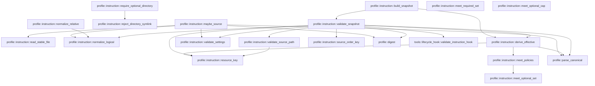

# profile::instruction

[Package atlas](index.md) · [Source](../../src/instruction.rs)

## Declarations

Visibility is the declaration spelling; trait members and reexports require their enclosing interface. `cfg` is not evaluated.

| Symbol | Kind | Visibility | Test / cfg |
|---|---|---|---|
| [profile::instruction::FORMAT](../../src/instruction.rs#L14) | const_item | `private` |  |
| [profile::instruction::MAX_FILES](../../src/instruction.rs#L15) | const_item | `private` |  |
| [profile::instruction::MAX_FILE_BYTES](../../src/instruction.rs#L16) | const_item | `private` |  |
| [profile::instruction::MAX_TOTAL_BYTES](../../src/instruction.rs#L17) | const_item | `private` |  |
| [profile::instruction::MAX_SCANS](../../src/instruction.rs#L18) | const_item | `private` |  |
| [profile::instruction::MAX_SAFE_INTEGER](../../src/instruction.rs#L19) | const_item | `private` |  |
| [profile::instruction::InstructionPolicy](../../src/instruction.rs#L23) | struct_item | `pub` |  |
| [profile::instruction::InstructionSettings](../../src/instruction.rs#L36) | struct_item | `pub` |  |
| [profile::instruction::InstructionSettings::decode](../../src/instruction.rs#L43) | function_item | `pub` |  |
| [profile::instruction::InstructionSettings::canonical_bytes](../../src/instruction.rs#L49) | function_item | `pub` |  |
| [profile::instruction::InstructionKind](../../src/instruction.rs#L57) | enum_item | `pub` |  |
| [profile::instruction::InstructionOrigin](../../src/instruction.rs#L67) | enum_item | `pub` |  |
| [profile::instruction::InstructionSource](../../src/instruction.rs#L75) | struct_item | `pub` |  |
| [profile::instruction::EffectiveInstructions](../../src/instruction.rs#L85) | struct_item | `pub` |  |
| [profile::instruction::InstructionSnapshot](../../src/instruction.rs#L95) | struct_item | `pub` |  |
| [profile::instruction::InstructionSnapshot::admit_source](../../src/instruction.rs#L102) | function_item | `pub` |  |
| [profile::instruction::InstructionSnapshot::source_authorized](../../src/instruction.rs#L114) | function_item | `pub` |  |
| [profile::instruction::EffectivePolicy](../../src/instruction.rs#L121) | struct_item | `pub` |  |
| [profile::instruction::EffectivePolicy::digest](../../src/instruction.rs#L129) | function_item | `pub` |  |
| [profile::instruction::LaunchProfile](../../src/instruction.rs#L135) | struct_item | `pub` |  |
| [profile::instruction::LaunchProfile::resolve_and_publish_for_scope](../../src/instruction.rs#L149) | function_item | `pub` |  |
| [profile::instruction::InstructionSnapshot::canonical_bytes](../../src/instruction.rs#L177) | function_item | `pub` |  |
| [profile::instruction::InstructionSnapshot::digest](../../src/instruction.rs#L182) | function_item | `pub` |  |
| [profile::instruction::InstructionSnapshot::decode](../../src/instruction.rs#L186) | function_item | `pub` |  |
| [profile::instruction::InstructionSnapshot::publish](../../src/instruction.rs#L192) | function_item | `pub` |  |
| [profile::instruction::InstructionSnapshot::validate_against_config](../../src/instruction.rs#L205) | function_item | `pub` |  |
| [profile::instruction::InstructionSnapshot::meet_workspace_policy](../../src/instruction.rs#L259) | function_item | `pub` |  |
| [profile::instruction::InstructionResolver](../../src/instruction.rs#L280) | struct_item | `pub` |  |
| [profile::instruction::InstructionResolver::new](../../src/instruction.rs#L288) | function_item | `pub` |  |
| [profile::instruction::InstructionResolver::new_scoped](../../src/instruction.rs#L303) | function_item | `pub` |  |
| [profile::instruction::InstructionResolver::capture](../../src/instruction.rs#L318) | function_item | `pub` |  |
| [profile::instruction::InstructionResolver::capture_with_hook](../../src/instruction.rs#L322) | function_item | `pub` |  |
| [profile::instruction::InstructionResolver::scan](../../src/instruction.rs#L348) | function_item | `private` |  |
| [profile::instruction::scan_origin](../../src/instruction.rs#L417) | function_item | `private` |  |
| [profile::instruction::skill_text_resource](../../src/instruction.rs#L509) | function_item | `private` |  |
| [profile::instruction::collect_files](../../src/instruction.rs#L537) | function_item | `private` |  |
| [profile::instruction::maybe_source](../../src/instruction.rs#L569) | function_item | `private` |  |
| [profile::instruction::read_stable_file](../../src/instruction.rs#L614) | function_item | `private` |  |
| [profile::instruction::reject_directory_symlink](../../src/instruction.rs#L647) | function_item | `private` |  |
| [profile::instruction::require_optional_directory](../../src/instruction.rs#L661) | function_item | `private` |  |
| [profile::instruction::normalize_relative](../../src/instruction.rs#L672) | function_item | `private` |  |
| [profile::instruction::normalize_logical](../../src/instruction.rs#L694) | function_item | `private` |  |
| [profile::instruction::build_snapshot](../../src/instruction.rs#L709) | function_item | `private` |  |
| [profile::instruction::derive_effective](../../src/instruction.rs#L720) | function_item | `private` |  |
| [profile::instruction::resource_key](../../src/instruction.rs#L755) | function_item | `private` |  |
| [profile::instruction::meet_policies](../../src/instruction.rs#L766) | function_item | `private` |  |
| [profile::instruction::meet_optional_set](../../src/instruction.rs#L789) | function_item | `private` |  |
| [profile::instruction::meet_required_set](../../src/instruction.rs#L800) | function_item | `private` |  |
| [profile::instruction::meet_optional_cap](../../src/instruction.rs#L811) | function_item | `private` |  |
| [profile::instruction::validate_settings](../../src/instruction.rs#L819) | function_item | `private` |  |
| [profile::instruction::validate_snapshot](../../src/instruction.rs#L865) | function_item | `private` |  |
| [profile::instruction::validate_source_path](../../src/instruction.rs#L968) | function_item | `private` |  |
| [profile::instruction::source_order_key](../../src/instruction.rs#L988) | function_item | `private` |  |

## Imports / reexports

| Local name | Source path | Visibility |
|---|---|---|
| `BTreeMap` | `std::collections::BTreeMap` | `private` |
| `BTreeSet` | `std::collections::BTreeSet` | `private` |
| `fs` | `std::fs` | `private` |
| `OpenOptions` | `std::fs::OpenOptions` | `private` |
| `Read` | `std::io::Read` | `private` |
| `MetadataExt` | `std::os::unix::fs::MetadataExt` | `private` |
| `OpenOptionsExt` | `std::os::unix::fs::OpenOptionsExt` | `private` |
| `Component` | `std::path::Component` | `private` |
| `Path` | `std::path::Path` | `private` |
| `PathBuf` | `std::path::PathBuf` | `private` |
| `Deserialize` | `serde::Deserialize` | `private` |
| `Serialize` | `serde::Serialize` | `private` |
| `AssetRef` | `store::AssetRef` | `private` |
| `AssetStore` | `store::AssetStore` | `private` |
| `UnicodeNormalization` | `unicode_normalization::UnicodeNormalization` | `private` |
| `ExecutionPolicy` | `crate::config::ExecutionPolicy` | `private` |
| `ProfileError` | `crate::ProfileError` | `private` |
| `canonical_line` | `crate::canonical_line` | `private` |
| `digest` | `crate::digest` | `private` |
| `parse_canonical` | `crate::parse_canonical` | `private` |

## Module declarations

| Module | Visibility | Attributes |
|---|---|---|

## Function call graphs

Edges below are syntactically resolved calls only, including private functions. Graphs partition callers into groups of 20; they are not execution order. All unresolved sites are listed below and in the JSON inventory.

```mermaid
flowchart TD
  n0["profile::instruction::InstructionSnapshot::admit_source"]
  n1["profile::instruction::InstructionSnapshot::source_authorized"]
  n2["profile::instruction::EffectivePolicy::digest"]
  n3["profile::instruction::LaunchProfile::resolve_and_publish_for_scope"]
  n4["profile::instruction::InstructionSnapshot::canonical_bytes"]
  n5["profile::instruction::InstructionSnapshot::digest"]
  n6["profile::instruction::InstructionSnapshot::decode"]
  n7["profile::instruction::InstructionSnapshot::publish"]
  n8["profile::instruction::InstructionSnapshot::validate_against_config"]
  n9["profile::instruction::InstructionSnapshot::meet_workspace_policy"]
  n10["profile::instruction::InstructionResolver::new"]
  n11["profile::instruction::InstructionResolver::new_scoped"]
  n12["profile::instruction::InstructionResolver::capture"]
  n13["profile::instruction::InstructionResolver::capture_with_hook"]
  n14["profile::instruction::InstructionResolver::scan"]
  n15["profile::instruction::scan_origin"]
  n16["profile::instruction::InstructionSettings::decode"]
  n17["profile::instruction::InstructionSettings::canonical_bytes"]
  n18["profile::instruction::skill_text_resource"]
  n19["profile::instruction::collect_files"]
  n20["profile::instruction::maybe_source"]
  n21["profile::instruction::require_optional_directory"]
  n22["profile::instruction::normalize_relative"]
  n23["profile::instruction::build_snapshot"]
  n24["profile::instruction::meet_required_set"]
  n25["profile::instruction::meet_optional_cap"]
  n26["profile::instruction::validate_settings"]
  n27["profile::instruction::validate_snapshot"]
  n28["profile::canonical_line"]
  n29["profile::digest"]
  n30["profile::parse_canonical"]
  n1 --> n0
  n2 --> n28
  n2 --> n29
  n4 --> n27
  n4 --> n28
  n5 --> n4
  n5 --> n29
  n6 --> n27
  n6 --> n30
  n7 --> n4
  n9 --> n24
  n9 --> n25
  n12 --> n13
  n13 --> n14
  n13 --> n23
  n14 --> n15
  n15 --> n18
  n15 --> n19
  n15 --> n20
  n15 --> n21
  n16 --> n26
  n16 --> n30
  n17 --> n26
  n17 --> n28
  n19 --> n19
  n19 --> n21
  n19 --> n22
```

Functions 1–20: 27 direct edges

Functions 21–37: 23 direct edges

## Call sites

Includes test functions (marked in declarations). Receiver-type-required sites need type analysis/manual tracing. Calls in closures are attributed to their enclosing function; their occurrence here does not mean the closure executes immediately.

| Caller | Callee expression | Source lines | Target / classification |
|---|---|---|---|
| `decode` | `parse_canonical` | [44](../../src/instruction.rs#L44) | [profile::parse_canonical](../../src/lib.rs#L69) |
| `decode` | `validate_settings` | [45](../../src/instruction.rs#L45) | [profile::instruction::validate_settings](../../src/instruction.rs#L819) |
| `decode` | `Path::new` | [45](../../src/instruction.rs#L45) | external-constructor-callback-or-unresolved |
| `decode` | `Ok` | [46](../../src/instruction.rs#L46) | external-constructor-callback-or-unresolved |
| `canonical_bytes` | `validate_settings` | [50](../../src/instruction.rs#L50) | [profile::instruction::validate_settings](../../src/instruction.rs#L819) |
| `canonical_bytes` | `Path::new` | [50](../../src/instruction.rs#L50) | external-constructor-callback-or-unresolved |
| `canonical_bytes` | `canonical_line` | [51](../../src/instruction.rs#L51) | [profile::canonical_line](../../src/lib.rs#L114) |
| `admit_source` | `Err` | [106](../../src/instruction.rs#L106) | external-constructor-callback-or-unresolved |
| `admit_source` | `std::io::Error::other` | [106](../../src/instruction.rs#L106) | external-constructor-callback-or-unresolved |
| `admit_source` | `Ok` | [110](../../src/instruction.rs#L110) | external-constructor-callback-or-unresolved |
| `source_authorized` | `self.admit_source(source).is_ok` | [115](../../src/instruction.rs#L115) | receiver-type-required |
| `source_authorized` | `self.admit_source` | [115](../../src/instruction.rs#L115) | [profile::instruction::InstructionSnapshot::admit_source](../../src/instruction.rs#L102) |
| `digest` | `Ok` | [130](../../src/instruction.rs#L130) | external-constructor-callback-or-unresolved |
| `digest` | `digest` | [130](../../src/instruction.rs#L130) | [profile::digest](../../src/lib.rs#L128) |
| `digest` | `canonical_line` | [130](../../src/instruction.rs#L130) | [profile::canonical_line](../../src/lib.rs#L114) |
| `resolve_and_publish_for_scope` | `scope.config` | [155](../../src/instruction.rs#L155) | receiver-type-required |
| `resolve_and_publish_for_scope` | `Some` | [156](../../src/instruction.rs#L156) | external-constructor-callback-or-unresolved |
| `resolve_and_publish_for_scope` | `user_agent_dir.as_ref().to_string_lossy().into_owned` | [156](../../src/instruction.rs#L156) | receiver-type-required |
| `resolve_and_publish_for_scope` | `user_agent_dir.as_ref().to_string_lossy` | [156](../../src/instruction.rs#L156) | receiver-type-required |
| `resolve_and_publish_for_scope` | `user_agent_dir.as_ref` | [156](../../src/instruction.rs#L156), [158](../../src/instruction.rs#L158) | receiver-type-required |
| `resolve_and_publish_for_scope` | `scope             .instructions(repository, user_agent_dir.as_ref(), &config)?             .capture` | [157](../../src/instruction.rs#L157) | receiver-type-required |
| `resolve_and_publish_for_scope` | `scope             .instructions` | [157](../../src/instruction.rs#L157) | receiver-type-required |
| `resolve_and_publish_for_scope` | `instruction.validate_against_config` | [160](../../src/instruction.rs#L160) | receiver-type-required |
| `resolve_and_publish_for_scope` | `instruction.meet_workspace_policy` | [161](../../src/instruction.rs#L161) | receiver-type-required |
| `resolve_and_publish_for_scope` | `config.publish` | [162](../../src/instruction.rs#L162) | receiver-type-required |
| `resolve_and_publish_for_scope` | `instruction.publish` | [163](../../src/instruction.rs#L163) | receiver-type-required |
| `resolve_and_publish_for_scope` | `Ok` | [164](../../src/instruction.rs#L164) | external-constructor-callback-or-unresolved |
| `canonical_bytes` | `validate_snapshot` | [178](../../src/instruction.rs#L178) | [profile::instruction::validate_snapshot](../../src/instruction.rs#L865) |
| `canonical_bytes` | `canonical_line` | [179](../../src/instruction.rs#L179) | [profile::canonical_line](../../src/lib.rs#L114) |
| `digest` | `Ok` | [183](../../src/instruction.rs#L183) | external-constructor-callback-or-unresolved |
| `digest` | `digest` | [183](../../src/instruction.rs#L183) | [profile::digest](../../src/lib.rs#L128) |
| `digest` | `self.canonical_bytes` | [183](../../src/instruction.rs#L183) | [profile::instruction::InstructionSnapshot::canonical_bytes](../../src/instruction.rs#L177) |
| `decode` | `parse_canonical` | [187](../../src/instruction.rs#L187) | [profile::parse_canonical](../../src/lib.rs#L69) |
| `decode` | `validate_snapshot` | [188](../../src/instruction.rs#L188) | [profile::instruction::validate_snapshot](../../src/instruction.rs#L865) |
| `decode` | `Ok` | [189](../../src/instruction.rs#L189) | external-constructor-callback-or-unresolved |
| `publish` | `self.canonical_bytes` | [193](../../src/instruction.rs#L193) | [profile::instruction::InstructionSnapshot::canonical_bytes](../../src/instruction.rs#L177) |
| `publish` | `digest` | [194](../../src/instruction.rs#L194) | external-constructor-callback-or-unresolved |
| `publish` | `assets.publish` | [195](../../src/instruction.rs#L195) | receiver-type-required |
| `publish` | `Err` | [197](../../src/instruction.rs#L197) | external-constructor-callback-or-unresolved |
| `publish` | `Ok` | [202](../../src/instruction.rs#L202) | external-constructor-callback-or-unresolved |
| `validate_against_config` | `usize::try_from(workspace_index).map_err` | [211](../../src/instruction.rs#L211) | receiver-type-required |
| `validate_against_config` | `usize::try_from` | [211](../../src/instruction.rs#L211) | external-constructor-callback-or-unresolved |
| `validate_against_config` | `PathBuf::from` | [213](../../src/instruction.rs#L213), [221](../../src/instruction.rs#L221), [233](../../src/instruction.rs#L233), [238](../../src/instruction.rs#L238), [249](../../src/instruction.rs#L249) | external-constructor-callback-or-unresolved |
| `validate_against_config` | `config.execution.cwd.len` | [219](../../src/instruction.rs#L219) | receiver-type-required |
| `validate_against_config` | `Err` | [220](../../src/instruction.rs#L220), [237](../../src/instruction.rs#L237), [248](../../src/instruction.rs#L248) | external-constructor-callback-or-unresolved |
| `validate_against_config` | `fs::canonicalize(root).map_err` | [232](../../src/instruction.rs#L232) | receiver-type-required |
| `validate_against_config` | `fs::canonicalize` | [232](../../src/instruction.rs#L232) | external-constructor-callback-or-unresolved |
| `validate_against_config` | `error.to_string` | [234](../../src/instruction.rs#L234) | receiver-type-required |
| `validate_against_config` | `canonical.to_str` | [236](../../src/instruction.rs#L236) | receiver-type-required |
| `validate_against_config` | `Some` | [236](../../src/instruction.rs#L236) | external-constructor-callback-or-unresolved |
| `validate_against_config` | `root.as_str` | [236](../../src/instruction.rs#L236) | receiver-type-required |
| `validate_against_config` | `"instruction writable root is not canonical".to_owned` | [239](../../src/instruction.rs#L239) | receiver-type-required |
| `validate_against_config` | `config                     .execution                     .cwd                     .iter()                     .any` | [242](../../src/instruction.rs#L242) | receiver-type-required |
| `validate_against_config` | `config                     .execution                     .cwd                     .iter` | [242](../../src/instruction.rs#L242) | receiver-type-required |
| `validate_against_config` | `canonical.starts_with` | [246](../../src/instruction.rs#L246) | receiver-type-required |
| `validate_against_config` | `Ok` | [255](../../src/instruction.rs#L255) | external-constructor-callback-or-unresolved |
| `meet_workspace_policy` | `instruction.network.unwrap_or` | [262](../../src/instruction.rs#L262) | receiver-type-required |
| `meet_workspace_policy` | `meet_required_set` | [263](../../src/instruction.rs#L263), [267](../../src/instruction.rs#L267) | [profile::instruction::meet_required_set](../../src/instruction.rs#L800) |
| `meet_workspace_policy` | `instruction.allowed_tools.as_deref` | [265](../../src/instruction.rs#L265) | receiver-type-required |
| `meet_workspace_policy` | `instruction.writable_roots.as_deref` | [269](../../src/instruction.rs#L269) | receiver-type-required |
| `meet_workspace_policy` | `meet_optional_cap` | [271](../../src/instruction.rs#L271) | [profile::instruction::meet_optional_cap](../../src/instruction.rs#L811) |
| `new` | `user_agent_dir.as_ref().to_path_buf` | [293](../../src/instruction.rs#L293) | receiver-type-required |
| `new` | `user_agent_dir.as_ref` | [293](../../src/instruction.rs#L293) | receiver-type-required |
| `new` | `cwd                 .into_iter()                 .map(&#124;value&#124; value.as_ref().to_path_buf())                 .collect` | [295](../../src/instruction.rs#L295) | receiver-type-required |
| `new` | `cwd                 .into_iter()                 .map` | [295](../../src/instruction.rs#L295) | receiver-type-required |
| `new` | `cwd                 .into_iter` | [295](../../src/instruction.rs#L295) | receiver-type-required |
| `new` | `value.as_ref().to_path_buf` | [297](../../src/instruction.rs#L297) | receiver-type-required |
| `new` | `value.as_ref` | [297](../../src/instruction.rs#L297) | receiver-type-required |
| `new_scoped` | `user_data_dir.as_ref().to_path_buf` | [309](../../src/instruction.rs#L309) | receiver-type-required |
| `new_scoped` | `user_data_dir.as_ref` | [309](../../src/instruction.rs#L309) | receiver-type-required |
| `new_scoped` | `Some` | [310](../../src/instruction.rs#L310) | external-constructor-callback-or-unresolved |
| `new_scoped` | `workspace_data_dir.as_ref().to_path_buf` | [310](../../src/instruction.rs#L310) | receiver-type-required |
| `new_scoped` | `workspace_data_dir.as_ref` | [310](../../src/instruction.rs#L310) | receiver-type-required |
| `new_scoped` | `cwd                 .into_iter()                 .map(&#124;value&#124; value.as_ref().to_path_buf())                 .collect` | [311](../../src/instruction.rs#L311) | receiver-type-required |
| `new_scoped` | `cwd                 .into_iter()                 .map` | [311](../../src/instruction.rs#L311) | receiver-type-required |
| `new_scoped` | `cwd                 .into_iter` | [311](../../src/instruction.rs#L311) | receiver-type-required |
| `new_scoped` | `value.as_ref().to_path_buf` | [313](../../src/instruction.rs#L313) | receiver-type-required |
| `new_scoped` | `value.as_ref` | [313](../../src/instruction.rs#L313) | receiver-type-required |
| `capture` | `self.capture_with_hook` | [319](../../src/instruction.rs#L319) | [profile::instruction::InstructionResolver::capture_with_hook](../../src/instruction.rs#L322) |
| `capture_with_hook` | `self.scan` | [328](../../src/instruction.rs#L328) | [profile::instruction::InstructionResolver::scan](../../src/instruction.rs#L348) |
| `capture_with_hook` | `after_scan` | [331](../../src/instruction.rs#L331), [337](../../src/instruction.rs#L337) | external-constructor-callback-or-unresolved |
| `capture_with_hook` | `Err` | [335](../../src/instruction.rs#L335), [343](../../src/instruction.rs#L343) | external-constructor-callback-or-unresolved |
| `capture_with_hook` | `previous.as_ref` | [338](../../src/instruction.rs#L338) | receiver-type-required |
| `capture_with_hook` | `Some` | [338](../../src/instruction.rs#L338), [341](../../src/instruction.rs#L341) | external-constructor-callback-or-unresolved |
| `capture_with_hook` | `build_snapshot` | [339](../../src/instruction.rs#L339) | [profile::instruction::build_snapshot](../../src/instruction.rs#L709) |
| `scan` | `Vec::new` | [349](../../src/instruction.rs#L349) | external-constructor-callback-or-unresolved |
| `scan` | `scan_origin` | [350](../../src/instruction.rs#L350), [358](../../src/instruction.rs#L358), [377](../../src/instruction.rs#L377) | [profile::instruction::scan_origin](../../src/instruction.rs#L417) |
| `scan` | `self.cwd.iter().enumerate` | [366](../../src/instruction.rs#L366) | receiver-type-required |
| `scan` | `self.cwd.iter` | [366](../../src/instruction.rs#L366) | receiver-type-required |
| `scan` | `fs::canonicalize(cwd).map_err` | [367](../../src/instruction.rs#L367) | receiver-type-required |
| `scan` | `fs::canonicalize` | [367](../../src/instruction.rs#L367) | external-constructor-callback-or-unresolved |
| `scan` | `cwd.clone` | [368](../../src/instruction.rs#L368) | receiver-type-required |
| `scan` | `error.to_string` | [369](../../src/instruction.rs#L369) | receiver-type-required |
| `scan` | `canonical.is_dir` | [371](../../src/instruction.rs#L371) | receiver-type-required |
| `scan` | `Err` | [372](../../src/instruction.rs#L372), [388](../../src/instruction.rs#L388), [395](../../src/instruction.rs#L395), [406](../../src/instruction.rs#L406) | external-constructor-callback-or-unresolved |
| `scan` | `"workspace cwd is not a directory".to_owned` | [374](../../src/instruction.rs#L374) | receiver-type-required |
| `scan` | `sources.len` | [387](../../src/instruction.rs#L387) | receiver-type-required |
| `scan` | `ProfileError::LimitExceeded` | [388](../../src/instruction.rs#L388), [395](../../src/instruction.rs#L395) | external-constructor-callback-or-unresolved |
| `scan` | `sources             .iter()             .map(&#124;source&#124; source.content.len() as u64)             .sum::<u64>` | [390](../../src/instruction.rs#L390) | receiver-type-required |
| `scan` | `sources             .iter()             .map` | [390](../../src/instruction.rs#L390) | receiver-type-required |
| `scan` | `sources             .iter` | [390](../../src/instruction.rs#L390) | receiver-type-required |
| `scan` | `source.content.len` | [392](../../src/instruction.rs#L392) | receiver-type-required |
| `scan` | `BTreeSet::new` | [399](../../src/instruction.rs#L399) | external-constructor-callback-or-unresolved |
| `scan` | `identities.insert` | [401](../../src/instruction.rs#L401) | receiver-type-required |
| `scan` | `source.origin.clone` | [402](../../src/instruction.rs#L402) | receiver-type-required |
| `scan` | `source.kind.clone` | [403](../../src/instruction.rs#L403) | receiver-type-required |
| `scan` | `source.path.clone` | [404](../../src/instruction.rs#L404) | receiver-type-required |
| `scan` | `PathBuf::from` | [407](../../src/instruction.rs#L407) | external-constructor-callback-or-unresolved |
| `scan` | `"instruction paths collide after NFC normalization".to_owned` | [408](../../src/instruction.rs#L408) | receiver-type-required |
| `scan` | `sources.sort_by_key` | [412](../../src/instruction.rs#L412) | receiver-type-required |
| `scan` | `Ok` | [413](../../src/instruction.rs#L413) | external-constructor-callback-or-unresolved |
| `scan_origin` | `require_optional_directory` | [424](../../src/instruction.rs#L424), [439](../../src/instruction.rs#L439), [443](../../src/instruction.rs#L443), [450](../../src/instruction.rs#L450) | [profile::instruction::require_optional_directory](../../src/instruction.rs#L661) |
| `scan_origin` | `Ok` | [425](../../src/instruction.rs#L425), [451](../../src/instruction.rs#L451), [506](../../src/instruction.rs#L506) | external-constructor-callback-or-unresolved |
| `scan_origin` | `root.join` | [427](../../src/instruction.rs#L427), [438](../../src/instruction.rs#L438), [442](../../src/instruction.rs#L442), [446](../../src/instruction.rs#L446) | receiver-type-required |
| `scan_origin` | `maybe_source` | [428](../../src/instruction.rs#L428), [453](../../src/instruction.rs#L453), [476](../../src/instruction.rs#L476), [496](../../src/instruction.rs#L496) | [profile::instruction::maybe_source](../../src/instruction.rs#L569) |
| `scan_origin` | `root.to_path_buf` | [436](../../src/instruction.rs#L436) | receiver-type-required |
| `scan_origin` | `agent.join` | [454](../../src/instruction.rs#L454), [468](../../src/instruction.rs#L468), [491](../../src/instruction.rs#L491) | receiver-type-required |
| `scan_origin` | `Vec::new` | [469](../../src/instruction.rs#L469), [492](../../src/instruction.rs#L492) | external-constructor-callback-or-unresolved |
| `scan_origin` | `collect_files` | [470](../../src/instruction.rs#L470), [493](../../src/instruction.rs#L493) | [profile::instruction::collect_files](../../src/instruction.rs#L537) |
| `scan_origin` | `files.sort_by` | [471](../../src/instruction.rs#L471), [494](../../src/instruction.rs#L494) | receiver-type-required |
| `scan_origin` | `left.0.as_bytes().cmp` | [471](../../src/instruction.rs#L471), [494](../../src/instruction.rs#L494) | receiver-type-required |
| `scan_origin` | `left.0.as_bytes` | [471](../../src/instruction.rs#L471), [494](../../src/instruction.rs#L494) | receiver-type-required |
| `scan_origin` | `right.0.as_bytes` | [471](../../src/instruction.rs#L471), [494](../../src/instruction.rs#L494) | receiver-type-required |
| `scan_origin` | `skill_text_resource` | [473](../../src/instruction.rs#L473) | [profile::instruction::skill_text_resource](../../src/instruction.rs#L509) |
| `scan_origin` | `kind.clone` | [479](../../src/instruction.rs#L479) | receiver-type-required |
| `scan_origin` | `agent             .file_name()             .is_some_and` | [486](../../src/instruction.rs#L486) | receiver-type-required |
| `scan_origin` | `agent             .file_name` | [486](../../src/instruction.rs#L486) | receiver-type-required |
| `skill_text_resource` | `relative.split('/').any` | [510](../../src/instruction.rs#L510) | receiver-type-required |
| `skill_text_resource` | `relative.split` | [510](../../src/instruction.rs#L510) | receiver-type-required |
| `skill_text_resource` | `part.starts_with` | [510](../../src/instruction.rs#L510) | receiver-type-required |
| `collect_files` | `require_optional_directory` | [542](../../src/instruction.rs#L542) | [profile::instruction::require_optional_directory](../../src/instruction.rs#L661) |
| `collect_files` | `Ok` | [543](../../src/instruction.rs#L543), [566](../../src/instruction.rs#L566) | external-constructor-callback-or-unresolved |
| `collect_files` | `fs::read_dir` | [545](../../src/instruction.rs#L545) | external-constructor-callback-or-unresolved |
| `collect_files` | `entry.path` | [547](../../src/instruction.rs#L547) | receiver-type-required |
| `collect_files` | `fs::symlink_metadata` | [548](../../src/instruction.rs#L548) | external-constructor-callback-or-unresolved |
| `collect_files` | `metadata.file_type().is_symlink` | [549](../../src/instruction.rs#L549) | receiver-type-required |
| `collect_files` | `metadata.file_type` | [549](../../src/instruction.rs#L549) | receiver-type-required |
| `collect_files` | `Err` | [550](../../src/instruction.rs#L550), [563](../../src/instruction.rs#L563) | external-constructor-callback-or-unresolved |
| `collect_files` | `ProfileError::Symlink` | [550](../../src/instruction.rs#L550) | external-constructor-callback-or-unresolved |
| `collect_files` | `metadata.is_dir` | [552](../../src/instruction.rs#L552) | receiver-type-required |
| `collect_files` | `collect_files` | [553](../../src/instruction.rs#L553) | [profile::instruction::collect_files](../../src/instruction.rs#L537) |
| `collect_files` | `metadata.is_file` | [554](../../src/instruction.rs#L554) | receiver-type-required |
| `collect_files` | `path                 .strip_prefix(root)                 .map_err` | [555](../../src/instruction.rs#L555) | receiver-type-required |
| `collect_files` | `path                 .strip_prefix` | [555](../../src/instruction.rs#L555) | receiver-type-required |
| `collect_files` | `path.clone` | [558](../../src/instruction.rs#L558) | receiver-type-required |
| `collect_files` | `"instruction path escaped its kind directory".to_owned` | [559](../../src/instruction.rs#L559) | receiver-type-required |
| `collect_files` | `output.push` | [561](../../src/instruction.rs#L561) | receiver-type-required |
| `collect_files` | `normalize_relative` | [561](../../src/instruction.rs#L561) | [profile::instruction::normalize_relative](../../src/instruction.rs#L672) |
| `collect_files` | `ProfileError::NotRegular` | [563](../../src/instruction.rs#L563) | external-constructor-callback-or-unresolved |
| `maybe_source` | `fs::symlink_metadata` | [576](../../src/instruction.rs#L576) | external-constructor-callback-or-unresolved |
| `maybe_source` | `metadata.file_type().is_symlink` | [578](../../src/instruction.rs#L578) | receiver-type-required |
| `maybe_source` | `metadata.file_type` | [578](../../src/instruction.rs#L578) | receiver-type-required |
| `maybe_source` | `Err` | [579](../../src/instruction.rs#L579), [582](../../src/instruction.rs#L582), [586](../../src/instruction.rs#L586), [594](../../src/instruction.rs#L594) | external-constructor-callback-or-unresolved |
| `maybe_source` | `ProfileError::Symlink` | [579](../../src/instruction.rs#L579) | external-constructor-callback-or-unresolved |
| `maybe_source` | `file.to_path_buf` | [579](../../src/instruction.rs#L579), [582](../../src/instruction.rs#L582), [590](../../src/instruction.rs#L590), [595](../../src/instruction.rs#L595) | receiver-type-required |
| `maybe_source` | `metadata.is_file` | [581](../../src/instruction.rs#L581) | receiver-type-required |
| `maybe_source` | `ProfileError::NotRegular` | [582](../../src/instruction.rs#L582) | external-constructor-callback-or-unresolved |
| `maybe_source` | `error.kind` | [585](../../src/instruction.rs#L585) | receiver-type-required |
| `maybe_source` | `Ok` | [585](../../src/instruction.rs#L585), [611](../../src/instruction.rs#L611) | external-constructor-callback-or-unresolved |
| `maybe_source` | `error.into` | [586](../../src/instruction.rs#L586) | receiver-type-required |
| `maybe_source` | `read_stable_file` | [588](../../src/instruction.rs#L588) | [profile::instruction::read_stable_file](../../src/instruction.rs#L614) |
| `maybe_source` | `String::from_utf8(bytes.clone()).map_err` | [589](../../src/instruction.rs#L589) | receiver-type-required |
| `maybe_source` | `String::from_utf8` | [589](../../src/instruction.rs#L589) | external-constructor-callback-or-unresolved |
| `maybe_source` | `bytes.clone` | [589](../../src/instruction.rs#L589) | receiver-type-required |
| `maybe_source` | `"instruction content is not UTF-8".to_owned` | [591](../../src/instruction.rs#L591) | receiver-type-required |
| `maybe_source` | `content.contains` | [593](../../src/instruction.rs#L593) | receiver-type-required |
| `maybe_source` | `"instruction content contains NUL".to_owned` | [596](../../src/instruction.rs#L596) | receiver-type-required |
| `maybe_source` | `parse_canonical` | [600](../../src/instruction.rs#L600) | [profile::parse_canonical](../../src/lib.rs#L69) |
| `maybe_source` | `validate_settings` | [601](../../src/instruction.rs#L601) | [profile::instruction::validate_settings](../../src/instruction.rs#L819) |
| `maybe_source` | `normalize_logical` | [603](../../src/instruction.rs#L603) | [profile::instruction::normalize_logical](../../src/instruction.rs#L694) |
| `maybe_source` | `sources.push` | [604](../../src/instruction.rs#L604) | receiver-type-required |
| `maybe_source` | `origin.clone` | [605](../../src/instruction.rs#L605) | receiver-type-required |
| `maybe_source` | `digest` | [609](../../src/instruction.rs#L609) | [profile::digest](../../src/lib.rs#L128) |
| `read_stable_file` | `OpenOptions::new()         .read(true)         .custom_flags(libc::O_CLOEXEC &#124; libc::O_NOFOLLOW)         .open` | [615](../../src/instruction.rs#L615) | receiver-type-required |
| `read_stable_file` | `OpenOptions::new()         .read(true)         .custom_flags` | [615](../../src/instruction.rs#L615) | receiver-type-required |
| `read_stable_file` | `OpenOptions::new()         .read` | [615](../../src/instruction.rs#L615) | receiver-type-required |
| `read_stable_file` | `OpenOptions::new` | [615](../../src/instruction.rs#L615) | external-constructor-callback-or-unresolved |
| `read_stable_file` | `file.metadata` | [619](../../src/instruction.rs#L619), [630](../../src/instruction.rs#L630) | receiver-type-required |
| `read_stable_file` | `before.is_file` | [620](../../src/instruction.rs#L620) | receiver-type-required |
| `read_stable_file` | `Err` | [621](../../src/instruction.rs#L621), [624](../../src/instruction.rs#L624), [633](../../src/instruction.rs#L633), [642](../../src/instruction.rs#L642) | external-constructor-callback-or-unresolved |
| `read_stable_file` | `ProfileError::NotRegular` | [621](../../src/instruction.rs#L621) | external-constructor-callback-or-unresolved |
| `read_stable_file` | `path.to_path_buf` | [621](../../src/instruction.rs#L621) | receiver-type-required |
| `read_stable_file` | `before.len` | [623](../../src/instruction.rs#L623), [628](../../src/instruction.rs#L628), [637](../../src/instruction.rs#L637) | receiver-type-required |
| `read_stable_file` | `ProfileError::LimitExceeded` | [624](../../src/instruction.rs#L624) | external-constructor-callback-or-unresolved |
| `read_stable_file` | `Vec::with_capacity` | [628](../../src/instruction.rs#L628) | external-constructor-callback-or-unresolved |
| `read_stable_file` | `file.read_to_end` | [629](../../src/instruction.rs#L629) | receiver-type-required |
| `read_stable_file` | `fs::symlink_metadata` | [631](../../src/instruction.rs#L631) | external-constructor-callback-or-unresolved |
| `read_stable_file` | `named.file_type().is_symlink` | [632](../../src/instruction.rs#L632) | receiver-type-required |
| `read_stable_file` | `named.file_type` | [632](../../src/instruction.rs#L632) | receiver-type-required |
| `read_stable_file` | `before.dev` | [635](../../src/instruction.rs#L635) | receiver-type-required |
| `read_stable_file` | `after.dev` | [635](../../src/instruction.rs#L635), [639](../../src/instruction.rs#L639) | receiver-type-required |
| `read_stable_file` | `before.ino` | [636](../../src/instruction.rs#L636) | receiver-type-required |
| `read_stable_file` | `after.ino` | [636](../../src/instruction.rs#L636), [640](../../src/instruction.rs#L640) | receiver-type-required |
| `read_stable_file` | `after.len` | [637](../../src/instruction.rs#L637) | receiver-type-required |
| `read_stable_file` | `before.modified` | [638](../../src/instruction.rs#L638) | receiver-type-required |
| `read_stable_file` | `after.modified` | [638](../../src/instruction.rs#L638) | receiver-type-required |
| `read_stable_file` | `named.dev` | [639](../../src/instruction.rs#L639) | receiver-type-required |
| `read_stable_file` | `named.ino` | [640](../../src/instruction.rs#L640) | receiver-type-required |
| `read_stable_file` | `Ok` | [644](../../src/instruction.rs#L644) | external-constructor-callback-or-unresolved |
| `reject_directory_symlink` | `fs::symlink_metadata` | [648](../../src/instruction.rs#L648) | external-constructor-callback-or-unresolved |
| `reject_directory_symlink` | `metadata.file_type().is_symlink` | [649](../../src/instruction.rs#L649) | receiver-type-required |
| `reject_directory_symlink` | `metadata.file_type` | [649](../../src/instruction.rs#L649) | receiver-type-required |
| `reject_directory_symlink` | `Err` | [650](../../src/instruction.rs#L650), [652](../../src/instruction.rs#L652) | external-constructor-callback-or-unresolved |
| `reject_directory_symlink` | `ProfileError::Symlink` | [650](../../src/instruction.rs#L650) | external-constructor-callback-or-unresolved |
| `reject_directory_symlink` | `path.to_path_buf` | [650](../../src/instruction.rs#L650), [653](../../src/instruction.rs#L653) | receiver-type-required |
| `reject_directory_symlink` | `metadata.is_dir` | [651](../../src/instruction.rs#L651) | receiver-type-required |
| `reject_directory_symlink` | `"expected instruction directory".to_owned` | [654](../../src/instruction.rs#L654) | receiver-type-required |
| `reject_directory_symlink` | `Ok` | [657](../../src/instruction.rs#L657) | external-constructor-callback-or-unresolved |
| `require_optional_directory` | `fs::symlink_metadata` | [662](../../src/instruction.rs#L662) | external-constructor-callback-or-unresolved |
| `require_optional_directory` | `reject_directory_symlink` | [664](../../src/instruction.rs#L664) | [profile::instruction::reject_directory_symlink](../../src/instruction.rs#L647) |
| `require_optional_directory` | `Ok` | [665](../../src/instruction.rs#L665), [667](../../src/instruction.rs#L667) | external-constructor-callback-or-unresolved |
| `require_optional_directory` | `error.kind` | [667](../../src/instruction.rs#L667) | receiver-type-required |
| `require_optional_directory` | `Err` | [668](../../src/instruction.rs#L668) | external-constructor-callback-or-unresolved |
| `require_optional_directory` | `error.into` | [668](../../src/instruction.rs#L668) | receiver-type-required |
| `normalize_relative` | `Vec::new` | [673](../../src/instruction.rs#L673) | external-constructor-callback-or-unresolved |
| `normalize_relative` | `path.components` | [674](../../src/instruction.rs#L674) | receiver-type-required |
| `normalize_relative` | `value.to_str().ok_or_else` | [677](../../src/instruction.rs#L677) | receiver-type-required |
| `normalize_relative` | `value.to_str` | [677](../../src/instruction.rs#L677) | receiver-type-required |
| `normalize_relative` | `path.to_path_buf` | [678](../../src/instruction.rs#L678), [685](../../src/instruction.rs#L685) | receiver-type-required |
| `normalize_relative` | `"instruction path is not UTF-8".to_owned` | [679](../../src/instruction.rs#L679) | receiver-type-required |
| `normalize_relative` | `values.push` | [681](../../src/instruction.rs#L681) | receiver-type-required |
| `normalize_relative` | `value.nfc().collect::<String>` | [681](../../src/instruction.rs#L681) | receiver-type-required |
| `normalize_relative` | `value.nfc` | [681](../../src/instruction.rs#L681) | receiver-type-required |
| `normalize_relative` | `Err` | [684](../../src/instruction.rs#L684) | external-constructor-callback-or-unresolved |
| `normalize_relative` | `"instruction path contains a non-normal component".to_owned` | [686](../../src/instruction.rs#L686) | receiver-type-required |
| `normalize_relative` | `normalize_logical` | [691](../../src/instruction.rs#L691) | [profile::instruction::normalize_logical](../../src/instruction.rs#L694) |
| `normalize_relative` | `values.join` | [691](../../src/instruction.rs#L691) | receiver-type-required |
| `normalize_logical` | `path.is_empty` | [695](../../src/instruction.rs#L695) | receiver-type-required |
| `normalize_logical` | `path.contains` | [696](../../src/instruction.rs#L696) | receiver-type-required |
| `normalize_logical` | `path             .split('/')             .any` | [697](../../src/instruction.rs#L697) | receiver-type-required |
| `normalize_logical` | `path             .split` | [697](../../src/instruction.rs#L697) | receiver-type-required |
| `normalize_logical` | `part.is_empty` | [699](../../src/instruction.rs#L699) | receiver-type-required |
| `normalize_logical` | `Err` | [701](../../src/instruction.rs#L701) | external-constructor-callback-or-unresolved |
| `normalize_logical` | `PathBuf::from` | [702](../../src/instruction.rs#L702) | external-constructor-callback-or-unresolved |
| `normalize_logical` | `"invalid logical instruction path".to_owned` | [703](../../src/instruction.rs#L703) | receiver-type-required |
| `normalize_logical` | `Ok` | [706](../../src/instruction.rs#L706) | external-constructor-callback-or-unresolved |
| `normalize_logical` | `path.nfc().collect` | [706](../../src/instruction.rs#L706) | receiver-type-required |
| `normalize_logical` | `path.nfc` | [706](../../src/instruction.rs#L706) | receiver-type-required |
| `build_snapshot` | `derive_effective` | [710](../../src/instruction.rs#L710) | [profile::instruction::derive_effective](../../src/instruction.rs#L720) |
| `build_snapshot` | `validate_snapshot` | [716](../../src/instruction.rs#L716) | [profile::instruction::validate_snapshot](../../src/instruction.rs#L865) |
| `build_snapshot` | `Ok` | [717](../../src/instruction.rs#L717) | external-constructor-callback-or-unresolved |
| `derive_effective` | `EffectiveInstructions::default` | [721](../../src/instruction.rs#L721) | external-constructor-callback-or-unresolved |
| `derive_effective` | `Vec::new` | [722](../../src/instruction.rs#L722) | external-constructor-callback-or-unresolved |
| `derive_effective` | `sources.iter().enumerate` | [723](../../src/instruction.rs#L723) | receiver-type-required |
| `derive_effective` | `sources.iter` | [723](../../src/instruction.rs#L723) | receiver-type-required |
| `derive_effective` | `effective.agents.push` | [726](../../src/instruction.rs#L726) | receiver-type-required |
| `derive_effective` | `effective                     .skills                     .insert` | [728](../../src/instruction.rs#L728) | receiver-type-required |
| `derive_effective` | `resource_key` | [730](../../src/instruction.rs#L730), [735](../../src/instruction.rs#L735), [740](../../src/instruction.rs#L740) | [profile::instruction::resource_key](../../src/instruction.rs#L755) |
| `derive_effective` | `effective                     .commands                     .insert` | [733](../../src/instruction.rs#L733) | receiver-type-required |
| `derive_effective` | `effective                     .hooks                     .insert` | [738](../../src/instruction.rs#L738) | receiver-type-required |
| `derive_effective` | `parse_canonical` | [744](../../src/instruction.rs#L744) | [profile::parse_canonical](../../src/lib.rs#L69) |
| `derive_effective` | `PathBuf::from` | [744](../../src/instruction.rs#L744) | external-constructor-callback-or-unresolved |
| `derive_effective` | `source.content.as_bytes` | [744](../../src/instruction.rs#L744) | receiver-type-required |
| `derive_effective` | `policies.push` | [746](../../src/instruction.rs#L746) | receiver-type-required |
| `derive_effective` | `meet_policies` | [751](../../src/instruction.rs#L751) | [profile::instruction::meet_policies](../../src/instruction.rs#L766) |
| `derive_effective` | `Ok` | [752](../../src/instruction.rs#L752) | external-constructor-callback-or-unresolved |
| `resource_key` | `source         .path         .strip_prefix(prefix)         .map(ToOwned::to_owned)         .ok_or_else` | [756](../../src/instruction.rs#L756) | receiver-type-required |
| `resource_key` | `source         .path         .strip_prefix(prefix)         .map` | [756](../../src/instruction.rs#L756) | receiver-type-required |
| `resource_key` | `source         .path         .strip_prefix` | [756](../../src/instruction.rs#L756) | receiver-type-required |
| `resource_key` | `PathBuf::from` | [761](../../src/instruction.rs#L761) | external-constructor-callback-or-unresolved |
| `meet_policies` | `Some` | [773](../../src/instruction.rs#L773), [778](../../src/instruction.rs#L778) | external-constructor-callback-or-unresolved |
| `meet_policies` | `network.unwrap_or` | [773](../../src/instruction.rs#L773) | receiver-type-required |
| `meet_policies` | `meet_optional_set` | [775](../../src/instruction.rs#L775), [776](../../src/instruction.rs#L776) | [profile::instruction::meet_optional_set](../../src/instruction.rs#L789) |
| `meet_policies` | `cap.map_or` | [778](../../src/instruction.rs#L778) | receiver-type-required |
| `meet_policies` | `current.min` | [778](../../src/instruction.rs#L778) | receiver-type-required |
| `meet_policies` | `tools.map` | [783](../../src/instruction.rs#L783) | receiver-type-required |
| `meet_policies` | `value.into_iter().collect` | [783](../../src/instruction.rs#L783), [784](../../src/instruction.rs#L784) | receiver-type-required |
| `meet_policies` | `value.into_iter` | [783](../../src/instruction.rs#L783), [784](../../src/instruction.rs#L784) | receiver-type-required |
| `meet_policies` | `roots.map` | [784](../../src/instruction.rs#L784) | receiver-type-required |
| `meet_optional_set` | `value.into_iter().collect::<BTreeSet<_>>` | [793](../../src/instruction.rs#L793) | receiver-type-required |
| `meet_optional_set` | `value.into_iter` | [793](../../src/instruction.rs#L793) | receiver-type-required |
| `meet_optional_set` | `Some` | [794](../../src/instruction.rs#L794) | external-constructor-callback-or-unresolved |
| `meet_optional_set` | `target.take` | [794](../../src/instruction.rs#L794) | receiver-type-required |
| `meet_optional_set` | `current.intersection(&value).cloned().collect` | [795](../../src/instruction.rs#L795) | receiver-type-required |
| `meet_optional_set` | `current.intersection(&value).cloned` | [795](../../src/instruction.rs#L795) | receiver-type-required |
| `meet_optional_set` | `current.intersection` | [795](../../src/instruction.rs#L795) | receiver-type-required |
| `meet_required_set` | `required.iter().cloned().collect::<BTreeSet<_>>` | [801](../../src/instruction.rs#L801) | receiver-type-required |
| `meet_required_set` | `required.iter().cloned` | [801](../../src/instruction.rs#L801) | receiver-type-required |
| `meet_required_set` | `required.iter` | [801](../../src/instruction.rs#L801) | receiver-type-required |
| `meet_required_set` | `constraint.iter().cloned().collect::<BTreeSet<_>>` | [804](../../src/instruction.rs#L804) | receiver-type-required |
| `meet_required_set` | `constraint.iter().cloned` | [804](../../src/instruction.rs#L804) | receiver-type-required |
| `meet_required_set` | `constraint.iter` | [804](../../src/instruction.rs#L804) | receiver-type-required |
| `meet_required_set` | `required.intersection(&constraint).cloned().collect` | [805](../../src/instruction.rs#L805) | receiver-type-required |
| `meet_required_set` | `required.intersection(&constraint).cloned` | [805](../../src/instruction.rs#L805) | receiver-type-required |
| `meet_required_set` | `required.intersection` | [805](../../src/instruction.rs#L805) | receiver-type-required |
| `meet_required_set` | `required.into_iter().collect` | [807](../../src/instruction.rs#L807) | receiver-type-required |
| `meet_required_set` | `required.into_iter` | [807](../../src/instruction.rs#L807) | receiver-type-required |
| `meet_optional_cap` | `Some` | [813](../../src/instruction.rs#L813), [814](../../src/instruction.rs#L814) | external-constructor-callback-or-unresolved |
| `meet_optional_cap` | `left.min` | [813](../../src/instruction.rs#L813) | receiver-type-required |
| `validate_settings` | `Err` | [821](../../src/instruction.rs#L821), [828](../../src/instruction.rs#L828), [837](../../src/instruction.rs#L837), [847](../../src/instruction.rs#L847), [855](../../src/instruction.rs#L855) | external-constructor-callback-or-unresolved |
| `validate_settings` | `path.to_path_buf` | [822](../../src/instruction.rs#L822), [829](../../src/instruction.rs#L829), [838](../../src/instruction.rs#L838), [848](../../src/instruction.rs#L848), [856](../../src/instruction.rs#L856) | receiver-type-required |
| `validate_settings` | `Some` | [827](../../src/instruction.rs#L827) | external-constructor-callback-or-unresolved |
| `validate_settings` | `"max_wall_seconds must be at least 1".to_owned` | [830](../../src/instruction.rs#L830) | receiver-type-required |
| `validate_settings` | `policy             .max_wall_seconds             .is_some_and` | [833](../../src/instruction.rs#L833) | receiver-type-required |
| `validate_settings` | `"max_wall_seconds exceeds the I-JSON safe-integer range".to_owned` | [839](../../src/instruction.rs#L839) | receiver-type-required |
| `validate_settings` | `[&policy.allowed_tools, &policy.writable_roots]             .into_iter()             .flatten` | [842](../../src/instruction.rs#L842) | receiver-type-required |
| `validate_settings` | `[&policy.allowed_tools, &policy.writable_roots]             .into_iter` | [842](../../src/instruction.rs#L842) | receiver-type-required |
| `validate_settings` | `values.iter().collect::<BTreeSet<_>>().len` | [846](../../src/instruction.rs#L846) | receiver-type-required |
| `validate_settings` | `values.iter().collect::<BTreeSet<_>>` | [846](../../src/instruction.rs#L846) | receiver-type-required |
| `validate_settings` | `values.iter` | [846](../../src/instruction.rs#L846) | receiver-type-required |
| `validate_settings` | `values.len` | [846](../../src/instruction.rs#L846) | receiver-type-required |
| `validate_settings` | `"instruction policy set contains duplicates".to_owned` | [849](../../src/instruction.rs#L849) | receiver-type-required |
| `validate_settings` | `policy.writable_roots.as_deref().unwrap_or_default` | [853](../../src/instruction.rs#L853) | receiver-type-required |
| `validate_settings` | `policy.writable_roots.as_deref` | [853](../../src/instruction.rs#L853) | receiver-type-required |
| `validate_settings` | `root.contains` | [854](../../src/instruction.rs#L854) | receiver-type-required |
| `validate_settings` | `Path::new(root).is_absolute` | [854](../../src/instruction.rs#L854) | receiver-type-required |
| `validate_settings` | `Path::new` | [854](../../src/instruction.rs#L854) | external-constructor-callback-or-unresolved |
| `validate_settings` | `"instruction writable root must be absolute".to_owned` | [857](../../src/instruction.rs#L857) | receiver-type-required |
| `validate_settings` | `Ok` | [862](../../src/instruction.rs#L862) | external-constructor-callback-or-unresolved |
| `validate_snapshot` | `Path::new` | [866](../../src/instruction.rs#L866), [946](../../src/instruction.rs#L946) | external-constructor-callback-or-unresolved |
| `validate_snapshot` | `Err` | [868](../../src/instruction.rs#L868), [874](../../src/instruction.rs#L874), [882](../../src/instruction.rs#L882), [889](../../src/instruction.rs#L889), [894](../../src/instruction.rs#L894), [905](../../src/instruction.rs#L905), [912](../../src/instruction.rs#L912), [918](../../src/instruction.rs#L918), [927](../../src/instruction.rs#L927), [937](../../src/instruction.rs#L937), [960](../../src/instruction.rs#L960) | external-constructor-callback-or-unresolved |
| `validate_snapshot` | `path.to_path_buf` | [869](../../src/instruction.rs#L869), [906](../../src/instruction.rs#L906), [928](../../src/instruction.rs#L928), [938](../../src/instruction.rs#L938), [961](../../src/instruction.rs#L961) | receiver-type-required |
| `validate_snapshot` | `snapshot.sources.len` | [873](../../src/instruction.rs#L873) | receiver-type-required |
| `validate_snapshot` | `ProfileError::LimitExceeded` | [874](../../src/instruction.rs#L874), [882](../../src/instruction.rs#L882), [889](../../src/instruction.rs#L889) | external-constructor-callback-or-unresolved |
| `validate_snapshot` | `snapshot         .sources         .iter()         .map(&#124;source&#124; source.content.len() as u64)         .sum::<u64>` | [876](../../src/instruction.rs#L876) | receiver-type-required |
| `validate_snapshot` | `snapshot         .sources         .iter()         .map` | [876](../../src/instruction.rs#L876) | receiver-type-required |
| `validate_snapshot` | `snapshot         .sources         .iter` | [876](../../src/instruction.rs#L876) | receiver-type-required |
| `validate_snapshot` | `source.content.len` | [879](../../src/instruction.rs#L879), [888](../../src/instruction.rs#L888) | receiver-type-required |
| `validate_snapshot` | `snapshot.sources.iter().enumerate` | [887](../../src/instruction.rs#L887) | receiver-type-required |
| `validate_snapshot` | `snapshot.sources.iter` | [887](../../src/instruction.rs#L887) | receiver-type-required |
| `validate_snapshot` | `source.content.contains` | [893](../../src/instruction.rs#L893) | receiver-type-required |
| `validate_snapshot` | `PathBuf::from` | [895](../../src/instruction.rs#L895), [919](../../src/instruction.rs#L919), [945](../../src/instruction.rs#L945), [952](../../src/instruction.rs#L952) | external-constructor-callback-or-unresolved |
| `validate_snapshot` | `"instruction content contains NUL".to_owned` | [896](../../src/instruction.rs#L896) | receiver-type-required |
| `validate_snapshot` | `source.content_sha256.len` | [899](../../src/instruction.rs#L899) | receiver-type-required |
| `validate_snapshot` | `source                 .content_sha256                 .bytes()                 .all` | [900](../../src/instruction.rs#L900) | receiver-type-required |
| `validate_snapshot` | `source                 .content_sha256                 .bytes` | [900](../../src/instruction.rs#L900) | receiver-type-required |
| `validate_snapshot` | `byte.is_ascii_hexdigit` | [903](../../src/instruction.rs#L903) | receiver-type-required |
| `validate_snapshot` | `byte.is_ascii_uppercase` | [903](../../src/instruction.rs#L903) | receiver-type-required |
| `validate_snapshot` | `digest` | [910](../../src/instruction.rs#L910) | [profile::digest](../../src/lib.rs#L128) |
| `validate_snapshot` | `source.content.as_bytes` | [910](../../src/instruction.rs#L910), [945](../../src/instruction.rs#L945), [950](../../src/instruction.rs#L950) | receiver-type-required |
| `validate_snapshot` | `source.content_sha256.clone` | [913](../../src/instruction.rs#L913) | receiver-type-required |
| `validate_snapshot` | `normalize_logical` | [917](../../src/instruction.rs#L917) | [profile::instruction::normalize_logical](../../src/instruction.rs#L694) |
| `validate_snapshot` | `"logical path is not NFC-normalized".to_owned` | [920](../../src/instruction.rs#L920) | receiver-type-required |
| `validate_snapshot` | `validate_source_path` | [923](../../src/instruction.rs#L923) | [profile::instruction::validate_source_path](../../src/instruction.rs#L968) |
| `validate_snapshot` | `source_order_key` | [932](../../src/instruction.rs#L932) | [profile::instruction::source_order_key](../../src/instruction.rs#L988) |
| `validate_snapshot` | `previous_key             .as_ref()             .is_some_and` | [933](../../src/instruction.rs#L933) | receiver-type-required |
| `validate_snapshot` | `previous_key             .as_ref` | [933](../../src/instruction.rs#L933) | receiver-type-required |
| `validate_snapshot` | `"sources are not in the deterministic discovery order".to_owned` | [939](../../src/instruction.rs#L939) | receiver-type-required |
| `validate_snapshot` | `Some` | [942](../../src/instruction.rs#L942) | external-constructor-callback-or-unresolved |
| `validate_snapshot` | `parse_canonical` | [945](../../src/instruction.rs#L945) | [profile::parse_canonical](../../src/lib.rs#L69) |
| `validate_snapshot` | `validate_settings` | [946](../../src/instruction.rs#L946) | [profile::instruction::validate_settings](../../src/instruction.rs#L819) |
| `validate_snapshot` | `resource_key` | [949](../../src/instruction.rs#L949) | [profile::instruction::resource_key](../../src/instruction.rs#L755) |
| `validate_snapshot` | `tools::validate_instruction_hook(source.content.as_bytes(), &logical).map_err` | [950](../../src/instruction.rs#L950) | receiver-type-required |
| `validate_snapshot` | `tools::validate_instruction_hook` | [950](../../src/instruction.rs#L950) | [tools::lifecycle_hook::validate_instruction_hook](../../../tools/src/lifecycle_hook.rs#L76) |
| `validate_snapshot` | `error.to_string` | [953](../../src/instruction.rs#L953) | receiver-type-required |
| `validate_snapshot` | `derive_effective` | [958](../../src/instruction.rs#L958) | [profile::instruction::derive_effective](../../src/instruction.rs#L720) |
| `validate_snapshot` | `"effective projection does not equal the deterministic source fold".to_owned` | [962](../../src/instruction.rs#L962) | receiver-type-required |
| `validate_snapshot` | `Ok` | [965](../../src/instruction.rs#L965) | external-constructor-callback-or-unresolved |
| `validate_source_path` | `source.path.starts_with` | [972](../../src/instruction.rs#L972), [973](../../src/instruction.rs#L973) | receiver-type-required |
| `validate_source_path` | `Ok` | [975](../../src/instruction.rs#L975), [977](../../src/instruction.rs#L977) | external-constructor-callback-or-unresolved |
| `validate_source_path` | `resource_key(source, "skills/").map` | [978](../../src/instruction.rs#L978) | receiver-type-required |
| `validate_source_path` | `resource_key` | [978](../../src/instruction.rs#L978), [979](../../src/instruction.rs#L979), [980](../../src/instruction.rs#L980) | [profile::instruction::resource_key](../../src/instruction.rs#L755) |
| `validate_source_path` | `resource_key(source, "commands/").map` | [979](../../src/instruction.rs#L979) | receiver-type-required |
| `validate_source_path` | `resource_key(source, "hooks/").map` | [980](../../src/instruction.rs#L980) | receiver-type-required |
| `validate_source_path` | `Err` | [981](../../src/instruction.rs#L981) | external-constructor-callback-or-unresolved |
| `validate_source_path` | `PathBuf::from` | [982](../../src/instruction.rs#L982) | external-constructor-callback-or-unresolved |
| `validate_source_path` | `"source kind does not match its logical path".to_owned` | [983](../../src/instruction.rs#L983) | receiver-type-required |
| `source_order_key` | `source.path.as_bytes().to_vec` | [1001](../../src/instruction.rs#L1001) | receiver-type-required |
| `source_order_key` | `source.path.as_bytes` | [1001](../../src/instruction.rs#L1001) | receiver-type-required |
