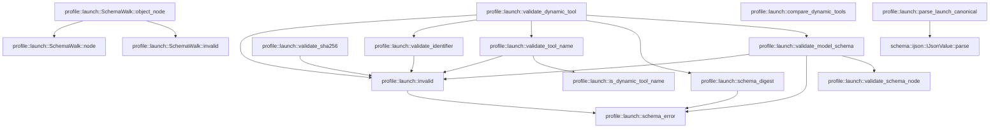

# profile::launch

[Package atlas](index.md) · [Source](../../src/launch.rs)

## Declarations

Visibility is the declaration spelling; trait members and reexports require their enclosing interface. `cfg` is not evaluated.

| Symbol | Kind | Visibility | Test / cfg |
|---|---|---|---|
| [profile::launch::MAX_DYNAMIC_DESCRIPTION_BYTES](../../src/launch.rs#L5) | const_item | `pub` |  |
| [profile::launch::FORMAT](../../src/launch.rs#L17) | const_item | `private` |  |
| [profile::launch::DynamicToolSource](../../src/launch.rs#L23) | struct_item | `pub` |  |
| [profile::launch::DynamicToolSourceKind](../../src/launch.rs#L30) | enum_item | `pub` |  |
| [profile::launch::DynamicToolEffect](../../src/launch.rs#L39) | enum_item | `pub` |  |
| [profile::launch::ExternalEffectBinding](../../src/launch.rs#L55) | struct_item | `pub` |  |
| [profile::launch::ExternalEffectProtocol](../../src/launch.rs#L62) | enum_item | `pub` |  |
| [profile::launch::DynamicTool](../../src/launch.rs#L68) | struct_item | `pub` |  |
| [profile::launch::DynamicTool::declared](../../src/launch.rs#L87) | function_item | `pub` |  |
| [profile::launch::DynamicToolCatalog](../../src/launch.rs#L113) | struct_item | `pub` |  |
| [profile::launch::DynamicToolCatalog::default](../../src/launch.rs#L119) | function_item | `private` |  |
| [profile::launch::DynamicToolCatalog::resolve](../../src/launch.rs#L128) | function_item | `pub` |  |
| [profile::launch::DynamicToolCatalog::decode](../../src/launch.rs#L138) | function_item | `pub` |  |
| [profile::launch::DynamicToolCatalog::canonical_bytes](../../src/launch.rs#L144) | function_item | `pub` |  |
| [profile::launch::DynamicToolCatalog::digest](../../src/launch.rs#L149) | function_item | `pub` |  |
| [profile::launch::LaunchBindings](../../src/launch.rs#L160) | struct_item | `pub` |  |
| [profile::launch::MAX_UNAVAILABLE_TOOLS](../../src/launch.rs#L178) | const_item | `pub` |  |
| [profile::launch::LaunchBindings::bind](../../src/launch.rs#L181) | function_item | `pub` |  |
| [profile::launch::LaunchBindings::bind_with_unavailable](../../src/launch.rs#L193) | function_item | `pub` |  |
| [profile::launch::LaunchBindings::decode](../../src/launch.rs#L213) | function_item | `pub` |  |
| [profile::launch::LaunchBindings::decode_verified](../../src/launch.rs#L235) | function_item | `pub` |  |
| [profile::launch::LaunchBindings::canonical_bytes](../../src/launch.rs#L250) | function_item | `pub` |  |
| [profile::launch::LaunchBindings::digest](../../src/launch.rs#L255) | function_item | `pub` |  |
| [profile::launch::LaunchBindings::publish](../../src/launch.rs#L259) | function_item | `pub` |  |
| [profile::launch::LaunchBindings::validate_against](../../src/launch.rs#L272) | function_item | `pub` |  |
| [profile::launch::validate_launch_bindings](../../src/launch.rs#L337) | function_item | `private` |  |
| [profile::launch::validate_dynamic_catalog](../../src/launch.rs#L366) | function_item | `private` |  |
| [profile::launch::DYNAMIC_SCHEMA_KEYWORDS](../../src/launch.rs#L406) | const_item | `private` |  |
| [profile::launch::SchemaRefusal](../../src/launch.rs#L450) | struct_item | `pub` |  |
| [profile::launch::SchemaRefusal::from_error](../../src/launch.rs#L458) | function_item | `pub` |  |
| [profile::launch::SchemaWalk](../../src/launch.rs#L484) | struct_item | `private` |  |
| [profile::launch::SchemaWalk::invalid](../../src/launch.rs#L492) | function_item | `private` |  |
| [profile::launch::validate_schema_node](../../src/launch.rs#L497) | function_item | `private` |  |
| [profile::launch::SchemaWalk::node](../../src/launch.rs#L530) | function_item | `private` |  |
| [profile::launch::SchemaWalk::object_node](../../src/launch.rs#L640) | function_item | `private` |  |
| [profile::launch::validate_dynamic_tool](../../src/launch.rs#L690) | function_item | `private` |  |
| [profile::launch::validate_model_schema](../../src/launch.rs#L729) | function_item | `private` |  |
| [profile::launch::compare_dynamic_tools](../../src/launch.rs#L785) | function_item | `private` |  |
| [profile::launch::schema_digest](../../src/launch.rs#L791) | function_item | `private` |  |
| [profile::launch::validate_sha256](../../src/launch.rs#L798) | function_item | `private` |  |
| [profile::launch::is_dynamic_tool_name](../../src/launch.rs#L818) | function_item | `pub` |  |
| [profile::launch::validate_tool_name](../../src/launch.rs#L824) | function_item | `private` |  |
| [profile::launch::validate_identifier](../../src/launch.rs#L835) | function_item | `private` |  |
| [profile::launch::schema_error](../../src/launch.rs#L854) | function_item | `private` |  |
| [profile::launch::invalid](../../src/launch.rs#L861) | function_item | `private` |  |
| [profile::launch::parse_launch_canonical](../../src/launch.rs#L867) | function_item | `private` |  |

## Imports / reexports

| Local name | Source path | Visibility |
|---|---|---|
| `BTreeSet` | `std::collections::BTreeSet` | `private` |
| `Path` | `std::path::Path` | `private` |
| `PathBuf` | `std::path::PathBuf` | `private` |
| `IJsonValue` | `schema::IJsonValue` | `private` |
| `DeserializeOwned` | `serde::de::DeserializeOwned` | `private` |
| `Deserialize` | `serde::Deserialize` | `private` |
| `Serialize` | `serde::Serialize` | `private` |
| `Value` | `serde_json::Value` | `private` |
| `Digest` | `sha2::Digest` | `private` |
| `Sha256` | `sha2::Sha256` | `private` |
| `AssetRef` | `store::AssetRef` | `private` |
| `AssetStore` | `store::AssetStore` | `private` |
| `BuiltinManifest` | `tools::BuiltinManifest` | `private` |
| `ConfigSnapshot` | `crate::ConfigSnapshot` | `private` |
| `ProfileError` | `crate::ProfileError` | `private` |
| `canonical_line` | `crate::canonical_line` | `private` |

## Module declarations

| Module | Visibility | Attributes |
|---|---|---|

## Function call graphs

Edges below are syntactically resolved calls only, including private functions. Graphs partition callers into groups of 20; they are not execution order. All unresolved sites are listed below and in the JSON inventory.

```mermaid
flowchart TD
  n0["profile::launch::DynamicToolCatalog::default"]
  n1["profile::launch::DynamicToolCatalog::resolve"]
  n2["profile::launch::DynamicToolCatalog::decode"]
  n3["profile::launch::DynamicToolCatalog::canonical_bytes"]
  n4["profile::launch::DynamicToolCatalog::digest"]
  n5["profile::launch::LaunchBindings::bind"]
  n6["profile::launch::LaunchBindings::bind_with_unavailable"]
  n7["profile::launch::LaunchBindings::decode"]
  n8["profile::launch::LaunchBindings::decode_verified"]
  n9["profile::launch::LaunchBindings::canonical_bytes"]
  n10["profile::launch::LaunchBindings::digest"]
  n11["profile::launch::LaunchBindings::publish"]
  n12["profile::launch::LaunchBindings::validate_against"]
  n13["profile::launch::validate_launch_bindings"]
  n14["profile::launch::validate_dynamic_catalog"]
  n15["profile::launch::SchemaRefusal::from_error"]
  n16["profile::launch::SchemaWalk::invalid"]
  n17["profile::launch::validate_schema_node"]
  n18["profile::launch::SchemaWalk::node"]
  n19["profile::launch::SchemaWalk::object_node"]
  n20["profile::launch::validate_dynamic_tool"]
  n21["profile::launch::compare_dynamic_tools"]
  n22["profile::launch::schema_digest"]
  n23["profile::launch::validate_sha256"]
  n24["profile::launch::validate_tool_name"]
  n25["profile::launch::validate_identifier"]
  n26["profile::launch::schema_error"]
  n27["profile::launch::invalid"]
  n28["profile::launch::parse_launch_canonical"]
  n29["profile::launch::DynamicTool::declared"]
  n30["profile::canonical_line"]
  n31["tools::builtin::BuiltinManifest::compiled"]
  n1 --> n14
  n2 --> n14
  n2 --> n28
  n3 --> n14
  n3 --> n30
  n5 --> n6
  n7 --> n27
  n7 --> n28
  n8 --> n7
  n9 --> n13
  n9 --> n30
  n11 --> n9
  n12 --> n13
  n12 --> n27
  n12 --> n31
  n13 --> n14
  n13 --> n23
  n13 --> n24
  n13 --> n25
  n13 --> n27
  n14 --> n20
  n14 --> n21
  n14 --> n27
  n14 --> n31
  n16 --> n27
  n17 --> n26
  n17 --> n27
  n18 --> n16
  n18 --> n18
  n18 --> n19
  n18 --> n26
  n29 --> n20
  n29 --> n22
```

Functions 1–20: 33 direct edges

Functions 21–32: 17 direct edges

## Call sites

Includes test functions (marked in declarations). Receiver-type-required sites need type analysis/manual tracing. Calls in closures are attributed to their enclosing function; their occurrence here does not mean the closure executes immediately.

| Caller | Callee expression | Source lines | Target / classification |
|---|---|---|---|
| `declared` | `name.into` | [96](../../src/launch.rs#L96) | receiver-type-required |
| `declared` | `String::new` | [103](../../src/launch.rs#L103) | external-constructor-callback-or-unresolved |
| `declared` | `schema_digest` | [105](../../src/launch.rs#L105) | [profile::launch::schema_digest](../../src/launch.rs#L791) |
| `declared` | `validate_dynamic_tool` | [106](../../src/launch.rs#L106) | [profile::launch::validate_dynamic_tool](../../src/launch.rs#L690) |
| `declared` | `Path::new` | [106](../../src/launch.rs#L106) | external-constructor-callback-or-unresolved |
| `declared` | `Ok` | [107](../../src/launch.rs#L107) | external-constructor-callback-or-unresolved |
| `default` | `Vec::new` | [122](../../src/launch.rs#L122) | external-constructor-callback-or-unresolved |
| `resolve` | `tools.sort_by` | [129](../../src/launch.rs#L129) | receiver-type-required |
| `resolve` | `validate_dynamic_catalog` | [134](../../src/launch.rs#L134) | [profile::launch::validate_dynamic_catalog](../../src/launch.rs#L366) |
| `resolve` | `Path::new` | [134](../../src/launch.rs#L134) | external-constructor-callback-or-unresolved |
| `resolve` | `Ok` | [135](../../src/launch.rs#L135) | external-constructor-callback-or-unresolved |
| `decode` | `parse_launch_canonical` | [139](../../src/launch.rs#L139) | [profile::launch::parse_launch_canonical](../../src/launch.rs#L867) |
| `decode` | `validate_dynamic_catalog` | [140](../../src/launch.rs#L140) | [profile::launch::validate_dynamic_catalog](../../src/launch.rs#L366) |
| `decode` | `Path::new` | [140](../../src/launch.rs#L140) | external-constructor-callback-or-unresolved |
| `decode` | `Ok` | [141](../../src/launch.rs#L141) | external-constructor-callback-or-unresolved |
| `canonical_bytes` | `validate_dynamic_catalog` | [145](../../src/launch.rs#L145) | [profile::launch::validate_dynamic_catalog](../../src/launch.rs#L366) |
| `canonical_bytes` | `Path::new` | [145](../../src/launch.rs#L145) | external-constructor-callback-or-unresolved |
| `canonical_bytes` | `canonical_line` | [146](../../src/launch.rs#L146) | [profile::canonical_line](../../src/lib.rs#L112) |
| `digest` | `Ok` | [150](../../src/launch.rs#L150) | external-constructor-callback-or-unresolved |
| `bind` | `Self::bind_with_unavailable` | [186](../../src/launch.rs#L186) | [profile::launch::LaunchBindings::bind_with_unavailable](../../src/launch.rs#L193) |
| `bind` | `Vec::new` | [186](../../src/launch.rs#L186) | external-constructor-callback-or-unresolved |
| `bind_with_unavailable` | `unavailable_tools.sort` | [199](../../src/launch.rs#L199) | receiver-type-required |
| `bind_with_unavailable` | `unavailable_tools.dedup` | [200](../../src/launch.rs#L200) | receiver-type-required |
| `bind_with_unavailable` | `config.workspace.id.clone` | [203](../../src/launch.rs#L203) | receiver-type-required |
| `bind_with_unavailable` | `config.digest` | [204](../../src/launch.rs#L204) | receiver-type-required |
| `bind_with_unavailable` | `value.validate_against` | [209](../../src/launch.rs#L209) | receiver-type-required |
| `bind_with_unavailable` | `Ok` | [210](../../src/launch.rs#L210) | external-constructor-callback-or-unresolved |
| `decode` | `parse_launch_canonical` | [214](../../src/launch.rs#L214) | [profile::launch::parse_launch_canonical](../../src/launch.rs#L867) |
| `decode` | `raw.get("goal_id").is_some_and` | [215](../../src/launch.rs#L215) | receiver-type-required |
| `decode` | `raw.get` | [215](../../src/launch.rs#L215) | receiver-type-required |
| `decode` | `invalid` | [216](../../src/launch.rs#L216), [226](../../src/launch.rs#L226) | [profile::launch::invalid](../../src/launch.rs#L861) |
| `decode` | `Path::new` | [217](../../src/launch.rs#L217), [227](../../src/launch.rs#L227) | external-constructor-callback-or-unresolved |
| `decode` | `raw             .get("unavailable_tools")             .and_then(Value::as_array)             .is_some_and` | [221](../../src/launch.rs#L221) | receiver-type-required |
| `decode` | `raw             .get("unavailable_tools")             .and_then` | [221](../../src/launch.rs#L221) | receiver-type-required |
| `decode` | `raw             .get` | [221](../../src/launch.rs#L221) | receiver-type-required |
| `decode` | `value.validate_against` | [231](../../src/launch.rs#L231) | receiver-type-required |
| `decode` | `Ok` | [232](../../src/launch.rs#L232) | external-constructor-callback-or-unresolved |
| `decode_verified` | `Err` | [242](../../src/launch.rs#L242) | external-constructor-callback-or-unresolved |
| `decode_verified` | `expected_digest.to_owned` | [243](../../src/launch.rs#L243) | receiver-type-required |
| `decode_verified` | `Self::decode` | [247](../../src/launch.rs#L247) | [profile::launch::LaunchBindings::decode](../../src/launch.rs#L213) |
| `canonical_bytes` | `validate_launch_bindings` | [251](../../src/launch.rs#L251) | [profile::launch::validate_launch_bindings](../../src/launch.rs#L337) |
| `canonical_bytes` | `Path::new` | [251](../../src/launch.rs#L251) | external-constructor-callback-or-unresolved |
| `canonical_bytes` | `canonical_line` | [252](../../src/launch.rs#L252) | [profile::canonical_line](../../src/lib.rs#L112) |
| `digest` | `Ok` | [256](../../src/launch.rs#L256) | external-constructor-callback-or-unresolved |
| `publish` | `self.canonical_bytes` | [260](../../src/launch.rs#L260) | [profile::launch::LaunchBindings::canonical_bytes](../../src/launch.rs#L250) |
| `publish` | `assets.publish` | [262](../../src/launch.rs#L262) | receiver-type-required |
| `publish` | `Err` | [264](../../src/launch.rs#L264) | external-constructor-callback-or-unresolved |
| `publish` | `Ok` | [269](../../src/launch.rs#L269) | external-constructor-callback-or-unresolved |
| `validate_against` | `Path::new` | [273](../../src/launch.rs#L273) | external-constructor-callback-or-unresolved |
| `validate_against` | `validate_launch_bindings` | [274](../../src/launch.rs#L274) | [profile::launch::validate_launch_bindings](../../src/launch.rs#L337) |
| `validate_against` | `invalid` | [276](../../src/launch.rs#L276), [279](../../src/launch.rs#L279) | [profile::launch::invalid](../../src/launch.rs#L861) |
| `validate_against` | `config.digest` | [278](../../src/launch.rs#L278) | receiver-type-required |
| `validate_against` | `BuiltinManifest::compiled()             .tools             .into_iter()             .map(&#124;tool&#124; tool.name)             .chain(                 self.dynamic_catalog                     .tools                     .iter()                     .map(&#124;tool&#124; tool.name.clone()),             )             .collect::<BTreeSet<_>>` | [282](../../src/launch.rs#L282) | receiver-type-required |
| `validate_against` | `BuiltinManifest::compiled()             .tools             .into_iter()             .map(&#124;tool&#124; tool.name)             .chain` | [282](../../src/launch.rs#L282) | receiver-type-required |
| `validate_against` | `BuiltinManifest::compiled()             .tools             .into_iter()             .map` | [282](../../src/launch.rs#L282) | receiver-type-required |
| `validate_against` | `BuiltinManifest::compiled()             .tools             .into_iter` | [282](../../src/launch.rs#L282) | receiver-type-required |
| `validate_against` | `BuiltinManifest::compiled` | [282](../../src/launch.rs#L282) | [tools::builtin::BuiltinManifest::compiled](../../../tools/src/builtin.rs#L315) |
| `validate_against` | `self.dynamic_catalog                     .tools                     .iter()                     .map` | [287](../../src/launch.rs#L287) | receiver-type-required |
| `validate_against` | `self.dynamic_catalog                     .tools                     .iter` | [287](../../src/launch.rs#L287) | receiver-type-required |
| `validate_against` | `tool.name.clone` | [290](../../src/launch.rs#L290) | receiver-type-required |
| `validate_against` | `self             .unavailable_tools             .iter()             .map(String::as_str)             .collect::<BTreeSet<_>>` | [293](../../src/launch.rs#L293) | receiver-type-required |
| `validate_against` | `self             .unavailable_tools             .iter()             .map` | [293](../../src/launch.rs#L293) | receiver-type-required |
| `validate_against` | `self             .unavailable_tools             .iter` | [293](../../src/launch.rs#L293) | receiver-type-required |
| `validate_against` | `effective_names.contains` | [302](../../src/launch.rs#L302), [324](../../src/launch.rs#L324) | receiver-type-required |
| `validate_against` | `config                     .workspace                     .policy                     .allowed_tools                     .iter()                     .any` | [303](../../src/launch.rs#L303) | receiver-type-required |
| `validate_against` | `config                     .workspace                     .policy                     .allowed_tools                     .iter` | [303](../../src/launch.rs#L303) | receiver-type-required |
| `validate_against` | `Err` | [310](../../src/launch.rs#L310), [325](../../src/launch.rs#L325) | external-constructor-callback-or-unresolved |
| `validate_against` | `path.to_path_buf` | [311](../../src/launch.rs#L311), [326](../../src/launch.rs#L326) | receiver-type-required |
| `validate_against` | `unavailable.contains` | [324](../../src/launch.rs#L324) | receiver-type-required |
| `validate_against` | `allowed.as_str` | [324](../../src/launch.rs#L324) | receiver-type-required |
| `validate_against` | `Ok` | [333](../../src/launch.rs#L333) | external-constructor-callback-or-unresolved |
| `validate_launch_bindings` | `Err` | [339](../../src/launch.rs#L339) | external-constructor-callback-or-unresolved |
| `validate_launch_bindings` | `path.to_path_buf` | [340](../../src/launch.rs#L340) | receiver-type-required |
| `validate_launch_bindings` | `validate_identifier` | [344](../../src/launch.rs#L344), [347](../../src/launch.rs#L347) | [profile::launch::validate_identifier](../../src/launch.rs#L835) |
| `validate_launch_bindings` | `validate_sha256` | [345](../../src/launch.rs#L345) | [profile::launch::validate_sha256](../../src/launch.rs#L798) |
| `validate_launch_bindings` | `validate_dynamic_catalog` | [349](../../src/launch.rs#L349) | [profile::launch::validate_dynamic_catalog](../../src/launch.rs#L366) |
| `validate_launch_bindings` | `value.unavailable_tools.len` | [350](../../src/launch.rs#L350) | receiver-type-required |
| `validate_launch_bindings` | `invalid` | [351](../../src/launch.rs#L351), [361](../../src/launch.rs#L361) | [profile::launch::invalid](../../src/launch.rs#L861) |
| `validate_launch_bindings` | `validate_tool_name` | [354](../../src/launch.rs#L354) | [profile::launch::validate_tool_name](../../src/launch.rs#L824) |
| `validate_launch_bindings` | `value         .unavailable_tools         .windows(2)         .any` | [356](../../src/launch.rs#L356) | receiver-type-required |
| `validate_launch_bindings` | `value         .unavailable_tools         .windows` | [356](../../src/launch.rs#L356) | receiver-type-required |
| `validate_launch_bindings` | `Ok` | [363](../../src/launch.rs#L363) | external-constructor-callback-or-unresolved |
| `validate_dynamic_catalog` | `Err` | [368](../../src/launch.rs#L368) | external-constructor-callback-or-unresolved |
| `validate_dynamic_catalog` | `path.to_path_buf` | [369](../../src/launch.rs#L369) | receiver-type-required |
| `validate_dynamic_catalog` | `BuiltinManifest::compiled()         .tools         .into_iter()         .map(&#124;tool&#124; tool.name)         .collect::<BTreeSet<_>>` | [373](../../src/launch.rs#L373) | receiver-type-required |
| `validate_dynamic_catalog` | `BuiltinManifest::compiled()         .tools         .into_iter()         .map` | [373](../../src/launch.rs#L373) | receiver-type-required |
| `validate_dynamic_catalog` | `BuiltinManifest::compiled()         .tools         .into_iter` | [373](../../src/launch.rs#L373) | receiver-type-required |
| `validate_dynamic_catalog` | `BuiltinManifest::compiled` | [373](../../src/launch.rs#L373) | [tools::builtin::BuiltinManifest::compiled](../../../tools/src/builtin.rs#L315) |
| `validate_dynamic_catalog` | `BTreeSet::new` | [378](../../src/launch.rs#L378) | external-constructor-callback-or-unresolved |
| `validate_dynamic_catalog` | `validate_dynamic_tool` | [380](../../src/launch.rs#L380) | [profile::launch::validate_dynamic_tool](../../src/launch.rs#L690) |
| `validate_dynamic_catalog` | `fixed.contains` | [381](../../src/launch.rs#L381) | receiver-type-required |
| `validate_dynamic_catalog` | `invalid` | [382](../../src/launch.rs#L382), [385](../../src/launch.rs#L385), [393](../../src/launch.rs#L393) | [profile::launch::invalid](../../src/launch.rs#L861) |
| `validate_dynamic_catalog` | `names.insert` | [384](../../src/launch.rs#L384) | receiver-type-required |
| `validate_dynamic_catalog` | `tool.name.as_str` | [384](../../src/launch.rs#L384) | receiver-type-required |
| `validate_dynamic_catalog` | `value         .tools         .windows(2)         .any` | [388](../../src/launch.rs#L388) | receiver-type-required |
| `validate_dynamic_catalog` | `value         .tools         .windows` | [388](../../src/launch.rs#L388) | receiver-type-required |
| `validate_dynamic_catalog` | `compare_dynamic_tools(&pair[0], &pair[1]).is_gt` | [391](../../src/launch.rs#L391) | receiver-type-required |
| `validate_dynamic_catalog` | `compare_dynamic_tools` | [391](../../src/launch.rs#L391) | [profile::launch::compare_dynamic_tools](../../src/launch.rs#L785) |
| `validate_dynamic_catalog` | `Ok` | [395](../../src/launch.rs#L395) | external-constructor-callback-or-unresolved |
| `from_error` | `reason.clone` | [460](../../src/launch.rs#L460) | receiver-type-required |
| `from_error` | `other.to_string` | [461](../../src/launch.rs#L461) | receiver-type-required |
| `from_error` | `reason.split_once` | [463](../../src/launch.rs#L463) | receiver-type-required |
| `from_error` | `pointer.starts_with` | [464](../../src/launch.rs#L464) | receiver-type-required |
| `from_error` | `Some` | [465](../../src/launch.rs#L465) | external-constructor-callback-or-unresolved |
| `from_error` | `pointer.to_owned` | [465](../../src/launch.rs#L465) | receiver-type-required |
| `from_error` | `message.to_owned` | [465](../../src/launch.rs#L465) | receiver-type-required |
| `from_error` | `message.split_once("keyword \"").and_then` | [469](../../src/launch.rs#L469) | receiver-type-required |
| `from_error` | `message.split_once` | [469](../../src/launch.rs#L469) | receiver-type-required |
| `from_error` | `rest.split_once('"')                 .map(&#124;(keyword, _)&#124; keyword.to_owned())                 .filter` | [470](../../src/launch.rs#L470) | receiver-type-required |
| `from_error` | `rest.split_once('"')                 .map` | [470](../../src/launch.rs#L470) | receiver-type-required |
| `from_error` | `rest.split_once` | [470](../../src/launch.rs#L470) | receiver-type-required |
| `from_error` | `keyword.to_owned` | [471](../../src/launch.rs#L471) | receiver-type-required |
| `from_error` | `keyword.is_empty` | [472](../../src/launch.rs#L472) | receiver-type-required |
| `invalid` | `invalid` | [493](../../src/launch.rs#L493) | [profile::launch::invalid](../../src/launch.rs#L861) |
| `validate_schema_node` | `schema         .as_object()         .ok_or_else` | [498](../../src/launch.rs#L498) | receiver-type-required |
| `validate_schema_node` | `schema         .as_object` | [498](../../src/launch.rs#L498) | receiver-type-required |
| `validate_schema_node` | `schema_error` | [500](../../src/launch.rs#L500) | [profile::launch::schema_error](../../src/launch.rs#L854) |
| `validate_schema_node` | `BTreeSet::new` | [501](../../src/launch.rs#L501) | external-constructor-callback-or-unresolved |
| `validate_schema_node` | `root.get` | [503](../../src/launch.rs#L503), [520](../../src/launch.rs#L520) | receiver-type-required |
| `validate_schema_node` | `entries.as_object` | [504](../../src/launch.rs#L504) | receiver-type-required |
| `validate_schema_node` | `invalid` | [505](../../src/launch.rs#L505) | [profile::launch::invalid](../../src/launch.rs#L861) |
| `validate_schema_node` | `definitions.extend` | [510](../../src/launch.rs#L510) | receiver-type-required |
| `validate_schema_node` | `entries.keys().map` | [510](../../src/launch.rs#L510) | receiver-type-required |
| `validate_schema_node` | `entries.keys` | [510](../../src/launch.rs#L510) | receiver-type-required |
| `validate_schema_node` | `walk.node` | [518](../../src/launch.rs#L518), [522](../../src/launch.rs#L522) | receiver-type-required |
| `validate_schema_node` | `root.get(container).and_then` | [520](../../src/launch.rs#L520) | receiver-type-required |
| `validate_schema_node` | `Ok` | [526](../../src/launch.rs#L526) | external-constructor-callback-or-unresolved |
| `node` | `schema.as_object().ok_or_else` | [531](../../src/launch.rs#L531) | receiver-type-required |
| `node` | `schema.as_object` | [531](../../src/launch.rs#L531) | receiver-type-required |
| `node` | `schema_error` | [532](../../src/launch.rs#L532) | [profile::launch::schema_error](../../src/launch.rs#L854) |
| `node` | `object.keys` | [537](../../src/launch.rs#L537) | receiver-type-required |
| `node` | `DYNAMIC_SCHEMA_KEYWORDS.contains` | [538](../../src/launch.rs#L538) | receiver-type-required |
| `node` | `key.as_str` | [538](../../src/launch.rs#L538) | receiver-type-required |
| `node` | `self.invalid` | [539](../../src/launch.rs#L539), [544](../../src/launch.rs#L544), [555](../../src/launch.rs#L555), [559](../../src/launch.rs#L559), [562](../../src/launch.rs#L562), [570](../../src/launch.rs#L570), [576](../../src/launch.rs#L576), [583](../../src/launch.rs#L583), [591](../../src/launch.rs#L591), [594](../../src/launch.rs#L594), [605](../../src/launch.rs#L605), [611](../../src/launch.rs#L611), [615](../../src/launch.rs#L615), [620](../../src/launch.rs#L620), [634](../../src/launch.rs#L634) | [profile::launch::SchemaWalk::invalid](../../src/launch.rs#L492) |
| `node` | `object.get("$schema").is_some_and` | [552](../../src/launch.rs#L552) | receiver-type-required |
| `node` | `object.get` | [552](../../src/launch.rs#L552), [557](../../src/launch.rs#L557), [568](../../src/launch.rs#L568), [582](../../src/launch.rs#L582), [589](../../src/launch.rs#L589), [614](../../src/launch.rs#L614), [619](../../src/launch.rs#L619), [633](../../src/launch.rs#L633) | receiver-type-required |
| `node` | `dialect.as_str` | [553](../../src/launch.rs#L553) | receiver-type-required |
| `node` | `Some` | [553](../../src/launch.rs#L553) | external-constructor-callback-or-unresolved |
| `node` | `reference.as_str` | [558](../../src/launch.rs#L558) | receiver-type-required |
| `node` | `self.definitions.contains` | [561](../../src/launch.rs#L561) | receiver-type-required |
| `node` | `kind.as_str` | [569](../../src/launch.rs#L569) | receiver-type-required |
| `node` | `self.object_node` | [579](../../src/launch.rs#L579) | [profile::launch::SchemaWalk::object_node](../../src/launch.rs#L640) |
| `node` | `self.node` | [585](../../src/launch.rs#L585), [597](../../src/launch.rs#L597) | [profile::launch::SchemaWalk::node](../../src/launch.rs#L530) |
| `node` | `branches.as_array` | [590](../../src/launch.rs#L590) | receiver-type-required |
| `node` | `branches.is_empty` | [593](../../src/launch.rs#L593) | receiver-type-required |
| `node` | `branches.iter().enumerate` | [596](../../src/launch.rs#L596) | receiver-type-required |
| `node` | `branches.iter` | [596](../../src/launch.rs#L596) | receiver-type-required |
| `node` | `object             .get("enum")             .is_some_and` | [601](../../src/launch.rs#L601) | receiver-type-required |
| `node` | `object             .get` | [601](../../src/launch.rs#L601), [607](../../src/launch.rs#L607) | receiver-type-required |
| `node` | `value.as_array().is_none_or` | [603](../../src/launch.rs#L603) | receiver-type-required |
| `node` | `value.as_array` | [603](../../src/launch.rs#L603) | receiver-type-required |
| `node` | `object             .get("examples")             .is_some_and` | [607](../../src/launch.rs#L607) | receiver-type-required |
| `node` | `value.is_array` | [609](../../src/launch.rs#L609) | receiver-type-required |
| `node` | `object.get(keyword).is_some_and` | [614](../../src/launch.rs#L614), [619](../../src/launch.rs#L619), [633](../../src/launch.rs#L633) | receiver-type-required |
| `node` | `value.is_string` | [614](../../src/launch.rs#L614) | receiver-type-required |
| `node` | `value.is_boolean` | [619](../../src/launch.rs#L619) | receiver-type-required |
| `node` | `value.is_number` | [633](../../src/launch.rs#L633) | receiver-type-required |
| `node` | `Ok` | [637](../../src/launch.rs#L637) | external-constructor-callback-or-unresolved |
| `object_node` | `serde_json::Map::new` | [650](../../src/launch.rs#L650) | external-constructor-callback-or-unresolved |
| `object_node` | `object.get` | [651](../../src/launch.rs#L651), [657](../../src/launch.rs#L657), [662](../../src/launch.rs#L662) | receiver-type-required |
| `object_node` | `self.invalid` | [654](../../src/launch.rs#L654), [660](../../src/launch.rs#L660), [672](../../src/launch.rs#L672), [677](../../src/launch.rs#L677), [680](../../src/launch.rs#L680) | [profile::launch::SchemaWalk::invalid](../../src/launch.rs#L492) |
| `object_node` | `Vec::new` | [656](../../src/launch.rs#L656) | external-constructor-callback-or-unresolved |
| `object_node` | `self.node` | [666](../../src/launch.rs#L666), [684](../../src/launch.rs#L684) | [profile::launch::SchemaWalk::node](../../src/launch.rs#L530) |
| `object_node` | `BTreeSet::new` | [674](../../src/launch.rs#L674) | external-constructor-callback-or-unresolved |
| `object_node` | `item.as_str` | [676](../../src/launch.rs#L676) | receiver-type-required |
| `object_node` | `properties.contains_key` | [679](../../src/launch.rs#L679) | receiver-type-required |
| `object_node` | `names.insert` | [679](../../src/launch.rs#L679) | receiver-type-required |
| `object_node` | `Ok` | [686](../../src/launch.rs#L686) | external-constructor-callback-or-unresolved |
| `validate_dynamic_tool` | `validate_tool_name` | [691](../../src/launch.rs#L691) | [profile::launch::validate_tool_name](../../src/launch.rs#L824) |
| `validate_dynamic_tool` | `validate_identifier` | [692](../../src/launch.rs#L692), [695](../../src/launch.rs#L695), [701](../../src/launch.rs#L701) | [profile::launch::validate_identifier](../../src/launch.rs#L835) |
| `validate_dynamic_tool` | `BTreeSet::new` | [693](../../src/launch.rs#L693) | external-constructor-callback-or-unresolved |
| `validate_dynamic_tool` | `aliases.insert` | [696](../../src/launch.rs#L696) | receiver-type-required |
| `validate_dynamic_tool` | `alias.as_str` | [696](../../src/launch.rs#L696) | receiver-type-required |
| `validate_dynamic_tool` | `invalid` | [697](../../src/launch.rs#L697), [711](../../src/launch.rs#L711), [719](../../src/launch.rs#L719) | [profile::launch::invalid](../../src/launch.rs#L861) |
| `validate_dynamic_tool` | `schema_digest` | [717](../../src/launch.rs#L717) | [profile::launch::schema_digest](../../src/launch.rs#L791) |
| `validate_dynamic_tool` | `validate_model_schema` | [721](../../src/launch.rs#L721) | [profile::launch::validate_model_schema](../../src/launch.rs#L729) |
| `validate_model_schema` | `serde_json::to_value(schema).map_err` | [735](../../src/launch.rs#L735) | receiver-type-required |
| `validate_model_schema` | `serde_json::to_value` | [735](../../src/launch.rs#L735) | external-constructor-callback-or-unresolved |
| `validate_model_schema` | `path.to_path_buf` | [736](../../src/launch.rs#L736) | receiver-type-required |
| `validate_model_schema` | `error.to_string` | [737](../../src/launch.rs#L737) | receiver-type-required |
| `validate_model_schema` | `value         .as_object()         .ok_or_else` | [739](../../src/launch.rs#L739) | receiver-type-required |
| `validate_model_schema` | `value         .as_object` | [739](../../src/launch.rs#L739) | receiver-type-required |
| `validate_model_schema` | `schema_error` | [741](../../src/launch.rs#L741), [773](../../src/launch.rs#L773) | [profile::launch::schema_error](../../src/launch.rs#L854) |
| `validate_model_schema` | `object.keys().map(String::as_str).collect::<BTreeSet<_>>` | [742](../../src/launch.rs#L742) | receiver-type-required |
| `validate_model_schema` | `object.keys().map` | [742](../../src/launch.rs#L742) | receiver-type-required |
| `validate_model_schema` | `object.keys` | [742](../../src/launch.rs#L742) | receiver-type-required |
| `validate_model_schema` | `BTreeSet::from` | [743](../../src/launch.rs#L743) | external-constructor-callback-or-unresolved |
| `validate_model_schema` | `invalid` | [744](../../src/launch.rs#L744), [750](../../src/launch.rs#L750), [765](../../src/launch.rs#L765), [780](../../src/launch.rs#L780) | [profile::launch::invalid](../../src/launch.rs#L861) |
| `validate_model_schema` | `object.get("name").and_then` | [749](../../src/launch.rs#L749) | receiver-type-required |
| `validate_model_schema` | `object.get` | [749](../../src/launch.rs#L749) | receiver-type-required |
| `validate_model_schema` | `Some` | [749](../../src/launch.rs#L749), [774](../../src/launch.rs#L774) | external-constructor-callback-or-unresolved |
| `validate_model_schema` | `object         .get("description")         .and_then(Value::as_str)         .unwrap_or_default` | [752](../../src/launch.rs#L752) | receiver-type-required |
| `validate_model_schema` | `object         .get("description")         .and_then` | [752](../../src/launch.rs#L752) | receiver-type-required |
| `validate_model_schema` | `object         .get` | [752](../../src/launch.rs#L752), [770](../../src/launch.rs#L770) | receiver-type-required |
| `validate_model_schema` | `description.trim().is_empty` | [759](../../src/launch.rs#L759) | receiver-type-required |
| `validate_model_schema` | `description.trim` | [759](../../src/launch.rs#L759) | receiver-type-required |
| `validate_model_schema` | `description.len` | [760](../../src/launch.rs#L760) | receiver-type-required |
| `validate_model_schema` | `description             .bytes()             .any` | [761](../../src/launch.rs#L761) | receiver-type-required |
| `validate_model_schema` | `description             .bytes` | [761](../../src/launch.rs#L761) | receiver-type-required |
| `validate_model_schema` | `byte.is_ascii_control` | [763](../../src/launch.rs#L763) | receiver-type-required |
| `validate_model_schema` | `object         .get("parameters")         .and_then(Value::as_object)         .ok_or_else` | [770](../../src/launch.rs#L770) | receiver-type-required |
| `validate_model_schema` | `object         .get("parameters")         .and_then` | [770](../../src/launch.rs#L770) | receiver-type-required |
| `validate_model_schema` | `parameters.get("type").and_then` | [774](../../src/launch.rs#L774) | receiver-type-required |
| `validate_model_schema` | `parameters.get` | [774](../../src/launch.rs#L774) | receiver-type-required |
| `validate_model_schema` | `parameters             .get("properties")             .and_then(Value::as_object)             .is_none` | [775](../../src/launch.rs#L775) | receiver-type-required |
| `validate_model_schema` | `parameters             .get("properties")             .and_then` | [775](../../src/launch.rs#L775) | receiver-type-required |
| `validate_model_schema` | `parameters             .get` | [775](../../src/launch.rs#L775) | receiver-type-required |
| `validate_model_schema` | `validate_schema_node` | [782](../../src/launch.rs#L782) | [profile::launch::validate_schema_node](../../src/launch.rs#L497) |
| `validate_model_schema` | `Value::Object` | [782](../../src/launch.rs#L782) | external-constructor-callback-or-unresolved |
| `validate_model_schema` | `parameters.clone` | [782](../../src/launch.rs#L782) | receiver-type-required |
| `compare_dynamic_tools` | `left.source         .cmp(&right.source)         .then_with` | [786](../../src/launch.rs#L786) | receiver-type-required |
| `compare_dynamic_tools` | `left.source         .cmp` | [786](../../src/launch.rs#L786) | receiver-type-required |
| `compare_dynamic_tools` | `left.name.as_bytes().cmp` | [788](../../src/launch.rs#L788) | receiver-type-required |
| `compare_dynamic_tools` | `left.name.as_bytes` | [788](../../src/launch.rs#L788) | receiver-type-required |
| `compare_dynamic_tools` | `right.name.as_bytes` | [788](../../src/launch.rs#L788) | receiver-type-required |
| `schema_digest` | `schema         .canonical_bytes()         .map_err` | [792](../../src/launch.rs#L792) | receiver-type-required |
| `schema_digest` | `schema         .canonical_bytes` | [792](../../src/launch.rs#L792) | receiver-type-required |
| `schema_digest` | `schema_error` | [794](../../src/launch.rs#L794) | [profile::launch::schema_error](../../src/launch.rs#L854) |
| `schema_digest` | `Path::new` | [794](../../src/launch.rs#L794) | external-constructor-callback-or-unresolved |
| `schema_digest` | `error.to_string` | [794](../../src/launch.rs#L794) | receiver-type-required |
| `schema_digest` | `Ok` | [795](../../src/launch.rs#L795) | external-constructor-callback-or-unresolved |
| `validate_sha256` | `value.len` | [799](../../src/launch.rs#L799) | receiver-type-required |
| `validate_sha256` | `value             .bytes()             .all` | [800](../../src/launch.rs#L800) | receiver-type-required |
| `validate_sha256` | `value             .bytes` | [800](../../src/launch.rs#L800) | receiver-type-required |
| `validate_sha256` | `byte.is_ascii_hexdigit` | [802](../../src/launch.rs#L802) | receiver-type-required |
| `validate_sha256` | `byte.is_ascii_uppercase` | [802](../../src/launch.rs#L802) | receiver-type-required |
| `validate_sha256` | `Ok` | [804](../../src/launch.rs#L804) | external-constructor-callback-or-unresolved |
| `validate_sha256` | `invalid` | [806](../../src/launch.rs#L806) | [profile::launch::invalid](../../src/launch.rs#L861) |
| `is_dynamic_tool_name` | `value.is_empty` | [819](../../src/launch.rs#L819) | receiver-type-required |
| `is_dynamic_tool_name` | `value.len` | [820](../../src/launch.rs#L820) | receiver-type-required |
| `is_dynamic_tool_name` | `value.chars().any` | [821](../../src/launch.rs#L821) | receiver-type-required |
| `is_dynamic_tool_name` | `value.chars` | [821](../../src/launch.rs#L821) | receiver-type-required |
| `is_dynamic_tool_name` | `character.is_ascii_control` | [821](../../src/launch.rs#L821) | receiver-type-required |
| `validate_tool_name` | `is_dynamic_tool_name` | [825](../../src/launch.rs#L825) | [profile::launch::is_dynamic_tool_name](../../src/launch.rs#L818) |
| `validate_tool_name` | `Ok` | [826](../../src/launch.rs#L826) | external-constructor-callback-or-unresolved |
| `validate_tool_name` | `invalid` | [828](../../src/launch.rs#L828) | [profile::launch::invalid](../../src/launch.rs#L861) |
| `validate_identifier` | `value.is_empty` | [841](../../src/launch.rs#L841) | receiver-type-required |
| `validate_identifier` | `value.len` | [842](../../src/launch.rs#L842) | receiver-type-required |
| `validate_identifier` | `value.chars().any` | [843](../../src/launch.rs#L843) | receiver-type-required |
| `validate_identifier` | `value.chars` | [843](../../src/launch.rs#L843) | receiver-type-required |
| `validate_identifier` | `character.is_ascii_control` | [843](../../src/launch.rs#L843) | receiver-type-required |
| `validate_identifier` | `Ok` | [845](../../src/launch.rs#L845) | external-constructor-callback-or-unresolved |
| `validate_identifier` | `invalid` | [847](../../src/launch.rs#L847) | [profile::launch::invalid](../../src/launch.rs#L861) |
| `schema_error` | `path.to_path_buf` | [856](../../src/launch.rs#L856) | receiver-type-required |
| `schema_error` | `reason.to_owned` | [857](../../src/launch.rs#L857) | receiver-type-required |
| `invalid` | `Err` | [862](../../src/launch.rs#L862) | external-constructor-callback-or-unresolved |
| `invalid` | `schema_error` | [862](../../src/launch.rs#L862) | [profile::launch::schema_error](../../src/launch.rs#L854) |
| `parse_launch_canonical` | `path.into` | [871](../../src/launch.rs#L871) | receiver-type-required |
| `parse_launch_canonical` | `bytes.ends_with` | [872](../../src/launch.rs#L872) | receiver-type-required |
| `parse_launch_canonical` | `bytes.len` | [872](../../src/launch.rs#L872), [878](../../src/launch.rs#L878) | receiver-type-required |
| `parse_launch_canonical` | `bytes[..bytes.len() - 1].ends_with` | [872](../../src/launch.rs#L872) | receiver-type-required |
| `parse_launch_canonical` | `Err` | [873](../../src/launch.rs#L873), [891](../../src/launch.rs#L891) | external-constructor-callback-or-unresolved |
| `parse_launch_canonical` | `"expected one canonical JSON object followed by exactly one LF".to_owned` | [875](../../src/launch.rs#L875) | receiver-type-required |
| `parse_launch_canonical` | `IJsonValue::parse(body).map_err` | [879](../../src/launch.rs#L879) | receiver-type-required |
| `parse_launch_canonical` | `IJsonValue::parse` | [879](../../src/launch.rs#L879) | [schema::ijson::IJsonValue::parse](../../../schema/src/ijson.rs#L16) |
| `parse_launch_canonical` | `path.clone` | [880](../../src/launch.rs#L880), [886](../../src/launch.rs#L886), [897](../../src/launch.rs#L897) | receiver-type-required |
| `parse_launch_canonical` | `error.to_string` | [881](../../src/launch.rs#L881), [887](../../src/launch.rs#L887), [898](../../src/launch.rs#L898), [903](../../src/launch.rs#L903) | receiver-type-required |
| `parse_launch_canonical` | `ijson         .canonical_bytes()         .map_err` | [883](../../src/launch.rs#L883) | receiver-type-required |
| `parse_launch_canonical` | `ijson         .canonical_bytes` | [883](../../src/launch.rs#L883) | receiver-type-required |
| `parse_launch_canonical` | `"bytes are not RFC-8785 canonical".to_owned` | [893](../../src/launch.rs#L893) | receiver-type-required |
| `parse_launch_canonical` | `serde_json::from_slice(body).map_err` | [896](../../src/launch.rs#L896) | receiver-type-required |
| `parse_launch_canonical` | `serde_json::from_slice` | [896](../../src/launch.rs#L896) | external-constructor-callback-or-unresolved |
| `parse_launch_canonical` | `serde_json::from_value(raw.clone()).map_err` | [901](../../src/launch.rs#L901) | receiver-type-required |
| `parse_launch_canonical` | `serde_json::from_value` | [901](../../src/launch.rs#L901) | external-constructor-callback-or-unresolved |
| `parse_launch_canonical` | `raw.clone` | [901](../../src/launch.rs#L901) | receiver-type-required |
| `parse_launch_canonical` | `Ok` | [905](../../src/launch.rs#L905) | external-constructor-callback-or-unresolved |
