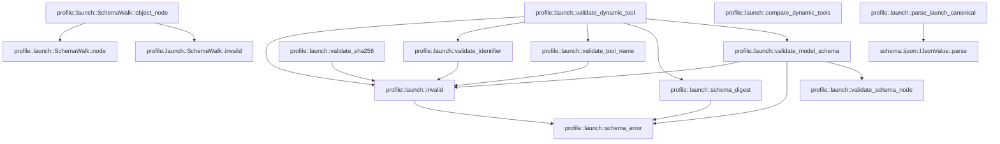

# profile::launch

[Package atlas](index.md) · [Source](../../src/launch.rs)

## Declarations

Visibility is the declaration spelling; trait members and reexports require their enclosing interface. `cfg` is not evaluated.

| Symbol | Kind | Visibility | Test / cfg |
|---|---|---|---|
| [profile::launch::MAX_DYNAMIC_DESCRIPTION_BYTES](../../src/launch.rs#L5) | const_item | `pub` |  |
| [profile::launch::FORMAT](../../src/launch.rs#L17) | const_item | `private` |  |
| [profile::launch::DynamicToolSource](../../src/launch.rs#L23) | struct_item | `pub` |  |
| [profile::launch::DynamicToolSourceKind](../../src/launch.rs#L30) | enum_item | `pub` |  |
| [profile::launch::DynamicToolEffect](../../src/launch.rs#L39) | enum_item | `pub` |  |
| [profile::launch::ExternalEffectBinding](../../src/launch.rs#L55) | struct_item | `pub` |  |
| [profile::launch::ExternalEffectProtocol](../../src/launch.rs#L62) | enum_item | `pub` |  |
| [profile::launch::DynamicTool](../../src/launch.rs#L68) | struct_item | `pub` |  |
| [profile::launch::DynamicTool::declared](../../src/launch.rs#L87) | function_item | `pub` |  |
| [profile::launch::DynamicToolCatalog](../../src/launch.rs#L113) | struct_item | `pub` |  |
| [profile::launch::DynamicToolCatalog::default](../../src/launch.rs#L119) | function_item | `private` |  |
| [profile::launch::DynamicToolCatalog::resolve](../../src/launch.rs#L128) | function_item | `pub` |  |
| [profile::launch::DynamicToolCatalog::decode](../../src/launch.rs#L138) | function_item | `pub` |  |
| [profile::launch::DynamicToolCatalog::canonical_bytes](../../src/launch.rs#L144) | function_item | `pub` |  |
| [profile::launch::DynamicToolCatalog::digest](../../src/launch.rs#L149) | function_item | `pub` |  |
| [profile::launch::LaunchBindings](../../src/launch.rs#L160) | struct_item | `pub` |  |
| [profile::launch::MAX_UNAVAILABLE_TOOLS](../../src/launch.rs#L178) | const_item | `pub` |  |
| [profile::launch::LaunchBindings::bind](../../src/launch.rs#L181) | function_item | `pub` |  |
| [profile::launch::LaunchBindings::bind_with_unavailable](../../src/launch.rs#L193) | function_item | `pub` |  |
| [profile::launch::LaunchBindings::decode](../../src/launch.rs#L213) | function_item | `pub` |  |
| [profile::launch::LaunchBindings::decode_verified](../../src/launch.rs#L225) | function_item | `pub` |  |
| [profile::launch::LaunchBindings::canonical_bytes](../../src/launch.rs#L240) | function_item | `pub` |  |
| [profile::launch::LaunchBindings::digest](../../src/launch.rs#L245) | function_item | `pub` |  |
| [profile::launch::LaunchBindings::publish](../../src/launch.rs#L249) | function_item | `pub` |  |
| [profile::launch::LaunchBindings::validate_against](../../src/launch.rs#L262) | function_item | `pub` |  |
| [profile::launch::validate_launch_bindings](../../src/launch.rs#L327) | function_item | `private` |  |
| [profile::launch::validate_dynamic_catalog](../../src/launch.rs#L356) | function_item | `private` |  |
| [profile::launch::DYNAMIC_SCHEMA_KEYWORDS](../../src/launch.rs#L396) | const_item | `private` |  |
| [profile::launch::SchemaRefusal](../../src/launch.rs#L440) | struct_item | `pub` |  |
| [profile::launch::SchemaRefusal::from_error](../../src/launch.rs#L448) | function_item | `pub` |  |
| [profile::launch::SchemaWalk](../../src/launch.rs#L474) | struct_item | `private` |  |
| [profile::launch::SchemaWalk::invalid](../../src/launch.rs#L482) | function_item | `private` |  |
| [profile::launch::validate_schema_node](../../src/launch.rs#L487) | function_item | `private` |  |
| [profile::launch::SchemaWalk::node](../../src/launch.rs#L520) | function_item | `private` |  |
| [profile::launch::SchemaWalk::object_node](../../src/launch.rs#L630) | function_item | `private` |  |
| [profile::launch::validate_dynamic_tool](../../src/launch.rs#L680) | function_item | `private` |  |
| [profile::launch::validate_model_schema](../../src/launch.rs#L719) | function_item | `private` |  |
| [profile::launch::compare_dynamic_tools](../../src/launch.rs#L775) | function_item | `private` |  |
| [profile::launch::schema_digest](../../src/launch.rs#L781) | function_item | `private` |  |
| [profile::launch::validate_sha256](../../src/launch.rs#L788) | function_item | `private` |  |
| [profile::launch::validate_tool_name](../../src/launch.rs#L803) | function_item | `private` |  |
| [profile::launch::validate_identifier](../../src/launch.rs#L817) | function_item | `private` |  |
| [profile::launch::schema_error](../../src/launch.rs#L836) | function_item | `private` |  |
| [profile::launch::invalid](../../src/launch.rs#L843) | function_item | `private` |  |
| [profile::launch::parse_launch_canonical](../../src/launch.rs#L849) | function_item | `private` |  |

## Imports / reexports

| Local name | Source path | Visibility |
|---|---|---|
| `BTreeSet` | `std::collections::BTreeSet` | `private` |
| `Path` | `std::path::Path` | `private` |
| `PathBuf` | `std::path::PathBuf` | `private` |
| `IJsonValue` | `schema::IJsonValue` | `private` |
| `DeserializeOwned` | `serde::de::DeserializeOwned` | `private` |
| `Deserialize` | `serde::Deserialize` | `private` |
| `Serialize` | `serde::Serialize` | `private` |
| `Value` | `serde_json::Value` | `private` |
| `Digest` | `sha2::Digest` | `private` |
| `Sha256` | `sha2::Sha256` | `private` |
| `AssetRef` | `store::AssetRef` | `private` |
| `AssetStore` | `store::AssetStore` | `private` |
| `BuiltinManifest` | `tools::BuiltinManifest` | `private` |
| `ConfigSnapshot` | `crate::ConfigSnapshot` | `private` |
| `ProfileError` | `crate::ProfileError` | `private` |
| `canonical_line` | `crate::canonical_line` | `private` |

## Module declarations

| Module | Visibility | Attributes |
|---|---|---|

## Function call graphs

Edges below are syntactically resolved calls only, including private functions. Graphs partition callers into groups of 20; they are not execution order. All unresolved sites are listed below and in the JSON inventory.

```mermaid
flowchart TD
  n0["profile::launch::DynamicToolCatalog::default"]
  n1["profile::launch::DynamicToolCatalog::resolve"]
  n2["profile::launch::DynamicToolCatalog::decode"]
  n3["profile::launch::DynamicToolCatalog::canonical_bytes"]
  n4["profile::launch::DynamicToolCatalog::digest"]
  n5["profile::launch::LaunchBindings::bind"]
  n6["profile::launch::LaunchBindings::bind_with_unavailable"]
  n7["profile::launch::LaunchBindings::decode"]
  n8["profile::launch::LaunchBindings::decode_verified"]
  n9["profile::launch::LaunchBindings::canonical_bytes"]
  n10["profile::launch::LaunchBindings::digest"]
  n11["profile::launch::LaunchBindings::publish"]
  n12["profile::launch::LaunchBindings::validate_against"]
  n13["profile::launch::validate_launch_bindings"]
  n14["profile::launch::validate_dynamic_catalog"]
  n15["profile::launch::SchemaRefusal::from_error"]
  n16["profile::launch::SchemaWalk::invalid"]
  n17["profile::launch::validate_schema_node"]
  n18["profile::launch::SchemaWalk::node"]
  n19["profile::launch::SchemaWalk::object_node"]
  n20["profile::launch::validate_dynamic_tool"]
  n21["profile::launch::compare_dynamic_tools"]
  n22["profile::launch::schema_digest"]
  n23["profile::launch::validate_sha256"]
  n24["profile::launch::validate_tool_name"]
  n25["profile::launch::validate_identifier"]
  n26["profile::launch::schema_error"]
  n27["profile::launch::invalid"]
  n28["profile::launch::parse_launch_canonical"]
  n29["profile::launch::DynamicTool::declared"]
  n30["profile::canonical_line"]
  n31["tools::builtin::BuiltinManifest::compiled"]
  n1 --> n14
  n2 --> n14
  n2 --> n28
  n3 --> n14
  n3 --> n30
  n5 --> n6
  n7 --> n27
  n7 --> n28
  n8 --> n7
  n9 --> n13
  n9 --> n30
  n11 --> n9
  n12 --> n13
  n12 --> n27
  n12 --> n31
  n13 --> n14
  n13 --> n23
  n13 --> n24
  n13 --> n25
  n13 --> n27
  n14 --> n20
  n14 --> n21
  n14 --> n27
  n14 --> n31
  n16 --> n27
  n17 --> n26
  n17 --> n27
  n18 --> n16
  n18 --> n18
  n18 --> n19
  n18 --> n26
  n29 --> n20
  n29 --> n22
```

Functions 1–20: 33 direct edges

Functions 21–31: 16 direct edges

## Call sites

Includes test functions (marked in declarations). Receiver-type-required sites need type analysis/manual tracing. Calls in closures are attributed to their enclosing function; their occurrence here does not mean the closure executes immediately.

| Caller | Callee expression | Source lines | Target / classification |
|---|---|---|---|
| `declared` | `name.into` | [96](../../src/launch.rs#L96) | receiver-type-required |
| `declared` | `String::new` | [103](../../src/launch.rs#L103) | external-constructor-callback-or-unresolved |
| `declared` | `schema_digest` | [105](../../src/launch.rs#L105) | [profile::launch::schema_digest](../../src/launch.rs#L781) |
| `declared` | `validate_dynamic_tool` | [106](../../src/launch.rs#L106) | [profile::launch::validate_dynamic_tool](../../src/launch.rs#L680) |
| `declared` | `Path::new` | [106](../../src/launch.rs#L106) | external-constructor-callback-or-unresolved |
| `declared` | `Ok` | [107](../../src/launch.rs#L107) | external-constructor-callback-or-unresolved |
| `default` | `Vec::new` | [122](../../src/launch.rs#L122) | external-constructor-callback-or-unresolved |
| `resolve` | `tools.sort_by` | [129](../../src/launch.rs#L129) | receiver-type-required |
| `resolve` | `validate_dynamic_catalog` | [134](../../src/launch.rs#L134) | [profile::launch::validate_dynamic_catalog](../../src/launch.rs#L356) |
| `resolve` | `Path::new` | [134](../../src/launch.rs#L134) | external-constructor-callback-or-unresolved |
| `resolve` | `Ok` | [135](../../src/launch.rs#L135) | external-constructor-callback-or-unresolved |
| `decode` | `parse_launch_canonical` | [139](../../src/launch.rs#L139) | [profile::launch::parse_launch_canonical](../../src/launch.rs#L849) |
| `decode` | `validate_dynamic_catalog` | [140](../../src/launch.rs#L140) | [profile::launch::validate_dynamic_catalog](../../src/launch.rs#L356) |
| `decode` | `Path::new` | [140](../../src/launch.rs#L140) | external-constructor-callback-or-unresolved |
| `decode` | `Ok` | [141](../../src/launch.rs#L141) | external-constructor-callback-or-unresolved |
| `canonical_bytes` | `validate_dynamic_catalog` | [145](../../src/launch.rs#L145) | [profile::launch::validate_dynamic_catalog](../../src/launch.rs#L356) |
| `canonical_bytes` | `Path::new` | [145](../../src/launch.rs#L145) | external-constructor-callback-or-unresolved |
| `canonical_bytes` | `canonical_line` | [146](../../src/launch.rs#L146) | [profile::canonical_line](../../src/lib.rs#L110) |
| `digest` | `Ok` | [150](../../src/launch.rs#L150) | external-constructor-callback-or-unresolved |
| `bind` | `Self::bind_with_unavailable` | [186](../../src/launch.rs#L186) | [profile::launch::LaunchBindings::bind_with_unavailable](../../src/launch.rs#L193) |
| `bind` | `Vec::new` | [186](../../src/launch.rs#L186) | external-constructor-callback-or-unresolved |
| `bind_with_unavailable` | `unavailable_tools.sort` | [199](../../src/launch.rs#L199) | receiver-type-required |
| `bind_with_unavailable` | `unavailable_tools.dedup` | [200](../../src/launch.rs#L200) | receiver-type-required |
| `bind_with_unavailable` | `config.workspace.id.clone` | [203](../../src/launch.rs#L203) | receiver-type-required |
| `bind_with_unavailable` | `config.digest` | [204](../../src/launch.rs#L204) | receiver-type-required |
| `bind_with_unavailable` | `value.validate_against` | [209](../../src/launch.rs#L209) | receiver-type-required |
| `bind_with_unavailable` | `Ok` | [210](../../src/launch.rs#L210) | external-constructor-callback-or-unresolved |
| `decode` | `parse_launch_canonical` | [214](../../src/launch.rs#L214) | [profile::launch::parse_launch_canonical](../../src/launch.rs#L849) |
| `decode` | `raw.get("goal_id").is_some_and` | [215](../../src/launch.rs#L215) | receiver-type-required |
| `decode` | `raw.get` | [215](../../src/launch.rs#L215) | receiver-type-required |
| `decode` | `invalid` | [216](../../src/launch.rs#L216) | [profile::launch::invalid](../../src/launch.rs#L843) |
| `decode` | `Path::new` | [217](../../src/launch.rs#L217) | external-constructor-callback-or-unresolved |
| `decode` | `value.validate_against` | [221](../../src/launch.rs#L221) | receiver-type-required |
| `decode` | `Ok` | [222](../../src/launch.rs#L222) | external-constructor-callback-or-unresolved |
| `decode_verified` | `Err` | [232](../../src/launch.rs#L232) | external-constructor-callback-or-unresolved |
| `decode_verified` | `expected_digest.to_owned` | [233](../../src/launch.rs#L233) | receiver-type-required |
| `decode_verified` | `Self::decode` | [237](../../src/launch.rs#L237) | [profile::launch::LaunchBindings::decode](../../src/launch.rs#L213) |
| `canonical_bytes` | `validate_launch_bindings` | [241](../../src/launch.rs#L241) | [profile::launch::validate_launch_bindings](../../src/launch.rs#L327) |
| `canonical_bytes` | `Path::new` | [241](../../src/launch.rs#L241) | external-constructor-callback-or-unresolved |
| `canonical_bytes` | `canonical_line` | [242](../../src/launch.rs#L242) | [profile::canonical_line](../../src/lib.rs#L110) |
| `digest` | `Ok` | [246](../../src/launch.rs#L246) | external-constructor-callback-or-unresolved |
| `publish` | `self.canonical_bytes` | [250](../../src/launch.rs#L250) | [profile::launch::LaunchBindings::canonical_bytes](../../src/launch.rs#L240) |
| `publish` | `assets.publish` | [252](../../src/launch.rs#L252) | receiver-type-required |
| `publish` | `Err` | [254](../../src/launch.rs#L254) | external-constructor-callback-or-unresolved |
| `publish` | `Ok` | [259](../../src/launch.rs#L259) | external-constructor-callback-or-unresolved |
| `validate_against` | `Path::new` | [263](../../src/launch.rs#L263) | external-constructor-callback-or-unresolved |
| `validate_against` | `validate_launch_bindings` | [264](../../src/launch.rs#L264) | [profile::launch::validate_launch_bindings](../../src/launch.rs#L327) |
| `validate_against` | `invalid` | [266](../../src/launch.rs#L266), [269](../../src/launch.rs#L269) | [profile::launch::invalid](../../src/launch.rs#L843) |
| `validate_against` | `config.digest` | [268](../../src/launch.rs#L268) | receiver-type-required |
| `validate_against` | `BuiltinManifest::compiled()             .tools             .into_iter()             .map(&#124;tool&#124; tool.name)             .chain(                 self.dynamic_catalog                     .tools                     .iter()                     .map(&#124;tool&#124; tool.name.clone()),             )             .collect::<BTreeSet<_>>` | [272](../../src/launch.rs#L272) | receiver-type-required |
| `validate_against` | `BuiltinManifest::compiled()             .tools             .into_iter()             .map(&#124;tool&#124; tool.name)             .chain` | [272](../../src/launch.rs#L272) | receiver-type-required |
| `validate_against` | `BuiltinManifest::compiled()             .tools             .into_iter()             .map` | [272](../../src/launch.rs#L272) | receiver-type-required |
| `validate_against` | `BuiltinManifest::compiled()             .tools             .into_iter` | [272](../../src/launch.rs#L272) | receiver-type-required |
| `validate_against` | `BuiltinManifest::compiled` | [272](../../src/launch.rs#L272) | [tools::builtin::BuiltinManifest::compiled](../../../tools/src/builtin.rs#L315) |
| `validate_against` | `self.dynamic_catalog                     .tools                     .iter()                     .map` | [277](../../src/launch.rs#L277) | receiver-type-required |
| `validate_against` | `self.dynamic_catalog                     .tools                     .iter` | [277](../../src/launch.rs#L277) | receiver-type-required |
| `validate_against` | `tool.name.clone` | [280](../../src/launch.rs#L280) | receiver-type-required |
| `validate_against` | `self             .unavailable_tools             .iter()             .map(String::as_str)             .collect::<BTreeSet<_>>` | [283](../../src/launch.rs#L283) | receiver-type-required |
| `validate_against` | `self             .unavailable_tools             .iter()             .map` | [283](../../src/launch.rs#L283) | receiver-type-required |
| `validate_against` | `self             .unavailable_tools             .iter` | [283](../../src/launch.rs#L283) | receiver-type-required |
| `validate_against` | `effective_names.contains` | [292](../../src/launch.rs#L292), [314](../../src/launch.rs#L314) | receiver-type-required |
| `validate_against` | `config                     .workspace                     .policy                     .allowed_tools                     .iter()                     .any` | [293](../../src/launch.rs#L293) | receiver-type-required |
| `validate_against` | `config                     .workspace                     .policy                     .allowed_tools                     .iter` | [293](../../src/launch.rs#L293) | receiver-type-required |
| `validate_against` | `Err` | [300](../../src/launch.rs#L300), [315](../../src/launch.rs#L315) | external-constructor-callback-or-unresolved |
| `validate_against` | `path.to_path_buf` | [301](../../src/launch.rs#L301), [316](../../src/launch.rs#L316) | receiver-type-required |
| `validate_against` | `unavailable.contains` | [314](../../src/launch.rs#L314) | receiver-type-required |
| `validate_against` | `allowed.as_str` | [314](../../src/launch.rs#L314) | receiver-type-required |
| `validate_against` | `Ok` | [323](../../src/launch.rs#L323) | external-constructor-callback-or-unresolved |
| `validate_launch_bindings` | `Err` | [329](../../src/launch.rs#L329) | external-constructor-callback-or-unresolved |
| `validate_launch_bindings` | `path.to_path_buf` | [330](../../src/launch.rs#L330) | receiver-type-required |
| `validate_launch_bindings` | `validate_identifier` | [334](../../src/launch.rs#L334), [337](../../src/launch.rs#L337) | [profile::launch::validate_identifier](../../src/launch.rs#L817) |
| `validate_launch_bindings` | `validate_sha256` | [335](../../src/launch.rs#L335) | [profile::launch::validate_sha256](../../src/launch.rs#L788) |
| `validate_launch_bindings` | `validate_dynamic_catalog` | [339](../../src/launch.rs#L339) | [profile::launch::validate_dynamic_catalog](../../src/launch.rs#L356) |
| `validate_launch_bindings` | `value.unavailable_tools.len` | [340](../../src/launch.rs#L340) | receiver-type-required |
| `validate_launch_bindings` | `invalid` | [341](../../src/launch.rs#L341), [351](../../src/launch.rs#L351) | [profile::launch::invalid](../../src/launch.rs#L843) |
| `validate_launch_bindings` | `validate_tool_name` | [344](../../src/launch.rs#L344) | [profile::launch::validate_tool_name](../../src/launch.rs#L803) |
| `validate_launch_bindings` | `value         .unavailable_tools         .windows(2)         .any` | [346](../../src/launch.rs#L346) | receiver-type-required |
| `validate_launch_bindings` | `value         .unavailable_tools         .windows` | [346](../../src/launch.rs#L346) | receiver-type-required |
| `validate_launch_bindings` | `Ok` | [353](../../src/launch.rs#L353) | external-constructor-callback-or-unresolved |
| `validate_dynamic_catalog` | `Err` | [358](../../src/launch.rs#L358) | external-constructor-callback-or-unresolved |
| `validate_dynamic_catalog` | `path.to_path_buf` | [359](../../src/launch.rs#L359) | receiver-type-required |
| `validate_dynamic_catalog` | `BuiltinManifest::compiled()         .tools         .into_iter()         .map(&#124;tool&#124; tool.name)         .collect::<BTreeSet<_>>` | [363](../../src/launch.rs#L363) | receiver-type-required |
| `validate_dynamic_catalog` | `BuiltinManifest::compiled()         .tools         .into_iter()         .map` | [363](../../src/launch.rs#L363) | receiver-type-required |
| `validate_dynamic_catalog` | `BuiltinManifest::compiled()         .tools         .into_iter` | [363](../../src/launch.rs#L363) | receiver-type-required |
| `validate_dynamic_catalog` | `BuiltinManifest::compiled` | [363](../../src/launch.rs#L363) | [tools::builtin::BuiltinManifest::compiled](../../../tools/src/builtin.rs#L315) |
| `validate_dynamic_catalog` | `BTreeSet::new` | [368](../../src/launch.rs#L368) | external-constructor-callback-or-unresolved |
| `validate_dynamic_catalog` | `validate_dynamic_tool` | [370](../../src/launch.rs#L370) | [profile::launch::validate_dynamic_tool](../../src/launch.rs#L680) |
| `validate_dynamic_catalog` | `fixed.contains` | [371](../../src/launch.rs#L371) | receiver-type-required |
| `validate_dynamic_catalog` | `invalid` | [372](../../src/launch.rs#L372), [375](../../src/launch.rs#L375), [383](../../src/launch.rs#L383) | [profile::launch::invalid](../../src/launch.rs#L843) |
| `validate_dynamic_catalog` | `names.insert` | [374](../../src/launch.rs#L374) | receiver-type-required |
| `validate_dynamic_catalog` | `tool.name.as_str` | [374](../../src/launch.rs#L374) | receiver-type-required |
| `validate_dynamic_catalog` | `value         .tools         .windows(2)         .any` | [378](../../src/launch.rs#L378) | receiver-type-required |
| `validate_dynamic_catalog` | `value         .tools         .windows` | [378](../../src/launch.rs#L378) | receiver-type-required |
| `validate_dynamic_catalog` | `compare_dynamic_tools(&pair[0], &pair[1]).is_gt` | [381](../../src/launch.rs#L381) | receiver-type-required |
| `validate_dynamic_catalog` | `compare_dynamic_tools` | [381](../../src/launch.rs#L381) | [profile::launch::compare_dynamic_tools](../../src/launch.rs#L775) |
| `validate_dynamic_catalog` | `Ok` | [385](../../src/launch.rs#L385) | external-constructor-callback-or-unresolved |
| `from_error` | `reason.clone` | [450](../../src/launch.rs#L450) | receiver-type-required |
| `from_error` | `other.to_string` | [451](../../src/launch.rs#L451) | receiver-type-required |
| `from_error` | `reason.split_once` | [453](../../src/launch.rs#L453) | receiver-type-required |
| `from_error` | `pointer.starts_with` | [454](../../src/launch.rs#L454) | receiver-type-required |
| `from_error` | `Some` | [455](../../src/launch.rs#L455) | external-constructor-callback-or-unresolved |
| `from_error` | `pointer.to_owned` | [455](../../src/launch.rs#L455) | receiver-type-required |
| `from_error` | `message.to_owned` | [455](../../src/launch.rs#L455) | receiver-type-required |
| `from_error` | `message.split_once("keyword \"").and_then` | [459](../../src/launch.rs#L459) | receiver-type-required |
| `from_error` | `message.split_once` | [459](../../src/launch.rs#L459) | receiver-type-required |
| `from_error` | `rest.split_once('"')                 .map(&#124;(keyword, _)&#124; keyword.to_owned())                 .filter` | [460](../../src/launch.rs#L460) | receiver-type-required |
| `from_error` | `rest.split_once('"')                 .map` | [460](../../src/launch.rs#L460) | receiver-type-required |
| `from_error` | `rest.split_once` | [460](../../src/launch.rs#L460) | receiver-type-required |
| `from_error` | `keyword.to_owned` | [461](../../src/launch.rs#L461) | receiver-type-required |
| `from_error` | `keyword.is_empty` | [462](../../src/launch.rs#L462) | receiver-type-required |
| `invalid` | `invalid` | [483](../../src/launch.rs#L483) | [profile::launch::invalid](../../src/launch.rs#L843) |
| `validate_schema_node` | `schema         .as_object()         .ok_or_else` | [488](../../src/launch.rs#L488) | receiver-type-required |
| `validate_schema_node` | `schema         .as_object` | [488](../../src/launch.rs#L488) | receiver-type-required |
| `validate_schema_node` | `schema_error` | [490](../../src/launch.rs#L490) | [profile::launch::schema_error](../../src/launch.rs#L836) |
| `validate_schema_node` | `BTreeSet::new` | [491](../../src/launch.rs#L491) | external-constructor-callback-or-unresolved |
| `validate_schema_node` | `root.get` | [493](../../src/launch.rs#L493), [510](../../src/launch.rs#L510) | receiver-type-required |
| `validate_schema_node` | `entries.as_object` | [494](../../src/launch.rs#L494) | receiver-type-required |
| `validate_schema_node` | `invalid` | [495](../../src/launch.rs#L495) | [profile::launch::invalid](../../src/launch.rs#L843) |
| `validate_schema_node` | `definitions.extend` | [500](../../src/launch.rs#L500) | receiver-type-required |
| `validate_schema_node` | `entries.keys().map` | [500](../../src/launch.rs#L500) | receiver-type-required |
| `validate_schema_node` | `entries.keys` | [500](../../src/launch.rs#L500) | receiver-type-required |
| `validate_schema_node` | `walk.node` | [508](../../src/launch.rs#L508), [512](../../src/launch.rs#L512) | receiver-type-required |
| `validate_schema_node` | `root.get(container).and_then` | [510](../../src/launch.rs#L510) | receiver-type-required |
| `validate_schema_node` | `Ok` | [516](../../src/launch.rs#L516) | external-constructor-callback-or-unresolved |
| `node` | `schema.as_object().ok_or_else` | [521](../../src/launch.rs#L521) | receiver-type-required |
| `node` | `schema.as_object` | [521](../../src/launch.rs#L521) | receiver-type-required |
| `node` | `schema_error` | [522](../../src/launch.rs#L522) | [profile::launch::schema_error](../../src/launch.rs#L836) |
| `node` | `object.keys` | [527](../../src/launch.rs#L527) | receiver-type-required |
| `node` | `DYNAMIC_SCHEMA_KEYWORDS.contains` | [528](../../src/launch.rs#L528) | receiver-type-required |
| `node` | `key.as_str` | [528](../../src/launch.rs#L528) | receiver-type-required |
| `node` | `self.invalid` | [529](../../src/launch.rs#L529), [534](../../src/launch.rs#L534), [545](../../src/launch.rs#L545), [549](../../src/launch.rs#L549), [552](../../src/launch.rs#L552), [560](../../src/launch.rs#L560), [566](../../src/launch.rs#L566), [573](../../src/launch.rs#L573), [581](../../src/launch.rs#L581), [584](../../src/launch.rs#L584), [595](../../src/launch.rs#L595), [601](../../src/launch.rs#L601), [605](../../src/launch.rs#L605), [610](../../src/launch.rs#L610), [624](../../src/launch.rs#L624) | [profile::launch::SchemaWalk::invalid](../../src/launch.rs#L482) |
| `node` | `object.get("$schema").is_some_and` | [542](../../src/launch.rs#L542) | receiver-type-required |
| `node` | `object.get` | [542](../../src/launch.rs#L542), [547](../../src/launch.rs#L547), [558](../../src/launch.rs#L558), [572](../../src/launch.rs#L572), [579](../../src/launch.rs#L579), [604](../../src/launch.rs#L604), [609](../../src/launch.rs#L609), [623](../../src/launch.rs#L623) | receiver-type-required |
| `node` | `dialect.as_str` | [543](../../src/launch.rs#L543) | receiver-type-required |
| `node` | `Some` | [543](../../src/launch.rs#L543) | external-constructor-callback-or-unresolved |
| `node` | `reference.as_str` | [548](../../src/launch.rs#L548) | receiver-type-required |
| `node` | `self.definitions.contains` | [551](../../src/launch.rs#L551) | receiver-type-required |
| `node` | `kind.as_str` | [559](../../src/launch.rs#L559) | receiver-type-required |
| `node` | `self.object_node` | [569](../../src/launch.rs#L569) | [profile::launch::SchemaWalk::object_node](../../src/launch.rs#L630) |
| `node` | `self.node` | [575](../../src/launch.rs#L575), [587](../../src/launch.rs#L587) | [profile::launch::SchemaWalk::node](../../src/launch.rs#L520) |
| `node` | `branches.as_array` | [580](../../src/launch.rs#L580) | receiver-type-required |
| `node` | `branches.is_empty` | [583](../../src/launch.rs#L583) | receiver-type-required |
| `node` | `branches.iter().enumerate` | [586](../../src/launch.rs#L586) | receiver-type-required |
| `node` | `branches.iter` | [586](../../src/launch.rs#L586) | receiver-type-required |
| `node` | `object             .get("enum")             .is_some_and` | [591](../../src/launch.rs#L591) | receiver-type-required |
| `node` | `object             .get` | [591](../../src/launch.rs#L591), [597](../../src/launch.rs#L597) | receiver-type-required |
| `node` | `value.as_array().is_none_or` | [593](../../src/launch.rs#L593) | receiver-type-required |
| `node` | `value.as_array` | [593](../../src/launch.rs#L593) | receiver-type-required |
| `node` | `object             .get("examples")             .is_some_and` | [597](../../src/launch.rs#L597) | receiver-type-required |
| `node` | `value.is_array` | [599](../../src/launch.rs#L599) | receiver-type-required |
| `node` | `object.get(keyword).is_some_and` | [604](../../src/launch.rs#L604), [609](../../src/launch.rs#L609), [623](../../src/launch.rs#L623) | receiver-type-required |
| `node` | `value.is_string` | [604](../../src/launch.rs#L604) | receiver-type-required |
| `node` | `value.is_boolean` | [609](../../src/launch.rs#L609) | receiver-type-required |
| `node` | `value.is_number` | [623](../../src/launch.rs#L623) | receiver-type-required |
| `node` | `Ok` | [627](../../src/launch.rs#L627) | external-constructor-callback-or-unresolved |
| `object_node` | `serde_json::Map::new` | [640](../../src/launch.rs#L640) | external-constructor-callback-or-unresolved |
| `object_node` | `object.get` | [641](../../src/launch.rs#L641), [647](../../src/launch.rs#L647), [652](../../src/launch.rs#L652) | receiver-type-required |
| `object_node` | `self.invalid` | [644](../../src/launch.rs#L644), [650](../../src/launch.rs#L650), [662](../../src/launch.rs#L662), [667](../../src/launch.rs#L667), [670](../../src/launch.rs#L670) | [profile::launch::SchemaWalk::invalid](../../src/launch.rs#L482) |
| `object_node` | `Vec::new` | [646](../../src/launch.rs#L646) | external-constructor-callback-or-unresolved |
| `object_node` | `self.node` | [656](../../src/launch.rs#L656), [674](../../src/launch.rs#L674) | [profile::launch::SchemaWalk::node](../../src/launch.rs#L520) |
| `object_node` | `BTreeSet::new` | [664](../../src/launch.rs#L664) | external-constructor-callback-or-unresolved |
| `object_node` | `item.as_str` | [666](../../src/launch.rs#L666) | receiver-type-required |
| `object_node` | `properties.contains_key` | [669](../../src/launch.rs#L669) | receiver-type-required |
| `object_node` | `names.insert` | [669](../../src/launch.rs#L669) | receiver-type-required |
| `object_node` | `Ok` | [676](../../src/launch.rs#L676) | external-constructor-callback-or-unresolved |
| `validate_dynamic_tool` | `validate_tool_name` | [681](../../src/launch.rs#L681) | [profile::launch::validate_tool_name](../../src/launch.rs#L803) |
| `validate_dynamic_tool` | `validate_identifier` | [682](../../src/launch.rs#L682), [685](../../src/launch.rs#L685), [691](../../src/launch.rs#L691) | [profile::launch::validate_identifier](../../src/launch.rs#L817) |
| `validate_dynamic_tool` | `BTreeSet::new` | [683](../../src/launch.rs#L683) | external-constructor-callback-or-unresolved |
| `validate_dynamic_tool` | `aliases.insert` | [686](../../src/launch.rs#L686) | receiver-type-required |
| `validate_dynamic_tool` | `alias.as_str` | [686](../../src/launch.rs#L686) | receiver-type-required |
| `validate_dynamic_tool` | `invalid` | [687](../../src/launch.rs#L687), [701](../../src/launch.rs#L701), [709](../../src/launch.rs#L709) | [profile::launch::invalid](../../src/launch.rs#L843) |
| `validate_dynamic_tool` | `schema_digest` | [707](../../src/launch.rs#L707) | [profile::launch::schema_digest](../../src/launch.rs#L781) |
| `validate_dynamic_tool` | `validate_model_schema` | [711](../../src/launch.rs#L711) | [profile::launch::validate_model_schema](../../src/launch.rs#L719) |
| `validate_model_schema` | `serde_json::to_value(schema).map_err` | [725](../../src/launch.rs#L725) | receiver-type-required |
| `validate_model_schema` | `serde_json::to_value` | [725](../../src/launch.rs#L725) | external-constructor-callback-or-unresolved |
| `validate_model_schema` | `path.to_path_buf` | [726](../../src/launch.rs#L726) | receiver-type-required |
| `validate_model_schema` | `error.to_string` | [727](../../src/launch.rs#L727) | receiver-type-required |
| `validate_model_schema` | `value         .as_object()         .ok_or_else` | [729](../../src/launch.rs#L729) | receiver-type-required |
| `validate_model_schema` | `value         .as_object` | [729](../../src/launch.rs#L729) | receiver-type-required |
| `validate_model_schema` | `schema_error` | [731](../../src/launch.rs#L731), [763](../../src/launch.rs#L763) | [profile::launch::schema_error](../../src/launch.rs#L836) |
| `validate_model_schema` | `object.keys().map(String::as_str).collect::<BTreeSet<_>>` | [732](../../src/launch.rs#L732) | receiver-type-required |
| `validate_model_schema` | `object.keys().map` | [732](../../src/launch.rs#L732) | receiver-type-required |
| `validate_model_schema` | `object.keys` | [732](../../src/launch.rs#L732) | receiver-type-required |
| `validate_model_schema` | `BTreeSet::from` | [733](../../src/launch.rs#L733) | external-constructor-callback-or-unresolved |
| `validate_model_schema` | `invalid` | [734](../../src/launch.rs#L734), [740](../../src/launch.rs#L740), [755](../../src/launch.rs#L755), [770](../../src/launch.rs#L770) | [profile::launch::invalid](../../src/launch.rs#L843) |
| `validate_model_schema` | `object.get("name").and_then` | [739](../../src/launch.rs#L739) | receiver-type-required |
| `validate_model_schema` | `object.get` | [739](../../src/launch.rs#L739) | receiver-type-required |
| `validate_model_schema` | `Some` | [739](../../src/launch.rs#L739), [764](../../src/launch.rs#L764) | external-constructor-callback-or-unresolved |
| `validate_model_schema` | `object         .get("description")         .and_then(Value::as_str)         .unwrap_or_default` | [742](../../src/launch.rs#L742) | receiver-type-required |
| `validate_model_schema` | `object         .get("description")         .and_then` | [742](../../src/launch.rs#L742) | receiver-type-required |
| `validate_model_schema` | `object         .get` | [742](../../src/launch.rs#L742), [760](../../src/launch.rs#L760) | receiver-type-required |
| `validate_model_schema` | `description.trim().is_empty` | [749](../../src/launch.rs#L749) | receiver-type-required |
| `validate_model_schema` | `description.trim` | [749](../../src/launch.rs#L749) | receiver-type-required |
| `validate_model_schema` | `description.len` | [750](../../src/launch.rs#L750) | receiver-type-required |
| `validate_model_schema` | `description             .bytes()             .any` | [751](../../src/launch.rs#L751) | receiver-type-required |
| `validate_model_schema` | `description             .bytes` | [751](../../src/launch.rs#L751) | receiver-type-required |
| `validate_model_schema` | `byte.is_ascii_control` | [753](../../src/launch.rs#L753) | receiver-type-required |
| `validate_model_schema` | `object         .get("parameters")         .and_then(Value::as_object)         .ok_or_else` | [760](../../src/launch.rs#L760) | receiver-type-required |
| `validate_model_schema` | `object         .get("parameters")         .and_then` | [760](../../src/launch.rs#L760) | receiver-type-required |
| `validate_model_schema` | `parameters.get("type").and_then` | [764](../../src/launch.rs#L764) | receiver-type-required |
| `validate_model_schema` | `parameters.get` | [764](../../src/launch.rs#L764) | receiver-type-required |
| `validate_model_schema` | `parameters             .get("properties")             .and_then(Value::as_object)             .is_none` | [765](../../src/launch.rs#L765) | receiver-type-required |
| `validate_model_schema` | `parameters             .get("properties")             .and_then` | [765](../../src/launch.rs#L765) | receiver-type-required |
| `validate_model_schema` | `parameters             .get` | [765](../../src/launch.rs#L765) | receiver-type-required |
| `validate_model_schema` | `validate_schema_node` | [772](../../src/launch.rs#L772) | [profile::launch::validate_schema_node](../../src/launch.rs#L487) |
| `validate_model_schema` | `Value::Object` | [772](../../src/launch.rs#L772) | external-constructor-callback-or-unresolved |
| `validate_model_schema` | `parameters.clone` | [772](../../src/launch.rs#L772) | receiver-type-required |
| `compare_dynamic_tools` | `left.source         .cmp(&right.source)         .then_with` | [776](../../src/launch.rs#L776) | receiver-type-required |
| `compare_dynamic_tools` | `left.source         .cmp` | [776](../../src/launch.rs#L776) | receiver-type-required |
| `compare_dynamic_tools` | `left.name.as_bytes().cmp` | [778](../../src/launch.rs#L778) | receiver-type-required |
| `compare_dynamic_tools` | `left.name.as_bytes` | [778](../../src/launch.rs#L778) | receiver-type-required |
| `compare_dynamic_tools` | `right.name.as_bytes` | [778](../../src/launch.rs#L778) | receiver-type-required |
| `schema_digest` | `schema         .canonical_bytes()         .map_err` | [782](../../src/launch.rs#L782) | receiver-type-required |
| `schema_digest` | `schema         .canonical_bytes` | [782](../../src/launch.rs#L782) | receiver-type-required |
| `schema_digest` | `schema_error` | [784](../../src/launch.rs#L784) | [profile::launch::schema_error](../../src/launch.rs#L836) |
| `schema_digest` | `Path::new` | [784](../../src/launch.rs#L784) | external-constructor-callback-or-unresolved |
| `schema_digest` | `error.to_string` | [784](../../src/launch.rs#L784) | receiver-type-required |
| `schema_digest` | `Ok` | [785](../../src/launch.rs#L785) | external-constructor-callback-or-unresolved |
| `validate_sha256` | `value.len` | [789](../../src/launch.rs#L789) | receiver-type-required |
| `validate_sha256` | `value             .bytes()             .all` | [790](../../src/launch.rs#L790) | receiver-type-required |
| `validate_sha256` | `value             .bytes` | [790](../../src/launch.rs#L790) | receiver-type-required |
| `validate_sha256` | `byte.is_ascii_hexdigit` | [792](../../src/launch.rs#L792) | receiver-type-required |
| `validate_sha256` | `byte.is_ascii_uppercase` | [792](../../src/launch.rs#L792) | receiver-type-required |
| `validate_sha256` | `Ok` | [794](../../src/launch.rs#L794) | external-constructor-callback-or-unresolved |
| `validate_sha256` | `invalid` | [796](../../src/launch.rs#L796) | [profile::launch::invalid](../../src/launch.rs#L843) |
| `validate_tool_name` | `value.is_empty` | [804](../../src/launch.rs#L804) | receiver-type-required |
| `validate_tool_name` | `value.len` | [805](../../src/launch.rs#L805) | receiver-type-required |
| `validate_tool_name` | `value.chars().any` | [806](../../src/launch.rs#L806) | receiver-type-required |
| `validate_tool_name` | `value.chars` | [806](../../src/launch.rs#L806) | receiver-type-required |
| `validate_tool_name` | `character.is_ascii_control` | [806](../../src/launch.rs#L806) | receiver-type-required |
| `validate_tool_name` | `Ok` | [808](../../src/launch.rs#L808) | external-constructor-callback-or-unresolved |
| `validate_tool_name` | `invalid` | [810](../../src/launch.rs#L810) | [profile::launch::invalid](../../src/launch.rs#L843) |
| `validate_identifier` | `value.is_empty` | [823](../../src/launch.rs#L823) | receiver-type-required |
| `validate_identifier` | `value.len` | [824](../../src/launch.rs#L824) | receiver-type-required |
| `validate_identifier` | `value.chars().any` | [825](../../src/launch.rs#L825) | receiver-type-required |
| `validate_identifier` | `value.chars` | [825](../../src/launch.rs#L825) | receiver-type-required |
| `validate_identifier` | `character.is_ascii_control` | [825](../../src/launch.rs#L825) | receiver-type-required |
| `validate_identifier` | `Ok` | [827](../../src/launch.rs#L827) | external-constructor-callback-or-unresolved |
| `validate_identifier` | `invalid` | [829](../../src/launch.rs#L829) | [profile::launch::invalid](../../src/launch.rs#L843) |
| `schema_error` | `path.to_path_buf` | [838](../../src/launch.rs#L838) | receiver-type-required |
| `schema_error` | `reason.to_owned` | [839](../../src/launch.rs#L839) | receiver-type-required |
| `invalid` | `Err` | [844](../../src/launch.rs#L844) | external-constructor-callback-or-unresolved |
| `invalid` | `schema_error` | [844](../../src/launch.rs#L844) | [profile::launch::schema_error](../../src/launch.rs#L836) |
| `parse_launch_canonical` | `path.into` | [853](../../src/launch.rs#L853) | receiver-type-required |
| `parse_launch_canonical` | `bytes.ends_with` | [854](../../src/launch.rs#L854) | receiver-type-required |
| `parse_launch_canonical` | `bytes.len` | [854](../../src/launch.rs#L854), [860](../../src/launch.rs#L860) | receiver-type-required |
| `parse_launch_canonical` | `bytes[..bytes.len() - 1].ends_with` | [854](../../src/launch.rs#L854) | receiver-type-required |
| `parse_launch_canonical` | `Err` | [855](../../src/launch.rs#L855), [873](../../src/launch.rs#L873) | external-constructor-callback-or-unresolved |
| `parse_launch_canonical` | `"expected one canonical JSON object followed by exactly one LF".to_owned` | [857](../../src/launch.rs#L857) | receiver-type-required |
| `parse_launch_canonical` | `IJsonValue::parse(body).map_err` | [861](../../src/launch.rs#L861) | receiver-type-required |
| `parse_launch_canonical` | `IJsonValue::parse` | [861](../../src/launch.rs#L861) | [schema::ijson::IJsonValue::parse](../../../schema/src/ijson.rs#L16) |
| `parse_launch_canonical` | `path.clone` | [862](../../src/launch.rs#L862), [868](../../src/launch.rs#L868), [879](../../src/launch.rs#L879) | receiver-type-required |
| `parse_launch_canonical` | `error.to_string` | [863](../../src/launch.rs#L863), [869](../../src/launch.rs#L869), [880](../../src/launch.rs#L880), [885](../../src/launch.rs#L885) | receiver-type-required |
| `parse_launch_canonical` | `ijson         .canonical_bytes()         .map_err` | [865](../../src/launch.rs#L865) | receiver-type-required |
| `parse_launch_canonical` | `ijson         .canonical_bytes` | [865](../../src/launch.rs#L865) | receiver-type-required |
| `parse_launch_canonical` | `"bytes are not RFC-8785 canonical".to_owned` | [875](../../src/launch.rs#L875) | receiver-type-required |
| `parse_launch_canonical` | `serde_json::from_slice(body).map_err` | [878](../../src/launch.rs#L878) | receiver-type-required |
| `parse_launch_canonical` | `serde_json::from_slice` | [878](../../src/launch.rs#L878) | external-constructor-callback-or-unresolved |
| `parse_launch_canonical` | `serde_json::from_value(raw.clone()).map_err` | [883](../../src/launch.rs#L883) | receiver-type-required |
| `parse_launch_canonical` | `serde_json::from_value` | [883](../../src/launch.rs#L883) | external-constructor-callback-or-unresolved |
| `parse_launch_canonical` | `raw.clone` | [883](../../src/launch.rs#L883) | receiver-type-required |
| `parse_launch_canonical` | `Ok` | [887](../../src/launch.rs#L887) | external-constructor-callback-or-unresolved |
