# profile::resources

[Package atlas](index.md) · [Source](../../src/resources.rs)

## Declarations

Visibility is the declaration spelling; trait members and reexports require their enclosing interface. `cfg` is not evaluated.

| Symbol | Kind | Visibility | Test / cfg |
|---|---|---|---|
| [profile::resources::MAX_NAME_BYTES](../../src/resources.rs#L15) | const_item | `private` |  |
| [profile::resources::MAX_ARGUMENT_BYTES](../../src/resources.rs#L16) | const_item | `private` |  |
| [profile::resources::MAX_EXPANDED_BYTES](../../src/resources.rs#L17) | const_item | `private` |  |
| [profile::resources::SkillResource](../../src/resources.rs#L21) | struct_item | `pub` |  |
| [profile::resources::SkillSummary](../../src/resources.rs#L29) | struct_item | `pub` |  |
| [profile::resources::SkillPackage](../../src/resources.rs#L39) | struct_item | `pub` |  |
| [profile::resources::CommandSummary](../../src/resources.rs#L47) | struct_item | `pub` |  |
| [profile::resources::CommandCatalogEntry](../../src/resources.rs#L59) | struct_item | `pub` |  |
| [profile::resources::CommandExpansion](../../src/resources.rs#L65) | struct_item | `pub` |  |
| [profile::resources::ResourceCatalog](../../src/resources.rs#L72) | struct_item | `pub` |  |
| [profile::resources::ResourceError](../../src/resources.rs#L79) | enum_item | `pub` |  |
| [profile::resources::ResourceCatalog::from_snapshot](../../src/resources.rs#L99) | function_item | `pub` |  |
| [profile::resources::ResourceCatalog::skill_package_names](../../src/resources.rs#L114) | function_item | `pub` |  |
| [profile::resources::ResourceCatalog::skill_authorized](../../src/resources.rs#L122) | function_item | `private` |  |
| [profile::resources::ResourceCatalog::skill_summaries](../../src/resources.rs#L134) | function_item | `pub` |  |
| [profile::resources::ResourceCatalog::skill](../../src/resources.rs#L142) | function_item | `pub` |  |
| [profile::resources::ResourceCatalog::skill_packages](../../src/resources.rs#L152) | function_item | `pub` |  |
| [profile::resources::ResourceCatalog::skill_resource](../../src/resources.rs#L158) | function_item | `pub` |  |
| [profile::resources::ResourceCatalog::command_summaries](../../src/resources.rs#L172) | function_item | `pub` |  |
| [profile::resources::ResourceCatalog::command](../../src/resources.rs#L179) | function_item | `pub` |  |
| [profile::resources::ResourceCatalog::expand_command](../../src/resources.rs#L185) | function_item | `pub` |  |
| [profile::resources::PackageCandidate](../../src/resources.rs#L212) | struct_item | `private` |  |
| [profile::resources::build_skills](../../src/resources.rs#L217) | function_item | `private` |  |
| [profile::resources::build_commands](../../src/resources.rs#L322) | function_item | `private` |  |
| [profile::resources::ParsedDocument](../../src/resources.rs#L364) | struct_item | `private` |  |
| [profile::resources::ParsedSkill](../../src/resources.rs#L369) | struct_item | `private` |  |
| [profile::resources::parse_skill_manifest](../../src/resources.rs#L375) | function_item | `private` |  |
| [profile::resources::parse_command](../../src/resources.rs#L405) | function_item | `private` |  |
| [profile::resources::parse_front_matter](../../src/resources.rs#L421) | function_item | `private` |  |
| [profile::resources::parse_arguments](../../src/resources.rs#L493) | function_item | `private` |  |
| [profile::resources::substitute_arguments](../../src/resources.rs#L549) | function_item | `private` |  |
| [profile::resources::push_expansion](../../src/resources.rs#L607) | function_item | `private` |  |
| [profile::resources::push_expansion_char](../../src/resources.rs#L617) | function_item | `private` |  |
| [profile::resources::source_label](../../src/resources.rs#L622) | function_item | `private` |  |
| [profile::resources::validate_name](../../src/resources.rs#L632) | function_item | `private` |  |
| [profile::resources::validate_relative](../../src/resources.rs#L646) | function_item | `private` |  |
| [profile::resources::hex_digest](../../src/resources.rs#L659) | function_item | `private` |  |
| [profile::resources::tests::trusted_snapshot](../../src/resources.rs#L665) | function_item | `private` | test; #[cfg(test)] |
| [profile::resources::tests::shared_skill_plain_description_accepts_embedded_colon](../../src/resources.rs#L680) | function_item | `private` | test; #[cfg(test)] |
| [profile::resources::tests::source](../../src/resources.rs#L699) | function_item | `private` | test; #[cfg(test)] |
| [profile::resources::tests::cross_scope_skill_collision_is_explicit_instead_of_silent_precedence](../../src/resources.rs#L715) | function_item | `private` | test; #[cfg(test)] |
| [profile::resources::tests::command_expansion_has_closed_quoting_and_escape_rules](../../src/resources.rs#L760) | function_item | `private` | test; #[cfg(test)] |
| [profile::resources::tests::invalid_winner_and_out_of_range_positionals_fail_closed](../../src/resources.rs#L788) | function_item | `private` | test; #[cfg(test)] |

## Imports / reexports

| Local name | Source path | Visibility |
|---|---|---|
| `BTreeMap` | `std::collections::BTreeMap` | `private` |
| `Deserialize` | `serde::Deserialize` | `private` |
| `Serialize` | `serde::Serialize` | `private` |
| `json` | `serde_json::json` | `private` |
| `Digest` | `sha2::Digest` | `private` |
| `Sha256` | `sha2::Sha256` | `private` |
| `Error` | `thiserror::Error` | `private` |
| `InstructionKind` | `crate::InstructionKind` | `private` |
| `InstructionOrigin` | `crate::InstructionOrigin` | `private` |
| `InstructionSnapshot` | `crate::InstructionSnapshot` | `private` |
| `InstructionSource` | `crate::InstructionSource` | `private` |
| `*` | `super::*` | `private` |
| `EffectiveInstructions` | `crate::EffectiveInstructions` | `private` |
| `InstructionSource` | `crate::InstructionSource` | `private` |

## Module declarations

| Module | Visibility | Attributes |
|---|---|---|
| `profile::resources::tests` | `private` | #[cfg(test)] |

## Function call graphs

Edges below are syntactically resolved calls only, including private functions. Graphs partition callers into groups of 20; they are not execution order. All unresolved sites are listed below and in the JSON inventory.

```mermaid
flowchart TD
  n0["profile::resources::ResourceCatalog::skill_package_names"]
  n1["profile::resources::ResourceCatalog::skill_authorized"]
  n2["profile::resources::ResourceCatalog::skill_summaries"]
  n3["profile::resources::ResourceCatalog::skill"]
  n4["profile::resources::ResourceCatalog::skill_packages"]
  n5["profile::resources::ResourceCatalog::skill_resource"]
  n6["profile::resources::ResourceCatalog::command_summaries"]
  n7["profile::resources::ResourceCatalog::command"]
  n8["profile::resources::ResourceCatalog::expand_command"]
  n9["profile::resources::build_skills"]
  n10["profile::resources::build_commands"]
  n11["profile::resources::parse_skill_manifest"]
  n12["profile::resources::parse_command"]
  n13["profile::resources::parse_front_matter"]
  n14["profile::resources::parse_arguments"]
  n15["profile::resources::substitute_arguments"]
  n16["profile::resources::push_expansion"]
  n17["profile::resources::push_expansion_char"]
  n18["profile::resources::source_label"]
  n19["profile::resources::validate_name"]
  n20["profile::resources::validate_relative"]
  n21["profile::resources::hex_digest"]
  n22["profile::resources::ResourceCatalog::from_snapshot"]
  n0 --> n22
  n1 --> n18
  n2 --> n1
  n3 --> n1
  n4 --> n1
  n5 --> n3
  n5 --> n20
  n8 --> n7
  n8 --> n14
  n8 --> n15
  n9 --> n11
  n9 --> n18
  n9 --> n19
  n9 --> n20
  n9 --> n21
  n10 --> n12
  n10 --> n18
  n10 --> n19
  n11 --> n13
  n11 --> n19
  n12 --> n13
  n15 --> n16
  n15 --> n17
  n17 --> n16
  n22 --> n9
  n22 --> n10
```

Functions 1–20: 26 direct edges

Functions 21–23: 0 direct edges

## Call sites

Includes test functions (marked in declarations). Receiver-type-required sites need type analysis/manual tracing. Calls in closures are attributed to their enclosing function; their occurrence here does not mean the closure executes immediately.

| Caller | Callee expression | Source lines | Target / classification |
|---|---|---|---|
| `from_snapshot` | `build_skills` | [100](../../src/resources.rs#L100) | [profile::resources::build_skills](../../src/resources.rs#L217) |
| `from_snapshot` | `build_commands` | [101](../../src/resources.rs#L101) | [profile::resources::build_commands](../../src/resources.rs#L322) |
| `from_snapshot` | `Ok` | [102](../../src/resources.rs#L102) | external-constructor-callback-or-unresolved |
| `from_snapshot` | `Some` | [105](../../src/resources.rs#L105) | external-constructor-callback-or-unresolved |
| `from_snapshot` | `snapshot.clone` | [105](../../src/resources.rs#L105) | receiver-type-required |
| `skill_package_names` | `Self::from_snapshot(snapshot)             .map(&#124;catalog&#124; catalog.skills.into_keys().collect())             .unwrap_or_default` | [117](../../src/resources.rs#L117) | receiver-type-required |
| `skill_package_names` | `Self::from_snapshot(snapshot)             .map` | [117](../../src/resources.rs#L117) | receiver-type-required |
| `skill_package_names` | `Self::from_snapshot` | [117](../../src/resources.rs#L117) | [profile::resources::ResourceCatalog::from_snapshot](../../src/resources.rs#L99) |
| `skill_package_names` | `catalog.skills.into_keys().collect` | [118](../../src/resources.rs#L118) | receiver-type-required |
| `skill_package_names` | `catalog.skills.into_keys` | [118](../../src/resources.rs#L118) | receiver-type-required |
| `skill_authorized` | `self.instruction.as_ref().is_some_and` | [123](../../src/resources.rs#L123) | receiver-type-required |
| `skill_authorized` | `self.instruction.as_ref` | [123](../../src/resources.rs#L123) | receiver-type-required |
| `skill_authorized` | `snapshot.sources.iter().any` | [124](../../src/resources.rs#L124) | receiver-type-required |
| `skill_authorized` | `snapshot.sources.iter` | [124](../../src/resources.rs#L124) | receiver-type-required |
| `skill_authorized` | `source_label` | [127](../../src/resources.rs#L127) | [profile::resources::source_label](../../src/resources.rs#L622) |
| `skill_authorized` | `snapshot.source_authorized` | [128](../../src/resources.rs#L128) | receiver-type-required |
| `skill_summaries` | `self.skills             .values()             .filter(&#124;package&#124; self.skill_authorized(package))             .map(&#124;package&#124; package.summary.clone())             .collect` | [135](../../src/resources.rs#L135) | receiver-type-required |
| `skill_summaries` | `self.skills             .values()             .filter(&#124;package&#124; self.skill_authorized(package))             .map` | [135](../../src/resources.rs#L135) | receiver-type-required |
| `skill_summaries` | `self.skills             .values()             .filter` | [135](../../src/resources.rs#L135) | receiver-type-required |
| `skill_summaries` | `self.skills             .values` | [135](../../src/resources.rs#L135) | receiver-type-required |
| `skill_summaries` | `self.skill_authorized` | [137](../../src/resources.rs#L137) | [profile::resources::ResourceCatalog::skill_authorized](../../src/resources.rs#L122) |
| `skill_summaries` | `package.summary.clone` | [138](../../src/resources.rs#L138) | receiver-type-required |
| `skill` | `self.skills             .get(name)             .filter(&#124;package&#124; self.skill_authorized(package))             .ok_or_else` | [143](../../src/resources.rs#L143) | receiver-type-required |
| `skill` | `self.skills             .get(name)             .filter` | [143](../../src/resources.rs#L143) | receiver-type-required |
| `skill` | `self.skills             .get` | [143](../../src/resources.rs#L143) | receiver-type-required |
| `skill` | `self.skill_authorized` | [145](../../src/resources.rs#L145) | [profile::resources::ResourceCatalog::skill_authorized](../../src/resources.rs#L122) |
| `skill` | `ResourceError::SkillNotFound` | [146](../../src/resources.rs#L146) | external-constructor-callback-or-unresolved |
| `skill` | `name.to_owned` | [146](../../src/resources.rs#L146) | receiver-type-required |
| `skill_packages` | `self.skills             .values()             .filter` | [153](../../src/resources.rs#L153) | receiver-type-required |
| `skill_packages` | `self.skills             .values` | [153](../../src/resources.rs#L153) | receiver-type-required |
| `skill_packages` | `self.skill_authorized` | [155](../../src/resources.rs#L155) | [profile::resources::ResourceCatalog::skill_authorized](../../src/resources.rs#L122) |
| `skill_resource` | `validate_relative` | [159](../../src/resources.rs#L159) | [profile::resources::validate_relative](../../src/resources.rs#L646) |
| `skill_resource` | `self.skill(skill)?             .resources             .iter()             .find(&#124;resource&#124; resource.path == path)             .map(&#124;resource&#124; resource.content.as_str())             .ok_or_else` | [160](../../src/resources.rs#L160) | receiver-type-required |
| `skill_resource` | `self.skill(skill)?             .resources             .iter()             .find(&#124;resource&#124; resource.path == path)             .map` | [160](../../src/resources.rs#L160) | receiver-type-required |
| `skill_resource` | `self.skill(skill)?             .resources             .iter()             .find` | [160](../../src/resources.rs#L160) | receiver-type-required |
| `skill_resource` | `self.skill(skill)?             .resources             .iter` | [160](../../src/resources.rs#L160) | receiver-type-required |
| `skill_resource` | `self.skill` | [160](../../src/resources.rs#L160) | [profile::resources::ResourceCatalog::skill](../../src/resources.rs#L142) |
| `skill_resource` | `resource.content.as_str` | [164](../../src/resources.rs#L164) | receiver-type-required |
| `skill_resource` | `skill.to_owned` | [166](../../src/resources.rs#L166) | receiver-type-required |
| `skill_resource` | `path.to_owned` | [167](../../src/resources.rs#L167) | receiver-type-required |
| `command_summaries` | `self.commands             .values()             .map(&#124;command&#124; command.summary.clone())             .collect` | [173](../../src/resources.rs#L173) | receiver-type-required |
| `command_summaries` | `self.commands             .values()             .map` | [173](../../src/resources.rs#L173) | receiver-type-required |
| `command_summaries` | `self.commands             .values` | [173](../../src/resources.rs#L173) | receiver-type-required |
| `command_summaries` | `command.summary.clone` | [175](../../src/resources.rs#L175) | receiver-type-required |
| `command` | `self.commands             .get(name)             .ok_or_else` | [180](../../src/resources.rs#L180) | receiver-type-required |
| `command` | `self.commands             .get` | [180](../../src/resources.rs#L180) | receiver-type-required |
| `command` | `ResourceError::CommandNotFound` | [182](../../src/resources.rs#L182) | external-constructor-callback-or-unresolved |
| `command` | `name.to_owned` | [182](../../src/resources.rs#L182) | receiver-type-required |
| `expand_command` | `self.command` | [190](../../src/resources.rs#L190) | [profile::resources::ResourceCatalog::command](../../src/resources.rs#L179) |
| `expand_command` | `parse_arguments` | [191](../../src/resources.rs#L191) | [profile::resources::parse_arguments](../../src/resources.rs#L493) |
| `expand_command` | `substitute_arguments` | [192](../../src/resources.rs#L192) | [profile::resources::substitute_arguments](../../src/resources.rs#L549) |
| `expand_command` | `text.trim().is_empty` | [193](../../src/resources.rs#L193) | receiver-type-required |
| `expand_command` | `text.trim` | [193](../../src/resources.rs#L193) | receiver-type-required |
| `expand_command` | `Err` | [194](../../src/resources.rs#L194), [199](../../src/resources.rs#L199) | external-constructor-callback-or-unresolved |
| `expand_command` | `ResourceError::InvalidCommand` | [194](../../src/resources.rs#L194) | external-constructor-callback-or-unresolved |
| `expand_command` | `text.len` | [198](../../src/resources.rs#L198) | receiver-type-required |
| `expand_command` | `ResourceError::InvalidArguments` | [199](../../src/resources.rs#L199) | external-constructor-callback-or-unresolved |
| `expand_command` | `"expanded command exceeds 1 MiB".to_owned` | [200](../../src/resources.rs#L200) | receiver-type-required |
| `expand_command` | `Ok` | [203](../../src/resources.rs#L203) | external-constructor-callback-or-unresolved |
| `expand_command` | `name.to_owned` | [204](../../src/resources.rs#L204) | receiver-type-required |
| `expand_command` | `command.summary.content_digest.clone` | [206](../../src/resources.rs#L206) | receiver-type-required |
| `build_skills` | `BTreeMap::new` | [220](../../src/resources.rs#L220), [256](../../src/resources.rs#L256) | external-constructor-callback-or-unresolved |
| `build_skills` | `snapshot.sources.iter().filter` | [221](../../src/resources.rs#L221) | receiver-type-required |
| `build_skills` | `snapshot.sources.iter` | [221](../../src/resources.rs#L221) | receiver-type-required |
| `build_skills` | `snapshot.source_authorized` | [222](../../src/resources.rs#L222) | receiver-type-required |
| `build_skills` | `source             .path             .strip_prefix("skills/")             .ok_or_else` | [224](../../src/resources.rs#L224) | receiver-type-required |
| `build_skills` | `source             .path             .strip_prefix` | [224](../../src/resources.rs#L224) | receiver-type-required |
| `build_skills` | `ResourceError::InvalidPath` | [227](../../src/resources.rs#L227) | external-constructor-callback-or-unresolved |
| `build_skills` | `source.path.clone` | [227](../../src/resources.rs#L227) | receiver-type-required |
| `build_skills` | `relative.split_once` | [228](../../src/resources.rs#L228) | receiver-type-required |
| `build_skills` | `validate_name` | [231](../../src/resources.rs#L231) | [profile::resources::validate_name](../../src/resources.rs#L632) |
| `build_skills` | `validate_relative` | [232](../../src/resources.rs#L232) | [profile::resources::validate_relative](../../src/resources.rs#L646) |
| `build_skills` | `candidates.get_mut` | [233](../../src/resources.rs#L233) | receiver-type-required |
| `build_skills` | `candidate.sources.push` | [235](../../src/resources.rs#L235) | receiver-type-required |
| `build_skills` | `Err` | [238](../../src/resources.rs#L238), [266](../../src/resources.rs#L266), [278](../../src/resources.rs#L278) | external-constructor-callback-or-unresolved |
| `build_skills` | `ResourceError::InvalidSkill` | [238](../../src/resources.rs#L238), [266](../../src/resources.rs#L266), [271](../../src/resources.rs#L271), [278](../../src/resources.rs#L278), [301](../../src/resources.rs#L301) | external-constructor-callback-or-unresolved |
| `build_skills` | `candidates.insert` | [245](../../src/resources.rs#L245) | receiver-type-required |
| `build_skills` | `name.to_owned` | [246](../../src/resources.rs#L246) | receiver-type-required |
| `build_skills` | `source.origin.clone` | [248](../../src/resources.rs#L248) | receiver-type-required |
| `build_skills` | `candidate             .sources             .sort_by` | [258](../../src/resources.rs#L258) | receiver-type-required |
| `build_skills` | `left.0.as_bytes().cmp` | [260](../../src/resources.rs#L260) | receiver-type-required |
| `build_skills` | `left.0.as_bytes` | [260](../../src/resources.rs#L260) | receiver-type-required |
| `build_skills` | `right.0.as_bytes` | [260](../../src/resources.rs#L260) | receiver-type-required |
| `build_skills` | `candidate             .sources             .iter()             .find` | [261](../../src/resources.rs#L261) | receiver-type-required |
| `build_skills` | `candidate             .sources             .iter` | [261](../../src/resources.rs#L261), [283](../../src/resources.rs#L283) | receiver-type-required |
| `build_skills` | `parse_skill_manifest(&manifest.content).map_err` | [270](../../src/resources.rs#L270) | receiver-type-required |
| `build_skills` | `parse_skill_manifest` | [270](../../src/resources.rs#L270) | [profile::resources::parse_skill_manifest](../../src/resources.rs#L375) |
| `build_skills` | `candidate             .sources             .iter()             .map(&#124;(path, source)&#124; SkillResource {                 path: (*path).to_owned(),                 content: source.content.clone(),                 content_sha256: source.content_sha256.clone(),             })             .collect::<Vec<_>>` | [283](../../src/resources.rs#L283) | receiver-type-required |
| `build_skills` | `candidate             .sources             .iter()             .map` | [283](../../src/resources.rs#L283) | receiver-type-required |
| `build_skills` | `(*path).to_owned` | [287](../../src/resources.rs#L287) | receiver-type-required |
| `build_skills` | `source.content.clone` | [288](../../src/resources.rs#L288) | receiver-type-required |
| `build_skills` | `source.content_sha256.clone` | [289](../../src/resources.rs#L289) | receiver-type-required |
| `build_skills` | `serde_json_canonicalizer::to_vec(&digest_value)             .map_err` | [300](../../src/resources.rs#L300) | receiver-type-required |
| `build_skills` | `serde_json_canonicalizer::to_vec` | [300](../../src/resources.rs#L300) | external-constructor-callback-or-unresolved |
| `build_skills` | `error.to_string` | [301](../../src/resources.rs#L301) | receiver-type-required |
| `build_skills` | `hex_digest` | [302](../../src/resources.rs#L302) | [profile::resources::hex_digest](../../src/resources.rs#L659) |
| `build_skills` | `directory_name.clone` | [304](../../src/resources.rs#L304), [305](../../src/resources.rs#L305) | receiver-type-required |
| `build_skills` | `source_label` | [307](../../src/resources.rs#L307) | [profile::resources::source_label](../../src/resources.rs#L622) |
| `build_skills` | `packages.insert` | [310](../../src/resources.rs#L310) | receiver-type-required |
| `build_skills` | `Ok` | [319](../../src/resources.rs#L319) | external-constructor-callback-or-unresolved |
| `build_commands` | `BTreeMap::new` | [325](../../src/resources.rs#L325) | external-constructor-callback-or-unresolved |
| `build_commands` | `logical.contains` | [327](../../src/resources.rs#L327) | receiver-type-required |
| `build_commands` | `logical.ends_with` | [327](../../src/resources.rs#L327) | receiver-type-required |
| `build_commands` | `logical             .strip_suffix(".md")             .ok_or_else` | [330](../../src/resources.rs#L330) | receiver-type-required |
| `build_commands` | `logical             .strip_suffix` | [330](../../src/resources.rs#L330) | receiver-type-required |
| `build_commands` | `ResourceError::InvalidPath` | [332](../../src/resources.rs#L332) | external-constructor-callback-or-unresolved |
| `build_commands` | `logical.clone` | [332](../../src/resources.rs#L332) | receiver-type-required |
| `build_commands` | `validate_name` | [333](../../src/resources.rs#L333) | [profile::resources::validate_name](../../src/resources.rs#L632) |
| `build_commands` | `snapshot.sources.get(*index as usize).ok_or_else` | [334](../../src/resources.rs#L334) | receiver-type-required |
| `build_commands` | `snapshot.sources.get` | [334](../../src/resources.rs#L334) | receiver-type-required |
| `build_commands` | `ResourceError::InvalidCommand` | [335](../../src/resources.rs#L335) | external-constructor-callback-or-unresolved |
| `build_commands` | `parse_command` | [337](../../src/resources.rs#L337) | [profile::resources::parse_command](../../src/resources.rs#L405) |
| `build_commands` | `commands.insert` | [338](../../src/resources.rs#L338) | receiver-type-required |
| `build_commands` | `name.to_owned` | [339](../../src/resources.rs#L339), [342](../../src/resources.rs#L342) | receiver-type-required |
| `build_commands` | `parsed                         .fields                         .get("description")                         .cloned()                         .unwrap_or_default` | [343](../../src/resources.rs#L343) | receiver-type-required |
| `build_commands` | `parsed                         .fields                         .get("description")                         .cloned` | [343](../../src/resources.rs#L343) | receiver-type-required |
| `build_commands` | `parsed                         .fields                         .get` | [343](../../src/resources.rs#L343), [348](../../src/resources.rs#L348) | receiver-type-required |
| `build_commands` | `parsed                         .fields                         .get("argument-hint")                         .or_else(&#124;&#124; parsed.fields.get("argument_hint"))                         .cloned` | [348](../../src/resources.rs#L348) | receiver-type-required |
| `build_commands` | `parsed                         .fields                         .get("argument-hint")                         .or_else` | [348](../../src/resources.rs#L348) | receiver-type-required |
| `build_commands` | `parsed.fields.get` | [351](../../src/resources.rs#L351), [353](../../src/resources.rs#L353) | receiver-type-required |
| `build_commands` | `parsed.fields.get("model").cloned` | [353](../../src/resources.rs#L353) | receiver-type-required |
| `build_commands` | `source_label` | [354](../../src/resources.rs#L354) | [profile::resources::source_label](../../src/resources.rs#L622) |
| `build_commands` | `source.content_sha256.clone` | [355](../../src/resources.rs#L355) | receiver-type-required |
| `build_commands` | `Ok` | [361](../../src/resources.rs#L361) | external-constructor-callback-or-unresolved |
| `parse_skill_manifest` | `parse_front_matter(content, true)         .map_err` | [376](../../src/resources.rs#L376) | receiver-type-required |
| `parse_skill_manifest` | `parse_front_matter` | [376](../../src/resources.rs#L376) | [profile::resources::parse_front_matter](../../src/resources.rs#L421) |
| `parse_skill_manifest` | `ResourceError::InvalidSkill` | [377](../../src/resources.rs#L377), [381](../../src/resources.rs#L381), [390](../../src/resources.rs#L390), [397](../../src/resources.rs#L397) | external-constructor-callback-or-unresolved |
| `parse_skill_manifest` | `error.to_string` | [377](../../src/resources.rs#L377) | receiver-type-required |
| `parse_skill_manifest` | `parsed.fields.get` | [378](../../src/resources.rs#L378) | receiver-type-required |
| `parse_skill_manifest` | `Err` | [381](../../src/resources.rs#L381) | external-constructor-callback-or-unresolved |
| `parse_skill_manifest` | `"schema_version must be 1".to_owned` | [382](../../src/resources.rs#L382) | receiver-type-required |
| `parse_skill_manifest` | `parsed         .fields         .get("name")         .filter(&#124;value&#124; !value.is_empty())         .cloned()         .ok_or_else` | [385](../../src/resources.rs#L385) | receiver-type-required |
| `parse_skill_manifest` | `parsed         .fields         .get("name")         .filter(&#124;value&#124; !value.is_empty())         .cloned` | [385](../../src/resources.rs#L385) | receiver-type-required |
| `parse_skill_manifest` | `parsed         .fields         .get("name")         .filter` | [385](../../src/resources.rs#L385) | receiver-type-required |
| `parse_skill_manifest` | `parsed         .fields         .get` | [385](../../src/resources.rs#L385), [392](../../src/resources.rs#L392) | receiver-type-required |
| `parse_skill_manifest` | `value.is_empty` | [388](../../src/resources.rs#L388), [395](../../src/resources.rs#L395) | receiver-type-required |
| `parse_skill_manifest` | `"front matter lacks name".to_owned` | [390](../../src/resources.rs#L390) | receiver-type-required |
| `parse_skill_manifest` | `validate_name` | [391](../../src/resources.rs#L391) | [profile::resources::validate_name](../../src/resources.rs#L632) |
| `parse_skill_manifest` | `parsed         .fields         .get("description")         .filter(&#124;value&#124; !value.is_empty())         .cloned()         .ok_or_else` | [392](../../src/resources.rs#L392) | receiver-type-required |
| `parse_skill_manifest` | `parsed         .fields         .get("description")         .filter(&#124;value&#124; !value.is_empty())         .cloned` | [392](../../src/resources.rs#L392) | receiver-type-required |
| `parse_skill_manifest` | `parsed         .fields         .get("description")         .filter` | [392](../../src/resources.rs#L392) | receiver-type-required |
| `parse_skill_manifest` | `"front matter lacks description".to_owned` | [397](../../src/resources.rs#L397) | receiver-type-required |
| `parse_skill_manifest` | `Ok` | [398](../../src/resources.rs#L398) | external-constructor-callback-or-unresolved |
| `parse_command` | `parse_front_matter(content, false)         .map_err` | [406](../../src/resources.rs#L406) | receiver-type-required |
| `parse_command` | `parse_front_matter` | [406](../../src/resources.rs#L406) | [profile::resources::parse_front_matter](../../src/resources.rs#L421) |
| `parse_command` | `ResourceError::InvalidCommand` | [407](../../src/resources.rs#L407), [409](../../src/resources.rs#L409), [414](../../src/resources.rs#L414) | external-constructor-callback-or-unresolved |
| `parse_command` | `error.to_string` | [407](../../src/resources.rs#L407) | receiver-type-required |
| `parse_command` | `parsed.fields.contains_key` | [408](../../src/resources.rs#L408) | receiver-type-required |
| `parse_command` | `Err` | [409](../../src/resources.rs#L409), [414](../../src/resources.rs#L414) | external-constructor-callback-or-unresolved |
| `parse_command` | `"argument-hint and argument_hint cannot both be present".to_owned` | [410](../../src/resources.rs#L410) | receiver-type-required |
| `parse_command` | `parsed.body.trim().is_empty` | [413](../../src/resources.rs#L413) | receiver-type-required |
| `parse_command` | `parsed.body.trim` | [413](../../src/resources.rs#L413) | receiver-type-required |
| `parse_command` | `"command body must not be empty".to_owned` | [415](../../src/resources.rs#L415) | receiver-type-required |
| `parse_command` | `Ok` | [418](../../src/resources.rs#L418) | external-constructor-callback-or-unresolved |
| `parse_front_matter` | `content.replace` | [422](../../src/resources.rs#L422) | receiver-type-required |
| `parse_front_matter` | `normalized.starts_with` | [423](../../src/resources.rs#L423) | receiver-type-required |
| `parse_front_matter` | `Err` | [425](../../src/resources.rs#L425), [435](../../src/resources.rs#L435), [463](../../src/resources.rs#L463) | external-constructor-callback-or-unresolved |
| `parse_front_matter` | `Ok` | [427](../../src/resources.rs#L427), [487](../../src/resources.rs#L487) | external-constructor-callback-or-unresolved |
| `parse_front_matter` | `BTreeMap::new` | [428](../../src/resources.rs#L428), [469](../../src/resources.rs#L469) | external-constructor-callback-or-unresolved |
| `parse_front_matter` | `normalized.trim().to_owned` | [429](../../src/resources.rs#L429) | receiver-type-required |
| `parse_front_matter` | `normalized.trim` | [429](../../src/resources.rs#L429) | receiver-type-required |
| `parse_front_matter` | `normalized.split('\n').collect::<Vec<_>>` | [433](../../src/resources.rs#L433) | receiver-type-required |
| `parse_front_matter` | `normalized.split` | [433](../../src/resources.rs#L433) | receiver-type-required |
| `parse_front_matter` | `lines.iter().skip(1).position` | [434](../../src/resources.rs#L434) | receiver-type-required |
| `parse_front_matter` | `lines.iter().skip` | [434](../../src/resources.rs#L434) | receiver-type-required |
| `parse_front_matter` | `lines.iter` | [434](../../src/resources.rs#L434) | receiver-type-required |
| `parse_front_matter` | `lines[1..closing].join` | [441](../../src/resources.rs#L441) | receiver-type-required |
| `parse_front_matter` | `serde_yaml::from_str(&header)         .or_else(&#124;original&#124; {             let repaired = lines[1..closing]                 .iter()                 .map(&#124;line&#124; {                     if let Some(value) = line.strip_prefix("description:") {                         let value = value.trim();                         if value.contains(": ")                             && !value.starts_with(['\'', '"', '&#124;', '>', '{', '['])                         {                             return format!(                                 "description: {}",                                 serde_json::to_string(value).expect("string serialization")                             );                         }                     }                     (*line).to_owned()                 })                 .collect::<Vec<_>>()                 .join("\n");             if repaired == header {                 Err(original)             } else {                 serde_yaml::from_str(&repaired)             }         })         .map_err` | [442](../../src/resources.rs#L442) | receiver-type-required |
| `parse_front_matter` | `serde_yaml::from_str(&header)         .or_else` | [442](../../src/resources.rs#L442) | receiver-type-required |
| `parse_front_matter` | `serde_yaml::from_str` | [442](../../src/resources.rs#L442), [465](../../src/resources.rs#L465) | external-constructor-callback-or-unresolved |
| `parse_front_matter` | `lines[1..closing]                 .iter()                 .map(&#124;line&#124; {                     if let Some(value) = line.strip_prefix("description:") {                         let value = value.trim();                         if value.contains(": ")                             && !value.starts_with(['\'', '"', '&#124;', '>', '{', '['])                         {                             return format!(                                 "description: {}",                                 serde_json::to_string(value).expect("string serialization")                             );                         }                     }                     (*line).to_owned()                 })                 .collect::<Vec<_>>()                 .join` | [444](../../src/resources.rs#L444) | receiver-type-required |
| `parse_front_matter` | `lines[1..closing]                 .iter()                 .map(&#124;line&#124; {                     if let Some(value) = line.strip_prefix("description:") {                         let value = value.trim();                         if value.contains(": ")                             && !value.starts_with(['\'', '"', '&#124;', '>', '{', '['])                         {                             return format!(                                 "description: {}",                                 serde_json::to_string(value).expect("string serialization")                             );                         }                     }                     (*line).to_owned()                 })                 .collect::<Vec<_>>` | [444](../../src/resources.rs#L444) | receiver-type-required |
| `parse_front_matter` | `lines[1..closing]                 .iter()                 .map` | [444](../../src/resources.rs#L444) | receiver-type-required |
| `parse_front_matter` | `lines[1..closing]                 .iter` | [444](../../src/resources.rs#L444) | receiver-type-required |
| `parse_front_matter` | `line.strip_prefix` | [447](../../src/resources.rs#L447) | receiver-type-required |
| `parse_front_matter` | `value.trim` | [448](../../src/resources.rs#L448) | receiver-type-required |
| `parse_front_matter` | `value.contains` | [449](../../src/resources.rs#L449) | receiver-type-required |
| `parse_front_matter` | `value.starts_with` | [450](../../src/resources.rs#L450) | receiver-type-required |
| `parse_front_matter` | `(*line).to_owned` | [458](../../src/resources.rs#L458) | receiver-type-required |
| `parse_front_matter` | `key             .as_str()             .filter(&#124;key&#124; !key.is_empty())             .ok_or` | [471](../../src/resources.rs#L471) | receiver-type-required |
| `parse_front_matter` | `key             .as_str()             .filter` | [471](../../src/resources.rs#L471) | receiver-type-required |
| `parse_front_matter` | `key             .as_str` | [471](../../src/resources.rs#L471) | receiver-type-required |
| `parse_front_matter` | `key.is_empty` | [473](../../src/resources.rs#L473) | receiver-type-required |
| `parse_front_matter` | `Some` | [476](../../src/resources.rs#L476), [477](../../src/resources.rs#L477), [478](../../src/resources.rs#L478) | external-constructor-callback-or-unresolved |
| `parse_front_matter` | `value.to_string` | [477](../../src/resources.rs#L477), [478](../../src/resources.rs#L478) | receiver-type-required |
| `parse_front_matter` | `fields.insert` | [484](../../src/resources.rs#L484) | receiver-type-required |
| `parse_front_matter` | `key.to_owned` | [484](../../src/resources.rs#L484) | receiver-type-required |
| `parse_front_matter` | `lines[closing + 1..].join("\n").trim().to_owned` | [489](../../src/resources.rs#L489) | receiver-type-required |
| `parse_front_matter` | `lines[closing + 1..].join("\n").trim` | [489](../../src/resources.rs#L489) | receiver-type-required |
| `parse_front_matter` | `lines[closing + 1..].join` | [489](../../src/resources.rs#L489) | receiver-type-required |
| `parse_arguments` | `arguments.len` | [494](../../src/resources.rs#L494) | receiver-type-required |
| `parse_arguments` | `Err` | [495](../../src/resources.rs#L495), [539](../../src/resources.rs#L539) | external-constructor-callback-or-unresolved |
| `parse_arguments` | `ResourceError::InvalidArguments` | [495](../../src/resources.rs#L495), [539](../../src/resources.rs#L539) | external-constructor-callback-or-unresolved |
| `parse_arguments` | `"arguments exceed 64 KiB".to_owned` | [496](../../src/resources.rs#L496) | receiver-type-required |
| `parse_arguments` | `Vec::new` | [499](../../src/resources.rs#L499) | external-constructor-callback-or-unresolved |
| `parse_arguments` | `String::new` | [500](../../src/resources.rs#L500) | external-constructor-callback-or-unresolved |
| `parse_arguments` | `arguments.chars` | [504](../../src/resources.rs#L504) | receiver-type-required |
| `parse_arguments` | `token.push` | [506](../../src/resources.rs#L506), [514](../../src/resources.rs#L514), [516](../../src/resources.rs#L516), [532](../../src/resources.rs#L532) | receiver-type-required |
| `parse_arguments` | `Some` | [518](../../src/resources.rs#L518) | external-constructor-callback-or-unresolved |
| `parse_arguments` | `character.is_whitespace` | [525](../../src/resources.rs#L525) | receiver-type-required |
| `parse_arguments` | `tokens.push` | [527](../../src/resources.rs#L527), [544](../../src/resources.rs#L544) | receiver-type-required |
| `parse_arguments` | `std::mem::take` | [527](../../src/resources.rs#L527) | external-constructor-callback-or-unresolved |
| `parse_arguments` | `quote.is_some` | [538](../../src/resources.rs#L538) | receiver-type-required |
| `parse_arguments` | `"arguments contain an unterminated quote or escape".to_owned` | [540](../../src/resources.rs#L540) | receiver-type-required |
| `parse_arguments` | `Ok` | [546](../../src/resources.rs#L546) | external-constructor-callback-or-unresolved |
| `substitute_arguments` | `body.chars().collect::<Vec<_>>` | [550](../../src/resources.rs#L550) | receiver-type-required |
| `substitute_arguments` | `body.chars` | [550](../../src/resources.rs#L550) | receiver-type-required |
| `substitute_arguments` | `String::new` | [551](../../src/resources.rs#L551) | external-constructor-callback-or-unresolved |
| `substitute_arguments` | `chars.len` | [553](../../src/resources.rs#L553), [576](../../src/resources.rs#L576) | receiver-type-required |
| `substitute_arguments` | `chars.get` | [554](../../src/resources.rs#L554), [564](../../src/resources.rs#L564), [580](../../src/resources.rs#L580) | receiver-type-required |
| `substitute_arguments` | `Some` | [554](../../src/resources.rs#L554), [564](../../src/resources.rs#L564) | external-constructor-callback-or-unresolved |
| `substitute_arguments` | `push_expansion_char` | [555](../../src/resources.rs#L555), [560](../../src/resources.rs#L560), [565](../../src/resources.rs#L565), [601](../../src/resources.rs#L601) | [profile::resources::push_expansion_char](../../src/resources.rs#L617) |
| `substitute_arguments` | `chars[index..].iter().collect::<String>` | [569](../../src/resources.rs#L569) | receiver-type-required |
| `substitute_arguments` | `chars[index..].iter` | [569](../../src/resources.rs#L569) | receiver-type-required |
| `substitute_arguments` | `suffix.starts_with` | [570](../../src/resources.rs#L570) | receiver-type-required |
| `substitute_arguments` | `push_expansion` | [571](../../src/resources.rs#L571), [596](../../src/resources.rs#L596) | [profile::resources::push_expansion](../../src/resources.rs#L607) |
| `substitute_arguments` | `"$ARGUMENTS".chars().count` | [572](../../src/resources.rs#L572) | receiver-type-required |
| `substitute_arguments` | `"$ARGUMENTS".chars` | [572](../../src/resources.rs#L572) | receiver-type-required |
| `substitute_arguments` | `chars[end].is_ascii_digit` | [576](../../src/resources.rs#L576) | receiver-type-required |
| `substitute_arguments` | `chars.get(end).is_some_and` | [580](../../src/resources.rs#L580) | receiver-type-required |
| `substitute_arguments` | `Err` | [581](../../src/resources.rs#L581), [591](../../src/resources.rs#L591) | external-constructor-callback-or-unresolved |
| `substitute_arguments` | `ResourceError::InvalidArguments` | [581](../../src/resources.rs#L581), [589](../../src/resources.rs#L589), [591](../../src/resources.rs#L591) | external-constructor-callback-or-unresolved |
| `substitute_arguments` | `"positionals are limited to $1 through $99".to_owned` | [582](../../src/resources.rs#L582) | receiver-type-required |
| `substitute_arguments` | `chars[index + 1..end]                 .iter()                 .collect::<String>()                 .parse::<usize>()                 .map_err` | [585](../../src/resources.rs#L585) | receiver-type-required |
| `substitute_arguments` | `chars[index + 1..end]                 .iter()                 .collect::<String>()                 .parse::<usize>` | [585](../../src/resources.rs#L585) | receiver-type-required |
| `substitute_arguments` | `chars[index + 1..end]                 .iter()                 .collect::<String>` | [585](../../src/resources.rs#L585) | receiver-type-required |
| `substitute_arguments` | `chars[index + 1..end]                 .iter` | [585](../../src/resources.rs#L585) | receiver-type-required |
| `substitute_arguments` | `"invalid positional".to_owned` | [589](../../src/resources.rs#L589) | receiver-type-required |
| `substitute_arguments` | `"$0 is not a valid positional".to_owned` | [592](../../src/resources.rs#L592) | receiver-type-required |
| `substitute_arguments` | `tokens.get` | [595](../../src/resources.rs#L595) | receiver-type-required |
| `substitute_arguments` | `Ok` | [604](../../src/resources.rs#L604) | external-constructor-callback-or-unresolved |
| `push_expansion` | `value.len` | [608](../../src/resources.rs#L608) | receiver-type-required |
| `push_expansion` | `MAX_EXPANDED_BYTES.saturating_sub` | [608](../../src/resources.rs#L608) | receiver-type-required |
| `push_expansion` | `output.len` | [608](../../src/resources.rs#L608) | receiver-type-required |
| `push_expansion` | `Err` | [609](../../src/resources.rs#L609) | external-constructor-callback-or-unresolved |
| `push_expansion` | `ResourceError::InvalidArguments` | [609](../../src/resources.rs#L609) | external-constructor-callback-or-unresolved |
| `push_expansion` | `"expanded command exceeds 1 MiB".to_owned` | [610](../../src/resources.rs#L610) | receiver-type-required |
| `push_expansion` | `output.push_str` | [613](../../src/resources.rs#L613) | receiver-type-required |
| `push_expansion` | `Ok` | [614](../../src/resources.rs#L614) | external-constructor-callback-or-unresolved |
| `push_expansion_char` | `push_expansion` | [619](../../src/resources.rs#L619) | [profile::resources::push_expansion](../../src/resources.rs#L607) |
| `push_expansion_char` | `value.encode_utf8` | [619](../../src/resources.rs#L619) | receiver-type-required |
| `source_label` | `"user".to_owned` | [624](../../src/resources.rs#L624) | receiver-type-required |
| `source_label` | `"workspace".to_owned` | [625](../../src/resources.rs#L625) | receiver-type-required |
| `validate_name` | `name.is_empty` | [633](../../src/resources.rs#L633) | receiver-type-required |
| `validate_name` | `name.len` | [634](../../src/resources.rs#L634) | receiver-type-required |
| `validate_name` | `name.bytes().enumerate().all` | [635](../../src/resources.rs#L635) | receiver-type-required |
| `validate_name` | `name.bytes().enumerate` | [635](../../src/resources.rs#L635) | receiver-type-required |
| `validate_name` | `name.bytes` | [635](../../src/resources.rs#L635) | receiver-type-required |
| `validate_name` | `byte.is_ascii_lowercase` | [636](../../src/resources.rs#L636) | receiver-type-required |
| `validate_name` | `byte.is_ascii_digit` | [637](../../src/resources.rs#L637) | receiver-type-required |
| `validate_name` | `Err` | [641](../../src/resources.rs#L641) | external-constructor-callback-or-unresolved |
| `validate_name` | `ResourceError::InvalidName` | [641](../../src/resources.rs#L641) | external-constructor-callback-or-unresolved |
| `validate_name` | `name.to_owned` | [641](../../src/resources.rs#L641) | receiver-type-required |
| `validate_name` | `Ok` | [643](../../src/resources.rs#L643) | external-constructor-callback-or-unresolved |
| `validate_relative` | `path.is_empty` | [647](../../src/resources.rs#L647) | receiver-type-required |
| `validate_relative` | `path.starts_with` | [648](../../src/resources.rs#L648) | receiver-type-required |
| `validate_relative` | `path.contains` | [649](../../src/resources.rs#L649) | receiver-type-required |
| `validate_relative` | `path             .split('/')             .any` | [650](../../src/resources.rs#L650) | receiver-type-required |
| `validate_relative` | `path             .split` | [650](../../src/resources.rs#L650) | receiver-type-required |
| `validate_relative` | `component.is_empty` | [652](../../src/resources.rs#L652) | receiver-type-required |
| `validate_relative` | `Err` | [654](../../src/resources.rs#L654) | external-constructor-callback-or-unresolved |
| `validate_relative` | `ResourceError::InvalidPath` | [654](../../src/resources.rs#L654) | external-constructor-callback-or-unresolved |
| `validate_relative` | `path.to_owned` | [654](../../src/resources.rs#L654) | receiver-type-required |
| `validate_relative` | `Ok` | [656](../../src/resources.rs#L656) | external-constructor-callback-or-unresolved |
| `trusted_snapshot` | `tempfile::tempdir().unwrap` | [666](../../src/resources.rs#L666) | receiver-type-required |
| `trusted_snapshot` | `tempfile::tempdir` | [666](../../src/resources.rs#L666) | external-constructor-callback-or-unresolved |
| `trusted_snapshot` | `root.path().join` | [667](../../src/resources.rs#L667), [668](../../src/resources.rs#L668) | receiver-type-required |
| `trusted_snapshot` | `root.path` | [667](../../src/resources.rs#L667), [668](../../src/resources.rs#L668) | receiver-type-required |
| `trusted_snapshot` | `std::fs::create_dir(&project).unwrap` | [669](../../src/resources.rs#L669) | receiver-type-required |
| `trusted_snapshot` | `std::fs::create_dir` | [669](../../src/resources.rs#L669) | external-constructor-callback-or-unresolved |
| `trusted_snapshot` | `crate::FolderAuthorityStore::new` | [670](../../src/resources.rs#L670) | [profile::folder_authority::FolderAuthorityStore::new](../../src/folder_authority.rs#L86) |
| `trusted_snapshot` | `store.request("r", 0, &project).unwrap` | [671](../../src/resources.rs#L671) | receiver-type-required |
| `trusted_snapshot` | `store.request` | [671](../../src/resources.rs#L671) | receiver-type-required |
| `trusted_snapshot` | `store.grant_from_host("g", 1, "r").unwrap` | [672](../../src/resources.rs#L672) | receiver-type-required |
| `trusted_snapshot` | `store.grant_from_host` | [672](../../src/resources.rs#L672) | receiver-type-required |
| `trusted_snapshot` | `Some` | [673](../../src/resources.rs#L673) | external-constructor-callback-or-unresolved |
| `trusted_snapshot` | `[(0, folder)].into` | [675](../../src/resources.rs#L675) | receiver-type-required |
| `shared_skill_plain_description_accepts_embedded_colon` | `super::parse_front_matter("---\nname: example\ndescription: Set up a project: scan and validate.\nreferences:\n  - guide\n---\nBody", true).unwrap` | [681](../../src/resources.rs#L681) | receiver-type-required |
| `shared_skill_plain_description_accepts_embedded_colon` | `super::parse_front_matter` | [681](../../src/resources.rs#L681) | [profile::resources::parse_front_matter](../../src/resources.rs#L421) |
| `source` | `path.to_owned` | [707](../../src/resources.rs#L707) | receiver-type-required |
| `source` | `content.to_owned` | [709](../../src/resources.rs#L709) | receiver-type-required |
| `source` | `hex_digest` | [710](../../src/resources.rs#L710) | external-constructor-callback-or-unresolved |
| `source` | `content.as_bytes` | [710](../../src/resources.rs#L710) | receiver-type-required |
| `cross_scope_skill_collision_is_explicit_instead_of_silent_precedence` | `EffectiveInstructions::default` | [748](../../src/resources.rs#L748) | external-constructor-callback-or-unresolved |
| `cross_scope_skill_collision_is_explicit_instead_of_silent_precedence` | `trusted_snapshot` | [750](../../src/resources.rs#L750) | [profile::resources::tests::trusted_snapshot](../../src/resources.rs#L665) |
| `cross_scope_skill_collision_is_explicit_instead_of_silent_precedence` | `ResourceCatalog::from_snapshot(&snapshot).expect_err` | [751](../../src/resources.rs#L751) | receiver-type-required |
| `cross_scope_skill_collision_is_explicit_instead_of_silent_precedence` | `ResourceCatalog::from_snapshot` | [751](../../src/resources.rs#L751) | external-constructor-callback-or-unresolved |
| `command_expansion_has_closed_quoting_and_escape_rules` | `source` | [762](../../src/resources.rs#L762) | external-constructor-callback-or-unresolved |
| `command_expansion_has_closed_quoting_and_escape_rules` | `EffectiveInstructions::default` | [768](../../src/resources.rs#L768) | external-constructor-callback-or-unresolved |
| `command_expansion_has_closed_quoting_and_escape_rules` | `effective.commands.insert` | [769](../../src/resources.rs#L769) | receiver-type-required |
| `command_expansion_has_closed_quoting_and_escape_rules` | `"review.md".to_owned` | [769](../../src/resources.rs#L769) | receiver-type-required |
| `command_expansion_has_closed_quoting_and_escape_rules` | `ResourceCatalog::from_snapshot(&snapshot).expect` | [776](../../src/resources.rs#L776) | receiver-type-required |
| `command_expansion_has_closed_quoting_and_escape_rules` | `ResourceCatalog::from_snapshot` | [776](../../src/resources.rs#L776) | external-constructor-callback-or-unresolved |
| `command_expansion_has_closed_quoting_and_escape_rules` | `catalog             .expand_command("review", "'a b' strict")             .expect` | [777](../../src/resources.rs#L777) | receiver-type-required |
| `command_expansion_has_closed_quoting_and_escape_rules` | `catalog             .expand_command` | [777](../../src/resources.rs#L777) | receiver-type-required |
| `invalid_winner_and_out_of_range_positionals_fail_closed` | `EffectiveInstructions::default` | [798](../../src/resources.rs#L798), [812](../../src/resources.rs#L812), [833](../../src/resources.rs#L833) | external-constructor-callback-or-unresolved |
| `invalid_winner_and_out_of_range_positionals_fail_closed` | `trusted_snapshot` | [800](../../src/resources.rs#L800) | [profile::resources::tests::trusted_snapshot](../../src/resources.rs#L665) |
| `invalid_winner_and_out_of_range_positionals_fail_closed` | `source` | [806](../../src/resources.rs#L806), [827](../../src/resources.rs#L827) | [profile::resources::tests::source](../../src/resources.rs#L699) |
| `invalid_winner_and_out_of_range_positionals_fail_closed` | `effective.commands.insert` | [813](../../src/resources.rs#L813), [834](../../src/resources.rs#L834) | receiver-type-required |
| `invalid_winner_and_out_of_range_positionals_fail_closed` | `"position.md".to_owned` | [813](../../src/resources.rs#L813) | receiver-type-required |
| `invalid_winner_and_out_of_range_positionals_fail_closed` | `ResourceCatalog::from_snapshot(&InstructionSnapshot {             folder_authority: None,             format: 1,             sources: vec![command],             effective,         })         .expect` | [814](../../src/resources.rs#L814) | receiver-type-required |
| `invalid_winner_and_out_of_range_positionals_fail_closed` | `ResourceCatalog::from_snapshot` | [814](../../src/resources.rs#L814), [835](../../src/resources.rs#L835) | external-constructor-callback-or-unresolved |
| `invalid_winner_and_out_of_range_positionals_fail_closed` | `"$ARGUMENTS".repeat` | [826](../../src/resources.rs#L826) | receiver-type-required |
| `invalid_winner_and_out_of_range_positionals_fail_closed` | `"expand.md".to_owned` | [834](../../src/resources.rs#L834) | receiver-type-required |
| `invalid_winner_and_out_of_range_positionals_fail_closed` | `ResourceCatalog::from_snapshot(&InstructionSnapshot {             folder_authority: None,             format: 1,             sources: vec![expanding],             effective,         })         .expect` | [835](../../src/resources.rs#L835) | receiver-type-required |
