# profile::resources

[Package atlas](index.md) · [Source](../../src/resources.rs)

## Declarations

Visibility is the declaration spelling; trait members and reexports require their enclosing interface. `cfg` is not evaluated.

| Symbol | Kind | Visibility | Test / cfg |
|---|---|---|---|
| [profile::resources::MAX_NAME_BYTES](../../src/resources.rs#L15) | const_item | `private` |  |
| [profile::resources::MAX_ARGUMENT_BYTES](../../src/resources.rs#L16) | const_item | `private` |  |
| [profile::resources::MAX_EXPANDED_BYTES](../../src/resources.rs#L17) | const_item | `private` |  |
| [profile::resources::SkillResource](../../src/resources.rs#L21) | struct_item | `pub` |  |
| [profile::resources::SkillSummary](../../src/resources.rs#L29) | struct_item | `pub` |  |
| [profile::resources::SkillPackage](../../src/resources.rs#L39) | struct_item | `pub` |  |
| [profile::resources::CommandSummary](../../src/resources.rs#L47) | struct_item | `pub` |  |
| [profile::resources::CommandCatalogEntry](../../src/resources.rs#L59) | struct_item | `pub` |  |
| [profile::resources::CommandExpansion](../../src/resources.rs#L65) | struct_item | `pub` |  |
| [profile::resources::ResourceCatalog](../../src/resources.rs#L72) | struct_item | `pub` |  |
| [profile::resources::ResourceError](../../src/resources.rs#L78) | enum_item | `pub` |  |
| [profile::resources::ResourceCatalog::from_snapshot](../../src/resources.rs#L98) | function_item | `pub` |  |
| [profile::resources::ResourceCatalog::skill_package_names](../../src/resources.rs#L109) | function_item | `pub` |  |
| [profile::resources::ResourceCatalog::skill_summaries](../../src/resources.rs#L118) | function_item | `pub` |  |
| [profile::resources::ResourceCatalog::skill](../../src/resources.rs#L125) | function_item | `pub` |  |
| [profile::resources::ResourceCatalog::skill_packages](../../src/resources.rs#L134) | function_item | `pub` |  |
| [profile::resources::ResourceCatalog::skill_resource](../../src/resources.rs#L138) | function_item | `pub` |  |
| [profile::resources::ResourceCatalog::command_summaries](../../src/resources.rs#L152) | function_item | `pub` |  |
| [profile::resources::ResourceCatalog::command](../../src/resources.rs#L159) | function_item | `pub` |  |
| [profile::resources::ResourceCatalog::expand_command](../../src/resources.rs#L165) | function_item | `pub` |  |
| [profile::resources::PackageCandidate](../../src/resources.rs#L192) | struct_item | `private` |  |
| [profile::resources::build_skills](../../src/resources.rs#L197) | function_item | `private` |  |
| [profile::resources::build_commands](../../src/resources.rs#L304) | function_item | `private` |  |
| [profile::resources::ParsedDocument](../../src/resources.rs#L346) | struct_item | `private` |  |
| [profile::resources::ParsedSkill](../../src/resources.rs#L351) | struct_item | `private` |  |
| [profile::resources::parse_skill_manifest](../../src/resources.rs#L357) | function_item | `private` |  |
| [profile::resources::parse_command](../../src/resources.rs#L387) | function_item | `private` |  |
| [profile::resources::parse_front_matter](../../src/resources.rs#L403) | function_item | `private` |  |
| [profile::resources::parse_arguments](../../src/resources.rs#L475) | function_item | `private` |  |
| [profile::resources::substitute_arguments](../../src/resources.rs#L531) | function_item | `private` |  |
| [profile::resources::push_expansion](../../src/resources.rs#L589) | function_item | `private` |  |
| [profile::resources::push_expansion_char](../../src/resources.rs#L599) | function_item | `private` |  |
| [profile::resources::source_label](../../src/resources.rs#L604) | function_item | `private` |  |
| [profile::resources::validate_name](../../src/resources.rs#L614) | function_item | `private` |  |
| [profile::resources::validate_relative](../../src/resources.rs#L628) | function_item | `private` |  |
| [profile::resources::hex_digest](../../src/resources.rs#L641) | function_item | `private` |  |
| [profile::resources::tests::shared_skill_plain_description_accepts_embedded_colon](../../src/resources.rs#L648) | function_item | `private` | test; #[cfg(test)] |
| [profile::resources::tests::source](../../src/resources.rs#L667) | function_item | `private` | test; #[cfg(test)] |
| [profile::resources::tests::cross_scope_skill_collision_is_explicit_instead_of_silent_precedence](../../src/resources.rs#L683) | function_item | `private` | test; #[cfg(test)] |
| [profile::resources::tests::command_expansion_has_closed_quoting_and_escape_rules](../../src/resources.rs#L726) | function_item | `private` | test; #[cfg(test)] |
| [profile::resources::tests::invalid_winner_and_out_of_range_positionals_fail_closed](../../src/resources.rs#L753) | function_item | `private` | test; #[cfg(test)] |

## Imports / reexports

| Local name | Source path | Visibility |
|---|---|---|
| `BTreeMap` | `std::collections::BTreeMap` | `private` |
| `Deserialize` | `serde::Deserialize` | `private` |
| `Serialize` | `serde::Serialize` | `private` |
| `json` | `serde_json::json` | `private` |
| `Digest` | `sha2::Digest` | `private` |
| `Sha256` | `sha2::Sha256` | `private` |
| `Error` | `thiserror::Error` | `private` |
| `InstructionKind` | `crate::InstructionKind` | `private` |
| `InstructionOrigin` | `crate::InstructionOrigin` | `private` |
| `InstructionSnapshot` | `crate::InstructionSnapshot` | `private` |
| `InstructionSource` | `crate::InstructionSource` | `private` |
| `*` | `super::*` | `private` |
| `EffectiveInstructions` | `crate::EffectiveInstructions` | `private` |
| `InstructionSource` | `crate::InstructionSource` | `private` |

## Module declarations

| Module | Visibility | Attributes |
|---|---|---|
| `profile::resources::tests` | `private` | #[cfg(test)] |

## Function call graphs

Edges below are syntactically resolved calls only, including private functions. Graphs partition callers into groups of 20; they are not execution order. All unresolved sites are listed below and in the JSON inventory.

```mermaid
flowchart TD
  n0["profile::resources::ResourceCatalog::skill_package_names"]
  n1["profile::resources::ResourceCatalog::skill_summaries"]
  n2["profile::resources::ResourceCatalog::skill"]
  n3["profile::resources::ResourceCatalog::skill_packages"]
  n4["profile::resources::ResourceCatalog::skill_resource"]
  n5["profile::resources::ResourceCatalog::command_summaries"]
  n6["profile::resources::ResourceCatalog::command"]
  n7["profile::resources::ResourceCatalog::expand_command"]
  n8["profile::resources::build_skills"]
  n9["profile::resources::build_commands"]
  n10["profile::resources::parse_skill_manifest"]
  n11["profile::resources::parse_command"]
  n12["profile::resources::parse_front_matter"]
  n13["profile::resources::parse_arguments"]
  n14["profile::resources::substitute_arguments"]
  n15["profile::resources::push_expansion"]
  n16["profile::resources::push_expansion_char"]
  n17["profile::resources::source_label"]
  n18["profile::resources::validate_name"]
  n19["profile::resources::validate_relative"]
  n20["profile::resources::hex_digest"]
  n21["profile::resources::ResourceCatalog::from_snapshot"]
  n0 --> n21
  n4 --> n2
  n4 --> n19
  n7 --> n6
  n7 --> n13
  n7 --> n14
  n8 --> n10
  n8 --> n17
  n8 --> n18
  n8 --> n19
  n8 --> n20
  n9 --> n11
  n9 --> n17
  n9 --> n18
  n10 --> n12
  n10 --> n18
  n11 --> n12
  n14 --> n15
  n14 --> n16
  n16 --> n15
  n21 --> n8
  n21 --> n9
```

Functions 1–20: 22 direct edges

Functions 21–22: 0 direct edges

## Call sites

Includes test functions (marked in declarations). Receiver-type-required sites need type analysis/manual tracing. Calls in closures are attributed to their enclosing function; their occurrence here does not mean the closure executes immediately.

| Caller | Callee expression | Source lines | Target / classification |
|---|---|---|---|
| `from_snapshot` | `build_skills` | [99](../../src/resources.rs#L99) | [profile::resources::build_skills](../../src/resources.rs#L197) |
| `from_snapshot` | `build_commands` | [100](../../src/resources.rs#L100) | [profile::resources::build_commands](../../src/resources.rs#L304) |
| `from_snapshot` | `Ok` | [101](../../src/resources.rs#L101) | external-constructor-callback-or-unresolved |
| `skill_package_names` | `Self::from_snapshot(snapshot)             .map(&#124;catalog&#124; catalog.skills.into_keys().collect())             .unwrap_or_default` | [112](../../src/resources.rs#L112) | receiver-type-required |
| `skill_package_names` | `Self::from_snapshot(snapshot)             .map` | [112](../../src/resources.rs#L112) | receiver-type-required |
| `skill_package_names` | `Self::from_snapshot` | [112](../../src/resources.rs#L112) | [profile::resources::ResourceCatalog::from_snapshot](../../src/resources.rs#L98) |
| `skill_package_names` | `catalog.skills.into_keys().collect` | [113](../../src/resources.rs#L113) | receiver-type-required |
| `skill_package_names` | `catalog.skills.into_keys` | [113](../../src/resources.rs#L113) | receiver-type-required |
| `skill_summaries` | `self.skills             .values()             .map(&#124;package&#124; package.summary.clone())             .collect` | [119](../../src/resources.rs#L119) | receiver-type-required |
| `skill_summaries` | `self.skills             .values()             .map` | [119](../../src/resources.rs#L119) | receiver-type-required |
| `skill_summaries` | `self.skills             .values` | [119](../../src/resources.rs#L119) | receiver-type-required |
| `skill_summaries` | `package.summary.clone` | [121](../../src/resources.rs#L121) | receiver-type-required |
| `skill` | `self.skills             .get(name)             .ok_or_else` | [126](../../src/resources.rs#L126) | receiver-type-required |
| `skill` | `self.skills             .get` | [126](../../src/resources.rs#L126) | receiver-type-required |
| `skill` | `ResourceError::SkillNotFound` | [128](../../src/resources.rs#L128) | external-constructor-callback-or-unresolved |
| `skill` | `name.to_owned` | [128](../../src/resources.rs#L128) | receiver-type-required |
| `skill_packages` | `self.skills.values` | [135](../../src/resources.rs#L135) | receiver-type-required |
| `skill_resource` | `validate_relative` | [139](../../src/resources.rs#L139) | [profile::resources::validate_relative](../../src/resources.rs#L628) |
| `skill_resource` | `self.skill(skill)?             .resources             .iter()             .find(&#124;resource&#124; resource.path == path)             .map(&#124;resource&#124; resource.content.as_str())             .ok_or_else` | [140](../../src/resources.rs#L140) | receiver-type-required |
| `skill_resource` | `self.skill(skill)?             .resources             .iter()             .find(&#124;resource&#124; resource.path == path)             .map` | [140](../../src/resources.rs#L140) | receiver-type-required |
| `skill_resource` | `self.skill(skill)?             .resources             .iter()             .find` | [140](../../src/resources.rs#L140) | receiver-type-required |
| `skill_resource` | `self.skill(skill)?             .resources             .iter` | [140](../../src/resources.rs#L140) | receiver-type-required |
| `skill_resource` | `self.skill` | [140](../../src/resources.rs#L140) | [profile::resources::ResourceCatalog::skill](../../src/resources.rs#L125) |
| `skill_resource` | `resource.content.as_str` | [144](../../src/resources.rs#L144) | receiver-type-required |
| `skill_resource` | `skill.to_owned` | [146](../../src/resources.rs#L146) | receiver-type-required |
| `skill_resource` | `path.to_owned` | [147](../../src/resources.rs#L147) | receiver-type-required |
| `command_summaries` | `self.commands             .values()             .map(&#124;command&#124; command.summary.clone())             .collect` | [153](../../src/resources.rs#L153) | receiver-type-required |
| `command_summaries` | `self.commands             .values()             .map` | [153](../../src/resources.rs#L153) | receiver-type-required |
| `command_summaries` | `self.commands             .values` | [153](../../src/resources.rs#L153) | receiver-type-required |
| `command_summaries` | `command.summary.clone` | [155](../../src/resources.rs#L155) | receiver-type-required |
| `command` | `self.commands             .get(name)             .ok_or_else` | [160](../../src/resources.rs#L160) | receiver-type-required |
| `command` | `self.commands             .get` | [160](../../src/resources.rs#L160) | receiver-type-required |
| `command` | `ResourceError::CommandNotFound` | [162](../../src/resources.rs#L162) | external-constructor-callback-or-unresolved |
| `command` | `name.to_owned` | [162](../../src/resources.rs#L162) | receiver-type-required |
| `expand_command` | `self.command` | [170](../../src/resources.rs#L170) | [profile::resources::ResourceCatalog::command](../../src/resources.rs#L159) |
| `expand_command` | `parse_arguments` | [171](../../src/resources.rs#L171) | [profile::resources::parse_arguments](../../src/resources.rs#L475) |
| `expand_command` | `substitute_arguments` | [172](../../src/resources.rs#L172) | [profile::resources::substitute_arguments](../../src/resources.rs#L531) |
| `expand_command` | `text.trim().is_empty` | [173](../../src/resources.rs#L173) | receiver-type-required |
| `expand_command` | `text.trim` | [173](../../src/resources.rs#L173) | receiver-type-required |
| `expand_command` | `Err` | [174](../../src/resources.rs#L174), [179](../../src/resources.rs#L179) | external-constructor-callback-or-unresolved |
| `expand_command` | `ResourceError::InvalidCommand` | [174](../../src/resources.rs#L174) | external-constructor-callback-or-unresolved |
| `expand_command` | `text.len` | [178](../../src/resources.rs#L178) | receiver-type-required |
| `expand_command` | `ResourceError::InvalidArguments` | [179](../../src/resources.rs#L179) | external-constructor-callback-or-unresolved |
| `expand_command` | `"expanded command exceeds 1 MiB".to_owned` | [180](../../src/resources.rs#L180) | receiver-type-required |
| `expand_command` | `Ok` | [183](../../src/resources.rs#L183) | external-constructor-callback-or-unresolved |
| `expand_command` | `name.to_owned` | [184](../../src/resources.rs#L184) | receiver-type-required |
| `expand_command` | `command.summary.content_digest.clone` | [186](../../src/resources.rs#L186) | receiver-type-required |
| `build_skills` | `BTreeMap::new` | [200](../../src/resources.rs#L200), [238](../../src/resources.rs#L238) | external-constructor-callback-or-unresolved |
| `build_skills` | `snapshot         .sources         .iter()         .filter` | [201](../../src/resources.rs#L201) | receiver-type-required |
| `build_skills` | `snapshot         .sources         .iter` | [201](../../src/resources.rs#L201) | receiver-type-required |
| `build_skills` | `source             .path             .strip_prefix("skills/")             .ok_or_else` | [206](../../src/resources.rs#L206) | receiver-type-required |
| `build_skills` | `source             .path             .strip_prefix` | [206](../../src/resources.rs#L206) | receiver-type-required |
| `build_skills` | `ResourceError::InvalidPath` | [209](../../src/resources.rs#L209) | external-constructor-callback-or-unresolved |
| `build_skills` | `source.path.clone` | [209](../../src/resources.rs#L209) | receiver-type-required |
| `build_skills` | `relative.split_once` | [210](../../src/resources.rs#L210) | receiver-type-required |
| `build_skills` | `validate_name` | [213](../../src/resources.rs#L213) | [profile::resources::validate_name](../../src/resources.rs#L614) |
| `build_skills` | `validate_relative` | [214](../../src/resources.rs#L214) | [profile::resources::validate_relative](../../src/resources.rs#L628) |
| `build_skills` | `candidates.get_mut` | [215](../../src/resources.rs#L215) | receiver-type-required |
| `build_skills` | `candidate.sources.push` | [217](../../src/resources.rs#L217) | receiver-type-required |
| `build_skills` | `Err` | [220](../../src/resources.rs#L220), [248](../../src/resources.rs#L248), [260](../../src/resources.rs#L260) | external-constructor-callback-or-unresolved |
| `build_skills` | `ResourceError::InvalidSkill` | [220](../../src/resources.rs#L220), [248](../../src/resources.rs#L248), [253](../../src/resources.rs#L253), [260](../../src/resources.rs#L260), [283](../../src/resources.rs#L283) | external-constructor-callback-or-unresolved |
| `build_skills` | `candidates.insert` | [227](../../src/resources.rs#L227) | receiver-type-required |
| `build_skills` | `name.to_owned` | [228](../../src/resources.rs#L228) | receiver-type-required |
| `build_skills` | `source.origin.clone` | [230](../../src/resources.rs#L230) | receiver-type-required |
| `build_skills` | `candidate             .sources             .sort_by` | [240](../../src/resources.rs#L240) | receiver-type-required |
| `build_skills` | `left.0.as_bytes().cmp` | [242](../../src/resources.rs#L242) | receiver-type-required |
| `build_skills` | `left.0.as_bytes` | [242](../../src/resources.rs#L242) | receiver-type-required |
| `build_skills` | `right.0.as_bytes` | [242](../../src/resources.rs#L242) | receiver-type-required |
| `build_skills` | `candidate             .sources             .iter()             .find` | [243](../../src/resources.rs#L243) | receiver-type-required |
| `build_skills` | `candidate             .sources             .iter` | [243](../../src/resources.rs#L243), [265](../../src/resources.rs#L265) | receiver-type-required |
| `build_skills` | `parse_skill_manifest(&manifest.content).map_err` | [252](../../src/resources.rs#L252) | receiver-type-required |
| `build_skills` | `parse_skill_manifest` | [252](../../src/resources.rs#L252) | [profile::resources::parse_skill_manifest](../../src/resources.rs#L357) |
| `build_skills` | `candidate             .sources             .iter()             .map(&#124;(path, source)&#124; SkillResource {                 path: (*path).to_owned(),                 content: source.content.clone(),                 content_sha256: source.content_sha256.clone(),             })             .collect::<Vec<_>>` | [265](../../src/resources.rs#L265) | receiver-type-required |
| `build_skills` | `candidate             .sources             .iter()             .map` | [265](../../src/resources.rs#L265) | receiver-type-required |
| `build_skills` | `(*path).to_owned` | [269](../../src/resources.rs#L269) | receiver-type-required |
| `build_skills` | `source.content.clone` | [270](../../src/resources.rs#L270) | receiver-type-required |
| `build_skills` | `source.content_sha256.clone` | [271](../../src/resources.rs#L271) | receiver-type-required |
| `build_skills` | `serde_json_canonicalizer::to_vec(&digest_value)             .map_err` | [282](../../src/resources.rs#L282) | receiver-type-required |
| `build_skills` | `serde_json_canonicalizer::to_vec` | [282](../../src/resources.rs#L282) | external-constructor-callback-or-unresolved |
| `build_skills` | `error.to_string` | [283](../../src/resources.rs#L283) | receiver-type-required |
| `build_skills` | `hex_digest` | [284](../../src/resources.rs#L284) | [profile::resources::hex_digest](../../src/resources.rs#L641) |
| `build_skills` | `directory_name.clone` | [286](../../src/resources.rs#L286), [287](../../src/resources.rs#L287) | receiver-type-required |
| `build_skills` | `source_label` | [289](../../src/resources.rs#L289) | [profile::resources::source_label](../../src/resources.rs#L604) |
| `build_skills` | `packages.insert` | [292](../../src/resources.rs#L292) | receiver-type-required |
| `build_skills` | `Ok` | [301](../../src/resources.rs#L301) | external-constructor-callback-or-unresolved |
| `build_commands` | `BTreeMap::new` | [307](../../src/resources.rs#L307) | external-constructor-callback-or-unresolved |
| `build_commands` | `logical.contains` | [309](../../src/resources.rs#L309) | receiver-type-required |
| `build_commands` | `logical.ends_with` | [309](../../src/resources.rs#L309) | receiver-type-required |
| `build_commands` | `logical             .strip_suffix(".md")             .ok_or_else` | [312](../../src/resources.rs#L312) | receiver-type-required |
| `build_commands` | `logical             .strip_suffix` | [312](../../src/resources.rs#L312) | receiver-type-required |
| `build_commands` | `ResourceError::InvalidPath` | [314](../../src/resources.rs#L314) | external-constructor-callback-or-unresolved |
| `build_commands` | `logical.clone` | [314](../../src/resources.rs#L314) | receiver-type-required |
| `build_commands` | `validate_name` | [315](../../src/resources.rs#L315) | [profile::resources::validate_name](../../src/resources.rs#L614) |
| `build_commands` | `snapshot.sources.get(*index as usize).ok_or_else` | [316](../../src/resources.rs#L316) | receiver-type-required |
| `build_commands` | `snapshot.sources.get` | [316](../../src/resources.rs#L316) | receiver-type-required |
| `build_commands` | `ResourceError::InvalidCommand` | [317](../../src/resources.rs#L317) | external-constructor-callback-or-unresolved |
| `build_commands` | `parse_command` | [319](../../src/resources.rs#L319) | [profile::resources::parse_command](../../src/resources.rs#L387) |
| `build_commands` | `commands.insert` | [320](../../src/resources.rs#L320) | receiver-type-required |
| `build_commands` | `name.to_owned` | [321](../../src/resources.rs#L321), [324](../../src/resources.rs#L324) | receiver-type-required |
| `build_commands` | `parsed                         .fields                         .get("description")                         .cloned()                         .unwrap_or_default` | [325](../../src/resources.rs#L325) | receiver-type-required |
| `build_commands` | `parsed                         .fields                         .get("description")                         .cloned` | [325](../../src/resources.rs#L325) | receiver-type-required |
| `build_commands` | `parsed                         .fields                         .get` | [325](../../src/resources.rs#L325), [330](../../src/resources.rs#L330) | receiver-type-required |
| `build_commands` | `parsed                         .fields                         .get("argument-hint")                         .or_else(&#124;&#124; parsed.fields.get("argument_hint"))                         .cloned` | [330](../../src/resources.rs#L330) | receiver-type-required |
| `build_commands` | `parsed                         .fields                         .get("argument-hint")                         .or_else` | [330](../../src/resources.rs#L330) | receiver-type-required |
| `build_commands` | `parsed.fields.get` | [333](../../src/resources.rs#L333), [335](../../src/resources.rs#L335) | receiver-type-required |
| `build_commands` | `parsed.fields.get("model").cloned` | [335](../../src/resources.rs#L335) | receiver-type-required |
| `build_commands` | `source_label` | [336](../../src/resources.rs#L336) | [profile::resources::source_label](../../src/resources.rs#L604) |
| `build_commands` | `source.content_sha256.clone` | [337](../../src/resources.rs#L337) | receiver-type-required |
| `build_commands` | `Ok` | [343](../../src/resources.rs#L343) | external-constructor-callback-or-unresolved |
| `parse_skill_manifest` | `parse_front_matter(content, true)         .map_err` | [358](../../src/resources.rs#L358) | receiver-type-required |
| `parse_skill_manifest` | `parse_front_matter` | [358](../../src/resources.rs#L358) | [profile::resources::parse_front_matter](../../src/resources.rs#L403) |
| `parse_skill_manifest` | `ResourceError::InvalidSkill` | [359](../../src/resources.rs#L359), [363](../../src/resources.rs#L363), [372](../../src/resources.rs#L372), [379](../../src/resources.rs#L379) | external-constructor-callback-or-unresolved |
| `parse_skill_manifest` | `error.to_string` | [359](../../src/resources.rs#L359) | receiver-type-required |
| `parse_skill_manifest` | `parsed.fields.get` | [360](../../src/resources.rs#L360) | receiver-type-required |
| `parse_skill_manifest` | `Err` | [363](../../src/resources.rs#L363) | external-constructor-callback-or-unresolved |
| `parse_skill_manifest` | `"schema_version must be 1".to_owned` | [364](../../src/resources.rs#L364) | receiver-type-required |
| `parse_skill_manifest` | `parsed         .fields         .get("name")         .filter(&#124;value&#124; !value.is_empty())         .cloned()         .ok_or_else` | [367](../../src/resources.rs#L367) | receiver-type-required |
| `parse_skill_manifest` | `parsed         .fields         .get("name")         .filter(&#124;value&#124; !value.is_empty())         .cloned` | [367](../../src/resources.rs#L367) | receiver-type-required |
| `parse_skill_manifest` | `parsed         .fields         .get("name")         .filter` | [367](../../src/resources.rs#L367) | receiver-type-required |
| `parse_skill_manifest` | `parsed         .fields         .get` | [367](../../src/resources.rs#L367), [374](../../src/resources.rs#L374) | receiver-type-required |
| `parse_skill_manifest` | `value.is_empty` | [370](../../src/resources.rs#L370), [377](../../src/resources.rs#L377) | receiver-type-required |
| `parse_skill_manifest` | `"front matter lacks name".to_owned` | [372](../../src/resources.rs#L372) | receiver-type-required |
| `parse_skill_manifest` | `validate_name` | [373](../../src/resources.rs#L373) | [profile::resources::validate_name](../../src/resources.rs#L614) |
| `parse_skill_manifest` | `parsed         .fields         .get("description")         .filter(&#124;value&#124; !value.is_empty())         .cloned()         .ok_or_else` | [374](../../src/resources.rs#L374) | receiver-type-required |
| `parse_skill_manifest` | `parsed         .fields         .get("description")         .filter(&#124;value&#124; !value.is_empty())         .cloned` | [374](../../src/resources.rs#L374) | receiver-type-required |
| `parse_skill_manifest` | `parsed         .fields         .get("description")         .filter` | [374](../../src/resources.rs#L374) | receiver-type-required |
| `parse_skill_manifest` | `"front matter lacks description".to_owned` | [379](../../src/resources.rs#L379) | receiver-type-required |
| `parse_skill_manifest` | `Ok` | [380](../../src/resources.rs#L380) | external-constructor-callback-or-unresolved |
| `parse_command` | `parse_front_matter(content, false)         .map_err` | [388](../../src/resources.rs#L388) | receiver-type-required |
| `parse_command` | `parse_front_matter` | [388](../../src/resources.rs#L388) | [profile::resources::parse_front_matter](../../src/resources.rs#L403) |
| `parse_command` | `ResourceError::InvalidCommand` | [389](../../src/resources.rs#L389), [391](../../src/resources.rs#L391), [396](../../src/resources.rs#L396) | external-constructor-callback-or-unresolved |
| `parse_command` | `error.to_string` | [389](../../src/resources.rs#L389) | receiver-type-required |
| `parse_command` | `parsed.fields.contains_key` | [390](../../src/resources.rs#L390) | receiver-type-required |
| `parse_command` | `Err` | [391](../../src/resources.rs#L391), [396](../../src/resources.rs#L396) | external-constructor-callback-or-unresolved |
| `parse_command` | `"argument-hint and argument_hint cannot both be present".to_owned` | [392](../../src/resources.rs#L392) | receiver-type-required |
| `parse_command` | `parsed.body.trim().is_empty` | [395](../../src/resources.rs#L395) | receiver-type-required |
| `parse_command` | `parsed.body.trim` | [395](../../src/resources.rs#L395) | receiver-type-required |
| `parse_command` | `"command body must not be empty".to_owned` | [397](../../src/resources.rs#L397) | receiver-type-required |
| `parse_command` | `Ok` | [400](../../src/resources.rs#L400) | external-constructor-callback-or-unresolved |
| `parse_front_matter` | `content.replace` | [404](../../src/resources.rs#L404) | receiver-type-required |
| `parse_front_matter` | `normalized.starts_with` | [405](../../src/resources.rs#L405) | receiver-type-required |
| `parse_front_matter` | `Err` | [407](../../src/resources.rs#L407), [417](../../src/resources.rs#L417), [445](../../src/resources.rs#L445) | external-constructor-callback-or-unresolved |
| `parse_front_matter` | `Ok` | [409](../../src/resources.rs#L409), [469](../../src/resources.rs#L469) | external-constructor-callback-or-unresolved |
| `parse_front_matter` | `BTreeMap::new` | [410](../../src/resources.rs#L410), [451](../../src/resources.rs#L451) | external-constructor-callback-or-unresolved |
| `parse_front_matter` | `normalized.trim().to_owned` | [411](../../src/resources.rs#L411) | receiver-type-required |
| `parse_front_matter` | `normalized.trim` | [411](../../src/resources.rs#L411) | receiver-type-required |
| `parse_front_matter` | `normalized.split('\n').collect::<Vec<_>>` | [415](../../src/resources.rs#L415) | receiver-type-required |
| `parse_front_matter` | `normalized.split` | [415](../../src/resources.rs#L415) | receiver-type-required |
| `parse_front_matter` | `lines.iter().skip(1).position` | [416](../../src/resources.rs#L416) | receiver-type-required |
| `parse_front_matter` | `lines.iter().skip` | [416](../../src/resources.rs#L416) | receiver-type-required |
| `parse_front_matter` | `lines.iter` | [416](../../src/resources.rs#L416) | receiver-type-required |
| `parse_front_matter` | `lines[1..closing].join` | [423](../../src/resources.rs#L423) | receiver-type-required |
| `parse_front_matter` | `serde_yaml::from_str(&header)         .or_else(&#124;original&#124; {             let repaired = lines[1..closing]                 .iter()                 .map(&#124;line&#124; {                     if let Some(value) = line.strip_prefix("description:") {                         let value = value.trim();                         if value.contains(": ")                             && !value.starts_with(['\'', '"', '&#124;', '>', '{', '['])                         {                             return format!(                                 "description: {}",                                 serde_json::to_string(value).expect("string serialization")                             );                         }                     }                     (*line).to_owned()                 })                 .collect::<Vec<_>>()                 .join("\n");             if repaired == header {                 Err(original)             } else {                 serde_yaml::from_str(&repaired)             }         })         .map_err` | [424](../../src/resources.rs#L424) | receiver-type-required |
| `parse_front_matter` | `serde_yaml::from_str(&header)         .or_else` | [424](../../src/resources.rs#L424) | receiver-type-required |
| `parse_front_matter` | `serde_yaml::from_str` | [424](../../src/resources.rs#L424), [447](../../src/resources.rs#L447) | external-constructor-callback-or-unresolved |
| `parse_front_matter` | `lines[1..closing]                 .iter()                 .map(&#124;line&#124; {                     if let Some(value) = line.strip_prefix("description:") {                         let value = value.trim();                         if value.contains(": ")                             && !value.starts_with(['\'', '"', '&#124;', '>', '{', '['])                         {                             return format!(                                 "description: {}",                                 serde_json::to_string(value).expect("string serialization")                             );                         }                     }                     (*line).to_owned()                 })                 .collect::<Vec<_>>()                 .join` | [426](../../src/resources.rs#L426) | receiver-type-required |
| `parse_front_matter` | `lines[1..closing]                 .iter()                 .map(&#124;line&#124; {                     if let Some(value) = line.strip_prefix("description:") {                         let value = value.trim();                         if value.contains(": ")                             && !value.starts_with(['\'', '"', '&#124;', '>', '{', '['])                         {                             return format!(                                 "description: {}",                                 serde_json::to_string(value).expect("string serialization")                             );                         }                     }                     (*line).to_owned()                 })                 .collect::<Vec<_>>` | [426](../../src/resources.rs#L426) | receiver-type-required |
| `parse_front_matter` | `lines[1..closing]                 .iter()                 .map` | [426](../../src/resources.rs#L426) | receiver-type-required |
| `parse_front_matter` | `lines[1..closing]                 .iter` | [426](../../src/resources.rs#L426) | receiver-type-required |
| `parse_front_matter` | `line.strip_prefix` | [429](../../src/resources.rs#L429) | receiver-type-required |
| `parse_front_matter` | `value.trim` | [430](../../src/resources.rs#L430) | receiver-type-required |
| `parse_front_matter` | `value.contains` | [431](../../src/resources.rs#L431) | receiver-type-required |
| `parse_front_matter` | `value.starts_with` | [432](../../src/resources.rs#L432) | receiver-type-required |
| `parse_front_matter` | `(*line).to_owned` | [440](../../src/resources.rs#L440) | receiver-type-required |
| `parse_front_matter` | `key             .as_str()             .filter(&#124;key&#124; !key.is_empty())             .ok_or` | [453](../../src/resources.rs#L453) | receiver-type-required |
| `parse_front_matter` | `key             .as_str()             .filter` | [453](../../src/resources.rs#L453) | receiver-type-required |
| `parse_front_matter` | `key             .as_str` | [453](../../src/resources.rs#L453) | receiver-type-required |
| `parse_front_matter` | `key.is_empty` | [455](../../src/resources.rs#L455) | receiver-type-required |
| `parse_front_matter` | `Some` | [458](../../src/resources.rs#L458), [459](../../src/resources.rs#L459), [460](../../src/resources.rs#L460) | external-constructor-callback-or-unresolved |
| `parse_front_matter` | `value.to_string` | [459](../../src/resources.rs#L459), [460](../../src/resources.rs#L460) | receiver-type-required |
| `parse_front_matter` | `fields.insert` | [466](../../src/resources.rs#L466) | receiver-type-required |
| `parse_front_matter` | `key.to_owned` | [466](../../src/resources.rs#L466) | receiver-type-required |
| `parse_front_matter` | `lines[closing + 1..].join("\n").trim().to_owned` | [471](../../src/resources.rs#L471) | receiver-type-required |
| `parse_front_matter` | `lines[closing + 1..].join("\n").trim` | [471](../../src/resources.rs#L471) | receiver-type-required |
| `parse_front_matter` | `lines[closing + 1..].join` | [471](../../src/resources.rs#L471) | receiver-type-required |
| `parse_arguments` | `arguments.len` | [476](../../src/resources.rs#L476) | receiver-type-required |
| `parse_arguments` | `Err` | [477](../../src/resources.rs#L477), [521](../../src/resources.rs#L521) | external-constructor-callback-or-unresolved |
| `parse_arguments` | `ResourceError::InvalidArguments` | [477](../../src/resources.rs#L477), [521](../../src/resources.rs#L521) | external-constructor-callback-or-unresolved |
| `parse_arguments` | `"arguments exceed 64 KiB".to_owned` | [478](../../src/resources.rs#L478) | receiver-type-required |
| `parse_arguments` | `Vec::new` | [481](../../src/resources.rs#L481) | external-constructor-callback-or-unresolved |
| `parse_arguments` | `String::new` | [482](../../src/resources.rs#L482) | external-constructor-callback-or-unresolved |
| `parse_arguments` | `arguments.chars` | [486](../../src/resources.rs#L486) | receiver-type-required |
| `parse_arguments` | `token.push` | [488](../../src/resources.rs#L488), [496](../../src/resources.rs#L496), [498](../../src/resources.rs#L498), [514](../../src/resources.rs#L514) | receiver-type-required |
| `parse_arguments` | `Some` | [500](../../src/resources.rs#L500) | external-constructor-callback-or-unresolved |
| `parse_arguments` | `character.is_whitespace` | [507](../../src/resources.rs#L507) | receiver-type-required |
| `parse_arguments` | `tokens.push` | [509](../../src/resources.rs#L509), [526](../../src/resources.rs#L526) | receiver-type-required |
| `parse_arguments` | `std::mem::take` | [509](../../src/resources.rs#L509) | external-constructor-callback-or-unresolved |
| `parse_arguments` | `quote.is_some` | [520](../../src/resources.rs#L520) | receiver-type-required |
| `parse_arguments` | `"arguments contain an unterminated quote or escape".to_owned` | [522](../../src/resources.rs#L522) | receiver-type-required |
| `parse_arguments` | `Ok` | [528](../../src/resources.rs#L528) | external-constructor-callback-or-unresolved |
| `substitute_arguments` | `body.chars().collect::<Vec<_>>` | [532](../../src/resources.rs#L532) | receiver-type-required |
| `substitute_arguments` | `body.chars` | [532](../../src/resources.rs#L532) | receiver-type-required |
| `substitute_arguments` | `String::new` | [533](../../src/resources.rs#L533) | external-constructor-callback-or-unresolved |
| `substitute_arguments` | `chars.len` | [535](../../src/resources.rs#L535), [558](../../src/resources.rs#L558) | receiver-type-required |
| `substitute_arguments` | `chars.get` | [536](../../src/resources.rs#L536), [546](../../src/resources.rs#L546), [562](../../src/resources.rs#L562) | receiver-type-required |
| `substitute_arguments` | `Some` | [536](../../src/resources.rs#L536), [546](../../src/resources.rs#L546) | external-constructor-callback-or-unresolved |
| `substitute_arguments` | `push_expansion_char` | [537](../../src/resources.rs#L537), [542](../../src/resources.rs#L542), [547](../../src/resources.rs#L547), [583](../../src/resources.rs#L583) | [profile::resources::push_expansion_char](../../src/resources.rs#L599) |
| `substitute_arguments` | `chars[index..].iter().collect::<String>` | [551](../../src/resources.rs#L551) | receiver-type-required |
| `substitute_arguments` | `chars[index..].iter` | [551](../../src/resources.rs#L551) | receiver-type-required |
| `substitute_arguments` | `suffix.starts_with` | [552](../../src/resources.rs#L552) | receiver-type-required |
| `substitute_arguments` | `push_expansion` | [553](../../src/resources.rs#L553), [578](../../src/resources.rs#L578) | [profile::resources::push_expansion](../../src/resources.rs#L589) |
| `substitute_arguments` | `"$ARGUMENTS".chars().count` | [554](../../src/resources.rs#L554) | receiver-type-required |
| `substitute_arguments` | `"$ARGUMENTS".chars` | [554](../../src/resources.rs#L554) | receiver-type-required |
| `substitute_arguments` | `chars[end].is_ascii_digit` | [558](../../src/resources.rs#L558) | receiver-type-required |
| `substitute_arguments` | `chars.get(end).is_some_and` | [562](../../src/resources.rs#L562) | receiver-type-required |
| `substitute_arguments` | `Err` | [563](../../src/resources.rs#L563), [573](../../src/resources.rs#L573) | external-constructor-callback-or-unresolved |
| `substitute_arguments` | `ResourceError::InvalidArguments` | [563](../../src/resources.rs#L563), [571](../../src/resources.rs#L571), [573](../../src/resources.rs#L573) | external-constructor-callback-or-unresolved |
| `substitute_arguments` | `"positionals are limited to $1 through $99".to_owned` | [564](../../src/resources.rs#L564) | receiver-type-required |
| `substitute_arguments` | `chars[index + 1..end]                 .iter()                 .collect::<String>()                 .parse::<usize>()                 .map_err` | [567](../../src/resources.rs#L567) | receiver-type-required |
| `substitute_arguments` | `chars[index + 1..end]                 .iter()                 .collect::<String>()                 .parse::<usize>` | [567](../../src/resources.rs#L567) | receiver-type-required |
| `substitute_arguments` | `chars[index + 1..end]                 .iter()                 .collect::<String>` | [567](../../src/resources.rs#L567) | receiver-type-required |
| `substitute_arguments` | `chars[index + 1..end]                 .iter` | [567](../../src/resources.rs#L567) | receiver-type-required |
| `substitute_arguments` | `"invalid positional".to_owned` | [571](../../src/resources.rs#L571) | receiver-type-required |
| `substitute_arguments` | `"$0 is not a valid positional".to_owned` | [574](../../src/resources.rs#L574) | receiver-type-required |
| `substitute_arguments` | `tokens.get` | [577](../../src/resources.rs#L577) | receiver-type-required |
| `substitute_arguments` | `Ok` | [586](../../src/resources.rs#L586) | external-constructor-callback-or-unresolved |
| `push_expansion` | `value.len` | [590](../../src/resources.rs#L590) | receiver-type-required |
| `push_expansion` | `MAX_EXPANDED_BYTES.saturating_sub` | [590](../../src/resources.rs#L590) | receiver-type-required |
| `push_expansion` | `output.len` | [590](../../src/resources.rs#L590) | receiver-type-required |
| `push_expansion` | `Err` | [591](../../src/resources.rs#L591) | external-constructor-callback-or-unresolved |
| `push_expansion` | `ResourceError::InvalidArguments` | [591](../../src/resources.rs#L591) | external-constructor-callback-or-unresolved |
| `push_expansion` | `"expanded command exceeds 1 MiB".to_owned` | [592](../../src/resources.rs#L592) | receiver-type-required |
| `push_expansion` | `output.push_str` | [595](../../src/resources.rs#L595) | receiver-type-required |
| `push_expansion` | `Ok` | [596](../../src/resources.rs#L596) | external-constructor-callback-or-unresolved |
| `push_expansion_char` | `push_expansion` | [601](../../src/resources.rs#L601) | [profile::resources::push_expansion](../../src/resources.rs#L589) |
| `push_expansion_char` | `value.encode_utf8` | [601](../../src/resources.rs#L601) | receiver-type-required |
| `source_label` | `"user".to_owned` | [606](../../src/resources.rs#L606) | receiver-type-required |
| `source_label` | `"workspace".to_owned` | [607](../../src/resources.rs#L607) | receiver-type-required |
| `validate_name` | `name.is_empty` | [615](../../src/resources.rs#L615) | receiver-type-required |
| `validate_name` | `name.len` | [616](../../src/resources.rs#L616) | receiver-type-required |
| `validate_name` | `name.bytes().enumerate().all` | [617](../../src/resources.rs#L617) | receiver-type-required |
| `validate_name` | `name.bytes().enumerate` | [617](../../src/resources.rs#L617) | receiver-type-required |
| `validate_name` | `name.bytes` | [617](../../src/resources.rs#L617) | receiver-type-required |
| `validate_name` | `byte.is_ascii_lowercase` | [618](../../src/resources.rs#L618) | receiver-type-required |
| `validate_name` | `byte.is_ascii_digit` | [619](../../src/resources.rs#L619) | receiver-type-required |
| `validate_name` | `Err` | [623](../../src/resources.rs#L623) | external-constructor-callback-or-unresolved |
| `validate_name` | `ResourceError::InvalidName` | [623](../../src/resources.rs#L623) | external-constructor-callback-or-unresolved |
| `validate_name` | `name.to_owned` | [623](../../src/resources.rs#L623) | receiver-type-required |
| `validate_name` | `Ok` | [625](../../src/resources.rs#L625) | external-constructor-callback-or-unresolved |
| `validate_relative` | `path.is_empty` | [629](../../src/resources.rs#L629) | receiver-type-required |
| `validate_relative` | `path.starts_with` | [630](../../src/resources.rs#L630) | receiver-type-required |
| `validate_relative` | `path.contains` | [631](../../src/resources.rs#L631) | receiver-type-required |
| `validate_relative` | `path             .split('/')             .any` | [632](../../src/resources.rs#L632) | receiver-type-required |
| `validate_relative` | `path             .split` | [632](../../src/resources.rs#L632) | receiver-type-required |
| `validate_relative` | `component.is_empty` | [634](../../src/resources.rs#L634) | receiver-type-required |
| `validate_relative` | `Err` | [636](../../src/resources.rs#L636) | external-constructor-callback-or-unresolved |
| `validate_relative` | `ResourceError::InvalidPath` | [636](../../src/resources.rs#L636) | external-constructor-callback-or-unresolved |
| `validate_relative` | `path.to_owned` | [636](../../src/resources.rs#L636) | receiver-type-required |
| `validate_relative` | `Ok` | [638](../../src/resources.rs#L638) | external-constructor-callback-or-unresolved |
| `shared_skill_plain_description_accepts_embedded_colon` | `super::parse_front_matter("---\nname: example\ndescription: Set up a project: scan and validate.\nreferences:\n  - guide\n---\nBody", true).unwrap` | [649](../../src/resources.rs#L649) | receiver-type-required |
| `shared_skill_plain_description_accepts_embedded_colon` | `super::parse_front_matter` | [649](../../src/resources.rs#L649) | [profile::resources::parse_front_matter](../../src/resources.rs#L403) |
| `source` | `path.to_owned` | [675](../../src/resources.rs#L675) | receiver-type-required |
| `source` | `content.to_owned` | [677](../../src/resources.rs#L677) | receiver-type-required |
| `source` | `hex_digest` | [678](../../src/resources.rs#L678) | external-constructor-callback-or-unresolved |
| `source` | `content.as_bytes` | [678](../../src/resources.rs#L678) | receiver-type-required |
| `cross_scope_skill_collision_is_explicit_instead_of_silent_precedence` | `EffectiveInstructions::default` | [715](../../src/resources.rs#L715) | external-constructor-callback-or-unresolved |
| `cross_scope_skill_collision_is_explicit_instead_of_silent_precedence` | `ResourceCatalog::from_snapshot(&snapshot).expect_err` | [717](../../src/resources.rs#L717) | receiver-type-required |
| `cross_scope_skill_collision_is_explicit_instead_of_silent_precedence` | `ResourceCatalog::from_snapshot` | [717](../../src/resources.rs#L717) | external-constructor-callback-or-unresolved |
| `command_expansion_has_closed_quoting_and_escape_rules` | `source` | [728](../../src/resources.rs#L728) | external-constructor-callback-or-unresolved |
| `command_expansion_has_closed_quoting_and_escape_rules` | `EffectiveInstructions::default` | [734](../../src/resources.rs#L734) | external-constructor-callback-or-unresolved |
| `command_expansion_has_closed_quoting_and_escape_rules` | `effective.commands.insert` | [735](../../src/resources.rs#L735) | receiver-type-required |
| `command_expansion_has_closed_quoting_and_escape_rules` | `"review.md".to_owned` | [735](../../src/resources.rs#L735) | receiver-type-required |
| `command_expansion_has_closed_quoting_and_escape_rules` | `ResourceCatalog::from_snapshot(&snapshot).expect` | [741](../../src/resources.rs#L741) | receiver-type-required |
| `command_expansion_has_closed_quoting_and_escape_rules` | `ResourceCatalog::from_snapshot` | [741](../../src/resources.rs#L741) | external-constructor-callback-or-unresolved |
| `command_expansion_has_closed_quoting_and_escape_rules` | `catalog             .expand_command("review", "'a b' strict")             .expect` | [742](../../src/resources.rs#L742) | receiver-type-required |
| `command_expansion_has_closed_quoting_and_escape_rules` | `catalog             .expand_command` | [742](../../src/resources.rs#L742) | receiver-type-required |
| `invalid_winner_and_out_of_range_positionals_fail_closed` | `EffectiveInstructions::default` | [762](../../src/resources.rs#L762), [775](../../src/resources.rs#L775), [795](../../src/resources.rs#L795) | external-constructor-callback-or-unresolved |
| `invalid_winner_and_out_of_range_positionals_fail_closed` | `source` | [769](../../src/resources.rs#L769), [789](../../src/resources.rs#L789) | [profile::resources::tests::source](../../src/resources.rs#L667) |
| `invalid_winner_and_out_of_range_positionals_fail_closed` | `effective.commands.insert` | [776](../../src/resources.rs#L776), [796](../../src/resources.rs#L796) | receiver-type-required |
| `invalid_winner_and_out_of_range_positionals_fail_closed` | `"position.md".to_owned` | [776](../../src/resources.rs#L776) | receiver-type-required |
| `invalid_winner_and_out_of_range_positionals_fail_closed` | `ResourceCatalog::from_snapshot(&InstructionSnapshot {             format: 1,             sources: vec![command],             effective,         })         .expect` | [777](../../src/resources.rs#L777) | receiver-type-required |
| `invalid_winner_and_out_of_range_positionals_fail_closed` | `ResourceCatalog::from_snapshot` | [777](../../src/resources.rs#L777), [797](../../src/resources.rs#L797) | external-constructor-callback-or-unresolved |
| `invalid_winner_and_out_of_range_positionals_fail_closed` | `"$ARGUMENTS".repeat` | [788](../../src/resources.rs#L788) | receiver-type-required |
| `invalid_winner_and_out_of_range_positionals_fail_closed` | `"expand.md".to_owned` | [796](../../src/resources.rs#L796) | receiver-type-required |
| `invalid_winner_and_out_of_range_positionals_fail_closed` | `ResourceCatalog::from_snapshot(&InstructionSnapshot {             format: 1,             sources: vec![expanding],             effective,         })         .expect` | [797](../../src/resources.rs#L797) | receiver-type-required |
