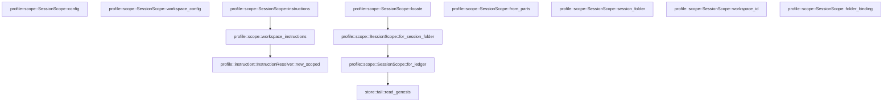

# profile::scope

[Package atlas](index.md) · [Source](../../src/scope.rs)

## Declarations

Visibility is the declaration spelling; trait members and reexports require their enclosing interface. `cfg` is not evaluated.

| Symbol | Kind | Visibility | Test / cfg |
|---|---|---|---|
| [profile::scope::SessionScope](../../src/scope.rs#L12) | struct_item | `pub` |  |
| [profile::scope::SessionScope::locate](../../src/scope.rs#L21) | function_item | `pub` |  |
| [profile::scope::SessionScope::for_session_folder](../../src/scope.rs#L35) | function_item | `pub` |  |
| [profile::scope::SessionScope::for_ledger](../../src/scope.rs#L41) | function_item | `pub` |  |
| [profile::scope::SessionScope::from_parts](../../src/scope.rs#L72) | function_item | `pub` |  |
| [profile::scope::SessionScope::session_folder](../../src/scope.rs#L85) | function_item | `pub` |  |
| [profile::scope::SessionScope::workspace_id](../../src/scope.rs#L90) | function_item | `pub` |  |
| [profile::scope::SessionScope::folder_binding](../../src/scope.rs#L95) | function_item | `pub` |  |
| [profile::scope::SessionScope::config](../../src/scope.rs#L102) | function_item | `pub` |  |
| [profile::scope::SessionScope::workspace_config](../../src/scope.rs#L116) | function_item | `pub` |  |
| [profile::scope::SessionScope::instructions](../../src/scope.rs#L129) | function_item | `pub` |  |
| [profile::scope::workspace_instructions](../../src/scope.rs#L142) | function_item | `pub` |  |
| [profile::scope::tests::write_genesis](../../src/scope.rs#L160) | function_item | `private` | test; #[cfg(test)] |
| [profile::scope::tests::scope_reads_workspace_and_binding_from_the_genesis_only](../../src/scope.rs#L183) | function_item | `private` | test; #[cfg(test)] |
| [profile::scope::tests::session_and_workspace_config_differ_only_in_session_settings](../../src/scope.rs#L204) | function_item | `private` | test; #[cfg(test)] |

## Imports / reexports

| Local name | Source path | Visibility |
|---|---|---|
| `Path` | `std::path::Path` | `private` |
| `PathBuf` | `std::path::PathBuf` | `private` |
| `ConfigRepository` | `crate::ConfigRepository` | `private` |
| `ConfigSnapshot` | `crate::ConfigSnapshot` | `private` |
| `InstructionResolver` | `crate::InstructionResolver` | `private` |
| `ProfileError` | `crate::ProfileError` | `private` |
| `*` | `super::*` | `private` |
| `WorkspaceConfig` | `crate::WorkspaceConfig` | `private` |
| `WorkspaceFolder` | `crate::WorkspaceFolder` | `private` |

## Module declarations

| Module | Visibility | Attributes |
|---|---|---|
| `profile::scope::tests` | `private` | #[cfg(test)] |

## Function call graphs

Edges below are syntactically resolved calls only, including private functions. Graphs partition callers into groups of 20; they are not execution order. All unresolved sites are listed below and in the JSON inventory.

Functions 1–11: 5 direct edges

## Call sites

Includes test functions (marked in declarations). Receiver-type-required sites need type analysis/manual tracing. Calls in closures are attributed to their enclosing function; their occurrence here does not mean the closure executes immediately.

| Caller | Callee expression | Source lines | Target / classification |
|---|---|---|---|
| `locate` | `["threads", "archive"]             .into_iter()             .map(&#124;area&#124; storage_root.join(area).join(session_id))             .find(&#124;path&#124; path.is_dir())             .ok_or_else` | [22](../../src/scope.rs#L22) | receiver-type-required |
| `locate` | `["threads", "archive"]             .into_iter()             .map(&#124;area&#124; storage_root.join(area).join(session_id))             .find` | [22](../../src/scope.rs#L22) | receiver-type-required |
| `locate` | `["threads", "archive"]             .into_iter()             .map` | [22](../../src/scope.rs#L22) | receiver-type-required |
| `locate` | `["threads", "archive"]             .into_iter` | [22](../../src/scope.rs#L22) | receiver-type-required |
| `locate` | `storage_root.join(area).join` | [24](../../src/scope.rs#L24) | receiver-type-required |
| `locate` | `storage_root.join` | [24](../../src/scope.rs#L24), [27](../../src/scope.rs#L27) | receiver-type-required |
| `locate` | `path.is_dir` | [25](../../src/scope.rs#L25) | receiver-type-required |
| `locate` | `storage_root.join("threads").join` | [27](../../src/scope.rs#L27) | receiver-type-required |
| `locate` | `"session folder does not exist".to_owned` | [28](../../src/scope.rs#L28) | receiver-type-required |
| `locate` | `Self::for_session_folder` | [30](../../src/scope.rs#L30) | [profile::scope::SessionScope::for_session_folder](../../src/scope.rs#L35) |
| `for_session_folder` | `Self::for_ledger` | [36](../../src/scope.rs#L36) | [profile::scope::SessionScope::for_ledger](../../src/scope.rs#L41) |
| `for_session_folder` | `session_folder.into().join` | [36](../../src/scope.rs#L36) | receiver-type-required |
| `for_session_folder` | `session_folder.into` | [36](../../src/scope.rs#L36) | receiver-type-required |
| `for_ledger` | `ledger.as_ref().to_path_buf` | [42](../../src/scope.rs#L42) | receiver-type-required |
| `for_ledger` | `ledger.as_ref` | [42](../../src/scope.rs#L42) | receiver-type-required |
| `for_ledger` | `ledger             .parent()             .ok_or_else(&#124;&#124; ProfileError::InvalidPath {                 path: ledger.clone(),                 reason: "session ledger has no folder".to_owned(),             })?             .to_path_buf` | [43](../../src/scope.rs#L43) | receiver-type-required |
| `for_ledger` | `ledger             .parent()             .ok_or_else` | [43](../../src/scope.rs#L43) | receiver-type-required |
| `for_ledger` | `ledger             .parent` | [43](../../src/scope.rs#L43) | receiver-type-required |
| `for_ledger` | `ledger.clone` | [46](../../src/scope.rs#L46), [52](../../src/scope.rs#L52), [58](../../src/scope.rs#L58) | receiver-type-required |
| `for_ledger` | `"session ledger has no folder".to_owned` | [47](../../src/scope.rs#L47) | receiver-type-required |
| `for_ledger` | `store::read_genesis(&ledger)?.ok_or_else` | [51](../../src/scope.rs#L51) | receiver-type-required |
| `for_ledger` | `store::read_genesis` | [51](../../src/scope.rs#L51) | [store::tail::read_genesis](../../../store/src/tail.rs#L86) |
| `for_ledger` | `"session ledger has no valid genesis".to_owned` | [53](../../src/scope.rs#L53) | receiver-type-required |
| `for_ledger` | `genesis             .string_field("workspace")             .ok_or_else(&#124;&#124; ProfileError::InvalidReference {                 path: ledger.clone(),                 reason: "session genesis has no workspace".to_owned(),             })?             .to_owned` | [55](../../src/scope.rs#L55) | receiver-type-required |
| `for_ledger` | `genesis             .string_field("workspace")             .ok_or_else` | [55](../../src/scope.rs#L55) | receiver-type-required |
| `for_ledger` | `genesis             .string_field` | [55](../../src/scope.rs#L55) | receiver-type-required |
| `for_ledger` | `"session genesis has no workspace".to_owned` | [59](../../src/scope.rs#L59) | receiver-type-required |
| `for_ledger` | `genesis.string_field("folder_binding").map` | [62](../../src/scope.rs#L62) | receiver-type-required |
| `for_ledger` | `genesis.string_field` | [62](../../src/scope.rs#L62) | receiver-type-required |
| `for_ledger` | `Ok` | [63](../../src/scope.rs#L63) | external-constructor-callback-or-unresolved |
| `from_parts` | `session_folder.into` | [78](../../src/scope.rs#L78) | receiver-type-required |
| `from_parts` | `workspace_id.into` | [79](../../src/scope.rs#L79) | receiver-type-required |
| `folder_binding` | `self.folder_binding.as_deref` | [96](../../src/scope.rs#L96) | receiver-type-required |
| `config` | `repository.resolve_for_session_binding` | [104](../../src/scope.rs#L104) | receiver-type-required |
| `config` | `repository.resolve_for_session` | [109](../../src/scope.rs#L109) | receiver-type-required |
| `workspace_config` | `repository.resolve_for_binding` | [121](../../src/scope.rs#L121) | receiver-type-required |
| `workspace_config` | `repository.resolve` | [122](../../src/scope.rs#L122) | receiver-type-required |
| `instructions` | `workspace_instructions` | [135](../../src/scope.rs#L135) | [profile::scope::workspace_instructions](../../src/scope.rs#L142) |
| `workspace_instructions` | `Ok` | [148](../../src/scope.rs#L148) | external-constructor-callback-or-unresolved |
| `workspace_instructions` | `InstructionResolver::new_scoped` | [148](../../src/scope.rs#L148) | [profile::instruction::InstructionResolver::new_scoped](../../src/instruction.rs#L297) |
| `workspace_instructions` | `repository.workspace_data_dir` | [150](../../src/scope.rs#L150) | receiver-type-required |
| `workspace_instructions` | `config.workspace.cwd.iter().map` | [151](../../src/scope.rs#L151) | receiver-type-required |
| `workspace_instructions` | `config.workspace.cwd.iter` | [151](../../src/scope.rs#L151) | receiver-type-required |
| `write_genesis` | `std::fs::create_dir_all(folder).unwrap` | [161](../../src/scope.rs#L161) | receiver-type-required |
| `write_genesis` | `std::fs::create_dir_all` | [161](../../src/scope.rs#L161) | external-constructor-callback-or-unresolved |
| `write_genesis` | `binding.into` | [170](../../src/scope.rs#L170) | receiver-type-required |
| `write_genesis` | `std::fs::write(             folder.join("main.jsonl"),             format!(                 "{}\n",                 serde_json_canonicalizer::to_string(&genesis).unwrap()             ),         )         .unwrap` | [172](../../src/scope.rs#L172) | receiver-type-required |
| `write_genesis` | `std::fs::write` | [172](../../src/scope.rs#L172) | external-constructor-callback-or-unresolved |
| `write_genesis` | `folder.join` | [173](../../src/scope.rs#L173) | receiver-type-required |
| `scope_reads_workspace_and_binding_from_the_genesis_only` | `tempfile::tempdir().unwrap` | [184](../../src/scope.rs#L184) | receiver-type-required |
| `scope_reads_workspace_and_binding_from_the_genesis_only` | `tempfile::tempdir` | [184](../../src/scope.rs#L184) | external-constructor-callback-or-unresolved |
| `scope_reads_workspace_and_binding_from_the_genesis_only` | `root.path().join("threads").join` | [185](../../src/scope.rs#L185) | receiver-type-required |
| `scope_reads_workspace_and_binding_from_the_genesis_only` | `root.path().join` | [185](../../src/scope.rs#L185), [186](../../src/scope.rs#L186) | receiver-type-required |
| `scope_reads_workspace_and_binding_from_the_genesis_only` | `root.path` | [185](../../src/scope.rs#L185), [186](../../src/scope.rs#L186), [190](../../src/scope.rs#L190), [194](../../src/scope.rs#L194) | receiver-type-required |
| `scope_reads_workspace_and_binding_from_the_genesis_only` | `root.path().join("archive").join` | [186](../../src/scope.rs#L186) | receiver-type-required |
| `scope_reads_workspace_and_binding_from_the_genesis_only` | `write_genesis` | [187](../../src/scope.rs#L187), [188](../../src/scope.rs#L188) | [profile::scope::tests::write_genesis](../../src/scope.rs#L160) |
| `scope_reads_workspace_and_binding_from_the_genesis_only` | `Some` | [187](../../src/scope.rs#L187) | external-constructor-callback-or-unresolved |
| `scope_reads_workspace_and_binding_from_the_genesis_only` | `SessionScope::locate(root.path(), "a").unwrap` | [190](../../src/scope.rs#L190) | receiver-type-required |
| `scope_reads_workspace_and_binding_from_the_genesis_only` | `SessionScope::locate` | [190](../../src/scope.rs#L190), [194](../../src/scope.rs#L194) | external-constructor-callback-or-unresolved |
| `scope_reads_workspace_and_binding_from_the_genesis_only` | `SessionScope::locate(root.path(), "b").unwrap` | [194](../../src/scope.rs#L194) | receiver-type-required |
| `scope_reads_workspace_and_binding_from_the_genesis_only` | `std::fs::write(active.join("main.jsonl"), b"").unwrap` | [199](../../src/scope.rs#L199) | receiver-type-required |
| `scope_reads_workspace_and_binding_from_the_genesis_only` | `std::fs::write` | [199](../../src/scope.rs#L199) | external-constructor-callback-or-unresolved |
| `scope_reads_workspace_and_binding_from_the_genesis_only` | `active.join` | [199](../../src/scope.rs#L199) | receiver-type-required |
| `session_and_workspace_config_differ_only_in_session_settings` | `tempfile::tempdir().unwrap` | [205](../../src/scope.rs#L205) | receiver-type-required |
| `session_and_workspace_config_differ_only_in_session_settings` | `tempfile::tempdir` | [205](../../src/scope.rs#L205) | external-constructor-callback-or-unresolved |
| `session_and_workspace_config_differ_only_in_session_settings` | `root.path().join` | [206](../../src/scope.rs#L206), [207](../../src/scope.rs#L207), [235](../../src/scope.rs#L235), [249](../../src/scope.rs#L249) | receiver-type-required |
| `session_and_workspace_config_differ_only_in_session_settings` | `root.path` | [206](../../src/scope.rs#L206), [207](../../src/scope.rs#L207), [210](../../src/scope.rs#L210), [235](../../src/scope.rs#L235), [249](../../src/scope.rs#L249) | receiver-type-required |
| `session_and_workspace_config_differ_only_in_session_settings` | `std::fs::create_dir_all(&first).unwrap` | [208](../../src/scope.rs#L208) | receiver-type-required |
| `session_and_workspace_config_differ_only_in_session_settings` | `std::fs::create_dir_all` | [208](../../src/scope.rs#L208), [209](../../src/scope.rs#L209) | external-constructor-callback-or-unresolved |
| `session_and_workspace_config_differ_only_in_session_settings` | `std::fs::create_dir_all(&second).unwrap` | [209](../../src/scope.rs#L209) | receiver-type-required |
| `session_and_workspace_config_differ_only_in_session_settings` | `ConfigRepository::open(root.path()).unwrap` | [210](../../src/scope.rs#L210) | receiver-type-required |
| `session_and_workspace_config_differ_only_in_session_settings` | `ConfigRepository::open` | [210](../../src/scope.rs#L210) | external-constructor-callback-or-unresolved |
| `session_and_workspace_config_differ_only_in_session_settings` | `path.canonicalize().unwrap().to_string_lossy().into_owned` | [211](../../src/scope.rs#L211) | receiver-type-required |
| `session_and_workspace_config_differ_only_in_session_settings` | `path.canonicalize().unwrap().to_string_lossy` | [211](../../src/scope.rs#L211) | receiver-type-required |
| `session_and_workspace_config_differ_only_in_session_settings` | `path.canonicalize().unwrap` | [211](../../src/scope.rs#L211) | receiver-type-required |
| `session_and_workspace_config_differ_only_in_session_settings` | `path.canonicalize` | [211](../../src/scope.rs#L211) | receiver-type-required |
| `session_and_workspace_config_differ_only_in_session_settings` | `repository             .publish_workspace(                 0,                 &WorkspaceConfig {                     format: 1,                     revision: 1,                     id: "workspace-1".to_owned(),                     name: "Workspace".to_owned(),                     cwd: Vec::new(),                     folders: vec![                         WorkspaceFolder {                             id: "folder-0001".to_owned(),                             path: canonical(&first),                         },                         WorkspaceFolder {                             id: "folder-0002".to_owned(),                             path: canonical(&second),                         },                     ],                     policy: None,                 },             )             .unwrap` | [212](../../src/scope.rs#L212) | receiver-type-required |
| `session_and_workspace_config_differ_only_in_session_settings` | `repository             .publish_workspace` | [212](../../src/scope.rs#L212) | receiver-type-required |
| `session_and_workspace_config_differ_only_in_session_settings` | `"workspace-1".to_owned` | [218](../../src/scope.rs#L218) | receiver-type-required |
| `session_and_workspace_config_differ_only_in_session_settings` | `"Workspace".to_owned` | [219](../../src/scope.rs#L219) | receiver-type-required |
| `session_and_workspace_config_differ_only_in_session_settings` | `Vec::new` | [220](../../src/scope.rs#L220) | external-constructor-callback-or-unresolved |
| `session_and_workspace_config_differ_only_in_session_settings` | `root.path().join("threads").join` | [235](../../src/scope.rs#L235) | receiver-type-required |
| `session_and_workspace_config_differ_only_in_session_settings` | `write_genesis` | [236](../../src/scope.rs#L236), [244](../../src/scope.rs#L244) | [profile::scope::tests::write_genesis](../../src/scope.rs#L160) |
| `session_and_workspace_config_differ_only_in_session_settings` | `Some` | [236](../../src/scope.rs#L236) | external-constructor-callback-or-unresolved |
| `session_and_workspace_config_differ_only_in_session_settings` | `SessionScope::for_session_folder(&folder).unwrap` | [237](../../src/scope.rs#L237), [245](../../src/scope.rs#L245) | receiver-type-required |
| `session_and_workspace_config_differ_only_in_session_settings` | `SessionScope::for_session_folder` | [237](../../src/scope.rs#L237), [245](../../src/scope.rs#L245) | external-constructor-callback-or-unresolved |
| `session_and_workspace_config_differ_only_in_session_settings` | `scope.config(&repository).unwrap` | [238](../../src/scope.rs#L238) | receiver-type-required |
| `session_and_workspace_config_differ_only_in_session_settings` | `scope.config` | [238](../../src/scope.rs#L238) | receiver-type-required |
| `session_and_workspace_config_differ_only_in_session_settings` | `scope.workspace_config(&repository).unwrap` | [239](../../src/scope.rs#L239) | receiver-type-required |
| `session_and_workspace_config_differ_only_in_session_settings` | `scope.workspace_config` | [239](../../src/scope.rs#L239) | receiver-type-required |
| `session_and_workspace_config_differ_only_in_session_settings` | `scope             .instructions(&repository, &root.path().join("agents"), &session)             .unwrap` | [248](../../src/scope.rs#L248) | receiver-type-required |
| `session_and_workspace_config_differ_only_in_session_settings` | `scope             .instructions` | [248](../../src/scope.rs#L248) | receiver-type-required |
