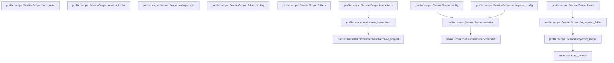

# profile::scope

[Package atlas](index.md) · [Source](../../src/scope.rs)

## Declarations

Visibility is the declaration spelling; trait members and reexports require their enclosing interface. `cfg` is not evaluated.

| Symbol | Kind | Visibility | Test / cfg |
|---|---|---|---|
| [profile::scope::SessionScope](../../src/scope.rs#L12) | struct_item | `pub` |  |
| [profile::scope::FolderRecord](../../src/scope.rs#L24) | struct_item | `pub` |  |
| [profile::scope::SessionScope::locate](../../src/scope.rs#L32) | function_item | `pub` |  |
| [profile::scope::SessionScope::for_session_folder](../../src/scope.rs#L46) | function_item | `pub` |  |
| [profile::scope::SessionScope::for_ledger](../../src/scope.rs#L52) | function_item | `pub` |  |
| [profile::scope::SessionScope::from_parts](../../src/scope.rs#L102) | function_item | `pub` |  |
| [profile::scope::SessionScope::session_folder](../../src/scope.rs#L117) | function_item | `pub` |  |
| [profile::scope::SessionScope::workspace_id](../../src/scope.rs#L122) | function_item | `pub` |  |
| [profile::scope::SessionScope::folder_binding](../../src/scope.rs#L127) | function_item | `pub` |  |
| [profile::scope::SessionScope::environment](../../src/scope.rs#L134) | function_item | `pub` |  |
| [profile::scope::SessionScope::folders](../../src/scope.rs#L143) | function_item | `pub` |  |
| [profile::scope::SessionScope::config](../../src/scope.rs#L171) | function_item | `pub` |  |
| [profile::scope::SessionScope::workspace_config](../../src/scope.rs#L183) | function_item | `pub` |  |
| [profile::scope::SessionScope::selection](../../src/scope.rs#L197) | function_item | `pub` |  |
| [profile::scope::SessionScope::instructions](../../src/scope.rs#L207) | function_item | `pub` |  |
| [profile::scope::workspace_instructions](../../src/scope.rs#L220) | function_item | `pub` |  |
| [profile::scope::tests::write_genesis](../../src/scope.rs#L239) | function_item | `private` | test; #[cfg(test)] |
| [profile::scope::tests::write_genesis_with](../../src/scope.rs#L243) | function_item | `private` | test; #[cfg(test)] |
| [profile::scope::tests::scope_reads_workspace_and_binding_from_the_genesis_only](../../src/scope.rs#L269) | function_item | `private` | test; #[cfg(test)] |
| [profile::scope::tests::session_and_workspace_config_differ_only_in_session_settings](../../src/scope.rs#L290) | function_item | `private` | test; #[cfg(test)] |
| [profile::scope::tests::environment_and_folders_come_from_the_genesis_or_the_workspace](../../src/scope.rs#L371) | function_item | `private` | test; #[cfg(test)] |

## Imports / reexports

| Local name | Source path | Visibility |
|---|---|---|
| `Path` | `std::path::Path` | `private` |
| `PathBuf` | `std::path::PathBuf` | `private` |
| `ConfigRepository` | `crate::ConfigRepository` | `private` |
| `ConfigSnapshot` | `crate::ConfigSnapshot` | `private` |
| `InstructionResolver` | `crate::InstructionResolver` | `private` |
| `ProfileError` | `crate::ProfileError` | `private` |
| `ScopeSelection` | `crate::ScopeSelection` | `private` |
| `*` | `super::*` | `private` |
| `WorkspaceConfig` | `crate::WorkspaceConfig` | `private` |
| `WorkspaceFolder` | `crate::WorkspaceFolder` | `private` |

## Module declarations

| Module | Visibility | Attributes |
|---|---|---|
| `profile::scope::tests` | `private` | #[cfg(test)] |

## Function call graphs

Edges below are syntactically resolved calls only, including private functions. Graphs partition callers into groups of 20; they are not execution order. All unresolved sites are listed below and in the JSON inventory.

Functions 1–14: 8 direct edges

## Call sites

Includes test functions (marked in declarations). Receiver-type-required sites need type analysis/manual tracing. Calls in closures are attributed to their enclosing function; their occurrence here does not mean the closure executes immediately.

| Caller | Callee expression | Source lines | Target / classification |
|---|---|---|---|
| `locate` | `["threads", "archive"]             .into_iter()             .map(&#124;area&#124; storage_root.join(area).join(session_id))             .find(&#124;path&#124; path.is_dir())             .ok_or_else` | [33](../../src/scope.rs#L33) | receiver-type-required |
| `locate` | `["threads", "archive"]             .into_iter()             .map(&#124;area&#124; storage_root.join(area).join(session_id))             .find` | [33](../../src/scope.rs#L33) | receiver-type-required |
| `locate` | `["threads", "archive"]             .into_iter()             .map` | [33](../../src/scope.rs#L33) | receiver-type-required |
| `locate` | `["threads", "archive"]             .into_iter` | [33](../../src/scope.rs#L33) | receiver-type-required |
| `locate` | `storage_root.join(area).join` | [35](../../src/scope.rs#L35) | receiver-type-required |
| `locate` | `storage_root.join` | [35](../../src/scope.rs#L35), [38](../../src/scope.rs#L38) | receiver-type-required |
| `locate` | `path.is_dir` | [36](../../src/scope.rs#L36) | receiver-type-required |
| `locate` | `storage_root.join("threads").join` | [38](../../src/scope.rs#L38) | receiver-type-required |
| `locate` | `"session folder does not exist".to_owned` | [39](../../src/scope.rs#L39) | receiver-type-required |
| `locate` | `Self::for_session_folder` | [41](../../src/scope.rs#L41) | [profile::scope::SessionScope::for_session_folder](../../src/scope.rs#L46) |
| `for_session_folder` | `Self::for_ledger` | [47](../../src/scope.rs#L47) | [profile::scope::SessionScope::for_ledger](../../src/scope.rs#L52) |
| `for_session_folder` | `session_folder.into().join` | [47](../../src/scope.rs#L47) | receiver-type-required |
| `for_session_folder` | `session_folder.into` | [47](../../src/scope.rs#L47) | receiver-type-required |
| `for_ledger` | `ledger.as_ref().to_path_buf` | [53](../../src/scope.rs#L53) | receiver-type-required |
| `for_ledger` | `ledger.as_ref` | [53](../../src/scope.rs#L53) | receiver-type-required |
| `for_ledger` | `ledger             .parent()             .ok_or_else(&#124;&#124; ProfileError::InvalidPath {                 path: ledger.clone(),                 reason: "session ledger has no folder".to_owned(),             })?             .to_path_buf` | [54](../../src/scope.rs#L54) | receiver-type-required |
| `for_ledger` | `ledger             .parent()             .ok_or_else` | [54](../../src/scope.rs#L54) | receiver-type-required |
| `for_ledger` | `ledger             .parent` | [54](../../src/scope.rs#L54) | receiver-type-required |
| `for_ledger` | `ledger.clone` | [57](../../src/scope.rs#L57), [63](../../src/scope.rs#L63), [69](../../src/scope.rs#L69), [77](../../src/scope.rs#L77) | receiver-type-required |
| `for_ledger` | `"session ledger has no folder".to_owned` | [58](../../src/scope.rs#L58) | receiver-type-required |
| `for_ledger` | `store::read_genesis(&ledger)?.ok_or_else` | [62](../../src/scope.rs#L62) | receiver-type-required |
| `for_ledger` | `store::read_genesis` | [62](../../src/scope.rs#L62) | [store::tail::read_genesis](../../../store/src/tail.rs#L86) |
| `for_ledger` | `"session ledger has no valid genesis".to_owned` | [64](../../src/scope.rs#L64) | receiver-type-required |
| `for_ledger` | `genesis             .string_field("workspace")             .ok_or_else(&#124;&#124; ProfileError::InvalidReference {                 path: ledger.clone(),                 reason: "session genesis has no workspace".to_owned(),             })?             .to_owned` | [66](../../src/scope.rs#L66) | receiver-type-required |
| `for_ledger` | `genesis             .string_field("workspace")             .ok_or_else` | [66](../../src/scope.rs#L66) | receiver-type-required |
| `for_ledger` | `genesis             .string_field` | [66](../../src/scope.rs#L66) | receiver-type-required |
| `for_ledger` | `"session genesis has no workspace".to_owned` | [70](../../src/scope.rs#L70) | receiver-type-required |
| `for_ledger` | `genesis.string_field("folder_binding").map` | [73](../../src/scope.rs#L73) | receiver-type-required |
| `for_ledger` | `genesis.string_field` | [73](../../src/scope.rs#L73), [74](../../src/scope.rs#L74) | receiver-type-required |
| `for_ledger` | `genesis.string_field("environment").map` | [74](../../src/scope.rs#L74) | receiver-type-required |
| `for_ledger` | `serde_json::to_value(genesis.raw()).map_err` | [75](../../src/scope.rs#L75) | receiver-type-required |
| `for_ledger` | `serde_json::to_value` | [75](../../src/scope.rs#L75) | external-constructor-callback-or-unresolved |
| `for_ledger` | `genesis.raw` | [75](../../src/scope.rs#L75) | receiver-type-required |
| `for_ledger` | `error.to_string` | [78](../../src/scope.rs#L78) | receiver-type-required |
| `for_ledger` | `raw             .get("folders")             .and_then(serde_json::Value::as_array)             .map` | [81](../../src/scope.rs#L81) | receiver-type-required |
| `for_ledger` | `raw             .get("folders")             .and_then` | [81](../../src/scope.rs#L81) | receiver-type-required |
| `for_ledger` | `raw             .get` | [81](../../src/scope.rs#L81) | receiver-type-required |
| `for_ledger` | `folders                     .iter()                     .filter_map(serde_json::Value::as_str)                     .map(str::to_owned)                     .collect` | [85](../../src/scope.rs#L85) | receiver-type-required |
| `for_ledger` | `folders                     .iter()                     .filter_map(serde_json::Value::as_str)                     .map` | [85](../../src/scope.rs#L85) | receiver-type-required |
| `for_ledger` | `folders                     .iter()                     .filter_map` | [85](../../src/scope.rs#L85) | receiver-type-required |
| `for_ledger` | `folders                     .iter` | [85](../../src/scope.rs#L85) | receiver-type-required |
| `for_ledger` | `Ok` | [91](../../src/scope.rs#L91) | external-constructor-callback-or-unresolved |
| `from_parts` | `session_folder.into` | [108](../../src/scope.rs#L108) | receiver-type-required |
| `from_parts` | `workspace_id.into` | [109](../../src/scope.rs#L109) | receiver-type-required |
| `folder_binding` | `self.folder_binding.as_deref` | [128](../../src/scope.rs#L128) | receiver-type-required |
| `environment` | `self.environment             .as_deref()             .unwrap_or` | [135](../../src/scope.rs#L135) | receiver-type-required |
| `environment` | `self.environment             .as_deref` | [135](../../src/scope.rs#L135) | receiver-type-required |
| `folders` | `repository.workspace` | [147](../../src/scope.rs#L147) | receiver-type-required |
| `folders` | `self             .folders             .clone()             .unwrap_or_else` | [148](../../src/scope.rs#L148) | receiver-type-required |
| `folders` | `self             .folders             .clone` | [148](../../src/scope.rs#L148) | receiver-type-required |
| `folders` | `workspace.folder_ids` | [151](../../src/scope.rs#L151) | receiver-type-required |
| `folders` | `ids.into_iter()             .map(&#124;id&#124; {                 let path = workspace.path_for_binding(&id).ok_or_else(&#124;&#124; {                     ProfileError::InvalidReference {                         path: self.session_folder.join("main.jsonl"),                         reason: format!("session folder {id} is not in its workspace"),                     }                 })?;                 Ok(FolderRecord {                     id,                     path: path.to_owned(),                 })             })             .collect` | [152](../../src/scope.rs#L152) | receiver-type-required |
| `folders` | `ids.into_iter()             .map` | [152](../../src/scope.rs#L152) | receiver-type-required |
| `folders` | `ids.into_iter` | [152](../../src/scope.rs#L152) | receiver-type-required |
| `folders` | `workspace.path_for_binding(&id).ok_or_else` | [154](../../src/scope.rs#L154) | receiver-type-required |
| `folders` | `workspace.path_for_binding` | [154](../../src/scope.rs#L154) | receiver-type-required |
| `folders` | `self.session_folder.join` | [156](../../src/scope.rs#L156) | receiver-type-required |
| `folders` | `Ok` | [160](../../src/scope.rs#L160) | external-constructor-callback-or-unresolved |
| `folders` | `path.to_owned` | [162](../../src/scope.rs#L162) | receiver-type-required |
| `config` | `repository.resolve_scoped` | [172](../../src/scope.rs#L172) | receiver-type-required |
| `config` | `Some` | [174](../../src/scope.rs#L174) | external-constructor-callback-or-unresolved |
| `config` | `self.folder_binding.as_deref` | [175](../../src/scope.rs#L175) | receiver-type-required |
| `config` | `self.selection` | [176](../../src/scope.rs#L176) | [profile::scope::SessionScope::selection](../../src/scope.rs#L197) |
| `workspace_config` | `repository.resolve_scoped` | [187](../../src/scope.rs#L187) | receiver-type-required |
| `workspace_config` | `self.folder_binding.as_deref` | [190](../../src/scope.rs#L190) | receiver-type-required |
| `workspace_config` | `self.selection` | [191](../../src/scope.rs#L191) | [profile::scope::SessionScope::selection](../../src/scope.rs#L197) |
| `selection` | `self.environment` | [199](../../src/scope.rs#L199) | [profile::scope::SessionScope::environment](../../src/scope.rs#L134) |
| `selection` | `self.folders.as_deref` | [200](../../src/scope.rs#L200) | receiver-type-required |
| `instructions` | `workspace_instructions` | [213](../../src/scope.rs#L213) | [profile::scope::workspace_instructions](../../src/scope.rs#L220) |
| `workspace_instructions` | `Ok` | [226](../../src/scope.rs#L226) | external-constructor-callback-or-unresolved |
| `workspace_instructions` | `InstructionResolver::new_scoped(         user_agent_dir,         repository.workspace_data_dir(workspace_id)?,         config.workspace.cwd.iter().map(Path::new),     )     .with_folder_authority` | [226](../../src/scope.rs#L226) | receiver-type-required |
| `workspace_instructions` | `InstructionResolver::new_scoped` | [226](../../src/scope.rs#L226) | [profile::instruction::InstructionResolver::new_scoped](../../src/instruction.rs#L333) |
| `workspace_instructions` | `repository.workspace_data_dir` | [228](../../src/scope.rs#L228) | receiver-type-required |
| `workspace_instructions` | `config.workspace.cwd.iter().map` | [229](../../src/scope.rs#L229) | receiver-type-required |
| `workspace_instructions` | `config.workspace.cwd.iter` | [229](../../src/scope.rs#L229) | receiver-type-required |
| `workspace_instructions` | `repository.root` | [231](../../src/scope.rs#L231) | receiver-type-required |
| `write_genesis` | `write_genesis_with` | [240](../../src/scope.rs#L240) | [profile::scope::tests::write_genesis_with](../../src/scope.rs#L243) |
| `write_genesis_with` | `std::fs::create_dir_all(folder).unwrap` | [244](../../src/scope.rs#L244) | receiver-type-required |
| `write_genesis_with` | `std::fs::create_dir_all` | [244](../../src/scope.rs#L244) | external-constructor-callback-or-unresolved |
| `write_genesis_with` | `binding.into` | [253](../../src/scope.rs#L253) | receiver-type-required |
| `write_genesis_with` | `extra.as_object().unwrap` | [255](../../src/scope.rs#L255) | receiver-type-required |
| `write_genesis_with` | `extra.as_object` | [255](../../src/scope.rs#L255) | receiver-type-required |
| `write_genesis_with` | `value.clone` | [256](../../src/scope.rs#L256) | receiver-type-required |
| `write_genesis_with` | `std::fs::write(             folder.join("main.jsonl"),             format!(                 "{}\n",                 serde_json_canonicalizer::to_string(&genesis).unwrap()             ),         )         .unwrap` | [258](../../src/scope.rs#L258) | receiver-type-required |
| `write_genesis_with` | `std::fs::write` | [258](../../src/scope.rs#L258) | external-constructor-callback-or-unresolved |
| `write_genesis_with` | `folder.join` | [259](../../src/scope.rs#L259) | receiver-type-required |
| `scope_reads_workspace_and_binding_from_the_genesis_only` | `tempfile::tempdir().unwrap` | [270](../../src/scope.rs#L270) | receiver-type-required |
| `scope_reads_workspace_and_binding_from_the_genesis_only` | `tempfile::tempdir` | [270](../../src/scope.rs#L270) | external-constructor-callback-or-unresolved |
| `scope_reads_workspace_and_binding_from_the_genesis_only` | `root.path().join("threads").join` | [271](../../src/scope.rs#L271) | receiver-type-required |
| `scope_reads_workspace_and_binding_from_the_genesis_only` | `root.path().join` | [271](../../src/scope.rs#L271), [272](../../src/scope.rs#L272) | receiver-type-required |
| `scope_reads_workspace_and_binding_from_the_genesis_only` | `root.path` | [271](../../src/scope.rs#L271), [272](../../src/scope.rs#L272), [276](../../src/scope.rs#L276), [280](../../src/scope.rs#L280) | receiver-type-required |
| `scope_reads_workspace_and_binding_from_the_genesis_only` | `root.path().join("archive").join` | [272](../../src/scope.rs#L272) | receiver-type-required |
| `scope_reads_workspace_and_binding_from_the_genesis_only` | `write_genesis` | [273](../../src/scope.rs#L273), [274](../../src/scope.rs#L274) | [profile::scope::tests::write_genesis](../../src/scope.rs#L239) |
| `scope_reads_workspace_and_binding_from_the_genesis_only` | `Some` | [273](../../src/scope.rs#L273) | external-constructor-callback-or-unresolved |
| `scope_reads_workspace_and_binding_from_the_genesis_only` | `SessionScope::locate(root.path(), "a").unwrap` | [276](../../src/scope.rs#L276) | receiver-type-required |
| `scope_reads_workspace_and_binding_from_the_genesis_only` | `SessionScope::locate` | [276](../../src/scope.rs#L276), [280](../../src/scope.rs#L280) | external-constructor-callback-or-unresolved |
| `scope_reads_workspace_and_binding_from_the_genesis_only` | `SessionScope::locate(root.path(), "b").unwrap` | [280](../../src/scope.rs#L280) | receiver-type-required |
| `scope_reads_workspace_and_binding_from_the_genesis_only` | `std::fs::write(active.join("main.jsonl"), b"").unwrap` | [285](../../src/scope.rs#L285) | receiver-type-required |
| `scope_reads_workspace_and_binding_from_the_genesis_only` | `std::fs::write` | [285](../../src/scope.rs#L285) | external-constructor-callback-or-unresolved |
| `scope_reads_workspace_and_binding_from_the_genesis_only` | `active.join` | [285](../../src/scope.rs#L285) | receiver-type-required |
| `session_and_workspace_config_differ_only_in_session_settings` | `tempfile::tempdir().unwrap` | [291](../../src/scope.rs#L291) | receiver-type-required |
| `session_and_workspace_config_differ_only_in_session_settings` | `tempfile::tempdir` | [291](../../src/scope.rs#L291) | external-constructor-callback-or-unresolved |
| `session_and_workspace_config_differ_only_in_session_settings` | `root.path().join` | [292](../../src/scope.rs#L292), [293](../../src/scope.rs#L293), [321](../../src/scope.rs#L321), [329](../../src/scope.rs#L329), [357](../../src/scope.rs#L357) | receiver-type-required |
| `session_and_workspace_config_differ_only_in_session_settings` | `root.path` | [292](../../src/scope.rs#L292), [293](../../src/scope.rs#L293), [296](../../src/scope.rs#L296), [321](../../src/scope.rs#L321), [329](../../src/scope.rs#L329), [357](../../src/scope.rs#L357) | receiver-type-required |
| `session_and_workspace_config_differ_only_in_session_settings` | `std::fs::create_dir_all(&first).unwrap` | [294](../../src/scope.rs#L294) | receiver-type-required |
| `session_and_workspace_config_differ_only_in_session_settings` | `std::fs::create_dir_all` | [294](../../src/scope.rs#L294), [295](../../src/scope.rs#L295) | external-constructor-callback-or-unresolved |
| `session_and_workspace_config_differ_only_in_session_settings` | `std::fs::create_dir_all(&second).unwrap` | [295](../../src/scope.rs#L295) | receiver-type-required |
| `session_and_workspace_config_differ_only_in_session_settings` | `ConfigRepository::open(root.path()).unwrap` | [296](../../src/scope.rs#L296) | receiver-type-required |
| `session_and_workspace_config_differ_only_in_session_settings` | `ConfigRepository::open` | [296](../../src/scope.rs#L296) | external-constructor-callback-or-unresolved |
| `session_and_workspace_config_differ_only_in_session_settings` | `path.canonicalize().unwrap().to_string_lossy().into_owned` | [297](../../src/scope.rs#L297) | receiver-type-required |
| `session_and_workspace_config_differ_only_in_session_settings` | `path.canonicalize().unwrap().to_string_lossy` | [297](../../src/scope.rs#L297) | receiver-type-required |
| `session_and_workspace_config_differ_only_in_session_settings` | `path.canonicalize().unwrap` | [297](../../src/scope.rs#L297) | receiver-type-required |
| `session_and_workspace_config_differ_only_in_session_settings` | `path.canonicalize` | [297](../../src/scope.rs#L297) | receiver-type-required |
| `session_and_workspace_config_differ_only_in_session_settings` | `repository             .publish_workspace(                 0,                 &WorkspaceConfig {                     format: 1,                     revision: 1,                     id: "workspace-1".to_owned(),                     name: "Workspace".to_owned(),                     cwd: Vec::new(),                     folders: vec![                         WorkspaceFolder {                             id: "folder-0001".to_owned(),                             path: canonical(&first),                         },                         WorkspaceFolder {                             id: "folder-0002".to_owned(),                             path: canonical(&second),                         },                     ],                     policy: None,                 },             )             .unwrap` | [298](../../src/scope.rs#L298) | receiver-type-required |
| `session_and_workspace_config_differ_only_in_session_settings` | `repository             .publish_workspace` | [298](../../src/scope.rs#L298) | receiver-type-required |
| `session_and_workspace_config_differ_only_in_session_settings` | `"workspace-1".to_owned` | [304](../../src/scope.rs#L304) | receiver-type-required |
| `session_and_workspace_config_differ_only_in_session_settings` | `"Workspace".to_owned` | [305](../../src/scope.rs#L305) | receiver-type-required |
| `session_and_workspace_config_differ_only_in_session_settings` | `Vec::new` | [306](../../src/scope.rs#L306) | external-constructor-callback-or-unresolved |
| `session_and_workspace_config_differ_only_in_session_settings` | `root.path().join("threads").join` | [321](../../src/scope.rs#L321) | receiver-type-required |
| `session_and_workspace_config_differ_only_in_session_settings` | `write_genesis` | [322](../../src/scope.rs#L322), [352](../../src/scope.rs#L352) | [profile::scope::tests::write_genesis](../../src/scope.rs#L239) |
| `session_and_workspace_config_differ_only_in_session_settings` | `Some` | [322](../../src/scope.rs#L322) | external-constructor-callback-or-unresolved |
| `session_and_workspace_config_differ_only_in_session_settings` | `SessionScope::for_session_folder(&folder).unwrap` | [323](../../src/scope.rs#L323), [353](../../src/scope.rs#L353) | receiver-type-required |
| `session_and_workspace_config_differ_only_in_session_settings` | `SessionScope::for_session_folder` | [323](../../src/scope.rs#L323), [353](../../src/scope.rs#L353) | external-constructor-callback-or-unresolved |
| `session_and_workspace_config_differ_only_in_session_settings` | `scope.config(&repository).unwrap` | [324](../../src/scope.rs#L324) | receiver-type-required |
| `session_and_workspace_config_differ_only_in_session_settings` | `scope.config` | [324](../../src/scope.rs#L324) | receiver-type-required |
| `session_and_workspace_config_differ_only_in_session_settings` | `scope.workspace_config(&repository).unwrap` | [325](../../src/scope.rs#L325) | receiver-type-required |
| `session_and_workspace_config_differ_only_in_session_settings` | `scope.workspace_config` | [325](../../src/scope.rs#L325) | receiver-type-required |
| `session_and_workspace_config_differ_only_in_session_settings` | `store::AssetStore::new(folder.join("assets")).unwrap` | [330](../../src/scope.rs#L330) | receiver-type-required |
| `session_and_workspace_config_differ_only_in_session_settings` | `store::AssetStore::new` | [330](../../src/scope.rs#L330) | [store::asset::AssetStore::new](../../../store/src/asset.rs#L27) |
| `session_and_workspace_config_differ_only_in_session_settings` | `folder.join` | [330](../../src/scope.rs#L330) | receiver-type-required |
| `session_and_workspace_config_differ_only_in_session_settings` | `crate::LaunchProfile::resolve_and_publish_for_scope(             &repository,             &scope,             &user_agent_dir,             &assets,         )         .unwrap` | [331](../../src/scope.rs#L331) | receiver-type-required |
| `session_and_workspace_config_differ_only_in_session_settings` | `crate::LaunchProfile::resolve_and_publish_for_scope` | [331](../../src/scope.rs#L331) | [profile::instruction::LaunchProfile::resolve_and_publish_for_scope](../../src/instruction.rs#L177) |
| `session_and_workspace_config_differ_only_in_session_settings` | `ConfigSnapshot::decode(&launch.config.canonical_bytes().unwrap()).unwrap` | [342](../../src/scope.rs#L342) | receiver-type-required |
| `session_and_workspace_config_differ_only_in_session_settings` | `ConfigSnapshot::decode` | [342](../../src/scope.rs#L342) | external-constructor-callback-or-unresolved |
| `session_and_workspace_config_differ_only_in_session_settings` | `launch.config.canonical_bytes().unwrap` | [342](../../src/scope.rs#L342) | receiver-type-required |
| `session_and_workspace_config_differ_only_in_session_settings` | `launch.config.canonical_bytes` | [342](../../src/scope.rs#L342) | receiver-type-required |
| `session_and_workspace_config_differ_only_in_session_settings` | `scope             .instructions(&repository, &root.path().join("agents"), &session)             .unwrap` | [356](../../src/scope.rs#L356) | receiver-type-required |
| `session_and_workspace_config_differ_only_in_session_settings` | `scope             .instructions` | [356](../../src/scope.rs#L356) | receiver-type-required |
| `environment_and_folders_come_from_the_genesis_or_the_workspace` | `tempfile::tempdir().unwrap` | [372](../../src/scope.rs#L372) | receiver-type-required |
| `environment_and_folders_come_from_the_genesis_or_the_workspace` | `tempfile::tempdir` | [372](../../src/scope.rs#L372) | external-constructor-callback-or-unresolved |
| `environment_and_folders_come_from_the_genesis_or_the_workspace` | `root.path().join` | [373](../../src/scope.rs#L373), [374](../../src/scope.rs#L374), [406](../../src/scope.rs#L406) | receiver-type-required |
| `environment_and_folders_come_from_the_genesis_or_the_workspace` | `root.path` | [373](../../src/scope.rs#L373), [374](../../src/scope.rs#L374), [377](../../src/scope.rs#L377), [406](../../src/scope.rs#L406) | receiver-type-required |
| `environment_and_folders_come_from_the_genesis_or_the_workspace` | `std::fs::create_dir_all(&first).unwrap` | [375](../../src/scope.rs#L375) | receiver-type-required |
| `environment_and_folders_come_from_the_genesis_or_the_workspace` | `std::fs::create_dir_all` | [375](../../src/scope.rs#L375), [376](../../src/scope.rs#L376) | external-constructor-callback-or-unresolved |
| `environment_and_folders_come_from_the_genesis_or_the_workspace` | `std::fs::create_dir_all(&second).unwrap` | [376](../../src/scope.rs#L376) | receiver-type-required |
| `environment_and_folders_come_from_the_genesis_or_the_workspace` | `ConfigRepository::open(root.path()).unwrap` | [377](../../src/scope.rs#L377) | receiver-type-required |
| `environment_and_folders_come_from_the_genesis_or_the_workspace` | `ConfigRepository::open` | [377](../../src/scope.rs#L377) | external-constructor-callback-or-unresolved |
| `environment_and_folders_come_from_the_genesis_or_the_workspace` | `dir.canonicalize().unwrap().to_string_lossy().into_owned` | [378](../../src/scope.rs#L378) | receiver-type-required |
| `environment_and_folders_come_from_the_genesis_or_the_workspace` | `dir.canonicalize().unwrap().to_string_lossy` | [378](../../src/scope.rs#L378) | receiver-type-required |
| `environment_and_folders_come_from_the_genesis_or_the_workspace` | `dir.canonicalize().unwrap` | [378](../../src/scope.rs#L378) | receiver-type-required |
| `environment_and_folders_come_from_the_genesis_or_the_workspace` | `dir.canonicalize` | [378](../../src/scope.rs#L378) | receiver-type-required |
| `environment_and_folders_come_from_the_genesis_or_the_workspace` | `repository             .publish_workspace(                 0,                 &WorkspaceConfig {                     format: 1,                     revision: 1,                     id: "workspace-1".to_owned(),                     name: "Workspace".to_owned(),                     cwd: Vec::new(),                     folders: vec![                         WorkspaceFolder {                             id: "folder-0001".to_owned(),                             path: path(&first),                         },                         WorkspaceFolder {                             id: "folder-0002".to_owned(),                             path: path(&second),                         },                     ],                     policy: None,                 },             )             .unwrap` | [379](../../src/scope.rs#L379) | receiver-type-required |
| `environment_and_folders_come_from_the_genesis_or_the_workspace` | `repository             .publish_workspace` | [379](../../src/scope.rs#L379) | receiver-type-required |
| `environment_and_folders_come_from_the_genesis_or_the_workspace` | `"workspace-1".to_owned` | [385](../../src/scope.rs#L385) | receiver-type-required |
| `environment_and_folders_come_from_the_genesis_or_the_workspace` | `"Workspace".to_owned` | [386](../../src/scope.rs#L386) | receiver-type-required |
| `environment_and_folders_come_from_the_genesis_or_the_workspace` | `Vec::new` | [387](../../src/scope.rs#L387) | external-constructor-callback-or-unresolved |
| `environment_and_folders_come_from_the_genesis_or_the_workspace` | `id.to_owned` | [403](../../src/scope.rs#L403) | receiver-type-required |
| `environment_and_folders_come_from_the_genesis_or_the_workspace` | `path` | [404](../../src/scope.rs#L404) | external-constructor-callback-or-unresolved |
| `environment_and_folders_come_from_the_genesis_or_the_workspace` | `root.path().join("threads").join` | [406](../../src/scope.rs#L406) | receiver-type-required |
| `environment_and_folders_come_from_the_genesis_or_the_workspace` | `write_genesis` | [409](../../src/scope.rs#L409) | [profile::scope::tests::write_genesis](../../src/scope.rs#L239) |
| `environment_and_folders_come_from_the_genesis_or_the_workspace` | `Some` | [409](../../src/scope.rs#L409), [423](../../src/scope.rs#L423) | external-constructor-callback-or-unresolved |
| `environment_and_folders_come_from_the_genesis_or_the_workspace` | `SessionScope::for_session_folder(&folder).unwrap` | [410](../../src/scope.rs#L410), [426](../../src/scope.rs#L426), [439](../../src/scope.rs#L439) | receiver-type-required |
| `environment_and_folders_come_from_the_genesis_or_the_workspace` | `SessionScope::for_session_folder` | [410](../../src/scope.rs#L410), [426](../../src/scope.rs#L426), [439](../../src/scope.rs#L439) | external-constructor-callback-or-unresolved |
| `environment_and_folders_come_from_the_genesis_or_the_workspace` | `write_genesis_with` | [421](../../src/scope.rs#L421), [434](../../src/scope.rs#L434) | [profile::scope::tests::write_genesis_with](../../src/scope.rs#L243) |
