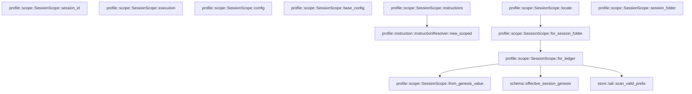

# profile::scope

[Package atlas](index.md) · [Source](../../src/scope.rs)

## Declarations

Visibility is the declaration spelling; trait members and reexports require their enclosing interface. `cfg` is not evaluated.

| Symbol | Kind | Visibility | Test / cfg |
|---|---|---|---|
| [profile::scope::SessionScope](../../src/scope.rs#L5) | struct_item | `pub` |  |
| [profile::scope::SessionScope::locate](../../src/scope.rs#L11) | function_item | `pub` |  |
| [profile::scope::SessionScope::for_session_folder](../../src/scope.rs#L22) | function_item | `pub` |  |
| [profile::scope::SessionScope::for_ledger](../../src/scope.rs#L25) | function_item | `pub` |  |
| [profile::scope::SessionScope::from_genesis_value](../../src/scope.rs#L57) | function_item | `pub` |  |
| [profile::scope::SessionScope::session_folder](../../src/scope.rs#L98) | function_item | `pub` |  |
| [profile::scope::SessionScope::session_id](../../src/scope.rs#L101) | function_item | `pub` |  |
| [profile::scope::SessionScope::execution](../../src/scope.rs#L104) | function_item | `pub` |  |
| [profile::scope::SessionScope::config](../../src/scope.rs#L107) | function_item | `pub` |  |
| [profile::scope::SessionScope::base_config](../../src/scope.rs#L114) | function_item | `pub` |  |
| [profile::scope::SessionScope::instructions](../../src/scope.rs#L120) | function_item | `pub` |  |

## Imports / reexports

| Local name | Source path | Visibility |
|---|---|---|
| `ConfigRepository` | `crate::ConfigRepository` | `private` |
| `ConfigSnapshot` | `crate::ConfigSnapshot` | `private` |
| `InstructionResolver` | `crate::InstructionResolver` | `private` |
| `ProfileError` | `crate::ProfileError` | `private` |
| `Path` | `std::path::Path` | `private` |
| `PathBuf` | `std::path::PathBuf` | `private` |

## Module declarations

| Module | Visibility | Attributes |
|---|---|---|

## Function call graphs

Edges below are syntactically resolved calls only, including private functions. Graphs partition callers into groups of 20; they are not execution order. All unresolved sites are listed below and in the JSON inventory.

Functions 1–10: 6 direct edges

## Call sites

Includes test functions (marked in declarations). Receiver-type-required sites need type analysis/manual tracing. Calls in closures are attributed to their enclosing function; their occurrence here does not mean the closure executes immediately.

| Caller | Callee expression | Source lines | Target / classification |
|---|---|---|---|
| `locate` | `["threads", "archive"]             .into_iter()             .map(&#124;area&#124; root.join(area).join(id))             .find(&#124;folder&#124; folder.is_dir())             .ok_or_else` | [12](../../src/scope.rs#L12) | receiver-type-required |
| `locate` | `["threads", "archive"]             .into_iter()             .map(&#124;area&#124; root.join(area).join(id))             .find` | [12](../../src/scope.rs#L12) | receiver-type-required |
| `locate` | `["threads", "archive"]             .into_iter()             .map` | [12](../../src/scope.rs#L12) | receiver-type-required |
| `locate` | `["threads", "archive"]             .into_iter` | [12](../../src/scope.rs#L12) | receiver-type-required |
| `locate` | `root.join(area).join` | [14](../../src/scope.rs#L14) | receiver-type-required |
| `locate` | `root.join` | [14](../../src/scope.rs#L14), [17](../../src/scope.rs#L17) | receiver-type-required |
| `locate` | `folder.is_dir` | [15](../../src/scope.rs#L15) | receiver-type-required |
| `locate` | `root.join("threads").join` | [17](../../src/scope.rs#L17) | receiver-type-required |
| `locate` | `"session folder does not exist".into` | [18](../../src/scope.rs#L18) | receiver-type-required |
| `locate` | `Self::for_session_folder` | [20](../../src/scope.rs#L20) | [profile::scope::SessionScope::for_session_folder](../../src/scope.rs#L22) |
| `for_session_folder` | `Self::for_ledger` | [23](../../src/scope.rs#L23) | [profile::scope::SessionScope::for_ledger](../../src/scope.rs#L25) |
| `for_session_folder` | `folder.into().join` | [23](../../src/scope.rs#L23) | receiver-type-required |
| `for_session_folder` | `folder.into` | [23](../../src/scope.rs#L23) | receiver-type-required |
| `for_ledger` | `ledger.as_ref().to_path_buf` | [26](../../src/scope.rs#L26) | receiver-type-required |
| `for_ledger` | `ledger.as_ref` | [26](../../src/scope.rs#L26) | receiver-type-required |
| `for_ledger` | `ledger             .parent()             .ok_or_else(&#124;&#124; ProfileError::InvalidPath {                 path: ledger.clone(),                 reason: "session ledger has no folder".to_owned(),             })?             .to_path_buf` | [27](../../src/scope.rs#L27) | receiver-type-required |
| `for_ledger` | `ledger             .parent()             .ok_or_else` | [27](../../src/scope.rs#L27) | receiver-type-required |
| `for_ledger` | `ledger             .parent` | [27](../../src/scope.rs#L27) | receiver-type-required |
| `for_ledger` | `ledger.clone` | [30](../../src/scope.rs#L30), [39](../../src/scope.rs#L39), [50](../../src/scope.rs#L50) | receiver-type-required |
| `for_ledger` | `"session ledger has no folder".to_owned` | [31](../../src/scope.rs#L31) | receiver-type-required |
| `for_ledger` | `std::fs::read` | [34](../../src/scope.rs#L34) | external-constructor-callback-or-unresolved |
| `for_ledger` | `store::scan_valid_prefix` | [35](../../src/scope.rs#L35) | [store::tail::scan_valid_prefix](../../../store/src/tail.rs#L37) |
| `for_ledger` | `scan             .projection             .ok_or_else` | [36](../../src/scope.rs#L36) | receiver-type-required |
| `for_ledger` | `"session ledger has no valid genesis".to_owned` | [40](../../src/scope.rs#L40) | receiver-type-required |
| `for_ledger` | `Err` | [43](../../src/scope.rs#L43) | external-constructor-callback-or-unresolved |
| `for_ledger` | `"session requires a newer reader".to_owned` | [45](../../src/scope.rs#L45) | receiver-type-required |
| `for_ledger` | `schema::effective_session_genesis(&projection.events)             .map_err(&#124;error&#124; ProfileError::InvalidReference {                 path: ledger.clone(),                 reason: error.to_string(),             })?             .expect` | [48](../../src/scope.rs#L48) | receiver-type-required |
| `for_ledger` | `schema::effective_session_genesis(&projection.events)             .map_err` | [48](../../src/scope.rs#L48) | receiver-type-required |
| `for_ledger` | `schema::effective_session_genesis` | [48](../../src/scope.rs#L48) | [schema::effective_session_genesis](../../../schema/src/lib.rs#L54) |
| `for_ledger` | `error.to_string` | [51](../../src/scope.rs#L51) | receiver-type-required |
| `for_ledger` | `Self::from_genesis_value` | [54](../../src/scope.rs#L54) | [profile::scope::SessionScope::from_genesis_value](../../src/scope.rs#L57) |
| `from_genesis_value` | `folder.into` | [61](../../src/scope.rs#L61) | receiver-type-required |
| `from_genesis_value` | `session_folder.join` | [63](../../src/scope.rs#L63) | receiver-type-required |
| `from_genesis_value` | `[             "workspace",             "folder_binding",             "environment",             "folders",             "session_scope",         ]         .iter()         .any` | [66](../../src/scope.rs#L66) | receiver-type-required |
| `from_genesis_value` | `[             "workspace",             "folder_binding",             "environment",             "folders",             "session_scope",         ]         .iter` | [66](../../src/scope.rs#L66) | receiver-type-required |
| `from_genesis_value` | `raw.get(field).is_some` | [74](../../src/scope.rs#L74) | receiver-type-required |
| `from_genesis_value` | `raw.get` | [74](../../src/scope.rs#L74), [84](../../src/scope.rs#L84) | receiver-type-required |
| `from_genesis_value` | `Err` | [76](../../src/scope.rs#L76) | external-constructor-callback-or-unresolved |
| `from_genesis_value` | `invalid` | [76](../../src/scope.rs#L76), [81](../../src/scope.rs#L81), [86](../../src/scope.rs#L86), [88](../../src/scope.rs#L88), [91](../../src/scope.rs#L91) | external-constructor-callback-or-unresolved |
| `from_genesis_value` | `"retired management scope is not executable".into` | [76](../../src/scope.rs#L76) | receiver-type-required |
| `from_genesis_value` | `raw             .get("thread")             .and_then(serde_json::Value::as_str)             .ok_or_else(&#124;&#124; invalid("session id is missing".into()))?             .to_owned` | [78](../../src/scope.rs#L78) | receiver-type-required |
| `from_genesis_value` | `raw             .get("thread")             .and_then(serde_json::Value::as_str)             .ok_or_else` | [78](../../src/scope.rs#L78) | receiver-type-required |
| `from_genesis_value` | `raw             .get("thread")             .and_then` | [78](../../src/scope.rs#L78) | receiver-type-required |
| `from_genesis_value` | `raw             .get` | [78](../../src/scope.rs#L78) | receiver-type-required |
| `from_genesis_value` | `"session id is missing".into` | [81](../../src/scope.rs#L81) | receiver-type-required |
| `from_genesis_value` | `serde_json::from_value(             raw.get("execution")                 .cloned()                 .ok_or_else(&#124;&#124; invalid("execution is required".into()))?,         )         .map_err` | [83](../../src/scope.rs#L83) | receiver-type-required |
| `from_genesis_value` | `serde_json::from_value` | [83](../../src/scope.rs#L83) | external-constructor-callback-or-unresolved |
| `from_genesis_value` | `raw.get("execution")                 .cloned()                 .ok_or_else` | [84](../../src/scope.rs#L84) | receiver-type-required |
| `from_genesis_value` | `raw.get("execution")                 .cloned` | [84](../../src/scope.rs#L84) | receiver-type-required |
| `from_genesis_value` | `"execution is required".into` | [86](../../src/scope.rs#L86) | receiver-type-required |
| `from_genesis_value` | `e.to_string` | [88](../../src/scope.rs#L88) | receiver-type-required |
| `from_genesis_value` | `execution             .validate()             .map_err` | [89](../../src/scope.rs#L89) | receiver-type-required |
| `from_genesis_value` | `execution             .validate` | [89](../../src/scope.rs#L89) | receiver-type-required |
| `from_genesis_value` | `reason.into` | [91](../../src/scope.rs#L91) | receiver-type-required |
| `from_genesis_value` | `Ok` | [92](../../src/scope.rs#L92) | external-constructor-callback-or-unresolved |
| `config` | `repository.resolve_execution` | [108](../../src/scope.rs#L108) | receiver-type-required |
| `config` | `Some` | [111](../../src/scope.rs#L111) | external-constructor-callback-or-unresolved |
| `base_config` | `repository.resolve_execution` | [118](../../src/scope.rs#L118) | receiver-type-required |
| `instructions` | `Ok` | [126](../../src/scope.rs#L126) | external-constructor-callback-or-unresolved |
| `instructions` | `InstructionResolver::new_scoped` | [126](../../src/scope.rs#L126) | [profile::instruction::InstructionResolver::new_scoped](../../src/instruction.rs#L303) |
| `instructions` | `repository                 .root()                 .join("session-instructions")                 .join` | [128](../../src/scope.rs#L128) | receiver-type-required |
| `instructions` | `repository                 .root()                 .join` | [128](../../src/scope.rs#L128) | receiver-type-required |
| `instructions` | `repository                 .root` | [128](../../src/scope.rs#L128) | receiver-type-required |
| `instructions` | `self.session_folder.file_name().expect` | [131](../../src/scope.rs#L131) | receiver-type-required |
| `instructions` | `self.session_folder.file_name` | [131](../../src/scope.rs#L131) | receiver-type-required |
| `instructions` | `config.execution.cwd.iter().map` | [132](../../src/scope.rs#L132) | receiver-type-required |
| `instructions` | `config.execution.cwd.iter` | [132](../../src/scope.rs#L132) | receiver-type-required |
