# profile::scope

[Package atlas](index.md) · [Source](../../src/scope.rs)

## Declarations

Visibility is the declaration spelling; trait members and reexports require their enclosing interface. `cfg` is not evaluated.

| Symbol | Kind | Visibility | Test / cfg |
|---|---|---|---|
| [profile::scope::SessionScope](../../src/scope.rs#L12) | struct_item | `pub` |  |
| [profile::scope::FolderRecord](../../src/scope.rs#L26) | struct_item | `pub` |  |
| [profile::scope::SessionScope::locate](../../src/scope.rs#L34) | function_item | `pub` |  |
| [profile::scope::SessionScope::for_session_folder](../../src/scope.rs#L48) | function_item | `pub` |  |
| [profile::scope::SessionScope::for_ledger](../../src/scope.rs#L54) | function_item | `pub` |  |
| [profile::scope::SessionScope::from_genesis_value](../../src/scope.rs#L87) | function_item | `pub` |  |
| [profile::scope::SessionScope::from_parts](../../src/scope.rs#L156) | function_item | `pub` |  |
| [profile::scope::SessionScope::session_folder](../../src/scope.rs#L173) | function_item | `pub` |  |
| [profile::scope::SessionScope::workspace_id](../../src/scope.rs#L178) | function_item | `pub` |  |
| [profile::scope::SessionScope::folder_binding](../../src/scope.rs#L183) | function_item | `pub` |  |
| [profile::scope::SessionScope::environment](../../src/scope.rs#L190) | function_item | `pub` |  |
| [profile::scope::SessionScope::folders](../../src/scope.rs#L199) | function_item | `pub` |  |
| [profile::scope::SessionScope::config](../../src/scope.rs#L233) | function_item | `pub` |  |
| [profile::scope::SessionScope::workspace_config](../../src/scope.rs#L263) | function_item | `pub` |  |
| [profile::scope::SessionScope::session_config](../../src/scope.rs#L294) | function_item | `pub` |  |
| [profile::scope::SessionScope::is_detached](../../src/scope.rs#L300) | function_item | `pub` |  |
| [profile::scope::SessionScope::selection](../../src/scope.rs#L306) | function_item | `pub` |  |
| [profile::scope::SessionScope::instructions](../../src/scope.rs#L316) | function_item | `pub` |  |
| [profile::scope::legacy_seed](../../src/scope.rs#L341) | function_item | `private` |  |
| [profile::scope::workspace_instructions](../../src/scope.rs#L403) | function_item | `pub` |  |
| [profile::scope::tests::write_genesis](../../src/scope.rs#L422) | function_item | `private` | test; #[cfg(test)] |
| [profile::scope::tests::write_genesis_with](../../src/scope.rs#L426) | function_item | `private` | test; #[cfg(test)] |
| [profile::scope::tests::scope_reads_workspace_and_binding_from_the_genesis_only](../../src/scope.rs#L452) | function_item | `private` | test; #[cfg(test)] |
| [profile::scope::tests::session_and_workspace_config_differ_only_in_session_settings](../../src/scope.rs#L473) | function_item | `private` | test; #[cfg(test)] |
| [profile::scope::tests::environment_and_folders_come_from_the_genesis_or_the_workspace](../../src/scope.rs#L554) | function_item | `private` | test; #[cfg(test)] |
| [profile::scope::tests::phase7_legacy_asset_is_lazy_frozen_and_follows_logical_relocation_without_workspace](../../src/scope.rs#L626) | function_item | `private` | test; #[cfg(test)] |
| [profile::scope::tests::phase7_environment_is_live_while_workspace_policy_is_a_creation_seed](../../src/scope.rs#L709) | function_item | `private` | test; #[cfg(test)] |

## Imports / reexports

| Local name | Source path | Visibility |
|---|---|---|
| `Path` | `std::path::Path` | `private` |
| `PathBuf` | `std::path::PathBuf` | `private` |
| `ConfigRepository` | `crate::ConfigRepository` | `private` |
| `ConfigSnapshot` | `crate::ConfigSnapshot` | `private` |
| `InstructionResolver` | `crate::InstructionResolver` | `private` |
| `ProfileError` | `crate::ProfileError` | `private` |
| `ScopeSelection` | `crate::ScopeSelection` | `private` |
| `*` | `super::*` | `private` |
| `WorkspaceConfig` | `crate::WorkspaceConfig` | `private` |
| `WorkspaceFolder` | `crate::WorkspaceFolder` | `private` |

## Module declarations

| Module | Visibility | Attributes |
|---|---|---|
| `profile::scope::tests` | `private` | #[cfg(test)] |

## Function call graphs

Edges below are syntactically resolved calls only, including private functions. Graphs partition callers into groups of 20; they are not execution order. All unresolved sites are listed below and in the JSON inventory.

```mermaid
flowchart TD
  n0["profile::folder_catalog::FolderCatalog::new"]
  n1["profile::instruction::InstructionResolver::new_scoped"]
  n2["profile::digest"]
  n3["profile::parse_canonical"]
  n4["profile::scope::SessionScope::from_parts"]
  n5["profile::scope::SessionScope::session_folder"]
  n6["profile::scope::SessionScope::workspace_id"]
  n7["profile::scope::SessionScope::folder_binding"]
  n8["profile::scope::SessionScope::environment"]
  n9["profile::scope::SessionScope::folders"]
  n10["profile::scope::SessionScope::config"]
  n11["profile::scope::SessionScope::workspace_config"]
  n12["profile::scope::SessionScope::session_config"]
  n13["profile::scope::SessionScope::is_detached"]
  n14["profile::scope::SessionScope::selection"]
  n15["profile::scope::SessionScope::instructions"]
  n16["profile::scope::legacy_seed"]
  n17["profile::scope::SessionScope::locate"]
  n18["profile::scope::workspace_instructions"]
  n19["profile::scope::SessionScope::for_session_folder"]
  n20["profile::scope::SessionScope::for_ledger"]
  n21["profile::scope::SessionScope::from_genesis_value"]
  n22["schema::effective_session_genesis"]
  n23["store::tail::scan_valid_prefix"]
  n9 --> n0
  n10 --> n0
  n10 --> n14
  n11 --> n0
  n11 --> n14
  n14 --> n8
  n15 --> n1
  n15 --> n18
  n16 --> n2
  n16 --> n3
  n17 --> n19
  n18 --> n1
  n19 --> n20
  n20 --> n21
  n20 --> n22
  n20 --> n23
```

Functions 1–18: 16 direct edges

## Call sites

Includes test functions (marked in declarations). Receiver-type-required sites need type analysis/manual tracing. Calls in closures are attributed to their enclosing function; their occurrence here does not mean the closure executes immediately.

| Caller | Callee expression | Source lines | Target / classification |
|---|---|---|---|
| `locate` | `["threads", "archive"]             .into_iter()             .map(&#124;area&#124; storage_root.join(area).join(session_id))             .find(&#124;path&#124; path.is_dir())             .ok_or_else` | [35](../../src/scope.rs#L35) | receiver-type-required |
| `locate` | `["threads", "archive"]             .into_iter()             .map(&#124;area&#124; storage_root.join(area).join(session_id))             .find` | [35](../../src/scope.rs#L35) | receiver-type-required |
| `locate` | `["threads", "archive"]             .into_iter()             .map` | [35](../../src/scope.rs#L35) | receiver-type-required |
| `locate` | `["threads", "archive"]             .into_iter` | [35](../../src/scope.rs#L35) | receiver-type-required |
| `locate` | `storage_root.join(area).join` | [37](../../src/scope.rs#L37) | receiver-type-required |
| `locate` | `storage_root.join` | [37](../../src/scope.rs#L37), [40](../../src/scope.rs#L40) | receiver-type-required |
| `locate` | `path.is_dir` | [38](../../src/scope.rs#L38) | receiver-type-required |
| `locate` | `storage_root.join("threads").join` | [40](../../src/scope.rs#L40) | receiver-type-required |
| `locate` | `"session folder does not exist".to_owned` | [41](../../src/scope.rs#L41) | receiver-type-required |
| `locate` | `Self::for_session_folder` | [43](../../src/scope.rs#L43) | [profile::scope::SessionScope::for_session_folder](../../src/scope.rs#L48) |
| `for_session_folder` | `Self::for_ledger` | [49](../../src/scope.rs#L49) | [profile::scope::SessionScope::for_ledger](../../src/scope.rs#L54) |
| `for_session_folder` | `session_folder.into().join` | [49](../../src/scope.rs#L49) | receiver-type-required |
| `for_session_folder` | `session_folder.into` | [49](../../src/scope.rs#L49) | receiver-type-required |
| `for_ledger` | `ledger.as_ref().to_path_buf` | [55](../../src/scope.rs#L55) | receiver-type-required |
| `for_ledger` | `ledger.as_ref` | [55](../../src/scope.rs#L55) | receiver-type-required |
| `for_ledger` | `ledger             .parent()             .ok_or_else(&#124;&#124; ProfileError::InvalidPath {                 path: ledger.clone(),                 reason: "session ledger has no folder".to_owned(),             })?             .to_path_buf` | [56](../../src/scope.rs#L56) | receiver-type-required |
| `for_ledger` | `ledger             .parent()             .ok_or_else` | [56](../../src/scope.rs#L56) | receiver-type-required |
| `for_ledger` | `ledger             .parent` | [56](../../src/scope.rs#L56) | receiver-type-required |
| `for_ledger` | `ledger.clone` | [59](../../src/scope.rs#L59), [68](../../src/scope.rs#L68), [79](../../src/scope.rs#L79) | receiver-type-required |
| `for_ledger` | `"session ledger has no folder".to_owned` | [60](../../src/scope.rs#L60) | receiver-type-required |
| `for_ledger` | `std::fs::read` | [63](../../src/scope.rs#L63) | external-constructor-callback-or-unresolved |
| `for_ledger` | `store::scan_valid_prefix` | [64](../../src/scope.rs#L64) | [store::tail::scan_valid_prefix](../../../store/src/tail.rs#L37) |
| `for_ledger` | `scan             .projection             .ok_or_else` | [65](../../src/scope.rs#L65) | receiver-type-required |
| `for_ledger` | `"session ledger has no valid genesis".to_owned` | [69](../../src/scope.rs#L69) | receiver-type-required |
| `for_ledger` | `Err` | [72](../../src/scope.rs#L72) | external-constructor-callback-or-unresolved |
| `for_ledger` | `"session requires a newer reader".to_owned` | [74](../../src/scope.rs#L74) | receiver-type-required |
| `for_ledger` | `schema::effective_session_genesis(&projection.events)             .map_err(&#124;error&#124; ProfileError::InvalidReference {                 path: ledger.clone(),                 reason: error.to_string(),             })?             .expect` | [77](../../src/scope.rs#L77) | receiver-type-required |
| `for_ledger` | `schema::effective_session_genesis(&projection.events)             .map_err` | [77](../../src/scope.rs#L77) | receiver-type-required |
| `for_ledger` | `schema::effective_session_genesis` | [77](../../src/scope.rs#L77) | [schema::effective_session_genesis](../../../schema/src/lib.rs#L48) |
| `for_ledger` | `error.to_string` | [80](../../src/scope.rs#L80) | receiver-type-required |
| `for_ledger` | `Self::from_genesis_value` | [83](../../src/scope.rs#L83) | [profile::scope::SessionScope::from_genesis_value](../../src/scope.rs#L87) |
| `from_genesis_value` | `session_folder.into` | [91](../../src/scope.rs#L91) | receiver-type-required |
| `from_genesis_value` | `session_folder.join` | [92](../../src/scope.rs#L92) | receiver-type-required |
| `from_genesis_value` | `raw             .get("workspace")             .and_then(serde_json::Value::as_str)             .ok_or_else(&#124;&#124; ProfileError::InvalidReference {                 path: ledger.clone(),                 reason: "session genesis has no compatibility address".to_owned(),             })?             .to_owned` | [93](../../src/scope.rs#L93) | receiver-type-required |
| `from_genesis_value` | `raw             .get("workspace")             .and_then(serde_json::Value::as_str)             .ok_or_else` | [93](../../src/scope.rs#L93) | receiver-type-required |
| `from_genesis_value` | `raw             .get("workspace")             .and_then` | [93](../../src/scope.rs#L93) | receiver-type-required |
| `from_genesis_value` | `raw             .get` | [93](../../src/scope.rs#L93), [101](../../src/scope.rs#L101), [105](../../src/scope.rs#L105), [109](../../src/scope.rs#L109), [119](../../src/scope.rs#L119) | receiver-type-required |
| `from_genesis_value` | `ledger.clone` | [97](../../src/scope.rs#L97), [125](../../src/scope.rs#L125) | receiver-type-required |
| `from_genesis_value` | `"session genesis has no compatibility address".to_owned` | [98](../../src/scope.rs#L98) | receiver-type-required |
| `from_genesis_value` | `raw             .get("folder_binding")             .and_then(serde_json::Value::as_str)             .map` | [101](../../src/scope.rs#L101) | receiver-type-required |
| `from_genesis_value` | `raw             .get("folder_binding")             .and_then` | [101](../../src/scope.rs#L101) | receiver-type-required |
| `from_genesis_value` | `raw             .get("environment")             .and_then(serde_json::Value::as_str)             .map` | [105](../../src/scope.rs#L105) | receiver-type-required |
| `from_genesis_value` | `raw             .get("environment")             .and_then` | [105](../../src/scope.rs#L105) | receiver-type-required |
| `from_genesis_value` | `raw             .get("folders")             .and_then(serde_json::Value::as_array)             .map` | [109](../../src/scope.rs#L109) | receiver-type-required |
| `from_genesis_value` | `raw             .get("folders")             .and_then` | [109](../../src/scope.rs#L109) | receiver-type-required |
| `from_genesis_value` | `folders                     .iter()                     .filter_map(serde_json::Value::as_str)                     .map(str::to_owned)                     .collect` | [113](../../src/scope.rs#L113) | receiver-type-required |
| `from_genesis_value` | `folders                     .iter()                     .filter_map(serde_json::Value::as_str)                     .map` | [113](../../src/scope.rs#L113) | receiver-type-required |
| `from_genesis_value` | `folders                     .iter()                     .filter_map` | [113](../../src/scope.rs#L113) | receiver-type-required |
| `from_genesis_value` | `folders                     .iter` | [113](../../src/scope.rs#L113) | receiver-type-required |
| `from_genesis_value` | `raw             .get("session_scope")             .cloned()             .map(serde_json::from_value)             .transpose()             .map_err` | [119](../../src/scope.rs#L119) | receiver-type-required |
| `from_genesis_value` | `raw             .get("session_scope")             .cloned()             .map(serde_json::from_value)             .transpose` | [119](../../src/scope.rs#L119) | receiver-type-required |
| `from_genesis_value` | `raw             .get("session_scope")             .cloned()             .map` | [119](../../src/scope.rs#L119) | receiver-type-required |
| `from_genesis_value` | `raw             .get("session_scope")             .cloned` | [119](../../src/scope.rs#L119) | receiver-type-required |
| `from_genesis_value` | `session_config.is_none` | [130](../../src/scope.rs#L130) | receiver-type-required |
| `from_genesis_value` | `legacy_seed` | [131](../../src/scope.rs#L131) | external-constructor-callback-or-unresolved |
| `from_genesis_value` | `Err` | [138](../../src/scope.rs#L138) | external-constructor-callback-or-unresolved |
| `from_genesis_value` | `"session seed compatibility address differs".to_owned` | [140](../../src/scope.rs#L140) | receiver-type-required |
| `from_genesis_value` | `Ok` | [143](../../src/scope.rs#L143) | external-constructor-callback-or-unresolved |
| `from_parts` | `session_folder.into` | [162](../../src/scope.rs#L162) | receiver-type-required |
| `from_parts` | `workspace_id.into` | [163](../../src/scope.rs#L163) | receiver-type-required |
| `folder_binding` | `self.folder_binding.as_deref` | [184](../../src/scope.rs#L184) | receiver-type-required |
| `environment` | `self.environment             .as_deref()             .unwrap_or` | [191](../../src/scope.rs#L191) | receiver-type-required |
| `environment` | `self.environment             .as_deref` | [191](../../src/scope.rs#L191) | receiver-type-required |
| `folders` | `crate::FolderCatalog::new(repository.root()).resolve` | [204](../../src/scope.rs#L204) | receiver-type-required |
| `folders` | `crate::FolderCatalog::new` | [204](../../src/scope.rs#L204), [206](../../src/scope.rs#L206) | [profile::folder_catalog::FolderCatalog::new](../../src/folder_catalog.rs#L68) |
| `folders` | `repository.root` | [204](../../src/scope.rs#L204), [206](../../src/scope.rs#L206) | receiver-type-required |
| `folders` | `crate::FolderCatalog::new(repository.root()).resolve_legacy` | [206](../../src/scope.rs#L206) | receiver-type-required |
| `folders` | `repository.workspace` | [207](../../src/scope.rs#L207) | receiver-type-required |
| `folders` | `self             .folders             .clone()             .unwrap_or_else` | [210](../../src/scope.rs#L210) | receiver-type-required |
| `folders` | `self             .folders             .clone` | [210](../../src/scope.rs#L210) | receiver-type-required |
| `folders` | `workspace.folder_ids` | [213](../../src/scope.rs#L213) | receiver-type-required |
| `folders` | `ids.into_iter()             .map(&#124;id&#124; {                 let path = workspace.path_for_binding(&id).ok_or_else(&#124;&#124; {                     ProfileError::InvalidReference {                         path: self.session_folder.join("main.jsonl"),                         reason: format!("session folder {id} is not in its workspace"),                     }                 })?;                 Ok(FolderRecord {                     id,                     path: path.to_owned(),                 })             })             .collect` | [214](../../src/scope.rs#L214) | receiver-type-required |
| `folders` | `ids.into_iter()             .map` | [214](../../src/scope.rs#L214) | receiver-type-required |
| `folders` | `ids.into_iter` | [214](../../src/scope.rs#L214) | receiver-type-required |
| `folders` | `workspace.path_for_binding(&id).ok_or_else` | [216](../../src/scope.rs#L216) | receiver-type-required |
| `folders` | `workspace.path_for_binding` | [216](../../src/scope.rs#L216) | receiver-type-required |
| `folders` | `self.session_folder.join` | [218](../../src/scope.rs#L218) | receiver-type-required |
| `folders` | `Ok` | [222](../../src/scope.rs#L222) | external-constructor-callback-or-unresolved |
| `folders` | `path.to_owned` | [224](../../src/scope.rs#L224) | receiver-type-required |
| `config` | `crate::FolderCatalog::new(repository.root()).resolve` | [235](../../src/scope.rs#L235) | receiver-type-required |
| `config` | `crate::FolderCatalog::new` | [235](../../src/scope.rs#L235), [244](../../src/scope.rs#L244) | [profile::folder_catalog::FolderCatalog::new](../../src/folder_catalog.rs#L68) |
| `config` | `repository.root` | [235](../../src/scope.rs#L235), [244](../../src/scope.rs#L244) | receiver-type-required |
| `config` | `repository.resolve_session_seed` | [236](../../src/scope.rs#L236), [245](../../src/scope.rs#L245) | receiver-type-required |
| `config` | `Some` | [238](../../src/scope.rs#L238), [247](../../src/scope.rs#L247), [254](../../src/scope.rs#L254) | external-constructor-callback-or-unresolved |
| `config` | `self.folder_binding.as_deref` | [239](../../src/scope.rs#L239), [248](../../src/scope.rs#L248), [255](../../src/scope.rs#L255) | receiver-type-required |
| `config` | `self.selection` | [240](../../src/scope.rs#L240), [249](../../src/scope.rs#L249), [256](../../src/scope.rs#L256) | [profile::scope::SessionScope::selection](../../src/scope.rs#L306) |
| `config` | `crate::FolderCatalog::new(repository.root()).resolve_legacy` | [244](../../src/scope.rs#L244) | receiver-type-required |
| `config` | `repository.resolve_scoped` | [252](../../src/scope.rs#L252) | receiver-type-required |
| `workspace_config` | `crate::FolderCatalog::new(repository.root()).resolve` | [268](../../src/scope.rs#L268) | receiver-type-required |
| `workspace_config` | `crate::FolderCatalog::new` | [268](../../src/scope.rs#L268), [277](../../src/scope.rs#L277) | [profile::folder_catalog::FolderCatalog::new](../../src/folder_catalog.rs#L68) |
| `workspace_config` | `repository.root` | [268](../../src/scope.rs#L268), [277](../../src/scope.rs#L277) | receiver-type-required |
| `workspace_config` | `repository.resolve_session_seed` | [269](../../src/scope.rs#L269), [278](../../src/scope.rs#L278) | receiver-type-required |
| `workspace_config` | `self.folder_binding.as_deref` | [272](../../src/scope.rs#L272), [281](../../src/scope.rs#L281), [288](../../src/scope.rs#L288) | receiver-type-required |
| `workspace_config` | `self.selection` | [273](../../src/scope.rs#L273), [282](../../src/scope.rs#L282), [289](../../src/scope.rs#L289) | [profile::scope::SessionScope::selection](../../src/scope.rs#L306) |
| `workspace_config` | `crate::FolderCatalog::new(repository.root()).resolve_legacy` | [277](../../src/scope.rs#L277) | receiver-type-required |
| `workspace_config` | `repository.resolve_scoped` | [285](../../src/scope.rs#L285) | receiver-type-required |
| `session_config` | `self.session_config.as_ref` | [295](../../src/scope.rs#L295) | receiver-type-required |
| `is_detached` | `self.session_config.is_some` | [301](../../src/scope.rs#L301) | receiver-type-required |
| `is_detached` | `self.legacy_seed.is_some` | [301](../../src/scope.rs#L301) | receiver-type-required |
| `selection` | `self.environment` | [308](../../src/scope.rs#L308) | [profile::scope::SessionScope::environment](../../src/scope.rs#L190) |
| `selection` | `self.folders.as_deref` | [309](../../src/scope.rs#L309) | receiver-type-required |
| `instructions` | `self             .session_config             .as_ref()             .is_some_and` | [322](../../src/scope.rs#L322) | receiver-type-required |
| `instructions` | `self             .session_config             .as_ref` | [322](../../src/scope.rs#L322) | receiver-type-required |
| `instructions` | `Ok` | [327](../../src/scope.rs#L327) | external-constructor-callback-or-unresolved |
| `instructions` | `InstructionResolver::new_scoped(                 user_agent_dir,                 repository                     .root()                     .join("session-instructions")                     .join(self.session_folder.file_name().expect("session folder")),                 config.workspace.cwd.iter().map(Path::new),             )             .with_folder_authority` | [327](../../src/scope.rs#L327) | receiver-type-required |
| `instructions` | `InstructionResolver::new_scoped` | [327](../../src/scope.rs#L327) | [profile::instruction::InstructionResolver::new_scoped](../../src/instruction.rs#L333) |
| `instructions` | `repository                     .root()                     .join("session-instructions")                     .join` | [329](../../src/scope.rs#L329) | receiver-type-required |
| `instructions` | `repository                     .root()                     .join` | [329](../../src/scope.rs#L329) | receiver-type-required |
| `instructions` | `repository                     .root` | [329](../../src/scope.rs#L329) | receiver-type-required |
| `instructions` | `self.session_folder.file_name().expect` | [332](../../src/scope.rs#L332) | receiver-type-required |
| `instructions` | `self.session_folder.file_name` | [332](../../src/scope.rs#L332) | receiver-type-required |
| `instructions` | `config.workspace.cwd.iter().map` | [333](../../src/scope.rs#L333) | receiver-type-required |
| `instructions` | `config.workspace.cwd.iter` | [333](../../src/scope.rs#L333) | receiver-type-required |
| `instructions` | `repository.root` | [335](../../src/scope.rs#L335) | receiver-type-required |
| `instructions` | `workspace_instructions` | [337](../../src/scope.rs#L337) | [profile::scope::workspace_instructions](../../src/scope.rs#L403) |
| `legacy_seed` | `raw         .get("config")         .and_then(&#124;config&#124; config.get("digest"))         .and_then(serde_json::Value::as_str)         .filter` | [346](../../src/scope.rs#L346) | receiver-type-required |
| `legacy_seed` | `raw         .get("config")         .and_then(&#124;config&#124; config.get("digest"))         .and_then` | [346](../../src/scope.rs#L346) | receiver-type-required |
| `legacy_seed` | `raw         .get("config")         .and_then` | [346](../../src/scope.rs#L346) | receiver-type-required |
| `legacy_seed` | `raw         .get` | [346](../../src/scope.rs#L346) | receiver-type-required |
| `legacy_seed` | `config.get` | [348](../../src/scope.rs#L348) | receiver-type-required |
| `legacy_seed` | `digest.len` | [351](../../src/scope.rs#L351) | receiver-type-required |
| `legacy_seed` | `digest                     .bytes()                     .all` | [352](../../src/scope.rs#L352) | receiver-type-required |
| `legacy_seed` | `digest                     .bytes` | [352](../../src/scope.rs#L352) | receiver-type-required |
| `legacy_seed` | `byte.is_ascii_hexdigit` | [354](../../src/scope.rs#L354) | receiver-type-required |
| `legacy_seed` | `byte.is_ascii_uppercase` | [354](../../src/scope.rs#L354) | receiver-type-required |
| `legacy_seed` | `Ok` | [357](../../src/scope.rs#L357), [362](../../src/scope.rs#L362), [385](../../src/scope.rs#L385) | external-constructor-callback-or-unresolved |
| `legacy_seed` | `folder.join("assets").join` | [359](../../src/scope.rs#L359) | receiver-type-required |
| `legacy_seed` | `folder.join` | [359](../../src/scope.rs#L359) | receiver-type-required |
| `legacy_seed` | `std::fs::read` | [360](../../src/scope.rs#L360) | external-constructor-callback-or-unresolved |
| `legacy_seed` | `error.kind` | [362](../../src/scope.rs#L362) | receiver-type-required |
| `legacy_seed` | `Err` | [363](../../src/scope.rs#L363), [367](../../src/scope.rs#L367), [380](../../src/scope.rs#L380) | external-constructor-callback-or-unresolved |
| `legacy_seed` | `error.into` | [363](../../src/scope.rs#L363) | receiver-type-required |
| `legacy_seed` | `crate::digest` | [365](../../src/scope.rs#L365) | [profile::digest](../../src/lib.rs#L132) |
| `legacy_seed` | `expected.to_owned` | [368](../../src/scope.rs#L368) | receiver-type-required |
| `legacy_seed` | `crate::parse_canonical` | [372](../../src/scope.rs#L372) | [profile::parse_canonical](../../src/lib.rs#L73) |
| `legacy_seed` | `workspace.folders.unwrap_or_else` | [374](../../src/scope.rs#L374) | receiver-type-required |
| `legacy_seed` | `(1..=workspace.cwd.len())             .map(&#124;index&#124; format!("folder-{index:04}"))             .collect` | [375](../../src/scope.rs#L375) | receiver-type-required |
| `legacy_seed` | `(1..=workspace.cwd.len())             .map` | [375](../../src/scope.rs#L375) | receiver-type-required |
| `legacy_seed` | `workspace.cwd.len` | [375](../../src/scope.rs#L375), [379](../../src/scope.rs#L379) | receiver-type-required |
| `legacy_seed` | `ids.len` | [379](../../src/scope.rs#L379) | receiver-type-required |
| `legacy_seed` | `"legacy config asset scope differs from genesis".to_owned` | [382](../../src/scope.rs#L382) | receiver-type-required |
| `legacy_seed` | `Some` | [385](../../src/scope.rs#L385), [396](../../src/scope.rs#L396) | external-constructor-callback-or-unresolved |
| `legacy_seed` | `Vec::new` | [390](../../src/scope.rs#L390) | external-constructor-callback-or-unresolved |
| `legacy_seed` | `ids             .into_iter()             .zip(workspace.cwd)             .map(&#124;(id, path)&#124; crate::WorkspaceFolder { id, path })             .collect` | [391](../../src/scope.rs#L391) | receiver-type-required |
| `legacy_seed` | `ids             .into_iter()             .zip(workspace.cwd)             .map` | [391](../../src/scope.rs#L391) | receiver-type-required |
| `legacy_seed` | `ids             .into_iter()             .zip` | [391](../../src/scope.rs#L391) | receiver-type-required |
| `legacy_seed` | `ids             .into_iter` | [391](../../src/scope.rs#L391) | receiver-type-required |
| `workspace_instructions` | `Ok` | [409](../../src/scope.rs#L409) | external-constructor-callback-or-unresolved |
| `workspace_instructions` | `InstructionResolver::new_scoped(         user_agent_dir,         repository.workspace_data_dir(workspace_id)?,         config.workspace.cwd.iter().map(Path::new),     )     .with_folder_authority` | [409](../../src/scope.rs#L409) | receiver-type-required |
| `workspace_instructions` | `InstructionResolver::new_scoped` | [409](../../src/scope.rs#L409) | [profile::instruction::InstructionResolver::new_scoped](../../src/instruction.rs#L333) |
| `workspace_instructions` | `repository.workspace_data_dir` | [411](../../src/scope.rs#L411) | receiver-type-required |
| `workspace_instructions` | `config.workspace.cwd.iter().map` | [412](../../src/scope.rs#L412) | receiver-type-required |
| `workspace_instructions` | `config.workspace.cwd.iter` | [412](../../src/scope.rs#L412) | receiver-type-required |
| `workspace_instructions` | `repository.root` | [414](../../src/scope.rs#L414) | receiver-type-required |
| `write_genesis` | `write_genesis_with` | [423](../../src/scope.rs#L423) | [profile::scope::tests::write_genesis_with](../../src/scope.rs#L426) |
| `write_genesis_with` | `std::fs::create_dir_all(folder).unwrap` | [427](../../src/scope.rs#L427) | receiver-type-required |
| `write_genesis_with` | `std::fs::create_dir_all` | [427](../../src/scope.rs#L427) | external-constructor-callback-or-unresolved |
| `write_genesis_with` | `binding.into` | [436](../../src/scope.rs#L436) | receiver-type-required |
| `write_genesis_with` | `extra.as_object().unwrap` | [438](../../src/scope.rs#L438) | receiver-type-required |
| `write_genesis_with` | `extra.as_object` | [438](../../src/scope.rs#L438) | receiver-type-required |
| `write_genesis_with` | `value.clone` | [439](../../src/scope.rs#L439) | receiver-type-required |
| `write_genesis_with` | `std::fs::write(             folder.join("main.jsonl"),             format!(                 "{}\n",                 serde_json_canonicalizer::to_string(&genesis).unwrap()             ),         )         .unwrap` | [441](../../src/scope.rs#L441) | receiver-type-required |
| `write_genesis_with` | `std::fs::write` | [441](../../src/scope.rs#L441) | external-constructor-callback-or-unresolved |
| `write_genesis_with` | `folder.join` | [442](../../src/scope.rs#L442) | receiver-type-required |
| `scope_reads_workspace_and_binding_from_the_genesis_only` | `tempfile::tempdir().unwrap` | [453](../../src/scope.rs#L453) | receiver-type-required |
| `scope_reads_workspace_and_binding_from_the_genesis_only` | `tempfile::tempdir` | [453](../../src/scope.rs#L453) | external-constructor-callback-or-unresolved |
| `scope_reads_workspace_and_binding_from_the_genesis_only` | `root.path().join("threads").join` | [454](../../src/scope.rs#L454) | receiver-type-required |
| `scope_reads_workspace_and_binding_from_the_genesis_only` | `root.path().join` | [454](../../src/scope.rs#L454), [455](../../src/scope.rs#L455) | receiver-type-required |
| `scope_reads_workspace_and_binding_from_the_genesis_only` | `root.path` | [454](../../src/scope.rs#L454), [455](../../src/scope.rs#L455), [459](../../src/scope.rs#L459), [463](../../src/scope.rs#L463) | receiver-type-required |
| `scope_reads_workspace_and_binding_from_the_genesis_only` | `root.path().join("archive").join` | [455](../../src/scope.rs#L455) | receiver-type-required |
| `scope_reads_workspace_and_binding_from_the_genesis_only` | `write_genesis` | [456](../../src/scope.rs#L456), [457](../../src/scope.rs#L457) | [profile::scope::tests::write_genesis](../../src/scope.rs#L422) |
| `scope_reads_workspace_and_binding_from_the_genesis_only` | `Some` | [456](../../src/scope.rs#L456) | external-constructor-callback-or-unresolved |
| `scope_reads_workspace_and_binding_from_the_genesis_only` | `SessionScope::locate(root.path(), "a").unwrap` | [459](../../src/scope.rs#L459) | receiver-type-required |
| `scope_reads_workspace_and_binding_from_the_genesis_only` | `SessionScope::locate` | [459](../../src/scope.rs#L459), [463](../../src/scope.rs#L463) | external-constructor-callback-or-unresolved |
| `scope_reads_workspace_and_binding_from_the_genesis_only` | `SessionScope::locate(root.path(), "b").unwrap` | [463](../../src/scope.rs#L463) | receiver-type-required |
| `scope_reads_workspace_and_binding_from_the_genesis_only` | `std::fs::write(active.join("main.jsonl"), b"").unwrap` | [468](../../src/scope.rs#L468) | receiver-type-required |
| `scope_reads_workspace_and_binding_from_the_genesis_only` | `std::fs::write` | [468](../../src/scope.rs#L468) | external-constructor-callback-or-unresolved |
| `scope_reads_workspace_and_binding_from_the_genesis_only` | `active.join` | [468](../../src/scope.rs#L468) | receiver-type-required |
| `session_and_workspace_config_differ_only_in_session_settings` | `tempfile::tempdir().unwrap` | [474](../../src/scope.rs#L474) | receiver-type-required |
| `session_and_workspace_config_differ_only_in_session_settings` | `tempfile::tempdir` | [474](../../src/scope.rs#L474) | external-constructor-callback-or-unresolved |
| `session_and_workspace_config_differ_only_in_session_settings` | `root.path().join` | [475](../../src/scope.rs#L475), [476](../../src/scope.rs#L476), [504](../../src/scope.rs#L504), [512](../../src/scope.rs#L512), [540](../../src/scope.rs#L540) | receiver-type-required |
| `session_and_workspace_config_differ_only_in_session_settings` | `root.path` | [475](../../src/scope.rs#L475), [476](../../src/scope.rs#L476), [479](../../src/scope.rs#L479), [504](../../src/scope.rs#L504), [512](../../src/scope.rs#L512), [540](../../src/scope.rs#L540) | receiver-type-required |
| `session_and_workspace_config_differ_only_in_session_settings` | `std::fs::create_dir_all(&first).unwrap` | [477](../../src/scope.rs#L477) | receiver-type-required |
| `session_and_workspace_config_differ_only_in_session_settings` | `std::fs::create_dir_all` | [477](../../src/scope.rs#L477), [478](../../src/scope.rs#L478) | external-constructor-callback-or-unresolved |
| `session_and_workspace_config_differ_only_in_session_settings` | `std::fs::create_dir_all(&second).unwrap` | [478](../../src/scope.rs#L478) | receiver-type-required |
| `session_and_workspace_config_differ_only_in_session_settings` | `ConfigRepository::open(root.path()).unwrap` | [479](../../src/scope.rs#L479) | receiver-type-required |
| `session_and_workspace_config_differ_only_in_session_settings` | `ConfigRepository::open` | [479](../../src/scope.rs#L479) | external-constructor-callback-or-unresolved |
| `session_and_workspace_config_differ_only_in_session_settings` | `path.canonicalize().unwrap().to_string_lossy().into_owned` | [480](../../src/scope.rs#L480) | receiver-type-required |
| `session_and_workspace_config_differ_only_in_session_settings` | `path.canonicalize().unwrap().to_string_lossy` | [480](../../src/scope.rs#L480) | receiver-type-required |
| `session_and_workspace_config_differ_only_in_session_settings` | `path.canonicalize().unwrap` | [480](../../src/scope.rs#L480) | receiver-type-required |
| `session_and_workspace_config_differ_only_in_session_settings` | `path.canonicalize` | [480](../../src/scope.rs#L480) | receiver-type-required |
| `session_and_workspace_config_differ_only_in_session_settings` | `repository             .publish_workspace(                 0,                 &WorkspaceConfig {                     format: 1,                     revision: 1,                     id: "workspace-1".to_owned(),                     name: "Workspace".to_owned(),                     cwd: Vec::new(),                     folders: vec![                         WorkspaceFolder {                             id: "folder-0001".to_owned(),                             path: canonical(&first),                         },                         WorkspaceFolder {                             id: "folder-0002".to_owned(),                             path: canonical(&second),                         },                     ],                     policy: None,                 },             )             .unwrap` | [481](../../src/scope.rs#L481) | receiver-type-required |
| `session_and_workspace_config_differ_only_in_session_settings` | `repository             .publish_workspace` | [481](../../src/scope.rs#L481) | receiver-type-required |
| `session_and_workspace_config_differ_only_in_session_settings` | `"workspace-1".to_owned` | [487](../../src/scope.rs#L487) | receiver-type-required |
| `session_and_workspace_config_differ_only_in_session_settings` | `"Workspace".to_owned` | [488](../../src/scope.rs#L488) | receiver-type-required |
| `session_and_workspace_config_differ_only_in_session_settings` | `Vec::new` | [489](../../src/scope.rs#L489) | external-constructor-callback-or-unresolved |
| `session_and_workspace_config_differ_only_in_session_settings` | `root.path().join("threads").join` | [504](../../src/scope.rs#L504) | receiver-type-required |
| `session_and_workspace_config_differ_only_in_session_settings` | `write_genesis` | [505](../../src/scope.rs#L505), [535](../../src/scope.rs#L535) | [profile::scope::tests::write_genesis](../../src/scope.rs#L422) |
| `session_and_workspace_config_differ_only_in_session_settings` | `Some` | [505](../../src/scope.rs#L505) | external-constructor-callback-or-unresolved |
| `session_and_workspace_config_differ_only_in_session_settings` | `SessionScope::for_session_folder(&folder).unwrap` | [506](../../src/scope.rs#L506), [536](../../src/scope.rs#L536) | receiver-type-required |
| `session_and_workspace_config_differ_only_in_session_settings` | `SessionScope::for_session_folder` | [506](../../src/scope.rs#L506), [536](../../src/scope.rs#L536) | external-constructor-callback-or-unresolved |
| `session_and_workspace_config_differ_only_in_session_settings` | `scope.config(&repository).unwrap` | [507](../../src/scope.rs#L507) | receiver-type-required |
| `session_and_workspace_config_differ_only_in_session_settings` | `scope.config` | [507](../../src/scope.rs#L507) | receiver-type-required |
| `session_and_workspace_config_differ_only_in_session_settings` | `scope.workspace_config(&repository).unwrap` | [508](../../src/scope.rs#L508) | receiver-type-required |
| `session_and_workspace_config_differ_only_in_session_settings` | `scope.workspace_config` | [508](../../src/scope.rs#L508) | receiver-type-required |
| `session_and_workspace_config_differ_only_in_session_settings` | `store::AssetStore::new(folder.join("assets")).unwrap` | [513](../../src/scope.rs#L513) | receiver-type-required |
| `session_and_workspace_config_differ_only_in_session_settings` | `store::AssetStore::new` | [513](../../src/scope.rs#L513) | [store::asset::AssetStore::new](../../../store/src/asset.rs#L27) |
| `session_and_workspace_config_differ_only_in_session_settings` | `folder.join` | [513](../../src/scope.rs#L513) | receiver-type-required |
| `session_and_workspace_config_differ_only_in_session_settings` | `crate::LaunchProfile::resolve_and_publish_for_scope(             &repository,             &scope,             &user_agent_dir,             &assets,         )         .unwrap` | [514](../../src/scope.rs#L514) | receiver-type-required |
| `session_and_workspace_config_differ_only_in_session_settings` | `crate::LaunchProfile::resolve_and_publish_for_scope` | [514](../../src/scope.rs#L514) | [profile::instruction::LaunchProfile::resolve_and_publish_for_scope](../../src/instruction.rs#L177) |
| `session_and_workspace_config_differ_only_in_session_settings` | `ConfigSnapshot::decode(&launch.config.canonical_bytes().unwrap()).unwrap` | [525](../../src/scope.rs#L525) | receiver-type-required |
| `session_and_workspace_config_differ_only_in_session_settings` | `ConfigSnapshot::decode` | [525](../../src/scope.rs#L525) | external-constructor-callback-or-unresolved |
| `session_and_workspace_config_differ_only_in_session_settings` | `launch.config.canonical_bytes().unwrap` | [525](../../src/scope.rs#L525) | receiver-type-required |
| `session_and_workspace_config_differ_only_in_session_settings` | `launch.config.canonical_bytes` | [525](../../src/scope.rs#L525) | receiver-type-required |
| `session_and_workspace_config_differ_only_in_session_settings` | `scope             .instructions(&repository, &root.path().join("agents"), &session)             .unwrap` | [539](../../src/scope.rs#L539) | receiver-type-required |
| `session_and_workspace_config_differ_only_in_session_settings` | `scope             .instructions` | [539](../../src/scope.rs#L539) | receiver-type-required |
| `environment_and_folders_come_from_the_genesis_or_the_workspace` | `tempfile::tempdir().unwrap` | [555](../../src/scope.rs#L555) | receiver-type-required |
| `environment_and_folders_come_from_the_genesis_or_the_workspace` | `tempfile::tempdir` | [555](../../src/scope.rs#L555) | external-constructor-callback-or-unresolved |
| `environment_and_folders_come_from_the_genesis_or_the_workspace` | `root.path().join` | [556](../../src/scope.rs#L556), [557](../../src/scope.rs#L557), [589](../../src/scope.rs#L589) | receiver-type-required |
| `environment_and_folders_come_from_the_genesis_or_the_workspace` | `root.path` | [556](../../src/scope.rs#L556), [557](../../src/scope.rs#L557), [560](../../src/scope.rs#L560), [589](../../src/scope.rs#L589) | receiver-type-required |
| `environment_and_folders_come_from_the_genesis_or_the_workspace` | `std::fs::create_dir_all(&first).unwrap` | [558](../../src/scope.rs#L558) | receiver-type-required |
| `environment_and_folders_come_from_the_genesis_or_the_workspace` | `std::fs::create_dir_all` | [558](../../src/scope.rs#L558), [559](../../src/scope.rs#L559) | external-constructor-callback-or-unresolved |
| `environment_and_folders_come_from_the_genesis_or_the_workspace` | `std::fs::create_dir_all(&second).unwrap` | [559](../../src/scope.rs#L559) | receiver-type-required |
| `environment_and_folders_come_from_the_genesis_or_the_workspace` | `ConfigRepository::open(root.path()).unwrap` | [560](../../src/scope.rs#L560) | receiver-type-required |
| `environment_and_folders_come_from_the_genesis_or_the_workspace` | `ConfigRepository::open` | [560](../../src/scope.rs#L560) | external-constructor-callback-or-unresolved |
| `environment_and_folders_come_from_the_genesis_or_the_workspace` | `dir.canonicalize().unwrap().to_string_lossy().into_owned` | [561](../../src/scope.rs#L561) | receiver-type-required |
| `environment_and_folders_come_from_the_genesis_or_the_workspace` | `dir.canonicalize().unwrap().to_string_lossy` | [561](../../src/scope.rs#L561) | receiver-type-required |
| `environment_and_folders_come_from_the_genesis_or_the_workspace` | `dir.canonicalize().unwrap` | [561](../../src/scope.rs#L561) | receiver-type-required |
| `environment_and_folders_come_from_the_genesis_or_the_workspace` | `dir.canonicalize` | [561](../../src/scope.rs#L561) | receiver-type-required |
| `environment_and_folders_come_from_the_genesis_or_the_workspace` | `repository             .publish_workspace(                 0,                 &WorkspaceConfig {                     format: 1,                     revision: 1,                     id: "workspace-1".to_owned(),                     name: "Workspace".to_owned(),                     cwd: Vec::new(),                     folders: vec![                         WorkspaceFolder {                             id: "folder-0001".to_owned(),                             path: path(&first),                         },                         WorkspaceFolder {                             id: "folder-0002".to_owned(),                             path: path(&second),                         },                     ],                     policy: None,                 },             )             .unwrap` | [562](../../src/scope.rs#L562) | receiver-type-required |
| `environment_and_folders_come_from_the_genesis_or_the_workspace` | `repository             .publish_workspace` | [562](../../src/scope.rs#L562) | receiver-type-required |
| `environment_and_folders_come_from_the_genesis_or_the_workspace` | `"workspace-1".to_owned` | [568](../../src/scope.rs#L568) | receiver-type-required |
| `environment_and_folders_come_from_the_genesis_or_the_workspace` | `"Workspace".to_owned` | [569](../../src/scope.rs#L569) | receiver-type-required |
| `environment_and_folders_come_from_the_genesis_or_the_workspace` | `Vec::new` | [570](../../src/scope.rs#L570) | external-constructor-callback-or-unresolved |
| `environment_and_folders_come_from_the_genesis_or_the_workspace` | `id.to_owned` | [586](../../src/scope.rs#L586) | receiver-type-required |
| `environment_and_folders_come_from_the_genesis_or_the_workspace` | `path` | [587](../../src/scope.rs#L587) | external-constructor-callback-or-unresolved |
| `environment_and_folders_come_from_the_genesis_or_the_workspace` | `root.path().join("threads").join` | [589](../../src/scope.rs#L589) | receiver-type-required |
| `environment_and_folders_come_from_the_genesis_or_the_workspace` | `write_genesis` | [592](../../src/scope.rs#L592) | [profile::scope::tests::write_genesis](../../src/scope.rs#L422) |
| `environment_and_folders_come_from_the_genesis_or_the_workspace` | `Some` | [592](../../src/scope.rs#L592), [606](../../src/scope.rs#L606) | external-constructor-callback-or-unresolved |
| `environment_and_folders_come_from_the_genesis_or_the_workspace` | `SessionScope::for_session_folder(&folder).unwrap` | [593](../../src/scope.rs#L593), [609](../../src/scope.rs#L609), [622](../../src/scope.rs#L622) | receiver-type-required |
| `environment_and_folders_come_from_the_genesis_or_the_workspace` | `SessionScope::for_session_folder` | [593](../../src/scope.rs#L593), [609](../../src/scope.rs#L609), [622](../../src/scope.rs#L622) | external-constructor-callback-or-unresolved |
| `environment_and_folders_come_from_the_genesis_or_the_workspace` | `write_genesis_with` | [604](../../src/scope.rs#L604), [617](../../src/scope.rs#L617) | [profile::scope::tests::write_genesis_with](../../src/scope.rs#L426) |
| `phase7_legacy_asset_is_lazy_frozen_and_follows_logical_relocation_without_workspace` | `tempfile::tempdir().unwrap` | [627](../../src/scope.rs#L627) | receiver-type-required |
| `phase7_legacy_asset_is_lazy_frozen_and_follows_logical_relocation_without_workspace` | `tempfile::tempdir` | [627](../../src/scope.rs#L627) | external-constructor-callback-or-unresolved |
| `phase7_legacy_asset_is_lazy_frozen_and_follows_logical_relocation_without_workspace` | `root.path().join` | [628](../../src/scope.rs#L628), [666](../../src/scope.rs#L666), [678](../../src/scope.rs#L678), [685](../../src/scope.rs#L685) | receiver-type-required |
| `phase7_legacy_asset_is_lazy_frozen_and_follows_logical_relocation_without_workspace` | `root.path` | [628](../../src/scope.rs#L628), [635](../../src/scope.rs#L635), [666](../../src/scope.rs#L666), [676](../../src/scope.rs#L676), [678](../../src/scope.rs#L678), [685](../../src/scope.rs#L685) | receiver-type-required |
| `phase7_legacy_asset_is_lazy_frozen_and_follows_logical_relocation_without_workspace` | `std::fs::create_dir(&project).unwrap` | [629](../../src/scope.rs#L629) | receiver-type-required |
| `phase7_legacy_asset_is_lazy_frozen_and_follows_logical_relocation_without_workspace` | `std::fs::create_dir` | [629](../../src/scope.rs#L629), [672](../../src/scope.rs#L672) | external-constructor-callback-or-unresolved |
| `phase7_legacy_asset_is_lazy_frozen_and_follows_logical_relocation_without_workspace` | `project             .canonicalize()             .unwrap()             .to_string_lossy()             .into_owned` | [630](../../src/scope.rs#L630) | receiver-type-required |
| `phase7_legacy_asset_is_lazy_frozen_and_follows_logical_relocation_without_workspace` | `project             .canonicalize()             .unwrap()             .to_string_lossy` | [630](../../src/scope.rs#L630) | receiver-type-required |
| `phase7_legacy_asset_is_lazy_frozen_and_follows_logical_relocation_without_workspace` | `project             .canonicalize()             .unwrap` | [630](../../src/scope.rs#L630) | receiver-type-required |
| `phase7_legacy_asset_is_lazy_frozen_and_follows_logical_relocation_without_workspace` | `project             .canonicalize` | [630](../../src/scope.rs#L630) | receiver-type-required |
| `phase7_legacy_asset_is_lazy_frozen_and_follows_logical_relocation_without_workspace` | `ConfigRepository::open(root.path()).unwrap` | [635](../../src/scope.rs#L635) | receiver-type-required |
| `phase7_legacy_asset_is_lazy_frozen_and_follows_logical_relocation_without_workspace` | `ConfigRepository::open` | [635](../../src/scope.rs#L635) | external-constructor-callback-or-unresolved |
| `phase7_legacy_asset_is_lazy_frozen_and_follows_logical_relocation_without_workspace` | `"workspace-1".into` | [639](../../src/scope.rs#L639) | receiver-type-required |
| `phase7_legacy_asset_is_lazy_frozen_and_follows_logical_relocation_without_workspace` | `"Legacy".into` | [640](../../src/scope.rs#L640) | receiver-type-required |
| `phase7_legacy_asset_is_lazy_frozen_and_follows_logical_relocation_without_workspace` | `Vec::new` | [641](../../src/scope.rs#L641) | external-constructor-callback-or-unresolved |
| `phase7_legacy_asset_is_lazy_frozen_and_follows_logical_relocation_without_workspace` | `Some` | [646](../../src/scope.rs#L646), [657](../../src/scope.rs#L657), [660](../../src/scope.rs#L660), [669](../../src/scope.rs#L669) | external-constructor-callback-or-unresolved |
| `phase7_legacy_asset_is_lazy_frozen_and_follows_logical_relocation_without_workspace` | `Default::default` | [649](../../src/scope.rs#L649) | external-constructor-callback-or-unresolved |
| `phase7_legacy_asset_is_lazy_frozen_and_follows_logical_relocation_without_workspace` | `repository.publish_workspace(0, &seed).unwrap` | [652](../../src/scope.rs#L652) | receiver-type-required |
| `phase7_legacy_asset_is_lazy_frozen_and_follows_logical_relocation_without_workspace` | `repository.publish_workspace` | [652](../../src/scope.rs#L652) | receiver-type-required |
| `phase7_legacy_asset_is_lazy_frozen_and_follows_logical_relocation_without_workspace` | `repository             .resolve_scoped(                 "workspace-1",                 None,                 Some("folder-0001"),                 ScopeSelection {                     environment: "local",                     folders: Some(&["folder-0001".into()]),                 },             )             .unwrap` | [653](../../src/scope.rs#L653) | receiver-type-required |
| `phase7_legacy_asset_is_lazy_frozen_and_follows_logical_relocation_without_workspace` | `repository             .resolve_scoped` | [653](../../src/scope.rs#L653) | receiver-type-required |
| `phase7_legacy_asset_is_lazy_frozen_and_follows_logical_relocation_without_workspace` | `"folder-0001".into` | [660](../../src/scope.rs#L660) | receiver-type-required |
| `phase7_legacy_asset_is_lazy_frozen_and_follows_logical_relocation_without_workspace` | `snapshot.canonical_bytes().unwrap` | [664](../../src/scope.rs#L664) | receiver-type-required |
| `phase7_legacy_asset_is_lazy_frozen_and_follows_logical_relocation_without_workspace` | `snapshot.canonical_bytes` | [664](../../src/scope.rs#L664) | receiver-type-required |
| `phase7_legacy_asset_is_lazy_frozen_and_follows_logical_relocation_without_workspace` | `crate::digest` | [665](../../src/scope.rs#L665) | [profile::digest](../../src/lib.rs#L132) |
| `phase7_legacy_asset_is_lazy_frozen_and_follows_logical_relocation_without_workspace` | `write_genesis_with` | [667](../../src/scope.rs#L667) | [profile::scope::tests::write_genesis_with](../../src/scope.rs#L426) |
| `phase7_legacy_asset_is_lazy_frozen_and_follows_logical_relocation_without_workspace` | `std::fs::create_dir(session.join("assets")).unwrap` | [672](../../src/scope.rs#L672) | receiver-type-required |
| `phase7_legacy_asset_is_lazy_frozen_and_follows_logical_relocation_without_workspace` | `session.join` | [672](../../src/scope.rs#L672), [673](../../src/scope.rs#L673), [675](../../src/scope.rs#L675) | receiver-type-required |
| `phase7_legacy_asset_is_lazy_frozen_and_follows_logical_relocation_without_workspace` | `session.join("assets").join` | [673](../../src/scope.rs#L673) | receiver-type-required |
| `phase7_legacy_asset_is_lazy_frozen_and_follows_logical_relocation_without_workspace` | `std::fs::write(&asset, &bytes).unwrap` | [674](../../src/scope.rs#L674) | receiver-type-required |
| `phase7_legacy_asset_is_lazy_frozen_and_follows_logical_relocation_without_workspace` | `std::fs::write` | [674](../../src/scope.rs#L674), [701](../../src/scope.rs#L701) | external-constructor-callback-or-unresolved |
| `phase7_legacy_asset_is_lazy_frozen_and_follows_logical_relocation_without_workspace` | `std::fs::read(session.join("main.jsonl")).unwrap` | [675](../../src/scope.rs#L675) | receiver-type-required |
| `phase7_legacy_asset_is_lazy_frozen_and_follows_logical_relocation_without_workspace` | `std::fs::read` | [675](../../src/scope.rs#L675) | external-constructor-callback-or-unresolved |
| `phase7_legacy_asset_is_lazy_frozen_and_follows_logical_relocation_without_workspace` | `crate::FolderCatalog::new` | [676](../../src/scope.rs#L676) | [profile::folder_catalog::FolderCatalog::new](../../src/folder_catalog.rs#L68) |
| `phase7_legacy_asset_is_lazy_frozen_and_follows_logical_relocation_without_workspace` | `catalog.capture(&seed).unwrap` | [677](../../src/scope.rs#L677) | receiver-type-required |
| `phase7_legacy_asset_is_lazy_frozen_and_follows_logical_relocation_without_workspace` | `catalog.capture` | [677](../../src/scope.rs#L677) | receiver-type-required |
| `phase7_legacy_asset_is_lazy_frozen_and_follows_logical_relocation_without_workspace` | `std::fs::remove_dir_all(root.path().join("workspaces/workspace-1")).unwrap` | [678](../../src/scope.rs#L678) | receiver-type-required |
| `phase7_legacy_asset_is_lazy_frozen_and_follows_logical_relocation_without_workspace` | `std::fs::remove_dir_all` | [678](../../src/scope.rs#L678) | external-constructor-callback-or-unresolved |
| `phase7_legacy_asset_is_lazy_frozen_and_follows_logical_relocation_without_workspace` | `SessionScope::for_session_folder(&session).unwrap` | [679](../../src/scope.rs#L679), [691](../../src/scope.rs#L691) | receiver-type-required |
| `phase7_legacy_asset_is_lazy_frozen_and_follows_logical_relocation_without_workspace` | `SessionScope::for_session_folder` | [679](../../src/scope.rs#L679), [691](../../src/scope.rs#L691) | external-constructor-callback-or-unresolved |
| `phase7_legacy_asset_is_lazy_frozen_and_follows_logical_relocation_without_workspace` | `std::fs::rename(&project, &moved).unwrap` | [686](../../src/scope.rs#L686) | receiver-type-required |
| `phase7_legacy_asset_is_lazy_frozen_and_follows_logical_relocation_without_workspace` | `std::fs::rename` | [686](../../src/scope.rs#L686) | external-constructor-callback-or-unresolved |
| `phase7_legacy_asset_is_lazy_frozen_and_follows_logical_relocation_without_workspace` | `moved.canonicalize().unwrap().to_string_lossy().into_owned` | [687](../../src/scope.rs#L687) | receiver-type-required |
| `phase7_legacy_asset_is_lazy_frozen_and_follows_logical_relocation_without_workspace` | `moved.canonicalize().unwrap().to_string_lossy` | [687](../../src/scope.rs#L687) | receiver-type-required |
| `phase7_legacy_asset_is_lazy_frozen_and_follows_logical_relocation_without_workspace` | `moved.canonicalize().unwrap` | [687](../../src/scope.rs#L687) | receiver-type-required |
| `phase7_legacy_asset_is_lazy_frozen_and_follows_logical_relocation_without_workspace` | `moved.canonicalize` | [687](../../src/scope.rs#L687) | receiver-type-required |
| `phase7_legacy_asset_is_lazy_frozen_and_follows_logical_relocation_without_workspace` | `catalog             .relocate_alias("workspace-1", "folder-0001", &path, &moved)             .unwrap` | [688](../../src/scope.rs#L688) | receiver-type-required |
| `phase7_legacy_asset_is_lazy_frozen_and_follows_logical_relocation_without_workspace` | `catalog             .relocate_alias` | [688](../../src/scope.rs#L688) | receiver-type-required |
| `phase7_legacy_asset_is_lazy_frozen_and_follows_logical_relocation_without_workspace` | `std::fs::write(asset, b"tampered\n").unwrap` | [701](../../src/scope.rs#L701) | receiver-type-required |
| `phase7_environment_is_live_while_workspace_policy_is_a_creation_seed` | `tempfile::tempdir().unwrap` | [710](../../src/scope.rs#L710) | receiver-type-required |
| `phase7_environment_is_live_while_workspace_policy_is_a_creation_seed` | `tempfile::tempdir` | [710](../../src/scope.rs#L710) | external-constructor-callback-or-unresolved |
| `phase7_environment_is_live_while_workspace_policy_is_a_creation_seed` | `root.path().join` | [711](../../src/scope.rs#L711), [735](../../src/scope.rs#L735) | receiver-type-required |
| `phase7_environment_is_live_while_workspace_policy_is_a_creation_seed` | `root.path` | [711](../../src/scope.rs#L711), [718](../../src/scope.rs#L718), [732](../../src/scope.rs#L732), [735](../../src/scope.rs#L735) | receiver-type-required |
| `phase7_environment_is_live_while_workspace_policy_is_a_creation_seed` | `std::fs::create_dir(&project).unwrap` | [712](../../src/scope.rs#L712) | receiver-type-required |
| `phase7_environment_is_live_while_workspace_policy_is_a_creation_seed` | `std::fs::create_dir` | [712](../../src/scope.rs#L712) | external-constructor-callback-or-unresolved |
| `phase7_environment_is_live_while_workspace_policy_is_a_creation_seed` | `project             .canonicalize()             .unwrap()             .to_string_lossy()             .into_owned` | [713](../../src/scope.rs#L713) | receiver-type-required |
| `phase7_environment_is_live_while_workspace_policy_is_a_creation_seed` | `project             .canonicalize()             .unwrap()             .to_string_lossy` | [713](../../src/scope.rs#L713) | receiver-type-required |
| `phase7_environment_is_live_while_workspace_policy_is_a_creation_seed` | `project             .canonicalize()             .unwrap` | [713](../../src/scope.rs#L713) | receiver-type-required |
| `phase7_environment_is_live_while_workspace_policy_is_a_creation_seed` | `project             .canonicalize` | [713](../../src/scope.rs#L713) | receiver-type-required |
| `phase7_environment_is_live_while_workspace_policy_is_a_creation_seed` | `ConfigRepository::open(root.path()).unwrap` | [718](../../src/scope.rs#L718) | receiver-type-required |
| `phase7_environment_is_live_while_workspace_policy_is_a_creation_seed` | `ConfigRepository::open` | [718](../../src/scope.rs#L718) | external-constructor-callback-or-unresolved |
| `phase7_environment_is_live_while_workspace_policy_is_a_creation_seed` | `"workspace-1".into` | [722](../../src/scope.rs#L722) | receiver-type-required |
| `phase7_environment_is_live_while_workspace_policy_is_a_creation_seed` | `"Seed".into` | [723](../../src/scope.rs#L723) | receiver-type-required |
| `phase7_environment_is_live_while_workspace_policy_is_a_creation_seed` | `Vec::new` | [725](../../src/scope.rs#L725) | external-constructor-callback-or-unresolved |
| `phase7_environment_is_live_while_workspace_policy_is_a_creation_seed` | `Some` | [726](../../src/scope.rs#L726), [738](../../src/scope.rs#L738) | external-constructor-callback-or-unresolved |
| `phase7_environment_is_live_while_workspace_policy_is_a_creation_seed` | `Default::default` | [729](../../src/scope.rs#L729) | external-constructor-callback-or-unresolved |
| `phase7_environment_is_live_while_workspace_policy_is_a_creation_seed` | `crate::FolderCatalog::new(root.path())             .capture(&seed)             .unwrap` | [732](../../src/scope.rs#L732) | receiver-type-required |
| `phase7_environment_is_live_while_workspace_policy_is_a_creation_seed` | `crate::FolderCatalog::new(root.path())             .capture` | [732](../../src/scope.rs#L732) | receiver-type-required |
| `phase7_environment_is_live_while_workspace_policy_is_a_creation_seed` | `crate::FolderCatalog::new` | [732](../../src/scope.rs#L732) | [profile::folder_catalog::FolderCatalog::new](../../src/folder_catalog.rs#L68) |
| `phase7_environment_is_live_while_workspace_policy_is_a_creation_seed` | `write_genesis_with` | [736](../../src/scope.rs#L736) | [profile::scope::tests::write_genesis_with](../../src/scope.rs#L426) |
| `phase7_environment_is_live_while_workspace_policy_is_a_creation_seed` | `crate::Environment::local` | [742](../../src/scope.rs#L742) | [profile::config::Environment::local](../../src/config.rs#L296) |
| `phase7_environment_is_live_while_workspace_policy_is_a_creation_seed` | `repository                 .publish_environments(                     revision - 1,                     &crate::EnvironmentsConfig {                         format: 1,                         revision,                         environments: vec![environment],                     },                 )                 .unwrap` | [744](../../src/scope.rs#L744) | receiver-type-required |
| `phase7_environment_is_live_while_workspace_policy_is_a_creation_seed` | `repository                 .publish_environments` | [744](../../src/scope.rs#L744) | receiver-type-required |
| `phase7_environment_is_live_while_workspace_policy_is_a_creation_seed` | `SessionScope::for_session_folder(&session)                 .unwrap()                 .config(&repository)                 .unwrap` | [754](../../src/scope.rs#L754) | receiver-type-required |
| `phase7_environment_is_live_while_workspace_policy_is_a_creation_seed` | `SessionScope::for_session_folder(&session)                 .unwrap()                 .config` | [754](../../src/scope.rs#L754) | receiver-type-required |
| `phase7_environment_is_live_while_workspace_policy_is_a_creation_seed` | `SessionScope::for_session_folder(&session)                 .unwrap` | [754](../../src/scope.rs#L754) | receiver-type-required |
| `phase7_environment_is_live_while_workspace_policy_is_a_creation_seed` | `SessionScope::for_session_folder` | [754](../../src/scope.rs#L754) | external-constructor-callback-or-unresolved |
