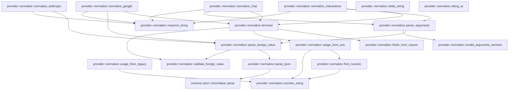

```mermaid
flowchart TD
  n0["provider::normalize::StreamAccumulator::interactions"]
  n1["provider::normalize::StreamAccumulator::record_native_search_call"]
  n2["provider::normalize::StreamAccumulator::anthropic"]
  n3["provider::normalize::StreamAccumulator::chat"]
  n4["provider::normalize::StreamAccumulator::google"]
  n5["provider::normalize::StreamAccumulator::push_text"]
  n6["provider::normalize::StreamAccumulator::push_reasoning"]
  n7["provider::normalize::append_string_field"]
  n8["provider::normalize::append_map_string"]
  n9["provider::normalize::append_interaction_content"]
  n10["provider::normalize::merge_delta_fields"]
  n11["provider::normalize::merge_chat_tool_delta"]
  n12["provider::normalize::upsert_response_part"]
  n13["provider::normalize::append_response_part_text"]
  n14["provider::normalize::optional_usize"]
  n15["provider::normalize::required_index"]
  n16["provider::normalize::merge_usage"]
  n17["provider::normalize::finish_from_reason"]
  n18["provider::normalize::native_search_call"]
  n19["provider::normalize::usage_from_any"]
  n20["provider::normalize::parse_ijson"]
  n21["provider::normalize::validate_foreign_value"]
  n22["provider::normalize::delta_string"]
  n23["provider::normalize::required_string"]
  n24["provider::normalize::repair_tool_arguments"]
  n25["provider::normalize::is_context_overflow"]
  n26["provider::normalize::ProviderStreamDecoder::completed_events"]
  n27["provider::normalize::ProviderStreamDecoder::completed_fragments"]
  n28["provider::normalize::ProviderStreamDecoder::push"]
  n29["provider::normalize::ProviderStreamDecoder::finish"]
  n30["provider::normalize::ProviderStreamDecoder::consume"]
  n31["provider::normalize::validate_completed_response_call"]
  n32["provider::normalize::invalid_arguments_sentinel"]
  n33["provider::normalize::invalid_arguments_detail"]
  n34["provider::normalize::resolve_call_arguments_or_sentinel"]
  n35["provider::normalize::resolve_call_arguments"]
  n36["provider::normalize::StreamAccumulator::mark_call_ready"]
  n37["provider::normalize::StreamAccumulator::completed_fragments"]
  n38["provider::normalize::StreamAccumulator::consume"]
  n39["provider::normalize::StreamAccumulator::responses"]
  n0 --> n5
  n0 --> n6
  n0 --> n9
  n0 --> n10
  n0 --> n15
  n0 --> n17
  n0 --> n19
  n0 --> n22
  n0 --> n23
  n0 --> n25
  n0 --> n36
  n1 --> n18
  n2 --> n5
  n2 --> n6
  n2 --> n7
  n2 --> n10
  n2 --> n15
  n2 --> n16
  n2 --> n17
  n2 --> n19
  n2 --> n22
  n2 --> n23
  n2 --> n36
  n3 --> n5
  n3 --> n6
  n3 --> n8
  n3 --> n11
  n3 --> n17
  n3 --> n19
  n3 --> n36
  n4 --> n5
  n4 --> n6
  n4 --> n17
  n4 --> n19
  n4 --> n23
  n4 --> n36
  n28 --> n30
  n29 --> n30
  n30 --> n20
  n31 --> n20
  n31 --> n23
  n34 --> n32
  n34 --> n35
  n35 --> n20
  n35 --> n21
  n35 --> n24
  n36 --> n34
  n37 --> n34
  n38 --> n0
  n38 --> n2
  n38 --> n3
  n38 --> n4
  n38 --> n19
  n38 --> n39
  n39 --> n1
  n39 --> n5
  n39 --> n6
  n39 --> n12
  n39 --> n13
  n39 --> n14
  n39 --> n17
  n39 --> n19
  n39 --> n22
  n39 --> n23
  n39 --> n31
  n39 --> n36
```

# provider::normalize

[Package atlas](index.md) · [Source](../../src/normalize.rs)

## Declarations

Visibility is the declaration spelling; trait members and reexports require their enclosing interface. `cfg` is not evaluated.

| Symbol | Kind | Visibility | Test / cfg |
|---|---|---|---|
| [provider::normalize::ContentBlock](../../src/normalize.rs#L10) | enum_item | `pub` |  |
| [provider::normalize::ToolCall](../../src/normalize.rs#L16) | struct_item | `pub` |  |
| [provider::normalize::Usage](../../src/normalize.rs#L23) | struct_item | `pub` |  |
| [provider::normalize::FinishReason](../../src/normalize.rs#L39) | enum_item | `pub` |  |
| [provider::normalize::ProviderTerminal](../../src/normalize.rs#L52) | struct_item | `pub` |  |
| [provider::normalize::ProviderTerminal::is_final_answer](../../src/normalize.rs#L81) | function_item | `pub` |  |
| [provider::normalize::ProviderFailure](../../src/normalize.rs#L129) | enum_item | `pub` |  |
| [provider::normalize::ProviderCompletion](../../src/normalize.rs#L162) | enum_item | `pub` |  |
| [provider::normalize::ProviderFrame](../../src/normalize.rs#L168) | enum_item | `pub` |  |
| [provider::normalize::normalize_response](../../src/normalize.rs#L184) | function_item | `pub` |  |
| [provider::normalize::normalize_dialect_response](../../src/normalize.rs#L218) | function_item | `pub` |  |
| [provider::normalize::validate_responses_output_container](../../src/normalize.rs#L292) | function_item | `private` |  |
| [provider::normalize::validate_exact_anthropic_payload](../../src/normalize.rs#L299) | function_item | `private` |  |
| [provider::normalize::repair_response_argument_strings](../../src/normalize.rs#L312) | function_item | `private` |  |
| [provider::normalize::repair_tool_arguments](../../src/normalize.rs#L349) | function_item | `pub` |  |
| [provider::normalize::repair_bare_object_values](../../src/normalize.rs#L372) | function_item | `private` |  |
| [provider::normalize::repair_bare_object_values::skip_whitespace](../../src/normalize.rs#L377) | function_item | `private` |  |
| [provider::normalize::repair_bare_object_values::copy_quoted](../../src/normalize.rs#L384) | function_item | `private` |  |
| [provider::normalize::repair_bare_object_values::starts_next_field](../../src/normalize.rs#L406) | function_item | `private` |  |
| [provider::normalize::repair_bare_object_values::only_whitespace_after](../../src/normalize.rs#L431) | function_item | `private` |  |
| [provider::normalize::repair_bare_object_values::scan_balanced](../../src/normalize.rs#L437) | function_item | `private` |  |
| [provider::normalize::repair_bare_object_values::consume_value](../../src/normalize.rs#L472) | function_item | `private` |  |
| [provider::normalize::repair_terminal_tool_arguments](../../src/normalize.rs#L573) | function_item | `private` |  |
| [provider::normalize::is_context_overflow](../../src/normalize.rs#L594) | function_item | `private` |  |
| [provider::normalize::normalize_sse_stream](../../src/normalize.rs#L610) | function_item | `pub` |  |
| [provider::normalize::normalize_dialect_sse_stream](../../src/normalize.rs#L621) | function_item | `pub` |  |
| [provider::normalize::ProviderStreamDecoder](../../src/normalize.rs#L632) | struct_item | `pub` |  |
| [provider::normalize::ProviderStreamDecoder::new](../../src/normalize.rs#L643) | function_item | `pub` |  |
| [provider::normalize::ProviderStreamDecoder::for_dialect](../../src/normalize.rs#L655) | function_item | `pub` |  |
| [provider::normalize::ProviderStreamDecoder::completed_events](../../src/normalize.rs#L667) | function_item | `pub` |  |
| [provider::normalize::ProviderStreamDecoder::completed_fragments](../../src/normalize.rs#L678) | function_item | `pub` |  |
| [provider::normalize::ProviderStreamDecoder::push](../../src/normalize.rs#L683) | function_item | `pub` |  |
| [provider::normalize::ProviderStreamDecoder::finish](../../src/normalize.rs#L690) | function_item | `pub` |  |
| [provider::normalize::ProviderStreamDecoder::consume](../../src/normalize.rs#L702) | function_item | `private` |  |
| [provider::normalize::StreamAccumulator](../../src/normalize.rs#L718) | struct_item | `private` |  |
| [provider::normalize::PartialCall](../../src/normalize.rs#L743) | struct_item | `private` |  |
| [provider::normalize::validate_completed_response_call](../../src/normalize.rs#L751) | function_item | `private` |  |
| [provider::normalize::INVALID_ARGUMENTS_KEY](../../src/normalize.rs#L777) | const_item | `pub` |  |
| [provider::normalize::invalid_arguments_sentinel](../../src/normalize.rs#L779) | function_item | `pub` |  |
| [provider::normalize::invalid_arguments_detail](../../src/normalize.rs#L790) | function_item | `pub` |  |
| [provider::normalize::resolve_call_arguments_or_sentinel](../../src/normalize.rs#L803) | function_item | `private` |  |
| [provider::normalize::resolve_call_arguments](../../src/normalize.rs#L810) | function_item | `private` |  |
| [provider::normalize::StreamAccumulator::mark_call_ready](../../src/normalize.rs#L833) | function_item | `private` |  |
| [provider::normalize::StreamAccumulator::completed_fragments](../../src/normalize.rs#L859) | function_item | `private` |  |
| [provider::normalize::StreamAccumulator::consume](../../src/normalize.rs#L895) | function_item | `private` |  |
| [provider::normalize::StreamAccumulator::responses](../../src/normalize.rs#L951) | function_item | `private` |  |
| [provider::normalize::StreamAccumulator::interactions](../../src/normalize.rs#L1184) | function_item | `private` |  |
| [provider::normalize::StreamAccumulator::record_native_search_call](../../src/normalize.rs#L1357) | function_item | `private` |  |
| [provider::normalize::StreamAccumulator::anthropic](../../src/normalize.rs#L1382) | function_item | `private` |  |
| [provider::normalize::StreamAccumulator::chat](../../src/normalize.rs#L1514) | function_item | `private` |  |
| [provider::normalize::StreamAccumulator::google](../../src/normalize.rs#L1626) | function_item | `private` |  |
| [provider::normalize::StreamAccumulator::push_text](../../src/normalize.rs#L1678) | function_item | `private` |  |
| [provider::normalize::StreamAccumulator::push_reasoning](../../src/normalize.rs#L1683) | function_item | `private` |  |
| [provider::normalize::StreamAccumulator::finish](../../src/normalize.rs#L1688) | function_item | `private` |  |
| [provider::normalize::sealed_from_normalized](../../src/normalize.rs#L1858) | function_item | `private` |  |
| [provider::normalize::complete_responses_fragments](../../src/normalize.rs#L1918) | function_item | `private` |  |
| [provider::normalize::append_string_field](../../src/normalize.rs#L1968) | function_item | `private` |  |
| [provider::normalize::append_map_string](../../src/normalize.rs#L1978) | function_item | `private` |  |
| [provider::normalize::append_interaction_content](../../src/normalize.rs#L1997) | function_item | `private` |  |
| [provider::normalize::merge_delta_fields](../../src/normalize.rs#L2016) | function_item | `private` |  |
| [provider::normalize::merge_object_delta](../../src/normalize.rs#L2040) | function_item | `private` |  |
| [provider::normalize::merge_chat_tool_delta](../../src/normalize.rs#L2057) | function_item | `private` |  |
| [provider::normalize::upsert_response_part](../../src/normalize.rs#L2094) | function_item | `private` |  |
| [provider::normalize::append_response_part_text](../../src/normalize.rs#L2121) | function_item | `private` |  |
| [provider::normalize::required_usize](../../src/normalize.rs#L2145) | function_item | `private` |  |
| [provider::normalize::optional_usize](../../src/normalize.rs#L2153) | function_item | `private` |  |
| [provider::normalize::required_index](../../src/normalize.rs#L2164) | function_item | `private` |  |
| [provider::normalize::merge_usage](../../src/normalize.rs#L2168) | function_item | `private` |  |
| [provider::normalize::finish_from_reason](../../src/normalize.rs#L2187) | function_item | `private` |  |
| [provider::normalize::normalize_legacy_result](../../src/normalize.rs#L2206) | function_item | `private` |  |
| [provider::normalize::native_search_call](../../src/normalize.rs#L2276) | function_item | `private` |  |
| [provider::normalize::normalize_responses](../../src/normalize.rs#L2299) | function_item | `private` |  |
| [provider::normalize::normalize_interactions](../../src/normalize.rs#L2361) | function_item | `private` |  |
| [provider::normalize::normalize_anthropic](../../src/normalize.rs#L2415) | function_item | `private` |  |
| [provider::normalize::normalize_chat](../../src/normalize.rs#L2471) | function_item | `private` |  |
| [provider::normalize::normalize_google](../../src/normalize.rs#L2519) | function_item | `private` |  |
| [provider::normalize::terminal](../../src/normalize.rs#L2584) | function_item | `private` |  |
| [provider::normalize::usage_from_legacy](../../src/normalize.rs#L2619) | function_item | `private` |  |
| [provider::normalize::usage_from_any](../../src/normalize.rs#L2630) | function_item | `private` |  |
| [provider::normalize::first_numeric](../../src/normalize.rs#L2676) | function_item | `private` |  |
| [provider::normalize::reasoning_usage_tests::streaming_usage_follows_content_and_keeps_zero_and_partial_reports](../../src/normalize.rs#L2686) | function_item | `private` | test; #[cfg(test)] |
| [provider::normalize::reasoning_usage_tests::reported_reasoning_survives_partial_usage_without_inventing_missing_values](../../src/normalize.rs#L2709) | function_item | `private` | test; #[cfg(test)] |
| [provider::normalize::numeric_string](../../src/normalize.rs#L2747) | function_item | `private` |  |
| [provider::normalize::parse_arguments](../../src/normalize.rs#L2755) | function_item | `private` |  |
| [provider::normalize::parse_ijson](../../src/normalize.rs#L2769) | function_item | `private` |  |
| [provider::normalize::parse_foreign_value](../../src/normalize.rs#L2774) | function_item | `private` |  |
| [provider::normalize::validate_foreign_value](../../src/normalize.rs#L2780) | function_item | `private` |  |
| [provider::normalize::delta_string](../../src/normalize.rs#L2793) | function_item | `private` |  |
| [provider::normalize::required_string](../../src/normalize.rs#L2801) | function_item | `private` |  |
| [provider::normalize::string_at](../../src/normalize.rs#L2810) | function_item | `private` |  |
| [provider::normalize::deepseek_cache_usage_tests::top_level_cache_hits_are_retained_and_take_precedence](../../src/normalize.rs#L2822) | function_item | `private` | test; #[cfg(test)] |
| [provider::normalize::deepseek_cache_usage_tests::nested_cache_fallback_does_not_invent_missing_hits](../../src/normalize.rs#L2837) | function_item | `private` | test; #[cfg(test)] |

## Imports / reexports

| Local name | Source path | Visibility |
|---|---|---|
| `IJsonValue` | `schema::IJsonValue` | `private` |
| `Deserialize` | `serde::Deserialize` | `private` |
| `Serialize` | `serde::Serialize` | `private` |
| `Value` | `serde_json::Value` | `private` |
| `SseDecoder` | `crate::SseDecoder` | `private` |
| `AdapterId` | `crate::AdapterId` | `private` |
| `DialectId` | `crate::DialectId` | `private` |
| `*` | `super::*` | `private` |
| `json` | `serde_json::json` | `private` |
| `*` | `super::*` | `private` |

## Module declarations

| Module | Visibility | Attributes |
|---|---|---|
| `provider::normalize::reasoning_usage_tests` | `private` | #[cfg(test)] |
| `provider::normalize::deepseek_cache_usage_tests` | `private` | #[cfg(test)] |

## Function call graphs

Edges below are syntactically resolved calls only, including private functions. Graphs partition callers into groups of 20; they are not execution order. All unresolved sites are listed below and in the JSON inventory.

```mermaid
flowchart TD
  n0["provider::normalize::normalize_response"]
  n1["provider::normalize::normalize_dialect_response"]
  n2["provider::normalize::normalize_legacy_result"]
  n3["provider::normalize::normalize_responses"]
  n4["provider::normalize::normalize_interactions"]
  n5["provider::normalize::normalize_anthropic"]
  n6["provider::normalize::normalize_chat"]
  n7["provider::normalize::normalize_google"]
  n8["provider::normalize::usage_from_any"]
  n9["provider::normalize::parse_ijson"]
  n10["provider::normalize::parse_foreign_value"]
  n11["provider::normalize::validate_foreign_value"]
  n12["provider::normalize::validate_responses_output_container"]
  n13["provider::normalize::validate_exact_anthropic_payload"]
  n14["provider::normalize::repair_response_argument_strings"]
  n15["provider::normalize::repair_tool_arguments"]
  n16["provider::normalize::repair_bare_object_values"]
  n17["provider::normalize::repair_bare_object_values::skip_whitespace"]
  n18["provider::normalize::repair_bare_object_values::copy_quoted"]
  n19["provider::normalize::repair_bare_object_values::starts_next_field"]
  n20["provider::normalize::repair_bare_object_values::only_whitespace_after"]
  n21["provider::normalize::repair_bare_object_values::scan_balanced"]
  n22["provider::normalize::repair_bare_object_values::consume_value"]
  n23["provider::normalize::repair_terminal_tool_arguments"]
  n24["provider::normalize::is_context_overflow"]
  n25["provider::normalize::normalize_sse_stream"]
  n26["provider::normalize::normalize_dialect_sse_stream"]
  n27["provider::normalize::ProviderStreamDecoder::new"]
  n28["provider::normalize::ProviderStreamDecoder::for_dialect"]
  n29["provider::normalize::ProviderTerminal::is_final_answer"]
  n30["provider::sse::SseDecoder::new"]
  n0 --> n2
  n0 --> n3
  n0 --> n4
  n0 --> n5
  n0 --> n6
  n0 --> n7
  n0 --> n8
  n0 --> n9
  n0 --> n24
  n1 --> n0
  n1 --> n3
  n1 --> n6
  n1 --> n9
  n1 --> n12
  n1 --> n13
  n1 --> n14
  n1 --> n23
  n14 --> n15
  n15 --> n10
  n15 --> n11
  n15 --> n16
  n22 --> n18
  n22 --> n19
  n22 --> n20
  n22 --> n21
  n23 --> n15
  n25 --> n27
  n26 --> n28
  n27 --> n30
  n28 --> n30
```

Functions 1–20: 30 direct edges

Functions 21–40: 66 direct edges

Functions 41–60: 21 direct edges

Functions 61–76: 23 direct edges

## Call sites

Includes test functions (marked in declarations). Receiver-type-required sites need type analysis/manual tracing. Calls in closures are attributed to their enclosing function; their occurrence here does not mean the closure executes immediately.

| Caller | Callee expression | Source lines | Target / classification |
|---|---|---|---|
| `is_final_answer` | `self             .http_status             .is_some_and` | [82](../../src/normalize.rs#L82) | receiver-type-required |
| `is_final_answer` | `(200..300).contains` | [84](../../src/normalize.rs#L84) | receiver-type-required |
| `is_final_answer` | `self.tool_calls.is_empty` | [86](../../src/normalize.rs#L86) | receiver-type-required |
| `is_final_answer` | `self                 .content                 .iter()                 .any` | [87](../../src/normalize.rs#L87) | receiver-type-required |
| `is_final_answer` | `self                 .content                 .iter` | [87](../../src/normalize.rs#L87) | receiver-type-required |
| `is_final_answer` | `self             .sealed_fragments             .get("isFinalAnswer")             .and_then` | [94](../../src/normalize.rs#L94) | receiver-type-required |
| `is_final_answer` | `self             .sealed_fragments             .get` | [94](../../src/normalize.rs#L94) | receiver-type-required |
| `is_final_answer` | `self.sealed_fragments.as_array` | [101](../../src/normalize.rs#L101) | receiver-type-required |
| `is_final_answer` | `items                 .iter()                 .filter(&#124;item&#124; item.get("type").and_then(Value::as_str) == Some("message"))                 .collect::<Vec<_>>` | [102](../../src/normalize.rs#L102) | receiver-type-required |
| `is_final_answer` | `items                 .iter()                 .filter` | [102](../../src/normalize.rs#L102) | receiver-type-required |
| `is_final_answer` | `items                 .iter` | [102](../../src/normalize.rs#L102) | receiver-type-required |
| `is_final_answer` | `item.get("type").and_then` | [104](../../src/normalize.rs#L104) | receiver-type-required |
| `is_final_answer` | `item.get` | [104](../../src/normalize.rs#L104), [106](../../src/normalize.rs#L106), [108](../../src/normalize.rs#L108), [109](../../src/normalize.rs#L109) | receiver-type-required |
| `is_final_answer` | `Some` | [104](../../src/normalize.rs#L104), [108](../../src/normalize.rs#L108), [109](../../src/normalize.rs#L109) | external-constructor-callback-or-unresolved |
| `is_final_answer` | `messages.iter().any` | [106](../../src/normalize.rs#L106), [107](../../src/normalize.rs#L107) | receiver-type-required |
| `is_final_answer` | `messages.iter` | [106](../../src/normalize.rs#L106), [107](../../src/normalize.rs#L107) | receiver-type-required |
| `is_final_answer` | `item.get("phase").is_some` | [106](../../src/normalize.rs#L106) | receiver-type-required |
| `is_final_answer` | `item.get("phase").and_then` | [108](../../src/normalize.rs#L108) | receiver-type-required |
| `is_final_answer` | `item.get("status").and_then` | [109](../../src/normalize.rs#L109) | receiver-type-required |
| `is_final_answer` | `item                             .get("content")                             .and_then(Value::as_array)                             .is_some_and` | [110](../../src/normalize.rs#L110) | receiver-type-required |
| `is_final_answer` | `item                             .get("content")                             .and_then` | [110](../../src/normalize.rs#L110) | receiver-type-required |
| `is_final_answer` | `item                             .get` | [110](../../src/normalize.rs#L110) | receiver-type-required |
| `is_final_answer` | `parts.iter().any` | [114](../../src/normalize.rs#L114) | receiver-type-required |
| `is_final_answer` | `parts.iter` | [114](../../src/normalize.rs#L114) | receiver-type-required |
| `is_final_answer` | `part.get("text")                                         .and_then(Value::as_str)                                         .is_some_and` | [115](../../src/normalize.rs#L115) | receiver-type-required |
| `is_final_answer` | `part.get("text")                                         .and_then` | [115](../../src/normalize.rs#L115) | receiver-type-required |
| `is_final_answer` | `part.get` | [115](../../src/normalize.rs#L115) | receiver-type-required |
| `is_final_answer` | `text.trim().is_empty` | [117](../../src/normalize.rs#L117) | receiver-type-required |
| `is_final_answer` | `text.trim` | [117](../../src/normalize.rs#L117) | receiver-type-required |
| `normalize_response` | `parse_ijson` | [185](../../src/normalize.rs#L185) | [provider::normalize::parse_ijson](../../src/normalize.rs#L2769) |
| `normalize_response` | `value.get("error").is_some_and` | [186](../../src/normalize.rs#L186) | receiver-type-required |
| `normalize_response` | `value.get` | [186](../../src/normalize.rs#L186), [192](../../src/normalize.rs#L192), [199](../../src/normalize.rs#L199), [206](../../src/normalize.rs#L206) | receiver-type-required |
| `normalize_response` | `error.is_null` | [186](../../src/normalize.rs#L186) | receiver-type-required |
| `normalize_response` | `Ok` | [187](../../src/normalize.rs#L187) | external-constructor-callback-or-unresolved |
| `normalize_response` | `Vec::new` | [188](../../src/normalize.rs#L188), [189](../../src/normalize.rs#L189), [190](../../src/normalize.rs#L190) | external-constructor-callback-or-unresolved |
| `normalize_response` | `Value::Array` | [190](../../src/normalize.rs#L190) | external-constructor-callback-or-unresolved |
| `normalize_response` | `usage_from_any` | [192](../../src/normalize.rs#L192) | [provider::normalize::usage_from_any](../../src/normalize.rs#L2630) |
| `normalize_response` | `is_context_overflow` | [193](../../src/normalize.rs#L193) | [provider::normalize::is_context_overflow](../../src/normalize.rs#L594) |
| `normalize_response` | `value.get("error").cloned` | [199](../../src/normalize.rs#L199) | receiver-type-required |
| `normalize_response` | `bytes.to_vec` | [203](../../src/normalize.rs#L203) | receiver-type-required |
| `normalize_response` | `value.get("functionCalls").is_some` | [206](../../src/normalize.rs#L206) | receiver-type-required |
| `normalize_response` | `value.get("isFinalAnswer").is_some` | [206](../../src/normalize.rs#L206) | receiver-type-required |
| `normalize_response` | `normalize_legacy_result` | [207](../../src/normalize.rs#L207) | [provider::normalize::normalize_legacy_result](../../src/normalize.rs#L2206) |
| `normalize_response` | `normalize_responses` | [210](../../src/normalize.rs#L210) | [provider::normalize::normalize_responses](../../src/normalize.rs#L2299) |
| `normalize_response` | `normalize_interactions` | [211](../../src/normalize.rs#L211) | [provider::normalize::normalize_interactions](../../src/normalize.rs#L2361) |
| `normalize_response` | `normalize_anthropic` | [212](../../src/normalize.rs#L212) | [provider::normalize::normalize_anthropic](../../src/normalize.rs#L2415) |
| `normalize_response` | `normalize_chat` | [213](../../src/normalize.rs#L213) | [provider::normalize::normalize_chat](../../src/normalize.rs#L2471) |
| `normalize_response` | `normalize_google` | [214](../../src/normalize.rs#L214) | [provider::normalize::normalize_google](../../src/normalize.rs#L2519) |
| `normalize_dialect_response` | `parse_ijson` | [226](../../src/normalize.rs#L226), [283](../../src/normalize.rs#L283) | [provider::normalize::parse_ijson](../../src/normalize.rs#L2769) |
| `normalize_dialect_response` | `value.get("error").is_some_and` | [229](../../src/normalize.rs#L229) | receiver-type-required |
| `normalize_dialect_response` | `value.get` | [229](../../src/normalize.rs#L229), [245](../../src/normalize.rs#L245) | receiver-type-required |
| `normalize_dialect_response` | `error.is_null` | [229](../../src/normalize.rs#L229) | receiver-type-required |
| `normalize_dialect_response` | `normalize_response` | [230](../../src/normalize.rs#L230), [286](../../src/normalize.rs#L286) | [provider::normalize::normalize_response](../../src/normalize.rs#L184) |
| `normalize_dialect_response` | `dialect.family` | [230](../../src/normalize.rs#L230), [286](../../src/normalize.rs#L286) | receiver-type-required |
| `normalize_dialect_response` | `value             .get("output")             .and_then(Value::as_array)             .is_some_and` | [232](../../src/normalize.rs#L232) | receiver-type-required |
| `normalize_dialect_response` | `value             .get("output")             .and_then` | [232](../../src/normalize.rs#L232) | receiver-type-required |
| `normalize_dialect_response` | `value             .get` | [232](../../src/normalize.rs#L232) | receiver-type-required |
| `normalize_dialect_response` | `items.iter().any` | [235](../../src/normalize.rs#L235) | receiver-type-required |
| `normalize_dialect_response` | `items.iter` | [235](../../src/normalize.rs#L235) | receiver-type-required |
| `normalize_dialect_response` | `Err` | [237](../../src/normalize.rs#L237), [258](../../src/normalize.rs#L258), [273](../../src/normalize.rs#L273), [274](../../src/normalize.rs#L274) | external-constructor-callback-or-unresolved |
| `normalize_dialect_response` | `"native client tool search requires OpenAI Responses".into` | [237](../../src/normalize.rs#L237) | receiver-type-required |
| `normalize_dialect_response` | `repair_response_argument_strings` | [239](../../src/normalize.rs#L239) | [provider::normalize::repair_response_argument_strings](../../src/normalize.rs#L312) |
| `normalize_dialect_response` | `normalize_chat` | [241](../../src/normalize.rs#L241) | [provider::normalize::normalize_chat](../../src/normalize.rs#L2471) |
| `normalize_dialect_response` | `validate_responses_output_container` | [243](../../src/normalize.rs#L243) | [provider::normalize::validate_responses_output_container](../../src/normalize.rs#L292) |
| `normalize_dialect_response` | `normalize_responses` | [244](../../src/normalize.rs#L244) | [provider::normalize::normalize_responses](../../src/normalize.rs#L2299) |
| `normalize_dialect_response` | `value.get("status").and_then` | [245](../../src/normalize.rs#L245) | receiver-type-required |
| `normalize_dialect_response` | `value                         .get("incomplete_details")                         .and_then(&#124;details&#124; details.get("reason"))                         .and_then(Value::as_str)                         .ok_or` | [248](../../src/normalize.rs#L248) | receiver-type-required |
| `normalize_dialect_response` | `value                         .get("incomplete_details")                         .and_then(&#124;details&#124; details.get("reason"))                         .and_then` | [248](../../src/normalize.rs#L248) | receiver-type-required |
| `normalize_dialect_response` | `value                         .get("incomplete_details")                         .and_then` | [248](../../src/normalize.rs#L248) | receiver-type-required |
| `normalize_dialect_response` | `value                         .get` | [248](../../src/normalize.rs#L248), [265](../../src/normalize.rs#L265) | receiver-type-required |
| `normalize_dialect_response` | `details.get` | [250](../../src/normalize.rs#L250) | receiver-type-required |
| `normalize_dialect_response` | `Some` | [253](../../src/normalize.rs#L253), [270](../../src/normalize.rs#L270) | external-constructor-callback-or-unresolved |
| `normalize_dialect_response` | `reason.to_owned` | [253](../../src/normalize.rs#L253) | receiver-type-required |
| `normalize_dialect_response` | `value                         .get("error")                         .filter(&#124;error&#124; error.is_object())                         .cloned()                         .ok_or` | [265](../../src/normalize.rs#L265) | receiver-type-required |
| `normalize_dialect_response` | `value                         .get("error")                         .filter(&#124;error&#124; error.is_object())                         .cloned` | [265](../../src/normalize.rs#L265) | receiver-type-required |
| `normalize_dialect_response` | `value                         .get("error")                         .filter` | [265](../../src/normalize.rs#L265) | receiver-type-required |
| `normalize_dialect_response` | `error.is_object` | [267](../../src/normalize.rs#L267) | receiver-type-required |
| `normalize_dialect_response` | `"DeepSeek Responses terminal lacks status".to_owned` | [274](../../src/normalize.rs#L274) | receiver-type-required |
| `normalize_dialect_response` | `validate_exact_anthropic_payload` | [284](../../src/normalize.rs#L284) | [provider::normalize::validate_exact_anthropic_payload](../../src/normalize.rs#L299) |
| `normalize_dialect_response` | `repair_terminal_tool_arguments` | [288](../../src/normalize.rs#L288) | [provider::normalize::repair_terminal_tool_arguments](../../src/normalize.rs#L573) |
| `normalize_dialect_response` | `Ok` | [289](../../src/normalize.rs#L289) | external-constructor-callback-or-unresolved |
| `validate_responses_output_container` | `value.get("output").is_some_and` | [293](../../src/normalize.rs#L293) | receiver-type-required |
| `validate_responses_output_container` | `value.get` | [293](../../src/normalize.rs#L293) | receiver-type-required |
| `validate_responses_output_container` | `output.is_array` | [293](../../src/normalize.rs#L293) | receiver-type-required |
| `validate_responses_output_container` | `Err` | [294](../../src/normalize.rs#L294) | external-constructor-callback-or-unresolved |
| `validate_responses_output_container` | `"Responses output must be an array".to_owned` | [294](../../src/normalize.rs#L294) | receiver-type-required |
| `validate_responses_output_container` | `Ok` | [296](../../src/normalize.rs#L296) | external-constructor-callback-or-unresolved |
| `validate_exact_anthropic_payload` | `value         .get("content")         .and_then(Value::as_array)         .ok_or` | [300](../../src/normalize.rs#L300) | receiver-type-required |
| `validate_exact_anthropic_payload` | `value         .get("content")         .and_then` | [300](../../src/normalize.rs#L300) | receiver-type-required |
| `validate_exact_anthropic_payload` | `value         .get` | [300](../../src/normalize.rs#L300) | receiver-type-required |
| `validate_exact_anthropic_payload` | `part.is_object` | [305](../../src/normalize.rs#L305) | receiver-type-required |
| `validate_exact_anthropic_payload` | `part.get("type").and_then(Value::as_str).is_none` | [305](../../src/normalize.rs#L305) | receiver-type-required |
| `validate_exact_anthropic_payload` | `part.get("type").and_then` | [305](../../src/normalize.rs#L305) | receiver-type-required |
| `validate_exact_anthropic_payload` | `part.get` | [305](../../src/normalize.rs#L305) | receiver-type-required |
| `validate_exact_anthropic_payload` | `Err` | [306](../../src/normalize.rs#L306) | external-constructor-callback-or-unresolved |
| `validate_exact_anthropic_payload` | `"Anthropic content block lacks type".to_owned` | [306](../../src/normalize.rs#L306) | receiver-type-required |
| `validate_exact_anthropic_payload` | `Ok` | [309](../../src/normalize.rs#L309) | external-constructor-callback-or-unresolved |
| `repair_response_argument_strings` | `value             .get_mut("output")             .and_then(Value::as_array_mut)             .into_iter()             .flatten()             .filter_map(&#124;item&#124; item.get_mut("arguments"))             .collect::<Vec<_>>` | [314](../../src/normalize.rs#L314) | receiver-type-required |
| `repair_response_argument_strings` | `value             .get_mut("output")             .and_then(Value::as_array_mut)             .into_iter()             .flatten()             .filter_map` | [314](../../src/normalize.rs#L314) | receiver-type-required |
| `repair_response_argument_strings` | `value             .get_mut("output")             .and_then(Value::as_array_mut)             .into_iter()             .flatten` | [314](../../src/normalize.rs#L314) | receiver-type-required |
| `repair_response_argument_strings` | `value             .get_mut("output")             .and_then(Value::as_array_mut)             .into_iter` | [314](../../src/normalize.rs#L314) | receiver-type-required |
| `repair_response_argument_strings` | `value             .get_mut("output")             .and_then` | [314](../../src/normalize.rs#L314) | receiver-type-required |
| `repair_response_argument_strings` | `value             .get_mut` | [314](../../src/normalize.rs#L314), [322](../../src/normalize.rs#L322) | receiver-type-required |
| `repair_response_argument_strings` | `item.get_mut` | [319](../../src/normalize.rs#L319) | receiver-type-required |
| `repair_response_argument_strings` | `value             .get_mut("choices")             .and_then(Value::as_array_mut)             .into_iter()             .flatten()             .filter_map(&#124;choice&#124; choice.pointer_mut("/message/tool_calls"))             .filter_map(Value::as_array_mut)             .flatten()             .filter_map(&#124;call&#124; call.pointer_mut("/function/arguments"))             .collect::<Vec<_>>` | [322](../../src/normalize.rs#L322) | receiver-type-required |
| `repair_response_argument_strings` | `value             .get_mut("choices")             .and_then(Value::as_array_mut)             .into_iter()             .flatten()             .filter_map(&#124;choice&#124; choice.pointer_mut("/message/tool_calls"))             .filter_map(Value::as_array_mut)             .flatten()             .filter_map` | [322](../../src/normalize.rs#L322) | receiver-type-required |
| `repair_response_argument_strings` | `value             .get_mut("choices")             .and_then(Value::as_array_mut)             .into_iter()             .flatten()             .filter_map(&#124;choice&#124; choice.pointer_mut("/message/tool_calls"))             .filter_map(Value::as_array_mut)             .flatten` | [322](../../src/normalize.rs#L322) | receiver-type-required |
| `repair_response_argument_strings` | `value             .get_mut("choices")             .and_then(Value::as_array_mut)             .into_iter()             .flatten()             .filter_map(&#124;choice&#124; choice.pointer_mut("/message/tool_calls"))             .filter_map` | [322](../../src/normalize.rs#L322) | receiver-type-required |
| `repair_response_argument_strings` | `value             .get_mut("choices")             .and_then(Value::as_array_mut)             .into_iter()             .flatten()             .filter_map` | [322](../../src/normalize.rs#L322) | receiver-type-required |
| `repair_response_argument_strings` | `value             .get_mut("choices")             .and_then(Value::as_array_mut)             .into_iter()             .flatten` | [322](../../src/normalize.rs#L322) | receiver-type-required |
| `repair_response_argument_strings` | `value             .get_mut("choices")             .and_then(Value::as_array_mut)             .into_iter` | [322](../../src/normalize.rs#L322) | receiver-type-required |
| `repair_response_argument_strings` | `value             .get_mut("choices")             .and_then` | [322](../../src/normalize.rs#L322) | receiver-type-required |
| `repair_response_argument_strings` | `choice.pointer_mut` | [327](../../src/normalize.rs#L327) | receiver-type-required |
| `repair_response_argument_strings` | `call.pointer_mut` | [330](../../src/normalize.rs#L330) | receiver-type-required |
| `repair_response_argument_strings` | `argument             .as_str()             .ok_or_else` | [334](../../src/normalize.rs#L334) | receiver-type-required |
| `repair_response_argument_strings` | `argument             .as_str` | [334](../../src/normalize.rs#L334) | receiver-type-required |
| `repair_response_argument_strings` | `"DeepSeek tool arguments must be a string".to_owned` | [336](../../src/normalize.rs#L336) | receiver-type-required |
| `repair_response_argument_strings` | `repair_tool_arguments` | [339](../../src/normalize.rs#L339) | [provider::normalize::repair_tool_arguments](../../src/normalize.rs#L349) |
| `repair_response_argument_strings` | `raw.as_bytes` | [339](../../src/normalize.rs#L339) | receiver-type-required |
| `repair_response_argument_strings` | `Value::String` | [342](../../src/normalize.rs#L342) | external-constructor-callback-or-unresolved |
| `repair_response_argument_strings` | `serde_json_canonicalizer::to_string(&repaired).map_err` | [343](../../src/normalize.rs#L343) | receiver-type-required |
| `repair_response_argument_strings` | `serde_json_canonicalizer::to_string` | [343](../../src/normalize.rs#L343) | external-constructor-callback-or-unresolved |
| `repair_response_argument_strings` | `error.to_string` | [343](../../src/normalize.rs#L343) | receiver-type-required |
| `repair_response_argument_strings` | `Ok` | [346](../../src/normalize.rs#L346) | external-constructor-callback-or-unresolved |
| `repair_tool_arguments` | `bytes.len` | [350](../../src/normalize.rs#L350) | receiver-type-required |
| `repair_tool_arguments` | `Err` | [351](../../src/normalize.rs#L351), [366](../../src/normalize.rs#L366) | external-constructor-callback-or-unresolved |
| `repair_tool_arguments` | `"provider tool arguments exceed the 65536-byte repair bound".to_owned` | [351](../../src/normalize.rs#L351) | receiver-type-required |
| `repair_tool_arguments` | `parse_foreign_value` | [357](../../src/normalize.rs#L357), [361](../../src/normalize.rs#L361), [364](../../src/normalize.rs#L364) | [provider::normalize::parse_foreign_value](../../src/normalize.rs#L2774) |
| `repair_tool_arguments` | `String::from_utf8(bytes.to_vec())         .map_err` | [359](../../src/normalize.rs#L359) | receiver-type-required |
| `repair_tool_arguments` | `String::from_utf8` | [359](../../src/normalize.rs#L359) | external-constructor-callback-or-unresolved |
| `repair_tool_arguments` | `bytes.to_vec` | [359](../../src/normalize.rs#L359) | receiver-type-required |
| `repair_tool_arguments` | `"provider tool arguments are not UTF-8".to_owned` | [360](../../src/normalize.rs#L360) | receiver-type-required |
| `repair_tool_arguments` | `parse_foreign_value(repaired.as_bytes(), "tool arguments").is_err` | [361](../../src/normalize.rs#L361) | receiver-type-required |
| `repair_tool_arguments` | `repaired.as_bytes` | [361](../../src/normalize.rs#L361), [364](../../src/normalize.rs#L364) | receiver-type-required |
| `repair_tool_arguments` | `repair_bare_object_values` | [362](../../src/normalize.rs#L362) | [provider::normalize::repair_bare_object_values](../../src/normalize.rs#L372) |
| `repair_tool_arguments` | `value.is_object` | [365](../../src/normalize.rs#L365) | receiver-type-required |
| `repair_tool_arguments` | `"provider tool arguments must be an object".to_owned` | [366](../../src/normalize.rs#L366) | receiver-type-required |
| `repair_tool_arguments` | `validate_foreign_value` | [368](../../src/normalize.rs#L368) | [provider::normalize::validate_foreign_value](../../src/normalize.rs#L2780) |
| `repair_tool_arguments` | `Ok` | [369](../../src/normalize.rs#L369) | external-constructor-callback-or-unresolved |
| `repair_bare_object_values` | `input.chars().collect::<Vec<_>>` | [373](../../src/normalize.rs#L373) | receiver-type-required |
| `repair_bare_object_values` | `input.chars` | [373](../../src/normalize.rs#L373) | receiver-type-required |
| `repair_bare_object_values` | `String::with_capacity` | [375](../../src/normalize.rs#L375) | external-constructor-callback-or-unresolved |
| `repair_bare_object_values` | `input.len` | [375](../../src/normalize.rs#L375) | receiver-type-required |
| `repair_bare_object_values` | `skip_whitespace` | [532](../../src/normalize.rs#L532), [538](../../src/normalize.rs#L538), [544](../../src/normalize.rs#L544), [548](../../src/normalize.rs#L548), [554](../../src/normalize.rs#L554), [558](../../src/normalize.rs#L558) | external-constructor-callback-or-unresolved |
| `repair_bare_object_values` | `chars.get` | [533](../../src/normalize.rs#L533), [539](../../src/normalize.rs#L539), [549](../../src/normalize.rs#L549), [559](../../src/normalize.rs#L559) | receiver-type-required |
| `repair_bare_object_values` | `Some` | [533](../../src/normalize.rs#L533), [539](../../src/normalize.rs#L539), [549](../../src/normalize.rs#L549) | external-constructor-callback-or-unresolved |
| `repair_bare_object_values` | `input.to_owned` | [534](../../src/normalize.rs#L534), [546](../../src/normalize.rs#L546), [550](../../src/normalize.rs#L550), [556](../../src/normalize.rs#L556), [568](../../src/normalize.rs#L568) | receiver-type-required |
| `repair_bare_object_values` | `output.push` | [536](../../src/normalize.rs#L536), [552](../../src/normalize.rs#L552), [561](../../src/normalize.rs#L561) | receiver-type-required |
| `repair_bare_object_values` | `output.extend` | [540](../../src/normalize.rs#L540), [565](../../src/normalize.rs#L565) | receiver-type-required |
| `repair_bare_object_values` | `chars[index..].iter` | [540](../../src/normalize.rs#L540), [565](../../src/normalize.rs#L565) | receiver-type-required |
| `repair_bare_object_values` | `copy_quoted` | [545](../../src/normalize.rs#L545) | external-constructor-callback-or-unresolved |
| `repair_bare_object_values` | `consume_value` | [555](../../src/normalize.rs#L555) | external-constructor-callback-or-unresolved |
| `skip_whitespace` | `chars.get(*index).is_some_and` | [378](../../src/normalize.rs#L378) | receiver-type-required |
| `skip_whitespace` | `chars.get` | [378](../../src/normalize.rs#L378) | receiver-type-required |
| `skip_whitespace` | `value.is_whitespace` | [378](../../src/normalize.rs#L378) | receiver-type-required |
| `skip_whitespace` | `output.push` | [379](../../src/normalize.rs#L379) | receiver-type-required |
| `copy_quoted` | `chars.get` | [385](../../src/normalize.rs#L385), [390](../../src/normalize.rs#L390), [394](../../src/normalize.rs#L394) | receiver-type-required |
| `copy_quoted` | `Some` | [385](../../src/normalize.rs#L385) | external-constructor-callback-or-unresolved |
| `copy_quoted` | `output.push` | [388](../../src/normalize.rs#L388), [391](../../src/normalize.rs#L391), [397](../../src/normalize.rs#L397) | receiver-type-required |
| `copy_quoted` | `chars.get(*index).copied` | [390](../../src/normalize.rs#L390), [394](../../src/normalize.rs#L394) | receiver-type-required |
| `starts_next_field` | `chars.get(index).is_some_and` | [407](../../src/normalize.rs#L407), [425](../../src/normalize.rs#L425) | receiver-type-required |
| `starts_next_field` | `chars.get` | [407](../../src/normalize.rs#L407), [410](../../src/normalize.rs#L410), [414](../../src/normalize.rs#L414), [425](../../src/normalize.rs#L425), [428](../../src/normalize.rs#L428) | receiver-type-required |
| `starts_next_field` | `value.is_whitespace` | [407](../../src/normalize.rs#L407), [425](../../src/normalize.rs#L425) | receiver-type-required |
| `starts_next_field` | `Some` | [410](../../src/normalize.rs#L410), [428](../../src/normalize.rs#L428) | external-constructor-callback-or-unresolved |
| `starts_next_field` | `chars.get(index).copied` | [414](../../src/normalize.rs#L414) | receiver-type-required |
| `only_whitespace_after` | `chars[index.saturating_add(1)..]             .iter()             .all` | [432](../../src/normalize.rs#L432) | receiver-type-required |
| `only_whitespace_after` | `chars[index.saturating_add(1)..]             .iter` | [432](../../src/normalize.rs#L432) | receiver-type-required |
| `only_whitespace_after` | `index.saturating_add` | [432](../../src/normalize.rs#L432) | receiver-type-required |
| `only_whitespace_after` | `value.is_whitespace` | [434](../../src/normalize.rs#L434) | receiver-type-required |
| `scan_balanced` | `chars.get(*index).copied` | [443](../../src/normalize.rs#L443), [446](../../src/normalize.rs#L446) | receiver-type-required |
| `scan_balanced` | `chars.get` | [443](../../src/normalize.rs#L443), [446](../../src/normalize.rs#L446) | receiver-type-required |
| `scan_balanced` | `depth.checked_sub` | [461](../../src/normalize.rs#L461) | receiver-type-required |
| `scan_balanced` | `Some` | [464](../../src/normalize.rs#L464) | external-constructor-callback-or-unresolved |
| `scan_balanced` | `chars[start..*index].iter().collect` | [464](../../src/normalize.rs#L464) | receiver-type-required |
| `scan_balanced` | `chars[start..*index].iter` | [464](../../src/normalize.rs#L464) | receiver-type-required |
| `consume_value` | `chars.get` | [473](../../src/normalize.rs#L473), [502](../../src/normalize.rs#L502) | receiver-type-required |
| `consume_value` | `copy_quoted` | [474](../../src/normalize.rs#L474) | [provider::normalize::repair_bare_object_values::copy_quoted](../../src/normalize.rs#L384) |
| `consume_value` | `scan_balanced` | [476](../../src/normalize.rs#L476) | [provider::normalize::repair_bare_object_values::scan_balanced](../../src/normalize.rs#L437) |
| `consume_value` | `serde_json::from_str::<Value>(&fragment).is_ok` | [479](../../src/normalize.rs#L479) | receiver-type-required |
| `consume_value` | `serde_json::from_str::<Value>` | [479](../../src/normalize.rs#L479) | external-constructor-callback-or-unresolved |
| `consume_value` | `output.push_str` | [480](../../src/normalize.rs#L480), [489](../../src/normalize.rs#L489), [493](../../src/normalize.rs#L493), [525](../../src/normalize.rs#L525), [527](../../src/normalize.rs#L527) | receiver-type-required |
| `consume_value` | `fragment[1..fragment.len() - 1].trim` | [483](../../src/normalize.rs#L483) | receiver-type-required |
| `consume_value` | `fragment.len` | [483](../../src/normalize.rs#L483) | receiver-type-required |
| `consume_value` | `fragment.starts_with` | [484](../../src/normalize.rs#L484) | receiver-type-required |
| `consume_value` | `inner.is_empty` | [485](../../src/normalize.rs#L485) | receiver-type-required |
| `consume_value` | `inner.contains` | [486](../../src/normalize.rs#L486) | receiver-type-required |
| `consume_value` | `output.push` | [488](../../src/normalize.rs#L488), [490](../../src/normalize.rs#L490) | receiver-type-required |
| `consume_value` | `serde_json::to_string(inner).expect` | [489](../../src/normalize.rs#L489) | receiver-type-required |
| `consume_value` | `serde_json::to_string` | [489](../../src/normalize.rs#L489), [527](../../src/normalize.rs#L527) | external-constructor-callback-or-unresolved |
| `consume_value` | `chars.get(*index).copied` | [502](../../src/normalize.rs#L502) | receiver-type-required |
| `consume_value` | `starts_next_field` | [503](../../src/normalize.rs#L503) | [provider::normalize::repair_bare_object_values::starts_next_field](../../src/normalize.rs#L406) |
| `consume_value` | `Some` | [504](../../src/normalize.rs#L504), [508](../../src/normalize.rs#L508) | external-constructor-callback-or-unresolved |
| `consume_value` | `only_whitespace_after` | [507](../../src/normalize.rs#L507) | [provider::normalize::repair_bare_object_values::only_whitespace_after](../../src/normalize.rs#L431) |
| `consume_value` | `chars[start..end]             .iter()             .collect::<String>()             .trim()             .to_owned` | [516](../../src/normalize.rs#L516) | receiver-type-required |
| `consume_value` | `chars[start..end]             .iter()             .collect::<String>()             .trim` | [516](../../src/normalize.rs#L516) | receiver-type-required |
| `consume_value` | `chars[start..end]             .iter()             .collect::<String>` | [516](../../src/normalize.rs#L516) | receiver-type-required |
| `consume_value` | `chars[start..end]             .iter` | [516](../../src/normalize.rs#L516) | receiver-type-required |
| `consume_value` | `bare.is_empty` | [521](../../src/normalize.rs#L521) | receiver-type-required |
| `consume_value` | `bare.parse::<f64>().is_ok` | [524](../../src/normalize.rs#L524) | receiver-type-required |
| `consume_value` | `bare.parse::<f64>` | [524](../../src/normalize.rs#L524) | receiver-type-required |
| `consume_value` | `serde_json::to_string(&bare).expect` | [527](../../src/normalize.rs#L527) | receiver-type-required |
| `repair_terminal_tool_arguments` | `Ok` | [581](../../src/normalize.rs#L581), [591](../../src/normalize.rs#L591) | external-constructor-callback-or-unresolved |
| `repair_terminal_tool_arguments` | `call.arguments.get(INVALID_ARGUMENTS_KEY).is_some` | [584](../../src/normalize.rs#L584) | receiver-type-required |
| `repair_terminal_tool_arguments` | `call.arguments.get` | [584](../../src/normalize.rs#L584) | receiver-type-required |
| `repair_terminal_tool_arguments` | `serde_json_canonicalizer::to_vec(&call.arguments).map_err` | [588](../../src/normalize.rs#L588) | receiver-type-required |
| `repair_terminal_tool_arguments` | `serde_json_canonicalizer::to_vec` | [588](../../src/normalize.rs#L588) | external-constructor-callback-or-unresolved |
| `repair_terminal_tool_arguments` | `error.to_string` | [588](../../src/normalize.rs#L588) | receiver-type-required |
| `repair_terminal_tool_arguments` | `repair_tool_arguments` | [589](../../src/normalize.rs#L589) | [provider::normalize::repair_tool_arguments](../../src/normalize.rs#L349) |
| `is_context_overflow` | `value.get("error").unwrap_or` | [595](../../src/normalize.rs#L595) | receiver-type-required |
| `is_context_overflow` | `value.get` | [595](../../src/normalize.rs#L595) | receiver-type-required |
| `is_context_overflow` | `["code", "type", "status"]         .into_iter()         .filter_map(&#124;field&#124; error.get(field).and_then(Value::as_str))         .any` | [596](../../src/normalize.rs#L596) | receiver-type-required |
| `is_context_overflow` | `["code", "type", "status"]         .into_iter()         .filter_map` | [596](../../src/normalize.rs#L596) | receiver-type-required |
| `is_context_overflow` | `["code", "type", "status"]         .into_iter` | [596](../../src/normalize.rs#L596) | receiver-type-required |
| `is_context_overflow` | `error.get(field).and_then` | [598](../../src/normalize.rs#L598) | receiver-type-required |
| `is_context_overflow` | `error.get` | [598](../../src/normalize.rs#L598) | receiver-type-required |
| `normalize_sse_stream` | `ProviderStreamDecoder::new` | [614](../../src/normalize.rs#L614) | [provider::normalize::ProviderStreamDecoder::new](../../src/normalize.rs#L643) |
| `normalize_sse_stream` | `decoder.push` | [615](../../src/normalize.rs#L615) | receiver-type-required |
| `normalize_sse_stream` | `decoder.finish` | [616](../../src/normalize.rs#L616) | receiver-type-required |
| `normalize_sse_stream` | `frames.extend` | [617](../../src/normalize.rs#L617) | receiver-type-required |
| `normalize_sse_stream` | `Ok` | [618](../../src/normalize.rs#L618) | external-constructor-callback-or-unresolved |
| `normalize_dialect_sse_stream` | `ProviderStreamDecoder::for_dialect` | [625](../../src/normalize.rs#L625) | [provider::normalize::ProviderStreamDecoder::for_dialect](../../src/normalize.rs#L655) |
| `normalize_dialect_sse_stream` | `decoder.push` | [626](../../src/normalize.rs#L626) | receiver-type-required |
| `normalize_dialect_sse_stream` | `decoder.finish` | [627](../../src/normalize.rs#L627) | receiver-type-required |
| `normalize_dialect_sse_stream` | `frames.extend` | [628](../../src/normalize.rs#L628) | receiver-type-required |
| `normalize_dialect_sse_stream` | `Ok` | [629](../../src/normalize.rs#L629) | external-constructor-callback-or-unresolved |
| `new` | `SseDecoder::new` | [647](../../src/normalize.rs#L647) | [provider::sse::SseDecoder::new](../../src/sse.rs#L31) |
| `new` | `StreamAccumulator::default` | [648](../../src/normalize.rs#L648) | external-constructor-callback-or-unresolved |
| `new` | `Vec::new` | [649](../../src/normalize.rs#L649) | external-constructor-callback-or-unresolved |
| `for_dialect` | `dialect.family` | [657](../../src/normalize.rs#L657) | receiver-type-required |
| `for_dialect` | `Some` | [658](../../src/normalize.rs#L658) | external-constructor-callback-or-unresolved |
| `for_dialect` | `SseDecoder::new` | [659](../../src/normalize.rs#L659) | [provider::sse::SseDecoder::new](../../src/sse.rs#L31) |
| `for_dialect` | `StreamAccumulator::default` | [660](../../src/normalize.rs#L660) | external-constructor-callback-or-unresolved |
| `for_dialect` | `Vec::new` | [661](../../src/normalize.rs#L661) | external-constructor-callback-or-unresolved |
| `completed_fragments` | `self.accumulator             .completed_fragments` | [679](../../src/normalize.rs#L679) | receiver-type-required |
| `push` | `self.raw.extend_from_slice` | [684](../../src/normalize.rs#L684) | receiver-type-required |
| `push` | `self.sse.push(bytes).map_err` | [685](../../src/normalize.rs#L685) | receiver-type-required |
| `push` | `self.sse.push` | [685](../../src/normalize.rs#L685) | receiver-type-required |
| `push` | `error.to_string` | [685](../../src/normalize.rs#L685) | receiver-type-required |
| `push` | `self.consume` | [686](../../src/normalize.rs#L686) | [provider::normalize::ProviderStreamDecoder::consume](../../src/normalize.rs#L702) |
| `push` | `Ok` | [687](../../src/normalize.rs#L687) | external-constructor-callback-or-unresolved |
| `push` | `std::mem::take` | [687](../../src/normalize.rs#L687) | external-constructor-callback-or-unresolved |
| `finish` | `std::mem::take(&mut self.sse)             .finish_events()             .map_err` | [691](../../src/normalize.rs#L691) | receiver-type-required |
| `finish` | `std::mem::take(&mut self.sse)             .finish_events` | [691](../../src/normalize.rs#L691) | receiver-type-required |
| `finish` | `std::mem::take` | [691](../../src/normalize.rs#L691), [695](../../src/normalize.rs#L695) | external-constructor-callback-or-unresolved |
| `finish` | `error.to_string` | [693](../../src/normalize.rs#L693) | receiver-type-required |
| `finish` | `self.consume` | [694](../../src/normalize.rs#L694) | [provider::normalize::ProviderStreamDecoder::consume](../../src/normalize.rs#L702) |
| `finish` | `self             .accumulator             .finish` | [696](../../src/normalize.rs#L696) | receiver-type-required |
| `finish` | `Ok` | [699](../../src/normalize.rs#L699) | external-constructor-callback-or-unresolved |
| `consume` | `self.completed_events.saturating_add` | [704](../../src/normalize.rs#L704) | receiver-type-required |
| `consume` | `parse_ijson` | [709](../../src/normalize.rs#L709) | [provider::normalize::parse_ijson](../../src/normalize.rs#L2769) |
| `consume` | `event.data.as_bytes` | [709](../../src/normalize.rs#L709) | receiver-type-required |
| `consume` | `self.accumulator                 .consume` | [710](../../src/normalize.rs#L710) | receiver-type-required |
| `consume` | `Ok` | [713](../../src/normalize.rs#L713) | external-constructor-callback-or-unresolved |
| `validate_completed_response_call` | `Err` | [753](../../src/normalize.rs#L753), [767](../../src/normalize.rs#L767) | external-constructor-callback-or-unresolved |
| `validate_completed_response_call` | `"completed tool identity differs from response manifest".to_owned` | [753](../../src/normalize.rs#L753) | receiver-type-required |
| `validate_completed_response_call` | `required_string` | [755](../../src/normalize.rs#L755) | [provider::normalize::required_string](../../src/normalize.rs#L2801) |
| `validate_completed_response_call` | `parse_ijson` | [757](../../src/normalize.rs#L757), [758](../../src/normalize.rs#L758) | [provider::normalize::parse_ijson](../../src/normalize.rs#L2769) |
| `validate_completed_response_call` | `arguments.as_bytes` | [757](../../src/normalize.rs#L757) | receiver-type-required |
| `validate_completed_response_call` | `call.arguments.as_bytes` | [758](../../src/normalize.rs#L758) | receiver-type-required |
| `validate_completed_response_call` | `"completed tool arguments differ from response manifest".to_owned` | [767](../../src/normalize.rs#L767) | receiver-type-required |
| `validate_completed_response_call` | `Ok` | [769](../../src/normalize.rs#L769) | external-constructor-callback-or-unresolved |
| `invalid_arguments_sentinel` | `raw.len().min` | [780](../../src/normalize.rs#L780) | receiver-type-required |
| `invalid_arguments_sentinel` | `raw.len` | [780](../../src/normalize.rs#L780) | receiver-type-required |
| `invalid_arguments_sentinel` | `raw.is_char_boundary` | [781](../../src/normalize.rs#L781) | receiver-type-required |
| `invalid_arguments_detail` | `arguments         .get(INVALID_ARGUMENTS_KEY)?         .get` | [791](../../src/normalize.rs#L791) | receiver-type-required |
| `invalid_arguments_detail` | `arguments         .get` | [791](../../src/normalize.rs#L791) | receiver-type-required |
| `invalid_arguments_detail` | `Some` | [794](../../src/normalize.rs#L794) | external-constructor-callback-or-unresolved |
| `resolve_call_arguments_or_sentinel` | `resolve_call_arguments(call, dialect)         .unwrap_or_else` | [804](../../src/normalize.rs#L804) | receiver-type-required |
| `resolve_call_arguments_or_sentinel` | `resolve_call_arguments` | [804](../../src/normalize.rs#L804) | [provider::normalize::resolve_call_arguments](../../src/normalize.rs#L810) |
| `resolve_call_arguments_or_sentinel` | `invalid_arguments_sentinel` | [805](../../src/normalize.rs#L805) | [provider::normalize::invalid_arguments_sentinel](../../src/normalize.rs#L779) |
| `resolve_call_arguments` | `call.value_arguments.as_ref` | [811](../../src/normalize.rs#L811) | receiver-type-required |
| `resolve_call_arguments` | `call.arguments.is_empty` | [812](../../src/normalize.rs#L812) | receiver-type-required |
| `resolve_call_arguments` | `value.clone` | [813](../../src/normalize.rs#L813) | receiver-type-required |
| `resolve_call_arguments` | `repair_tool_arguments` | [815](../../src/normalize.rs#L815), [820](../../src/normalize.rs#L820) | [provider::normalize::repair_tool_arguments](../../src/normalize.rs#L349) |
| `resolve_call_arguments` | `call.arguments.as_bytes` | [815](../../src/normalize.rs#L815), [817](../../src/normalize.rs#L817), [820](../../src/normalize.rs#L820), [822](../../src/normalize.rs#L822) | receiver-type-required |
| `resolve_call_arguments` | `parse_ijson` | [817](../../src/normalize.rs#L817), [822](../../src/normalize.rs#L822) | [provider::normalize::parse_ijson](../../src/normalize.rs#L2769) |
| `resolve_call_arguments` | `validate_foreign_value` | [824](../../src/normalize.rs#L824) | [provider::normalize::validate_foreign_value](../../src/normalize.rs#L2780) |
| `resolve_call_arguments` | `Ok` | [825](../../src/normalize.rs#L825) | external-constructor-callback-or-unresolved |
| `mark_call_ready` | `self.calls.get_mut` | [834](../../src/normalize.rs#L834) | receiver-type-required |
| `mark_call_ready` | `Ok` | [835](../../src/normalize.rs#L835), [838](../../src/normalize.rs#L838), [851](../../src/normalize.rs#L851) | external-constructor-callback-or-unresolved |
| `mark_call_ready` | `call.id.is_empty` | [840](../../src/normalize.rs#L840) | receiver-type-required |
| `mark_call_ready` | `call.name.is_empty` | [840](../../src/normalize.rs#L840) | receiver-type-required |
| `mark_call_ready` | `Err` | [841](../../src/normalize.rs#L841) | external-constructor-callback-or-unresolved |
| `mark_call_ready` | `"completed tool arguments lack identity".to_owned` | [841](../../src/normalize.rs#L841) | receiver-type-required |
| `mark_call_ready` | `resolve_call_arguments_or_sentinel` | [843](../../src/normalize.rs#L843) | [provider::normalize::resolve_call_arguments_or_sentinel](../../src/normalize.rs#L803) |
| `mark_call_ready` | `call.id.clone` | [846](../../src/normalize.rs#L846) | receiver-type-required |
| `mark_call_ready` | `call.name.clone` | [847](../../src/normalize.rs#L847) | receiver-type-required |
| `mark_call_ready` | `self.frames.push` | [850](../../src/normalize.rs#L850) | receiver-type-required |
| `mark_call_ready` | `ProviderFrame::ToolCallReady` | [850](../../src/normalize.rs#L850) | external-constructor-callback-or-unresolved |
| `completed_fragments` | `Vec::new` | [869](../../src/normalize.rs#L869) | external-constructor-callback-or-unresolved |
| `completed_fragments` | `self.calls.get(index).filter` | [871](../../src/normalize.rs#L871) | receiver-type-required |
| `completed_fragments` | `self.calls.get` | [871](../../src/normalize.rs#L871) | receiver-type-required |
| `completed_fragments` | `self.completed_items.contains` | [872](../../src/normalize.rs#L872) | receiver-type-required |
| `completed_fragments` | `call.is_none` | [872](../../src/normalize.rs#L872) | receiver-type-required |
| `completed_fragments` | `item.clone` | [875](../../src/normalize.rs#L875) | receiver-type-required |
| `completed_fragments` | `resolve_call_arguments_or_sentinel` | [877](../../src/normalize.rs#L877) | [provider::normalize::resolve_call_arguments_or_sentinel](../../src/normalize.rs#L803) |
| `completed_fragments` | `item.as_object_mut` | [878](../../src/normalize.rs#L878) | receiver-type-required |
| `completed_fragments` | `object.insert` | [880](../../src/normalize.rs#L880), [884](../../src/normalize.rs#L884), [885](../../src/normalize.rs#L885), [887](../../src/normalize.rs#L887) | receiver-type-required |
| `completed_fragments` | `"arguments".to_owned` | [881](../../src/normalize.rs#L881) | receiver-type-required |
| `completed_fragments` | `Value::String` | [882](../../src/normalize.rs#L882), [884](../../src/normalize.rs#L884), [885](../../src/normalize.rs#L885) | external-constructor-callback-or-unresolved |
| `completed_fragments` | `serde_json_canonicalizer::to_string(&arguments).ok` | [882](../../src/normalize.rs#L882) | receiver-type-required |
| `completed_fragments` | `serde_json_canonicalizer::to_string` | [882](../../src/normalize.rs#L882) | external-constructor-callback-or-unresolved |
| `completed_fragments` | `"call_id".to_owned` | [884](../../src/normalize.rs#L884) | receiver-type-required |
| `completed_fragments` | `call.id.clone` | [884](../../src/normalize.rs#L884) | receiver-type-required |
| `completed_fragments` | `"name".to_owned` | [885](../../src/normalize.rs#L885) | receiver-type-required |
| `completed_fragments` | `call.name.clone` | [885](../../src/normalize.rs#L885) | receiver-type-required |
| `completed_fragments` | `"input".to_owned` | [887](../../src/normalize.rs#L887) | receiver-type-required |
| `completed_fragments` | `fragments.push` | [890](../../src/normalize.rs#L890) | receiver-type-required |
| `completed_fragments` | `(!fragments.is_empty()).then_some` | [892](../../src/normalize.rs#L892) | receiver-type-required |
| `completed_fragments` | `fragments.is_empty` | [892](../../src/normalize.rs#L892) | receiver-type-required |
| `completed_fragments` | `Value::Array` | [892](../../src/normalize.rs#L892) | external-constructor-callback-or-unresolved |
| `consume` | `Err` | [902](../../src/normalize.rs#L902) | external-constructor-callback-or-unresolved |
| `consume` | `"provider data follows terminal".to_owned` | [902](../../src/normalize.rs#L902) | receiver-type-required |
| `consume` | `self.responses` | [905](../../src/normalize.rs#L905) | [provider::normalize::StreamAccumulator::responses](../../src/normalize.rs#L951) |
| `consume` | `self.interactions` | [906](../../src/normalize.rs#L906) | [provider::normalize::StreamAccumulator::interactions](../../src/normalize.rs#L1184) |
| `consume` | `self.anthropic` | [907](../../src/normalize.rs#L907) | [provider::normalize::StreamAccumulator::anthropic](../../src/normalize.rs#L1382) |
| `consume` | `self.chat` | [908](../../src/normalize.rs#L908) | [provider::normalize::StreamAccumulator::chat](../../src/normalize.rs#L1514) |
| `consume` | `self.google` | [909](../../src/normalize.rs#L909) | [provider::normalize::StreamAccumulator::google](../../src/normalize.rs#L1626) |
| `consume` | `value.get("type").and_then` | [913](../../src/normalize.rs#L913) | receiver-type-required |
| `consume` | `value.get` | [913](../../src/normalize.rs#L913), [926](../../src/normalize.rs#L926), [931](../../src/normalize.rs#L931), [935](../../src/normalize.rs#L935), [938](../../src/normalize.rs#L938), [940](../../src/normalize.rs#L940), [941](../../src/normalize.rs#L941), [942](../../src/normalize.rs#L942) | receiver-type-required |
| `consume` | `value.get("response").and_then` | [926](../../src/normalize.rs#L926) | receiver-type-required |
| `consume` | `v.get` | [926](../../src/normalize.rs#L926), [935](../../src/normalize.rs#L935), [938](../../src/normalize.rs#L938) | receiver-type-required |
| `consume` | `value                     .get("event_type")                     .or_else(&#124;&#124; value.get("type"))                     .and_then` | [929](../../src/normalize.rs#L929) | receiver-type-required |
| `consume` | `value                     .get("event_type")                     .or_else` | [929](../../src/normalize.rs#L929) | receiver-type-required |
| `consume` | `value                     .get` | [929](../../src/normalize.rs#L929) | receiver-type-required |
| `consume` | `Some` | [933](../../src/normalize.rs#L933), [937](../../src/normalize.rs#L937), [940](../../src/normalize.rs#L940) | external-constructor-callback-or-unresolved |
| `consume` | `value.get("interaction").and_then` | [935](../../src/normalize.rs#L935) | receiver-type-required |
| `consume` | `value.get("message").and_then` | [938](../../src/normalize.rs#L938) | receiver-type-required |
| `consume` | `usage_from_any` | [945](../../src/normalize.rs#L945) | [provider::normalize::usage_from_any](../../src/normalize.rs#L2630) |
| `consume` | `self.frames.push` | [946](../../src/normalize.rs#L946) | receiver-type-required |
| `consume` | `ProviderFrame::UsageDelta` | [946](../../src/normalize.rs#L946) | external-constructor-callback-or-unresolved |
| `consume` | `Ok` | [948](../../src/normalize.rs#L948) | external-constructor-callback-or-unresolved |
| `responses` | `value.get("type").and_then` | [952](../../src/normalize.rs#L952) | receiver-type-required |
| `responses` | `value.get` | [952](../../src/normalize.rs#L952), [977](../../src/normalize.rs#L977), [983](../../src/normalize.rs#L983), [998](../../src/normalize.rs#L998), [1124](../../src/normalize.rs#L1124), [1153](../../src/normalize.rs#L1153), [1160](../../src/normalize.rs#L1160) | receiver-type-required |
| `responses` | `delta_string` | [954](../../src/normalize.rs#L954), [959](../../src/normalize.rs#L959), [964](../../src/normalize.rs#L964), [989](../../src/normalize.rs#L989) | [provider::normalize::delta_string](../../src/normalize.rs#L2793) |
| `responses` | `append_response_part_text` | [955](../../src/normalize.rs#L955), [960](../../src/normalize.rs#L960), [965](../../src/normalize.rs#L965) | [provider::normalize::append_response_part_text](../../src/normalize.rs#L2121) |
| `responses` | `self.push_text` | [956](../../src/normalize.rs#L956) | [provider::normalize::StreamAccumulator::push_text](../../src/normalize.rs#L1678) |
| `responses` | `self.push_reasoning` | [961](../../src/normalize.rs#L961), [966](../../src/normalize.rs#L966) | [provider::normalize::StreamAccumulator::push_reasoning](../../src/normalize.rs#L1683) |
| `responses` | `value                     .get("output_index")                     .and_then(Value::as_u64)                     .unwrap_or` | [969](../../src/normalize.rs#L969), [1117](../../src/normalize.rs#L1117) | receiver-type-required |
| `responses` | `value                     .get("output_index")                     .and_then` | [969](../../src/normalize.rs#L969), [1117](../../src/normalize.rs#L1117) | receiver-type-required |
| `responses` | `value                     .get` | [969](../../src/normalize.rs#L969), [1030](../../src/normalize.rs#L1030), [1064](../../src/normalize.rs#L1064), [1117](../../src/normalize.rs#L1117) | receiver-type-required |
| `responses` | `self.calls.entry(index).or_default` | [973](../../src/normalize.rs#L973), [1005](../../src/normalize.rs#L1005), [1014](../../src/normalize.rs#L1014), [1121](../../src/normalize.rs#L1121) | receiver-type-required |
| `responses` | `self.calls.entry` | [973](../../src/normalize.rs#L973), [1005](../../src/normalize.rs#L1005), [1014](../../src/normalize.rs#L1014), [1121](../../src/normalize.rs#L1121) | receiver-type-required |
| `responses` | `Err` | [975](../../src/normalize.rs#L975), [979](../../src/normalize.rs#L979), [985](../../src/normalize.rs#L985), [1000](../../src/normalize.rs#L1000), [1012](../../src/normalize.rs#L1012), [1017](../../src/normalize.rs#L1017), [1028](../../src/normalize.rs#L1028), [1035](../../src/normalize.rs#L1035), [1076](../../src/normalize.rs#L1076), [1091](../../src/normalize.rs#L1091), [1126](../../src/normalize.rs#L1126), [1132](../../src/normalize.rs#L1132), [1155](../../src/normalize.rs#L1155), [1162](../../src/normalize.rs#L1162), [1179](../../src/normalize.rs#L1179) | external-constructor-callback-or-unresolved |
| `responses` | `"tool arguments delta follows arguments.done".to_owned` | [975](../../src/normalize.rs#L975) | receiver-type-required |
| `responses` | `value.get("call_id").and_then` | [977](../../src/normalize.rs#L977) | receiver-type-required |
| `responses` | `call.id.is_empty` | [978](../../src/normalize.rs#L978), [1016](../../src/normalize.rs#L1016) | receiver-type-required |
| `responses` | `"tool identity changed during arguments stream".to_owned` | [979](../../src/normalize.rs#L979) | receiver-type-required |
| `responses` | `id.to_owned` | [981](../../src/normalize.rs#L981) | receiver-type-required |
| `responses` | `value.get("name").and_then` | [983](../../src/normalize.rs#L983), [1124](../../src/normalize.rs#L1124) | receiver-type-required |
| `responses` | `call.name.is_empty` | [984](../../src/normalize.rs#L984), [993](../../src/normalize.rs#L993), [1125](../../src/normalize.rs#L1125), [1139](../../src/normalize.rs#L1139) | receiver-type-required |
| `responses` | `"tool name changed during arguments stream".to_owned` | [985](../../src/normalize.rs#L985), [1126](../../src/normalize.rs#L1126) | receiver-type-required |
| `responses` | `name.to_owned` | [987](../../src/normalize.rs#L987), [1128](../../src/normalize.rs#L1128) | receiver-type-required |
| `responses` | `call.arguments.push_str` | [990](../../src/normalize.rs#L990) | receiver-type-required |
| `responses` | `self.frames.push` | [991](../../src/normalize.rs#L991), [1137](../../src/normalize.rs#L1137) | receiver-type-required |
| `responses` | `call.id.clone` | [992](../../src/normalize.rs#L992), [1138](../../src/normalize.rs#L1138) | receiver-type-required |
| `responses` | `(!call.name.is_empty()).then` | [993](../../src/normalize.rs#L993), [1139](../../src/normalize.rs#L1139) | receiver-type-required |
| `responses` | `call.name.clone` | [993](../../src/normalize.rs#L993), [1139](../../src/normalize.rs#L1139) | receiver-type-required |
| `responses` | `value.get("item").ok_or` | [998](../../src/normalize.rs#L998), [1160](../../src/normalize.rs#L1160) | receiver-type-required |
| `responses` | `item.is_object` | [999](../../src/normalize.rs#L999), [1161](../../src/normalize.rs#L1161) | receiver-type-required |
| `responses` | `item.get("type").and_then(Value::as_str).is_none` | [999](../../src/normalize.rs#L999), [1161](../../src/normalize.rs#L1161) | receiver-type-required |
| `responses` | `item.get("type").and_then` | [999](../../src/normalize.rs#L999), [1004](../../src/normalize.rs#L1004), [1161](../../src/normalize.rs#L1161) | receiver-type-required |
| `responses` | `item.get` | [999](../../src/normalize.rs#L999), [1004](../../src/normalize.rs#L1004), [1161](../../src/normalize.rs#L1161) | receiver-type-required |
| `responses` | `"output_item.added has an invalid item".to_owned` | [1000](../../src/normalize.rs#L1000) | receiver-type-required |
| `responses` | `optional_usize(value, "output_index")?.unwrap_or` | [1002](../../src/normalize.rs#L1002), [1164](../../src/normalize.rs#L1164) | receiver-type-required |
| `responses` | `optional_usize` | [1002](../../src/normalize.rs#L1002), [1164](../../src/normalize.rs#L1164) | [provider::normalize::optional_usize](../../src/normalize.rs#L2153) |
| `responses` | `self.response_items.insert` | [1003](../../src/normalize.rs#L1003), [1168](../../src/normalize.rs#L1168) | receiver-type-required |
| `responses` | `item.clone` | [1003](../../src/normalize.rs#L1003), [1168](../../src/normalize.rs#L1168) | receiver-type-required |
| `responses` | `Some` | [1004](../../src/normalize.rs#L1004), [1057](../../src/normalize.rs#L1057), [1075](../../src/normalize.rs#L1075), [1079](../../src/normalize.rs#L1079), [1086](../../src/normalize.rs#L1086), [1098](../../src/normalize.rs#L1098) | external-constructor-callback-or-unresolved |
| `responses` | `required_string` | [1006](../../src/normalize.rs#L1006), [1007](../../src/normalize.rs#L1007), [1015](../../src/normalize.rs#L1015), [1130](../../src/normalize.rs#L1130) | [provider::normalize::required_string](../../src/normalize.rs#L2801) |
| `responses` | `dialect.is_some_and` | [1009](../../src/normalize.rs#L1009) | receiver-type-required |
| `responses` | `"native client tool search requires OpenAI Responses".into` | [1012](../../src/normalize.rs#L1012) | receiver-type-required |
| `responses` | `id.is_empty` | [1016](../../src/normalize.rs#L1016) | receiver-type-required |
| `responses` | `"native search call changed identity".into` | [1017](../../src/normalize.rs#L1017) | receiver-type-required |
| `responses` | `"tool_search".into` | [1020](../../src/normalize.rs#L1020) | receiver-type-required |
| `responses` | `"duplicate provider terminal".to_owned` | [1028](../../src/normalize.rs#L1028) | receiver-type-required |
| `responses` | `value                     .get("response")                     .ok_or` | [1030](../../src/normalize.rs#L1030) | receiver-type-required |
| `responses` | `response.get` | [1033](../../src/normalize.rs#L1033), [1063](../../src/normalize.rs#L1063), [1075](../../src/normalize.rs#L1075), [1110](../../src/normalize.rs#L1110) | receiver-type-required |
| `responses` | `output.is_array` | [1034](../../src/normalize.rs#L1034) | receiver-type-required |
| `responses` | `"Responses terminal output must be an array".to_owned` | [1035](../../src/normalize.rs#L1035) | receiver-type-required |
| `responses` | `output                                 .as_array()                                 .expect("validated output")                                 .get(*index)                                 .ok_or` | [1039](../../src/normalize.rs#L1039) | receiver-type-required |
| `responses` | `output                                 .as_array()                                 .expect("validated output")                                 .get` | [1039](../../src/normalize.rs#L1039) | receiver-type-required |
| `responses` | `output                                 .as_array()                                 .expect` | [1039](../../src/normalize.rs#L1039) | receiver-type-required |
| `responses` | `output                                 .as_array` | [1039](../../src/normalize.rs#L1039) | receiver-type-required |
| `responses` | `validate_completed_response_call` | [1044](../../src/normalize.rs#L1044), [1166](../../src/normalize.rs#L1166) | [provider::normalize::validate_completed_response_call](../../src/normalize.rs#L751) |
| `responses` | `output                         .as_array()                         .expect("validated output")                         .iter()                         .enumerate` | [1047](../../src/normalize.rs#L1047) | receiver-type-required |
| `responses` | `output                         .as_array()                         .expect("validated output")                         .iter` | [1047](../../src/normalize.rs#L1047) | receiver-type-required |
| `responses` | `output                         .as_array()                         .expect` | [1047](../../src/normalize.rs#L1047) | receiver-type-required |
| `responses` | `output                         .as_array` | [1047](../../src/normalize.rs#L1047) | receiver-type-required |
| `responses` | `self.record_native_search_call` | [1054](../../src/normalize.rs#L1054), [1171](../../src/normalize.rs#L1171) | [provider::normalize::StreamAccumulator::record_native_search_call](../../src/normalize.rs#L1357) |
| `responses` | `output.clone` | [1057](../../src/normalize.rs#L1057) | receiver-type-required |
| `responses` | `response                     .get("id")                     .and_then(Value::as_str)                     .map` | [1059](../../src/normalize.rs#L1059) | receiver-type-required |
| `responses` | `response                     .get("id")                     .and_then` | [1059](../../src/normalize.rs#L1059) | receiver-type-required |
| `responses` | `response                     .get` | [1059](../../src/normalize.rs#L1059) | receiver-type-required |
| `responses` | `usage_from_any` | [1063](../../src/normalize.rs#L1063) | [provider::normalize::usage_from_any](../../src/normalize.rs#L2630) |
| `responses` | `value                     .get("type")                     .and_then(Value::as_str)                     .unwrap_or_default` | [1064](../../src/normalize.rs#L1064) | receiver-type-required |
| `responses` | `value                     .get("type")                     .and_then` | [1064](../../src/normalize.rs#L1064) | receiver-type-required |
| `responses` | `response.get("status").and_then` | [1075](../../src/normalize.rs#L1075), [1110](../../src/normalize.rs#L1110) | receiver-type-required |
| `responses` | `response                             .get("incomplete_details")                             .and_then(&#124;details&#124; details.get("reason"))                             .and_then(Value::as_str)                             .ok_or` | [1081](../../src/normalize.rs#L1081) | receiver-type-required |
| `responses` | `response                             .get("incomplete_details")                             .and_then(&#124;details&#124; details.get("reason"))                             .and_then` | [1081](../../src/normalize.rs#L1081) | receiver-type-required |
| `responses` | `response                             .get("incomplete_details")                             .and_then` | [1081](../../src/normalize.rs#L1081) | receiver-type-required |
| `responses` | `response                             .get` | [1081](../../src/normalize.rs#L1081) | receiver-type-required |
| `responses` | `details.get` | [1083](../../src/normalize.rs#L1083) | receiver-type-required |
| `responses` | `reason.to_owned` | [1086](../../src/normalize.rs#L1086) | receiver-type-required |
| `responses` | `response                                 .get("error")                                 .filter(&#124;error&#124; error.is_object())                                 .cloned()                                 .ok_or` | [1099](../../src/normalize.rs#L1099) | receiver-type-required |
| `responses` | `response                                 .get("error")                                 .filter(&#124;error&#124; error.is_object())                                 .cloned` | [1099](../../src/normalize.rs#L1099) | receiver-type-required |
| `responses` | `response                                 .get("error")                                 .filter` | [1099](../../src/normalize.rs#L1099) | receiver-type-required |
| `responses` | `response                                 .get` | [1099](../../src/normalize.rs#L1099) | receiver-type-required |
| `responses` | `error.is_object` | [1101](../../src/normalize.rs#L1101) | receiver-type-required |
| `responses` | `finish_from_reason` | [1109](../../src/normalize.rs#L1109) | [provider::normalize::finish_from_reason](../../src/normalize.rs#L2187) |
| `responses` | `self.calls.is_empty` | [1111](../../src/normalize.rs#L1111) | receiver-type-required |
| `responses` | `call.arguments.is_empty` | [1131](../../src/normalize.rs#L1131), [1136](../../src/normalize.rs#L1136) | receiver-type-required |
| `responses` | `"arguments.done differs from streamed tool arguments".to_owned` | [1132](../../src/normalize.rs#L1132) | receiver-type-required |
| `responses` | `arguments.is_empty` | [1136](../../src/normalize.rs#L1136) | receiver-type-required |
| `responses` | `arguments.clone` | [1140](../../src/normalize.rs#L1140) | receiver-type-required |
| `responses` | `self.mark_call_ready` | [1147](../../src/normalize.rs#L1147) | [provider::normalize::StreamAccumulator::mark_call_ready](../../src/normalize.rs#L833) |
| `responses` | `value.get("part").ok_or` | [1153](../../src/normalize.rs#L1153) | receiver-type-required |
| `responses` | `part.is_object` | [1154](../../src/normalize.rs#L1154) | receiver-type-required |
| `responses` | `part.get("type").and_then(Value::as_str).is_none` | [1154](../../src/normalize.rs#L1154) | receiver-type-required |
| `responses` | `part.get("type").and_then` | [1154](../../src/normalize.rs#L1154) | receiver-type-required |
| `responses` | `part.get` | [1154](../../src/normalize.rs#L1154) | receiver-type-required |
| `responses` | `"content_part event has an invalid part".to_owned` | [1155](../../src/normalize.rs#L1155) | receiver-type-required |
| `responses` | `upsert_response_part` | [1157](../../src/normalize.rs#L1157) | [provider::normalize::upsert_response_part](../../src/normalize.rs#L2094) |
| `responses` | `part.clone` | [1157](../../src/normalize.rs#L1157) | receiver-type-required |
| `responses` | `"output_item.done has an invalid item".to_owned` | [1162](../../src/normalize.rs#L1162) | receiver-type-required |
| `responses` | `self.calls.get(&index).filter` | [1165](../../src/normalize.rs#L1165) | receiver-type-required |
| `responses` | `self.calls.get` | [1165](../../src/normalize.rs#L1165) | receiver-type-required |
| `responses` | `self.completed_items.insert` | [1169](../../src/normalize.rs#L1169) | receiver-type-required |
| `responses` | `"provider event lacks type".to_owned` | [1179](../../src/normalize.rs#L1179) | receiver-type-required |
| `responses` | `Ok` | [1181](../../src/normalize.rs#L1181) | external-constructor-callback-or-unresolved |
| `interactions` | `value             .get("event_type")             .or_else(&#124;&#124; value.get("type"))             .and_then` | [1185](../../src/normalize.rs#L1185) | receiver-type-required |
| `interactions` | `value             .get("event_type")             .or_else` | [1185](../../src/normalize.rs#L1185) | receiver-type-required |
| `interactions` | `value             .get` | [1185](../../src/normalize.rs#L1185) | receiver-type-required |
| `interactions` | `value.get` | [1187](../../src/normalize.rs#L1187), [1209](../../src/normalize.rs#L1209), [1223](../../src/normalize.rs#L1223) | receiver-type-required |
| `interactions` | `value                     .get("interaction")                     .ok_or` | [1191](../../src/normalize.rs#L1191), [1322](../../src/normalize.rs#L1322) | receiver-type-required |
| `interactions` | `value                     .get` | [1191](../../src/normalize.rs#L1191), [1322](../../src/normalize.rs#L1322) | receiver-type-required |
| `interactions` | `Some` | [1194](../../src/normalize.rs#L1194), [1214](../../src/normalize.rs#L1214), [1249](../../src/normalize.rs#L1249), [1293](../../src/normalize.rs#L1293), [1334](../../src/normalize.rs#L1334), [1337](../../src/normalize.rs#L1337), [1344](../../src/normalize.rs#L1344) | external-constructor-callback-or-unresolved |
| `interactions` | `required_string` | [1194](../../src/normalize.rs#L1194), [1204](../../src/normalize.rs#L1204), [1216](../../src/normalize.rs#L1216), [1217](../../src/normalize.rs#L1217), [1250](../../src/normalize.rs#L1250), [1261](../../src/normalize.rs#L1261), [1298](../../src/normalize.rs#L1298) | [provider::normalize::required_string](../../src/normalize.rs#L2801) |
| `interactions` | `self.frames.push` | [1195](../../src/normalize.rs#L1195), [1205](../../src/normalize.rs#L1205), [1287](../../src/normalize.rs#L1287) | receiver-type-required |
| `interactions` | `ProviderFrame::Status` | [1195](../../src/normalize.rs#L1195), [1205](../../src/normalize.rs#L1205) | external-constructor-callback-or-unresolved |
| `interactions` | `interaction                         .get("status")                         .and_then(Value::as_str)                         .unwrap_or("in_progress")                         .to_owned` | [1196](../../src/normalize.rs#L1196) | receiver-type-required |
| `interactions` | `interaction                         .get("status")                         .and_then(Value::as_str)                         .unwrap_or` | [1196](../../src/normalize.rs#L1196) | receiver-type-required |
| `interactions` | `interaction                         .get("status")                         .and_then` | [1196](../../src/normalize.rs#L1196) | receiver-type-required |
| `interactions` | `interaction                         .get` | [1196](../../src/normalize.rs#L1196) | receiver-type-required |
| `interactions` | `required_index` | [1208](../../src/normalize.rs#L1208), [1222](../../src/normalize.rs#L1222), [1315](../../src/normalize.rs#L1315) | [provider::normalize::required_index](../../src/normalize.rs#L2164) |
| `interactions` | `value.get("step").ok_or` | [1209](../../src/normalize.rs#L1209) | receiver-type-required |
| `interactions` | `step.is_object` | [1210](../../src/normalize.rs#L1210) | receiver-type-required |
| `interactions` | `step.get("type").and_then(Value::as_str).is_none` | [1210](../../src/normalize.rs#L1210) | receiver-type-required |
| `interactions` | `step.get("type").and_then` | [1210](../../src/normalize.rs#L1210), [1214](../../src/normalize.rs#L1214) | receiver-type-required |
| `interactions` | `step.get` | [1210](../../src/normalize.rs#L1210), [1214](../../src/normalize.rs#L1214), [1218](../../src/normalize.rs#L1218) | receiver-type-required |
| `interactions` | `Err` | [1211](../../src/normalize.rs#L1211), [1311](../../src/normalize.rs#L1311), [1320](../../src/normalize.rs#L1320), [1332](../../src/normalize.rs#L1332), [1352](../../src/normalize.rs#L1352) | external-constructor-callback-or-unresolved |
| `interactions` | `"step.start has an invalid step".to_owned` | [1211](../../src/normalize.rs#L1211) | receiver-type-required |
| `interactions` | `self.interaction_steps.insert` | [1213](../../src/normalize.rs#L1213) | receiver-type-required |
| `interactions` | `step.clone` | [1213](../../src/normalize.rs#L1213) | receiver-type-required |
| `interactions` | `self.calls.entry(index).or_default` | [1215](../../src/normalize.rs#L1215), [1271](../../src/normalize.rs#L1271) | receiver-type-required |
| `interactions` | `self.calls.entry` | [1215](../../src/normalize.rs#L1215), [1271](../../src/normalize.rs#L1271) | receiver-type-required |
| `interactions` | `step.get("arguments").cloned` | [1218](../../src/normalize.rs#L1218) | receiver-type-required |
| `interactions` | `value.get("delta").ok_or` | [1223](../../src/normalize.rs#L1223) | receiver-type-required |
| `interactions` | `delta.get("type").and_then` | [1224](../../src/normalize.rs#L1224) | receiver-type-required |
| `interactions` | `delta.get` | [1224](../../src/normalize.rs#L1224), [1272](../../src/normalize.rs#L1272), [1276](../../src/normalize.rs#L1276), [1283](../../src/normalize.rs#L1283) | receiver-type-required |
| `interactions` | `delta_string` | [1226](../../src/normalize.rs#L1226), [1236](../../src/normalize.rs#L1236) | [provider::normalize::delta_string](../../src/normalize.rs#L2793) |
| `interactions` | `append_interaction_content` | [1227](../../src/normalize.rs#L1227), [1237](../../src/normalize.rs#L1237), [1251](../../src/normalize.rs#L1251) | [provider::normalize::append_interaction_content](../../src/normalize.rs#L1997) |
| `interactions` | `self.interaction_steps.entry(index).or_insert_with` | [1228](../../src/normalize.rs#L1228), [1238](../../src/normalize.rs#L1238), [1252](../../src/normalize.rs#L1252) | receiver-type-required |
| `interactions` | `self.interaction_steps.entry` | [1228](../../src/normalize.rs#L1228), [1238](../../src/normalize.rs#L1238), [1252](../../src/normalize.rs#L1252) | receiver-type-required |
| `interactions` | `self.push_text` | [1233](../../src/normalize.rs#L1233) | [provider::normalize::StreamAccumulator::push_text](../../src/normalize.rs#L1678) |
| `interactions` | `self.push_reasoning` | [1243](../../src/normalize.rs#L1243), [1257](../../src/normalize.rs#L1257) | [provider::normalize::StreamAccumulator::push_reasoning](../../src/normalize.rs#L1683) |
| `interactions` | `delta                             .get("content")                             .ok_or` | [1246](../../src/normalize.rs#L1246) | receiver-type-required |
| `interactions` | `delta                             .get` | [1246](../../src/normalize.rs#L1246) | receiver-type-required |
| `interactions` | `content.get("type").and_then` | [1249](../../src/normalize.rs#L1249) | receiver-type-required |
| `interactions` | `content.get` | [1249](../../src/normalize.rs#L1249) | receiver-type-required |
| `interactions` | `content.clone` | [1255](../../src/normalize.rs#L1255) | receiver-type-required |
| `interactions` | `self                             .interaction_steps                             .entry(index)                             .or_insert_with` | [1262](../../src/normalize.rs#L1262) | receiver-type-required |
| `interactions` | `self                             .interaction_steps                             .entry` | [1262](../../src/normalize.rs#L1262) | receiver-type-required |
| `interactions` | `step.as_object_mut()                             .ok_or("interaction step must be an object")?                             .insert` | [1266](../../src/normalize.rs#L1266) | receiver-type-required |
| `interactions` | `step.as_object_mut()                             .ok_or` | [1266](../../src/normalize.rs#L1266) | receiver-type-required |
| `interactions` | `step.as_object_mut` | [1266](../../src/normalize.rs#L1266) | receiver-type-required |
| `interactions` | `"signature".to_owned` | [1268](../../src/normalize.rs#L1268) | receiver-type-required |
| `interactions` | `Value::String` | [1268](../../src/normalize.rs#L1268) | external-constructor-callback-or-unresolved |
| `interactions` | `delta.get("id").and_then` | [1272](../../src/normalize.rs#L1272) | receiver-type-required |
| `interactions` | `id.to_owned` | [1273](../../src/normalize.rs#L1273) | receiver-type-required |
| `interactions` | `call.name.is_empty` | [1275](../../src/normalize.rs#L1275) | receiver-type-required |
| `interactions` | `delta.get("name").and_then(Value::as_str).map` | [1276](../../src/normalize.rs#L1276) | receiver-type-required |
| `interactions` | `delta.get("name").and_then` | [1276](../../src/normalize.rs#L1276) | receiver-type-required |
| `interactions` | `name.clone` | [1281](../../src/normalize.rs#L1281) | receiver-type-required |
| `interactions` | `call.arguments.push_str` | [1286](../../src/normalize.rs#L1286) | receiver-type-required |
| `interactions` | `call.id.clone` | [1288](../../src/normalize.rs#L1288) | receiver-type-required |
| `interactions` | `piece.clone` | [1290](../../src/normalize.rs#L1290) | receiver-type-required |
| `interactions` | `value.clone` | [1293](../../src/normalize.rs#L1293) | receiver-type-required |
| `interactions` | `self.calls                             .entry(index)                             .or_default()                             .arguments                             .push_str` | [1299](../../src/normalize.rs#L1299) | receiver-type-required |
| `interactions` | `self.calls                             .entry(index)                             .or_default` | [1299](../../src/normalize.rs#L1299) | receiver-type-required |
| `interactions` | `self.calls                             .entry` | [1299](../../src/normalize.rs#L1299) | receiver-type-required |
| `interactions` | `merge_delta_fields` | [1305](../../src/normalize.rs#L1305) | [provider::normalize::merge_delta_fields](../../src/normalize.rs#L2016) |
| `interactions` | `self.interaction_steps                             .entry(index)                             .or_insert_with` | [1306](../../src/normalize.rs#L1306) | receiver-type-required |
| `interactions` | `self.interaction_steps                             .entry` | [1306](../../src/normalize.rs#L1306) | receiver-type-required |
| `interactions` | `"interactions delta lacks type".to_owned` | [1311](../../src/normalize.rs#L1311) | receiver-type-required |
| `interactions` | `self.mark_call_ready` | [1316](../../src/normalize.rs#L1316) | [provider::normalize::StreamAccumulator::mark_call_ready](../../src/normalize.rs#L833) |
| `interactions` | `"duplicate provider terminal".to_owned` | [1320](../../src/normalize.rs#L1320) | receiver-type-required |
| `interactions` | `interaction                     .get("id")                     .and_then(Value::as_str)                     .map(str::to_owned)                     .or` | [1325](../../src/normalize.rs#L1325) | receiver-type-required |
| `interactions` | `interaction                     .get("id")                     .and_then(Value::as_str)                     .map` | [1325](../../src/normalize.rs#L1325) | receiver-type-required |
| `interactions` | `interaction                     .get("id")                     .and_then` | [1325](../../src/normalize.rs#L1325) | receiver-type-required |
| `interactions` | `interaction                     .get` | [1325](../../src/normalize.rs#L1325) | receiver-type-required |
| `interactions` | `self.response_identity.take` | [1329](../../src/normalize.rs#L1329) | receiver-type-required |
| `interactions` | `interaction.get` | [1330](../../src/normalize.rs#L1330), [1336](../../src/normalize.rs#L1336), [1338](../../src/normalize.rs#L1338) | receiver-type-required |
| `interactions` | `steps.is_array` | [1331](../../src/normalize.rs#L1331) | receiver-type-required |
| `interactions` | `"completed interaction steps must be an array".to_owned` | [1332](../../src/normalize.rs#L1332) | receiver-type-required |
| `interactions` | `steps.clone` | [1334](../../src/normalize.rs#L1334) | receiver-type-required |
| `interactions` | `usage_from_any` | [1336](../../src/normalize.rs#L1336) | [provider::normalize::usage_from_any](../../src/normalize.rs#L2630) |
| `interactions` | `finish_from_reason` | [1337](../../src/normalize.rs#L1337) | [provider::normalize::finish_from_reason](../../src/normalize.rs#L2187) |
| `interactions` | `interaction.get("status").and_then` | [1338](../../src/normalize.rs#L1338) | receiver-type-required |
| `interactions` | `self.calls.is_empty` | [1339](../../src/normalize.rs#L1339) | receiver-type-required |
| `interactions` | `is_context_overflow` | [1344](../../src/normalize.rs#L1344) | [provider::normalize::is_context_overflow](../../src/normalize.rs#L594) |
| `interactions` | `"provider event lacks event_type/type".to_owned` | [1352](../../src/normalize.rs#L1352) | receiver-type-required |
| `interactions` | `Ok` | [1354](../../src/normalize.rs#L1354) | external-constructor-callback-or-unresolved |
| `record_native_search_call` | `dialect.is_some_and` | [1363](../../src/normalize.rs#L1363) | receiver-type-required |
| `record_native_search_call` | `Err` | [1364](../../src/normalize.rs#L1364), [1374](../../src/normalize.rs#L1374) | external-constructor-callback-or-unresolved |
| `record_native_search_call` | `"native client tool search requires OpenAI Responses".into` | [1364](../../src/normalize.rs#L1364) | receiver-type-required |
| `record_native_search_call` | `native_search_call` | [1366](../../src/normalize.rs#L1366) | [provider::normalize::native_search_call](../../src/normalize.rs#L2276) |
| `record_native_search_call` | `serde_json_canonicalizer::to_string(&native.arguments).map_err` | [1368](../../src/normalize.rs#L1368) | receiver-type-required |
| `record_native_search_call` | `serde_json_canonicalizer::to_string` | [1368](../../src/normalize.rs#L1368) | external-constructor-callback-or-unresolved |
| `record_native_search_call` | `e.to_string` | [1368](../../src/normalize.rs#L1368) | receiver-type-required |
| `record_native_search_call` | `self.calls.entry(index).or_default` | [1369](../../src/normalize.rs#L1369) | receiver-type-required |
| `record_native_search_call` | `self.calls.entry` | [1369](../../src/normalize.rs#L1369) | receiver-type-required |
| `record_native_search_call` | `call.id.is_empty` | [1370](../../src/normalize.rs#L1370) | receiver-type-required |
| `record_native_search_call` | `call.name.is_empty` | [1371](../../src/normalize.rs#L1371) | receiver-type-required |
| `record_native_search_call` | `call.arguments.is_empty` | [1372](../../src/normalize.rs#L1372) | receiver-type-required |
| `record_native_search_call` | `"native search call changed identity or arguments".into` | [1374](../../src/normalize.rs#L1374) | receiver-type-required |
| `record_native_search_call` | `Ok` | [1379](../../src/normalize.rs#L1379) | external-constructor-callback-or-unresolved |
| `anthropic` | `value.get("type").and_then` | [1384](../../src/normalize.rs#L1384) | receiver-type-required |
| `anthropic` | `value.get` | [1384](../../src/normalize.rs#L1384), [1386](../../src/normalize.rs#L1386), [1397](../../src/normalize.rs#L1397), [1429](../../src/normalize.rs#L1429), [1488](../../src/normalize.rs#L1488), [1498](../../src/normalize.rs#L1498), [1503](../../src/normalize.rs#L1503) | receiver-type-required |
| `anthropic` | `value.get("message").ok_or` | [1386](../../src/normalize.rs#L1386) | receiver-type-required |
| `anthropic` | `message.get("id").and_then(Value::as_str).map` | [1388](../../src/normalize.rs#L1388) | receiver-type-required |
| `anthropic` | `message.get("id").and_then` | [1388](../../src/normalize.rs#L1388) | receiver-type-required |
| `anthropic` | `message.get` | [1388](../../src/normalize.rs#L1388), [1389](../../src/normalize.rs#L1389) | receiver-type-required |
| `anthropic` | `usage_from_any` | [1389](../../src/normalize.rs#L1389), [1503](../../src/normalize.rs#L1503) | [provider::normalize::usage_from_any](../../src/normalize.rs#L2630) |
| `anthropic` | `message                     .get("input_transformations")                     .filter(&#124;v&#124; v.is_array())                     .cloned` | [1390](../../src/normalize.rs#L1390) | receiver-type-required |
| `anthropic` | `message                     .get("input_transformations")                     .filter` | [1390](../../src/normalize.rs#L1390) | receiver-type-required |
| `anthropic` | `message                     .get` | [1390](../../src/normalize.rs#L1390) | receiver-type-required |
| `anthropic` | `v.is_array` | [1392](../../src/normalize.rs#L1392), [1499](../../src/normalize.rs#L1499) | receiver-type-required |
| `anthropic` | `required_index` | [1396](../../src/normalize.rs#L1396), [1428](../../src/normalize.rs#L1428), [1476](../../src/normalize.rs#L1476) | [provider::normalize::required_index](../../src/normalize.rs#L2164) |
| `anthropic` | `value.get("content_block").ok_or` | [1397](../../src/normalize.rs#L1397) | receiver-type-required |
| `anthropic` | `block.is_object` | [1398](../../src/normalize.rs#L1398) | receiver-type-required |
| `anthropic` | `block.get("type").and_then(Value::as_str).is_none` | [1398](../../src/normalize.rs#L1398) | receiver-type-required |
| `anthropic` | `block.get("type").and_then` | [1398](../../src/normalize.rs#L1398), [1402](../../src/normalize.rs#L1402) | receiver-type-required |
| `anthropic` | `block.get` | [1398](../../src/normalize.rs#L1398), [1402](../../src/normalize.rs#L1402), [1421](../../src/normalize.rs#L1421) | receiver-type-required |
| `anthropic` | `Err` | [1399](../../src/normalize.rs#L1399), [1424](../../src/normalize.rs#L1424), [1457](../../src/normalize.rs#L1457), [1472](../../src/normalize.rs#L1472), [1509](../../src/normalize.rs#L1509) | external-constructor-callback-or-unresolved |
| `anthropic` | `"anthropic content block lacks type".to_owned` | [1399](../../src/normalize.rs#L1399), [1424](../../src/normalize.rs#L1424) | receiver-type-required |
| `anthropic` | `self.anthropic_blocks.insert` | [1401](../../src/normalize.rs#L1401) | receiver-type-required |
| `anthropic` | `block.clone` | [1401](../../src/normalize.rs#L1401) | receiver-type-required |
| `anthropic` | `self.push_text` | [1403](../../src/normalize.rs#L1403), [1434](../../src/normalize.rs#L1434) | [provider::normalize::StreamAccumulator::push_text](../../src/normalize.rs#L1678) |
| `anthropic` | `block                             .get("text")                             .and_then(Value::as_str)                             .unwrap_or("")                             .to_owned` | [1404](../../src/normalize.rs#L1404) | receiver-type-required |
| `anthropic` | `block                             .get("text")                             .and_then(Value::as_str)                             .unwrap_or` | [1404](../../src/normalize.rs#L1404) | receiver-type-required |
| `anthropic` | `block                             .get("text")                             .and_then` | [1404](../../src/normalize.rs#L1404) | receiver-type-required |
| `anthropic` | `block                             .get` | [1404](../../src/normalize.rs#L1404), [1411](../../src/normalize.rs#L1411) | receiver-type-required |
| `anthropic` | `self.push_reasoning` | [1410](../../src/normalize.rs#L1410), [1443](../../src/normalize.rs#L1443) | [provider::normalize::StreamAccumulator::push_reasoning](../../src/normalize.rs#L1683) |
| `anthropic` | `block                             .get("thinking")                             .and_then(Value::as_str)                             .unwrap_or("")                             .to_owned` | [1411](../../src/normalize.rs#L1411) | receiver-type-required |
| `anthropic` | `block                             .get("thinking")                             .and_then(Value::as_str)                             .unwrap_or` | [1411](../../src/normalize.rs#L1411) | receiver-type-required |
| `anthropic` | `block                             .get("thinking")                             .and_then` | [1411](../../src/normalize.rs#L1411) | receiver-type-required |
| `anthropic` | `self.calls.entry(index).or_default` | [1418](../../src/normalize.rs#L1418), [1455](../../src/normalize.rs#L1455) | receiver-type-required |
| `anthropic` | `self.calls.entry` | [1418](../../src/normalize.rs#L1418), [1455](../../src/normalize.rs#L1455) | receiver-type-required |
| `anthropic` | `required_string` | [1419](../../src/normalize.rs#L1419), [1420](../../src/normalize.rs#L1420), [1446](../../src/normalize.rs#L1446) | [provider::normalize::required_string](../../src/normalize.rs#L2801) |
| `anthropic` | `block.get("input").cloned` | [1421](../../src/normalize.rs#L1421) | receiver-type-required |
| `anthropic` | `value.get("delta").ok_or` | [1429](../../src/normalize.rs#L1429), [1488](../../src/normalize.rs#L1488) | receiver-type-required |
| `anthropic` | `delta.get("type").and_then` | [1430](../../src/normalize.rs#L1430) | receiver-type-required |
| `anthropic` | `delta.get` | [1430](../../src/normalize.rs#L1430), [1490](../../src/normalize.rs#L1490), [1493](../../src/normalize.rs#L1493) | receiver-type-required |
| `anthropic` | `delta_string` | [1432](../../src/normalize.rs#L1432), [1437](../../src/normalize.rs#L1437), [1454](../../src/normalize.rs#L1454) | [provider::normalize::delta_string](../../src/normalize.rs#L2793) |
| `anthropic` | `append_string_field` | [1433](../../src/normalize.rs#L1433), [1438](../../src/normalize.rs#L1438), [1447](../../src/normalize.rs#L1447) | [provider::normalize::append_string_field](../../src/normalize.rs#L1968) |
| `anthropic` | `self.anthropic_blocks.get_mut` | [1433](../../src/normalize.rs#L1433), [1439](../../src/normalize.rs#L1439), [1448](../../src/normalize.rs#L1448) | receiver-type-required |
| `anthropic` | `"tool arguments changed after the block stopped".to_owned` | [1457](../../src/normalize.rs#L1457) | receiver-type-required |
| `anthropic` | `call.arguments.push_str` | [1459](../../src/normalize.rs#L1459) | receiver-type-required |
| `anthropic` | `self.frames.push` | [1460](../../src/normalize.rs#L1460) | receiver-type-required |
| `anthropic` | `call.id.clone` | [1461](../../src/normalize.rs#L1461) | receiver-type-required |
| `anthropic` | `(!call.name.is_empty()).then` | [1462](../../src/normalize.rs#L1462) | receiver-type-required |
| `anthropic` | `call.name.is_empty` | [1462](../../src/normalize.rs#L1462) | receiver-type-required |
| `anthropic` | `call.name.clone` | [1462](../../src/normalize.rs#L1462) | receiver-type-required |
| `anthropic` | `merge_delta_fields` | [1466](../../src/normalize.rs#L1466) | [provider::normalize::merge_delta_fields](../../src/normalize.rs#L2016) |
| `anthropic` | `self.anthropic_blocks                             .get_mut(&index)                             .ok_or` | [1467](../../src/normalize.rs#L1467) | receiver-type-required |
| `anthropic` | `self.anthropic_blocks                             .get_mut` | [1467](../../src/normalize.rs#L1467) | receiver-type-required |
| `anthropic` | `"anthropic delta lacks type".to_owned` | [1472](../../src/normalize.rs#L1472) | receiver-type-required |
| `anthropic` | `self.mark_call_ready` | [1477](../../src/normalize.rs#L1477), [1483](../../src/normalize.rs#L1483) | [provider::normalize::StreamAccumulator::mark_call_ready](../../src/normalize.rs#L833) |
| `anthropic` | `self.completed_items.insert` | [1478](../../src/normalize.rs#L1478) | receiver-type-required |
| `anthropic` | `self.calls.keys().copied().collect::<Vec<_>>` | [1481](../../src/normalize.rs#L1481) | receiver-type-required |
| `anthropic` | `self.calls.keys().copied` | [1481](../../src/normalize.rs#L1481) | receiver-type-required |
| `anthropic` | `self.calls.keys` | [1481](../../src/normalize.rs#L1481) | receiver-type-required |
| `anthropic` | `Some` | [1489](../../src/normalize.rs#L1489), [1494](../../src/normalize.rs#L1494), [1501](../../src/normalize.rs#L1501) | external-constructor-callback-or-unresolved |
| `anthropic` | `finish_from_reason` | [1489](../../src/normalize.rs#L1489) | [provider::normalize::finish_from_reason](../../src/normalize.rs#L2187) |
| `anthropic` | `delta.get("stop_reason").and_then` | [1490](../../src/normalize.rs#L1490) | receiver-type-required |
| `anthropic` | `self.calls.is_empty` | [1491](../../src/normalize.rs#L1491) | receiver-type-required |
| `anthropic` | `delta.get("stop_details").filter` | [1493](../../src/normalize.rs#L1493) | receiver-type-required |
| `anthropic` | `value.is_null` | [1493](../../src/normalize.rs#L1493) | receiver-type-required |
| `anthropic` | `details.clone` | [1494](../../src/normalize.rs#L1494) | receiver-type-required |
| `anthropic` | `delta                     .get("input_transformations")                     .or_else(&#124;&#124; value.get("input_transformations"))                     .filter` | [1496](../../src/normalize.rs#L1496) | receiver-type-required |
| `anthropic` | `delta                     .get("input_transformations")                     .or_else` | [1496](../../src/normalize.rs#L1496) | receiver-type-required |
| `anthropic` | `delta                     .get` | [1496](../../src/normalize.rs#L1496) | receiver-type-required |
| `anthropic` | `changes.clone` | [1501](../../src/normalize.rs#L1501) | receiver-type-required |
| `anthropic` | `merge_usage` | [1504](../../src/normalize.rs#L1504) | [provider::normalize::merge_usage](../../src/normalize.rs#L2168) |
| `anthropic` | `"provider event lacks type".to_owned` | [1509](../../src/normalize.rs#L1509) | receiver-type-required |
| `anthropic` | `Ok` | [1511](../../src/normalize.rs#L1511) | external-constructor-callback-or-unresolved |
| `chat` | `self             .response_identity             .take()             .or_else` | [1515](../../src/normalize.rs#L1515) | receiver-type-required |
| `chat` | `self             .response_identity             .take` | [1515](../../src/normalize.rs#L1515) | receiver-type-required |
| `chat` | `value.get("id").and_then(Value::as_str).map` | [1518](../../src/normalize.rs#L1518) | receiver-type-required |
| `chat` | `value.get("id").and_then` | [1518](../../src/normalize.rs#L1518) | receiver-type-required |
| `chat` | `value.get` | [1518](../../src/normalize.rs#L1518), [1519](../../src/normalize.rs#L1519), [1533](../../src/normalize.rs#L1533) | receiver-type-required |
| `chat` | `usage_from_any` | [1519](../../src/normalize.rs#L1519), [1533](../../src/normalize.rs#L1533), [1534](../../src/normalize.rs#L1534) | [provider::normalize::usage_from_any](../../src/normalize.rs#L2630) |
| `chat` | `Some` | [1520](../../src/normalize.rs#L1520), [1531](../../src/normalize.rs#L1531), [1532](../../src/normalize.rs#L1532), [1536](../../src/normalize.rs#L1536), [1614](../../src/normalize.rs#L1614) | external-constructor-callback-or-unresolved |
| `chat` | `value             .get("choices")             .and_then(Value::as_array)             .into_iter()             .flatten` | [1522](../../src/normalize.rs#L1522) | receiver-type-required |
| `chat` | `value             .get("choices")             .and_then(Value::as_array)             .into_iter` | [1522](../../src/normalize.rs#L1522) | receiver-type-required |
| `chat` | `value             .get("choices")             .and_then` | [1522](../../src/normalize.rs#L1522) | receiver-type-required |
| `chat` | `value             .get` | [1522](../../src/normalize.rs#L1522) | receiver-type-required |
| `chat` | `choice.get("index").and_then` | [1532](../../src/normalize.rs#L1532) | receiver-type-required |
| `chat` | `choice.get` | [1532](../../src/normalize.rs#L1532), [1534](../../src/normalize.rs#L1534), [1538](../../src/normalize.rs#L1538), [1612](../../src/normalize.rs#L1612) | receiver-type-required |
| `chat` | `usage_from_any(value.get("usage")).is_none` | [1533](../../src/normalize.rs#L1533) | receiver-type-required |
| `chat` | `delta                     .as_object()                     .ok_or` | [1539](../../src/normalize.rs#L1539) | receiver-type-required |
| `chat` | `delta                     .as_object` | [1539](../../src/normalize.rs#L1539) | receiver-type-required |
| `chat` | `self.finish_reason.is_some` | [1542](../../src/normalize.rs#L1542) | receiver-type-required |
| `chat` | `delta_object.values().any` | [1543](../../src/normalize.rs#L1543) | receiver-type-required |
| `chat` | `delta_object.values` | [1543](../../src/normalize.rs#L1543) | receiver-type-required |
| `chat` | `value.is_null` | [1543](../../src/normalize.rs#L1543) | receiver-type-required |
| `chat` | `Err` | [1545](../../src/normalize.rs#L1545) | external-constructor-callback-or-unresolved |
| `chat` | `"chat content follows finish_reason".to_owned` | [1545](../../src/normalize.rs#L1545) | receiver-type-required |
| `chat` | `self.chat_message.insert` | [1554](../../src/normalize.rs#L1554) | receiver-type-required |
| `chat` | `key.clone` | [1554](../../src/normalize.rs#L1554) | receiver-type-required |
| `chat` | `value.clone` | [1554](../../src/normalize.rs#L1554) | receiver-type-required |
| `chat` | `delta.get("content").and_then` | [1556](../../src/normalize.rs#L1556) | receiver-type-required |
| `chat` | `delta.get` | [1556](../../src/normalize.rs#L1556), [1560](../../src/normalize.rs#L1560), [1565](../../src/normalize.rs#L1565) | receiver-type-required |
| `chat` | `append_map_string` | [1557](../../src/normalize.rs#L1557), [1566](../../src/normalize.rs#L1566) | [provider::normalize::append_map_string](../../src/normalize.rs#L1978) |
| `chat` | `self.push_text` | [1558](../../src/normalize.rs#L1558) | [provider::normalize::StreamAccumulator::push_text](../../src/normalize.rs#L1678) |
| `chat` | `text.to_owned` | [1558](../../src/normalize.rs#L1558) | receiver-type-required |
| `chat` | `delta.get("reasoning_content").is_some` | [1560](../../src/normalize.rs#L1560) | receiver-type-required |
| `chat` | `delta.get(reasoning_field).and_then` | [1565](../../src/normalize.rs#L1565) | receiver-type-required |
| `chat` | `self.push_reasoning` | [1567](../../src/normalize.rs#L1567) | [provider::normalize::StreamAccumulator::push_reasoning](../../src/normalize.rs#L1683) |
| `chat` | `reasoning.to_owned` | [1567](../../src/normalize.rs#L1567) | receiver-type-required |
| `chat` | `delta                     .get("tool_calls")                     .and_then(Value::as_array)                     .into_iter()                     .flatten` | [1569](../../src/normalize.rs#L1569) | receiver-type-required |
| `chat` | `delta                     .get("tool_calls")                     .and_then(Value::as_array)                     .into_iter` | [1569](../../src/normalize.rs#L1569) | receiver-type-required |
| `chat` | `delta                     .get("tool_calls")                     .and_then` | [1569](../../src/normalize.rs#L1569) | receiver-type-required |
| `chat` | `delta                     .get` | [1569](../../src/normalize.rs#L1569) | receiver-type-required |
| `chat` | `item.get("index").and_then(Value::as_u64).unwrap_or` | [1575](../../src/normalize.rs#L1575) | receiver-type-required |
| `chat` | `item.get("index").and_then` | [1575](../../src/normalize.rs#L1575) | receiver-type-required |
| `chat` | `item.get` | [1575](../../src/normalize.rs#L1575), [1583](../../src/normalize.rs#L1583), [1586](../../src/normalize.rs#L1586) | receiver-type-required |
| `chat` | `merge_chat_tool_delta` | [1576](../../src/normalize.rs#L1576) | [provider::normalize::merge_chat_tool_delta](../../src/normalize.rs#L2057) |
| `chat` | `self.chat_tool_calls                             .entry(index)                             .or_insert_with` | [1577](../../src/normalize.rs#L1577) | receiver-type-required |
| `chat` | `self.chat_tool_calls                             .entry` | [1577](../../src/normalize.rs#L1577) | receiver-type-required |
| `chat` | `self.calls.entry(index).or_default` | [1582](../../src/normalize.rs#L1582) | receiver-type-required |
| `chat` | `self.calls.entry` | [1582](../../src/normalize.rs#L1582) | receiver-type-required |
| `chat` | `item.get("id").and_then` | [1583](../../src/normalize.rs#L1583) | receiver-type-required |
| `chat` | `id.to_owned` | [1584](../../src/normalize.rs#L1584) | receiver-type-required |
| `chat` | `call.name.is_empty` | [1587](../../src/normalize.rs#L1587) | receiver-type-required |
| `chat` | `function                                 .get("name")                                 .and_then(Value::as_str)                                 .map` | [1588](../../src/normalize.rs#L1588) | receiver-type-required |
| `chat` | `function                                 .get("name")                                 .and_then` | [1588](../../src/normalize.rs#L1588) | receiver-type-required |
| `chat` | `function                                 .get` | [1588](../../src/normalize.rs#L1588) | receiver-type-required |
| `chat` | `name.clone` | [1596](../../src/normalize.rs#L1596) | receiver-type-required |
| `chat` | `function                             .get("arguments")                             .and_then(Value::as_str)                             .unwrap_or("")                             .to_owned` | [1598](../../src/normalize.rs#L1598) | receiver-type-required |
| `chat` | `function                             .get("arguments")                             .and_then(Value::as_str)                             .unwrap_or` | [1598](../../src/normalize.rs#L1598) | receiver-type-required |
| `chat` | `function                             .get("arguments")                             .and_then` | [1598](../../src/normalize.rs#L1598) | receiver-type-required |
| `chat` | `function                             .get` | [1598](../../src/normalize.rs#L1598) | receiver-type-required |
| `chat` | `call.arguments.push_str` | [1603](../../src/normalize.rs#L1603) | receiver-type-required |
| `chat` | `self.frames.push` | [1604](../../src/normalize.rs#L1604) | receiver-type-required |
| `chat` | `call.id.clone` | [1605](../../src/normalize.rs#L1605) | receiver-type-required |
| `chat` | `choice.get("finish_reason").and_then` | [1612](../../src/normalize.rs#L1612) | receiver-type-required |
| `chat` | `finish_from_reason` | [1614](../../src/normalize.rs#L1614) | [provider::normalize::finish_from_reason](../../src/normalize.rs#L2187) |
| `chat` | `self.calls.is_empty` | [1614](../../src/normalize.rs#L1614) | receiver-type-required |
| `chat` | `self.calls.keys().copied().collect::<Vec<_>>` | [1617](../../src/normalize.rs#L1617) | receiver-type-required |
| `chat` | `self.calls.keys().copied` | [1617](../../src/normalize.rs#L1617) | receiver-type-required |
| `chat` | `self.calls.keys` | [1617](../../src/normalize.rs#L1617) | receiver-type-required |
| `chat` | `self.mark_call_ready` | [1619](../../src/normalize.rs#L1619) | [provider::normalize::StreamAccumulator::mark_call_ready](../../src/normalize.rs#L833) |
| `chat` | `Ok` | [1623](../../src/normalize.rs#L1623) | external-constructor-callback-or-unresolved |
| `google` | `self.response_identity.take().or_else` | [1627](../../src/normalize.rs#L1627) | receiver-type-required |
| `google` | `self.response_identity.take` | [1627](../../src/normalize.rs#L1627) | receiver-type-required |
| `google` | `value                 .get("responseId")                 .and_then(Value::as_str)                 .map` | [1628](../../src/normalize.rs#L1628) | receiver-type-required |
| `google` | `value                 .get("responseId")                 .and_then` | [1628](../../src/normalize.rs#L1628) | receiver-type-required |
| `google` | `value                 .get` | [1628](../../src/normalize.rs#L1628) | receiver-type-required |
| `google` | `usage_from_any` | [1633](../../src/normalize.rs#L1633) | [provider::normalize::usage_from_any](../../src/normalize.rs#L2630) |
| `google` | `value.get` | [1633](../../src/normalize.rs#L1633) | receiver-type-required |
| `google` | `Some` | [1634](../../src/normalize.rs#L1634), [1671](../../src/normalize.rs#L1671) | external-constructor-callback-or-unresolved |
| `google` | `value             .get("candidates")             .and_then(Value::as_array)             .into_iter()             .flatten` | [1636](../../src/normalize.rs#L1636) | receiver-type-required |
| `google` | `value             .get("candidates")             .and_then(Value::as_array)             .into_iter` | [1636](../../src/normalize.rs#L1636) | receiver-type-required |
| `google` | `value             .get("candidates")             .and_then` | [1636](../../src/normalize.rs#L1636) | receiver-type-required |
| `google` | `value             .get` | [1636](../../src/normalize.rs#L1636) | receiver-type-required |
| `google` | `candidate                 .pointer("/content/parts")                 .and_then(Value::as_array)                 .into_iter()                 .flatten` | [1642](../../src/normalize.rs#L1642) | receiver-type-required |
| `google` | `candidate                 .pointer("/content/parts")                 .and_then(Value::as_array)                 .into_iter` | [1642](../../src/normalize.rs#L1642) | receiver-type-required |
| `google` | `candidate                 .pointer("/content/parts")                 .and_then` | [1642](../../src/normalize.rs#L1642) | receiver-type-required |
| `google` | `candidate                 .pointer` | [1642](../../src/normalize.rs#L1642) | receiver-type-required |
| `google` | `self.google_parts.push` | [1648](../../src/normalize.rs#L1648) | receiver-type-required |
| `google` | `part.clone` | [1648](../../src/normalize.rs#L1648) | receiver-type-required |
| `google` | `part.get("text").and_then` | [1649](../../src/normalize.rs#L1649) | receiver-type-required |
| `google` | `part.get` | [1649](../../src/normalize.rs#L1649), [1660](../../src/normalize.rs#L1660) | receiver-type-required |
| `google` | `part                         .get("thought")                         .and_then(Value::as_bool)                         .unwrap_or` | [1650](../../src/normalize.rs#L1650) | receiver-type-required |
| `google` | `part                         .get("thought")                         .and_then` | [1650](../../src/normalize.rs#L1650) | receiver-type-required |
| `google` | `part                         .get` | [1650](../../src/normalize.rs#L1650) | receiver-type-required |
| `google` | `self.push_reasoning` | [1655](../../src/normalize.rs#L1655) | [provider::normalize::StreamAccumulator::push_reasoning](../../src/normalize.rs#L1683) |
| `google` | `text.to_owned` | [1655](../../src/normalize.rs#L1655), [1657](../../src/normalize.rs#L1657) | receiver-type-required |
| `google` | `self.push_text` | [1657](../../src/normalize.rs#L1657) | [provider::normalize::StreamAccumulator::push_text](../../src/normalize.rs#L1678) |
| `google` | `self.calls.len` | [1661](../../src/normalize.rs#L1661) | receiver-type-required |
| `google` | `self.calls.entry(index).or_default` | [1662](../../src/normalize.rs#L1662) | receiver-type-required |
| `google` | `self.calls.entry` | [1662](../../src/normalize.rs#L1662) | receiver-type-required |
| `google` | `required_string` | [1663](../../src/normalize.rs#L1663), [1664](../../src/normalize.rs#L1664) | [provider::normalize::required_string](../../src/normalize.rs#L2801) |
| `google` | `function.get("args").cloned` | [1665](../../src/normalize.rs#L1665) | receiver-type-required |
| `google` | `function.get` | [1665](../../src/normalize.rs#L1665) | receiver-type-required |
| `google` | `self.mark_call_ready` | [1666](../../src/normalize.rs#L1666) | [provider::normalize::StreamAccumulator::mark_call_ready](../../src/normalize.rs#L833) |
| `google` | `candidate.get("finishReason").and_then` | [1669](../../src/normalize.rs#L1669) | receiver-type-required |
| `google` | `candidate.get` | [1669](../../src/normalize.rs#L1669) | receiver-type-required |
| `google` | `finish_from_reason` | [1671](../../src/normalize.rs#L1671) | [provider::normalize::finish_from_reason](../../src/normalize.rs#L2187) |
| `google` | `self.calls.is_empty` | [1671](../../src/normalize.rs#L1671) | receiver-type-required |
| `google` | `Ok` | [1675](../../src/normalize.rs#L1675) | external-constructor-callback-or-unresolved |
| `push_text` | `self.text.push_str` | [1679](../../src/normalize.rs#L1679) | receiver-type-required |
| `push_text` | `self.frames.push` | [1680](../../src/normalize.rs#L1680) | receiver-type-required |
| `push_text` | `ProviderFrame::TextDelta` | [1680](../../src/normalize.rs#L1680) | external-constructor-callback-or-unresolved |
| `push_reasoning` | `self.reasoning.push_str` | [1684](../../src/normalize.rs#L1684) | receiver-type-required |
| `push_reasoning` | `self.frames.push` | [1685](../../src/normalize.rs#L1685) | receiver-type-required |
| `push_reasoning` | `ProviderFrame::ReasoningDelta` | [1685](../../src/normalize.rs#L1685) | external-constructor-callback-or-unresolved |
| `finish` | `Err` | [1695](../../src/normalize.rs#L1695), [1709](../../src/normalize.rs#L1709), [1755](../../src/normalize.rs#L1755) | external-constructor-callback-or-unresolved |
| `finish` | `"provider stream ended without terminal".to_owned` | [1695](../../src/normalize.rs#L1695) | receiver-type-required |
| `finish` | `Vec::new` | [1697](../../src/normalize.rs#L1697), [1706](../../src/normalize.rs#L1706) | external-constructor-callback-or-unresolved |
| `finish` | `self.reasoning.is_empty` | [1698](../../src/normalize.rs#L1698) | receiver-type-required |
| `finish` | `content.push` | [1699](../../src/normalize.rs#L1699), [1704](../../src/normalize.rs#L1704) | receiver-type-required |
| `finish` | `ContentBlock::Reasoning` | [1699](../../src/normalize.rs#L1699) | external-constructor-callback-or-unresolved |
| `finish` | `self.reasoning.trim_end().to_owned` | [1700](../../src/normalize.rs#L1700) | receiver-type-required |
| `finish` | `self.reasoning.trim_end` | [1700](../../src/normalize.rs#L1700) | receiver-type-required |
| `finish` | `self.text.is_empty` | [1703](../../src/normalize.rs#L1703) | receiver-type-required |
| `finish` | `ContentBlock::Text` | [1704](../../src/normalize.rs#L1704) | external-constructor-callback-or-unresolved |
| `finish` | `call.id.is_empty` | [1708](../../src/normalize.rs#L1708) | receiver-type-required |
| `finish` | `call.name.is_empty` | [1708](../../src/normalize.rs#L1708) | receiver-type-required |
| `finish` | `"missing tool call identity".to_owned` | [1709](../../src/normalize.rs#L1709) | receiver-type-required |
| `finish` | `resolve_call_arguments_or_sentinel` | [1711](../../src/normalize.rs#L1711) | [provider::normalize::resolve_call_arguments_or_sentinel](../../src/normalize.rs#L803) |
| `finish` | `self.anthropic_blocks.get_mut` | [1712](../../src/normalize.rs#L1712) | receiver-type-required |
| `finish` | `block                     .as_object_mut()                     .ok_or("anthropic content block must be an object")?                     .insert` | [1713](../../src/normalize.rs#L1713) | receiver-type-required |
| `finish` | `block                     .as_object_mut()                     .ok_or` | [1713](../../src/normalize.rs#L1713) | receiver-type-required |
| `finish` | `block                     .as_object_mut` | [1713](../../src/normalize.rs#L1713) | receiver-type-required |
| `finish` | `"input".to_owned` | [1716](../../src/normalize.rs#L1716) | receiver-type-required |
| `finish` | `arguments.clone` | [1716](../../src/normalize.rs#L1716), [1721](../../src/normalize.rs#L1721) | receiver-type-required |
| `finish` | `self.interaction_steps.get_mut` | [1718](../../src/normalize.rs#L1718) | receiver-type-required |
| `finish` | `step.as_object_mut()                     .ok_or("interaction step must be an object")?                     .insert` | [1719](../../src/normalize.rs#L1719) | receiver-type-required |
| `finish` | `step.as_object_mut()                     .ok_or` | [1719](../../src/normalize.rs#L1719) | receiver-type-required |
| `finish` | `step.as_object_mut` | [1719](../../src/normalize.rs#L1719) | receiver-type-required |
| `finish` | `"arguments".to_owned` | [1721](../../src/normalize.rs#L1721), [1728](../../src/normalize.rs#L1728), [1775](../../src/normalize.rs#L1775) | receiver-type-required |
| `finish` | `self.response_items.get_mut` | [1723](../../src/normalize.rs#L1723) | receiver-type-required |
| `finish` | `item                     .as_object_mut()                     .ok_or` | [1724](../../src/normalize.rs#L1724) | receiver-type-required |
| `finish` | `item                     .as_object_mut` | [1724](../../src/normalize.rs#L1724) | receiver-type-required |
| `finish` | `object.insert` | [1727](../../src/normalize.rs#L1727), [1734](../../src/normalize.rs#L1734), [1735](../../src/normalize.rs#L1735), [1764](../../src/normalize.rs#L1764) | receiver-type-required |
| `finish` | `Value::String` | [1729](../../src/normalize.rs#L1729), [1734](../../src/normalize.rs#L1734), [1735](../../src/normalize.rs#L1735), [1764](../../src/normalize.rs#L1764), [1767](../../src/normalize.rs#L1767), [1773](../../src/normalize.rs#L1773), [1776](../../src/normalize.rs#L1776), [1789](../../src/normalize.rs#L1789) | external-constructor-callback-or-unresolved |
| `finish` | `serde_json_canonicalizer::to_string(&arguments)                             .map_err` | [1730](../../src/normalize.rs#L1730) | receiver-type-required |
| `finish` | `serde_json_canonicalizer::to_string` | [1730](../../src/normalize.rs#L1730), [1777](../../src/normalize.rs#L1777) | external-constructor-callback-or-unresolved |
| `finish` | `error.to_string` | [1731](../../src/normalize.rs#L1731), [1778](../../src/normalize.rs#L1778) | receiver-type-required |
| `finish` | `"call_id".to_owned` | [1734](../../src/normalize.rs#L1734) | receiver-type-required |
| `finish` | `call.id.clone` | [1734](../../src/normalize.rs#L1734) | receiver-type-required |
| `finish` | `"name".to_owned` | [1735](../../src/normalize.rs#L1735), [1773](../../src/normalize.rs#L1773) | receiver-type-required |
| `finish` | `call.name.clone` | [1735](../../src/normalize.rs#L1735), [1773](../../src/normalize.rs#L1773) | receiver-type-required |
| `finish` | `tool_calls.push` | [1737](../../src/normalize.rs#L1737) | receiver-type-required |
| `finish` | `self.finish_reason.unwrap_or` | [1743](../../src/normalize.rs#L1743) | receiver-type-required |
| `finish` | `tool_calls.is_empty` | [1744](../../src/normalize.rs#L1744), [1757](../../src/normalize.rs#L1757) | receiver-type-required |
| `finish` | `std::collections::BTreeSet::new` | [1750](../../src/normalize.rs#L1750) | external-constructor-callback-or-unresolved |
| `finish` | `tool_calls             .iter()             .any` | [1751](../../src/normalize.rs#L1751) | receiver-type-required |
| `finish` | `tool_calls             .iter` | [1751](../../src/normalize.rs#L1751) | receiver-type-required |
| `finish` | `ids.insert` | [1753](../../src/normalize.rs#L1753) | receiver-type-required |
| `finish` | `call.call_id.clone` | [1753](../../src/normalize.rs#L1753), [1764](../../src/normalize.rs#L1764) | receiver-type-required |
| `finish` | `"duplicate tool call identity".to_owned` | [1755](../../src/normalize.rs#L1755) | receiver-type-required |
| `finish` | `native_calls.values_mut().zip` | [1759](../../src/normalize.rs#L1759) | receiver-type-required |
| `finish` | `native_calls.values_mut` | [1759](../../src/normalize.rs#L1759) | receiver-type-required |
| `finish` | `tool_calls.iter` | [1759](../../src/normalize.rs#L1759) | receiver-type-required |
| `finish` | `native                     .as_object_mut()                     .ok_or` | [1760](../../src/normalize.rs#L1760) | receiver-type-required |
| `finish` | `native                     .as_object_mut` | [1760](../../src/normalize.rs#L1760) | receiver-type-required |
| `finish` | `object.remove` | [1763](../../src/normalize.rs#L1763) | receiver-type-required |
| `finish` | `"id".to_owned` | [1764](../../src/normalize.rs#L1764) | receiver-type-required |
| `finish` | `object                     .entry("type".to_owned())                     .or_insert_with` | [1765](../../src/normalize.rs#L1765) | receiver-type-required |
| `finish` | `object                     .entry` | [1765](../../src/normalize.rs#L1765), [1768](../../src/normalize.rs#L1768) | receiver-type-required |
| `finish` | `"type".to_owned` | [1766](../../src/normalize.rs#L1766) | receiver-type-required |
| `finish` | `"function".to_owned` | [1767](../../src/normalize.rs#L1767), [1769](../../src/normalize.rs#L1769) | receiver-type-required |
| `finish` | `object                     .entry("function".to_owned())                     .or_insert_with(&#124;&#124; serde_json::json!({}))                     .as_object_mut()                     .ok_or` | [1768](../../src/normalize.rs#L1768) | receiver-type-required |
| `finish` | `object                     .entry("function".to_owned())                     .or_insert_with(&#124;&#124; serde_json::json!({}))                     .as_object_mut` | [1768](../../src/normalize.rs#L1768) | receiver-type-required |
| `finish` | `object                     .entry("function".to_owned())                     .or_insert_with` | [1768](../../src/normalize.rs#L1768) | receiver-type-required |
| `finish` | `function.insert` | [1773](../../src/normalize.rs#L1773), [1774](../../src/normalize.rs#L1774) | receiver-type-required |
| `finish` | `serde_json_canonicalizer::to_string(&call.arguments)                             .map_err` | [1777](../../src/normalize.rs#L1777) | receiver-type-required |
| `finish` | `self.chat_message.insert` | [1782](../../src/normalize.rs#L1782) | receiver-type-required |
| `finish` | `"tool_calls".to_owned` | [1783](../../src/normalize.rs#L1783) | receiver-type-required |
| `finish` | `Value::Array` | [1784](../../src/normalize.rs#L1784), [1796](../../src/normalize.rs#L1796), [1799](../../src/normalize.rs#L1799), [1802](../../src/normalize.rs#L1802) | external-constructor-callback-or-unresolved |
| `finish` | `native_calls.into_values().collect` | [1784](../../src/normalize.rs#L1784) | receiver-type-required |
| `finish` | `native_calls.into_values` | [1784](../../src/normalize.rs#L1784) | receiver-type-required |
| `finish` | `self.chat_message.contains_key` | [1787](../../src/normalize.rs#L1787) | receiver-type-required |
| `finish` | `self.chat_message                 .insert` | [1788](../../src/normalize.rs#L1788) | receiver-type-required |
| `finish` | `"role".to_owned` | [1789](../../src/normalize.rs#L1789) | receiver-type-required |
| `finish` | `"assistant".to_owned` | [1789](../../src/normalize.rs#L1789) | receiver-type-required |
| `finish` | `self             .terminal_fragments             .take()             .unwrap_or_else` | [1791](../../src/normalize.rs#L1791) | receiver-type-required |
| `finish` | `self             .terminal_fragments             .take` | [1791](../../src/normalize.rs#L1791) | receiver-type-required |
| `finish` | `self.response_items.is_empty` | [1795](../../src/normalize.rs#L1795) | receiver-type-required |
| `finish` | `self.response_items.into_values().collect` | [1796](../../src/normalize.rs#L1796) | receiver-type-required |
| `finish` | `self.response_items.into_values` | [1796](../../src/normalize.rs#L1796) | receiver-type-required |
| `finish` | `self.anthropic_blocks.is_empty` | [1798](../../src/normalize.rs#L1798) | receiver-type-required |
| `finish` | `self.anthropic_blocks.into_values().collect` | [1799](../../src/normalize.rs#L1799) | receiver-type-required |
| `finish` | `self.anthropic_blocks.into_values` | [1799](../../src/normalize.rs#L1799) | receiver-type-required |
| `finish` | `self.interaction_steps.is_empty` | [1801](../../src/normalize.rs#L1801) | receiver-type-required |
| `finish` | `self.interaction_steps.into_values().collect` | [1802](../../src/normalize.rs#L1802) | receiver-type-required |
| `finish` | `self.interaction_steps.into_values` | [1802](../../src/normalize.rs#L1802) | receiver-type-required |
| `finish` | `self.chat_message.is_empty` | [1804](../../src/normalize.rs#L1804) | receiver-type-required |
| `finish` | `Value::Object` | [1805](../../src/normalize.rs#L1805) | external-constructor-callback-or-unresolved |
| `finish` | `self.google_parts.is_empty` | [1807](../../src/normalize.rs#L1807) | receiver-type-required |
| `finish` | `sealed_from_normalized` | [1811](../../src/normalize.rs#L1811) | [provider::normalize::sealed_from_normalized](../../src/normalize.rs#L1858) |
| `finish` | `complete_responses_fragments` | [1814](../../src/normalize.rs#L1814) | [provider::normalize::complete_responses_fragments](../../src/normalize.rs#L1918) |
| `finish` | `content                 .iter()                 .any` | [1821](../../src/normalize.rs#L1821) | receiver-type-required |
| `finish` | `content                 .iter` | [1821](../../src/normalize.rs#L1821) | receiver-type-required |
| `finish` | `normalize_responses` | [1825](../../src/normalize.rs#L1825) | [provider::normalize::normalize_responses](../../src/normalize.rs#L2299) |
| `finish` | `content.extend` | [1831](../../src/normalize.rs#L1831) | receiver-type-required |
| `finish` | `terminal_output                     .content                     .into_iter()                     .filter` | [1832](../../src/normalize.rs#L1832) | receiver-type-required |
| `finish` | `terminal_output                     .content                     .into_iter` | [1832](../../src/normalize.rs#L1832) | receiver-type-required |
| `finish` | `Ok` | [1838](../../src/normalize.rs#L1838) | external-constructor-callback-or-unresolved |
| `finish` | `bytes.to_vec` | [1852](../../src/normalize.rs#L1852) | receiver-type-required |
| `sealed_from_normalized` | `content.iter().filter_map` | [1864](../../src/normalize.rs#L1864), [1868](../../src/normalize.rs#L1868) | receiver-type-required |
| `sealed_from_normalized` | `content.iter` | [1864](../../src/normalize.rs#L1864), [1868](../../src/normalize.rs#L1868) | receiver-type-required |
| `sealed_from_normalized` | `Some` | [1865](../../src/normalize.rs#L1865), [1869](../../src/normalize.rs#L1869), [1873](../../src/normalize.rs#L1873) | external-constructor-callback-or-unresolved |
| `sealed_from_normalized` | `text.as_str` | [1865](../../src/normalize.rs#L1865), [1869](../../src/normalize.rs#L1869) | receiver-type-required |
| `sealed_from_normalized` | `Value::Array` | [1873](../../src/normalize.rs#L1873), [1880](../../src/normalize.rs#L1880), [1887](../../src/normalize.rs#L1887), [1908](../../src/normalize.rs#L1908) | external-constructor-callback-or-unresolved |
| `sealed_from_normalized` | `reasoning_parts                 .map(&#124;text&#124; serde_json::json!({"content":[{"text":text,"type":"reasoning_text"}],"type":"reasoning"}))                 .chain(text_parts.map(&#124;text&#124; serde_json::json!({"content":[{"text":text,"type":"output_text"}],"role":"assistant","type":"message"})))                 .chain(calls.iter().map(&#124;call&#124; serde_json::json!({"arguments":serde_json_canonicalizer::to_string(&call.arguments).expect("validated I-JSON"),"call_id":call.call_id,"name":call.name,"type":"function_call"})))                 .collect` | [1874](../../src/normalize.rs#L1874) | receiver-type-required |
| `sealed_from_normalized` | `reasoning_parts                 .map(&#124;text&#124; serde_json::json!({"content":[{"text":text,"type":"reasoning_text"}],"type":"reasoning"}))                 .chain(text_parts.map(&#124;text&#124; serde_json::json!({"content":[{"text":text,"type":"output_text"}],"role":"assistant","type":"message"})))                 .chain` | [1874](../../src/normalize.rs#L1874) | receiver-type-required |
| `sealed_from_normalized` | `reasoning_parts                 .map(&#124;text&#124; serde_json::json!({"content":[{"text":text,"type":"reasoning_text"}],"type":"reasoning"}))                 .chain` | [1874](../../src/normalize.rs#L1874) | receiver-type-required |
| `sealed_from_normalized` | `reasoning_parts                 .map` | [1874](../../src/normalize.rs#L1874), [1881](../../src/normalize.rs#L1881), [1888](../../src/normalize.rs#L1888), [1909](../../src/normalize.rs#L1909) | receiver-type-required |
| `sealed_from_normalized` | `text_parts.map` | [1876](../../src/normalize.rs#L1876), [1883](../../src/normalize.rs#L1883), [1890](../../src/normalize.rs#L1890), [1911](../../src/normalize.rs#L1911) | receiver-type-required |
| `sealed_from_normalized` | `calls.iter().map` | [1877](../../src/normalize.rs#L1877), [1884](../../src/normalize.rs#L1884), [1891](../../src/normalize.rs#L1891), [1912](../../src/normalize.rs#L1912) | receiver-type-required |
| `sealed_from_normalized` | `calls.iter` | [1877](../../src/normalize.rs#L1877), [1884](../../src/normalize.rs#L1884), [1891](../../src/normalize.rs#L1891), [1912](../../src/normalize.rs#L1912) | receiver-type-required |
| `sealed_from_normalized` | `reasoning_parts                 .map(&#124;text&#124; serde_json::json!({"summary":[{"text":text,"type":"summary_text"}],"type":"reasoning"}))                 .chain(text_parts.map(&#124;text&#124; serde_json::json!({"content":[{"text":text,"type":"output_text"}],"role":"assistant","type":"message"})))                 .chain(calls.iter().map(&#124;call&#124; serde_json::json!({"arguments":serde_json_canonicalizer::to_string(&call.arguments).expect("validated I-JSON"),"call_id":call.call_id,"name":call.name,"type":"function_call"})))                 .collect` | [1881](../../src/normalize.rs#L1881) | receiver-type-required |
| `sealed_from_normalized` | `reasoning_parts                 .map(&#124;text&#124; serde_json::json!({"summary":[{"text":text,"type":"summary_text"}],"type":"reasoning"}))                 .chain(text_parts.map(&#124;text&#124; serde_json::json!({"content":[{"text":text,"type":"output_text"}],"role":"assistant","type":"message"})))                 .chain` | [1881](../../src/normalize.rs#L1881) | receiver-type-required |
| `sealed_from_normalized` | `reasoning_parts                 .map(&#124;text&#124; serde_json::json!({"summary":[{"text":text,"type":"summary_text"}],"type":"reasoning"}))                 .chain` | [1881](../../src/normalize.rs#L1881) | receiver-type-required |
| `sealed_from_normalized` | `reasoning_parts                 .map(&#124;text&#124; serde_json::json!({"thinking":text,"type":"thinking"}))                 .chain(text_parts.map(&#124;text&#124; serde_json::json!({"text":text,"type":"text"})))                 .chain(calls.iter().map(&#124;call&#124; serde_json::json!({"id":call.call_id,"input":call.arguments,"name":call.name,"type":"tool_use"})))                 .collect` | [1888](../../src/normalize.rs#L1888) | receiver-type-required |
| `sealed_from_normalized` | `reasoning_parts                 .map(&#124;text&#124; serde_json::json!({"thinking":text,"type":"thinking"}))                 .chain(text_parts.map(&#124;text&#124; serde_json::json!({"text":text,"type":"text"})))                 .chain` | [1888](../../src/normalize.rs#L1888) | receiver-type-required |
| `sealed_from_normalized` | `reasoning_parts                 .map(&#124;text&#124; serde_json::json!({"thinking":text,"type":"thinking"}))                 .chain` | [1888](../../src/normalize.rs#L1888) | receiver-type-required |
| `sealed_from_normalized` | `reasoning_parts                 .map(&#124;text&#124; serde_json::json!({"content":[{"text":text,"type":"thought"}],"type":"model_output"}))                 .chain(text_parts.map(&#124;text&#124; serde_json::json!({"content":[{"text":text,"type":"text"}],"type":"model_output"})))                 .chain(calls.iter().map(&#124;call&#124; serde_json::json!({"arguments":call.arguments,"id":call.call_id,"name":call.name,"type":"function_call"})))                 .collect` | [1909](../../src/normalize.rs#L1909) | receiver-type-required |
| `sealed_from_normalized` | `reasoning_parts                 .map(&#124;text&#124; serde_json::json!({"content":[{"text":text,"type":"thought"}],"type":"model_output"}))                 .chain(text_parts.map(&#124;text&#124; serde_json::json!({"content":[{"text":text,"type":"text"}],"type":"model_output"})))                 .chain` | [1909](../../src/normalize.rs#L1909) | receiver-type-required |
| `sealed_from_normalized` | `reasoning_parts                 .map(&#124;text&#124; serde_json::json!({"content":[{"text":text,"type":"thought"}],"type":"model_output"}))                 .chain` | [1909](../../src/normalize.rs#L1909) | receiver-type-required |
| `complete_responses_fragments` | `fragments         .iter()         .any` | [1927](../../src/normalize.rs#L1927), [1930](../../src/normalize.rs#L1930) | receiver-type-required |
| `complete_responses_fragments` | `fragments         .iter` | [1927](../../src/normalize.rs#L1927), [1930](../../src/normalize.rs#L1930), [1933](../../src/normalize.rs#L1933) | receiver-type-required |
| `complete_responses_fragments` | `item.get("type").and_then` | [1929](../../src/normalize.rs#L1929), [1932](../../src/normalize.rs#L1932), [1950](../../src/normalize.rs#L1950) | receiver-type-required |
| `complete_responses_fragments` | `item.get` | [1929](../../src/normalize.rs#L1929), [1932](../../src/normalize.rs#L1932), [1941](../../src/normalize.rs#L1941), [1950](../../src/normalize.rs#L1950) | receiver-type-required |
| `complete_responses_fragments` | `Some` | [1929](../../src/normalize.rs#L1929), [1932](../../src/normalize.rs#L1932) | external-constructor-callback-or-unresolved |
| `complete_responses_fragments` | `fragments         .iter()         .filter(&#124;item&#124; {             matches!(                 item.get("type").and_then(Value::as_str),                 Some("function_call" &#124; "tool_search_call")             )         })         .filter_map(&#124;item&#124; item.get("call_id").and_then(Value::as_str))         .collect::<std::collections::BTreeSet<_>>` | [1933](../../src/normalize.rs#L1933) | receiver-type-required |
| `complete_responses_fragments` | `fragments         .iter()         .filter(&#124;item&#124; {             matches!(                 item.get("type").and_then(Value::as_str),                 Some("function_call" &#124; "tool_search_call")             )         })         .filter_map` | [1933](../../src/normalize.rs#L1933) | receiver-type-required |
| `complete_responses_fragments` | `fragments         .iter()         .filter` | [1933](../../src/normalize.rs#L1933) | receiver-type-required |
| `complete_responses_fragments` | `item.get("call_id").and_then` | [1941](../../src/normalize.rs#L1941) | receiver-type-required |
| `complete_responses_fragments` | `sealed_from_normalized` | [1944](../../src/normalize.rs#L1944) | [provider::normalize::sealed_from_normalized](../../src/normalize.rs#L1858) |
| `complete_responses_fragments` | `Vec::new` | [1948](../../src/normalize.rs#L1948) | external-constructor-callback-or-unresolved |
| `complete_responses_fragments` | `missing.push` | [1951](../../src/normalize.rs#L1951), [1952](../../src/normalize.rs#L1952), [1959](../../src/normalize.rs#L1959) | receiver-type-required |
| `complete_responses_fragments` | `item                     .get("call_id")                     .and_then(Value::as_str)                     .is_some_and` | [1954](../../src/normalize.rs#L1954) | receiver-type-required |
| `complete_responses_fragments` | `item                     .get("call_id")                     .and_then` | [1954](../../src/normalize.rs#L1954) | receiver-type-required |
| `complete_responses_fragments` | `item                     .get` | [1954](../../src/normalize.rs#L1954) | receiver-type-required |
| `complete_responses_fragments` | `call_ids.contains` | [1957](../../src/normalize.rs#L1957) | receiver-type-required |
| `complete_responses_fragments` | `missing.append` | [1964](../../src/normalize.rs#L1964) | receiver-type-required |
| `complete_responses_fragments` | `Value::Array` | [1965](../../src/normalize.rs#L1965) | external-constructor-callback-or-unresolved |
| `append_string_field` | `Ok` | [1970](../../src/normalize.rs#L1970) | external-constructor-callback-or-unresolved |
| `append_string_field` | `value         .as_object_mut()         .ok_or_else` | [1972](../../src/normalize.rs#L1972) | receiver-type-required |
| `append_string_field` | `value         .as_object_mut` | [1972](../../src/normalize.rs#L1972) | receiver-type-required |
| `append_string_field` | `"provider native fragment must be an object".to_owned` | [1974](../../src/normalize.rs#L1974) | receiver-type-required |
| `append_string_field` | `append_map_string` | [1975](../../src/normalize.rs#L1975) | [provider::normalize::append_map_string](../../src/normalize.rs#L1978) |
| `append_map_string` | `object.get_mut` | [1983](../../src/normalize.rs#L1983) | receiver-type-required |
| `append_map_string` | `value.push_str` | [1984](../../src/normalize.rs#L1984) | receiver-type-required |
| `append_map_string` | `Err` | [1986](../../src/normalize.rs#L1986) | external-constructor-callback-or-unresolved |
| `append_map_string` | `object.insert` | [1991](../../src/normalize.rs#L1991) | receiver-type-required |
| `append_map_string` | `field.to_owned` | [1991](../../src/normalize.rs#L1991) | receiver-type-required |
| `append_map_string` | `Value::String` | [1991](../../src/normalize.rs#L1991) | external-constructor-callback-or-unresolved |
| `append_map_string` | `piece.to_owned` | [1991](../../src/normalize.rs#L1991) | receiver-type-required |
| `append_map_string` | `Ok` | [1994](../../src/normalize.rs#L1994) | external-constructor-callback-or-unresolved |
| `append_interaction_content` | `step         .as_object_mut()         .ok_or_else` | [1998](../../src/normalize.rs#L1998) | receiver-type-required |
| `append_interaction_content` | `step         .as_object_mut` | [1998](../../src/normalize.rs#L1998) | receiver-type-required |
| `append_interaction_content` | `"interaction step must be an object".to_owned` | [2000](../../src/normalize.rs#L2000) | receiver-type-required |
| `append_interaction_content` | `object.get("type").and_then` | [2001](../../src/normalize.rs#L2001) | receiver-type-required |
| `append_interaction_content` | `object.get` | [2001](../../src/normalize.rs#L2001) | receiver-type-required |
| `append_interaction_content` | `Some` | [2001](../../src/normalize.rs#L2001) | external-constructor-callback-or-unresolved |
| `append_interaction_content` | `object         .entry(field.to_owned())         .or_insert_with` | [2006](../../src/normalize.rs#L2006) | receiver-type-required |
| `append_interaction_content` | `object         .entry` | [2006](../../src/normalize.rs#L2006) | receiver-type-required |
| `append_interaction_content` | `field.to_owned` | [2007](../../src/normalize.rs#L2007) | receiver-type-required |
| `append_interaction_content` | `Value::Array` | [2008](../../src/normalize.rs#L2008) | external-constructor-callback-or-unresolved |
| `append_interaction_content` | `Vec::new` | [2008](../../src/normalize.rs#L2008) | external-constructor-callback-or-unresolved |
| `append_interaction_content` | `parts.push` | [2010](../../src/normalize.rs#L2010) | receiver-type-required |
| `append_interaction_content` | `Err` | [2011](../../src/normalize.rs#L2011) | external-constructor-callback-or-unresolved |
| `append_interaction_content` | `Ok` | [2013](../../src/normalize.rs#L2013) | external-constructor-callback-or-unresolved |
| `merge_delta_fields` | `target         .as_object_mut()         .ok_or_else` | [2017](../../src/normalize.rs#L2017) | receiver-type-required |
| `merge_delta_fields` | `target         .as_object_mut` | [2017](../../src/normalize.rs#L2017) | receiver-type-required |
| `merge_delta_fields` | `"provider native fragment must be an object".to_owned` | [2019](../../src/normalize.rs#L2019) | receiver-type-required |
| `merge_delta_fields` | `delta         .as_object()         .ok_or_else` | [2020](../../src/normalize.rs#L2020) | receiver-type-required |
| `merge_delta_fields` | `delta         .as_object` | [2020](../../src/normalize.rs#L2020) | receiver-type-required |
| `merge_delta_fields` | `"provider delta must be an object".to_owned` | [2022](../../src/normalize.rs#L2022) | receiver-type-required |
| `merge_delta_fields` | `target.get_mut` | [2027](../../src/normalize.rs#L2027) | receiver-type-required |
| `merge_delta_fields` | `existing.push_str` | [2028](../../src/normalize.rs#L2028) | receiver-type-required |
| `merge_delta_fields` | `merge_object_delta` | [2030](../../src/normalize.rs#L2030) | [provider::normalize::merge_object_delta](../../src/normalize.rs#L2040) |
| `merge_delta_fields` | `target.insert` | [2033](../../src/normalize.rs#L2033) | receiver-type-required |
| `merge_delta_fields` | `key.clone` | [2033](../../src/normalize.rs#L2033) | receiver-type-required |
| `merge_delta_fields` | `value.clone` | [2033](../../src/normalize.rs#L2033) | receiver-type-required |
| `merge_delta_fields` | `Ok` | [2037](../../src/normalize.rs#L2037) | external-constructor-callback-or-unresolved |
| `merge_object_delta` | `target.get_mut` | [2045](../../src/normalize.rs#L2045) | receiver-type-required |
| `merge_object_delta` | `existing.push_str` | [2046](../../src/normalize.rs#L2046) | receiver-type-required |
| `merge_object_delta` | `merge_object_delta` | [2048](../../src/normalize.rs#L2048) | [provider::normalize::merge_object_delta](../../src/normalize.rs#L2040) |
| `merge_object_delta` | `target.insert` | [2051](../../src/normalize.rs#L2051) | receiver-type-required |
| `merge_object_delta` | `key.clone` | [2051](../../src/normalize.rs#L2051) | receiver-type-required |
| `merge_object_delta` | `value.clone` | [2051](../../src/normalize.rs#L2051) | receiver-type-required |
| `merge_chat_tool_delta` | `target         .as_object_mut()         .ok_or_else` | [2058](../../src/normalize.rs#L2058) | receiver-type-required |
| `merge_chat_tool_delta` | `target         .as_object_mut` | [2058](../../src/normalize.rs#L2058) | receiver-type-required |
| `merge_chat_tool_delta` | `"chat tool call must be an object".to_owned` | [2060](../../src/normalize.rs#L2060) | receiver-type-required |
| `merge_chat_tool_delta` | `item         .as_object()         .ok_or_else` | [2061](../../src/normalize.rs#L2061) | receiver-type-required |
| `merge_chat_tool_delta` | `item         .as_object` | [2061](../../src/normalize.rs#L2061) | receiver-type-required |
| `merge_chat_tool_delta` | `"chat tool call delta must be an object".to_owned` | [2063](../../src/normalize.rs#L2063) | receiver-type-required |
| `merge_chat_tool_delta` | `value                 .as_object()                 .ok_or_else` | [2069](../../src/normalize.rs#L2069) | receiver-type-required |
| `merge_chat_tool_delta` | `value                 .as_object` | [2069](../../src/normalize.rs#L2069) | receiver-type-required |
| `merge_chat_tool_delta` | `"chat tool call function must be an object".to_owned` | [2071](../../src/normalize.rs#L2071), [2076](../../src/normalize.rs#L2076) | receiver-type-required |
| `merge_chat_tool_delta` | `target                 .entry(key.clone())                 .or_insert_with(&#124;&#124; serde_json::json!({}))                 .as_object_mut()                 .ok_or_else` | [2072](../../src/normalize.rs#L2072) | receiver-type-required |
| `merge_chat_tool_delta` | `target                 .entry(key.clone())                 .or_insert_with(&#124;&#124; serde_json::json!({}))                 .as_object_mut` | [2072](../../src/normalize.rs#L2072) | receiver-type-required |
| `merge_chat_tool_delta` | `target                 .entry(key.clone())                 .or_insert_with` | [2072](../../src/normalize.rs#L2072) | receiver-type-required |
| `merge_chat_tool_delta` | `target                 .entry` | [2072](../../src/normalize.rs#L2072) | receiver-type-required |
| `merge_chat_tool_delta` | `key.clone` | [2073](../../src/normalize.rs#L2073), [2088](../../src/normalize.rs#L2088) | receiver-type-required |
| `merge_chat_tool_delta` | `value                         .as_str()                         .ok_or_else` | [2079](../../src/normalize.rs#L2079) | receiver-type-required |
| `merge_chat_tool_delta` | `value                         .as_str` | [2079](../../src/normalize.rs#L2079) | receiver-type-required |
| `merge_chat_tool_delta` | `"chat tool arguments delta must be a string".to_owned` | [2081](../../src/normalize.rs#L2081) | receiver-type-required |
| `merge_chat_tool_delta` | `append_map_string` | [2082](../../src/normalize.rs#L2082) | [provider::normalize::append_map_string](../../src/normalize.rs#L1978) |
| `merge_chat_tool_delta` | `native.insert` | [2084](../../src/normalize.rs#L2084) | receiver-type-required |
| `merge_chat_tool_delta` | `field.clone` | [2084](../../src/normalize.rs#L2084) | receiver-type-required |
| `merge_chat_tool_delta` | `value.clone` | [2084](../../src/normalize.rs#L2084), [2088](../../src/normalize.rs#L2088) | receiver-type-required |
| `merge_chat_tool_delta` | `target.insert` | [2088](../../src/normalize.rs#L2088) | receiver-type-required |
| `merge_chat_tool_delta` | `Ok` | [2091](../../src/normalize.rs#L2091) | external-constructor-callback-or-unresolved |
| `upsert_response_part` | `optional_usize(event, "output_index")?.unwrap_or` | [2099](../../src/normalize.rs#L2099) | receiver-type-required |
| `upsert_response_part` | `optional_usize` | [2099](../../src/normalize.rs#L2099), [2100](../../src/normalize.rs#L2100) | [provider::normalize::optional_usize](../../src/normalize.rs#L2153) |
| `upsert_response_part` | `optional_usize(event, "content_index")?.unwrap_or` | [2100](../../src/normalize.rs#L2100) | receiver-type-required |
| `upsert_response_part` | `items         .entry(output_index)         .or_insert_with` | [2101](../../src/normalize.rs#L2101) | receiver-type-required |
| `upsert_response_part` | `items         .entry` | [2101](../../src/normalize.rs#L2101) | receiver-type-required |
| `upsert_response_part` | `item         .as_object_mut()         .ok_or_else(&#124;&#124; "Responses output item must be an object".to_owned())?         .entry("content".to_owned())         .or_insert_with(&#124;&#124; Value::Array(Vec::new()))         .as_array_mut()         .ok_or_else` | [2104](../../src/normalize.rs#L2104) | receiver-type-required |
| `upsert_response_part` | `item         .as_object_mut()         .ok_or_else(&#124;&#124; "Responses output item must be an object".to_owned())?         .entry("content".to_owned())         .or_insert_with(&#124;&#124; Value::Array(Vec::new()))         .as_array_mut` | [2104](../../src/normalize.rs#L2104) | receiver-type-required |
| `upsert_response_part` | `item         .as_object_mut()         .ok_or_else(&#124;&#124; "Responses output item must be an object".to_owned())?         .entry("content".to_owned())         .or_insert_with` | [2104](../../src/normalize.rs#L2104) | receiver-type-required |
| `upsert_response_part` | `item         .as_object_mut()         .ok_or_else(&#124;&#124; "Responses output item must be an object".to_owned())?         .entry` | [2104](../../src/normalize.rs#L2104) | receiver-type-required |
| `upsert_response_part` | `item         .as_object_mut()         .ok_or_else` | [2104](../../src/normalize.rs#L2104) | receiver-type-required |
| `upsert_response_part` | `item         .as_object_mut` | [2104](../../src/normalize.rs#L2104) | receiver-type-required |
| `upsert_response_part` | `"Responses output item must be an object".to_owned` | [2106](../../src/normalize.rs#L2106) | receiver-type-required |
| `upsert_response_part` | `"content".to_owned` | [2107](../../src/normalize.rs#L2107) | receiver-type-required |
| `upsert_response_part` | `Value::Array` | [2108](../../src/normalize.rs#L2108) | external-constructor-callback-or-unresolved |
| `upsert_response_part` | `Vec::new` | [2108](../../src/normalize.rs#L2108) | external-constructor-callback-or-unresolved |
| `upsert_response_part` | `"Responses message content must be an array".to_owned` | [2110](../../src/normalize.rs#L2110) | receiver-type-required |
| `upsert_response_part` | `content_index.cmp` | [2111](../../src/normalize.rs#L2111) | receiver-type-required |
| `upsert_response_part` | `content.len` | [2111](../../src/normalize.rs#L2111) | receiver-type-required |
| `upsert_response_part` | `content.push` | [2113](../../src/normalize.rs#L2113) | receiver-type-required |
| `upsert_response_part` | `Err` | [2115](../../src/normalize.rs#L2115) | external-constructor-callback-or-unresolved |
| `upsert_response_part` | `"Responses content part index is not contiguous".to_owned` | [2115](../../src/normalize.rs#L2115) | receiver-type-required |
| `upsert_response_part` | `Ok` | [2118](../../src/normalize.rs#L2118) | external-constructor-callback-or-unresolved |
| `append_response_part_text` | `event.get("output_index").and_then` | [2128](../../src/normalize.rs#L2128) | receiver-type-required |
| `append_response_part_text` | `event.get` | [2128](../../src/normalize.rs#L2128), [2129](../../src/normalize.rs#L2129) | receiver-type-required |
| `append_response_part_text` | `event.get("content_index").and_then` | [2129](../../src/normalize.rs#L2129) | receiver-type-required |
| `append_response_part_text` | `Ok` | [2131](../../src/normalize.rs#L2131), [2134](../../src/normalize.rs#L2134), [2137](../../src/normalize.rs#L2137), [2140](../../src/normalize.rs#L2140) | external-constructor-callback-or-unresolved |
| `append_response_part_text` | `items.get_mut` | [2133](../../src/normalize.rs#L2133) | receiver-type-required |
| `append_response_part_text` | `item.get_mut(field).and_then` | [2136](../../src/normalize.rs#L2136) | receiver-type-required |
| `append_response_part_text` | `item.get_mut` | [2136](../../src/normalize.rs#L2136) | receiver-type-required |
| `append_response_part_text` | `parts.get_mut` | [2139](../../src/normalize.rs#L2139) | receiver-type-required |
| `append_response_part_text` | `append_string_field` | [2142](../../src/normalize.rs#L2142) | [provider::normalize::append_string_field](../../src/normalize.rs#L1968) |
| `append_response_part_text` | `Some` | [2142](../../src/normalize.rs#L2142) | external-constructor-callback-or-unresolved |
| `required_usize` | `value         .get(field)         .and_then(Value::as_u64)         .and_then(&#124;value&#124; usize::try_from(value).ok())         .ok_or_else` | [2146](../../src/normalize.rs#L2146) | receiver-type-required |
| `required_usize` | `value         .get(field)         .and_then(Value::as_u64)         .and_then` | [2146](../../src/normalize.rs#L2146) | receiver-type-required |
| `required_usize` | `value         .get(field)         .and_then` | [2146](../../src/normalize.rs#L2146) | receiver-type-required |
| `required_usize` | `value         .get` | [2146](../../src/normalize.rs#L2146) | receiver-type-required |
| `required_usize` | `usize::try_from(value).ok` | [2149](../../src/normalize.rs#L2149) | receiver-type-required |
| `required_usize` | `usize::try_from` | [2149](../../src/normalize.rs#L2149) | external-constructor-callback-or-unresolved |
| `optional_usize` | `value.get` | [2154](../../src/normalize.rs#L2154) | receiver-type-required |
| `optional_usize` | `value             .as_u64()             .and_then(&#124;value&#124; usize::try_from(value).ok())             .map(Some)             .ok_or_else` | [2155](../../src/normalize.rs#L2155) | receiver-type-required |
| `optional_usize` | `value             .as_u64()             .and_then(&#124;value&#124; usize::try_from(value).ok())             .map` | [2155](../../src/normalize.rs#L2155) | receiver-type-required |
| `optional_usize` | `value             .as_u64()             .and_then` | [2155](../../src/normalize.rs#L2155) | receiver-type-required |
| `optional_usize` | `value             .as_u64` | [2155](../../src/normalize.rs#L2155) | receiver-type-required |
| `optional_usize` | `usize::try_from(value).ok` | [2157](../../src/normalize.rs#L2157) | receiver-type-required |
| `optional_usize` | `usize::try_from` | [2157](../../src/normalize.rs#L2157) | external-constructor-callback-or-unresolved |
| `optional_usize` | `Ok` | [2160](../../src/normalize.rs#L2160) | external-constructor-callback-or-unresolved |
| `required_index` | `required_usize` | [2165](../../src/normalize.rs#L2165) | [provider::normalize::required_usize](../../src/normalize.rs#L2145) |
| `merge_usage` | `target.get_or_insert_with` | [2169](../../src/normalize.rs#L2169) | receiver-type-required |
| `merge_usage` | `incoming.input_tokens.is_some` | [2170](../../src/normalize.rs#L2170) | receiver-type-required |
| `merge_usage` | `incoming.output_tokens.is_some` | [2173](../../src/normalize.rs#L2173) | receiver-type-required |
| `merge_usage` | `incoming.cache_write.is_some` | [2176](../../src/normalize.rs#L2176) | receiver-type-required |
| `merge_usage` | `incoming.cache_read.is_some` | [2179](../../src/normalize.rs#L2179) | receiver-type-required |
| `merge_usage` | `incoming.reasoning_tokens.is_some` | [2182](../../src/normalize.rs#L2182) | receiver-type-required |
| `finish_from_reason` | `reason.unwrap_or("completed").to_ascii_lowercase().as_str` | [2188](../../src/normalize.rs#L2188) | receiver-type-required |
| `finish_from_reason` | `reason.unwrap_or("completed").to_ascii_lowercase` | [2188](../../src/normalize.rs#L2188) | receiver-type-required |
| `finish_from_reason` | `reason.unwrap_or` | [2188](../../src/normalize.rs#L2188) | receiver-type-required |
| `finish_from_reason` | `Ok` | [2189](../../src/normalize.rs#L2189), [2194](../../src/normalize.rs#L2194), [2195](../../src/normalize.rs#L2195), [2196](../../src/normalize.rs#L2196), [2198](../../src/normalize.rs#L2198), [2200](../../src/normalize.rs#L2200), [2201](../../src/normalize.rs#L2201) | external-constructor-callback-or-unresolved |
| `finish_from_reason` | `Err` | [2202](../../src/normalize.rs#L2202) | external-constructor-callback-or-unresolved |
| `normalize_legacy_result` | `value.get("error").and_then` | [2207](../../src/normalize.rs#L2207) | receiver-type-required |
| `normalize_legacy_result` | `value.get` | [2207](../../src/normalize.rs#L2207), [2213](../../src/normalize.rs#L2213), [2228](../../src/normalize.rs#L2228), [2233](../../src/normalize.rs#L2233), [2265](../../src/normalize.rs#L2265) | receiver-type-required |
| `normalize_legacy_result` | `Ok` | [2208](../../src/normalize.rs#L2208), [2248](../../src/normalize.rs#L2248), [2260](../../src/normalize.rs#L2260) | external-constructor-callback-or-unresolved |
| `normalize_legacy_result` | `Vec::new` | [2209](../../src/normalize.rs#L2209), [2210](../../src/normalize.rs#L2210), [2227](../../src/normalize.rs#L2227) | external-constructor-callback-or-unresolved |
| `normalize_legacy_result` | `value.clone` | [2211](../../src/normalize.rs#L2211), [2263](../../src/normalize.rs#L2263) | receiver-type-required |
| `normalize_legacy_result` | `string_at` | [2212](../../src/normalize.rs#L2212), [2264](../../src/normalize.rs#L2264) | [provider::normalize::string_at](../../src/normalize.rs#L2810) |
| `normalize_legacy_result` | `usage_from_legacy` | [2213](../../src/normalize.rs#L2213), [2265](../../src/normalize.rs#L2265) | [provider::normalize::usage_from_legacy](../../src/normalize.rs#L2619) |
| `normalize_legacy_result` | `error.contains` | [2214](../../src/normalize.rs#L2214) | receiver-type-required |
| `normalize_legacy_result` | `Some` | [2220](../../src/normalize.rs#L2220) | external-constructor-callback-or-unresolved |
| `normalize_legacy_result` | `Value::String` | [2220](../../src/normalize.rs#L2220) | external-constructor-callback-or-unresolved |
| `normalize_legacy_result` | `error.to_owned` | [2220](../../src/normalize.rs#L2220) | receiver-type-required |
| `normalize_legacy_result` | `bytes.to_vec` | [2224](../../src/normalize.rs#L2224), [2272](../../src/normalize.rs#L2272) | receiver-type-required |
| `normalize_legacy_result` | `value.get("reasoningData").and_then` | [2228](../../src/normalize.rs#L2228) | receiver-type-required |
| `normalize_legacy_result` | `reasoning.is_empty` | [2229](../../src/normalize.rs#L2229) | receiver-type-required |
| `normalize_legacy_result` | `content.push` | [2231](../../src/normalize.rs#L2231), [2236](../../src/normalize.rs#L2236) | receiver-type-required |
| `normalize_legacy_result` | `ContentBlock::Reasoning` | [2231](../../src/normalize.rs#L2231) | external-constructor-callback-or-unresolved |
| `normalize_legacy_result` | `reasoning.to_owned` | [2231](../../src/normalize.rs#L2231) | receiver-type-required |
| `normalize_legacy_result` | `value.get("text").and_then` | [2233](../../src/normalize.rs#L2233) | receiver-type-required |
| `normalize_legacy_result` | `text.is_empty` | [2234](../../src/normalize.rs#L2234) | receiver-type-required |
| `normalize_legacy_result` | `ContentBlock::Text` | [2236](../../src/normalize.rs#L2236) | external-constructor-callback-or-unresolved |
| `normalize_legacy_result` | `text.to_owned` | [2236](../../src/normalize.rs#L2236) | receiver-type-required |
| `normalize_legacy_result` | `value         .get("functionCalls")         .and_then(Value::as_array)         .into_iter()         .flatten()         .map(&#124;call&#124; {             let arguments = call                 .get("arguments")                 .and_then(Value::as_str)                 .ok_or_else(&#124;&#124; "tool arguments missing".to_owned())?;             Ok(ToolCall {                 call_id: required_string(call, "id")?,                 name: required_string(call, "name")?,                 arguments: parse_foreign_value(arguments.as_bytes(), "tool arguments")?,             })         })         .collect::<Result<Vec<_>, String>>` | [2238](../../src/normalize.rs#L2238) | receiver-type-required |
| `normalize_legacy_result` | `value         .get("functionCalls")         .and_then(Value::as_array)         .into_iter()         .flatten()         .map` | [2238](../../src/normalize.rs#L2238) | receiver-type-required |
| `normalize_legacy_result` | `value         .get("functionCalls")         .and_then(Value::as_array)         .into_iter()         .flatten` | [2238](../../src/normalize.rs#L2238) | receiver-type-required |
| `normalize_legacy_result` | `value         .get("functionCalls")         .and_then(Value::as_array)         .into_iter` | [2238](../../src/normalize.rs#L2238) | receiver-type-required |
| `normalize_legacy_result` | `value         .get("functionCalls")         .and_then` | [2238](../../src/normalize.rs#L2238) | receiver-type-required |
| `normalize_legacy_result` | `value         .get` | [2238](../../src/normalize.rs#L2238) | receiver-type-required |
| `normalize_legacy_result` | `call                 .get("arguments")                 .and_then(Value::as_str)                 .ok_or_else` | [2244](../../src/normalize.rs#L2244) | receiver-type-required |
| `normalize_legacy_result` | `call                 .get("arguments")                 .and_then` | [2244](../../src/normalize.rs#L2244) | receiver-type-required |
| `normalize_legacy_result` | `call                 .get` | [2244](../../src/normalize.rs#L2244) | receiver-type-required |
| `normalize_legacy_result` | `"tool arguments missing".to_owned` | [2247](../../src/normalize.rs#L2247) | receiver-type-required |
| `normalize_legacy_result` | `required_string` | [2249](../../src/normalize.rs#L2249), [2250](../../src/normalize.rs#L2250) | [provider::normalize::required_string](../../src/normalize.rs#L2801) |
| `normalize_legacy_result` | `parse_foreign_value` | [2251](../../src/normalize.rs#L2251) | [provider::normalize::parse_foreign_value](../../src/normalize.rs#L2774) |
| `normalize_legacy_result` | `arguments.as_bytes` | [2251](../../src/normalize.rs#L2251) | receiver-type-required |
| `normalize_legacy_result` | `tool_calls.is_empty` | [2255](../../src/normalize.rs#L2255) | receiver-type-required |
| `native_search_call` | `Err` | [2278](../../src/normalize.rs#L2278), [2281](../../src/normalize.rs#L2281), [2285](../../src/normalize.rs#L2285) | external-constructor-callback-or-unresolved |
| `native_search_call` | `"native search call must be a completed client execution".into` | [2278](../../src/normalize.rs#L2278) | receiver-type-required |
| `native_search_call` | `item.get("name").is_some_and` | [2280](../../src/normalize.rs#L2280) | receiver-type-required |
| `native_search_call` | `item.get` | [2280](../../src/normalize.rs#L2280) | receiver-type-required |
| `native_search_call` | `"native search call has an unexpected name".into` | [2281](../../src/normalize.rs#L2281) | receiver-type-required |
| `native_search_call` | `required_string` | [2283](../../src/normalize.rs#L2283) | [provider::normalize::required_string](../../src/normalize.rs#L2801) |
| `native_search_call` | `call_id.is_empty` | [2284](../../src/normalize.rs#L2284) | receiver-type-required |
| `native_search_call` | `"native search call lacks call identity".into` | [2285](../../src/normalize.rs#L2285) | receiver-type-required |
| `native_search_call` | `item         .get("arguments")         .filter(&#124;v&#124; v.is_object())         .ok_or("native search arguments must be an object")?         .clone` | [2287](../../src/normalize.rs#L2287) | receiver-type-required |
| `native_search_call` | `item         .get("arguments")         .filter(&#124;v&#124; v.is_object())         .ok_or` | [2287](../../src/normalize.rs#L2287) | receiver-type-required |
| `native_search_call` | `item         .get("arguments")         .filter` | [2287](../../src/normalize.rs#L2287) | receiver-type-required |
| `native_search_call` | `item         .get` | [2287](../../src/normalize.rs#L2287) | receiver-type-required |
| `native_search_call` | `v.is_object` | [2289](../../src/normalize.rs#L2289) | receiver-type-required |
| `native_search_call` | `Ok` | [2292](../../src/normalize.rs#L2292) | external-constructor-callback-or-unresolved |
| `native_search_call` | `"tool_search".into` | [2294](../../src/normalize.rs#L2294) | receiver-type-required |
| `normalize_responses` | `Vec::new` | [2300](../../src/normalize.rs#L2300), [2301](../../src/normalize.rs#L2301), [2354](../../src/normalize.rs#L2354) | external-constructor-callback-or-unresolved |
| `normalize_responses` | `value         .get("output")         .and_then(Value::as_array)         .into_iter()         .flatten` | [2302](../../src/normalize.rs#L2302) | receiver-type-required |
| `normalize_responses` | `value         .get("output")         .and_then(Value::as_array)         .into_iter` | [2302](../../src/normalize.rs#L2302) | receiver-type-required |
| `normalize_responses` | `value         .get("output")         .and_then` | [2302](../../src/normalize.rs#L2302) | receiver-type-required |
| `normalize_responses` | `value         .get` | [2302](../../src/normalize.rs#L2302) | receiver-type-required |
| `normalize_responses` | `item.get("type").and_then` | [2308](../../src/normalize.rs#L2308) | receiver-type-required |
| `normalize_responses` | `item.get` | [2308](../../src/normalize.rs#L2308), [2323](../../src/normalize.rs#L2323), [2341](../../src/normalize.rs#L2341) | receiver-type-required |
| `normalize_responses` | `item                     .get("content")                     .and_then(Value::as_array)                     .ok_or_else` | [2310](../../src/normalize.rs#L2310) | receiver-type-required |
| `normalize_responses` | `item                     .get("content")                     .and_then` | [2310](../../src/normalize.rs#L2310) | receiver-type-required |
| `normalize_responses` | `item                     .get` | [2310](../../src/normalize.rs#L2310) | receiver-type-required |
| `normalize_responses` | `"Responses message lacks content array".to_owned` | [2313](../../src/normalize.rs#L2313) | receiver-type-required |
| `normalize_responses` | `part.is_object` | [2315](../../src/normalize.rs#L2315), [2327](../../src/normalize.rs#L2327) | receiver-type-required |
| `normalize_responses` | `part.get("type").and_then(Value::as_str).is_none` | [2315](../../src/normalize.rs#L2315), [2327](../../src/normalize.rs#L2327) | receiver-type-required |
| `normalize_responses` | `part.get("type").and_then` | [2315](../../src/normalize.rs#L2315), [2327](../../src/normalize.rs#L2327) | receiver-type-required |
| `normalize_responses` | `part.get` | [2315](../../src/normalize.rs#L2315), [2318](../../src/normalize.rs#L2318), [2327](../../src/normalize.rs#L2327), [2330](../../src/normalize.rs#L2330) | receiver-type-required |
| `normalize_responses` | `Err` | [2316](../../src/normalize.rs#L2316), [2328](../../src/normalize.rs#L2328), [2344](../../src/normalize.rs#L2344) | external-constructor-callback-or-unresolved |
| `normalize_responses` | `"Responses message part lacks type".to_owned` | [2316](../../src/normalize.rs#L2316) | receiver-type-required |
| `normalize_responses` | `part.get("text").and_then` | [2318](../../src/normalize.rs#L2318), [2330](../../src/normalize.rs#L2330) | receiver-type-required |
| `normalize_responses` | `content.push` | [2319](../../src/normalize.rs#L2319), [2324](../../src/normalize.rs#L2324), [2331](../../src/normalize.rs#L2331) | receiver-type-required |
| `normalize_responses` | `ContentBlock::Text` | [2319](../../src/normalize.rs#L2319) | external-constructor-callback-or-unresolved |
| `normalize_responses` | `text.to_owned` | [2319](../../src/normalize.rs#L2319), [2331](../../src/normalize.rs#L2331) | receiver-type-required |
| `normalize_responses` | `item.get("summary").or_else` | [2323](../../src/normalize.rs#L2323) | receiver-type-required |
| `normalize_responses` | `ContentBlock::Reasoning` | [2324](../../src/normalize.rs#L2324), [2331](../../src/normalize.rs#L2331) | external-constructor-callback-or-unresolved |
| `normalize_responses` | `text.clone` | [2324](../../src/normalize.rs#L2324) | receiver-type-required |
| `normalize_responses` | `"Responses reasoning part lacks type".to_owned` | [2328](../../src/normalize.rs#L2328) | receiver-type-required |
| `normalize_responses` | `tool_calls.push` | [2337](../../src/normalize.rs#L2337), [2338](../../src/normalize.rs#L2338) | receiver-type-required |
| `normalize_responses` | `native_search_call` | [2337](../../src/normalize.rs#L2337) | [provider::normalize::native_search_call](../../src/normalize.rs#L2276) |
| `normalize_responses` | `required_string` | [2339](../../src/normalize.rs#L2339), [2340](../../src/normalize.rs#L2340) | [provider::normalize::required_string](../../src/normalize.rs#L2801) |
| `normalize_responses` | `parse_arguments` | [2341](../../src/normalize.rs#L2341) | [provider::normalize::parse_arguments](../../src/normalize.rs#L2755) |
| `normalize_responses` | `"Responses output item lacks type".to_owned` | [2344](../../src/normalize.rs#L2344) | receiver-type-required |
| `normalize_responses` | `terminal` | [2347](../../src/normalize.rs#L2347) | [provider::normalize::terminal](../../src/normalize.rs#L2584) |
| `normalize_responses` | `value             .get("output")             .cloned()             .unwrap_or` | [2351](../../src/normalize.rs#L2351) | receiver-type-required |
| `normalize_responses` | `value             .get("output")             .cloned` | [2351](../../src/normalize.rs#L2351) | receiver-type-required |
| `normalize_responses` | `value             .get` | [2351](../../src/normalize.rs#L2351) | receiver-type-required |
| `normalize_responses` | `Value::Array` | [2354](../../src/normalize.rs#L2354) | external-constructor-callback-or-unresolved |
| `normalize_responses` | `value.get("id").and_then` | [2355](../../src/normalize.rs#L2355) | receiver-type-required |
| `normalize_responses` | `value.get` | [2355](../../src/normalize.rs#L2355), [2356](../../src/normalize.rs#L2356), [2357](../../src/normalize.rs#L2357) | receiver-type-required |
| `normalize_responses` | `value.get("status").and_then` | [2357](../../src/normalize.rs#L2357) | receiver-type-required |
| `normalize_interactions` | `value.get("object").and_then` | [2362](../../src/normalize.rs#L2362) | receiver-type-required |
| `normalize_interactions` | `value.get` | [2362](../../src/normalize.rs#L2362), [2409](../../src/normalize.rs#L2409), [2410](../../src/normalize.rs#L2410), [2411](../../src/normalize.rs#L2411) | receiver-type-required |
| `normalize_interactions` | `Some` | [2362](../../src/normalize.rs#L2362) | external-constructor-callback-or-unresolved |
| `normalize_interactions` | `Err` | [2363](../../src/normalize.rs#L2363), [2388](../../src/normalize.rs#L2388), [2398](../../src/normalize.rs#L2398) | external-constructor-callback-or-unresolved |
| `normalize_interactions` | `"interactions response lacks object=interaction".to_owned` | [2363](../../src/normalize.rs#L2363) | receiver-type-required |
| `normalize_interactions` | `Vec::new` | [2365](../../src/normalize.rs#L2365), [2366](../../src/normalize.rs#L2366), [2408](../../src/normalize.rs#L2408) | external-constructor-callback-or-unresolved |
| `normalize_interactions` | `value         .get("steps")         .and_then(Value::as_array)         .ok_or_else` | [2367](../../src/normalize.rs#L2367) | receiver-type-required |
| `normalize_interactions` | `value         .get("steps")         .and_then` | [2367](../../src/normalize.rs#L2367) | receiver-type-required |
| `normalize_interactions` | `value         .get` | [2367](../../src/normalize.rs#L2367) | receiver-type-required |
| `normalize_interactions` | `"interactions response lacks steps".to_owned` | [2370](../../src/normalize.rs#L2370) | receiver-type-required |
| `normalize_interactions` | `step.get("type").and_then` | [2372](../../src/normalize.rs#L2372) | receiver-type-required |
| `normalize_interactions` | `step.get` | [2372](../../src/normalize.rs#L2372), [2395](../../src/normalize.rs#L2395) | receiver-type-required |
| `normalize_interactions` | `step                     .get("content")                     .and_then(Value::as_array)                     .into_iter()                     .flatten` | [2374](../../src/normalize.rs#L2374) | receiver-type-required |
| `normalize_interactions` | `step                     .get("content")                     .and_then(Value::as_array)                     .into_iter` | [2374](../../src/normalize.rs#L2374) | receiver-type-required |
| `normalize_interactions` | `step                     .get("content")                     .and_then` | [2374](../../src/normalize.rs#L2374) | receiver-type-required |
| `normalize_interactions` | `step                     .get` | [2374](../../src/normalize.rs#L2374) | receiver-type-required |
| `normalize_interactions` | `part.get("type").and_then` | [2380](../../src/normalize.rs#L2380) | receiver-type-required |
| `normalize_interactions` | `part.get` | [2380](../../src/normalize.rs#L2380) | receiver-type-required |
| `normalize_interactions` | `content.push` | [2382](../../src/normalize.rs#L2382), [2385](../../src/normalize.rs#L2385) | receiver-type-required |
| `normalize_interactions` | `ContentBlock::Text` | [2382](../../src/normalize.rs#L2382) | external-constructor-callback-or-unresolved |
| `normalize_interactions` | `required_string` | [2382](../../src/normalize.rs#L2382), [2385](../../src/normalize.rs#L2385), [2393](../../src/normalize.rs#L2393), [2394](../../src/normalize.rs#L2394) | [provider::normalize::required_string](../../src/normalize.rs#L2801) |
| `normalize_interactions` | `ContentBlock::Reasoning` | [2385](../../src/normalize.rs#L2385) | external-constructor-callback-or-unresolved |
| `normalize_interactions` | `"interactions content lacks type".to_owned` | [2388](../../src/normalize.rs#L2388) | receiver-type-required |
| `normalize_interactions` | `calls.push` | [2392](../../src/normalize.rs#L2392) | receiver-type-required |
| `normalize_interactions` | `parse_arguments` | [2395](../../src/normalize.rs#L2395) | [provider::normalize::parse_arguments](../../src/normalize.rs#L2755) |
| `normalize_interactions` | `"interactions step lacks type".to_owned` | [2398](../../src/normalize.rs#L2398) | receiver-type-required |
| `normalize_interactions` | `terminal` | [2401](../../src/normalize.rs#L2401) | [provider::normalize::terminal](../../src/normalize.rs#L2584) |
| `normalize_interactions` | `value             .get("steps")             .cloned()             .unwrap_or` | [2405](../../src/normalize.rs#L2405) | receiver-type-required |
| `normalize_interactions` | `value             .get("steps")             .cloned` | [2405](../../src/normalize.rs#L2405) | receiver-type-required |
| `normalize_interactions` | `value             .get` | [2405](../../src/normalize.rs#L2405) | receiver-type-required |
| `normalize_interactions` | `Value::Array` | [2408](../../src/normalize.rs#L2408) | external-constructor-callback-or-unresolved |
| `normalize_interactions` | `value.get("id").and_then` | [2409](../../src/normalize.rs#L2409) | receiver-type-required |
| `normalize_interactions` | `value.get("status").and_then` | [2411](../../src/normalize.rs#L2411) | receiver-type-required |
| `normalize_anthropic` | `Vec::new` | [2416](../../src/normalize.rs#L2416), [2417](../../src/normalize.rs#L2417), [2455](../../src/normalize.rs#L2455) | external-constructor-callback-or-unresolved |
| `normalize_anthropic` | `value         .get("content")         .and_then(Value::as_array)         .ok_or_else` | [2418](../../src/normalize.rs#L2418) | receiver-type-required |
| `normalize_anthropic` | `value         .get("content")         .and_then` | [2418](../../src/normalize.rs#L2418) | receiver-type-required |
| `normalize_anthropic` | `value         .get` | [2418](../../src/normalize.rs#L2418), [2460](../../src/normalize.rs#L2460), [2464](../../src/normalize.rs#L2464) | receiver-type-required |
| `normalize_anthropic` | `"Anthropic response lacks content array".to_owned` | [2421](../../src/normalize.rs#L2421) | receiver-type-required |
| `normalize_anthropic` | `part.get("type").and_then` | [2423](../../src/normalize.rs#L2423) | receiver-type-required |
| `normalize_anthropic` | `part.get` | [2423](../../src/normalize.rs#L2423), [2426](../../src/normalize.rs#L2426), [2437](../../src/normalize.rs#L2437) | receiver-type-required |
| `normalize_anthropic` | `content.push` | [2424](../../src/normalize.rs#L2424), [2429](../../src/normalize.rs#L2429) | receiver-type-required |
| `normalize_anthropic` | `ContentBlock::Text` | [2424](../../src/normalize.rs#L2424) | external-constructor-callback-or-unresolved |
| `normalize_anthropic` | `required_string` | [2424](../../src/normalize.rs#L2424), [2433](../../src/normalize.rs#L2433), [2434](../../src/normalize.rs#L2434) | [provider::normalize::required_string](../../src/normalize.rs#L2801) |
| `normalize_anthropic` | `part.get("thinking").and_then` | [2426](../../src/normalize.rs#L2426) | receiver-type-required |
| `normalize_anthropic` | `thinking.is_empty` | [2427](../../src/normalize.rs#L2427) | receiver-type-required |
| `normalize_anthropic` | `ContentBlock::Reasoning` | [2429](../../src/normalize.rs#L2429) | external-constructor-callback-or-unresolved |
| `normalize_anthropic` | `thinking.to_owned` | [2429](../../src/normalize.rs#L2429) | receiver-type-required |
| `normalize_anthropic` | `calls.push` | [2432](../../src/normalize.rs#L2432) | receiver-type-required |
| `normalize_anthropic` | `parse_foreign_value` | [2435](../../src/normalize.rs#L2435) | [provider::normalize::parse_foreign_value](../../src/normalize.rs#L2774) |
| `normalize_anthropic` | `serde_json::to_vec(                         part.get("input")                             .unwrap_or(&Value::Object(Default::default())),                     )                     .map_err` | [2436](../../src/normalize.rs#L2436) | receiver-type-required |
| `normalize_anthropic` | `serde_json::to_vec` | [2436](../../src/normalize.rs#L2436) | external-constructor-callback-or-unresolved |
| `normalize_anthropic` | `part.get("input")                             .unwrap_or` | [2437](../../src/normalize.rs#L2437) | receiver-type-required |
| `normalize_anthropic` | `Value::Object` | [2438](../../src/normalize.rs#L2438) | external-constructor-callback-or-unresolved |
| `normalize_anthropic` | `Default::default` | [2438](../../src/normalize.rs#L2438) | external-constructor-callback-or-unresolved |
| `normalize_anthropic` | `error.to_string` | [2440](../../src/normalize.rs#L2440) | receiver-type-required |
| `normalize_anthropic` | `Err` | [2445](../../src/normalize.rs#L2445) | external-constructor-callback-or-unresolved |
| `normalize_anthropic` | `"Anthropic content block lacks type".to_owned` | [2445](../../src/normalize.rs#L2445) | receiver-type-required |
| `normalize_anthropic` | `terminal` | [2448](../../src/normalize.rs#L2448) | external-constructor-callback-or-unresolved |
| `normalize_anthropic` | `value             .get("content")             .cloned()             .unwrap_or` | [2452](../../src/normalize.rs#L2452) | receiver-type-required |
| `normalize_anthropic` | `value             .get("content")             .cloned` | [2452](../../src/normalize.rs#L2452) | receiver-type-required |
| `normalize_anthropic` | `value             .get` | [2452](../../src/normalize.rs#L2452) | receiver-type-required |
| `normalize_anthropic` | `Value::Array` | [2455](../../src/normalize.rs#L2455) | external-constructor-callback-or-unresolved |
| `normalize_anthropic` | `value.get("id").and_then` | [2456](../../src/normalize.rs#L2456) | receiver-type-required |
| `normalize_anthropic` | `value.get` | [2456](../../src/normalize.rs#L2456), [2457](../../src/normalize.rs#L2457), [2458](../../src/normalize.rs#L2458) | receiver-type-required |
| `normalize_anthropic` | `value.get("stop_reason").and_then` | [2458](../../src/normalize.rs#L2458) | receiver-type-required |
| `normalize_anthropic` | `value         .get("stop_details")         .filter(&#124;value&#124; !value.is_null())         .cloned` | [2460](../../src/normalize.rs#L2460) | receiver-type-required |
| `normalize_anthropic` | `value         .get("stop_details")         .filter` | [2460](../../src/normalize.rs#L2460) | receiver-type-required |
| `normalize_anthropic` | `value.is_null` | [2462](../../src/normalize.rs#L2462) | receiver-type-required |
| `normalize_anthropic` | `value         .get("input_transformations")         .filter(&#124;v&#124; v.is_array())         .cloned` | [2464](../../src/normalize.rs#L2464) | receiver-type-required |
| `normalize_anthropic` | `value         .get("input_transformations")         .filter` | [2464](../../src/normalize.rs#L2464) | receiver-type-required |
| `normalize_anthropic` | `v.is_array` | [2466](../../src/normalize.rs#L2466) | receiver-type-required |
| `normalize_anthropic` | `Ok` | [2468](../../src/normalize.rs#L2468) | external-constructor-callback-or-unresolved |
| `normalize_chat` | `value         .get("choices")         .and_then(Value::as_array)         .and_then(&#124;values&#124; values.first())         .ok_or_else` | [2472](../../src/normalize.rs#L2472) | receiver-type-required |
| `normalize_chat` | `value         .get("choices")         .and_then(Value::as_array)         .and_then` | [2472](../../src/normalize.rs#L2472) | receiver-type-required |
| `normalize_chat` | `value         .get("choices")         .and_then` | [2472](../../src/normalize.rs#L2472) | receiver-type-required |
| `normalize_chat` | `value         .get` | [2472](../../src/normalize.rs#L2472) | receiver-type-required |
| `normalize_chat` | `values.first` | [2475](../../src/normalize.rs#L2475) | receiver-type-required |
| `normalize_chat` | `"chat response has no choice".to_owned` | [2476](../../src/normalize.rs#L2476) | receiver-type-required |
| `normalize_chat` | `choice         .get("message")         .ok_or_else` | [2477](../../src/normalize.rs#L2477) | receiver-type-required |
| `normalize_chat` | `choice         .get` | [2477](../../src/normalize.rs#L2477) | receiver-type-required |
| `normalize_chat` | `"chat choice has no message".to_owned` | [2479](../../src/normalize.rs#L2479) | receiver-type-required |
| `normalize_chat` | `message.is_object` | [2480](../../src/normalize.rs#L2480) | receiver-type-required |
| `normalize_chat` | `Err` | [2481](../../src/normalize.rs#L2481) | external-constructor-callback-or-unresolved |
| `normalize_chat` | `"chat choice message must be an object".to_owned` | [2481](../../src/normalize.rs#L2481) | receiver-type-required |
| `normalize_chat` | `Vec::new` | [2483](../../src/normalize.rs#L2483) | external-constructor-callback-or-unresolved |
| `normalize_chat` | `message.get("reasoning_content").and_then` | [2484](../../src/normalize.rs#L2484) | receiver-type-required |
| `normalize_chat` | `message.get` | [2484](../../src/normalize.rs#L2484), [2487](../../src/normalize.rs#L2487) | receiver-type-required |
| `normalize_chat` | `content.push` | [2485](../../src/normalize.rs#L2485), [2490](../../src/normalize.rs#L2490) | receiver-type-required |
| `normalize_chat` | `ContentBlock::Reasoning` | [2485](../../src/normalize.rs#L2485) | external-constructor-callback-or-unresolved |
| `normalize_chat` | `reasoning.to_owned` | [2485](../../src/normalize.rs#L2485) | receiver-type-required |
| `normalize_chat` | `message.get("content").and_then` | [2487](../../src/normalize.rs#L2487) | receiver-type-required |
| `normalize_chat` | `text.is_empty` | [2488](../../src/normalize.rs#L2488) | receiver-type-required |
| `normalize_chat` | `ContentBlock::Text` | [2490](../../src/normalize.rs#L2490) | external-constructor-callback-or-unresolved |
| `normalize_chat` | `text.to_owned` | [2490](../../src/normalize.rs#L2490) | receiver-type-required |
| `normalize_chat` | `message         .get("tool_calls")         .and_then(Value::as_array)         .into_iter()         .flatten()         .map(&#124;call&#124; {             let function = call                 .get("function")                 .ok_or_else(&#124;&#124; "chat tool call has no function".to_owned())?;             Ok(ToolCall {                 call_id: required_string(call, "id")?,                 name: required_string(function, "name")?,                 arguments: parse_arguments(function.get("arguments"))?,             })         })         .collect::<Result<Vec<_>, String>>` | [2492](../../src/normalize.rs#L2492) | receiver-type-required |
| `normalize_chat` | `message         .get("tool_calls")         .and_then(Value::as_array)         .into_iter()         .flatten()         .map` | [2492](../../src/normalize.rs#L2492) | receiver-type-required |
| `normalize_chat` | `message         .get("tool_calls")         .and_then(Value::as_array)         .into_iter()         .flatten` | [2492](../../src/normalize.rs#L2492) | receiver-type-required |
| `normalize_chat` | `message         .get("tool_calls")         .and_then(Value::as_array)         .into_iter` | [2492](../../src/normalize.rs#L2492) | receiver-type-required |
| `normalize_chat` | `message         .get("tool_calls")         .and_then` | [2492](../../src/normalize.rs#L2492) | receiver-type-required |
| `normalize_chat` | `message         .get` | [2492](../../src/normalize.rs#L2492) | receiver-type-required |
| `normalize_chat` | `call                 .get("function")                 .ok_or_else` | [2498](../../src/normalize.rs#L2498) | receiver-type-required |
| `normalize_chat` | `call                 .get` | [2498](../../src/normalize.rs#L2498) | receiver-type-required |
| `normalize_chat` | `"chat tool call has no function".to_owned` | [2500](../../src/normalize.rs#L2500) | receiver-type-required |
| `normalize_chat` | `Ok` | [2501](../../src/normalize.rs#L2501) | external-constructor-callback-or-unresolved |
| `normalize_chat` | `required_string` | [2502](../../src/normalize.rs#L2502), [2503](../../src/normalize.rs#L2503) | [provider::normalize::required_string](../../src/normalize.rs#L2801) |
| `normalize_chat` | `parse_arguments` | [2504](../../src/normalize.rs#L2504) | [provider::normalize::parse_arguments](../../src/normalize.rs#L2755) |
| `normalize_chat` | `function.get` | [2504](../../src/normalize.rs#L2504) | receiver-type-required |
| `normalize_chat` | `terminal` | [2508](../../src/normalize.rs#L2508) | [provider::normalize::terminal](../../src/normalize.rs#L2584) |
| `normalize_chat` | `message.clone` | [2512](../../src/normalize.rs#L2512) | receiver-type-required |
| `normalize_chat` | `value.get("id").and_then` | [2513](../../src/normalize.rs#L2513) | receiver-type-required |
| `normalize_chat` | `value.get` | [2513](../../src/normalize.rs#L2513), [2514](../../src/normalize.rs#L2514) | receiver-type-required |
| `normalize_chat` | `choice.get("finish_reason").and_then` | [2515](../../src/normalize.rs#L2515) | receiver-type-required |
| `normalize_chat` | `choice.get` | [2515](../../src/normalize.rs#L2515) | receiver-type-required |
| `normalize_google` | `value.get("promptFeedback").is_some` | [2520](../../src/normalize.rs#L2520) | receiver-type-required |
| `normalize_google` | `value.get` | [2520](../../src/normalize.rs#L2520), [2527](../../src/normalize.rs#L2527), [2578](../../src/normalize.rs#L2578), [2579](../../src/normalize.rs#L2579) | receiver-type-required |
| `normalize_google` | `value.get("candidates").is_none` | [2520](../../src/normalize.rs#L2520) | receiver-type-required |
| `normalize_google` | `terminal` | [2521](../../src/normalize.rs#L2521), [2570](../../src/normalize.rs#L2570) | [provider::normalize::terminal](../../src/normalize.rs#L2584) |
| `normalize_google` | `Vec::new` | [2523](../../src/normalize.rs#L2523), [2524](../../src/normalize.rs#L2524), [2525](../../src/normalize.rs#L2525), [2536](../../src/normalize.rs#L2536), [2537](../../src/normalize.rs#L2537) | external-constructor-callback-or-unresolved |
| `normalize_google` | `Value::Array` | [2525](../../src/normalize.rs#L2525) | external-constructor-callback-or-unresolved |
| `normalize_google` | `Some` | [2528](../../src/normalize.rs#L2528) | external-constructor-callback-or-unresolved |
| `normalize_google` | `value         .get("candidates")         .and_then(Value::as_array)         .and_then(&#124;values&#124; values.first())         .ok_or_else` | [2531](../../src/normalize.rs#L2531) | receiver-type-required |
| `normalize_google` | `value         .get("candidates")         .and_then(Value::as_array)         .and_then` | [2531](../../src/normalize.rs#L2531) | receiver-type-required |
| `normalize_google` | `value         .get("candidates")         .and_then` | [2531](../../src/normalize.rs#L2531) | receiver-type-required |
| `normalize_google` | `value         .get` | [2531](../../src/normalize.rs#L2531) | receiver-type-required |
| `normalize_google` | `values.first` | [2534](../../src/normalize.rs#L2534) | receiver-type-required |
| `normalize_google` | `"google response has no candidate".to_owned` | [2535](../../src/normalize.rs#L2535) | receiver-type-required |
| `normalize_google` | `candidate         .pointer("/content/parts")         .and_then(Value::as_array)         .into_iter()         .flatten` | [2538](../../src/normalize.rs#L2538) | receiver-type-required |
| `normalize_google` | `candidate         .pointer("/content/parts")         .and_then(Value::as_array)         .into_iter` | [2538](../../src/normalize.rs#L2538) | receiver-type-required |
| `normalize_google` | `candidate         .pointer("/content/parts")         .and_then` | [2538](../../src/normalize.rs#L2538) | receiver-type-required |
| `normalize_google` | `candidate         .pointer` | [2538](../../src/normalize.rs#L2538) | receiver-type-required |
| `normalize_google` | `part.get("text").and_then` | [2544](../../src/normalize.rs#L2544) | receiver-type-required |
| `normalize_google` | `part.get` | [2544](../../src/normalize.rs#L2544), [2555](../../src/normalize.rs#L2555) | receiver-type-required |
| `normalize_google` | `part                 .get("thought")                 .and_then(Value::as_bool)                 .unwrap_or` | [2545](../../src/normalize.rs#L2545) | receiver-type-required |
| `normalize_google` | `part                 .get("thought")                 .and_then` | [2545](../../src/normalize.rs#L2545) | receiver-type-required |
| `normalize_google` | `part                 .get` | [2545](../../src/normalize.rs#L2545) | receiver-type-required |
| `normalize_google` | `content.push` | [2550](../../src/normalize.rs#L2550), [2552](../../src/normalize.rs#L2552) | receiver-type-required |
| `normalize_google` | `ContentBlock::Reasoning` | [2550](../../src/normalize.rs#L2550) | external-constructor-callback-or-unresolved |
| `normalize_google` | `text.to_owned` | [2550](../../src/normalize.rs#L2550), [2552](../../src/normalize.rs#L2552) | receiver-type-required |
| `normalize_google` | `ContentBlock::Text` | [2552](../../src/normalize.rs#L2552) | external-constructor-callback-or-unresolved |
| `normalize_google` | `calls.push` | [2556](../../src/normalize.rs#L2556) | receiver-type-required |
| `normalize_google` | `required_string` | [2557](../../src/normalize.rs#L2557), [2558](../../src/normalize.rs#L2558) | [provider::normalize::required_string](../../src/normalize.rs#L2801) |
| `normalize_google` | `parse_foreign_value` | [2559](../../src/normalize.rs#L2559) | [provider::normalize::parse_foreign_value](../../src/normalize.rs#L2774) |
| `normalize_google` | `serde_json::to_vec(                         call.get("args")                             .unwrap_or(&Value::Object(Default::default())),                     )                     .map_err` | [2560](../../src/normalize.rs#L2560) | receiver-type-required |
| `normalize_google` | `serde_json::to_vec` | [2560](../../src/normalize.rs#L2560) | external-constructor-callback-or-unresolved |
| `normalize_google` | `call.get("args")                             .unwrap_or` | [2561](../../src/normalize.rs#L2561) | receiver-type-required |
| `normalize_google` | `call.get` | [2561](../../src/normalize.rs#L2561) | receiver-type-required |
| `normalize_google` | `Value::Object` | [2562](../../src/normalize.rs#L2562), [2577](../../src/normalize.rs#L2577) | external-constructor-callback-or-unresolved |
| `normalize_google` | `Default::default` | [2562](../../src/normalize.rs#L2562), [2577](../../src/normalize.rs#L2577) | external-constructor-callback-or-unresolved |
| `normalize_google` | `error.to_string` | [2564](../../src/normalize.rs#L2564) | receiver-type-required |
| `normalize_google` | `candidate             .get("content")             .cloned()             .unwrap_or` | [2574](../../src/normalize.rs#L2574) | receiver-type-required |
| `normalize_google` | `candidate             .get("content")             .cloned` | [2574](../../src/normalize.rs#L2574) | receiver-type-required |
| `normalize_google` | `candidate             .get` | [2574](../../src/normalize.rs#L2574) | receiver-type-required |
| `normalize_google` | `value.get("responseId").and_then` | [2578](../../src/normalize.rs#L2578) | receiver-type-required |
| `normalize_google` | `candidate.get("finishReason").and_then` | [2580](../../src/normalize.rs#L2580) | receiver-type-required |
| `normalize_google` | `candidate.get` | [2580](../../src/normalize.rs#L2580) | receiver-type-required |
| `terminal` | `std::collections::BTreeSet::new` | [2593](../../src/normalize.rs#L2593) | external-constructor-callback-or-unresolved |
| `terminal` | `tool_calls.iter().any` | [2594](../../src/normalize.rs#L2594) | receiver-type-required |
| `terminal` | `tool_calls.iter` | [2594](../../src/normalize.rs#L2594) | receiver-type-required |
| `terminal` | `call.call_id.is_empty` | [2595](../../src/normalize.rs#L2595) | receiver-type-required |
| `terminal` | `call.name.is_empty` | [2595](../../src/normalize.rs#L2595) | receiver-type-required |
| `terminal` | `ids.insert` | [2595](../../src/normalize.rs#L2595) | receiver-type-required |
| `terminal` | `call.call_id.clone` | [2595](../../src/normalize.rs#L2595) | receiver-type-required |
| `terminal` | `Err` | [2597](../../src/normalize.rs#L2597) | external-constructor-callback-or-unresolved |
| `terminal` | `"missing or duplicate tool call identity".to_owned` | [2597](../../src/normalize.rs#L2597) | receiver-type-required |
| `terminal` | `validate_foreign_value` | [2600](../../src/normalize.rs#L2600) | [provider::normalize::validate_foreign_value](../../src/normalize.rs#L2780) |
| `terminal` | `finish_from_reason` | [2602](../../src/normalize.rs#L2602) | [provider::normalize::finish_from_reason](../../src/normalize.rs#L2187) |
| `terminal` | `tool_calls.is_empty` | [2602](../../src/normalize.rs#L2602) | receiver-type-required |
| `terminal` | `Ok` | [2603](../../src/normalize.rs#L2603) | external-constructor-callback-or-unresolved |
| `terminal` | `id.map` | [2607](../../src/normalize.rs#L2607) | receiver-type-required |
| `terminal` | `usage_from_any` | [2608](../../src/normalize.rs#L2608) | [provider::normalize::usage_from_any](../../src/normalize.rs#L2630) |
| `terminal` | `bytes.to_vec` | [2615](../../src/normalize.rs#L2615) | receiver-type-required |
| `usage_from_legacy` | `value.filter(&#124;value&#124; !value.is_null()).map` | [2620](../../src/normalize.rs#L2620) | receiver-type-required |
| `usage_from_legacy` | `value.filter` | [2620](../../src/normalize.rs#L2620) | receiver-type-required |
| `usage_from_legacy` | `value.is_null` | [2620](../../src/normalize.rs#L2620) | receiver-type-required |
| `usage_from_legacy` | `numeric_string` | [2621](../../src/normalize.rs#L2621), [2622](../../src/normalize.rs#L2622), [2623](../../src/normalize.rs#L2623), [2625](../../src/normalize.rs#L2625), [2626](../../src/normalize.rs#L2626) | [provider::normalize::numeric_string](../../src/normalize.rs#L2747) |
| `usage_from_legacy` | `value.get` | [2621](../../src/normalize.rs#L2621), [2622](../../src/normalize.rs#L2622), [2623](../../src/normalize.rs#L2623), [2625](../../src/normalize.rs#L2625), [2626](../../src/normalize.rs#L2626) | receiver-type-required |
| `usage_from_any` | `value.filter(&#124;value&#124; !value.is_null()).map` | [2631](../../src/normalize.rs#L2631) | receiver-type-required |
| `usage_from_any` | `value.filter` | [2631](../../src/normalize.rs#L2631) | receiver-type-required |
| `usage_from_any` | `value.is_null` | [2631](../../src/normalize.rs#L2631) | receiver-type-required |
| `usage_from_any` | `first_numeric` | [2632](../../src/normalize.rs#L2632), [2642](../../src/normalize.rs#L2642), [2652](../../src/normalize.rs#L2652), [2666](../../src/normalize.rs#L2666) | [provider::normalize::first_numeric](../../src/normalize.rs#L2676) |
| `usage_from_any` | `first_numeric(             value,             &[                 "prompt_cache_hit_tokens",                 "cached_tokens",                 "cache_read_input_tokens",                 "cachedContentTokenCount",                 "total_cached_tokens",             ],         )         .or_else(&#124;&#124; numeric_string(value.pointer("/input_tokens_details/cached_tokens")))         .or_else` | [2652](../../src/normalize.rs#L2652) | receiver-type-required |
| `usage_from_any` | `first_numeric(             value,             &[                 "prompt_cache_hit_tokens",                 "cached_tokens",                 "cache_read_input_tokens",                 "cachedContentTokenCount",                 "total_cached_tokens",             ],         )         .or_else` | [2652](../../src/normalize.rs#L2652) | receiver-type-required |
| `usage_from_any` | `numeric_string` | [2662](../../src/normalize.rs#L2662), [2663](../../src/normalize.rs#L2663), [2664](../../src/normalize.rs#L2664), [2665](../../src/normalize.rs#L2665), [2670](../../src/normalize.rs#L2670), [2671](../../src/normalize.rs#L2671), [2672](../../src/normalize.rs#L2672) | [provider::normalize::numeric_string](../../src/normalize.rs#L2747) |
| `usage_from_any` | `value.pointer` | [2662](../../src/normalize.rs#L2662), [2663](../../src/normalize.rs#L2663), [2670](../../src/normalize.rs#L2670), [2671](../../src/normalize.rs#L2671), [2672](../../src/normalize.rs#L2672) | receiver-type-required |
| `usage_from_any` | `value.get` | [2664](../../src/normalize.rs#L2664), [2665](../../src/normalize.rs#L2665) | receiver-type-required |
| `usage_from_any` | `first_numeric(             value,             &["reasoningTokens", "thoughtsTokenCount", "reasoning_tokens"],         )         .or_else(&#124;&#124; numeric_string(value.pointer("/output_tokens_details/reasoning_tokens")))         .or_else(&#124;&#124; numeric_string(value.pointer("/output_tokens_details/thinking_tokens")))         .or_else` | [2666](../../src/normalize.rs#L2666) | receiver-type-required |
| `usage_from_any` | `first_numeric(             value,             &["reasoningTokens", "thoughtsTokenCount", "reasoning_tokens"],         )         .or_else(&#124;&#124; numeric_string(value.pointer("/output_tokens_details/reasoning_tokens")))         .or_else` | [2666](../../src/normalize.rs#L2666) | receiver-type-required |
| `usage_from_any` | `first_numeric(             value,             &["reasoningTokens", "thoughtsTokenCount", "reasoning_tokens"],         )         .or_else` | [2666](../../src/normalize.rs#L2666) | receiver-type-required |
| `first_numeric` | `keys.iter().find_map` | [2677](../../src/normalize.rs#L2677) | receiver-type-required |
| `first_numeric` | `keys.iter` | [2677](../../src/normalize.rs#L2677) | receiver-type-required |
| `first_numeric` | `numeric_string` | [2677](../../src/normalize.rs#L2677) | [provider::normalize::numeric_string](../../src/normalize.rs#L2747) |
| `first_numeric` | `value.get` | [2677](../../src/normalize.rs#L2677) | receiver-type-required |
| `streaming_usage_follows_content_and_keeps_zero_and_partial_reports` | `ProviderStreamDecoder::new` | [2687](../../src/normalize.rs#L2687) | external-constructor-callback-or-unresolved |
| `streaming_usage_follows_content_and_keeps_zero_and_partial_reports` | `Some` | [2689](../../src/normalize.rs#L2689), [2690](../../src/normalize.rs#L2690) | external-constructor-callback-or-unresolved |
| `streaming_usage_follows_content_and_keeps_zero_and_partial_reports` | `decoder.push(bytes.as_bytes()).unwrap` | [2697](../../src/normalize.rs#L2697) | receiver-type-required |
| `streaming_usage_follows_content_and_keeps_zero_and_partial_reports` | `decoder.push` | [2697](../../src/normalize.rs#L2697) | receiver-type-required |
| `streaming_usage_follows_content_and_keeps_zero_and_partial_reports` | `bytes.as_bytes` | [2697](../../src/normalize.rs#L2697) | receiver-type-required |
| `streaming_usage_follows_content_and_keeps_zero_and_partial_reports` | `frames.last().unwrap` | [2698](../../src/normalize.rs#L2698) | receiver-type-required |
| `streaming_usage_follows_content_and_keeps_zero_and_partial_reports` | `frames.last` | [2698](../../src/normalize.rs#L2698) | receiver-type-required |
| `streaming_usage_follows_content_and_keeps_zero_and_partial_reports` | `text.is_empty` | [2702](../../src/normalize.rs#L2702) | receiver-type-required |
| `reported_reasoning_survives_partial_usage_without_inventing_missing_values` | `usage_from_any` | [2716](../../src/normalize.rs#L2716), [2723](../../src/normalize.rs#L2723) | external-constructor-callback-or-unresolved |
| `reported_reasoning_survives_partial_usage_without_inventing_missing_values` | `Some` | [2716](../../src/normalize.rs#L2716), [2723](../../src/normalize.rs#L2723) | external-constructor-callback-or-unresolved |
| `reported_reasoning_survives_partial_usage_without_inventing_missing_values` | `merge_usage` | [2721](../../src/normalize.rs#L2721) | external-constructor-callback-or-unresolved |
| `reported_reasoning_survives_partial_usage_without_inventing_missing_values` | `usage_from_any(Some(&json!({"output_tokens":12}))).unwrap` | [2723](../../src/normalize.rs#L2723) | receiver-type-required |
| `numeric_string` | `Some` | [2749](../../src/normalize.rs#L2749), [2750](../../src/normalize.rs#L2750) | external-constructor-callback-or-unresolved |
| `numeric_string` | `value.clone` | [2749](../../src/normalize.rs#L2749) | receiver-type-required |
| `numeric_string` | `value.to_string` | [2750](../../src/normalize.rs#L2750) | receiver-type-required |
| `parse_arguments` | `Ok` | [2759](../../src/normalize.rs#L2759) | external-constructor-callback-or-unresolved |
| `parse_arguments` | `parse_foreign_value(value.as_bytes(), "tool arguments")             .unwrap_or_else` | [2759](../../src/normalize.rs#L2759) | receiver-type-required |
| `parse_arguments` | `parse_foreign_value` | [2759](../../src/normalize.rs#L2759), [2761](../../src/normalize.rs#L2761) | [provider::normalize::parse_foreign_value](../../src/normalize.rs#L2774) |
| `parse_arguments` | `value.as_bytes` | [2759](../../src/normalize.rs#L2759) | receiver-type-required |
| `parse_arguments` | `invalid_arguments_sentinel` | [2760](../../src/normalize.rs#L2760) | [provider::normalize::invalid_arguments_sentinel](../../src/normalize.rs#L779) |
| `parse_arguments` | `serde_json::to_vec(value).map_err` | [2762](../../src/normalize.rs#L2762) | receiver-type-required |
| `parse_arguments` | `serde_json::to_vec` | [2762](../../src/normalize.rs#L2762) | external-constructor-callback-or-unresolved |
| `parse_arguments` | `error.to_string` | [2762](../../src/normalize.rs#L2762) | receiver-type-required |
| `parse_arguments` | `Err` | [2765](../../src/normalize.rs#L2765) | external-constructor-callback-or-unresolved |
| `parse_arguments` | `"tool arguments missing".to_owned` | [2765](../../src/normalize.rs#L2765) | receiver-type-required |
| `parse_ijson` | `IJsonValue::parse(bytes).map_err` | [2770](../../src/normalize.rs#L2770) | receiver-type-required |
| `parse_ijson` | `IJsonValue::parse` | [2770](../../src/normalize.rs#L2770) | [schema::ijson::IJsonValue::parse](../../../schema/src/ijson.rs#L16) |
| `parse_ijson` | `error.to_string` | [2770](../../src/normalize.rs#L2770), [2771](../../src/normalize.rs#L2771) | receiver-type-required |
| `parse_ijson` | `serde_json::to_value(value).map_err` | [2771](../../src/normalize.rs#L2771) | receiver-type-required |
| `parse_ijson` | `serde_json::to_value` | [2771](../../src/normalize.rs#L2771) | external-constructor-callback-or-unresolved |
| `parse_foreign_value` | `parse_ijson` | [2775](../../src/normalize.rs#L2775) | [provider::normalize::parse_ijson](../../src/normalize.rs#L2769) |
| `parse_foreign_value` | `validate_foreign_value` | [2776](../../src/normalize.rs#L2776) | [provider::normalize::validate_foreign_value](../../src/normalize.rs#L2780) |
| `parse_foreign_value` | `Ok` | [2777](../../src/normalize.rs#L2777) | external-constructor-callback-or-unresolved |
| `validate_foreign_value` | `value         .as_object()         .is_some_and` | [2781](../../src/normalize.rs#L2781) | receiver-type-required |
| `validate_foreign_value` | `value         .as_object` | [2781](../../src/normalize.rs#L2781) | receiver-type-required |
| `validate_foreign_value` | `object.len` | [2783](../../src/normalize.rs#L2783) | receiver-type-required |
| `validate_foreign_value` | `object.contains_key` | [2783](../../src/normalize.rs#L2783) | receiver-type-required |
| `validate_foreign_value` | `Err` | [2785](../../src/normalize.rs#L2785) | external-constructor-callback-or-unresolved |
| `validate_foreign_value` | `Ok` | [2789](../../src/normalize.rs#L2789) | external-constructor-callback-or-unresolved |
| `delta_string` | `value         .get(key)         .and_then(Value::as_str)         .map(str::to_owned)         .ok_or_else` | [2794](../../src/normalize.rs#L2794) | receiver-type-required |
| `delta_string` | `value         .get(key)         .and_then(Value::as_str)         .map` | [2794](../../src/normalize.rs#L2794) | receiver-type-required |
| `delta_string` | `value         .get(key)         .and_then` | [2794](../../src/normalize.rs#L2794) | receiver-type-required |
| `delta_string` | `value         .get` | [2794](../../src/normalize.rs#L2794) | receiver-type-required |
| `required_string` | `value         .get(key)         .and_then(Value::as_str)         .filter(&#124;value&#124; !value.is_empty())         .map(str::to_owned)         .ok_or_else` | [2802](../../src/normalize.rs#L2802) | receiver-type-required |
| `required_string` | `value         .get(key)         .and_then(Value::as_str)         .filter(&#124;value&#124; !value.is_empty())         .map` | [2802](../../src/normalize.rs#L2802) | receiver-type-required |
| `required_string` | `value         .get(key)         .and_then(Value::as_str)         .filter` | [2802](../../src/normalize.rs#L2802) | receiver-type-required |
| `required_string` | `value         .get(key)         .and_then` | [2802](../../src/normalize.rs#L2802) | receiver-type-required |
| `required_string` | `value         .get` | [2802](../../src/normalize.rs#L2802) | receiver-type-required |
| `required_string` | `value.is_empty` | [2805](../../src/normalize.rs#L2805) | receiver-type-required |
| `string_at` | `path.iter()         .try_fold(value, &#124;value, key&#124; value.get(*key))         .and_then(Value::as_str)         .map` | [2811](../../src/normalize.rs#L2811) | receiver-type-required |
| `string_at` | `path.iter()         .try_fold(value, &#124;value, key&#124; value.get(*key))         .and_then` | [2811](../../src/normalize.rs#L2811) | receiver-type-required |
| `string_at` | `path.iter()         .try_fold` | [2811](../../src/normalize.rs#L2811) | receiver-type-required |
| `string_at` | `path.iter` | [2811](../../src/normalize.rs#L2811) | receiver-type-required |
| `string_at` | `value.get` | [2812](../../src/normalize.rs#L2812) | receiver-type-required |
| `top_level_cache_hits_are_retained_and_take_precedence` | `usage_from_any(Some(&serde_json::json!({                 "prompt_tokens":256,"completion_tokens":8,                 "prompt_cache_hit_tokens":hit,"prompt_cache_miss_tokens":256-hit,                 "prompt_tokens_details":{"cached_tokens":64}             })))             .unwrap` | [2824](../../src/normalize.rs#L2824) | receiver-type-required |
| `top_level_cache_hits_are_retained_and_take_precedence` | `usage_from_any` | [2824](../../src/normalize.rs#L2824) | external-constructor-callback-or-unresolved |
| `top_level_cache_hits_are_retained_and_take_precedence` | `Some` | [2824](../../src/normalize.rs#L2824) | external-constructor-callback-or-unresolved |
| `nested_cache_fallback_does_not_invent_missing_hits` | `usage_from_any(Some(&serde_json::json!({             "input_tokens":256,"input_tokens_details":{"cached_tokens":64}         })))         .unwrap` | [2838](../../src/normalize.rs#L2838) | receiver-type-required |
| `nested_cache_fallback_does_not_invent_missing_hits` | `usage_from_any` | [2838](../../src/normalize.rs#L2838), [2847](../../src/normalize.rs#L2847) | external-constructor-callback-or-unresolved |
| `nested_cache_fallback_does_not_invent_missing_hits` | `Some` | [2838](../../src/normalize.rs#L2838), [2847](../../src/normalize.rs#L2847) | external-constructor-callback-or-unresolved |
| `nested_cache_fallback_does_not_invent_missing_hits` | `usage_from_any(Some(&serde_json::json!({"input_tokens":256}))).unwrap` | [2847](../../src/normalize.rs#L2847) | receiver-type-required |
