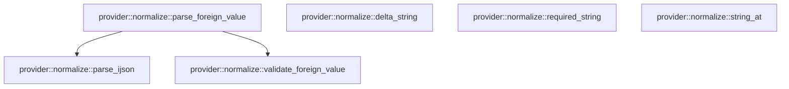

```mermaid
flowchart TD
  n0["provider::normalize::StreamAccumulator::interactions"]
  n1["provider::normalize::StreamAccumulator::record_native_search_call"]
  n2["provider::normalize::StreamAccumulator::anthropic"]
  n3["provider::normalize::StreamAccumulator::chat"]
  n4["provider::normalize::StreamAccumulator::google"]
  n5["provider::normalize::StreamAccumulator::record_stream_error"]
  n6["provider::normalize::StreamAccumulator::push_text"]
  n7["provider::normalize::StreamAccumulator::push_reasoning"]
  n8["provider::normalize::append_string_field"]
  n9["provider::normalize::append_map_string"]
  n10["provider::normalize::append_interaction_content"]
  n11["provider::normalize::merge_delta_fields"]
  n12["provider::normalize::merge_chat_tool_delta"]
  n13["provider::normalize::upsert_response_part"]
  n14["provider::normalize::append_response_part_text"]
  n15["provider::normalize::append_response_part_refusal"]
  n16["provider::normalize::is_google_trailing_metadata"]
  n17["provider::normalize::extract_responses_refusal"]
  n18["provider::normalize::optional_usize"]
  n19["provider::normalize::required_index"]
  n20["provider::normalize::merge_usage"]
  n21["provider::normalize::finish_from_reason"]
  n22["provider::normalize::native_search_call"]
  n23["provider::normalize::usage_from_any"]
  n24["provider::normalize::parse_ijson"]
  n25["provider::normalize::validate_foreign_value"]
  n26["provider::normalize::delta_string"]
  n27["provider::normalize::required_string"]
  n28["provider::normalize::repair_tool_arguments"]
  n29["provider::normalize::responses_incomplete_finish_reason"]
  n30["provider::normalize::responses_failed_error"]
  n31["provider::normalize::ProviderStreamDecoder::new"]
  n32["provider::normalize::ProviderStreamDecoder::for_dialect"]
  n33["provider::normalize::ProviderStreamDecoder::completed_events"]
  n34["provider::normalize::ProviderStreamDecoder::completed_fragments"]
  n35["provider::normalize::ProviderStreamDecoder::push"]
  n36["provider::normalize::ProviderStreamDecoder::finish"]
  n37["provider::normalize::ProviderStreamDecoder::consume"]
  n38["provider::normalize::validate_completed_response_call"]
  n39["provider::normalize::invalid_arguments_sentinel"]
  n40["provider::normalize::invalid_arguments_detail"]
  n41["provider::normalize::resolve_call_arguments_or_sentinel"]
  n42["provider::normalize::resolve_call_arguments"]
  n43["provider::normalize::StreamAccumulator::mark_call_ready"]
  n44["provider::normalize::StreamAccumulator::completed_fragments"]
  n45["provider::normalize::StreamAccumulator::consume"]
  n46["provider::normalize::StreamAccumulator::responses"]
  n47["provider::sse::SseDecoder::new"]
  n0 --> n5
  n0 --> n6
  n0 --> n7
  n0 --> n10
  n0 --> n11
  n0 --> n19
  n0 --> n21
  n0 --> n23
  n0 --> n26
  n0 --> n27
  n0 --> n43
  n1 --> n22
  n2 --> n5
  n2 --> n6
  n2 --> n7
  n2 --> n8
  n2 --> n11
  n2 --> n19
  n2 --> n20
  n2 --> n21
  n2 --> n23
  n2 --> n26
  n2 --> n27
  n2 --> n43
  n3 --> n6
  n3 --> n7
  n3 --> n9
  n3 --> n12
  n3 --> n21
  n3 --> n23
  n3 --> n43
  n31 --> n47
  n32 --> n47
  n35 --> n37
  n36 --> n37
  n37 --> n24
  n38 --> n24
  n38 --> n27
  n41 --> n39
  n41 --> n42
  n42 --> n24
  n42 --> n25
  n42 --> n28
  n43 --> n41
  n44 --> n41
  n45 --> n0
  n45 --> n2
  n45 --> n3
  n45 --> n4
  n45 --> n16
  n45 --> n23
  n45 --> n46
  n46 --> n1
  n46 --> n5
  n46 --> n6
  n46 --> n7
  n46 --> n13
  n46 --> n14
  n46 --> n15
  n46 --> n17
  n46 --> n18
  n46 --> n21
  n46 --> n23
  n46 --> n26
  n46 --> n27
  n46 --> n29
  n46 --> n30
  n46 --> n38
  n46 --> n43
```

```mermaid
flowchart TD
  n0["provider::normalize::StreamAccumulator::google"]
  n1["provider::normalize::StreamAccumulator::record_stream_error"]
  n2["provider::normalize::StreamAccumulator::push_text"]
  n3["provider::normalize::StreamAccumulator::push_reasoning"]
  n4["provider::normalize::StreamAccumulator::finish"]
  n5["provider::normalize::sealed_from_normalized"]
  n6["provider::normalize::complete_responses_fragments"]
  n7["provider::normalize::append_string_field"]
  n8["provider::normalize::append_map_string"]
  n9["provider::normalize::append_interaction_content"]
  n10["provider::normalize::merge_delta_fields"]
  n11["provider::normalize::merge_object_delta"]
  n12["provider::normalize::merge_chat_tool_delta"]
  n13["provider::normalize::upsert_response_part"]
  n14["provider::normalize::append_response_part_text"]
  n15["provider::normalize::append_response_part_refusal"]
  n16["provider::normalize::append_response_part_field"]
  n17["provider::normalize::is_google_trailing_metadata"]
  n18["provider::normalize::message_part_refusal"]
  n19["provider::normalize::extract_responses_refusal"]
  n20["provider::normalize::optional_usize"]
  n21["provider::normalize::finish_from_reason"]
  n22["provider::normalize::normalize_responses"]
  n23["provider::normalize::google_function_call_id"]
  n24["provider::normalize::usage_from_any"]
  n25["provider::normalize::required_string"]
  n26["provider::normalize::is_context_overflow"]
  n27["provider::normalize::resolve_call_arguments_or_sentinel"]
  n28["provider::normalize::StreamAccumulator::mark_call_ready"]
  n0 --> n2
  n0 --> n3
  n0 --> n21
  n0 --> n23
  n0 --> n24
  n0 --> n25
  n0 --> n28
  n1 --> n26
  n4 --> n5
  n4 --> n6
  n4 --> n22
  n4 --> n27
  n6 --> n5
  n7 --> n8
  n10 --> n11
  n11 --> n11
  n12 --> n8
  n13 --> n20
  n14 --> n16
  n15 --> n16
  n16 --> n7
```

```mermaid
flowchart TD
  n0["provider::normalize::message_part_refusal"]
  n1["provider::normalize::required_usize"]
  n2["provider::normalize::optional_usize"]
  n3["provider::normalize::required_index"]
  n4["provider::normalize::merge_usage"]
  n5["provider::normalize::finish_from_reason"]
  n6["provider::normalize::normalize_legacy_result"]
  n7["provider::normalize::native_search_call"]
  n8["provider::normalize::normalize_responses"]
  n9["provider::normalize::normalize_interactions"]
  n10["provider::normalize::normalize_anthropic"]
  n11["provider::normalize::normalize_chat"]
  n12["provider::normalize::google_function_call_id"]
  n13["provider::normalize::normalize_google"]
  n14["provider::normalize::terminal"]
  n15["provider::normalize::usage_from_legacy"]
  n16["provider::normalize::usage_from_any"]
  n17["provider::normalize::first_numeric"]
  n18["provider::normalize::numeric_string"]
  n19["provider::normalize::parse_arguments"]
  n20["provider::normalize::parse_ijson"]
  n21["provider::normalize::parse_foreign_value"]
  n22["provider::normalize::validate_foreign_value"]
  n23["provider::normalize::required_string"]
  n24["provider::normalize::string_at"]
  n25["provider::normalize::responses_incomplete_finish_reason"]
  n26["provider::normalize::responses_failed_error"]
  n27["provider::normalize::invalid_arguments_sentinel"]
  n28["schema::ijson::IJsonValue::parse"]
  n3 --> n1
  n6 --> n15
  n6 --> n21
  n6 --> n23
  n6 --> n24
  n7 --> n23
  n8 --> n0
  n8 --> n7
  n8 --> n14
  n8 --> n19
  n8 --> n23
  n8 --> n25
  n8 --> n26
  n9 --> n14
  n9 --> n19
  n9 --> n23
  n10 --> n21
  n10 --> n23
  n11 --> n14
  n11 --> n19
  n11 --> n23
  n12 --> n23
  n13 --> n12
  n13 --> n14
  n13 --> n21
  n13 --> n23
  n14 --> n5
  n14 --> n16
  n14 --> n22
  n15 --> n18
  n16 --> n17
  n16 --> n18
  n17 --> n18
  n19 --> n21
  n19 --> n27
  n20 --> n28
```

# provider::normalize

[Package atlas](index.md) · [Source](../../src/normalize.rs)

## Declarations

Visibility is the declaration spelling; trait members and reexports require their enclosing interface. `cfg` is not evaluated.

| Symbol | Kind | Visibility | Test / cfg |
|---|---|---|---|
| [provider::normalize::ContentBlock](../../src/normalize.rs#L10) | enum_item | `pub` |  |
| [provider::normalize::ToolCall](../../src/normalize.rs#L16) | struct_item | `pub` |  |
| [provider::normalize::Usage](../../src/normalize.rs#L23) | struct_item | `pub` |  |
| [provider::normalize::FinishReason](../../src/normalize.rs#L39) | enum_item | `pub` |  |
| [provider::normalize::ProviderTerminal](../../src/normalize.rs#L52) | struct_item | `pub` |  |
| [provider::normalize::ProviderTerminal::is_final_answer](../../src/normalize.rs#L81) | function_item | `pub` |  |
| [provider::normalize::ProviderFailure](../../src/normalize.rs#L129) | enum_item | `pub` |  |
| [provider::normalize::ProviderCompletion](../../src/normalize.rs#L162) | enum_item | `pub` |  |
| [provider::normalize::ProviderFrame](../../src/normalize.rs#L168) | enum_item | `pub` |  |
| [provider::normalize::normalize_response](../../src/normalize.rs#L184) | function_item | `pub` |  |
| [provider::normalize::normalize_dialect_response](../../src/normalize.rs#L218) | function_item | `pub` |  |
| [provider::normalize::validate_responses_output_container](../../src/normalize.rs#L286) | function_item | `private` |  |
| [provider::normalize::validate_exact_anthropic_payload](../../src/normalize.rs#L293) | function_item | `private` |  |
| [provider::normalize::repair_response_argument_strings](../../src/normalize.rs#L306) | function_item | `private` |  |
| [provider::normalize::repair_tool_arguments](../../src/normalize.rs#L343) | function_item | `pub` |  |
| [provider::normalize::repair_bare_object_values](../../src/normalize.rs#L366) | function_item | `private` |  |
| [provider::normalize::repair_bare_object_values::skip_whitespace](../../src/normalize.rs#L371) | function_item | `private` |  |
| [provider::normalize::repair_bare_object_values::copy_quoted](../../src/normalize.rs#L378) | function_item | `private` |  |
| [provider::normalize::repair_bare_object_values::starts_next_field](../../src/normalize.rs#L400) | function_item | `private` |  |
| [provider::normalize::repair_bare_object_values::only_whitespace_after](../../src/normalize.rs#L425) | function_item | `private` |  |
| [provider::normalize::repair_bare_object_values::scan_balanced](../../src/normalize.rs#L431) | function_item | `private` |  |
| [provider::normalize::repair_bare_object_values::consume_value](../../src/normalize.rs#L466) | function_item | `private` |  |
| [provider::normalize::repair_terminal_tool_arguments](../../src/normalize.rs#L567) | function_item | `private` |  |
| [provider::normalize::is_context_overflow](../../src/normalize.rs#L588) | function_item | `private` |  |
| [provider::normalize::responses_incomplete_finish_reason](../../src/normalize.rs#L605) | function_item | `private` |  |
| [provider::normalize::responses_failed_error](../../src/normalize.rs#L626) | function_item | `private` |  |
| [provider::normalize::normalize_sse_stream](../../src/normalize.rs#L640) | function_item | `pub` |  |
| [provider::normalize::normalize_dialect_sse_stream](../../src/normalize.rs#L651) | function_item | `pub` |  |
| [provider::normalize::ProviderStreamDecoder](../../src/normalize.rs#L662) | struct_item | `pub` |  |
| [provider::normalize::ProviderStreamDecoder::new](../../src/normalize.rs#L673) | function_item | `pub` |  |
| [provider::normalize::ProviderStreamDecoder::for_dialect](../../src/normalize.rs#L685) | function_item | `pub` |  |
| [provider::normalize::ProviderStreamDecoder::completed_events](../../src/normalize.rs#L697) | function_item | `pub` |  |
| [provider::normalize::ProviderStreamDecoder::completed_fragments](../../src/normalize.rs#L708) | function_item | `pub` |  |
| [provider::normalize::ProviderStreamDecoder::push](../../src/normalize.rs#L713) | function_item | `pub` |  |
| [provider::normalize::ProviderStreamDecoder::finish](../../src/normalize.rs#L720) | function_item | `pub` |  |
| [provider::normalize::ProviderStreamDecoder::consume](../../src/normalize.rs#L732) | function_item | `private` |  |
| [provider::normalize::StreamAccumulator](../../src/normalize.rs#L748) | struct_item | `private` |  |
| [provider::normalize::PartialCall](../../src/normalize.rs#L774) | struct_item | `private` |  |
| [provider::normalize::validate_completed_response_call](../../src/normalize.rs#L782) | function_item | `private` |  |
| [provider::normalize::INVALID_ARGUMENTS_KEY](../../src/normalize.rs#L808) | const_item | `pub` |  |
| [provider::normalize::invalid_arguments_sentinel](../../src/normalize.rs#L810) | function_item | `pub` |  |
| [provider::normalize::invalid_arguments_detail](../../src/normalize.rs#L821) | function_item | `pub` |  |
| [provider::normalize::resolve_call_arguments_or_sentinel](../../src/normalize.rs#L834) | function_item | `private` |  |
| [provider::normalize::resolve_call_arguments](../../src/normalize.rs#L841) | function_item | `private` |  |
| [provider::normalize::StreamAccumulator::mark_call_ready](../../src/normalize.rs#L864) | function_item | `private` |  |
| [provider::normalize::StreamAccumulator::completed_fragments](../../src/normalize.rs#L890) | function_item | `private` |  |
| [provider::normalize::StreamAccumulator::consume](../../src/normalize.rs#L936) | function_item | `private` |  |
| [provider::normalize::StreamAccumulator::responses](../../src/normalize.rs#L994) | function_item | `private` |  |
| [provider::normalize::StreamAccumulator::interactions](../../src/normalize.rs#L1229) | function_item | `private` |  |
| [provider::normalize::StreamAccumulator::record_native_search_call](../../src/normalize.rs#L1395) | function_item | `private` |  |
| [provider::normalize::StreamAccumulator::anthropic](../../src/normalize.rs#L1420) | function_item | `private` |  |
| [provider::normalize::StreamAccumulator::chat](../../src/normalize.rs#L1553) | function_item | `private` |  |
| [provider::normalize::StreamAccumulator::google](../../src/normalize.rs#L1665) | function_item | `private` |  |
| [provider::normalize::StreamAccumulator::record_stream_error](../../src/normalize.rs#L1729) | function_item | `private` |  |
| [provider::normalize::StreamAccumulator::push_text](../../src/normalize.rs#L1739) | function_item | `private` |  |
| [provider::normalize::StreamAccumulator::push_reasoning](../../src/normalize.rs#L1744) | function_item | `private` |  |
| [provider::normalize::StreamAccumulator::finish](../../src/normalize.rs#L1749) | function_item | `private` |  |
| [provider::normalize::sealed_from_normalized](../../src/normalize.rs#L1934) | function_item | `private` |  |
| [provider::normalize::complete_responses_fragments](../../src/normalize.rs#L1994) | function_item | `private` |  |
| [provider::normalize::append_string_field](../../src/normalize.rs#L2044) | function_item | `private` |  |
| [provider::normalize::append_map_string](../../src/normalize.rs#L2054) | function_item | `private` |  |
| [provider::normalize::append_interaction_content](../../src/normalize.rs#L2073) | function_item | `private` |  |
| [provider::normalize::merge_delta_fields](../../src/normalize.rs#L2092) | function_item | `private` |  |
| [provider::normalize::merge_object_delta](../../src/normalize.rs#L2116) | function_item | `private` |  |
| [provider::normalize::merge_chat_tool_delta](../../src/normalize.rs#L2133) | function_item | `private` |  |
| [provider::normalize::upsert_response_part](../../src/normalize.rs#L2170) | function_item | `private` |  |
| [provider::normalize::append_response_part_text](../../src/normalize.rs#L2197) | function_item | `private` |  |
| [provider::normalize::append_response_part_refusal](../../src/normalize.rs#L2206) | function_item | `private` |  |
| [provider::normalize::append_response_part_field](../../src/normalize.rs#L2214) | function_item | `private` |  |
| [provider::normalize::is_google_trailing_metadata](../../src/normalize.rs#L2245) | function_item | `private` |  |
| [provider::normalize::message_part_refusal](../../src/normalize.rs#L2261) | function_item | `private` |  |
| [provider::normalize::extract_responses_refusal](../../src/normalize.rs#L2272) | function_item | `private` |  |
| [provider::normalize::required_usize](../../src/normalize.rs#L2283) | function_item | `private` |  |
| [provider::normalize::optional_usize](../../src/normalize.rs#L2291) | function_item | `private` |  |
| [provider::normalize::required_index](../../src/normalize.rs#L2302) | function_item | `private` |  |
| [provider::normalize::merge_usage](../../src/normalize.rs#L2306) | function_item | `private` |  |
| [provider::normalize::finish_from_reason](../../src/normalize.rs#L2325) | function_item | `private` |  |
| [provider::normalize::normalize_legacy_result](../../src/normalize.rs#L2362) | function_item | `private` |  |
| [provider::normalize::native_search_call](../../src/normalize.rs#L2432) | function_item | `private` |  |
| [provider::normalize::normalize_responses](../../src/normalize.rs#L2455) | function_item | `private` |  |
| [provider::normalize::normalize_interactions](../../src/normalize.rs#L2552) | function_item | `private` |  |
| [provider::normalize::normalize_anthropic](../../src/normalize.rs#L2606) | function_item | `private` |  |
| [provider::normalize::normalize_chat](../../src/normalize.rs#L2662) | function_item | `private` |  |
| [provider::normalize::google_function_call_id](../../src/normalize.rs#L2710) | function_item | `private` |  |
| [provider::normalize::normalize_google](../../src/normalize.rs#L2722) | function_item | `private` |  |
| [provider::normalize::terminal](../../src/normalize.rs#L2799) | function_item | `private` |  |
| [provider::normalize::usage_from_legacy](../../src/normalize.rs#L2834) | function_item | `private` |  |
| [provider::normalize::usage_from_any](../../src/normalize.rs#L2845) | function_item | `private` |  |
| [provider::normalize::first_numeric](../../src/normalize.rs#L2898) | function_item | `private` |  |
| [provider::normalize::reasoning_usage_tests::streaming_usage_follows_content_and_keeps_zero_and_partial_reports](../../src/normalize.rs#L2908) | function_item | `private` | test; #[cfg(test)] |
| [provider::normalize::reasoning_usage_tests::reported_reasoning_survives_partial_usage_without_inventing_missing_values](../../src/normalize.rs#L2931) | function_item | `private` | test; #[cfg(test)] |
| [provider::normalize::numeric_string](../../src/normalize.rs#L2969) | function_item | `private` |  |
| [provider::normalize::parse_arguments](../../src/normalize.rs#L2977) | function_item | `private` |  |
| [provider::normalize::parse_ijson](../../src/normalize.rs#L2991) | function_item | `private` |  |
| [provider::normalize::parse_foreign_value](../../src/normalize.rs#L2996) | function_item | `private` |  |
| [provider::normalize::validate_foreign_value](../../src/normalize.rs#L3002) | function_item | `private` |  |
| [provider::normalize::delta_string](../../src/normalize.rs#L3015) | function_item | `private` |  |
| [provider::normalize::required_string](../../src/normalize.rs#L3023) | function_item | `private` |  |
| [provider::normalize::string_at](../../src/normalize.rs#L3032) | function_item | `private` |  |
| [provider::normalize::deepseek_cache_usage_tests::top_level_cache_hits_are_retained_and_take_precedence](../../src/normalize.rs#L3044) | function_item | `private` | test; #[cfg(test)] |
| [provider::normalize::deepseek_cache_usage_tests::nested_cache_fallback_does_not_invent_missing_hits](../../src/normalize.rs#L3059) | function_item | `private` | test; #[cfg(test)] |

## Imports / reexports

| Local name | Source path | Visibility |
|---|---|---|
| `IJsonValue` | `schema::IJsonValue` | `private` |
| `Deserialize` | `serde::Deserialize` | `private` |
| `Serialize` | `serde::Serialize` | `private` |
| `Value` | `serde_json::Value` | `private` |
| `SseDecoder` | `crate::SseDecoder` | `private` |
| `AdapterId` | `crate::AdapterId` | `private` |
| `DialectId` | `crate::DialectId` | `private` |
| `*` | `super::*` | `private` |
| `json` | `serde_json::json` | `private` |
| `*` | `super::*` | `private` |

## Module declarations

| Module | Visibility | Attributes |
|---|---|---|
| `provider::normalize::reasoning_usage_tests` | `private` | #[cfg(test)] |
| `provider::normalize::deepseek_cache_usage_tests` | `private` | #[cfg(test)] |

## Function call graphs

Edges below are syntactically resolved calls only, including private functions. Graphs partition callers into groups of 20; they are not execution order. All unresolved sites are listed below and in the JSON inventory.

Functions 1–20: 32 direct edges

Functions 21–40: 69 direct edges

Functions 41–60: 21 direct edges

Functions 61–80: 36 direct edges

Functions 81–85: 2 direct edges

## Call sites

Includes test functions (marked in declarations). Receiver-type-required sites need type analysis/manual tracing. Calls in closures are attributed to their enclosing function; their occurrence here does not mean the closure executes immediately.

| Caller | Callee expression | Source lines | Target / classification |
|---|---|---|---|
| `is_final_answer` | `self             .http_status             .is_some_and` | [82](../../src/normalize.rs#L82) | receiver-type-required |
| `is_final_answer` | `(200..300).contains` | [84](../../src/normalize.rs#L84) | receiver-type-required |
| `is_final_answer` | `self.tool_calls.is_empty` | [86](../../src/normalize.rs#L86) | receiver-type-required |
| `is_final_answer` | `self                 .content                 .iter()                 .any` | [87](../../src/normalize.rs#L87) | receiver-type-required |
| `is_final_answer` | `self                 .content                 .iter` | [87](../../src/normalize.rs#L87) | receiver-type-required |
| `is_final_answer` | `self             .sealed_fragments             .get("isFinalAnswer")             .and_then` | [94](../../src/normalize.rs#L94) | receiver-type-required |
| `is_final_answer` | `self             .sealed_fragments             .get` | [94](../../src/normalize.rs#L94) | receiver-type-required |
| `is_final_answer` | `self.sealed_fragments.as_array` | [101](../../src/normalize.rs#L101) | receiver-type-required |
| `is_final_answer` | `items                 .iter()                 .filter(&#124;item&#124; item.get("type").and_then(Value::as_str) == Some("message"))                 .collect::<Vec<_>>` | [102](../../src/normalize.rs#L102) | receiver-type-required |
| `is_final_answer` | `items                 .iter()                 .filter` | [102](../../src/normalize.rs#L102) | receiver-type-required |
| `is_final_answer` | `items                 .iter` | [102](../../src/normalize.rs#L102) | receiver-type-required |
| `is_final_answer` | `item.get("type").and_then` | [104](../../src/normalize.rs#L104) | receiver-type-required |
| `is_final_answer` | `item.get` | [104](../../src/normalize.rs#L104), [106](../../src/normalize.rs#L106), [108](../../src/normalize.rs#L108), [109](../../src/normalize.rs#L109) | receiver-type-required |
| `is_final_answer` | `Some` | [104](../../src/normalize.rs#L104), [108](../../src/normalize.rs#L108), [109](../../src/normalize.rs#L109) | external-constructor-callback-or-unresolved |
| `is_final_answer` | `messages.iter().any` | [106](../../src/normalize.rs#L106), [107](../../src/normalize.rs#L107) | receiver-type-required |
| `is_final_answer` | `messages.iter` | [106](../../src/normalize.rs#L106), [107](../../src/normalize.rs#L107) | receiver-type-required |
| `is_final_answer` | `item.get("phase").is_some` | [106](../../src/normalize.rs#L106) | receiver-type-required |
| `is_final_answer` | `item.get("phase").and_then` | [108](../../src/normalize.rs#L108) | receiver-type-required |
| `is_final_answer` | `item.get("status").and_then` | [109](../../src/normalize.rs#L109) | receiver-type-required |
| `is_final_answer` | `item                             .get("content")                             .and_then(Value::as_array)                             .is_some_and` | [110](../../src/normalize.rs#L110) | receiver-type-required |
| `is_final_answer` | `item                             .get("content")                             .and_then` | [110](../../src/normalize.rs#L110) | receiver-type-required |
| `is_final_answer` | `item                             .get` | [110](../../src/normalize.rs#L110) | receiver-type-required |
| `is_final_answer` | `parts.iter().any` | [114](../../src/normalize.rs#L114) | receiver-type-required |
| `is_final_answer` | `parts.iter` | [114](../../src/normalize.rs#L114) | receiver-type-required |
| `is_final_answer` | `part.get("text")                                         .and_then(Value::as_str)                                         .is_some_and` | [115](../../src/normalize.rs#L115) | receiver-type-required |
| `is_final_answer` | `part.get("text")                                         .and_then` | [115](../../src/normalize.rs#L115) | receiver-type-required |
| `is_final_answer` | `part.get` | [115](../../src/normalize.rs#L115) | receiver-type-required |
| `is_final_answer` | `text.trim().is_empty` | [117](../../src/normalize.rs#L117) | receiver-type-required |
| `is_final_answer` | `text.trim` | [117](../../src/normalize.rs#L117) | receiver-type-required |
| `normalize_response` | `parse_ijson` | [185](../../src/normalize.rs#L185) | [provider::normalize::parse_ijson](../../src/normalize.rs#L2991) |
| `normalize_response` | `value.get("error").is_some_and` | [186](../../src/normalize.rs#L186) | receiver-type-required |
| `normalize_response` | `value.get` | [186](../../src/normalize.rs#L186), [192](../../src/normalize.rs#L192), [199](../../src/normalize.rs#L199), [206](../../src/normalize.rs#L206) | receiver-type-required |
| `normalize_response` | `error.is_null` | [186](../../src/normalize.rs#L186) | receiver-type-required |
| `normalize_response` | `Ok` | [187](../../src/normalize.rs#L187) | external-constructor-callback-or-unresolved |
| `normalize_response` | `Vec::new` | [188](../../src/normalize.rs#L188), [189](../../src/normalize.rs#L189), [190](../../src/normalize.rs#L190) | external-constructor-callback-or-unresolved |
| `normalize_response` | `Value::Array` | [190](../../src/normalize.rs#L190) | external-constructor-callback-or-unresolved |
| `normalize_response` | `usage_from_any` | [192](../../src/normalize.rs#L192) | [provider::normalize::usage_from_any](../../src/normalize.rs#L2845) |
| `normalize_response` | `is_context_overflow` | [193](../../src/normalize.rs#L193) | [provider::normalize::is_context_overflow](../../src/normalize.rs#L588) |
| `normalize_response` | `value.get("error").cloned` | [199](../../src/normalize.rs#L199) | receiver-type-required |
| `normalize_response` | `bytes.to_vec` | [203](../../src/normalize.rs#L203) | receiver-type-required |
| `normalize_response` | `value.get("functionCalls").is_some` | [206](../../src/normalize.rs#L206) | receiver-type-required |
| `normalize_response` | `value.get("isFinalAnswer").is_some` | [206](../../src/normalize.rs#L206) | receiver-type-required |
| `normalize_response` | `normalize_legacy_result` | [207](../../src/normalize.rs#L207) | [provider::normalize::normalize_legacy_result](../../src/normalize.rs#L2362) |
| `normalize_response` | `normalize_responses` | [210](../../src/normalize.rs#L210) | [provider::normalize::normalize_responses](../../src/normalize.rs#L2455) |
| `normalize_response` | `normalize_interactions` | [211](../../src/normalize.rs#L211) | [provider::normalize::normalize_interactions](../../src/normalize.rs#L2552) |
| `normalize_response` | `normalize_anthropic` | [212](../../src/normalize.rs#L212) | [provider::normalize::normalize_anthropic](../../src/normalize.rs#L2606) |
| `normalize_response` | `normalize_chat` | [213](../../src/normalize.rs#L213) | [provider::normalize::normalize_chat](../../src/normalize.rs#L2662) |
| `normalize_response` | `normalize_google` | [214](../../src/normalize.rs#L214) | [provider::normalize::normalize_google](../../src/normalize.rs#L2722) |
| `normalize_dialect_response` | `parse_ijson` | [226](../../src/normalize.rs#L226), [263](../../src/normalize.rs#L263), [277](../../src/normalize.rs#L277) | [provider::normalize::parse_ijson](../../src/normalize.rs#L2991) |
| `normalize_dialect_response` | `value.get("error").is_some_and` | [229](../../src/normalize.rs#L229), [264](../../src/normalize.rs#L264) | receiver-type-required |
| `normalize_dialect_response` | `value.get` | [229](../../src/normalize.rs#L229), [245](../../src/normalize.rs#L245), [264](../../src/normalize.rs#L264), [265](../../src/normalize.rs#L265), [266](../../src/normalize.rs#L266) | receiver-type-required |
| `normalize_dialect_response` | `error.is_null` | [229](../../src/normalize.rs#L229), [264](../../src/normalize.rs#L264) | receiver-type-required |
| `normalize_dialect_response` | `normalize_response` | [230](../../src/normalize.rs#L230), [268](../../src/normalize.rs#L268), [280](../../src/normalize.rs#L280) | [provider::normalize::normalize_response](../../src/normalize.rs#L184) |
| `normalize_dialect_response` | `dialect.family` | [230](../../src/normalize.rs#L230), [268](../../src/normalize.rs#L268), [280](../../src/normalize.rs#L280) | receiver-type-required |
| `normalize_dialect_response` | `value             .get("output")             .and_then(Value::as_array)             .is_some_and` | [232](../../src/normalize.rs#L232) | receiver-type-required |
| `normalize_dialect_response` | `value             .get("output")             .and_then` | [232](../../src/normalize.rs#L232) | receiver-type-required |
| `normalize_dialect_response` | `value             .get` | [232](../../src/normalize.rs#L232) | receiver-type-required |
| `normalize_dialect_response` | `items.iter().any` | [235](../../src/normalize.rs#L235) | receiver-type-required |
| `normalize_dialect_response` | `items.iter` | [235](../../src/normalize.rs#L235) | receiver-type-required |
| `normalize_dialect_response` | `Err` | [237](../../src/normalize.rs#L237), [257](../../src/normalize.rs#L257), [258](../../src/normalize.rs#L258) | external-constructor-callback-or-unresolved |
| `normalize_dialect_response` | `"native client tool search requires OpenAI Responses".into` | [237](../../src/normalize.rs#L237) | receiver-type-required |
| `normalize_dialect_response` | `repair_response_argument_strings` | [239](../../src/normalize.rs#L239) | [provider::normalize::repair_response_argument_strings](../../src/normalize.rs#L306) |
| `normalize_dialect_response` | `normalize_chat` | [241](../../src/normalize.rs#L241) | [provider::normalize::normalize_chat](../../src/normalize.rs#L2662) |
| `normalize_dialect_response` | `validate_responses_output_container` | [243](../../src/normalize.rs#L243) | [provider::normalize::validate_responses_output_container](../../src/normalize.rs#L286) |
| `normalize_dialect_response` | `normalize_responses` | [244](../../src/normalize.rs#L244) | [provider::normalize::normalize_responses](../../src/normalize.rs#L2455) |
| `normalize_dialect_response` | `value.get("status").and_then` | [245](../../src/normalize.rs#L245) | receiver-type-required |
| `normalize_dialect_response` | `responses_incomplete_finish_reason` | [248](../../src/normalize.rs#L248) | [provider::normalize::responses_incomplete_finish_reason](../../src/normalize.rs#L605) |
| `normalize_dialect_response` | `Some` | [249](../../src/normalize.rs#L249), [254](../../src/normalize.rs#L254), [270](../../src/normalize.rs#L270) | external-constructor-callback-or-unresolved |
| `normalize_dialect_response` | `responses_failed_error` | [253](../../src/normalize.rs#L253) | [provider::normalize::responses_failed_error](../../src/normalize.rs#L626) |
| `normalize_dialect_response` | `"DeepSeek Responses terminal lacks status".to_owned` | [258](../../src/normalize.rs#L258) | receiver-type-required |
| `normalize_dialect_response` | `value.get("functionCalls").is_some` | [265](../../src/normalize.rs#L265) | receiver-type-required |
| `normalize_dialect_response` | `value.get("isFinalAnswer").is_some` | [266](../../src/normalize.rs#L266) | receiver-type-required |
| `normalize_dialect_response` | `normalize_google` | [270](../../src/normalize.rs#L270) | [provider::normalize::normalize_google](../../src/normalize.rs#L2722) |
| `normalize_dialect_response` | `validate_exact_anthropic_payload` | [278](../../src/normalize.rs#L278) | [provider::normalize::validate_exact_anthropic_payload](../../src/normalize.rs#L293) |
| `normalize_dialect_response` | `repair_terminal_tool_arguments` | [282](../../src/normalize.rs#L282) | [provider::normalize::repair_terminal_tool_arguments](../../src/normalize.rs#L567) |
| `normalize_dialect_response` | `Ok` | [283](../../src/normalize.rs#L283) | external-constructor-callback-or-unresolved |
| `validate_responses_output_container` | `value.get("output").is_some_and` | [287](../../src/normalize.rs#L287) | receiver-type-required |
| `validate_responses_output_container` | `value.get` | [287](../../src/normalize.rs#L287) | receiver-type-required |
| `validate_responses_output_container` | `output.is_array` | [287](../../src/normalize.rs#L287) | receiver-type-required |
| `validate_responses_output_container` | `Err` | [288](../../src/normalize.rs#L288) | external-constructor-callback-or-unresolved |
| `validate_responses_output_container` | `"Responses output must be an array".to_owned` | [288](../../src/normalize.rs#L288) | receiver-type-required |
| `validate_responses_output_container` | `Ok` | [290](../../src/normalize.rs#L290) | external-constructor-callback-or-unresolved |
| `validate_exact_anthropic_payload` | `value         .get("content")         .and_then(Value::as_array)         .ok_or` | [294](../../src/normalize.rs#L294) | receiver-type-required |
| `validate_exact_anthropic_payload` | `value         .get("content")         .and_then` | [294](../../src/normalize.rs#L294) | receiver-type-required |
| `validate_exact_anthropic_payload` | `value         .get` | [294](../../src/normalize.rs#L294) | receiver-type-required |
| `validate_exact_anthropic_payload` | `part.is_object` | [299](../../src/normalize.rs#L299) | receiver-type-required |
| `validate_exact_anthropic_payload` | `part.get("type").and_then(Value::as_str).is_none` | [299](../../src/normalize.rs#L299) | receiver-type-required |
| `validate_exact_anthropic_payload` | `part.get("type").and_then` | [299](../../src/normalize.rs#L299) | receiver-type-required |
| `validate_exact_anthropic_payload` | `part.get` | [299](../../src/normalize.rs#L299) | receiver-type-required |
| `validate_exact_anthropic_payload` | `Err` | [300](../../src/normalize.rs#L300) | external-constructor-callback-or-unresolved |
| `validate_exact_anthropic_payload` | `"Anthropic content block lacks type".to_owned` | [300](../../src/normalize.rs#L300) | receiver-type-required |
| `validate_exact_anthropic_payload` | `Ok` | [303](../../src/normalize.rs#L303) | external-constructor-callback-or-unresolved |
| `repair_response_argument_strings` | `value             .get_mut("output")             .and_then(Value::as_array_mut)             .into_iter()             .flatten()             .filter_map(&#124;item&#124; item.get_mut("arguments"))             .collect::<Vec<_>>` | [308](../../src/normalize.rs#L308) | receiver-type-required |
| `repair_response_argument_strings` | `value             .get_mut("output")             .and_then(Value::as_array_mut)             .into_iter()             .flatten()             .filter_map` | [308](../../src/normalize.rs#L308) | receiver-type-required |
| `repair_response_argument_strings` | `value             .get_mut("output")             .and_then(Value::as_array_mut)             .into_iter()             .flatten` | [308](../../src/normalize.rs#L308) | receiver-type-required |
| `repair_response_argument_strings` | `value             .get_mut("output")             .and_then(Value::as_array_mut)             .into_iter` | [308](../../src/normalize.rs#L308) | receiver-type-required |
| `repair_response_argument_strings` | `value             .get_mut("output")             .and_then` | [308](../../src/normalize.rs#L308) | receiver-type-required |
| `repair_response_argument_strings` | `value             .get_mut` | [308](../../src/normalize.rs#L308), [316](../../src/normalize.rs#L316) | receiver-type-required |
| `repair_response_argument_strings` | `item.get_mut` | [313](../../src/normalize.rs#L313) | receiver-type-required |
| `repair_response_argument_strings` | `value             .get_mut("choices")             .and_then(Value::as_array_mut)             .into_iter()             .flatten()             .filter_map(&#124;choice&#124; choice.pointer_mut("/message/tool_calls"))             .filter_map(Value::as_array_mut)             .flatten()             .filter_map(&#124;call&#124; call.pointer_mut("/function/arguments"))             .collect::<Vec<_>>` | [316](../../src/normalize.rs#L316) | receiver-type-required |
| `repair_response_argument_strings` | `value             .get_mut("choices")             .and_then(Value::as_array_mut)             .into_iter()             .flatten()             .filter_map(&#124;choice&#124; choice.pointer_mut("/message/tool_calls"))             .filter_map(Value::as_array_mut)             .flatten()             .filter_map` | [316](../../src/normalize.rs#L316) | receiver-type-required |
| `repair_response_argument_strings` | `value             .get_mut("choices")             .and_then(Value::as_array_mut)             .into_iter()             .flatten()             .filter_map(&#124;choice&#124; choice.pointer_mut("/message/tool_calls"))             .filter_map(Value::as_array_mut)             .flatten` | [316](../../src/normalize.rs#L316) | receiver-type-required |
| `repair_response_argument_strings` | `value             .get_mut("choices")             .and_then(Value::as_array_mut)             .into_iter()             .flatten()             .filter_map(&#124;choice&#124; choice.pointer_mut("/message/tool_calls"))             .filter_map` | [316](../../src/normalize.rs#L316) | receiver-type-required |
| `repair_response_argument_strings` | `value             .get_mut("choices")             .and_then(Value::as_array_mut)             .into_iter()             .flatten()             .filter_map` | [316](../../src/normalize.rs#L316) | receiver-type-required |
| `repair_response_argument_strings` | `value             .get_mut("choices")             .and_then(Value::as_array_mut)             .into_iter()             .flatten` | [316](../../src/normalize.rs#L316) | receiver-type-required |
| `repair_response_argument_strings` | `value             .get_mut("choices")             .and_then(Value::as_array_mut)             .into_iter` | [316](../../src/normalize.rs#L316) | receiver-type-required |
| `repair_response_argument_strings` | `value             .get_mut("choices")             .and_then` | [316](../../src/normalize.rs#L316) | receiver-type-required |
| `repair_response_argument_strings` | `choice.pointer_mut` | [321](../../src/normalize.rs#L321) | receiver-type-required |
| `repair_response_argument_strings` | `call.pointer_mut` | [324](../../src/normalize.rs#L324) | receiver-type-required |
| `repair_response_argument_strings` | `argument             .as_str()             .ok_or_else` | [328](../../src/normalize.rs#L328) | receiver-type-required |
| `repair_response_argument_strings` | `argument             .as_str` | [328](../../src/normalize.rs#L328) | receiver-type-required |
| `repair_response_argument_strings` | `"DeepSeek tool arguments must be a string".to_owned` | [330](../../src/normalize.rs#L330) | receiver-type-required |
| `repair_response_argument_strings` | `repair_tool_arguments` | [333](../../src/normalize.rs#L333) | [provider::normalize::repair_tool_arguments](../../src/normalize.rs#L343) |
| `repair_response_argument_strings` | `raw.as_bytes` | [333](../../src/normalize.rs#L333) | receiver-type-required |
| `repair_response_argument_strings` | `Value::String` | [336](../../src/normalize.rs#L336) | external-constructor-callback-or-unresolved |
| `repair_response_argument_strings` | `serde_json_canonicalizer::to_string(&repaired).map_err` | [337](../../src/normalize.rs#L337) | receiver-type-required |
| `repair_response_argument_strings` | `serde_json_canonicalizer::to_string` | [337](../../src/normalize.rs#L337) | external-constructor-callback-or-unresolved |
| `repair_response_argument_strings` | `error.to_string` | [337](../../src/normalize.rs#L337) | receiver-type-required |
| `repair_response_argument_strings` | `Ok` | [340](../../src/normalize.rs#L340) | external-constructor-callback-or-unresolved |
| `repair_tool_arguments` | `bytes.len` | [344](../../src/normalize.rs#L344) | receiver-type-required |
| `repair_tool_arguments` | `Err` | [345](../../src/normalize.rs#L345), [360](../../src/normalize.rs#L360) | external-constructor-callback-or-unresolved |
| `repair_tool_arguments` | `"provider tool arguments exceed the 65536-byte repair bound".to_owned` | [345](../../src/normalize.rs#L345) | receiver-type-required |
| `repair_tool_arguments` | `parse_foreign_value` | [351](../../src/normalize.rs#L351), [355](../../src/normalize.rs#L355), [358](../../src/normalize.rs#L358) | [provider::normalize::parse_foreign_value](../../src/normalize.rs#L2996) |
| `repair_tool_arguments` | `String::from_utf8(bytes.to_vec())         .map_err` | [353](../../src/normalize.rs#L353) | receiver-type-required |
| `repair_tool_arguments` | `String::from_utf8` | [353](../../src/normalize.rs#L353) | external-constructor-callback-or-unresolved |
| `repair_tool_arguments` | `bytes.to_vec` | [353](../../src/normalize.rs#L353) | receiver-type-required |
| `repair_tool_arguments` | `"provider tool arguments are not UTF-8".to_owned` | [354](../../src/normalize.rs#L354) | receiver-type-required |
| `repair_tool_arguments` | `parse_foreign_value(repaired.as_bytes(), "tool arguments").is_err` | [355](../../src/normalize.rs#L355) | receiver-type-required |
| `repair_tool_arguments` | `repaired.as_bytes` | [355](../../src/normalize.rs#L355), [358](../../src/normalize.rs#L358) | receiver-type-required |
| `repair_tool_arguments` | `repair_bare_object_values` | [356](../../src/normalize.rs#L356) | [provider::normalize::repair_bare_object_values](../../src/normalize.rs#L366) |
| `repair_tool_arguments` | `value.is_object` | [359](../../src/normalize.rs#L359) | receiver-type-required |
| `repair_tool_arguments` | `"provider tool arguments must be an object".to_owned` | [360](../../src/normalize.rs#L360) | receiver-type-required |
| `repair_tool_arguments` | `validate_foreign_value` | [362](../../src/normalize.rs#L362) | [provider::normalize::validate_foreign_value](../../src/normalize.rs#L3002) |
| `repair_tool_arguments` | `Ok` | [363](../../src/normalize.rs#L363) | external-constructor-callback-or-unresolved |
| `repair_bare_object_values` | `input.chars().collect::<Vec<_>>` | [367](../../src/normalize.rs#L367) | receiver-type-required |
| `repair_bare_object_values` | `input.chars` | [367](../../src/normalize.rs#L367) | receiver-type-required |
| `repair_bare_object_values` | `String::with_capacity` | [369](../../src/normalize.rs#L369) | external-constructor-callback-or-unresolved |
| `repair_bare_object_values` | `input.len` | [369](../../src/normalize.rs#L369) | receiver-type-required |
| `repair_bare_object_values` | `skip_whitespace` | [526](../../src/normalize.rs#L526), [532](../../src/normalize.rs#L532), [538](../../src/normalize.rs#L538), [542](../../src/normalize.rs#L542), [548](../../src/normalize.rs#L548), [552](../../src/normalize.rs#L552) | external-constructor-callback-or-unresolved |
| `repair_bare_object_values` | `chars.get` | [527](../../src/normalize.rs#L527), [533](../../src/normalize.rs#L533), [543](../../src/normalize.rs#L543), [553](../../src/normalize.rs#L553) | receiver-type-required |
| `repair_bare_object_values` | `Some` | [527](../../src/normalize.rs#L527), [533](../../src/normalize.rs#L533), [543](../../src/normalize.rs#L543) | external-constructor-callback-or-unresolved |
| `repair_bare_object_values` | `input.to_owned` | [528](../../src/normalize.rs#L528), [540](../../src/normalize.rs#L540), [544](../../src/normalize.rs#L544), [550](../../src/normalize.rs#L550), [562](../../src/normalize.rs#L562) | receiver-type-required |
| `repair_bare_object_values` | `output.push` | [530](../../src/normalize.rs#L530), [546](../../src/normalize.rs#L546), [555](../../src/normalize.rs#L555) | receiver-type-required |
| `repair_bare_object_values` | `output.extend` | [534](../../src/normalize.rs#L534), [559](../../src/normalize.rs#L559) | receiver-type-required |
| `repair_bare_object_values` | `chars[index..].iter` | [534](../../src/normalize.rs#L534), [559](../../src/normalize.rs#L559) | receiver-type-required |
| `repair_bare_object_values` | `copy_quoted` | [539](../../src/normalize.rs#L539) | external-constructor-callback-or-unresolved |
| `repair_bare_object_values` | `consume_value` | [549](../../src/normalize.rs#L549) | external-constructor-callback-or-unresolved |
| `skip_whitespace` | `chars.get(*index).is_some_and` | [372](../../src/normalize.rs#L372) | receiver-type-required |
| `skip_whitespace` | `chars.get` | [372](../../src/normalize.rs#L372) | receiver-type-required |
| `skip_whitespace` | `value.is_whitespace` | [372](../../src/normalize.rs#L372) | receiver-type-required |
| `skip_whitespace` | `output.push` | [373](../../src/normalize.rs#L373) | receiver-type-required |
| `copy_quoted` | `chars.get` | [379](../../src/normalize.rs#L379), [384](../../src/normalize.rs#L384), [388](../../src/normalize.rs#L388) | receiver-type-required |
| `copy_quoted` | `Some` | [379](../../src/normalize.rs#L379) | external-constructor-callback-or-unresolved |
| `copy_quoted` | `output.push` | [382](../../src/normalize.rs#L382), [385](../../src/normalize.rs#L385), [391](../../src/normalize.rs#L391) | receiver-type-required |
| `copy_quoted` | `chars.get(*index).copied` | [384](../../src/normalize.rs#L384), [388](../../src/normalize.rs#L388) | receiver-type-required |
| `starts_next_field` | `chars.get(index).is_some_and` | [401](../../src/normalize.rs#L401), [419](../../src/normalize.rs#L419) | receiver-type-required |
| `starts_next_field` | `chars.get` | [401](../../src/normalize.rs#L401), [404](../../src/normalize.rs#L404), [408](../../src/normalize.rs#L408), [419](../../src/normalize.rs#L419), [422](../../src/normalize.rs#L422) | receiver-type-required |
| `starts_next_field` | `value.is_whitespace` | [401](../../src/normalize.rs#L401), [419](../../src/normalize.rs#L419) | receiver-type-required |
| `starts_next_field` | `Some` | [404](../../src/normalize.rs#L404), [422](../../src/normalize.rs#L422) | external-constructor-callback-or-unresolved |
| `starts_next_field` | `chars.get(index).copied` | [408](../../src/normalize.rs#L408) | receiver-type-required |
| `only_whitespace_after` | `chars[index.saturating_add(1)..]             .iter()             .all` | [426](../../src/normalize.rs#L426) | receiver-type-required |
| `only_whitespace_after` | `chars[index.saturating_add(1)..]             .iter` | [426](../../src/normalize.rs#L426) | receiver-type-required |
| `only_whitespace_after` | `index.saturating_add` | [426](../../src/normalize.rs#L426) | receiver-type-required |
| `only_whitespace_after` | `value.is_whitespace` | [428](../../src/normalize.rs#L428) | receiver-type-required |
| `scan_balanced` | `chars.get(*index).copied` | [437](../../src/normalize.rs#L437), [440](../../src/normalize.rs#L440) | receiver-type-required |
| `scan_balanced` | `chars.get` | [437](../../src/normalize.rs#L437), [440](../../src/normalize.rs#L440) | receiver-type-required |
| `scan_balanced` | `depth.checked_sub` | [455](../../src/normalize.rs#L455) | receiver-type-required |
| `scan_balanced` | `Some` | [458](../../src/normalize.rs#L458) | external-constructor-callback-or-unresolved |
| `scan_balanced` | `chars[start..*index].iter().collect` | [458](../../src/normalize.rs#L458) | receiver-type-required |
| `scan_balanced` | `chars[start..*index].iter` | [458](../../src/normalize.rs#L458) | receiver-type-required |
| `consume_value` | `chars.get` | [467](../../src/normalize.rs#L467), [496](../../src/normalize.rs#L496) | receiver-type-required |
| `consume_value` | `copy_quoted` | [468](../../src/normalize.rs#L468) | [provider::normalize::repair_bare_object_values::copy_quoted](../../src/normalize.rs#L378) |
| `consume_value` | `scan_balanced` | [470](../../src/normalize.rs#L470) | [provider::normalize::repair_bare_object_values::scan_balanced](../../src/normalize.rs#L431) |
| `consume_value` | `serde_json::from_str::<Value>(&fragment).is_ok` | [473](../../src/normalize.rs#L473) | receiver-type-required |
| `consume_value` | `serde_json::from_str::<Value>` | [473](../../src/normalize.rs#L473) | external-constructor-callback-or-unresolved |
| `consume_value` | `output.push_str` | [474](../../src/normalize.rs#L474), [483](../../src/normalize.rs#L483), [487](../../src/normalize.rs#L487), [519](../../src/normalize.rs#L519), [521](../../src/normalize.rs#L521) | receiver-type-required |
| `consume_value` | `fragment[1..fragment.len() - 1].trim` | [477](../../src/normalize.rs#L477) | receiver-type-required |
| `consume_value` | `fragment.len` | [477](../../src/normalize.rs#L477) | receiver-type-required |
| `consume_value` | `fragment.starts_with` | [478](../../src/normalize.rs#L478) | receiver-type-required |
| `consume_value` | `inner.is_empty` | [479](../../src/normalize.rs#L479) | receiver-type-required |
| `consume_value` | `inner.contains` | [480](../../src/normalize.rs#L480) | receiver-type-required |
| `consume_value` | `output.push` | [482](../../src/normalize.rs#L482), [484](../../src/normalize.rs#L484) | receiver-type-required |
| `consume_value` | `serde_json::to_string(inner).expect` | [483](../../src/normalize.rs#L483) | receiver-type-required |
| `consume_value` | `serde_json::to_string` | [483](../../src/normalize.rs#L483), [521](../../src/normalize.rs#L521) | external-constructor-callback-or-unresolved |
| `consume_value` | `chars.get(*index).copied` | [496](../../src/normalize.rs#L496) | receiver-type-required |
| `consume_value` | `starts_next_field` | [497](../../src/normalize.rs#L497) | [provider::normalize::repair_bare_object_values::starts_next_field](../../src/normalize.rs#L400) |
| `consume_value` | `Some` | [498](../../src/normalize.rs#L498), [502](../../src/normalize.rs#L502) | external-constructor-callback-or-unresolved |
| `consume_value` | `only_whitespace_after` | [501](../../src/normalize.rs#L501) | [provider::normalize::repair_bare_object_values::only_whitespace_after](../../src/normalize.rs#L425) |
| `consume_value` | `chars[start..end]             .iter()             .collect::<String>()             .trim()             .to_owned` | [510](../../src/normalize.rs#L510) | receiver-type-required |
| `consume_value` | `chars[start..end]             .iter()             .collect::<String>()             .trim` | [510](../../src/normalize.rs#L510) | receiver-type-required |
| `consume_value` | `chars[start..end]             .iter()             .collect::<String>` | [510](../../src/normalize.rs#L510) | receiver-type-required |
| `consume_value` | `chars[start..end]             .iter` | [510](../../src/normalize.rs#L510) | receiver-type-required |
| `consume_value` | `bare.is_empty` | [515](../../src/normalize.rs#L515) | receiver-type-required |
| `consume_value` | `bare.parse::<f64>().is_ok` | [518](../../src/normalize.rs#L518) | receiver-type-required |
| `consume_value` | `bare.parse::<f64>` | [518](../../src/normalize.rs#L518) | receiver-type-required |
| `consume_value` | `serde_json::to_string(&bare).expect` | [521](../../src/normalize.rs#L521) | receiver-type-required |
| `repair_terminal_tool_arguments` | `Ok` | [575](../../src/normalize.rs#L575), [585](../../src/normalize.rs#L585) | external-constructor-callback-or-unresolved |
| `repair_terminal_tool_arguments` | `call.arguments.get(INVALID_ARGUMENTS_KEY).is_some` | [578](../../src/normalize.rs#L578) | receiver-type-required |
| `repair_terminal_tool_arguments` | `call.arguments.get` | [578](../../src/normalize.rs#L578) | receiver-type-required |
| `repair_terminal_tool_arguments` | `serde_json_canonicalizer::to_vec(&call.arguments).map_err` | [582](../../src/normalize.rs#L582) | receiver-type-required |
| `repair_terminal_tool_arguments` | `serde_json_canonicalizer::to_vec` | [582](../../src/normalize.rs#L582) | external-constructor-callback-or-unresolved |
| `repair_terminal_tool_arguments` | `error.to_string` | [582](../../src/normalize.rs#L582) | receiver-type-required |
| `repair_terminal_tool_arguments` | `repair_tool_arguments` | [583](../../src/normalize.rs#L583) | [provider::normalize::repair_tool_arguments](../../src/normalize.rs#L343) |
| `is_context_overflow` | `value.get("error").unwrap_or` | [589](../../src/normalize.rs#L589) | receiver-type-required |
| `is_context_overflow` | `value.get` | [589](../../src/normalize.rs#L589) | receiver-type-required |
| `is_context_overflow` | `["code", "type", "status"]         .into_iter()         .filter_map(&#124;field&#124; error.get(field).and_then(Value::as_str))         .any` | [590](../../src/normalize.rs#L590) | receiver-type-required |
| `is_context_overflow` | `["code", "type", "status"]         .into_iter()         .filter_map` | [590](../../src/normalize.rs#L590) | receiver-type-required |
| `is_context_overflow` | `["code", "type", "status"]         .into_iter` | [590](../../src/normalize.rs#L590) | receiver-type-required |
| `is_context_overflow` | `error.get(field).and_then` | [592](../../src/normalize.rs#L592) | receiver-type-required |
| `is_context_overflow` | `error.get` | [592](../../src/normalize.rs#L592) | receiver-type-required |
| `responses_incomplete_finish_reason` | `response         .get("incomplete_details")         .and_then(&#124;details&#124; details.get("reason"))         .and_then(Value::as_str)         .ok_or` | [606](../../src/normalize.rs#L606) | receiver-type-required |
| `responses_incomplete_finish_reason` | `response         .get("incomplete_details")         .and_then(&#124;details&#124; details.get("reason"))         .and_then` | [606](../../src/normalize.rs#L606) | receiver-type-required |
| `responses_incomplete_finish_reason` | `response         .get("incomplete_details")         .and_then` | [606](../../src/normalize.rs#L606) | receiver-type-required |
| `responses_incomplete_finish_reason` | `response         .get` | [606](../../src/normalize.rs#L606) | receiver-type-required |
| `responses_incomplete_finish_reason` | `details.get` | [608](../../src/normalize.rs#L608) | receiver-type-required |
| `responses_incomplete_finish_reason` | `Err` | [620](../../src/normalize.rs#L620) | external-constructor-callback-or-unresolved |
| `responses_incomplete_finish_reason` | `Ok` | [623](../../src/normalize.rs#L623) | external-constructor-callback-or-unresolved |
| `responses_incomplete_finish_reason` | `reason.to_owned` | [623](../../src/normalize.rs#L623) | receiver-type-required |
| `responses_failed_error` | `response         .get("error")         .filter(&#124;error&#124; error.is_object())         .cloned()         .ok_or` | [627](../../src/normalize.rs#L627) | receiver-type-required |
| `responses_failed_error` | `response         .get("error")         .filter(&#124;error&#124; error.is_object())         .cloned` | [627](../../src/normalize.rs#L627) | receiver-type-required |
| `responses_failed_error` | `response         .get("error")         .filter` | [627](../../src/normalize.rs#L627) | receiver-type-required |
| `responses_failed_error` | `response         .get` | [627](../../src/normalize.rs#L627) | receiver-type-required |
| `responses_failed_error` | `error.is_object` | [629](../../src/normalize.rs#L629) | receiver-type-required |
| `responses_failed_error` | `is_context_overflow` | [632](../../src/normalize.rs#L632) | [provider::normalize::is_context_overflow](../../src/normalize.rs#L588) |
| `responses_failed_error` | `Ok` | [637](../../src/normalize.rs#L637) | external-constructor-callback-or-unresolved |
| `normalize_sse_stream` | `ProviderStreamDecoder::new` | [644](../../src/normalize.rs#L644) | [provider::normalize::ProviderStreamDecoder::new](../../src/normalize.rs#L673) |
| `normalize_sse_stream` | `decoder.push` | [645](../../src/normalize.rs#L645) | receiver-type-required |
| `normalize_sse_stream` | `decoder.finish` | [646](../../src/normalize.rs#L646) | receiver-type-required |
| `normalize_sse_stream` | `frames.extend` | [647](../../src/normalize.rs#L647) | receiver-type-required |
| `normalize_sse_stream` | `Ok` | [648](../../src/normalize.rs#L648) | external-constructor-callback-or-unresolved |
| `normalize_dialect_sse_stream` | `ProviderStreamDecoder::for_dialect` | [655](../../src/normalize.rs#L655) | [provider::normalize::ProviderStreamDecoder::for_dialect](../../src/normalize.rs#L685) |
| `normalize_dialect_sse_stream` | `decoder.push` | [656](../../src/normalize.rs#L656) | receiver-type-required |
| `normalize_dialect_sse_stream` | `decoder.finish` | [657](../../src/normalize.rs#L657) | receiver-type-required |
| `normalize_dialect_sse_stream` | `frames.extend` | [658](../../src/normalize.rs#L658) | receiver-type-required |
| `normalize_dialect_sse_stream` | `Ok` | [659](../../src/normalize.rs#L659) | external-constructor-callback-or-unresolved |
| `new` | `SseDecoder::new` | [677](../../src/normalize.rs#L677) | [provider::sse::SseDecoder::new](../../src/sse.rs#L31) |
| `new` | `StreamAccumulator::default` | [678](../../src/normalize.rs#L678) | external-constructor-callback-or-unresolved |
| `new` | `Vec::new` | [679](../../src/normalize.rs#L679) | external-constructor-callback-or-unresolved |
| `for_dialect` | `dialect.family` | [687](../../src/normalize.rs#L687) | receiver-type-required |
| `for_dialect` | `Some` | [688](../../src/normalize.rs#L688) | external-constructor-callback-or-unresolved |
| `for_dialect` | `SseDecoder::new` | [689](../../src/normalize.rs#L689) | [provider::sse::SseDecoder::new](../../src/sse.rs#L31) |
| `for_dialect` | `StreamAccumulator::default` | [690](../../src/normalize.rs#L690) | external-constructor-callback-or-unresolved |
| `for_dialect` | `Vec::new` | [691](../../src/normalize.rs#L691) | external-constructor-callback-or-unresolved |
| `completed_fragments` | `self.accumulator             .completed_fragments` | [709](../../src/normalize.rs#L709) | receiver-type-required |
| `push` | `self.raw.extend_from_slice` | [714](../../src/normalize.rs#L714) | receiver-type-required |
| `push` | `self.sse.push(bytes).map_err` | [715](../../src/normalize.rs#L715) | receiver-type-required |
| `push` | `self.sse.push` | [715](../../src/normalize.rs#L715) | receiver-type-required |
| `push` | `error.to_string` | [715](../../src/normalize.rs#L715) | receiver-type-required |
| `push` | `self.consume` | [716](../../src/normalize.rs#L716) | [provider::normalize::ProviderStreamDecoder::consume](../../src/normalize.rs#L732) |
| `push` | `Ok` | [717](../../src/normalize.rs#L717) | external-constructor-callback-or-unresolved |
| `push` | `std::mem::take` | [717](../../src/normalize.rs#L717) | external-constructor-callback-or-unresolved |
| `finish` | `std::mem::take(&mut self.sse)             .finish_events()             .map_err` | [721](../../src/normalize.rs#L721) | receiver-type-required |
| `finish` | `std::mem::take(&mut self.sse)             .finish_events` | [721](../../src/normalize.rs#L721) | receiver-type-required |
| `finish` | `std::mem::take` | [721](../../src/normalize.rs#L721), [725](../../src/normalize.rs#L725) | external-constructor-callback-or-unresolved |
| `finish` | `error.to_string` | [723](../../src/normalize.rs#L723) | receiver-type-required |
| `finish` | `self.consume` | [724](../../src/normalize.rs#L724) | [provider::normalize::ProviderStreamDecoder::consume](../../src/normalize.rs#L732) |
| `finish` | `self             .accumulator             .finish` | [726](../../src/normalize.rs#L726) | receiver-type-required |
| `finish` | `Ok` | [729](../../src/normalize.rs#L729) | external-constructor-callback-or-unresolved |
| `consume` | `self.completed_events.saturating_add` | [734](../../src/normalize.rs#L734) | receiver-type-required |
| `consume` | `parse_ijson` | [739](../../src/normalize.rs#L739) | [provider::normalize::parse_ijson](../../src/normalize.rs#L2991) |
| `consume` | `event.data.as_bytes` | [739](../../src/normalize.rs#L739) | receiver-type-required |
| `consume` | `self.accumulator                 .consume` | [740](../../src/normalize.rs#L740) | receiver-type-required |
| `consume` | `Ok` | [743](../../src/normalize.rs#L743) | external-constructor-callback-or-unresolved |
| `validate_completed_response_call` | `Err` | [784](../../src/normalize.rs#L784), [798](../../src/normalize.rs#L798) | external-constructor-callback-or-unresolved |
| `validate_completed_response_call` | `"completed tool identity differs from response manifest".to_owned` | [784](../../src/normalize.rs#L784) | receiver-type-required |
| `validate_completed_response_call` | `required_string` | [786](../../src/normalize.rs#L786) | [provider::normalize::required_string](../../src/normalize.rs#L3023) |
| `validate_completed_response_call` | `parse_ijson` | [788](../../src/normalize.rs#L788), [789](../../src/normalize.rs#L789) | [provider::normalize::parse_ijson](../../src/normalize.rs#L2991) |
| `validate_completed_response_call` | `arguments.as_bytes` | [788](../../src/normalize.rs#L788) | receiver-type-required |
| `validate_completed_response_call` | `call.arguments.as_bytes` | [789](../../src/normalize.rs#L789) | receiver-type-required |
| `validate_completed_response_call` | `"completed tool arguments differ from response manifest".to_owned` | [798](../../src/normalize.rs#L798) | receiver-type-required |
| `validate_completed_response_call` | `Ok` | [800](../../src/normalize.rs#L800) | external-constructor-callback-or-unresolved |
| `invalid_arguments_sentinel` | `raw.len().min` | [811](../../src/normalize.rs#L811) | receiver-type-required |
| `invalid_arguments_sentinel` | `raw.len` | [811](../../src/normalize.rs#L811) | receiver-type-required |
| `invalid_arguments_sentinel` | `raw.is_char_boundary` | [812](../../src/normalize.rs#L812) | receiver-type-required |
| `invalid_arguments_detail` | `arguments         .get(INVALID_ARGUMENTS_KEY)?         .get` | [822](../../src/normalize.rs#L822) | receiver-type-required |
| `invalid_arguments_detail` | `arguments         .get` | [822](../../src/normalize.rs#L822) | receiver-type-required |
| `invalid_arguments_detail` | `Some` | [825](../../src/normalize.rs#L825) | external-constructor-callback-or-unresolved |
| `resolve_call_arguments_or_sentinel` | `resolve_call_arguments(call, dialect)         .unwrap_or_else` | [835](../../src/normalize.rs#L835) | receiver-type-required |
| `resolve_call_arguments_or_sentinel` | `resolve_call_arguments` | [835](../../src/normalize.rs#L835) | [provider::normalize::resolve_call_arguments](../../src/normalize.rs#L841) |
| `resolve_call_arguments_or_sentinel` | `invalid_arguments_sentinel` | [836](../../src/normalize.rs#L836) | [provider::normalize::invalid_arguments_sentinel](../../src/normalize.rs#L810) |
| `resolve_call_arguments` | `call.value_arguments.as_ref` | [842](../../src/normalize.rs#L842) | receiver-type-required |
| `resolve_call_arguments` | `call.arguments.is_empty` | [843](../../src/normalize.rs#L843) | receiver-type-required |
| `resolve_call_arguments` | `value.clone` | [844](../../src/normalize.rs#L844) | receiver-type-required |
| `resolve_call_arguments` | `repair_tool_arguments` | [846](../../src/normalize.rs#L846), [851](../../src/normalize.rs#L851) | [provider::normalize::repair_tool_arguments](../../src/normalize.rs#L343) |
| `resolve_call_arguments` | `call.arguments.as_bytes` | [846](../../src/normalize.rs#L846), [848](../../src/normalize.rs#L848), [851](../../src/normalize.rs#L851), [853](../../src/normalize.rs#L853) | receiver-type-required |
| `resolve_call_arguments` | `parse_ijson` | [848](../../src/normalize.rs#L848), [853](../../src/normalize.rs#L853) | [provider::normalize::parse_ijson](../../src/normalize.rs#L2991) |
| `resolve_call_arguments` | `validate_foreign_value` | [855](../../src/normalize.rs#L855) | [provider::normalize::validate_foreign_value](../../src/normalize.rs#L3002) |
| `resolve_call_arguments` | `Ok` | [856](../../src/normalize.rs#L856) | external-constructor-callback-or-unresolved |
| `mark_call_ready` | `self.calls.get_mut` | [865](../../src/normalize.rs#L865) | receiver-type-required |
| `mark_call_ready` | `Ok` | [866](../../src/normalize.rs#L866), [869](../../src/normalize.rs#L869), [882](../../src/normalize.rs#L882) | external-constructor-callback-or-unresolved |
| `mark_call_ready` | `call.id.is_empty` | [871](../../src/normalize.rs#L871) | receiver-type-required |
| `mark_call_ready` | `call.name.is_empty` | [871](../../src/normalize.rs#L871) | receiver-type-required |
| `mark_call_ready` | `Err` | [872](../../src/normalize.rs#L872) | external-constructor-callback-or-unresolved |
| `mark_call_ready` | `"completed tool arguments lack identity".to_owned` | [872](../../src/normalize.rs#L872) | receiver-type-required |
| `mark_call_ready` | `resolve_call_arguments_or_sentinel` | [874](../../src/normalize.rs#L874) | [provider::normalize::resolve_call_arguments_or_sentinel](../../src/normalize.rs#L834) |
| `mark_call_ready` | `call.id.clone` | [877](../../src/normalize.rs#L877) | receiver-type-required |
| `mark_call_ready` | `call.name.clone` | [878](../../src/normalize.rs#L878) | receiver-type-required |
| `mark_call_ready` | `self.frames.push` | [881](../../src/normalize.rs#L881) | receiver-type-required |
| `mark_call_ready` | `ProviderFrame::ToolCallReady` | [881](../../src/normalize.rs#L881) | external-constructor-callback-or-unresolved |
| `completed_fragments` | `(self.calls.values().any(&#124;call&#124; call.arguments_done)                 && !self.google_parts.is_empty())             .then` | [892](../../src/normalize.rs#L892) | receiver-type-required |
| `completed_fragments` | `self.calls.values().any` | [892](../../src/normalize.rs#L892) | receiver-type-required |
| `completed_fragments` | `self.calls.values` | [892](../../src/normalize.rs#L892) | receiver-type-required |
| `completed_fragments` | `self.google_parts.is_empty` | [893](../../src/normalize.rs#L893) | receiver-type-required |
| `completed_fragments` | `Vec::new` | [910](../../src/normalize.rs#L910) | external-constructor-callback-or-unresolved |
| `completed_fragments` | `self.calls.get(index).filter` | [912](../../src/normalize.rs#L912) | receiver-type-required |
| `completed_fragments` | `self.calls.get` | [912](../../src/normalize.rs#L912) | receiver-type-required |
| `completed_fragments` | `self.completed_items.contains` | [913](../../src/normalize.rs#L913) | receiver-type-required |
| `completed_fragments` | `call.is_none` | [913](../../src/normalize.rs#L913) | receiver-type-required |
| `completed_fragments` | `item.clone` | [916](../../src/normalize.rs#L916) | receiver-type-required |
| `completed_fragments` | `resolve_call_arguments_or_sentinel` | [918](../../src/normalize.rs#L918) | [provider::normalize::resolve_call_arguments_or_sentinel](../../src/normalize.rs#L834) |
| `completed_fragments` | `item.as_object_mut` | [919](../../src/normalize.rs#L919) | receiver-type-required |
| `completed_fragments` | `object.insert` | [921](../../src/normalize.rs#L921), [925](../../src/normalize.rs#L925), [926](../../src/normalize.rs#L926), [928](../../src/normalize.rs#L928) | receiver-type-required |
| `completed_fragments` | `"arguments".to_owned` | [922](../../src/normalize.rs#L922) | receiver-type-required |
| `completed_fragments` | `Value::String` | [923](../../src/normalize.rs#L923), [925](../../src/normalize.rs#L925), [926](../../src/normalize.rs#L926) | external-constructor-callback-or-unresolved |
| `completed_fragments` | `serde_json_canonicalizer::to_string(&arguments).ok` | [923](../../src/normalize.rs#L923) | receiver-type-required |
| `completed_fragments` | `serde_json_canonicalizer::to_string` | [923](../../src/normalize.rs#L923) | external-constructor-callback-or-unresolved |
| `completed_fragments` | `"call_id".to_owned` | [925](../../src/normalize.rs#L925) | receiver-type-required |
| `completed_fragments` | `call.id.clone` | [925](../../src/normalize.rs#L925) | receiver-type-required |
| `completed_fragments` | `"name".to_owned` | [926](../../src/normalize.rs#L926) | receiver-type-required |
| `completed_fragments` | `call.name.clone` | [926](../../src/normalize.rs#L926) | receiver-type-required |
| `completed_fragments` | `"input".to_owned` | [928](../../src/normalize.rs#L928) | receiver-type-required |
| `completed_fragments` | `fragments.push` | [931](../../src/normalize.rs#L931) | receiver-type-required |
| `completed_fragments` | `(!fragments.is_empty()).then_some` | [933](../../src/normalize.rs#L933) | receiver-type-required |
| `completed_fragments` | `fragments.is_empty` | [933](../../src/normalize.rs#L933) | receiver-type-required |
| `completed_fragments` | `Value::Array` | [933](../../src/normalize.rs#L933) | external-constructor-callback-or-unresolved |
| `consume` | `is_google_trailing_metadata` | [943](../../src/normalize.rs#L943) | [provider::normalize::is_google_trailing_metadata](../../src/normalize.rs#L2245) |
| `consume` | `Err` | [945](../../src/normalize.rs#L945) | external-constructor-callback-or-unresolved |
| `consume` | `"provider data follows terminal".to_owned` | [945](../../src/normalize.rs#L945) | receiver-type-required |
| `consume` | `self.responses` | [948](../../src/normalize.rs#L948) | [provider::normalize::StreamAccumulator::responses](../../src/normalize.rs#L994) |
| `consume` | `self.interactions` | [949](../../src/normalize.rs#L949) | [provider::normalize::StreamAccumulator::interactions](../../src/normalize.rs#L1229) |
| `consume` | `self.anthropic` | [950](../../src/normalize.rs#L950) | [provider::normalize::StreamAccumulator::anthropic](../../src/normalize.rs#L1420) |
| `consume` | `self.chat` | [951](../../src/normalize.rs#L951) | [provider::normalize::StreamAccumulator::chat](../../src/normalize.rs#L1553) |
| `consume` | `self.google` | [952](../../src/normalize.rs#L952) | [provider::normalize::StreamAccumulator::google](../../src/normalize.rs#L1665) |
| `consume` | `value.get("type").and_then` | [956](../../src/normalize.rs#L956) | receiver-type-required |
| `consume` | `value.get` | [956](../../src/normalize.rs#L956), [969](../../src/normalize.rs#L969), [974](../../src/normalize.rs#L974), [978](../../src/normalize.rs#L978), [981](../../src/normalize.rs#L981), [983](../../src/normalize.rs#L983), [984](../../src/normalize.rs#L984), [985](../../src/normalize.rs#L985) | receiver-type-required |
| `consume` | `value.get("response").and_then` | [969](../../src/normalize.rs#L969) | receiver-type-required |
| `consume` | `v.get` | [969](../../src/normalize.rs#L969), [978](../../src/normalize.rs#L978), [981](../../src/normalize.rs#L981) | receiver-type-required |
| `consume` | `value                     .get("event_type")                     .or_else(&#124;&#124; value.get("type"))                     .and_then` | [972](../../src/normalize.rs#L972) | receiver-type-required |
| `consume` | `value                     .get("event_type")                     .or_else` | [972](../../src/normalize.rs#L972) | receiver-type-required |
| `consume` | `value                     .get` | [972](../../src/normalize.rs#L972) | receiver-type-required |
| `consume` | `Some` | [976](../../src/normalize.rs#L976), [980](../../src/normalize.rs#L980), [983](../../src/normalize.rs#L983) | external-constructor-callback-or-unresolved |
| `consume` | `value.get("interaction").and_then` | [978](../../src/normalize.rs#L978) | receiver-type-required |
| `consume` | `value.get("message").and_then` | [981](../../src/normalize.rs#L981) | receiver-type-required |
| `consume` | `usage_from_any` | [988](../../src/normalize.rs#L988) | [provider::normalize::usage_from_any](../../src/normalize.rs#L2845) |
| `consume` | `self.frames.push` | [989](../../src/normalize.rs#L989) | receiver-type-required |
| `consume` | `ProviderFrame::UsageDelta` | [989](../../src/normalize.rs#L989) | external-constructor-callback-or-unresolved |
| `consume` | `Ok` | [991](../../src/normalize.rs#L991) | external-constructor-callback-or-unresolved |
| `responses` | `value.get("type").and_then` | [995](../../src/normalize.rs#L995) | receiver-type-required |
| `responses` | `value.get` | [995](../../src/normalize.rs#L995), [1018](../../src/normalize.rs#L1018), [1032](../../src/normalize.rs#L1032), [1038](../../src/normalize.rs#L1038), [1053](../../src/normalize.rs#L1053), [1168](../../src/normalize.rs#L1168), [1197](../../src/normalize.rs#L1197), [1204](../../src/normalize.rs#L1204) | receiver-type-required |
| `responses` | `delta_string` | [997](../../src/normalize.rs#L997), [1002](../../src/normalize.rs#L1002), [1007](../../src/normalize.rs#L1007), [1012](../../src/normalize.rs#L1012), [1044](../../src/normalize.rs#L1044) | [provider::normalize::delta_string](../../src/normalize.rs#L3015) |
| `responses` | `append_response_part_text` | [998](../../src/normalize.rs#L998), [1003](../../src/normalize.rs#L1003), [1008](../../src/normalize.rs#L1008) | [provider::normalize::append_response_part_text](../../src/normalize.rs#L2197) |
| `responses` | `self.push_text` | [999](../../src/normalize.rs#L999) | [provider::normalize::StreamAccumulator::push_text](../../src/normalize.rs#L1739) |
| `responses` | `self.push_reasoning` | [1004](../../src/normalize.rs#L1004), [1009](../../src/normalize.rs#L1009) | [provider::normalize::StreamAccumulator::push_reasoning](../../src/normalize.rs#L1744) |
| `responses` | `append_response_part_refusal` | [1013](../../src/normalize.rs#L1013) | [provider::normalize::append_response_part_refusal](../../src/normalize.rs#L2206) |
| `responses` | `self.refusal_text.push_str` | [1014](../../src/normalize.rs#L1014), [1020](../../src/normalize.rs#L1020) | receiver-type-required |
| `responses` | `self.refusal_text.is_empty` | [1017](../../src/normalize.rs#L1017), [1112](../../src/normalize.rs#L1112) | receiver-type-required |
| `responses` | `value.get("refusal").and_then` | [1018](../../src/normalize.rs#L1018) | receiver-type-required |
| `responses` | `value                     .get("output_index")                     .and_then(Value::as_u64)                     .unwrap_or` | [1024](../../src/normalize.rs#L1024), [1161](../../src/normalize.rs#L1161) | receiver-type-required |
| `responses` | `value                     .get("output_index")                     .and_then` | [1024](../../src/normalize.rs#L1024), [1161](../../src/normalize.rs#L1161) | receiver-type-required |
| `responses` | `value                     .get` | [1024](../../src/normalize.rs#L1024), [1085](../../src/normalize.rs#L1085), [1129](../../src/normalize.rs#L1129), [1161](../../src/normalize.rs#L1161) | receiver-type-required |
| `responses` | `self.calls.entry(index).or_default` | [1028](../../src/normalize.rs#L1028), [1060](../../src/normalize.rs#L1060), [1069](../../src/normalize.rs#L1069), [1165](../../src/normalize.rs#L1165) | receiver-type-required |
| `responses` | `self.calls.entry` | [1028](../../src/normalize.rs#L1028), [1060](../../src/normalize.rs#L1060), [1069](../../src/normalize.rs#L1069), [1165](../../src/normalize.rs#L1165) | receiver-type-required |
| `responses` | `Err` | [1030](../../src/normalize.rs#L1030), [1034](../../src/normalize.rs#L1034), [1040](../../src/normalize.rs#L1040), [1055](../../src/normalize.rs#L1055), [1067](../../src/normalize.rs#L1067), [1072](../../src/normalize.rs#L1072), [1083](../../src/normalize.rs#L1083), [1090](../../src/normalize.rs#L1090), [1142](../../src/normalize.rs#L1142), [1170](../../src/normalize.rs#L1170), [1176](../../src/normalize.rs#L1176), [1199](../../src/normalize.rs#L1199), [1206](../../src/normalize.rs#L1206), [1224](../../src/normalize.rs#L1224) | external-constructor-callback-or-unresolved |
| `responses` | `"tool arguments delta follows arguments.done".to_owned` | [1030](../../src/normalize.rs#L1030) | receiver-type-required |
| `responses` | `value.get("call_id").and_then` | [1032](../../src/normalize.rs#L1032) | receiver-type-required |
| `responses` | `call.id.is_empty` | [1033](../../src/normalize.rs#L1033), [1071](../../src/normalize.rs#L1071) | receiver-type-required |
| `responses` | `"tool identity changed during arguments stream".to_owned` | [1034](../../src/normalize.rs#L1034) | receiver-type-required |
| `responses` | `id.to_owned` | [1036](../../src/normalize.rs#L1036) | receiver-type-required |
| `responses` | `value.get("name").and_then` | [1038](../../src/normalize.rs#L1038), [1168](../../src/normalize.rs#L1168) | receiver-type-required |
| `responses` | `call.name.is_empty` | [1039](../../src/normalize.rs#L1039), [1048](../../src/normalize.rs#L1048), [1169](../../src/normalize.rs#L1169), [1183](../../src/normalize.rs#L1183) | receiver-type-required |
| `responses` | `"tool name changed during arguments stream".to_owned` | [1040](../../src/normalize.rs#L1040), [1170](../../src/normalize.rs#L1170) | receiver-type-required |
| `responses` | `name.to_owned` | [1042](../../src/normalize.rs#L1042), [1172](../../src/normalize.rs#L1172) | receiver-type-required |
| `responses` | `call.arguments.push_str` | [1045](../../src/normalize.rs#L1045) | receiver-type-required |
| `responses` | `self.frames.push` | [1046](../../src/normalize.rs#L1046), [1181](../../src/normalize.rs#L1181) | receiver-type-required |
| `responses` | `call.id.clone` | [1047](../../src/normalize.rs#L1047), [1182](../../src/normalize.rs#L1182) | receiver-type-required |
| `responses` | `(!call.name.is_empty()).then` | [1048](../../src/normalize.rs#L1048), [1183](../../src/normalize.rs#L1183) | receiver-type-required |
| `responses` | `call.name.clone` | [1048](../../src/normalize.rs#L1048), [1183](../../src/normalize.rs#L1183) | receiver-type-required |
| `responses` | `value.get("item").ok_or` | [1053](../../src/normalize.rs#L1053), [1204](../../src/normalize.rs#L1204) | receiver-type-required |
| `responses` | `item.is_object` | [1054](../../src/normalize.rs#L1054), [1205](../../src/normalize.rs#L1205) | receiver-type-required |
| `responses` | `item.get("type").and_then(Value::as_str).is_none` | [1054](../../src/normalize.rs#L1054), [1205](../../src/normalize.rs#L1205) | receiver-type-required |
| `responses` | `item.get("type").and_then` | [1054](../../src/normalize.rs#L1054), [1059](../../src/normalize.rs#L1059), [1205](../../src/normalize.rs#L1205) | receiver-type-required |
| `responses` | `item.get` | [1054](../../src/normalize.rs#L1054), [1059](../../src/normalize.rs#L1059), [1205](../../src/normalize.rs#L1205) | receiver-type-required |
| `responses` | `"output_item.added has an invalid item".to_owned` | [1055](../../src/normalize.rs#L1055) | receiver-type-required |
| `responses` | `optional_usize(value, "output_index")?.unwrap_or` | [1057](../../src/normalize.rs#L1057), [1208](../../src/normalize.rs#L1208) | receiver-type-required |
| `responses` | `optional_usize` | [1057](../../src/normalize.rs#L1057), [1208](../../src/normalize.rs#L1208) | [provider::normalize::optional_usize](../../src/normalize.rs#L2291) |
| `responses` | `self.response_items.insert` | [1058](../../src/normalize.rs#L1058), [1212](../../src/normalize.rs#L1212) | receiver-type-required |
| `responses` | `item.clone` | [1058](../../src/normalize.rs#L1058), [1212](../../src/normalize.rs#L1212) | receiver-type-required |
| `responses` | `Some` | [1059](../../src/normalize.rs#L1059), [1116](../../src/normalize.rs#L1116), [1127](../../src/normalize.rs#L1127), [1141](../../src/normalize.rs#L1141), [1145](../../src/normalize.rs#L1145), [1148](../../src/normalize.rs#L1148), [1153](../../src/normalize.rs#L1153) | external-constructor-callback-or-unresolved |
| `responses` | `required_string` | [1061](../../src/normalize.rs#L1061), [1062](../../src/normalize.rs#L1062), [1070](../../src/normalize.rs#L1070), [1174](../../src/normalize.rs#L1174) | [provider::normalize::required_string](../../src/normalize.rs#L3023) |
| `responses` | `dialect.is_some_and` | [1064](../../src/normalize.rs#L1064) | receiver-type-required |
| `responses` | `"native client tool search requires OpenAI Responses".into` | [1067](../../src/normalize.rs#L1067) | receiver-type-required |
| `responses` | `id.is_empty` | [1071](../../src/normalize.rs#L1071) | receiver-type-required |
| `responses` | `"native search call changed identity".into` | [1072](../../src/normalize.rs#L1072) | receiver-type-required |
| `responses` | `"tool_search".into` | [1075](../../src/normalize.rs#L1075) | receiver-type-required |
| `responses` | `"duplicate provider terminal".to_owned` | [1083](../../src/normalize.rs#L1083) | receiver-type-required |
| `responses` | `value                     .get("response")                     .ok_or` | [1085](../../src/normalize.rs#L1085) | receiver-type-required |
| `responses` | `response.get` | [1088](../../src/normalize.rs#L1088), [1122](../../src/normalize.rs#L1122), [1133](../../src/normalize.rs#L1133) | receiver-type-required |
| `responses` | `output.is_array` | [1089](../../src/normalize.rs#L1089) | receiver-type-required |
| `responses` | `"Responses terminal output must be an array".to_owned` | [1090](../../src/normalize.rs#L1090) | receiver-type-required |
| `responses` | `output                                 .as_array()                                 .expect("validated output")                                 .get(*index)                                 .ok_or` | [1094](../../src/normalize.rs#L1094) | receiver-type-required |
| `responses` | `output                                 .as_array()                                 .expect("validated output")                                 .get` | [1094](../../src/normalize.rs#L1094) | receiver-type-required |
| `responses` | `output                                 .as_array()                                 .expect` | [1094](../../src/normalize.rs#L1094) | receiver-type-required |
| `responses` | `output                                 .as_array` | [1094](../../src/normalize.rs#L1094) | receiver-type-required |
| `responses` | `validate_completed_response_call` | [1099](../../src/normalize.rs#L1099), [1210](../../src/normalize.rs#L1210) | [provider::normalize::validate_completed_response_call](../../src/normalize.rs#L782) |
| `responses` | `output                         .as_array()                         .expect("validated output")                         .iter()                         .enumerate` | [1102](../../src/normalize.rs#L1102) | receiver-type-required |
| `responses` | `output                         .as_array()                         .expect("validated output")                         .iter` | [1102](../../src/normalize.rs#L1102) | receiver-type-required |
| `responses` | `output                         .as_array()                         .expect` | [1102](../../src/normalize.rs#L1102) | receiver-type-required |
| `responses` | `output                         .as_array` | [1102](../../src/normalize.rs#L1102) | receiver-type-required |
| `responses` | `self.record_native_search_call` | [1109](../../src/normalize.rs#L1109), [1215](../../src/normalize.rs#L1215) | [provider::normalize::StreamAccumulator::record_native_search_call](../../src/normalize.rs#L1395) |
| `responses` | `extract_responses_refusal` | [1114](../../src/normalize.rs#L1114) | [provider::normalize::extract_responses_refusal](../../src/normalize.rs#L2272) |
| `responses` | `output.as_array().expect` | [1114](../../src/normalize.rs#L1114) | receiver-type-required |
| `responses` | `output.as_array` | [1114](../../src/normalize.rs#L1114) | receiver-type-required |
| `responses` | `output.clone` | [1116](../../src/normalize.rs#L1116) | receiver-type-required |
| `responses` | `response                     .get("id")                     .and_then(Value::as_str)                     .map` | [1118](../../src/normalize.rs#L1118) | receiver-type-required |
| `responses` | `response                     .get("id")                     .and_then` | [1118](../../src/normalize.rs#L1118) | receiver-type-required |
| `responses` | `response                     .get` | [1118](../../src/normalize.rs#L1118), [1123](../../src/normalize.rs#L1123) | receiver-type-required |
| `responses` | `usage_from_any` | [1122](../../src/normalize.rs#L1122) | [provider::normalize::usage_from_any](../../src/normalize.rs#L2845) |
| `responses` | `response                     .get("input_transformations")                     .filter` | [1123](../../src/normalize.rs#L1123) | receiver-type-required |
| `responses` | `v.is_array` | [1125](../../src/normalize.rs#L1125) | receiver-type-required |
| `responses` | `changes.clone` | [1127](../../src/normalize.rs#L1127) | receiver-type-required |
| `responses` | `value                     .get("type")                     .and_then(Value::as_str)                     .unwrap_or_default` | [1129](../../src/normalize.rs#L1129) | receiver-type-required |
| `responses` | `value                     .get("type")                     .and_then` | [1129](../../src/normalize.rs#L1129) | receiver-type-required |
| `responses` | `response.get("status").and_then` | [1133](../../src/normalize.rs#L1133) | receiver-type-required |
| `responses` | `responses_incomplete_finish_reason` | [1147](../../src/normalize.rs#L1147) | [provider::normalize::responses_incomplete_finish_reason](../../src/normalize.rs#L605) |
| `responses` | `responses_failed_error` | [1152](../../src/normalize.rs#L1152) | [provider::normalize::responses_failed_error](../../src/normalize.rs#L626) |
| `responses` | `finish_from_reason` | [1156](../../src/normalize.rs#L1156) | [provider::normalize::finish_from_reason](../../src/normalize.rs#L2325) |
| `responses` | `self.calls.is_empty` | [1156](../../src/normalize.rs#L1156) | receiver-type-required |
| `responses` | `call.arguments.is_empty` | [1175](../../src/normalize.rs#L1175), [1180](../../src/normalize.rs#L1180) | receiver-type-required |
| `responses` | `"arguments.done differs from streamed tool arguments".to_owned` | [1176](../../src/normalize.rs#L1176) | receiver-type-required |
| `responses` | `arguments.is_empty` | [1180](../../src/normalize.rs#L1180) | receiver-type-required |
| `responses` | `arguments.clone` | [1184](../../src/normalize.rs#L1184) | receiver-type-required |
| `responses` | `self.mark_call_ready` | [1191](../../src/normalize.rs#L1191) | [provider::normalize::StreamAccumulator::mark_call_ready](../../src/normalize.rs#L864) |
| `responses` | `value.get("part").ok_or` | [1197](../../src/normalize.rs#L1197) | receiver-type-required |
| `responses` | `part.is_object` | [1198](../../src/normalize.rs#L1198) | receiver-type-required |
| `responses` | `part.get("type").and_then(Value::as_str).is_none` | [1198](../../src/normalize.rs#L1198) | receiver-type-required |
| `responses` | `part.get("type").and_then` | [1198](../../src/normalize.rs#L1198) | receiver-type-required |
| `responses` | `part.get` | [1198](../../src/normalize.rs#L1198) | receiver-type-required |
| `responses` | `"content_part event has an invalid part".to_owned` | [1199](../../src/normalize.rs#L1199) | receiver-type-required |
| `responses` | `upsert_response_part` | [1201](../../src/normalize.rs#L1201) | [provider::normalize::upsert_response_part](../../src/normalize.rs#L2170) |
| `responses` | `part.clone` | [1201](../../src/normalize.rs#L1201) | receiver-type-required |
| `responses` | `"output_item.done has an invalid item".to_owned` | [1206](../../src/normalize.rs#L1206) | receiver-type-required |
| `responses` | `self.calls.get(&index).filter` | [1209](../../src/normalize.rs#L1209) | receiver-type-required |
| `responses` | `self.calls.get` | [1209](../../src/normalize.rs#L1209) | receiver-type-required |
| `responses` | `self.completed_items.insert` | [1213](../../src/normalize.rs#L1213) | receiver-type-required |
| `responses` | `self.record_stream_error` | [1219](../../src/normalize.rs#L1219) | [provider::normalize::StreamAccumulator::record_stream_error](../../src/normalize.rs#L1729) |
| `responses` | `"provider event lacks type".to_owned` | [1224](../../src/normalize.rs#L1224) | receiver-type-required |
| `responses` | `Ok` | [1226](../../src/normalize.rs#L1226) | external-constructor-callback-or-unresolved |
| `interactions` | `value             .get("event_type")             .or_else(&#124;&#124; value.get("type"))             .and_then` | [1230](../../src/normalize.rs#L1230) | receiver-type-required |
| `interactions` | `value             .get("event_type")             .or_else` | [1230](../../src/normalize.rs#L1230) | receiver-type-required |
| `interactions` | `value             .get` | [1230](../../src/normalize.rs#L1230) | receiver-type-required |
| `interactions` | `value.get` | [1232](../../src/normalize.rs#L1232), [1254](../../src/normalize.rs#L1254), [1268](../../src/normalize.rs#L1268) | receiver-type-required |
| `interactions` | `value                     .get("interaction")                     .ok_or` | [1236](../../src/normalize.rs#L1236), [1367](../../src/normalize.rs#L1367) | receiver-type-required |
| `interactions` | `value                     .get` | [1236](../../src/normalize.rs#L1236), [1367](../../src/normalize.rs#L1367) | receiver-type-required |
| `interactions` | `Some` | [1239](../../src/normalize.rs#L1239), [1259](../../src/normalize.rs#L1259), [1294](../../src/normalize.rs#L1294), [1338](../../src/normalize.rs#L1338), [1379](../../src/normalize.rs#L1379), [1382](../../src/normalize.rs#L1382) | external-constructor-callback-or-unresolved |
| `interactions` | `required_string` | [1239](../../src/normalize.rs#L1239), [1249](../../src/normalize.rs#L1249), [1261](../../src/normalize.rs#L1261), [1262](../../src/normalize.rs#L1262), [1295](../../src/normalize.rs#L1295), [1306](../../src/normalize.rs#L1306), [1343](../../src/normalize.rs#L1343) | [provider::normalize::required_string](../../src/normalize.rs#L3023) |
| `interactions` | `self.frames.push` | [1240](../../src/normalize.rs#L1240), [1250](../../src/normalize.rs#L1250), [1332](../../src/normalize.rs#L1332) | receiver-type-required |
| `interactions` | `ProviderFrame::Status` | [1240](../../src/normalize.rs#L1240), [1250](../../src/normalize.rs#L1250) | external-constructor-callback-or-unresolved |
| `interactions` | `interaction                         .get("status")                         .and_then(Value::as_str)                         .unwrap_or("in_progress")                         .to_owned` | [1241](../../src/normalize.rs#L1241) | receiver-type-required |
| `interactions` | `interaction                         .get("status")                         .and_then(Value::as_str)                         .unwrap_or` | [1241](../../src/normalize.rs#L1241) | receiver-type-required |
| `interactions` | `interaction                         .get("status")                         .and_then` | [1241](../../src/normalize.rs#L1241) | receiver-type-required |
| `interactions` | `interaction                         .get` | [1241](../../src/normalize.rs#L1241) | receiver-type-required |
| `interactions` | `required_index` | [1253](../../src/normalize.rs#L1253), [1267](../../src/normalize.rs#L1267), [1360](../../src/normalize.rs#L1360) | [provider::normalize::required_index](../../src/normalize.rs#L2302) |
| `interactions` | `value.get("step").ok_or` | [1254](../../src/normalize.rs#L1254) | receiver-type-required |
| `interactions` | `step.is_object` | [1255](../../src/normalize.rs#L1255) | receiver-type-required |
| `interactions` | `step.get("type").and_then(Value::as_str).is_none` | [1255](../../src/normalize.rs#L1255) | receiver-type-required |
| `interactions` | `step.get("type").and_then` | [1255](../../src/normalize.rs#L1255), [1259](../../src/normalize.rs#L1259) | receiver-type-required |
| `interactions` | `step.get` | [1255](../../src/normalize.rs#L1255), [1259](../../src/normalize.rs#L1259), [1263](../../src/normalize.rs#L1263) | receiver-type-required |
| `interactions` | `Err` | [1256](../../src/normalize.rs#L1256), [1356](../../src/normalize.rs#L1356), [1365](../../src/normalize.rs#L1365), [1377](../../src/normalize.rs#L1377), [1390](../../src/normalize.rs#L1390) | external-constructor-callback-or-unresolved |
| `interactions` | `"step.start has an invalid step".to_owned` | [1256](../../src/normalize.rs#L1256) | receiver-type-required |
| `interactions` | `self.interaction_steps.insert` | [1258](../../src/normalize.rs#L1258) | receiver-type-required |
| `interactions` | `step.clone` | [1258](../../src/normalize.rs#L1258) | receiver-type-required |
| `interactions` | `self.calls.entry(index).or_default` | [1260](../../src/normalize.rs#L1260), [1316](../../src/normalize.rs#L1316) | receiver-type-required |
| `interactions` | `self.calls.entry` | [1260](../../src/normalize.rs#L1260), [1316](../../src/normalize.rs#L1316) | receiver-type-required |
| `interactions` | `step.get("arguments").cloned` | [1263](../../src/normalize.rs#L1263) | receiver-type-required |
| `interactions` | `value.get("delta").ok_or` | [1268](../../src/normalize.rs#L1268) | receiver-type-required |
| `interactions` | `delta.get("type").and_then` | [1269](../../src/normalize.rs#L1269) | receiver-type-required |
| `interactions` | `delta.get` | [1269](../../src/normalize.rs#L1269), [1317](../../src/normalize.rs#L1317), [1321](../../src/normalize.rs#L1321), [1328](../../src/normalize.rs#L1328) | receiver-type-required |
| `interactions` | `delta_string` | [1271](../../src/normalize.rs#L1271), [1281](../../src/normalize.rs#L1281) | [provider::normalize::delta_string](../../src/normalize.rs#L3015) |
| `interactions` | `append_interaction_content` | [1272](../../src/normalize.rs#L1272), [1282](../../src/normalize.rs#L1282), [1296](../../src/normalize.rs#L1296) | [provider::normalize::append_interaction_content](../../src/normalize.rs#L2073) |
| `interactions` | `self.interaction_steps.entry(index).or_insert_with` | [1273](../../src/normalize.rs#L1273), [1283](../../src/normalize.rs#L1283), [1297](../../src/normalize.rs#L1297) | receiver-type-required |
| `interactions` | `self.interaction_steps.entry` | [1273](../../src/normalize.rs#L1273), [1283](../../src/normalize.rs#L1283), [1297](../../src/normalize.rs#L1297) | receiver-type-required |
| `interactions` | `self.push_text` | [1278](../../src/normalize.rs#L1278) | [provider::normalize::StreamAccumulator::push_text](../../src/normalize.rs#L1739) |
| `interactions` | `self.push_reasoning` | [1288](../../src/normalize.rs#L1288), [1302](../../src/normalize.rs#L1302) | [provider::normalize::StreamAccumulator::push_reasoning](../../src/normalize.rs#L1744) |
| `interactions` | `delta                             .get("content")                             .ok_or` | [1291](../../src/normalize.rs#L1291) | receiver-type-required |
| `interactions` | `delta                             .get` | [1291](../../src/normalize.rs#L1291) | receiver-type-required |
| `interactions` | `content.get("type").and_then` | [1294](../../src/normalize.rs#L1294) | receiver-type-required |
| `interactions` | `content.get` | [1294](../../src/normalize.rs#L1294) | receiver-type-required |
| `interactions` | `content.clone` | [1300](../../src/normalize.rs#L1300) | receiver-type-required |
| `interactions` | `self                             .interaction_steps                             .entry(index)                             .or_insert_with` | [1307](../../src/normalize.rs#L1307) | receiver-type-required |
| `interactions` | `self                             .interaction_steps                             .entry` | [1307](../../src/normalize.rs#L1307) | receiver-type-required |
| `interactions` | `step.as_object_mut()                             .ok_or("interaction step must be an object")?                             .insert` | [1311](../../src/normalize.rs#L1311) | receiver-type-required |
| `interactions` | `step.as_object_mut()                             .ok_or` | [1311](../../src/normalize.rs#L1311) | receiver-type-required |
| `interactions` | `step.as_object_mut` | [1311](../../src/normalize.rs#L1311) | receiver-type-required |
| `interactions` | `"signature".to_owned` | [1313](../../src/normalize.rs#L1313) | receiver-type-required |
| `interactions` | `Value::String` | [1313](../../src/normalize.rs#L1313) | external-constructor-callback-or-unresolved |
| `interactions` | `delta.get("id").and_then` | [1317](../../src/normalize.rs#L1317) | receiver-type-required |
| `interactions` | `id.to_owned` | [1318](../../src/normalize.rs#L1318) | receiver-type-required |
| `interactions` | `call.name.is_empty` | [1320](../../src/normalize.rs#L1320) | receiver-type-required |
| `interactions` | `delta.get("name").and_then(Value::as_str).map` | [1321](../../src/normalize.rs#L1321) | receiver-type-required |
| `interactions` | `delta.get("name").and_then` | [1321](../../src/normalize.rs#L1321) | receiver-type-required |
| `interactions` | `name.clone` | [1326](../../src/normalize.rs#L1326) | receiver-type-required |
| `interactions` | `call.arguments.push_str` | [1331](../../src/normalize.rs#L1331) | receiver-type-required |
| `interactions` | `call.id.clone` | [1333](../../src/normalize.rs#L1333) | receiver-type-required |
| `interactions` | `piece.clone` | [1335](../../src/normalize.rs#L1335) | receiver-type-required |
| `interactions` | `value.clone` | [1338](../../src/normalize.rs#L1338) | receiver-type-required |
| `interactions` | `self.calls                             .entry(index)                             .or_default()                             .arguments                             .push_str` | [1344](../../src/normalize.rs#L1344) | receiver-type-required |
| `interactions` | `self.calls                             .entry(index)                             .or_default` | [1344](../../src/normalize.rs#L1344) | receiver-type-required |
| `interactions` | `self.calls                             .entry` | [1344](../../src/normalize.rs#L1344) | receiver-type-required |
| `interactions` | `merge_delta_fields` | [1350](../../src/normalize.rs#L1350) | [provider::normalize::merge_delta_fields](../../src/normalize.rs#L2092) |
| `interactions` | `self.interaction_steps                             .entry(index)                             .or_insert_with` | [1351](../../src/normalize.rs#L1351) | receiver-type-required |
| `interactions` | `self.interaction_steps                             .entry` | [1351](../../src/normalize.rs#L1351) | receiver-type-required |
| `interactions` | `"interactions delta lacks type".to_owned` | [1356](../../src/normalize.rs#L1356) | receiver-type-required |
| `interactions` | `self.mark_call_ready` | [1361](../../src/normalize.rs#L1361) | [provider::normalize::StreamAccumulator::mark_call_ready](../../src/normalize.rs#L864) |
| `interactions` | `"duplicate provider terminal".to_owned` | [1365](../../src/normalize.rs#L1365) | receiver-type-required |
| `interactions` | `interaction                     .get("id")                     .and_then(Value::as_str)                     .map(str::to_owned)                     .or` | [1370](../../src/normalize.rs#L1370) | receiver-type-required |
| `interactions` | `interaction                     .get("id")                     .and_then(Value::as_str)                     .map` | [1370](../../src/normalize.rs#L1370) | receiver-type-required |
| `interactions` | `interaction                     .get("id")                     .and_then` | [1370](../../src/normalize.rs#L1370) | receiver-type-required |
| `interactions` | `interaction                     .get` | [1370](../../src/normalize.rs#L1370) | receiver-type-required |
| `interactions` | `self.response_identity.take` | [1374](../../src/normalize.rs#L1374) | receiver-type-required |
| `interactions` | `interaction.get` | [1375](../../src/normalize.rs#L1375), [1381](../../src/normalize.rs#L1381), [1383](../../src/normalize.rs#L1383) | receiver-type-required |
| `interactions` | `steps.is_array` | [1376](../../src/normalize.rs#L1376) | receiver-type-required |
| `interactions` | `"completed interaction steps must be an array".to_owned` | [1377](../../src/normalize.rs#L1377) | receiver-type-required |
| `interactions` | `steps.clone` | [1379](../../src/normalize.rs#L1379) | receiver-type-required |
| `interactions` | `usage_from_any` | [1381](../../src/normalize.rs#L1381) | [provider::normalize::usage_from_any](../../src/normalize.rs#L2845) |
| `interactions` | `finish_from_reason` | [1382](../../src/normalize.rs#L1382) | [provider::normalize::finish_from_reason](../../src/normalize.rs#L2325) |
| `interactions` | `interaction.get("status").and_then` | [1383](../../src/normalize.rs#L1383) | receiver-type-required |
| `interactions` | `self.calls.is_empty` | [1384](../../src/normalize.rs#L1384) | receiver-type-required |
| `interactions` | `self.record_stream_error` | [1388](../../src/normalize.rs#L1388) | [provider::normalize::StreamAccumulator::record_stream_error](../../src/normalize.rs#L1729) |
| `interactions` | `"provider event lacks event_type/type".to_owned` | [1390](../../src/normalize.rs#L1390) | receiver-type-required |
| `interactions` | `Ok` | [1392](../../src/normalize.rs#L1392) | external-constructor-callback-or-unresolved |
| `record_native_search_call` | `dialect.is_some_and` | [1401](../../src/normalize.rs#L1401) | receiver-type-required |
| `record_native_search_call` | `Err` | [1402](../../src/normalize.rs#L1402), [1412](../../src/normalize.rs#L1412) | external-constructor-callback-or-unresolved |
| `record_native_search_call` | `"native client tool search requires OpenAI Responses".into` | [1402](../../src/normalize.rs#L1402) | receiver-type-required |
| `record_native_search_call` | `native_search_call` | [1404](../../src/normalize.rs#L1404) | [provider::normalize::native_search_call](../../src/normalize.rs#L2432) |
| `record_native_search_call` | `serde_json_canonicalizer::to_string(&native.arguments).map_err` | [1406](../../src/normalize.rs#L1406) | receiver-type-required |
| `record_native_search_call` | `serde_json_canonicalizer::to_string` | [1406](../../src/normalize.rs#L1406) | external-constructor-callback-or-unresolved |
| `record_native_search_call` | `e.to_string` | [1406](../../src/normalize.rs#L1406) | receiver-type-required |
| `record_native_search_call` | `self.calls.entry(index).or_default` | [1407](../../src/normalize.rs#L1407) | receiver-type-required |
| `record_native_search_call` | `self.calls.entry` | [1407](../../src/normalize.rs#L1407) | receiver-type-required |
| `record_native_search_call` | `call.id.is_empty` | [1408](../../src/normalize.rs#L1408) | receiver-type-required |
| `record_native_search_call` | `call.name.is_empty` | [1409](../../src/normalize.rs#L1409) | receiver-type-required |
| `record_native_search_call` | `call.arguments.is_empty` | [1410](../../src/normalize.rs#L1410) | receiver-type-required |
| `record_native_search_call` | `"native search call changed identity or arguments".into` | [1412](../../src/normalize.rs#L1412) | receiver-type-required |
| `record_native_search_call` | `Ok` | [1417](../../src/normalize.rs#L1417) | external-constructor-callback-or-unresolved |
| `anthropic` | `value.get("type").and_then` | [1422](../../src/normalize.rs#L1422) | receiver-type-required |
| `anthropic` | `value.get` | [1422](../../src/normalize.rs#L1422), [1424](../../src/normalize.rs#L1424), [1435](../../src/normalize.rs#L1435), [1467](../../src/normalize.rs#L1467), [1526](../../src/normalize.rs#L1526), [1536](../../src/normalize.rs#L1536), [1541](../../src/normalize.rs#L1541) | receiver-type-required |
| `anthropic` | `value.get("message").ok_or` | [1424](../../src/normalize.rs#L1424) | receiver-type-required |
| `anthropic` | `message.get("id").and_then(Value::as_str).map` | [1426](../../src/normalize.rs#L1426) | receiver-type-required |
| `anthropic` | `message.get("id").and_then` | [1426](../../src/normalize.rs#L1426) | receiver-type-required |
| `anthropic` | `message.get` | [1426](../../src/normalize.rs#L1426), [1427](../../src/normalize.rs#L1427) | receiver-type-required |
| `anthropic` | `usage_from_any` | [1427](../../src/normalize.rs#L1427), [1541](../../src/normalize.rs#L1541) | [provider::normalize::usage_from_any](../../src/normalize.rs#L2845) |
| `anthropic` | `message                     .get("input_transformations")                     .filter(&#124;v&#124; v.is_array())                     .cloned` | [1428](../../src/normalize.rs#L1428) | receiver-type-required |
| `anthropic` | `message                     .get("input_transformations")                     .filter` | [1428](../../src/normalize.rs#L1428) | receiver-type-required |
| `anthropic` | `message                     .get` | [1428](../../src/normalize.rs#L1428) | receiver-type-required |
| `anthropic` | `v.is_array` | [1430](../../src/normalize.rs#L1430), [1537](../../src/normalize.rs#L1537) | receiver-type-required |
| `anthropic` | `required_index` | [1434](../../src/normalize.rs#L1434), [1466](../../src/normalize.rs#L1466), [1514](../../src/normalize.rs#L1514) | [provider::normalize::required_index](../../src/normalize.rs#L2302) |
| `anthropic` | `value.get("content_block").ok_or` | [1435](../../src/normalize.rs#L1435) | receiver-type-required |
| `anthropic` | `block.is_object` | [1436](../../src/normalize.rs#L1436) | receiver-type-required |
| `anthropic` | `block.get("type").and_then(Value::as_str).is_none` | [1436](../../src/normalize.rs#L1436) | receiver-type-required |
| `anthropic` | `block.get("type").and_then` | [1436](../../src/normalize.rs#L1436), [1440](../../src/normalize.rs#L1440) | receiver-type-required |
| `anthropic` | `block.get` | [1436](../../src/normalize.rs#L1436), [1440](../../src/normalize.rs#L1440), [1459](../../src/normalize.rs#L1459) | receiver-type-required |
| `anthropic` | `Err` | [1437](../../src/normalize.rs#L1437), [1462](../../src/normalize.rs#L1462), [1495](../../src/normalize.rs#L1495), [1510](../../src/normalize.rs#L1510), [1548](../../src/normalize.rs#L1548) | external-constructor-callback-or-unresolved |
| `anthropic` | `"anthropic content block lacks type".to_owned` | [1437](../../src/normalize.rs#L1437), [1462](../../src/normalize.rs#L1462) | receiver-type-required |
| `anthropic` | `self.anthropic_blocks.insert` | [1439](../../src/normalize.rs#L1439) | receiver-type-required |
| `anthropic` | `block.clone` | [1439](../../src/normalize.rs#L1439) | receiver-type-required |
| `anthropic` | `self.push_text` | [1441](../../src/normalize.rs#L1441), [1472](../../src/normalize.rs#L1472) | [provider::normalize::StreamAccumulator::push_text](../../src/normalize.rs#L1739) |
| `anthropic` | `block                             .get("text")                             .and_then(Value::as_str)                             .unwrap_or("")                             .to_owned` | [1442](../../src/normalize.rs#L1442) | receiver-type-required |
| `anthropic` | `block                             .get("text")                             .and_then(Value::as_str)                             .unwrap_or` | [1442](../../src/normalize.rs#L1442) | receiver-type-required |
| `anthropic` | `block                             .get("text")                             .and_then` | [1442](../../src/normalize.rs#L1442) | receiver-type-required |
| `anthropic` | `block                             .get` | [1442](../../src/normalize.rs#L1442), [1449](../../src/normalize.rs#L1449) | receiver-type-required |
| `anthropic` | `self.push_reasoning` | [1448](../../src/normalize.rs#L1448), [1481](../../src/normalize.rs#L1481) | [provider::normalize::StreamAccumulator::push_reasoning](../../src/normalize.rs#L1744) |
| `anthropic` | `block                             .get("thinking")                             .and_then(Value::as_str)                             .unwrap_or("")                             .to_owned` | [1449](../../src/normalize.rs#L1449) | receiver-type-required |
| `anthropic` | `block                             .get("thinking")                             .and_then(Value::as_str)                             .unwrap_or` | [1449](../../src/normalize.rs#L1449) | receiver-type-required |
| `anthropic` | `block                             .get("thinking")                             .and_then` | [1449](../../src/normalize.rs#L1449) | receiver-type-required |
| `anthropic` | `self.calls.entry(index).or_default` | [1456](../../src/normalize.rs#L1456), [1493](../../src/normalize.rs#L1493) | receiver-type-required |
| `anthropic` | `self.calls.entry` | [1456](../../src/normalize.rs#L1456), [1493](../../src/normalize.rs#L1493) | receiver-type-required |
| `anthropic` | `required_string` | [1457](../../src/normalize.rs#L1457), [1458](../../src/normalize.rs#L1458), [1484](../../src/normalize.rs#L1484) | [provider::normalize::required_string](../../src/normalize.rs#L3023) |
| `anthropic` | `block.get("input").cloned` | [1459](../../src/normalize.rs#L1459) | receiver-type-required |
| `anthropic` | `value.get("delta").ok_or` | [1467](../../src/normalize.rs#L1467), [1526](../../src/normalize.rs#L1526) | receiver-type-required |
| `anthropic` | `delta.get("type").and_then` | [1468](../../src/normalize.rs#L1468) | receiver-type-required |
| `anthropic` | `delta.get` | [1468](../../src/normalize.rs#L1468), [1528](../../src/normalize.rs#L1528), [1531](../../src/normalize.rs#L1531) | receiver-type-required |
| `anthropic` | `delta_string` | [1470](../../src/normalize.rs#L1470), [1475](../../src/normalize.rs#L1475), [1492](../../src/normalize.rs#L1492) | [provider::normalize::delta_string](../../src/normalize.rs#L3015) |
| `anthropic` | `append_string_field` | [1471](../../src/normalize.rs#L1471), [1476](../../src/normalize.rs#L1476), [1485](../../src/normalize.rs#L1485) | [provider::normalize::append_string_field](../../src/normalize.rs#L2044) |
| `anthropic` | `self.anthropic_blocks.get_mut` | [1471](../../src/normalize.rs#L1471), [1477](../../src/normalize.rs#L1477), [1486](../../src/normalize.rs#L1486) | receiver-type-required |
| `anthropic` | `"tool arguments changed after the block stopped".to_owned` | [1495](../../src/normalize.rs#L1495) | receiver-type-required |
| `anthropic` | `call.arguments.push_str` | [1497](../../src/normalize.rs#L1497) | receiver-type-required |
| `anthropic` | `self.frames.push` | [1498](../../src/normalize.rs#L1498) | receiver-type-required |
| `anthropic` | `call.id.clone` | [1499](../../src/normalize.rs#L1499) | receiver-type-required |
| `anthropic` | `(!call.name.is_empty()).then` | [1500](../../src/normalize.rs#L1500) | receiver-type-required |
| `anthropic` | `call.name.is_empty` | [1500](../../src/normalize.rs#L1500) | receiver-type-required |
| `anthropic` | `call.name.clone` | [1500](../../src/normalize.rs#L1500) | receiver-type-required |
| `anthropic` | `merge_delta_fields` | [1504](../../src/normalize.rs#L1504) | [provider::normalize::merge_delta_fields](../../src/normalize.rs#L2092) |
| `anthropic` | `self.anthropic_blocks                             .get_mut(&index)                             .ok_or` | [1505](../../src/normalize.rs#L1505) | receiver-type-required |
| `anthropic` | `self.anthropic_blocks                             .get_mut` | [1505](../../src/normalize.rs#L1505) | receiver-type-required |
| `anthropic` | `"anthropic delta lacks type".to_owned` | [1510](../../src/normalize.rs#L1510) | receiver-type-required |
| `anthropic` | `self.mark_call_ready` | [1515](../../src/normalize.rs#L1515), [1521](../../src/normalize.rs#L1521) | [provider::normalize::StreamAccumulator::mark_call_ready](../../src/normalize.rs#L864) |
| `anthropic` | `self.completed_items.insert` | [1516](../../src/normalize.rs#L1516) | receiver-type-required |
| `anthropic` | `self.calls.keys().copied().collect::<Vec<_>>` | [1519](../../src/normalize.rs#L1519) | receiver-type-required |
| `anthropic` | `self.calls.keys().copied` | [1519](../../src/normalize.rs#L1519) | receiver-type-required |
| `anthropic` | `self.calls.keys` | [1519](../../src/normalize.rs#L1519) | receiver-type-required |
| `anthropic` | `Some` | [1527](../../src/normalize.rs#L1527), [1532](../../src/normalize.rs#L1532), [1539](../../src/normalize.rs#L1539) | external-constructor-callback-or-unresolved |
| `anthropic` | `finish_from_reason` | [1527](../../src/normalize.rs#L1527) | [provider::normalize::finish_from_reason](../../src/normalize.rs#L2325) |
| `anthropic` | `delta.get("stop_reason").and_then` | [1528](../../src/normalize.rs#L1528) | receiver-type-required |
| `anthropic` | `self.calls.is_empty` | [1529](../../src/normalize.rs#L1529) | receiver-type-required |
| `anthropic` | `delta.get("stop_details").filter` | [1531](../../src/normalize.rs#L1531) | receiver-type-required |
| `anthropic` | `value.is_null` | [1531](../../src/normalize.rs#L1531) | receiver-type-required |
| `anthropic` | `details.clone` | [1532](../../src/normalize.rs#L1532) | receiver-type-required |
| `anthropic` | `delta                     .get("input_transformations")                     .or_else(&#124;&#124; value.get("input_transformations"))                     .filter` | [1534](../../src/normalize.rs#L1534) | receiver-type-required |
| `anthropic` | `delta                     .get("input_transformations")                     .or_else` | [1534](../../src/normalize.rs#L1534) | receiver-type-required |
| `anthropic` | `delta                     .get` | [1534](../../src/normalize.rs#L1534) | receiver-type-required |
| `anthropic` | `changes.clone` | [1539](../../src/normalize.rs#L1539) | receiver-type-required |
| `anthropic` | `merge_usage` | [1542](../../src/normalize.rs#L1542) | [provider::normalize::merge_usage](../../src/normalize.rs#L2306) |
| `anthropic` | `self.record_stream_error` | [1546](../../src/normalize.rs#L1546) | [provider::normalize::StreamAccumulator::record_stream_error](../../src/normalize.rs#L1729) |
| `anthropic` | `"provider event lacks type".to_owned` | [1548](../../src/normalize.rs#L1548) | receiver-type-required |
| `anthropic` | `Ok` | [1550](../../src/normalize.rs#L1550) | external-constructor-callback-or-unresolved |
| `chat` | `self             .response_identity             .take()             .or_else` | [1554](../../src/normalize.rs#L1554) | receiver-type-required |
| `chat` | `self             .response_identity             .take` | [1554](../../src/normalize.rs#L1554) | receiver-type-required |
| `chat` | `value.get("id").and_then(Value::as_str).map` | [1557](../../src/normalize.rs#L1557) | receiver-type-required |
| `chat` | `value.get("id").and_then` | [1557](../../src/normalize.rs#L1557) | receiver-type-required |
| `chat` | `value.get` | [1557](../../src/normalize.rs#L1557), [1558](../../src/normalize.rs#L1558), [1572](../../src/normalize.rs#L1572) | receiver-type-required |
| `chat` | `usage_from_any` | [1558](../../src/normalize.rs#L1558), [1572](../../src/normalize.rs#L1572), [1573](../../src/normalize.rs#L1573) | [provider::normalize::usage_from_any](../../src/normalize.rs#L2845) |
| `chat` | `Some` | [1559](../../src/normalize.rs#L1559), [1570](../../src/normalize.rs#L1570), [1571](../../src/normalize.rs#L1571), [1575](../../src/normalize.rs#L1575), [1653](../../src/normalize.rs#L1653) | external-constructor-callback-or-unresolved |
| `chat` | `value             .get("choices")             .and_then(Value::as_array)             .into_iter()             .flatten` | [1561](../../src/normalize.rs#L1561) | receiver-type-required |
| `chat` | `value             .get("choices")             .and_then(Value::as_array)             .into_iter` | [1561](../../src/normalize.rs#L1561) | receiver-type-required |
| `chat` | `value             .get("choices")             .and_then` | [1561](../../src/normalize.rs#L1561) | receiver-type-required |
| `chat` | `value             .get` | [1561](../../src/normalize.rs#L1561) | receiver-type-required |
| `chat` | `choice.get("index").and_then` | [1571](../../src/normalize.rs#L1571) | receiver-type-required |
| `chat` | `choice.get` | [1571](../../src/normalize.rs#L1571), [1573](../../src/normalize.rs#L1573), [1577](../../src/normalize.rs#L1577), [1651](../../src/normalize.rs#L1651) | receiver-type-required |
| `chat` | `usage_from_any(value.get("usage")).is_none` | [1572](../../src/normalize.rs#L1572) | receiver-type-required |
| `chat` | `delta                     .as_object()                     .ok_or` | [1578](../../src/normalize.rs#L1578) | receiver-type-required |
| `chat` | `delta                     .as_object` | [1578](../../src/normalize.rs#L1578) | receiver-type-required |
| `chat` | `self.finish_reason.is_some` | [1581](../../src/normalize.rs#L1581) | receiver-type-required |
| `chat` | `delta_object.values().any` | [1582](../../src/normalize.rs#L1582) | receiver-type-required |
| `chat` | `delta_object.values` | [1582](../../src/normalize.rs#L1582) | receiver-type-required |
| `chat` | `value.is_null` | [1582](../../src/normalize.rs#L1582) | receiver-type-required |
| `chat` | `Err` | [1584](../../src/normalize.rs#L1584) | external-constructor-callback-or-unresolved |
| `chat` | `"chat content follows finish_reason".to_owned` | [1584](../../src/normalize.rs#L1584) | receiver-type-required |
| `chat` | `self.chat_message.insert` | [1593](../../src/normalize.rs#L1593) | receiver-type-required |
| `chat` | `key.clone` | [1593](../../src/normalize.rs#L1593) | receiver-type-required |
| `chat` | `value.clone` | [1593](../../src/normalize.rs#L1593) | receiver-type-required |
| `chat` | `delta.get("content").and_then` | [1595](../../src/normalize.rs#L1595) | receiver-type-required |
| `chat` | `delta.get` | [1595](../../src/normalize.rs#L1595), [1599](../../src/normalize.rs#L1599), [1604](../../src/normalize.rs#L1604) | receiver-type-required |
| `chat` | `append_map_string` | [1596](../../src/normalize.rs#L1596), [1605](../../src/normalize.rs#L1605) | [provider::normalize::append_map_string](../../src/normalize.rs#L2054) |
| `chat` | `self.push_text` | [1597](../../src/normalize.rs#L1597) | [provider::normalize::StreamAccumulator::push_text](../../src/normalize.rs#L1739) |
| `chat` | `text.to_owned` | [1597](../../src/normalize.rs#L1597) | receiver-type-required |
| `chat` | `delta.get("reasoning_content").is_some` | [1599](../../src/normalize.rs#L1599) | receiver-type-required |
| `chat` | `delta.get(reasoning_field).and_then` | [1604](../../src/normalize.rs#L1604) | receiver-type-required |
| `chat` | `self.push_reasoning` | [1606](../../src/normalize.rs#L1606) | [provider::normalize::StreamAccumulator::push_reasoning](../../src/normalize.rs#L1744) |
| `chat` | `reasoning.to_owned` | [1606](../../src/normalize.rs#L1606) | receiver-type-required |
| `chat` | `delta                     .get("tool_calls")                     .and_then(Value::as_array)                     .into_iter()                     .flatten` | [1608](../../src/normalize.rs#L1608) | receiver-type-required |
| `chat` | `delta                     .get("tool_calls")                     .and_then(Value::as_array)                     .into_iter` | [1608](../../src/normalize.rs#L1608) | receiver-type-required |
| `chat` | `delta                     .get("tool_calls")                     .and_then` | [1608](../../src/normalize.rs#L1608) | receiver-type-required |
| `chat` | `delta                     .get` | [1608](../../src/normalize.rs#L1608) | receiver-type-required |
| `chat` | `item.get("index").and_then(Value::as_u64).unwrap_or` | [1614](../../src/normalize.rs#L1614) | receiver-type-required |
| `chat` | `item.get("index").and_then` | [1614](../../src/normalize.rs#L1614) | receiver-type-required |
| `chat` | `item.get` | [1614](../../src/normalize.rs#L1614), [1622](../../src/normalize.rs#L1622), [1625](../../src/normalize.rs#L1625) | receiver-type-required |
| `chat` | `merge_chat_tool_delta` | [1615](../../src/normalize.rs#L1615) | [provider::normalize::merge_chat_tool_delta](../../src/normalize.rs#L2133) |
| `chat` | `self.chat_tool_calls                             .entry(index)                             .or_insert_with` | [1616](../../src/normalize.rs#L1616) | receiver-type-required |
| `chat` | `self.chat_tool_calls                             .entry` | [1616](../../src/normalize.rs#L1616) | receiver-type-required |
| `chat` | `self.calls.entry(index).or_default` | [1621](../../src/normalize.rs#L1621) | receiver-type-required |
| `chat` | `self.calls.entry` | [1621](../../src/normalize.rs#L1621) | receiver-type-required |
| `chat` | `item.get("id").and_then` | [1622](../../src/normalize.rs#L1622) | receiver-type-required |
| `chat` | `id.to_owned` | [1623](../../src/normalize.rs#L1623) | receiver-type-required |
| `chat` | `call.name.is_empty` | [1626](../../src/normalize.rs#L1626) | receiver-type-required |
| `chat` | `function                                 .get("name")                                 .and_then(Value::as_str)                                 .map` | [1627](../../src/normalize.rs#L1627) | receiver-type-required |
| `chat` | `function                                 .get("name")                                 .and_then` | [1627](../../src/normalize.rs#L1627) | receiver-type-required |
| `chat` | `function                                 .get` | [1627](../../src/normalize.rs#L1627) | receiver-type-required |
| `chat` | `name.clone` | [1635](../../src/normalize.rs#L1635) | receiver-type-required |
| `chat` | `function                             .get("arguments")                             .and_then(Value::as_str)                             .unwrap_or("")                             .to_owned` | [1637](../../src/normalize.rs#L1637) | receiver-type-required |
| `chat` | `function                             .get("arguments")                             .and_then(Value::as_str)                             .unwrap_or` | [1637](../../src/normalize.rs#L1637) | receiver-type-required |
| `chat` | `function                             .get("arguments")                             .and_then` | [1637](../../src/normalize.rs#L1637) | receiver-type-required |
| `chat` | `function                             .get` | [1637](../../src/normalize.rs#L1637) | receiver-type-required |
| `chat` | `call.arguments.push_str` | [1642](../../src/normalize.rs#L1642) | receiver-type-required |
| `chat` | `self.frames.push` | [1643](../../src/normalize.rs#L1643) | receiver-type-required |
| `chat` | `call.id.clone` | [1644](../../src/normalize.rs#L1644) | receiver-type-required |
| `chat` | `choice.get("finish_reason").and_then` | [1651](../../src/normalize.rs#L1651) | receiver-type-required |
| `chat` | `finish_from_reason` | [1653](../../src/normalize.rs#L1653) | [provider::normalize::finish_from_reason](../../src/normalize.rs#L2325) |
| `chat` | `self.calls.is_empty` | [1653](../../src/normalize.rs#L1653) | receiver-type-required |
| `chat` | `self.calls.keys().copied().collect::<Vec<_>>` | [1656](../../src/normalize.rs#L1656) | receiver-type-required |
| `chat` | `self.calls.keys().copied` | [1656](../../src/normalize.rs#L1656) | receiver-type-required |
| `chat` | `self.calls.keys` | [1656](../../src/normalize.rs#L1656) | receiver-type-required |
| `chat` | `self.mark_call_ready` | [1658](../../src/normalize.rs#L1658) | [provider::normalize::StreamAccumulator::mark_call_ready](../../src/normalize.rs#L864) |
| `chat` | `Ok` | [1662](../../src/normalize.rs#L1662) | external-constructor-callback-or-unresolved |
| `google` | `self.response_identity.take().or_else` | [1666](../../src/normalize.rs#L1666) | receiver-type-required |
| `google` | `self.response_identity.take` | [1666](../../src/normalize.rs#L1666) | receiver-type-required |
| `google` | `value                 .get("responseId")                 .and_then(Value::as_str)                 .map` | [1667](../../src/normalize.rs#L1667) | receiver-type-required |
| `google` | `value                 .get("responseId")                 .and_then` | [1667](../../src/normalize.rs#L1667) | receiver-type-required |
| `google` | `value                 .get` | [1667](../../src/normalize.rs#L1667), [1676](../../src/normalize.rs#L1676) | receiver-type-required |
| `google` | `usage_from_any` | [1672](../../src/normalize.rs#L1672) | [provider::normalize::usage_from_any](../../src/normalize.rs#L2845) |
| `google` | `value.get` | [1672](../../src/normalize.rs#L1672), [1675](../../src/normalize.rs#L1675), [1682](../../src/normalize.rs#L1682) | receiver-type-required |
| `google` | `Some` | [1673](../../src/normalize.rs#L1673), [1681](../../src/normalize.rs#L1681), [1722](../../src/normalize.rs#L1722) | external-constructor-callback-or-unresolved |
| `google` | `value.get("promptFeedback").is_some` | [1675](../../src/normalize.rs#L1675) | receiver-type-required |
| `google` | `value                 .get("candidates")                 .and_then(Value::as_array)                 .is_none_or` | [1676](../../src/normalize.rs#L1676) | receiver-type-required |
| `google` | `value                 .get("candidates")                 .and_then` | [1676](../../src/normalize.rs#L1676) | receiver-type-required |
| `google` | `value.get("promptFeedback").cloned` | [1682](../../src/normalize.rs#L1682) | receiver-type-required |
| `google` | `Ok` | [1684](../../src/normalize.rs#L1684), [1726](../../src/normalize.rs#L1726) | external-constructor-callback-or-unresolved |
| `google` | `value             .get("candidates")             .and_then(Value::as_array)             .into_iter()             .flatten` | [1686](../../src/normalize.rs#L1686) | receiver-type-required |
| `google` | `value             .get("candidates")             .and_then(Value::as_array)             .into_iter` | [1686](../../src/normalize.rs#L1686) | receiver-type-required |
| `google` | `value             .get("candidates")             .and_then` | [1686](../../src/normalize.rs#L1686) | receiver-type-required |
| `google` | `value             .get` | [1686](../../src/normalize.rs#L1686) | receiver-type-required |
| `google` | `candidate                 .pointer("/content/parts")                 .and_then(Value::as_array)                 .into_iter()                 .flatten` | [1692](../../src/normalize.rs#L1692) | receiver-type-required |
| `google` | `candidate                 .pointer("/content/parts")                 .and_then(Value::as_array)                 .into_iter` | [1692](../../src/normalize.rs#L1692) | receiver-type-required |
| `google` | `candidate                 .pointer("/content/parts")                 .and_then` | [1692](../../src/normalize.rs#L1692) | receiver-type-required |
| `google` | `candidate                 .pointer` | [1692](../../src/normalize.rs#L1692) | receiver-type-required |
| `google` | `self.google_parts.push` | [1698](../../src/normalize.rs#L1698) | receiver-type-required |
| `google` | `part.clone` | [1698](../../src/normalize.rs#L1698) | receiver-type-required |
| `google` | `part.get("text").and_then` | [1699](../../src/normalize.rs#L1699) | receiver-type-required |
| `google` | `part.get` | [1699](../../src/normalize.rs#L1699), [1710](../../src/normalize.rs#L1710) | receiver-type-required |
| `google` | `part                         .get("thought")                         .and_then(Value::as_bool)                         .unwrap_or` | [1700](../../src/normalize.rs#L1700) | receiver-type-required |
| `google` | `part                         .get("thought")                         .and_then` | [1700](../../src/normalize.rs#L1700) | receiver-type-required |
| `google` | `part                         .get` | [1700](../../src/normalize.rs#L1700) | receiver-type-required |
| `google` | `self.push_reasoning` | [1705](../../src/normalize.rs#L1705) | [provider::normalize::StreamAccumulator::push_reasoning](../../src/normalize.rs#L1744) |
| `google` | `text.to_owned` | [1705](../../src/normalize.rs#L1705), [1707](../../src/normalize.rs#L1707) | receiver-type-required |
| `google` | `self.push_text` | [1707](../../src/normalize.rs#L1707) | [provider::normalize::StreamAccumulator::push_text](../../src/normalize.rs#L1739) |
| `google` | `self.calls.len` | [1711](../../src/normalize.rs#L1711) | receiver-type-required |
| `google` | `google_function_call_id` | [1712](../../src/normalize.rs#L1712) | [provider::normalize::google_function_call_id](../../src/normalize.rs#L2710) |
| `google` | `self.calls.entry(index).or_default` | [1713](../../src/normalize.rs#L1713) | receiver-type-required |
| `google` | `self.calls.entry` | [1713](../../src/normalize.rs#L1713) | receiver-type-required |
| `google` | `required_string` | [1715](../../src/normalize.rs#L1715) | [provider::normalize::required_string](../../src/normalize.rs#L3023) |
| `google` | `function.get("args").cloned` | [1716](../../src/normalize.rs#L1716) | receiver-type-required |
| `google` | `function.get` | [1716](../../src/normalize.rs#L1716) | receiver-type-required |
| `google` | `self.mark_call_ready` | [1717](../../src/normalize.rs#L1717) | [provider::normalize::StreamAccumulator::mark_call_ready](../../src/normalize.rs#L864) |
| `google` | `candidate.get("finishReason").and_then` | [1720](../../src/normalize.rs#L1720) | receiver-type-required |
| `google` | `candidate.get` | [1720](../../src/normalize.rs#L1720) | receiver-type-required |
| `google` | `finish_from_reason` | [1722](../../src/normalize.rs#L1722) | [provider::normalize::finish_from_reason](../../src/normalize.rs#L2325) |
| `google` | `self.calls.is_empty` | [1722](../../src/normalize.rs#L1722) | receiver-type-required |
| `record_stream_error` | `Some` | [1730](../../src/normalize.rs#L1730), [1731](../../src/normalize.rs#L1731) | external-constructor-callback-or-unresolved |
| `record_stream_error` | `value.get("error").unwrap_or(value).clone` | [1730](../../src/normalize.rs#L1730) | receiver-type-required |
| `record_stream_error` | `value.get("error").unwrap_or` | [1730](../../src/normalize.rs#L1730) | receiver-type-required |
| `record_stream_error` | `value.get` | [1730](../../src/normalize.rs#L1730) | receiver-type-required |
| `record_stream_error` | `is_context_overflow` | [1731](../../src/normalize.rs#L1731) | [provider::normalize::is_context_overflow](../../src/normalize.rs#L588) |
| `push_text` | `self.text.push_str` | [1740](../../src/normalize.rs#L1740) | receiver-type-required |
| `push_text` | `self.frames.push` | [1741](../../src/normalize.rs#L1741) | receiver-type-required |
| `push_text` | `ProviderFrame::TextDelta` | [1741](../../src/normalize.rs#L1741) | external-constructor-callback-or-unresolved |
| `push_reasoning` | `self.reasoning.push_str` | [1745](../../src/normalize.rs#L1745) | receiver-type-required |
| `push_reasoning` | `self.frames.push` | [1746](../../src/normalize.rs#L1746) | receiver-type-required |
| `push_reasoning` | `ProviderFrame::ReasoningDelta` | [1746](../../src/normalize.rs#L1746) | external-constructor-callback-or-unresolved |
| `finish` | `Err` | [1756](../../src/normalize.rs#L1756), [1770](../../src/normalize.rs#L1770), [1816](../../src/normalize.rs#L1816) | external-constructor-callback-or-unresolved |
| `finish` | `"provider stream ended without terminal".to_owned` | [1756](../../src/normalize.rs#L1756) | receiver-type-required |
| `finish` | `Vec::new` | [1758](../../src/normalize.rs#L1758), [1767](../../src/normalize.rs#L1767) | external-constructor-callback-or-unresolved |
| `finish` | `self.reasoning.is_empty` | [1759](../../src/normalize.rs#L1759) | receiver-type-required |
| `finish` | `content.push` | [1760](../../src/normalize.rs#L1760), [1765](../../src/normalize.rs#L1765) | receiver-type-required |
| `finish` | `ContentBlock::Reasoning` | [1760](../../src/normalize.rs#L1760) | external-constructor-callback-or-unresolved |
| `finish` | `self.reasoning.trim_end().to_owned` | [1761](../../src/normalize.rs#L1761) | receiver-type-required |
| `finish` | `self.reasoning.trim_end` | [1761](../../src/normalize.rs#L1761) | receiver-type-required |
| `finish` | `self.text.is_empty` | [1764](../../src/normalize.rs#L1764) | receiver-type-required |
| `finish` | `ContentBlock::Text` | [1765](../../src/normalize.rs#L1765) | external-constructor-callback-or-unresolved |
| `finish` | `call.id.is_empty` | [1769](../../src/normalize.rs#L1769) | receiver-type-required |
| `finish` | `call.name.is_empty` | [1769](../../src/normalize.rs#L1769) | receiver-type-required |
| `finish` | `"missing tool call identity".to_owned` | [1770](../../src/normalize.rs#L1770) | receiver-type-required |
| `finish` | `resolve_call_arguments_or_sentinel` | [1772](../../src/normalize.rs#L1772) | [provider::normalize::resolve_call_arguments_or_sentinel](../../src/normalize.rs#L834) |
| `finish` | `self.anthropic_blocks.get_mut` | [1773](../../src/normalize.rs#L1773) | receiver-type-required |
| `finish` | `block                     .as_object_mut()                     .ok_or("anthropic content block must be an object")?                     .insert` | [1774](../../src/normalize.rs#L1774) | receiver-type-required |
| `finish` | `block                     .as_object_mut()                     .ok_or` | [1774](../../src/normalize.rs#L1774) | receiver-type-required |
| `finish` | `block                     .as_object_mut` | [1774](../../src/normalize.rs#L1774) | receiver-type-required |
| `finish` | `"input".to_owned` | [1777](../../src/normalize.rs#L1777) | receiver-type-required |
| `finish` | `arguments.clone` | [1777](../../src/normalize.rs#L1777), [1782](../../src/normalize.rs#L1782) | receiver-type-required |
| `finish` | `self.interaction_steps.get_mut` | [1779](../../src/normalize.rs#L1779) | receiver-type-required |
| `finish` | `step.as_object_mut()                     .ok_or("interaction step must be an object")?                     .insert` | [1780](../../src/normalize.rs#L1780) | receiver-type-required |
| `finish` | `step.as_object_mut()                     .ok_or` | [1780](../../src/normalize.rs#L1780) | receiver-type-required |
| `finish` | `step.as_object_mut` | [1780](../../src/normalize.rs#L1780) | receiver-type-required |
| `finish` | `"arguments".to_owned` | [1782](../../src/normalize.rs#L1782), [1789](../../src/normalize.rs#L1789), [1836](../../src/normalize.rs#L1836) | receiver-type-required |
| `finish` | `self.response_items.get_mut` | [1784](../../src/normalize.rs#L1784) | receiver-type-required |
| `finish` | `item                     .as_object_mut()                     .ok_or` | [1785](../../src/normalize.rs#L1785) | receiver-type-required |
| `finish` | `item                     .as_object_mut` | [1785](../../src/normalize.rs#L1785) | receiver-type-required |
| `finish` | `object.insert` | [1788](../../src/normalize.rs#L1788), [1795](../../src/normalize.rs#L1795), [1796](../../src/normalize.rs#L1796), [1825](../../src/normalize.rs#L1825) | receiver-type-required |
| `finish` | `Value::String` | [1790](../../src/normalize.rs#L1790), [1795](../../src/normalize.rs#L1795), [1796](../../src/normalize.rs#L1796), [1825](../../src/normalize.rs#L1825), [1828](../../src/normalize.rs#L1828), [1834](../../src/normalize.rs#L1834), [1837](../../src/normalize.rs#L1837), [1850](../../src/normalize.rs#L1850) | external-constructor-callback-or-unresolved |
| `finish` | `serde_json_canonicalizer::to_string(&arguments)                             .map_err` | [1791](../../src/normalize.rs#L1791) | receiver-type-required |
| `finish` | `serde_json_canonicalizer::to_string` | [1791](../../src/normalize.rs#L1791), [1838](../../src/normalize.rs#L1838) | external-constructor-callback-or-unresolved |
| `finish` | `error.to_string` | [1792](../../src/normalize.rs#L1792), [1839](../../src/normalize.rs#L1839) | receiver-type-required |
| `finish` | `"call_id".to_owned` | [1795](../../src/normalize.rs#L1795) | receiver-type-required |
| `finish` | `call.id.clone` | [1795](../../src/normalize.rs#L1795) | receiver-type-required |
| `finish` | `"name".to_owned` | [1796](../../src/normalize.rs#L1796), [1834](../../src/normalize.rs#L1834) | receiver-type-required |
| `finish` | `call.name.clone` | [1796](../../src/normalize.rs#L1796), [1834](../../src/normalize.rs#L1834) | receiver-type-required |
| `finish` | `tool_calls.push` | [1798](../../src/normalize.rs#L1798) | receiver-type-required |
| `finish` | `self.finish_reason.unwrap_or` | [1804](../../src/normalize.rs#L1804) | receiver-type-required |
| `finish` | `tool_calls.is_empty` | [1805](../../src/normalize.rs#L1805), [1818](../../src/normalize.rs#L1818), [1904](../../src/normalize.rs#L1904) | receiver-type-required |
| `finish` | `std::collections::BTreeSet::new` | [1811](../../src/normalize.rs#L1811) | external-constructor-callback-or-unresolved |
| `finish` | `tool_calls             .iter()             .any` | [1812](../../src/normalize.rs#L1812) | receiver-type-required |
| `finish` | `tool_calls             .iter` | [1812](../../src/normalize.rs#L1812) | receiver-type-required |
| `finish` | `ids.insert` | [1814](../../src/normalize.rs#L1814) | receiver-type-required |
| `finish` | `call.call_id.clone` | [1814](../../src/normalize.rs#L1814), [1825](../../src/normalize.rs#L1825) | receiver-type-required |
| `finish` | `"duplicate tool call identity".to_owned` | [1816](../../src/normalize.rs#L1816) | receiver-type-required |
| `finish` | `native_calls.values_mut().zip` | [1820](../../src/normalize.rs#L1820) | receiver-type-required |
| `finish` | `native_calls.values_mut` | [1820](../../src/normalize.rs#L1820) | receiver-type-required |
| `finish` | `tool_calls.iter` | [1820](../../src/normalize.rs#L1820) | receiver-type-required |
| `finish` | `native                     .as_object_mut()                     .ok_or` | [1821](../../src/normalize.rs#L1821) | receiver-type-required |
| `finish` | `native                     .as_object_mut` | [1821](../../src/normalize.rs#L1821) | receiver-type-required |
| `finish` | `object.remove` | [1824](../../src/normalize.rs#L1824) | receiver-type-required |
| `finish` | `"id".to_owned` | [1825](../../src/normalize.rs#L1825) | receiver-type-required |
| `finish` | `object                     .entry("type".to_owned())                     .or_insert_with` | [1826](../../src/normalize.rs#L1826) | receiver-type-required |
| `finish` | `object                     .entry` | [1826](../../src/normalize.rs#L1826), [1829](../../src/normalize.rs#L1829) | receiver-type-required |
| `finish` | `"type".to_owned` | [1827](../../src/normalize.rs#L1827) | receiver-type-required |
| `finish` | `"function".to_owned` | [1828](../../src/normalize.rs#L1828), [1830](../../src/normalize.rs#L1830) | receiver-type-required |
| `finish` | `object                     .entry("function".to_owned())                     .or_insert_with(&#124;&#124; serde_json::json!({}))                     .as_object_mut()                     .ok_or` | [1829](../../src/normalize.rs#L1829) | receiver-type-required |
| `finish` | `object                     .entry("function".to_owned())                     .or_insert_with(&#124;&#124; serde_json::json!({}))                     .as_object_mut` | [1829](../../src/normalize.rs#L1829) | receiver-type-required |
| `finish` | `object                     .entry("function".to_owned())                     .or_insert_with` | [1829](../../src/normalize.rs#L1829) | receiver-type-required |
| `finish` | `function.insert` | [1834](../../src/normalize.rs#L1834), [1835](../../src/normalize.rs#L1835) | receiver-type-required |
| `finish` | `serde_json_canonicalizer::to_string(&call.arguments)                             .map_err` | [1838](../../src/normalize.rs#L1838) | receiver-type-required |
| `finish` | `self.chat_message.insert` | [1843](../../src/normalize.rs#L1843) | receiver-type-required |
| `finish` | `"tool_calls".to_owned` | [1844](../../src/normalize.rs#L1844) | receiver-type-required |
| `finish` | `Value::Array` | [1845](../../src/normalize.rs#L1845), [1857](../../src/normalize.rs#L1857), [1860](../../src/normalize.rs#L1860), [1863](../../src/normalize.rs#L1863) | external-constructor-callback-or-unresolved |
| `finish` | `native_calls.into_values().collect` | [1845](../../src/normalize.rs#L1845) | receiver-type-required |
| `finish` | `native_calls.into_values` | [1845](../../src/normalize.rs#L1845) | receiver-type-required |
| `finish` | `self.chat_message.contains_key` | [1848](../../src/normalize.rs#L1848) | receiver-type-required |
| `finish` | `self.chat_message                 .insert` | [1849](../../src/normalize.rs#L1849) | receiver-type-required |
| `finish` | `"role".to_owned` | [1850](../../src/normalize.rs#L1850) | receiver-type-required |
| `finish` | `"assistant".to_owned` | [1850](../../src/normalize.rs#L1850) | receiver-type-required |
| `finish` | `self             .terminal_fragments             .take()             .unwrap_or_else` | [1852](../../src/normalize.rs#L1852) | receiver-type-required |
| `finish` | `self             .terminal_fragments             .take` | [1852](../../src/normalize.rs#L1852) | receiver-type-required |
| `finish` | `self.response_items.is_empty` | [1856](../../src/normalize.rs#L1856) | receiver-type-required |
| `finish` | `self.response_items.into_values().collect` | [1857](../../src/normalize.rs#L1857) | receiver-type-required |
| `finish` | `self.response_items.into_values` | [1857](../../src/normalize.rs#L1857) | receiver-type-required |
| `finish` | `self.anthropic_blocks.is_empty` | [1859](../../src/normalize.rs#L1859) | receiver-type-required |
| `finish` | `self.anthropic_blocks.into_values().collect` | [1860](../../src/normalize.rs#L1860) | receiver-type-required |
| `finish` | `self.anthropic_blocks.into_values` | [1860](../../src/normalize.rs#L1860) | receiver-type-required |
| `finish` | `self.interaction_steps.is_empty` | [1862](../../src/normalize.rs#L1862) | receiver-type-required |
| `finish` | `self.interaction_steps.into_values().collect` | [1863](../../src/normalize.rs#L1863) | receiver-type-required |
| `finish` | `self.interaction_steps.into_values` | [1863](../../src/normalize.rs#L1863) | receiver-type-required |
| `finish` | `self.chat_message.is_empty` | [1865](../../src/normalize.rs#L1865) | receiver-type-required |
| `finish` | `Value::Object` | [1866](../../src/normalize.rs#L1866) | external-constructor-callback-or-unresolved |
| `finish` | `self.google_parts.is_empty` | [1868](../../src/normalize.rs#L1868) | receiver-type-required |
| `finish` | `sealed_from_normalized` | [1872](../../src/normalize.rs#L1872) | [provider::normalize::sealed_from_normalized](../../src/normalize.rs#L1934) |
| `finish` | `complete_responses_fragments` | [1875](../../src/normalize.rs#L1875) | [provider::normalize::complete_responses_fragments](../../src/normalize.rs#L1994) |
| `finish` | `content                 .iter()                 .any` | [1882](../../src/normalize.rs#L1882) | receiver-type-required |
| `finish` | `content                 .iter` | [1882](../../src/normalize.rs#L1882) | receiver-type-required |
| `finish` | `normalize_responses` | [1886](../../src/normalize.rs#L1886) | [provider::normalize::normalize_responses](../../src/normalize.rs#L2455) |
| `finish` | `content.extend` | [1892](../../src/normalize.rs#L1892) | receiver-type-required |
| `finish` | `terminal_output                     .content                     .into_iter()                     .filter` | [1893](../../src/normalize.rs#L1893) | receiver-type-required |
| `finish` | `terminal_output                     .content                     .into_iter` | [1893](../../src/normalize.rs#L1893) | receiver-type-required |
| `finish` | `content             .iter()             .any` | [1899](../../src/normalize.rs#L1899) | receiver-type-required |
| `finish` | `content             .iter` | [1899](../../src/normalize.rs#L1899) | receiver-type-required |
| `finish` | `self.refusal_text.is_empty` | [1903](../../src/normalize.rs#L1903) | receiver-type-required |
| `finish` | `self.stop_details.get_or_insert_with` | [1910](../../src/normalize.rs#L1910) | receiver-type-required |
| `finish` | `Ok` | [1914](../../src/normalize.rs#L1914) | external-constructor-callback-or-unresolved |
| `finish` | `bytes.to_vec` | [1928](../../src/normalize.rs#L1928) | receiver-type-required |
| `sealed_from_normalized` | `content.iter().filter_map` | [1940](../../src/normalize.rs#L1940), [1944](../../src/normalize.rs#L1944) | receiver-type-required |
| `sealed_from_normalized` | `content.iter` | [1940](../../src/normalize.rs#L1940), [1944](../../src/normalize.rs#L1944) | receiver-type-required |
| `sealed_from_normalized` | `Some` | [1941](../../src/normalize.rs#L1941), [1945](../../src/normalize.rs#L1945), [1949](../../src/normalize.rs#L1949) | external-constructor-callback-or-unresolved |
| `sealed_from_normalized` | `text.as_str` | [1941](../../src/normalize.rs#L1941), [1945](../../src/normalize.rs#L1945) | receiver-type-required |
| `sealed_from_normalized` | `Value::Array` | [1949](../../src/normalize.rs#L1949), [1956](../../src/normalize.rs#L1956), [1963](../../src/normalize.rs#L1963), [1984](../../src/normalize.rs#L1984) | external-constructor-callback-or-unresolved |
| `sealed_from_normalized` | `reasoning_parts                 .map(&#124;text&#124; serde_json::json!({"content":[{"text":text,"type":"reasoning_text"}],"type":"reasoning"}))                 .chain(text_parts.map(&#124;text&#124; serde_json::json!({"content":[{"text":text,"type":"output_text"}],"role":"assistant","type":"message"})))                 .chain(calls.iter().map(&#124;call&#124; serde_json::json!({"arguments":serde_json_canonicalizer::to_string(&call.arguments).expect("validated I-JSON"),"call_id":call.call_id,"name":call.name,"type":"function_call"})))                 .collect` | [1950](../../src/normalize.rs#L1950) | receiver-type-required |
| `sealed_from_normalized` | `reasoning_parts                 .map(&#124;text&#124; serde_json::json!({"content":[{"text":text,"type":"reasoning_text"}],"type":"reasoning"}))                 .chain(text_parts.map(&#124;text&#124; serde_json::json!({"content":[{"text":text,"type":"output_text"}],"role":"assistant","type":"message"})))                 .chain` | [1950](../../src/normalize.rs#L1950) | receiver-type-required |
| `sealed_from_normalized` | `reasoning_parts                 .map(&#124;text&#124; serde_json::json!({"content":[{"text":text,"type":"reasoning_text"}],"type":"reasoning"}))                 .chain` | [1950](../../src/normalize.rs#L1950) | receiver-type-required |
| `sealed_from_normalized` | `reasoning_parts                 .map` | [1950](../../src/normalize.rs#L1950), [1957](../../src/normalize.rs#L1957), [1964](../../src/normalize.rs#L1964), [1985](../../src/normalize.rs#L1985) | receiver-type-required |
| `sealed_from_normalized` | `text_parts.map` | [1952](../../src/normalize.rs#L1952), [1959](../../src/normalize.rs#L1959), [1966](../../src/normalize.rs#L1966), [1987](../../src/normalize.rs#L1987) | receiver-type-required |
| `sealed_from_normalized` | `calls.iter().map` | [1953](../../src/normalize.rs#L1953), [1960](../../src/normalize.rs#L1960), [1967](../../src/normalize.rs#L1967), [1988](../../src/normalize.rs#L1988) | receiver-type-required |
| `sealed_from_normalized` | `calls.iter` | [1953](../../src/normalize.rs#L1953), [1960](../../src/normalize.rs#L1960), [1967](../../src/normalize.rs#L1967), [1988](../../src/normalize.rs#L1988) | receiver-type-required |
| `sealed_from_normalized` | `reasoning_parts                 .map(&#124;text&#124; serde_json::json!({"summary":[{"text":text,"type":"summary_text"}],"type":"reasoning"}))                 .chain(text_parts.map(&#124;text&#124; serde_json::json!({"content":[{"text":text,"type":"output_text"}],"role":"assistant","type":"message"})))                 .chain(calls.iter().map(&#124;call&#124; serde_json::json!({"arguments":serde_json_canonicalizer::to_string(&call.arguments).expect("validated I-JSON"),"call_id":call.call_id,"name":call.name,"type":"function_call"})))                 .collect` | [1957](../../src/normalize.rs#L1957) | receiver-type-required |
| `sealed_from_normalized` | `reasoning_parts                 .map(&#124;text&#124; serde_json::json!({"summary":[{"text":text,"type":"summary_text"}],"type":"reasoning"}))                 .chain(text_parts.map(&#124;text&#124; serde_json::json!({"content":[{"text":text,"type":"output_text"}],"role":"assistant","type":"message"})))                 .chain` | [1957](../../src/normalize.rs#L1957) | receiver-type-required |
| `sealed_from_normalized` | `reasoning_parts                 .map(&#124;text&#124; serde_json::json!({"summary":[{"text":text,"type":"summary_text"}],"type":"reasoning"}))                 .chain` | [1957](../../src/normalize.rs#L1957) | receiver-type-required |
| `sealed_from_normalized` | `reasoning_parts                 .map(&#124;text&#124; serde_json::json!({"thinking":text,"type":"thinking"}))                 .chain(text_parts.map(&#124;text&#124; serde_json::json!({"text":text,"type":"text"})))                 .chain(calls.iter().map(&#124;call&#124; serde_json::json!({"id":call.call_id,"input":call.arguments,"name":call.name,"type":"tool_use"})))                 .collect` | [1964](../../src/normalize.rs#L1964) | receiver-type-required |
| `sealed_from_normalized` | `reasoning_parts                 .map(&#124;text&#124; serde_json::json!({"thinking":text,"type":"thinking"}))                 .chain(text_parts.map(&#124;text&#124; serde_json::json!({"text":text,"type":"text"})))                 .chain` | [1964](../../src/normalize.rs#L1964) | receiver-type-required |
| `sealed_from_normalized` | `reasoning_parts                 .map(&#124;text&#124; serde_json::json!({"thinking":text,"type":"thinking"}))                 .chain` | [1964](../../src/normalize.rs#L1964) | receiver-type-required |
| `sealed_from_normalized` | `reasoning_parts                 .map(&#124;text&#124; serde_json::json!({"content":[{"text":text,"type":"thought"}],"type":"model_output"}))                 .chain(text_parts.map(&#124;text&#124; serde_json::json!({"content":[{"text":text,"type":"text"}],"type":"model_output"})))                 .chain(calls.iter().map(&#124;call&#124; serde_json::json!({"arguments":call.arguments,"id":call.call_id,"name":call.name,"type":"function_call"})))                 .collect` | [1985](../../src/normalize.rs#L1985) | receiver-type-required |
| `sealed_from_normalized` | `reasoning_parts                 .map(&#124;text&#124; serde_json::json!({"content":[{"text":text,"type":"thought"}],"type":"model_output"}))                 .chain(text_parts.map(&#124;text&#124; serde_json::json!({"content":[{"text":text,"type":"text"}],"type":"model_output"})))                 .chain` | [1985](../../src/normalize.rs#L1985) | receiver-type-required |
| `sealed_from_normalized` | `reasoning_parts                 .map(&#124;text&#124; serde_json::json!({"content":[{"text":text,"type":"thought"}],"type":"model_output"}))                 .chain` | [1985](../../src/normalize.rs#L1985) | receiver-type-required |
| `complete_responses_fragments` | `fragments         .iter()         .any` | [2003](../../src/normalize.rs#L2003), [2006](../../src/normalize.rs#L2006) | receiver-type-required |
| `complete_responses_fragments` | `fragments         .iter` | [2003](../../src/normalize.rs#L2003), [2006](../../src/normalize.rs#L2006), [2009](../../src/normalize.rs#L2009) | receiver-type-required |
| `complete_responses_fragments` | `item.get("type").and_then` | [2005](../../src/normalize.rs#L2005), [2008](../../src/normalize.rs#L2008), [2026](../../src/normalize.rs#L2026) | receiver-type-required |
| `complete_responses_fragments` | `item.get` | [2005](../../src/normalize.rs#L2005), [2008](../../src/normalize.rs#L2008), [2017](../../src/normalize.rs#L2017), [2026](../../src/normalize.rs#L2026) | receiver-type-required |
| `complete_responses_fragments` | `Some` | [2005](../../src/normalize.rs#L2005), [2008](../../src/normalize.rs#L2008) | external-constructor-callback-or-unresolved |
| `complete_responses_fragments` | `fragments         .iter()         .filter(&#124;item&#124; {             matches!(                 item.get("type").and_then(Value::as_str),                 Some("function_call" &#124; "tool_search_call")             )         })         .filter_map(&#124;item&#124; item.get("call_id").and_then(Value::as_str))         .collect::<std::collections::BTreeSet<_>>` | [2009](../../src/normalize.rs#L2009) | receiver-type-required |
| `complete_responses_fragments` | `fragments         .iter()         .filter(&#124;item&#124; {             matches!(                 item.get("type").and_then(Value::as_str),                 Some("function_call" &#124; "tool_search_call")             )         })         .filter_map` | [2009](../../src/normalize.rs#L2009) | receiver-type-required |
| `complete_responses_fragments` | `fragments         .iter()         .filter` | [2009](../../src/normalize.rs#L2009) | receiver-type-required |
| `complete_responses_fragments` | `item.get("call_id").and_then` | [2017](../../src/normalize.rs#L2017) | receiver-type-required |
| `complete_responses_fragments` | `sealed_from_normalized` | [2020](../../src/normalize.rs#L2020) | [provider::normalize::sealed_from_normalized](../../src/normalize.rs#L1934) |
| `complete_responses_fragments` | `Vec::new` | [2024](../../src/normalize.rs#L2024) | external-constructor-callback-or-unresolved |
| `complete_responses_fragments` | `missing.push` | [2027](../../src/normalize.rs#L2027), [2028](../../src/normalize.rs#L2028), [2035](../../src/normalize.rs#L2035) | receiver-type-required |
| `complete_responses_fragments` | `item                     .get("call_id")                     .and_then(Value::as_str)                     .is_some_and` | [2030](../../src/normalize.rs#L2030) | receiver-type-required |
| `complete_responses_fragments` | `item                     .get("call_id")                     .and_then` | [2030](../../src/normalize.rs#L2030) | receiver-type-required |
| `complete_responses_fragments` | `item                     .get` | [2030](../../src/normalize.rs#L2030) | receiver-type-required |
| `complete_responses_fragments` | `call_ids.contains` | [2033](../../src/normalize.rs#L2033) | receiver-type-required |
| `complete_responses_fragments` | `missing.append` | [2040](../../src/normalize.rs#L2040) | receiver-type-required |
| `complete_responses_fragments` | `Value::Array` | [2041](../../src/normalize.rs#L2041) | external-constructor-callback-or-unresolved |
| `append_string_field` | `Ok` | [2046](../../src/normalize.rs#L2046) | external-constructor-callback-or-unresolved |
| `append_string_field` | `value         .as_object_mut()         .ok_or_else` | [2048](../../src/normalize.rs#L2048) | receiver-type-required |
| `append_string_field` | `value         .as_object_mut` | [2048](../../src/normalize.rs#L2048) | receiver-type-required |
| `append_string_field` | `"provider native fragment must be an object".to_owned` | [2050](../../src/normalize.rs#L2050) | receiver-type-required |
| `append_string_field` | `append_map_string` | [2051](../../src/normalize.rs#L2051) | [provider::normalize::append_map_string](../../src/normalize.rs#L2054) |
| `append_map_string` | `object.get_mut` | [2059](../../src/normalize.rs#L2059) | receiver-type-required |
| `append_map_string` | `value.push_str` | [2060](../../src/normalize.rs#L2060) | receiver-type-required |
| `append_map_string` | `Err` | [2062](../../src/normalize.rs#L2062) | external-constructor-callback-or-unresolved |
| `append_map_string` | `object.insert` | [2067](../../src/normalize.rs#L2067) | receiver-type-required |
| `append_map_string` | `field.to_owned` | [2067](../../src/normalize.rs#L2067) | receiver-type-required |
| `append_map_string` | `Value::String` | [2067](../../src/normalize.rs#L2067) | external-constructor-callback-or-unresolved |
| `append_map_string` | `piece.to_owned` | [2067](../../src/normalize.rs#L2067) | receiver-type-required |
| `append_map_string` | `Ok` | [2070](../../src/normalize.rs#L2070) | external-constructor-callback-or-unresolved |
| `append_interaction_content` | `step         .as_object_mut()         .ok_or_else` | [2074](../../src/normalize.rs#L2074) | receiver-type-required |
| `append_interaction_content` | `step         .as_object_mut` | [2074](../../src/normalize.rs#L2074) | receiver-type-required |
| `append_interaction_content` | `"interaction step must be an object".to_owned` | [2076](../../src/normalize.rs#L2076) | receiver-type-required |
| `append_interaction_content` | `object.get("type").and_then` | [2077](../../src/normalize.rs#L2077) | receiver-type-required |
| `append_interaction_content` | `object.get` | [2077](../../src/normalize.rs#L2077) | receiver-type-required |
| `append_interaction_content` | `Some` | [2077](../../src/normalize.rs#L2077) | external-constructor-callback-or-unresolved |
| `append_interaction_content` | `object         .entry(field.to_owned())         .or_insert_with` | [2082](../../src/normalize.rs#L2082) | receiver-type-required |
| `append_interaction_content` | `object         .entry` | [2082](../../src/normalize.rs#L2082) | receiver-type-required |
| `append_interaction_content` | `field.to_owned` | [2083](../../src/normalize.rs#L2083) | receiver-type-required |
| `append_interaction_content` | `Value::Array` | [2084](../../src/normalize.rs#L2084) | external-constructor-callback-or-unresolved |
| `append_interaction_content` | `Vec::new` | [2084](../../src/normalize.rs#L2084) | external-constructor-callback-or-unresolved |
| `append_interaction_content` | `parts.push` | [2086](../../src/normalize.rs#L2086) | receiver-type-required |
| `append_interaction_content` | `Err` | [2087](../../src/normalize.rs#L2087) | external-constructor-callback-or-unresolved |
| `append_interaction_content` | `Ok` | [2089](../../src/normalize.rs#L2089) | external-constructor-callback-or-unresolved |
| `merge_delta_fields` | `target         .as_object_mut()         .ok_or_else` | [2093](../../src/normalize.rs#L2093) | receiver-type-required |
| `merge_delta_fields` | `target         .as_object_mut` | [2093](../../src/normalize.rs#L2093) | receiver-type-required |
| `merge_delta_fields` | `"provider native fragment must be an object".to_owned` | [2095](../../src/normalize.rs#L2095) | receiver-type-required |
| `merge_delta_fields` | `delta         .as_object()         .ok_or_else` | [2096](../../src/normalize.rs#L2096) | receiver-type-required |
| `merge_delta_fields` | `delta         .as_object` | [2096](../../src/normalize.rs#L2096) | receiver-type-required |
| `merge_delta_fields` | `"provider delta must be an object".to_owned` | [2098](../../src/normalize.rs#L2098) | receiver-type-required |
| `merge_delta_fields` | `target.get_mut` | [2103](../../src/normalize.rs#L2103) | receiver-type-required |
| `merge_delta_fields` | `existing.push_str` | [2104](../../src/normalize.rs#L2104) | receiver-type-required |
| `merge_delta_fields` | `merge_object_delta` | [2106](../../src/normalize.rs#L2106) | [provider::normalize::merge_object_delta](../../src/normalize.rs#L2116) |
| `merge_delta_fields` | `target.insert` | [2109](../../src/normalize.rs#L2109) | receiver-type-required |
| `merge_delta_fields` | `key.clone` | [2109](../../src/normalize.rs#L2109) | receiver-type-required |
| `merge_delta_fields` | `value.clone` | [2109](../../src/normalize.rs#L2109) | receiver-type-required |
| `merge_delta_fields` | `Ok` | [2113](../../src/normalize.rs#L2113) | external-constructor-callback-or-unresolved |
| `merge_object_delta` | `target.get_mut` | [2121](../../src/normalize.rs#L2121) | receiver-type-required |
| `merge_object_delta` | `existing.push_str` | [2122](../../src/normalize.rs#L2122) | receiver-type-required |
| `merge_object_delta` | `merge_object_delta` | [2124](../../src/normalize.rs#L2124) | [provider::normalize::merge_object_delta](../../src/normalize.rs#L2116) |
| `merge_object_delta` | `target.insert` | [2127](../../src/normalize.rs#L2127) | receiver-type-required |
| `merge_object_delta` | `key.clone` | [2127](../../src/normalize.rs#L2127) | receiver-type-required |
| `merge_object_delta` | `value.clone` | [2127](../../src/normalize.rs#L2127) | receiver-type-required |
| `merge_chat_tool_delta` | `target         .as_object_mut()         .ok_or_else` | [2134](../../src/normalize.rs#L2134) | receiver-type-required |
| `merge_chat_tool_delta` | `target         .as_object_mut` | [2134](../../src/normalize.rs#L2134) | receiver-type-required |
| `merge_chat_tool_delta` | `"chat tool call must be an object".to_owned` | [2136](../../src/normalize.rs#L2136) | receiver-type-required |
| `merge_chat_tool_delta` | `item         .as_object()         .ok_or_else` | [2137](../../src/normalize.rs#L2137) | receiver-type-required |
| `merge_chat_tool_delta` | `item         .as_object` | [2137](../../src/normalize.rs#L2137) | receiver-type-required |
| `merge_chat_tool_delta` | `"chat tool call delta must be an object".to_owned` | [2139](../../src/normalize.rs#L2139) | receiver-type-required |
| `merge_chat_tool_delta` | `value                 .as_object()                 .ok_or_else` | [2145](../../src/normalize.rs#L2145) | receiver-type-required |
| `merge_chat_tool_delta` | `value                 .as_object` | [2145](../../src/normalize.rs#L2145) | receiver-type-required |
| `merge_chat_tool_delta` | `"chat tool call function must be an object".to_owned` | [2147](../../src/normalize.rs#L2147), [2152](../../src/normalize.rs#L2152) | receiver-type-required |
| `merge_chat_tool_delta` | `target                 .entry(key.clone())                 .or_insert_with(&#124;&#124; serde_json::json!({}))                 .as_object_mut()                 .ok_or_else` | [2148](../../src/normalize.rs#L2148) | receiver-type-required |
| `merge_chat_tool_delta` | `target                 .entry(key.clone())                 .or_insert_with(&#124;&#124; serde_json::json!({}))                 .as_object_mut` | [2148](../../src/normalize.rs#L2148) | receiver-type-required |
| `merge_chat_tool_delta` | `target                 .entry(key.clone())                 .or_insert_with` | [2148](../../src/normalize.rs#L2148) | receiver-type-required |
| `merge_chat_tool_delta` | `target                 .entry` | [2148](../../src/normalize.rs#L2148) | receiver-type-required |
| `merge_chat_tool_delta` | `key.clone` | [2149](../../src/normalize.rs#L2149), [2164](../../src/normalize.rs#L2164) | receiver-type-required |
| `merge_chat_tool_delta` | `value                         .as_str()                         .ok_or_else` | [2155](../../src/normalize.rs#L2155) | receiver-type-required |
| `merge_chat_tool_delta` | `value                         .as_str` | [2155](../../src/normalize.rs#L2155) | receiver-type-required |
| `merge_chat_tool_delta` | `"chat tool arguments delta must be a string".to_owned` | [2157](../../src/normalize.rs#L2157) | receiver-type-required |
| `merge_chat_tool_delta` | `append_map_string` | [2158](../../src/normalize.rs#L2158) | [provider::normalize::append_map_string](../../src/normalize.rs#L2054) |
| `merge_chat_tool_delta` | `native.insert` | [2160](../../src/normalize.rs#L2160) | receiver-type-required |
| `merge_chat_tool_delta` | `field.clone` | [2160](../../src/normalize.rs#L2160) | receiver-type-required |
| `merge_chat_tool_delta` | `value.clone` | [2160](../../src/normalize.rs#L2160), [2164](../../src/normalize.rs#L2164) | receiver-type-required |
| `merge_chat_tool_delta` | `target.insert` | [2164](../../src/normalize.rs#L2164) | receiver-type-required |
| `merge_chat_tool_delta` | `Ok` | [2167](../../src/normalize.rs#L2167) | external-constructor-callback-or-unresolved |
| `upsert_response_part` | `optional_usize(event, "output_index")?.unwrap_or` | [2175](../../src/normalize.rs#L2175) | receiver-type-required |
| `upsert_response_part` | `optional_usize` | [2175](../../src/normalize.rs#L2175), [2176](../../src/normalize.rs#L2176) | [provider::normalize::optional_usize](../../src/normalize.rs#L2291) |
| `upsert_response_part` | `optional_usize(event, "content_index")?.unwrap_or` | [2176](../../src/normalize.rs#L2176) | receiver-type-required |
| `upsert_response_part` | `items         .entry(output_index)         .or_insert_with` | [2177](../../src/normalize.rs#L2177) | receiver-type-required |
| `upsert_response_part` | `items         .entry` | [2177](../../src/normalize.rs#L2177) | receiver-type-required |
| `upsert_response_part` | `item         .as_object_mut()         .ok_or_else(&#124;&#124; "Responses output item must be an object".to_owned())?         .entry("content".to_owned())         .or_insert_with(&#124;&#124; Value::Array(Vec::new()))         .as_array_mut()         .ok_or_else` | [2180](../../src/normalize.rs#L2180) | receiver-type-required |
| `upsert_response_part` | `item         .as_object_mut()         .ok_or_else(&#124;&#124; "Responses output item must be an object".to_owned())?         .entry("content".to_owned())         .or_insert_with(&#124;&#124; Value::Array(Vec::new()))         .as_array_mut` | [2180](../../src/normalize.rs#L2180) | receiver-type-required |
| `upsert_response_part` | `item         .as_object_mut()         .ok_or_else(&#124;&#124; "Responses output item must be an object".to_owned())?         .entry("content".to_owned())         .or_insert_with` | [2180](../../src/normalize.rs#L2180) | receiver-type-required |
| `upsert_response_part` | `item         .as_object_mut()         .ok_or_else(&#124;&#124; "Responses output item must be an object".to_owned())?         .entry` | [2180](../../src/normalize.rs#L2180) | receiver-type-required |
| `upsert_response_part` | `item         .as_object_mut()         .ok_or_else` | [2180](../../src/normalize.rs#L2180) | receiver-type-required |
| `upsert_response_part` | `item         .as_object_mut` | [2180](../../src/normalize.rs#L2180) | receiver-type-required |
| `upsert_response_part` | `"Responses output item must be an object".to_owned` | [2182](../../src/normalize.rs#L2182) | receiver-type-required |
| `upsert_response_part` | `"content".to_owned` | [2183](../../src/normalize.rs#L2183) | receiver-type-required |
| `upsert_response_part` | `Value::Array` | [2184](../../src/normalize.rs#L2184) | external-constructor-callback-or-unresolved |
| `upsert_response_part` | `Vec::new` | [2184](../../src/normalize.rs#L2184) | external-constructor-callback-or-unresolved |
| `upsert_response_part` | `"Responses message content must be an array".to_owned` | [2186](../../src/normalize.rs#L2186) | receiver-type-required |
| `upsert_response_part` | `content_index.cmp` | [2187](../../src/normalize.rs#L2187) | receiver-type-required |
| `upsert_response_part` | `content.len` | [2187](../../src/normalize.rs#L2187) | receiver-type-required |
| `upsert_response_part` | `content.push` | [2189](../../src/normalize.rs#L2189) | receiver-type-required |
| `upsert_response_part` | `Err` | [2191](../../src/normalize.rs#L2191) | external-constructor-callback-or-unresolved |
| `upsert_response_part` | `"Responses content part index is not contiguous".to_owned` | [2191](../../src/normalize.rs#L2191) | receiver-type-required |
| `upsert_response_part` | `Ok` | [2194](../../src/normalize.rs#L2194) | external-constructor-callback-or-unresolved |
| `append_response_part_text` | `append_response_part_field` | [2203](../../src/normalize.rs#L2203) | [provider::normalize::append_response_part_field](../../src/normalize.rs#L2214) |
| `append_response_part_refusal` | `append_response_part_field` | [2211](../../src/normalize.rs#L2211) | [provider::normalize::append_response_part_field](../../src/normalize.rs#L2214) |
| `append_response_part_refusal` | `Some` | [2211](../../src/normalize.rs#L2211) | external-constructor-callback-or-unresolved |
| `append_response_part_field` | `event.get("output_index").and_then` | [2222](../../src/normalize.rs#L2222) | receiver-type-required |
| `append_response_part_field` | `event.get` | [2222](../../src/normalize.rs#L2222), [2223](../../src/normalize.rs#L2223) | receiver-type-required |
| `append_response_part_field` | `event.get("content_index").and_then` | [2223](../../src/normalize.rs#L2223) | receiver-type-required |
| `append_response_part_field` | `Ok` | [2225](../../src/normalize.rs#L2225), [2228](../../src/normalize.rs#L2228), [2231](../../src/normalize.rs#L2231), [2234](../../src/normalize.rs#L2234) | external-constructor-callback-or-unresolved |
| `append_response_part_field` | `items.get_mut` | [2227](../../src/normalize.rs#L2227) | receiver-type-required |
| `append_response_part_field` | `item.get_mut(field).and_then` | [2230](../../src/normalize.rs#L2230) | receiver-type-required |
| `append_response_part_field` | `item.get_mut` | [2230](../../src/normalize.rs#L2230) | receiver-type-required |
| `append_response_part_field` | `parts.get_mut` | [2233](../../src/normalize.rs#L2233) | receiver-type-required |
| `append_response_part_field` | `part.get(key).is_some` | [2237](../../src/normalize.rs#L2237) | receiver-type-required |
| `append_response_part_field` | `part.get` | [2237](../../src/normalize.rs#L2237), [2238](../../src/normalize.rs#L2238) | receiver-type-required |
| `append_response_part_field` | `part.get("text").is_some` | [2238](../../src/normalize.rs#L2238) | receiver-type-required |
| `append_response_part_field` | `append_string_field` | [2242](../../src/normalize.rs#L2242) | [provider::normalize::append_string_field](../../src/normalize.rs#L2044) |
| `append_response_part_field` | `Some` | [2242](../../src/normalize.rs#L2242) | external-constructor-callback-or-unresolved |
| `is_google_trailing_metadata` | `value.get("promptFeedback").is_none` | [2246](../../src/normalize.rs#L2246) | receiver-type-required |
| `is_google_trailing_metadata` | `value.get` | [2246](../../src/normalize.rs#L2246) | receiver-type-required |
| `is_google_trailing_metadata` | `value             .get("candidates")             .and_then(Value::as_array)             .is_none_or` | [2247](../../src/normalize.rs#L2247) | receiver-type-required |
| `is_google_trailing_metadata` | `value             .get("candidates")             .and_then` | [2247](../../src/normalize.rs#L2247) | receiver-type-required |
| `is_google_trailing_metadata` | `value             .get` | [2247](../../src/normalize.rs#L2247) | receiver-type-required |
| `is_google_trailing_metadata` | `candidates.iter().all` | [2251](../../src/normalize.rs#L2251) | receiver-type-required |
| `is_google_trailing_metadata` | `candidates.iter` | [2251](../../src/normalize.rs#L2251) | receiver-type-required |
| `is_google_trailing_metadata` | `candidate.get("finishReason").is_none` | [2252](../../src/normalize.rs#L2252) | receiver-type-required |
| `is_google_trailing_metadata` | `candidate.get` | [2252](../../src/normalize.rs#L2252) | receiver-type-required |
| `is_google_trailing_metadata` | `candidate                             .pointer("/content/parts")                             .and_then(Value::as_array)                             .is_none_or` | [2253](../../src/normalize.rs#L2253) | receiver-type-required |
| `is_google_trailing_metadata` | `candidate                             .pointer("/content/parts")                             .and_then` | [2253](../../src/normalize.rs#L2253) | receiver-type-required |
| `is_google_trailing_metadata` | `candidate                             .pointer` | [2253](../../src/normalize.rs#L2253) | receiver-type-required |
| `message_part_refusal` | `(part.get("type").and_then(Value::as_str) == Some("refusal"))         .then(&#124;&#124; {             part.get("refusal")                 .or_else(&#124;&#124; part.get("text"))                 .and_then(Value::as_str)         })         .flatten()         .filter` | [2262](../../src/normalize.rs#L2262) | receiver-type-required |
| `message_part_refusal` | `(part.get("type").and_then(Value::as_str) == Some("refusal"))         .then(&#124;&#124; {             part.get("refusal")                 .or_else(&#124;&#124; part.get("text"))                 .and_then(Value::as_str)         })         .flatten` | [2262](../../src/normalize.rs#L2262) | receiver-type-required |
| `message_part_refusal` | `(part.get("type").and_then(Value::as_str) == Some("refusal"))         .then` | [2262](../../src/normalize.rs#L2262) | receiver-type-required |
| `message_part_refusal` | `part.get("type").and_then` | [2262](../../src/normalize.rs#L2262) | receiver-type-required |
| `message_part_refusal` | `part.get` | [2262](../../src/normalize.rs#L2262), [2264](../../src/normalize.rs#L2264), [2265](../../src/normalize.rs#L2265) | receiver-type-required |
| `message_part_refusal` | `Some` | [2262](../../src/normalize.rs#L2262) | external-constructor-callback-or-unresolved |
| `message_part_refusal` | `part.get("refusal")                 .or_else(&#124;&#124; part.get("text"))                 .and_then` | [2264](../../src/normalize.rs#L2264) | receiver-type-required |
| `message_part_refusal` | `part.get("refusal")                 .or_else` | [2264](../../src/normalize.rs#L2264) | receiver-type-required |
| `message_part_refusal` | `text.is_empty` | [2269](../../src/normalize.rs#L2269) | receiver-type-required |
| `extract_responses_refusal` | `output         .iter()         .filter(&#124;item&#124; item.get("type").and_then(Value::as_str) == Some("message"))         .filter_map(&#124;item&#124; item.get("content").and_then(Value::as_array))         .flatten()         .filter_map(message_part_refusal)         .collect::<Vec<_>>()         .join` | [2273](../../src/normalize.rs#L2273) | receiver-type-required |
| `extract_responses_refusal` | `output         .iter()         .filter(&#124;item&#124; item.get("type").and_then(Value::as_str) == Some("message"))         .filter_map(&#124;item&#124; item.get("content").and_then(Value::as_array))         .flatten()         .filter_map(message_part_refusal)         .collect::<Vec<_>>` | [2273](../../src/normalize.rs#L2273) | receiver-type-required |
| `extract_responses_refusal` | `output         .iter()         .filter(&#124;item&#124; item.get("type").and_then(Value::as_str) == Some("message"))         .filter_map(&#124;item&#124; item.get("content").and_then(Value::as_array))         .flatten()         .filter_map` | [2273](../../src/normalize.rs#L2273) | receiver-type-required |
| `extract_responses_refusal` | `output         .iter()         .filter(&#124;item&#124; item.get("type").and_then(Value::as_str) == Some("message"))         .filter_map(&#124;item&#124; item.get("content").and_then(Value::as_array))         .flatten` | [2273](../../src/normalize.rs#L2273) | receiver-type-required |
| `extract_responses_refusal` | `output         .iter()         .filter(&#124;item&#124; item.get("type").and_then(Value::as_str) == Some("message"))         .filter_map` | [2273](../../src/normalize.rs#L2273) | receiver-type-required |
| `extract_responses_refusal` | `output         .iter()         .filter` | [2273](../../src/normalize.rs#L2273) | receiver-type-required |
| `extract_responses_refusal` | `output         .iter` | [2273](../../src/normalize.rs#L2273) | receiver-type-required |
| `extract_responses_refusal` | `item.get("type").and_then` | [2275](../../src/normalize.rs#L2275) | receiver-type-required |
| `extract_responses_refusal` | `item.get` | [2275](../../src/normalize.rs#L2275), [2276](../../src/normalize.rs#L2276) | receiver-type-required |
| `extract_responses_refusal` | `Some` | [2275](../../src/normalize.rs#L2275) | external-constructor-callback-or-unresolved |
| `extract_responses_refusal` | `item.get("content").and_then` | [2276](../../src/normalize.rs#L2276) | receiver-type-required |
| `required_usize` | `value         .get(field)         .and_then(Value::as_u64)         .and_then(&#124;value&#124; usize::try_from(value).ok())         .ok_or_else` | [2284](../../src/normalize.rs#L2284) | receiver-type-required |
| `required_usize` | `value         .get(field)         .and_then(Value::as_u64)         .and_then` | [2284](../../src/normalize.rs#L2284) | receiver-type-required |
| `required_usize` | `value         .get(field)         .and_then` | [2284](../../src/normalize.rs#L2284) | receiver-type-required |
| `required_usize` | `value         .get` | [2284](../../src/normalize.rs#L2284) | receiver-type-required |
| `required_usize` | `usize::try_from(value).ok` | [2287](../../src/normalize.rs#L2287) | receiver-type-required |
| `required_usize` | `usize::try_from` | [2287](../../src/normalize.rs#L2287) | external-constructor-callback-or-unresolved |
| `optional_usize` | `value.get` | [2292](../../src/normalize.rs#L2292) | receiver-type-required |
| `optional_usize` | `value             .as_u64()             .and_then(&#124;value&#124; usize::try_from(value).ok())             .map(Some)             .ok_or_else` | [2293](../../src/normalize.rs#L2293) | receiver-type-required |
| `optional_usize` | `value             .as_u64()             .and_then(&#124;value&#124; usize::try_from(value).ok())             .map` | [2293](../../src/normalize.rs#L2293) | receiver-type-required |
| `optional_usize` | `value             .as_u64()             .and_then` | [2293](../../src/normalize.rs#L2293) | receiver-type-required |
| `optional_usize` | `value             .as_u64` | [2293](../../src/normalize.rs#L2293) | receiver-type-required |
| `optional_usize` | `usize::try_from(value).ok` | [2295](../../src/normalize.rs#L2295) | receiver-type-required |
| `optional_usize` | `usize::try_from` | [2295](../../src/normalize.rs#L2295) | external-constructor-callback-or-unresolved |
| `optional_usize` | `Ok` | [2298](../../src/normalize.rs#L2298) | external-constructor-callback-or-unresolved |
| `required_index` | `required_usize` | [2303](../../src/normalize.rs#L2303) | [provider::normalize::required_usize](../../src/normalize.rs#L2283) |
| `merge_usage` | `target.get_or_insert_with` | [2307](../../src/normalize.rs#L2307) | receiver-type-required |
| `merge_usage` | `incoming.input_tokens.is_some` | [2308](../../src/normalize.rs#L2308) | receiver-type-required |
| `merge_usage` | `incoming.output_tokens.is_some` | [2311](../../src/normalize.rs#L2311) | receiver-type-required |
| `merge_usage` | `incoming.cache_write.is_some` | [2314](../../src/normalize.rs#L2314) | receiver-type-required |
| `merge_usage` | `incoming.cache_read.is_some` | [2317](../../src/normalize.rs#L2317) | receiver-type-required |
| `merge_usage` | `incoming.reasoning_tokens.is_some` | [2320](../../src/normalize.rs#L2320) | receiver-type-required |
| `finish_from_reason` | `reason.unwrap_or("completed").to_ascii_lowercase().as_str` | [2326](../../src/normalize.rs#L2326) | receiver-type-required |
| `finish_from_reason` | `reason.unwrap_or("completed").to_ascii_lowercase` | [2326](../../src/normalize.rs#L2326) | receiver-type-required |
| `finish_from_reason` | `reason.unwrap_or` | [2326](../../src/normalize.rs#L2326) | receiver-type-required |
| `finish_from_reason` | `Ok` | [2327](../../src/normalize.rs#L2327), [2332](../../src/normalize.rs#L2332), [2333](../../src/normalize.rs#L2333), [2334](../../src/normalize.rs#L2334), [2338](../../src/normalize.rs#L2338), [2349](../../src/normalize.rs#L2349), [2357](../../src/normalize.rs#L2357) | external-constructor-callback-or-unresolved |
| `finish_from_reason` | `Err` | [2358](../../src/normalize.rs#L2358) | external-constructor-callback-or-unresolved |
| `normalize_legacy_result` | `value.get("error").and_then` | [2363](../../src/normalize.rs#L2363) | receiver-type-required |
| `normalize_legacy_result` | `value.get` | [2363](../../src/normalize.rs#L2363), [2369](../../src/normalize.rs#L2369), [2384](../../src/normalize.rs#L2384), [2389](../../src/normalize.rs#L2389), [2421](../../src/normalize.rs#L2421) | receiver-type-required |
| `normalize_legacy_result` | `Ok` | [2364](../../src/normalize.rs#L2364), [2404](../../src/normalize.rs#L2404), [2416](../../src/normalize.rs#L2416) | external-constructor-callback-or-unresolved |
| `normalize_legacy_result` | `Vec::new` | [2365](../../src/normalize.rs#L2365), [2366](../../src/normalize.rs#L2366), [2383](../../src/normalize.rs#L2383) | external-constructor-callback-or-unresolved |
| `normalize_legacy_result` | `value.clone` | [2367](../../src/normalize.rs#L2367), [2419](../../src/normalize.rs#L2419) | receiver-type-required |
| `normalize_legacy_result` | `string_at` | [2368](../../src/normalize.rs#L2368), [2420](../../src/normalize.rs#L2420) | [provider::normalize::string_at](../../src/normalize.rs#L3032) |
| `normalize_legacy_result` | `usage_from_legacy` | [2369](../../src/normalize.rs#L2369), [2421](../../src/normalize.rs#L2421) | [provider::normalize::usage_from_legacy](../../src/normalize.rs#L2834) |
| `normalize_legacy_result` | `error.contains` | [2370](../../src/normalize.rs#L2370) | receiver-type-required |
| `normalize_legacy_result` | `Some` | [2376](../../src/normalize.rs#L2376) | external-constructor-callback-or-unresolved |
| `normalize_legacy_result` | `Value::String` | [2376](../../src/normalize.rs#L2376) | external-constructor-callback-or-unresolved |
| `normalize_legacy_result` | `error.to_owned` | [2376](../../src/normalize.rs#L2376) | receiver-type-required |
| `normalize_legacy_result` | `bytes.to_vec` | [2380](../../src/normalize.rs#L2380), [2428](../../src/normalize.rs#L2428) | receiver-type-required |
| `normalize_legacy_result` | `value.get("reasoningData").and_then` | [2384](../../src/normalize.rs#L2384) | receiver-type-required |
| `normalize_legacy_result` | `reasoning.is_empty` | [2385](../../src/normalize.rs#L2385) | receiver-type-required |
| `normalize_legacy_result` | `content.push` | [2387](../../src/normalize.rs#L2387), [2392](../../src/normalize.rs#L2392) | receiver-type-required |
| `normalize_legacy_result` | `ContentBlock::Reasoning` | [2387](../../src/normalize.rs#L2387) | external-constructor-callback-or-unresolved |
| `normalize_legacy_result` | `reasoning.to_owned` | [2387](../../src/normalize.rs#L2387) | receiver-type-required |
| `normalize_legacy_result` | `value.get("text").and_then` | [2389](../../src/normalize.rs#L2389) | receiver-type-required |
| `normalize_legacy_result` | `text.is_empty` | [2390](../../src/normalize.rs#L2390) | receiver-type-required |
| `normalize_legacy_result` | `ContentBlock::Text` | [2392](../../src/normalize.rs#L2392) | external-constructor-callback-or-unresolved |
| `normalize_legacy_result` | `text.to_owned` | [2392](../../src/normalize.rs#L2392) | receiver-type-required |
| `normalize_legacy_result` | `value         .get("functionCalls")         .and_then(Value::as_array)         .into_iter()         .flatten()         .map(&#124;call&#124; {             let arguments = call                 .get("arguments")                 .and_then(Value::as_str)                 .ok_or_else(&#124;&#124; "tool arguments missing".to_owned())?;             Ok(ToolCall {                 call_id: required_string(call, "id")?,                 name: required_string(call, "name")?,                 arguments: parse_foreign_value(arguments.as_bytes(), "tool arguments")?,             })         })         .collect::<Result<Vec<_>, String>>` | [2394](../../src/normalize.rs#L2394) | receiver-type-required |
| `normalize_legacy_result` | `value         .get("functionCalls")         .and_then(Value::as_array)         .into_iter()         .flatten()         .map` | [2394](../../src/normalize.rs#L2394) | receiver-type-required |
| `normalize_legacy_result` | `value         .get("functionCalls")         .and_then(Value::as_array)         .into_iter()         .flatten` | [2394](../../src/normalize.rs#L2394) | receiver-type-required |
| `normalize_legacy_result` | `value         .get("functionCalls")         .and_then(Value::as_array)         .into_iter` | [2394](../../src/normalize.rs#L2394) | receiver-type-required |
| `normalize_legacy_result` | `value         .get("functionCalls")         .and_then` | [2394](../../src/normalize.rs#L2394) | receiver-type-required |
| `normalize_legacy_result` | `value         .get` | [2394](../../src/normalize.rs#L2394) | receiver-type-required |
| `normalize_legacy_result` | `call                 .get("arguments")                 .and_then(Value::as_str)                 .ok_or_else` | [2400](../../src/normalize.rs#L2400) | receiver-type-required |
| `normalize_legacy_result` | `call                 .get("arguments")                 .and_then` | [2400](../../src/normalize.rs#L2400) | receiver-type-required |
| `normalize_legacy_result` | `call                 .get` | [2400](../../src/normalize.rs#L2400) | receiver-type-required |
| `normalize_legacy_result` | `"tool arguments missing".to_owned` | [2403](../../src/normalize.rs#L2403) | receiver-type-required |
| `normalize_legacy_result` | `required_string` | [2405](../../src/normalize.rs#L2405), [2406](../../src/normalize.rs#L2406) | [provider::normalize::required_string](../../src/normalize.rs#L3023) |
| `normalize_legacy_result` | `parse_foreign_value` | [2407](../../src/normalize.rs#L2407) | [provider::normalize::parse_foreign_value](../../src/normalize.rs#L2996) |
| `normalize_legacy_result` | `arguments.as_bytes` | [2407](../../src/normalize.rs#L2407) | receiver-type-required |
| `normalize_legacy_result` | `tool_calls.is_empty` | [2411](../../src/normalize.rs#L2411) | receiver-type-required |
| `native_search_call` | `Err` | [2434](../../src/normalize.rs#L2434), [2437](../../src/normalize.rs#L2437), [2441](../../src/normalize.rs#L2441) | external-constructor-callback-or-unresolved |
| `native_search_call` | `"native search call must be a completed client execution".into` | [2434](../../src/normalize.rs#L2434) | receiver-type-required |
| `native_search_call` | `item.get("name").is_some_and` | [2436](../../src/normalize.rs#L2436) | receiver-type-required |
| `native_search_call` | `item.get` | [2436](../../src/normalize.rs#L2436) | receiver-type-required |
| `native_search_call` | `"native search call has an unexpected name".into` | [2437](../../src/normalize.rs#L2437) | receiver-type-required |
| `native_search_call` | `required_string` | [2439](../../src/normalize.rs#L2439) | [provider::normalize::required_string](../../src/normalize.rs#L3023) |
| `native_search_call` | `call_id.is_empty` | [2440](../../src/normalize.rs#L2440) | receiver-type-required |
| `native_search_call` | `"native search call lacks call identity".into` | [2441](../../src/normalize.rs#L2441) | receiver-type-required |
| `native_search_call` | `item         .get("arguments")         .filter(&#124;v&#124; v.is_object())         .ok_or("native search arguments must be an object")?         .clone` | [2443](../../src/normalize.rs#L2443) | receiver-type-required |
| `native_search_call` | `item         .get("arguments")         .filter(&#124;v&#124; v.is_object())         .ok_or` | [2443](../../src/normalize.rs#L2443) | receiver-type-required |
| `native_search_call` | `item         .get("arguments")         .filter` | [2443](../../src/normalize.rs#L2443) | receiver-type-required |
| `native_search_call` | `item         .get` | [2443](../../src/normalize.rs#L2443) | receiver-type-required |
| `native_search_call` | `v.is_object` | [2445](../../src/normalize.rs#L2445) | receiver-type-required |
| `native_search_call` | `Ok` | [2448](../../src/normalize.rs#L2448) | external-constructor-callback-or-unresolved |
| `native_search_call` | `"tool_search".into` | [2450](../../src/normalize.rs#L2450) | receiver-type-required |
| `normalize_responses` | `Vec::new` | [2456](../../src/normalize.rs#L2456), [2457](../../src/normalize.rs#L2457), [2458](../../src/normalize.rs#L2458), [2516](../../src/normalize.rs#L2516) | external-constructor-callback-or-unresolved |
| `normalize_responses` | `value         .get("output")         .and_then(Value::as_array)         .into_iter()         .flatten` | [2459](../../src/normalize.rs#L2459) | receiver-type-required |
| `normalize_responses` | `value         .get("output")         .and_then(Value::as_array)         .into_iter` | [2459](../../src/normalize.rs#L2459) | receiver-type-required |
| `normalize_responses` | `value         .get("output")         .and_then` | [2459](../../src/normalize.rs#L2459) | receiver-type-required |
| `normalize_responses` | `value         .get` | [2459](../../src/normalize.rs#L2459), [2533](../../src/normalize.rs#L2533) | receiver-type-required |
| `normalize_responses` | `item.get("type").and_then` | [2465](../../src/normalize.rs#L2465) | receiver-type-required |
| `normalize_responses` | `item.get` | [2465](../../src/normalize.rs#L2465), [2484](../../src/normalize.rs#L2484), [2502](../../src/normalize.rs#L2502) | receiver-type-required |
| `normalize_responses` | `item                     .get("content")                     .and_then(Value::as_array)                     .ok_or_else` | [2467](../../src/normalize.rs#L2467) | receiver-type-required |
| `normalize_responses` | `item                     .get("content")                     .and_then` | [2467](../../src/normalize.rs#L2467) | receiver-type-required |
| `normalize_responses` | `item                     .get` | [2467](../../src/normalize.rs#L2467) | receiver-type-required |
| `normalize_responses` | `"Responses message lacks content array".to_owned` | [2470](../../src/normalize.rs#L2470) | receiver-type-required |
| `normalize_responses` | `part.is_object` | [2472](../../src/normalize.rs#L2472), [2488](../../src/normalize.rs#L2488) | receiver-type-required |
| `normalize_responses` | `part.get("type").and_then(Value::as_str).is_none` | [2472](../../src/normalize.rs#L2472), [2488](../../src/normalize.rs#L2488) | receiver-type-required |
| `normalize_responses` | `part.get("type").and_then` | [2472](../../src/normalize.rs#L2472), [2477](../../src/normalize.rs#L2477), [2488](../../src/normalize.rs#L2488) | receiver-type-required |
| `normalize_responses` | `part.get` | [2472](../../src/normalize.rs#L2472), [2477](../../src/normalize.rs#L2477), [2478](../../src/normalize.rs#L2478), [2488](../../src/normalize.rs#L2488), [2491](../../src/normalize.rs#L2491) | receiver-type-required |
| `normalize_responses` | `Err` | [2473](../../src/normalize.rs#L2473), [2489](../../src/normalize.rs#L2489), [2505](../../src/normalize.rs#L2505) | external-constructor-callback-or-unresolved |
| `normalize_responses` | `"Responses message part lacks type".to_owned` | [2473](../../src/normalize.rs#L2473) | receiver-type-required |
| `normalize_responses` | `message_part_refusal` | [2475](../../src/normalize.rs#L2475) | [provider::normalize::message_part_refusal](../../src/normalize.rs#L2261) |
| `normalize_responses` | `refusal_parts.push` | [2476](../../src/normalize.rs#L2476) | receiver-type-required |
| `normalize_responses` | `refusal.to_owned` | [2476](../../src/normalize.rs#L2476) | receiver-type-required |
| `normalize_responses` | `Some` | [2477](../../src/normalize.rs#L2477), [2520](../../src/normalize.rs#L2520), [2524](../../src/normalize.rs#L2524), [2526](../../src/normalize.rs#L2526), [2528](../../src/normalize.rs#L2528), [2530](../../src/normalize.rs#L2530) | external-constructor-callback-or-unresolved |
| `normalize_responses` | `part.get("text").and_then` | [2478](../../src/normalize.rs#L2478), [2491](../../src/normalize.rs#L2491) | receiver-type-required |
| `normalize_responses` | `content.push` | [2480](../../src/normalize.rs#L2480), [2485](../../src/normalize.rs#L2485), [2492](../../src/normalize.rs#L2492) | receiver-type-required |
| `normalize_responses` | `ContentBlock::Text` | [2480](../../src/normalize.rs#L2480) | external-constructor-callback-or-unresolved |
| `normalize_responses` | `text.to_owned` | [2480](../../src/normalize.rs#L2480), [2492](../../src/normalize.rs#L2492) | receiver-type-required |
| `normalize_responses` | `item.get("summary").or_else` | [2484](../../src/normalize.rs#L2484) | receiver-type-required |
| `normalize_responses` | `ContentBlock::Reasoning` | [2485](../../src/normalize.rs#L2485), [2492](../../src/normalize.rs#L2492) | external-constructor-callback-or-unresolved |
| `normalize_responses` | `text.clone` | [2485](../../src/normalize.rs#L2485) | receiver-type-required |
| `normalize_responses` | `"Responses reasoning part lacks type".to_owned` | [2489](../../src/normalize.rs#L2489) | receiver-type-required |
| `normalize_responses` | `tool_calls.push` | [2498](../../src/normalize.rs#L2498), [2499](../../src/normalize.rs#L2499) | receiver-type-required |
| `normalize_responses` | `native_search_call` | [2498](../../src/normalize.rs#L2498) | [provider::normalize::native_search_call](../../src/normalize.rs#L2432) |
| `normalize_responses` | `required_string` | [2500](../../src/normalize.rs#L2500), [2501](../../src/normalize.rs#L2501) | [provider::normalize::required_string](../../src/normalize.rs#L3023) |
| `normalize_responses` | `parse_arguments` | [2502](../../src/normalize.rs#L2502) | [provider::normalize::parse_arguments](../../src/normalize.rs#L2977) |
| `normalize_responses` | `"Responses output item lacks type".to_owned` | [2505](../../src/normalize.rs#L2505) | receiver-type-required |
| `normalize_responses` | `value.get("status").and_then` | [2508](../../src/normalize.rs#L2508) | receiver-type-required |
| `normalize_responses` | `value.get` | [2508](../../src/normalize.rs#L2508), [2517](../../src/normalize.rs#L2517), [2518](../../src/normalize.rs#L2518) | receiver-type-required |
| `normalize_responses` | `terminal` | [2509](../../src/normalize.rs#L2509) | [provider::normalize::terminal](../../src/normalize.rs#L2799) |
| `normalize_responses` | `value             .get("output")             .cloned()             .unwrap_or` | [2513](../../src/normalize.rs#L2513) | receiver-type-required |
| `normalize_responses` | `value             .get("output")             .cloned` | [2513](../../src/normalize.rs#L2513) | receiver-type-required |
| `normalize_responses` | `value             .get` | [2513](../../src/normalize.rs#L2513) | receiver-type-required |
| `normalize_responses` | `Value::Array` | [2516](../../src/normalize.rs#L2516) | external-constructor-callback-or-unresolved |
| `normalize_responses` | `value.get("id").and_then` | [2517](../../src/normalize.rs#L2517) | receiver-type-required |
| `normalize_responses` | `responses_incomplete_finish_reason` | [2525](../../src/normalize.rs#L2525) | [provider::normalize::responses_incomplete_finish_reason](../../src/normalize.rs#L605) |
| `normalize_responses` | `responses_failed_error` | [2529](../../src/normalize.rs#L2529) | [provider::normalize::responses_failed_error](../../src/normalize.rs#L626) |
| `normalize_responses` | `value         .get("input_transformations")         .filter(&#124;v&#124; v.is_array())         .cloned` | [2533](../../src/normalize.rs#L2533) | receiver-type-required |
| `normalize_responses` | `value         .get("input_transformations")         .filter` | [2533](../../src/normalize.rs#L2533) | receiver-type-required |
| `normalize_responses` | `v.is_array` | [2535](../../src/normalize.rs#L2535) | receiver-type-required |
| `normalize_responses` | `term         .content         .iter()         .any` | [2537](../../src/normalize.rs#L2537) | receiver-type-required |
| `normalize_responses` | `term         .content         .iter` | [2537](../../src/normalize.rs#L2537) | receiver-type-required |
| `normalize_responses` | `refusal_parts.is_empty` | [2541](../../src/normalize.rs#L2541) | receiver-type-required |
| `normalize_responses` | `term.tool_calls.is_empty` | [2541](../../src/normalize.rs#L2541) | receiver-type-required |
| `normalize_responses` | `term.stop_details.get_or_insert_with` | [2545](../../src/normalize.rs#L2545) | receiver-type-required |
| `normalize_responses` | `Ok` | [2549](../../src/normalize.rs#L2549) | external-constructor-callback-or-unresolved |
| `normalize_interactions` | `value.get("object").and_then` | [2553](../../src/normalize.rs#L2553) | receiver-type-required |
| `normalize_interactions` | `value.get` | [2553](../../src/normalize.rs#L2553), [2600](../../src/normalize.rs#L2600), [2601](../../src/normalize.rs#L2601), [2602](../../src/normalize.rs#L2602) | receiver-type-required |
| `normalize_interactions` | `Some` | [2553](../../src/normalize.rs#L2553) | external-constructor-callback-or-unresolved |
| `normalize_interactions` | `Err` | [2554](../../src/normalize.rs#L2554), [2579](../../src/normalize.rs#L2579), [2589](../../src/normalize.rs#L2589) | external-constructor-callback-or-unresolved |
| `normalize_interactions` | `"interactions response lacks object=interaction".to_owned` | [2554](../../src/normalize.rs#L2554) | receiver-type-required |
| `normalize_interactions` | `Vec::new` | [2556](../../src/normalize.rs#L2556), [2557](../../src/normalize.rs#L2557), [2599](../../src/normalize.rs#L2599) | external-constructor-callback-or-unresolved |
| `normalize_interactions` | `value         .get("steps")         .and_then(Value::as_array)         .ok_or_else` | [2558](../../src/normalize.rs#L2558) | receiver-type-required |
| `normalize_interactions` | `value         .get("steps")         .and_then` | [2558](../../src/normalize.rs#L2558) | receiver-type-required |
| `normalize_interactions` | `value         .get` | [2558](../../src/normalize.rs#L2558) | receiver-type-required |
| `normalize_interactions` | `"interactions response lacks steps".to_owned` | [2561](../../src/normalize.rs#L2561) | receiver-type-required |
| `normalize_interactions` | `step.get("type").and_then` | [2563](../../src/normalize.rs#L2563) | receiver-type-required |
| `normalize_interactions` | `step.get` | [2563](../../src/normalize.rs#L2563), [2586](../../src/normalize.rs#L2586) | receiver-type-required |
| `normalize_interactions` | `step                     .get("content")                     .and_then(Value::as_array)                     .into_iter()                     .flatten` | [2565](../../src/normalize.rs#L2565) | receiver-type-required |
| `normalize_interactions` | `step                     .get("content")                     .and_then(Value::as_array)                     .into_iter` | [2565](../../src/normalize.rs#L2565) | receiver-type-required |
| `normalize_interactions` | `step                     .get("content")                     .and_then` | [2565](../../src/normalize.rs#L2565) | receiver-type-required |
| `normalize_interactions` | `step                     .get` | [2565](../../src/normalize.rs#L2565) | receiver-type-required |
| `normalize_interactions` | `part.get("type").and_then` | [2571](../../src/normalize.rs#L2571) | receiver-type-required |
| `normalize_interactions` | `part.get` | [2571](../../src/normalize.rs#L2571) | receiver-type-required |
| `normalize_interactions` | `content.push` | [2573](../../src/normalize.rs#L2573), [2576](../../src/normalize.rs#L2576) | receiver-type-required |
| `normalize_interactions` | `ContentBlock::Text` | [2573](../../src/normalize.rs#L2573) | external-constructor-callback-or-unresolved |
| `normalize_interactions` | `required_string` | [2573](../../src/normalize.rs#L2573), [2576](../../src/normalize.rs#L2576), [2584](../../src/normalize.rs#L2584), [2585](../../src/normalize.rs#L2585) | [provider::normalize::required_string](../../src/normalize.rs#L3023) |
| `normalize_interactions` | `ContentBlock::Reasoning` | [2576](../../src/normalize.rs#L2576) | external-constructor-callback-or-unresolved |
| `normalize_interactions` | `"interactions content lacks type".to_owned` | [2579](../../src/normalize.rs#L2579) | receiver-type-required |
| `normalize_interactions` | `calls.push` | [2583](../../src/normalize.rs#L2583) | receiver-type-required |
| `normalize_interactions` | `parse_arguments` | [2586](../../src/normalize.rs#L2586) | [provider::normalize::parse_arguments](../../src/normalize.rs#L2977) |
| `normalize_interactions` | `"interactions step lacks type".to_owned` | [2589](../../src/normalize.rs#L2589) | receiver-type-required |
| `normalize_interactions` | `terminal` | [2592](../../src/normalize.rs#L2592) | [provider::normalize::terminal](../../src/normalize.rs#L2799) |
| `normalize_interactions` | `value             .get("steps")             .cloned()             .unwrap_or` | [2596](../../src/normalize.rs#L2596) | receiver-type-required |
| `normalize_interactions` | `value             .get("steps")             .cloned` | [2596](../../src/normalize.rs#L2596) | receiver-type-required |
| `normalize_interactions` | `value             .get` | [2596](../../src/normalize.rs#L2596) | receiver-type-required |
| `normalize_interactions` | `Value::Array` | [2599](../../src/normalize.rs#L2599) | external-constructor-callback-or-unresolved |
| `normalize_interactions` | `value.get("id").and_then` | [2600](../../src/normalize.rs#L2600) | receiver-type-required |
| `normalize_interactions` | `value.get("status").and_then` | [2602](../../src/normalize.rs#L2602) | receiver-type-required |
| `normalize_anthropic` | `Vec::new` | [2607](../../src/normalize.rs#L2607), [2608](../../src/normalize.rs#L2608), [2646](../../src/normalize.rs#L2646) | external-constructor-callback-or-unresolved |
| `normalize_anthropic` | `value         .get("content")         .and_then(Value::as_array)         .ok_or_else` | [2609](../../src/normalize.rs#L2609) | receiver-type-required |
| `normalize_anthropic` | `value         .get("content")         .and_then` | [2609](../../src/normalize.rs#L2609) | receiver-type-required |
| `normalize_anthropic` | `value         .get` | [2609](../../src/normalize.rs#L2609), [2651](../../src/normalize.rs#L2651), [2655](../../src/normalize.rs#L2655) | receiver-type-required |
| `normalize_anthropic` | `"Anthropic response lacks content array".to_owned` | [2612](../../src/normalize.rs#L2612) | receiver-type-required |
| `normalize_anthropic` | `part.get("type").and_then` | [2614](../../src/normalize.rs#L2614) | receiver-type-required |
| `normalize_anthropic` | `part.get` | [2614](../../src/normalize.rs#L2614), [2617](../../src/normalize.rs#L2617), [2628](../../src/normalize.rs#L2628) | receiver-type-required |
| `normalize_anthropic` | `content.push` | [2615](../../src/normalize.rs#L2615), [2620](../../src/normalize.rs#L2620) | receiver-type-required |
| `normalize_anthropic` | `ContentBlock::Text` | [2615](../../src/normalize.rs#L2615) | external-constructor-callback-or-unresolved |
| `normalize_anthropic` | `required_string` | [2615](../../src/normalize.rs#L2615), [2624](../../src/normalize.rs#L2624), [2625](../../src/normalize.rs#L2625) | [provider::normalize::required_string](../../src/normalize.rs#L3023) |
| `normalize_anthropic` | `part.get("thinking").and_then` | [2617](../../src/normalize.rs#L2617) | receiver-type-required |
| `normalize_anthropic` | `thinking.is_empty` | [2618](../../src/normalize.rs#L2618) | receiver-type-required |
| `normalize_anthropic` | `ContentBlock::Reasoning` | [2620](../../src/normalize.rs#L2620) | external-constructor-callback-or-unresolved |
| `normalize_anthropic` | `thinking.to_owned` | [2620](../../src/normalize.rs#L2620) | receiver-type-required |
| `normalize_anthropic` | `calls.push` | [2623](../../src/normalize.rs#L2623) | receiver-type-required |
| `normalize_anthropic` | `parse_foreign_value` | [2626](../../src/normalize.rs#L2626) | [provider::normalize::parse_foreign_value](../../src/normalize.rs#L2996) |
| `normalize_anthropic` | `serde_json::to_vec(                         part.get("input")                             .unwrap_or(&Value::Object(Default::default())),                     )                     .map_err` | [2627](../../src/normalize.rs#L2627) | receiver-type-required |
| `normalize_anthropic` | `serde_json::to_vec` | [2627](../../src/normalize.rs#L2627) | external-constructor-callback-or-unresolved |
| `normalize_anthropic` | `part.get("input")                             .unwrap_or` | [2628](../../src/normalize.rs#L2628) | receiver-type-required |
| `normalize_anthropic` | `Value::Object` | [2629](../../src/normalize.rs#L2629) | external-constructor-callback-or-unresolved |
| `normalize_anthropic` | `Default::default` | [2629](../../src/normalize.rs#L2629) | external-constructor-callback-or-unresolved |
| `normalize_anthropic` | `error.to_string` | [2631](../../src/normalize.rs#L2631) | receiver-type-required |
| `normalize_anthropic` | `Err` | [2636](../../src/normalize.rs#L2636) | external-constructor-callback-or-unresolved |
| `normalize_anthropic` | `"Anthropic content block lacks type".to_owned` | [2636](../../src/normalize.rs#L2636) | receiver-type-required |
| `normalize_anthropic` | `terminal` | [2639](../../src/normalize.rs#L2639) | external-constructor-callback-or-unresolved |
| `normalize_anthropic` | `value             .get("content")             .cloned()             .unwrap_or` | [2643](../../src/normalize.rs#L2643) | receiver-type-required |
| `normalize_anthropic` | `value             .get("content")             .cloned` | [2643](../../src/normalize.rs#L2643) | receiver-type-required |
| `normalize_anthropic` | `value             .get` | [2643](../../src/normalize.rs#L2643) | receiver-type-required |
| `normalize_anthropic` | `Value::Array` | [2646](../../src/normalize.rs#L2646) | external-constructor-callback-or-unresolved |
| `normalize_anthropic` | `value.get("id").and_then` | [2647](../../src/normalize.rs#L2647) | receiver-type-required |
| `normalize_anthropic` | `value.get` | [2647](../../src/normalize.rs#L2647), [2648](../../src/normalize.rs#L2648), [2649](../../src/normalize.rs#L2649) | receiver-type-required |
| `normalize_anthropic` | `value.get("stop_reason").and_then` | [2649](../../src/normalize.rs#L2649) | receiver-type-required |
| `normalize_anthropic` | `value         .get("stop_details")         .filter(&#124;value&#124; !value.is_null())         .cloned` | [2651](../../src/normalize.rs#L2651) | receiver-type-required |
| `normalize_anthropic` | `value         .get("stop_details")         .filter` | [2651](../../src/normalize.rs#L2651) | receiver-type-required |
| `normalize_anthropic` | `value.is_null` | [2653](../../src/normalize.rs#L2653) | receiver-type-required |
| `normalize_anthropic` | `value         .get("input_transformations")         .filter(&#124;v&#124; v.is_array())         .cloned` | [2655](../../src/normalize.rs#L2655) | receiver-type-required |
| `normalize_anthropic` | `value         .get("input_transformations")         .filter` | [2655](../../src/normalize.rs#L2655) | receiver-type-required |
| `normalize_anthropic` | `v.is_array` | [2657](../../src/normalize.rs#L2657) | receiver-type-required |
| `normalize_anthropic` | `Ok` | [2659](../../src/normalize.rs#L2659) | external-constructor-callback-or-unresolved |
| `normalize_chat` | `value         .get("choices")         .and_then(Value::as_array)         .and_then(&#124;values&#124; values.first())         .ok_or_else` | [2663](../../src/normalize.rs#L2663) | receiver-type-required |
| `normalize_chat` | `value         .get("choices")         .and_then(Value::as_array)         .and_then` | [2663](../../src/normalize.rs#L2663) | receiver-type-required |
| `normalize_chat` | `value         .get("choices")         .and_then` | [2663](../../src/normalize.rs#L2663) | receiver-type-required |
| `normalize_chat` | `value         .get` | [2663](../../src/normalize.rs#L2663) | receiver-type-required |
| `normalize_chat` | `values.first` | [2666](../../src/normalize.rs#L2666) | receiver-type-required |
| `normalize_chat` | `"chat response has no choice".to_owned` | [2667](../../src/normalize.rs#L2667) | receiver-type-required |
| `normalize_chat` | `choice         .get("message")         .ok_or_else` | [2668](../../src/normalize.rs#L2668) | receiver-type-required |
| `normalize_chat` | `choice         .get` | [2668](../../src/normalize.rs#L2668) | receiver-type-required |
| `normalize_chat` | `"chat choice has no message".to_owned` | [2670](../../src/normalize.rs#L2670) | receiver-type-required |
| `normalize_chat` | `message.is_object` | [2671](../../src/normalize.rs#L2671) | receiver-type-required |
| `normalize_chat` | `Err` | [2672](../../src/normalize.rs#L2672) | external-constructor-callback-or-unresolved |
| `normalize_chat` | `"chat choice message must be an object".to_owned` | [2672](../../src/normalize.rs#L2672) | receiver-type-required |
| `normalize_chat` | `Vec::new` | [2674](../../src/normalize.rs#L2674) | external-constructor-callback-or-unresolved |
| `normalize_chat` | `message.get("reasoning_content").and_then` | [2675](../../src/normalize.rs#L2675) | receiver-type-required |
| `normalize_chat` | `message.get` | [2675](../../src/normalize.rs#L2675), [2678](../../src/normalize.rs#L2678) | receiver-type-required |
| `normalize_chat` | `content.push` | [2676](../../src/normalize.rs#L2676), [2681](../../src/normalize.rs#L2681) | receiver-type-required |
| `normalize_chat` | `ContentBlock::Reasoning` | [2676](../../src/normalize.rs#L2676) | external-constructor-callback-or-unresolved |
| `normalize_chat` | `reasoning.to_owned` | [2676](../../src/normalize.rs#L2676) | receiver-type-required |
| `normalize_chat` | `message.get("content").and_then` | [2678](../../src/normalize.rs#L2678) | receiver-type-required |
| `normalize_chat` | `text.is_empty` | [2679](../../src/normalize.rs#L2679) | receiver-type-required |
| `normalize_chat` | `ContentBlock::Text` | [2681](../../src/normalize.rs#L2681) | external-constructor-callback-or-unresolved |
| `normalize_chat` | `text.to_owned` | [2681](../../src/normalize.rs#L2681) | receiver-type-required |
| `normalize_chat` | `message         .get("tool_calls")         .and_then(Value::as_array)         .into_iter()         .flatten()         .map(&#124;call&#124; {             let function = call                 .get("function")                 .ok_or_else(&#124;&#124; "chat tool call has no function".to_owned())?;             Ok(ToolCall {                 call_id: required_string(call, "id")?,                 name: required_string(function, "name")?,                 arguments: parse_arguments(function.get("arguments"))?,             })         })         .collect::<Result<Vec<_>, String>>` | [2683](../../src/normalize.rs#L2683) | receiver-type-required |
| `normalize_chat` | `message         .get("tool_calls")         .and_then(Value::as_array)         .into_iter()         .flatten()         .map` | [2683](../../src/normalize.rs#L2683) | receiver-type-required |
| `normalize_chat` | `message         .get("tool_calls")         .and_then(Value::as_array)         .into_iter()         .flatten` | [2683](../../src/normalize.rs#L2683) | receiver-type-required |
| `normalize_chat` | `message         .get("tool_calls")         .and_then(Value::as_array)         .into_iter` | [2683](../../src/normalize.rs#L2683) | receiver-type-required |
| `normalize_chat` | `message         .get("tool_calls")         .and_then` | [2683](../../src/normalize.rs#L2683) | receiver-type-required |
| `normalize_chat` | `message         .get` | [2683](../../src/normalize.rs#L2683) | receiver-type-required |
| `normalize_chat` | `call                 .get("function")                 .ok_or_else` | [2689](../../src/normalize.rs#L2689) | receiver-type-required |
| `normalize_chat` | `call                 .get` | [2689](../../src/normalize.rs#L2689) | receiver-type-required |
| `normalize_chat` | `"chat tool call has no function".to_owned` | [2691](../../src/normalize.rs#L2691) | receiver-type-required |
| `normalize_chat` | `Ok` | [2692](../../src/normalize.rs#L2692) | external-constructor-callback-or-unresolved |
| `normalize_chat` | `required_string` | [2693](../../src/normalize.rs#L2693), [2694](../../src/normalize.rs#L2694) | [provider::normalize::required_string](../../src/normalize.rs#L3023) |
| `normalize_chat` | `parse_arguments` | [2695](../../src/normalize.rs#L2695) | [provider::normalize::parse_arguments](../../src/normalize.rs#L2977) |
| `normalize_chat` | `function.get` | [2695](../../src/normalize.rs#L2695) | receiver-type-required |
| `normalize_chat` | `terminal` | [2699](../../src/normalize.rs#L2699) | [provider::normalize::terminal](../../src/normalize.rs#L2799) |
| `normalize_chat` | `message.clone` | [2703](../../src/normalize.rs#L2703) | receiver-type-required |
| `normalize_chat` | `value.get("id").and_then` | [2704](../../src/normalize.rs#L2704) | receiver-type-required |
| `normalize_chat` | `value.get` | [2704](../../src/normalize.rs#L2704), [2705](../../src/normalize.rs#L2705) | receiver-type-required |
| `normalize_chat` | `choice.get("finish_reason").and_then` | [2706](../../src/normalize.rs#L2706) | receiver-type-required |
| `normalize_chat` | `choice.get` | [2706](../../src/normalize.rs#L2706) | receiver-type-required |
| `google_function_call_id` | `function.get("id").is_some` | [2715](../../src/normalize.rs#L2715) | receiver-type-required |
| `google_function_call_id` | `function.get` | [2715](../../src/normalize.rs#L2715) | receiver-type-required |
| `google_function_call_id` | `Some` | [2715](../../src/normalize.rs#L2715) | external-constructor-callback-or-unresolved |
| `google_function_call_id` | `required_string` | [2716](../../src/normalize.rs#L2716) | [provider::normalize::required_string](../../src/normalize.rs#L3023) |
| `google_function_call_id` | `Ok` | [2718](../../src/normalize.rs#L2718) | external-constructor-callback-or-unresolved |
| `normalize_google` | `value.get("promptFeedback").is_some` | [2727](../../src/normalize.rs#L2727) | receiver-type-required |
| `normalize_google` | `value.get` | [2727](../../src/normalize.rs#L2727), [2738](../../src/normalize.rs#L2738), [2739](../../src/normalize.rs#L2739), [2742](../../src/normalize.rs#L2742), [2793](../../src/normalize.rs#L2793), [2794](../../src/normalize.rs#L2794) | receiver-type-required |
| `normalize_google` | `value             .get("candidates")             .and_then(Value::as_array)             .is_none_or` | [2728](../../src/normalize.rs#L2728) | receiver-type-required |
| `normalize_google` | `value             .get("candidates")             .and_then` | [2728](../../src/normalize.rs#L2728) | receiver-type-required |
| `normalize_google` | `value             .get` | [2728](../../src/normalize.rs#L2728) | receiver-type-required |
| `normalize_google` | `terminal` | [2733](../../src/normalize.rs#L2733), [2785](../../src/normalize.rs#L2785) | [provider::normalize::terminal](../../src/normalize.rs#L2799) |
| `normalize_google` | `Vec::new` | [2735](../../src/normalize.rs#L2735), [2736](../../src/normalize.rs#L2736), [2737](../../src/normalize.rs#L2737), [2750](../../src/normalize.rs#L2750), [2751](../../src/normalize.rs#L2751) | external-constructor-callback-or-unresolved |
| `normalize_google` | `Value::Array` | [2737](../../src/normalize.rs#L2737) | external-constructor-callback-or-unresolved |
| `normalize_google` | `value.get("responseId").and_then` | [2738](../../src/normalize.rs#L2738), [2793](../../src/normalize.rs#L2793) | receiver-type-required |
| `normalize_google` | `Some` | [2740](../../src/normalize.rs#L2740) | external-constructor-callback-or-unresolved |
| `normalize_google` | `value.get("promptFeedback").cloned` | [2742](../../src/normalize.rs#L2742) | receiver-type-required |
| `normalize_google` | `Ok` | [2743](../../src/normalize.rs#L2743) | external-constructor-callback-or-unresolved |
| `normalize_google` | `value         .get("candidates")         .and_then(Value::as_array)         .and_then(&#124;values&#124; values.first())         .ok_or_else` | [2745](../../src/normalize.rs#L2745) | receiver-type-required |
| `normalize_google` | `value         .get("candidates")         .and_then(Value::as_array)         .and_then` | [2745](../../src/normalize.rs#L2745) | receiver-type-required |
| `normalize_google` | `value         .get("candidates")         .and_then` | [2745](../../src/normalize.rs#L2745) | receiver-type-required |
| `normalize_google` | `value         .get` | [2745](../../src/normalize.rs#L2745) | receiver-type-required |
| `normalize_google` | `values.first` | [2748](../../src/normalize.rs#L2748) | receiver-type-required |
| `normalize_google` | `"google response has no candidate".to_owned` | [2749](../../src/normalize.rs#L2749) | receiver-type-required |
| `normalize_google` | `candidate         .pointer("/content/parts")         .and_then(Value::as_array)         .into_iter()         .flatten` | [2752](../../src/normalize.rs#L2752) | receiver-type-required |
| `normalize_google` | `candidate         .pointer("/content/parts")         .and_then(Value::as_array)         .into_iter` | [2752](../../src/normalize.rs#L2752) | receiver-type-required |
| `normalize_google` | `candidate         .pointer("/content/parts")         .and_then` | [2752](../../src/normalize.rs#L2752) | receiver-type-required |
| `normalize_google` | `candidate         .pointer` | [2752](../../src/normalize.rs#L2752) | receiver-type-required |
| `normalize_google` | `part.get("text").and_then` | [2758](../../src/normalize.rs#L2758) | receiver-type-required |
| `normalize_google` | `part.get` | [2758](../../src/normalize.rs#L2758), [2769](../../src/normalize.rs#L2769) | receiver-type-required |
| `normalize_google` | `part                 .get("thought")                 .and_then(Value::as_bool)                 .unwrap_or` | [2759](../../src/normalize.rs#L2759) | receiver-type-required |
| `normalize_google` | `part                 .get("thought")                 .and_then` | [2759](../../src/normalize.rs#L2759) | receiver-type-required |
| `normalize_google` | `part                 .get` | [2759](../../src/normalize.rs#L2759) | receiver-type-required |
| `normalize_google` | `content.push` | [2764](../../src/normalize.rs#L2764), [2766](../../src/normalize.rs#L2766) | receiver-type-required |
| `normalize_google` | `ContentBlock::Reasoning` | [2764](../../src/normalize.rs#L2764) | external-constructor-callback-or-unresolved |
| `normalize_google` | `text.to_owned` | [2764](../../src/normalize.rs#L2764), [2766](../../src/normalize.rs#L2766) | receiver-type-required |
| `normalize_google` | `ContentBlock::Text` | [2766](../../src/normalize.rs#L2766) | external-constructor-callback-or-unresolved |
| `normalize_google` | `google_function_call_id` | [2770](../../src/normalize.rs#L2770) | [provider::normalize::google_function_call_id](../../src/normalize.rs#L2710) |
| `normalize_google` | `calls.len` | [2770](../../src/normalize.rs#L2770) | receiver-type-required |
| `normalize_google` | `calls.push` | [2771](../../src/normalize.rs#L2771) | receiver-type-required |
| `normalize_google` | `required_string` | [2773](../../src/normalize.rs#L2773) | [provider::normalize::required_string](../../src/normalize.rs#L3023) |
| `normalize_google` | `parse_foreign_value` | [2774](../../src/normalize.rs#L2774) | [provider::normalize::parse_foreign_value](../../src/normalize.rs#L2996) |
| `normalize_google` | `serde_json::to_vec(                         call.get("args")                             .unwrap_or(&Value::Object(Default::default())),                     )                     .map_err` | [2775](../../src/normalize.rs#L2775) | receiver-type-required |
| `normalize_google` | `serde_json::to_vec` | [2775](../../src/normalize.rs#L2775) | external-constructor-callback-or-unresolved |
| `normalize_google` | `call.get("args")                             .unwrap_or` | [2776](../../src/normalize.rs#L2776) | receiver-type-required |
| `normalize_google` | `call.get` | [2776](../../src/normalize.rs#L2776) | receiver-type-required |
| `normalize_google` | `Value::Object` | [2777](../../src/normalize.rs#L2777), [2792](../../src/normalize.rs#L2792) | external-constructor-callback-or-unresolved |
| `normalize_google` | `Default::default` | [2777](../../src/normalize.rs#L2777), [2792](../../src/normalize.rs#L2792) | external-constructor-callback-or-unresolved |
| `normalize_google` | `error.to_string` | [2779](../../src/normalize.rs#L2779) | receiver-type-required |
| `normalize_google` | `candidate             .get("content")             .cloned()             .unwrap_or` | [2789](../../src/normalize.rs#L2789) | receiver-type-required |
| `normalize_google` | `candidate             .get("content")             .cloned` | [2789](../../src/normalize.rs#L2789) | receiver-type-required |
| `normalize_google` | `candidate             .get` | [2789](../../src/normalize.rs#L2789) | receiver-type-required |
| `normalize_google` | `candidate.get("finishReason").and_then` | [2795](../../src/normalize.rs#L2795) | receiver-type-required |
| `normalize_google` | `candidate.get` | [2795](../../src/normalize.rs#L2795) | receiver-type-required |
| `terminal` | `std::collections::BTreeSet::new` | [2808](../../src/normalize.rs#L2808) | external-constructor-callback-or-unresolved |
| `terminal` | `tool_calls.iter().any` | [2809](../../src/normalize.rs#L2809) | receiver-type-required |
| `terminal` | `tool_calls.iter` | [2809](../../src/normalize.rs#L2809) | receiver-type-required |
| `terminal` | `call.call_id.is_empty` | [2810](../../src/normalize.rs#L2810) | receiver-type-required |
| `terminal` | `call.name.is_empty` | [2810](../../src/normalize.rs#L2810) | receiver-type-required |
| `terminal` | `ids.insert` | [2810](../../src/normalize.rs#L2810) | receiver-type-required |
| `terminal` | `call.call_id.clone` | [2810](../../src/normalize.rs#L2810) | receiver-type-required |
| `terminal` | `Err` | [2812](../../src/normalize.rs#L2812) | external-constructor-callback-or-unresolved |
| `terminal` | `"missing or duplicate tool call identity".to_owned` | [2812](../../src/normalize.rs#L2812) | receiver-type-required |
| `terminal` | `validate_foreign_value` | [2815](../../src/normalize.rs#L2815) | [provider::normalize::validate_foreign_value](../../src/normalize.rs#L3002) |
| `terminal` | `finish_from_reason` | [2817](../../src/normalize.rs#L2817) | [provider::normalize::finish_from_reason](../../src/normalize.rs#L2325) |
| `terminal` | `tool_calls.is_empty` | [2817](../../src/normalize.rs#L2817) | receiver-type-required |
| `terminal` | `Ok` | [2818](../../src/normalize.rs#L2818) | external-constructor-callback-or-unresolved |
| `terminal` | `id.map` | [2822](../../src/normalize.rs#L2822) | receiver-type-required |
| `terminal` | `usage_from_any` | [2823](../../src/normalize.rs#L2823) | [provider::normalize::usage_from_any](../../src/normalize.rs#L2845) |
| `terminal` | `bytes.to_vec` | [2830](../../src/normalize.rs#L2830) | receiver-type-required |
| `usage_from_legacy` | `value.filter(&#124;value&#124; !value.is_null()).map` | [2835](../../src/normalize.rs#L2835) | receiver-type-required |
| `usage_from_legacy` | `value.filter` | [2835](../../src/normalize.rs#L2835) | receiver-type-required |
| `usage_from_legacy` | `value.is_null` | [2835](../../src/normalize.rs#L2835) | receiver-type-required |
| `usage_from_legacy` | `numeric_string` | [2836](../../src/normalize.rs#L2836), [2837](../../src/normalize.rs#L2837), [2838](../../src/normalize.rs#L2838), [2840](../../src/normalize.rs#L2840), [2841](../../src/normalize.rs#L2841) | [provider::normalize::numeric_string](../../src/normalize.rs#L2969) |
| `usage_from_legacy` | `value.get` | [2836](../../src/normalize.rs#L2836), [2837](../../src/normalize.rs#L2837), [2838](../../src/normalize.rs#L2838), [2840](../../src/normalize.rs#L2840), [2841](../../src/normalize.rs#L2841) | receiver-type-required |
| `usage_from_any` | `value.filter(&#124;value&#124; !value.is_null()).map` | [2846](../../src/normalize.rs#L2846) | receiver-type-required |
| `usage_from_any` | `value.filter` | [2846](../../src/normalize.rs#L2846) | receiver-type-required |
| `usage_from_any` | `value.is_null` | [2846](../../src/normalize.rs#L2846) | receiver-type-required |
| `usage_from_any` | `first_numeric` | [2847](../../src/normalize.rs#L2847), [2857](../../src/normalize.rs#L2857), [2867](../../src/normalize.rs#L2867), [2882](../../src/normalize.rs#L2882) | [provider::normalize::first_numeric](../../src/normalize.rs#L2898) |
| `usage_from_any` | `first_numeric(             value,             &[                 "prompt_cache_hit_tokens",                 "cached_tokens",                 "cache_read_input_tokens",                 "cachedContentTokenCount",                 "total_cached_tokens",             ],         )         .or_else(&#124;&#124; numeric_string(value.pointer("/input_tokens_details/cached_tokens")))         .or_else` | [2867](../../src/normalize.rs#L2867) | receiver-type-required |
| `usage_from_any` | `first_numeric(             value,             &[                 "prompt_cache_hit_tokens",                 "cached_tokens",                 "cache_read_input_tokens",                 "cachedContentTokenCount",                 "total_cached_tokens",             ],         )         .or_else` | [2867](../../src/normalize.rs#L2867) | receiver-type-required |
| `usage_from_any` | `numeric_string` | [2877](../../src/normalize.rs#L2877), [2878](../../src/normalize.rs#L2878), [2879](../../src/normalize.rs#L2879), [2880](../../src/normalize.rs#L2880), [2881](../../src/normalize.rs#L2881), [2892](../../src/normalize.rs#L2892), [2893](../../src/normalize.rs#L2893), [2894](../../src/normalize.rs#L2894) | [provider::normalize::numeric_string](../../src/normalize.rs#L2969) |
| `usage_from_any` | `value.pointer` | [2877](../../src/normalize.rs#L2877), [2878](../../src/normalize.rs#L2878), [2881](../../src/normalize.rs#L2881), [2892](../../src/normalize.rs#L2892), [2893](../../src/normalize.rs#L2893), [2894](../../src/normalize.rs#L2894) | receiver-type-required |
| `usage_from_any` | `value.get` | [2879](../../src/normalize.rs#L2879), [2880](../../src/normalize.rs#L2880) | receiver-type-required |
| `usage_from_any` | `numeric_string(value.get("cache_creation_input_tokens"))             .or_else` | [2880](../../src/normalize.rs#L2880) | receiver-type-required |
| `usage_from_any` | `first_numeric(             value,             &[                 "reasoningTokens",                 "thoughtsTokenCount",                 "totalThoughtTokens",                 "reasoning_tokens",                 "total_thought_tokens",             ],         )         .or_else(&#124;&#124; numeric_string(value.pointer("/output_tokens_details/reasoning_tokens")))         .or_else(&#124;&#124; numeric_string(value.pointer("/output_tokens_details/thinking_tokens")))         .or_else` | [2882](../../src/normalize.rs#L2882) | receiver-type-required |
| `usage_from_any` | `first_numeric(             value,             &[                 "reasoningTokens",                 "thoughtsTokenCount",                 "totalThoughtTokens",                 "reasoning_tokens",                 "total_thought_tokens",             ],         )         .or_else(&#124;&#124; numeric_string(value.pointer("/output_tokens_details/reasoning_tokens")))         .or_else` | [2882](../../src/normalize.rs#L2882) | receiver-type-required |
| `usage_from_any` | `first_numeric(             value,             &[                 "reasoningTokens",                 "thoughtsTokenCount",                 "totalThoughtTokens",                 "reasoning_tokens",                 "total_thought_tokens",             ],         )         .or_else` | [2882](../../src/normalize.rs#L2882) | receiver-type-required |
| `first_numeric` | `keys.iter().find_map` | [2899](../../src/normalize.rs#L2899) | receiver-type-required |
| `first_numeric` | `keys.iter` | [2899](../../src/normalize.rs#L2899) | receiver-type-required |
| `first_numeric` | `numeric_string` | [2899](../../src/normalize.rs#L2899) | [provider::normalize::numeric_string](../../src/normalize.rs#L2969) |
| `first_numeric` | `value.get` | [2899](../../src/normalize.rs#L2899) | receiver-type-required |
| `streaming_usage_follows_content_and_keeps_zero_and_partial_reports` | `ProviderStreamDecoder::new` | [2909](../../src/normalize.rs#L2909) | external-constructor-callback-or-unresolved |
| `streaming_usage_follows_content_and_keeps_zero_and_partial_reports` | `Some` | [2911](../../src/normalize.rs#L2911), [2912](../../src/normalize.rs#L2912) | external-constructor-callback-or-unresolved |
| `streaming_usage_follows_content_and_keeps_zero_and_partial_reports` | `decoder.push(bytes.as_bytes()).unwrap` | [2919](../../src/normalize.rs#L2919) | receiver-type-required |
| `streaming_usage_follows_content_and_keeps_zero_and_partial_reports` | `decoder.push` | [2919](../../src/normalize.rs#L2919) | receiver-type-required |
| `streaming_usage_follows_content_and_keeps_zero_and_partial_reports` | `bytes.as_bytes` | [2919](../../src/normalize.rs#L2919) | receiver-type-required |
| `streaming_usage_follows_content_and_keeps_zero_and_partial_reports` | `frames.last().unwrap` | [2920](../../src/normalize.rs#L2920) | receiver-type-required |
| `streaming_usage_follows_content_and_keeps_zero_and_partial_reports` | `frames.last` | [2920](../../src/normalize.rs#L2920) | receiver-type-required |
| `streaming_usage_follows_content_and_keeps_zero_and_partial_reports` | `text.is_empty` | [2924](../../src/normalize.rs#L2924) | receiver-type-required |
| `reported_reasoning_survives_partial_usage_without_inventing_missing_values` | `usage_from_any` | [2938](../../src/normalize.rs#L2938), [2945](../../src/normalize.rs#L2945) | external-constructor-callback-or-unresolved |
| `reported_reasoning_survives_partial_usage_without_inventing_missing_values` | `Some` | [2938](../../src/normalize.rs#L2938), [2945](../../src/normalize.rs#L2945) | external-constructor-callback-or-unresolved |
| `reported_reasoning_survives_partial_usage_without_inventing_missing_values` | `merge_usage` | [2943](../../src/normalize.rs#L2943) | external-constructor-callback-or-unresolved |
| `reported_reasoning_survives_partial_usage_without_inventing_missing_values` | `usage_from_any(Some(&json!({"output_tokens":12}))).unwrap` | [2945](../../src/normalize.rs#L2945) | receiver-type-required |
| `numeric_string` | `Some` | [2971](../../src/normalize.rs#L2971), [2972](../../src/normalize.rs#L2972) | external-constructor-callback-or-unresolved |
| `numeric_string` | `value.clone` | [2971](../../src/normalize.rs#L2971) | receiver-type-required |
| `numeric_string` | `value.to_string` | [2972](../../src/normalize.rs#L2972) | receiver-type-required |
| `parse_arguments` | `Ok` | [2981](../../src/normalize.rs#L2981) | external-constructor-callback-or-unresolved |
| `parse_arguments` | `parse_foreign_value(value.as_bytes(), "tool arguments")             .unwrap_or_else` | [2981](../../src/normalize.rs#L2981) | receiver-type-required |
| `parse_arguments` | `parse_foreign_value` | [2981](../../src/normalize.rs#L2981), [2983](../../src/normalize.rs#L2983) | [provider::normalize::parse_foreign_value](../../src/normalize.rs#L2996) |
| `parse_arguments` | `value.as_bytes` | [2981](../../src/normalize.rs#L2981) | receiver-type-required |
| `parse_arguments` | `invalid_arguments_sentinel` | [2982](../../src/normalize.rs#L2982) | [provider::normalize::invalid_arguments_sentinel](../../src/normalize.rs#L810) |
| `parse_arguments` | `serde_json::to_vec(value).map_err` | [2984](../../src/normalize.rs#L2984) | receiver-type-required |
| `parse_arguments` | `serde_json::to_vec` | [2984](../../src/normalize.rs#L2984) | external-constructor-callback-or-unresolved |
| `parse_arguments` | `error.to_string` | [2984](../../src/normalize.rs#L2984) | receiver-type-required |
| `parse_arguments` | `Err` | [2987](../../src/normalize.rs#L2987) | external-constructor-callback-or-unresolved |
| `parse_arguments` | `"tool arguments missing".to_owned` | [2987](../../src/normalize.rs#L2987) | receiver-type-required |
| `parse_ijson` | `IJsonValue::parse(bytes).map_err` | [2992](../../src/normalize.rs#L2992) | receiver-type-required |
| `parse_ijson` | `IJsonValue::parse` | [2992](../../src/normalize.rs#L2992) | [schema::ijson::IJsonValue::parse](../../../schema/src/ijson.rs#L16) |
| `parse_ijson` | `error.to_string` | [2992](../../src/normalize.rs#L2992), [2993](../../src/normalize.rs#L2993) | receiver-type-required |
| `parse_ijson` | `serde_json::to_value(value).map_err` | [2993](../../src/normalize.rs#L2993) | receiver-type-required |
| `parse_ijson` | `serde_json::to_value` | [2993](../../src/normalize.rs#L2993) | external-constructor-callback-or-unresolved |
| `parse_foreign_value` | `parse_ijson` | [2997](../../src/normalize.rs#L2997) | [provider::normalize::parse_ijson](../../src/normalize.rs#L2991) |
| `parse_foreign_value` | `validate_foreign_value` | [2998](../../src/normalize.rs#L2998) | [provider::normalize::validate_foreign_value](../../src/normalize.rs#L3002) |
| `parse_foreign_value` | `Ok` | [2999](../../src/normalize.rs#L2999) | external-constructor-callback-or-unresolved |
| `validate_foreign_value` | `value         .as_object()         .is_some_and` | [3003](../../src/normalize.rs#L3003) | receiver-type-required |
| `validate_foreign_value` | `value         .as_object` | [3003](../../src/normalize.rs#L3003) | receiver-type-required |
| `validate_foreign_value` | `object.len` | [3005](../../src/normalize.rs#L3005) | receiver-type-required |
| `validate_foreign_value` | `object.contains_key` | [3005](../../src/normalize.rs#L3005) | receiver-type-required |
| `validate_foreign_value` | `Err` | [3007](../../src/normalize.rs#L3007) | external-constructor-callback-or-unresolved |
| `validate_foreign_value` | `Ok` | [3011](../../src/normalize.rs#L3011) | external-constructor-callback-or-unresolved |
| `delta_string` | `value         .get(key)         .and_then(Value::as_str)         .map(str::to_owned)         .ok_or_else` | [3016](../../src/normalize.rs#L3016) | receiver-type-required |
| `delta_string` | `value         .get(key)         .and_then(Value::as_str)         .map` | [3016](../../src/normalize.rs#L3016) | receiver-type-required |
| `delta_string` | `value         .get(key)         .and_then` | [3016](../../src/normalize.rs#L3016) | receiver-type-required |
| `delta_string` | `value         .get` | [3016](../../src/normalize.rs#L3016) | receiver-type-required |
| `required_string` | `value         .get(key)         .and_then(Value::as_str)         .filter(&#124;value&#124; !value.is_empty())         .map(str::to_owned)         .ok_or_else` | [3024](../../src/normalize.rs#L3024) | receiver-type-required |
| `required_string` | `value         .get(key)         .and_then(Value::as_str)         .filter(&#124;value&#124; !value.is_empty())         .map` | [3024](../../src/normalize.rs#L3024) | receiver-type-required |
| `required_string` | `value         .get(key)         .and_then(Value::as_str)         .filter` | [3024](../../src/normalize.rs#L3024) | receiver-type-required |
| `required_string` | `value         .get(key)         .and_then` | [3024](../../src/normalize.rs#L3024) | receiver-type-required |
| `required_string` | `value         .get` | [3024](../../src/normalize.rs#L3024) | receiver-type-required |
| `required_string` | `value.is_empty` | [3027](../../src/normalize.rs#L3027) | receiver-type-required |
| `string_at` | `path.iter()         .try_fold(value, &#124;value, key&#124; value.get(*key))         .and_then(Value::as_str)         .map` | [3033](../../src/normalize.rs#L3033) | receiver-type-required |
| `string_at` | `path.iter()         .try_fold(value, &#124;value, key&#124; value.get(*key))         .and_then` | [3033](../../src/normalize.rs#L3033) | receiver-type-required |
| `string_at` | `path.iter()         .try_fold` | [3033](../../src/normalize.rs#L3033) | receiver-type-required |
| `string_at` | `path.iter` | [3033](../../src/normalize.rs#L3033) | receiver-type-required |
| `string_at` | `value.get` | [3034](../../src/normalize.rs#L3034) | receiver-type-required |
| `top_level_cache_hits_are_retained_and_take_precedence` | `usage_from_any(Some(&serde_json::json!({                 "prompt_tokens":256,"completion_tokens":8,                 "prompt_cache_hit_tokens":hit,"prompt_cache_miss_tokens":256-hit,                 "prompt_tokens_details":{"cached_tokens":64}             })))             .unwrap` | [3046](../../src/normalize.rs#L3046) | receiver-type-required |
| `top_level_cache_hits_are_retained_and_take_precedence` | `usage_from_any` | [3046](../../src/normalize.rs#L3046) | external-constructor-callback-or-unresolved |
| `top_level_cache_hits_are_retained_and_take_precedence` | `Some` | [3046](../../src/normalize.rs#L3046) | external-constructor-callback-or-unresolved |
| `nested_cache_fallback_does_not_invent_missing_hits` | `usage_from_any(Some(&serde_json::json!({             "input_tokens":256,"input_tokens_details":{"cached_tokens":64}         })))         .unwrap` | [3060](../../src/normalize.rs#L3060) | receiver-type-required |
| `nested_cache_fallback_does_not_invent_missing_hits` | `usage_from_any` | [3060](../../src/normalize.rs#L3060), [3069](../../src/normalize.rs#L3069) | external-constructor-callback-or-unresolved |
| `nested_cache_fallback_does_not_invent_missing_hits` | `Some` | [3060](../../src/normalize.rs#L3060), [3069](../../src/normalize.rs#L3069) | external-constructor-callback-or-unresolved |
| `nested_cache_fallback_does_not_invent_missing_hits` | `usage_from_any(Some(&serde_json::json!({"input_tokens":256}))).unwrap` | [3069](../../src/normalize.rs#L3069) | receiver-type-required |
