```mermaid
flowchart TD
  n0["schema::event::validate_blocks"]
  n1["schema::event::validate_blocks_or_spill"]
  n2["schema::event::validate_string_or_spill"]
  n3["schema::event::validate_json_or_spill"]
  n4["schema::event::validate_resume"]
  n5["schema::event::validate_origin_tuple"]
  n6["schema::event::required"]
  n7["schema::event::required_str"]
  n8["schema::event::required_id"]
  n9["schema::event::optional_str"]
  n10["schema::event::required_u64"]
  n11["schema::event::optional_u64"]
  n12["schema::event::required_bool"]
  n13["schema::event::optional_bool"]
  n14["schema::event::required_object"]
  n15["schema::event::optional_object"]
  n16["schema::event::required_array"]
  n17["schema::event::optional_array"]
  n18["schema::event::required_enum"]
  n19["schema::event::optional_json_value"]
  n20["schema::event::ranges"]
  n21["schema::event::validate_ranges_required_from_envelope"]
  n22["schema::event::validate_ranges_required_from_payload"]
  n23["schema::event::validate_u64_array"]
  n24["schema::event::validate_strictly_increasing_u64"]
  n25["schema::event::Event::origin_tuple"]
  n26["schema::event::Event::supersedes"]
  n27["schema::event::Event::object"]
  n28["schema::event::validate_payload"]
  n29["schema::event::validate_lower_sha256"]
  n30["schema::event::validate_genesis"]
  n31["schema::event::validate_epoch"]
  n32["schema::event::validate_input"]
  n33["schema::event::validate_turn_open"]
  n34["schema::event::validate_output"]
  n35["schema::event::validate_tool_call"]
  n36["schema::event::validate_tool_result"]
  n37["schema::event::validate_spawn"]
  n38["schema::event::validate_child_result"]
  n39["schema::event::validate_attempt"]
  n40["schema::event::validate_attempt_recovery"]
  n41["schema::event::validate_usage"]
  n42["schema::event::validate_error"]
  n43["schema::event::validate_settle"]
  n44["schema::event::validate_checkpoint"]
  n45["schema::event::validate_compact"]
  n46["schema::event::validate_meta"]
  n47["schema::SchemaError::event"]
  n25 --> n27
  n26 --> n20
  n26 --> n27
  n28 --> n2
  n28 --> n3
  n28 --> n5
  n28 --> n6
  n28 --> n7
  n28 --> n8
  n28 --> n9
  n28 --> n10
  n28 --> n12
  n28 --> n14
  n28 --> n18
  n28 --> n19
  n28 --> n21
  n28 --> n29
  n28 --> n30
  n28 --> n31
  n28 --> n32
  n28 --> n33
  n28 --> n34
  n28 --> n35
  n28 --> n36
  n28 --> n37
  n28 --> n38
  n28 --> n39
  n28 --> n40
  n28 --> n42
  n28 --> n43
  n28 --> n44
  n28 --> n45
  n28 --> n46
  n28 --> n47
  n29 --> n47
  n30 --> n4
  n30 --> n5
  n30 --> n6
  n30 --> n7
  n30 --> n8
  n30 --> n10
  n30 --> n13
  n30 --> n14
  n30 --> n15
  n30 --> n16
  n30 --> n17
  n30 --> n47
  n31 --> n7
  n31 --> n8
  n31 --> n10
  n31 --> n14
  n31 --> n15
  n31 --> n16
  n31 --> n23
  n32 --> n0
  n32 --> n5
  n32 --> n7
  n32 --> n13
  n32 --> n14
  n32 --> n16
  n32 --> n47
  n33 --> n6
  n33 --> n8
  n33 --> n16
  n33 --> n24
  n33 --> n47
  n34 --> n0
  n34 --> n2
  n34 --> n6
  n34 --> n7
  n34 --> n8
  n34 --> n10
  n34 --> n13
  n34 --> n14
  n34 --> n15
  n34 --> n16
  n34 --> n41
  n35 --> n3
  n35 --> n6
  n35 --> n7
  n35 --> n8
  n35 --> n13
  n35 --> n18
  n36 --> n1
  n36 --> n6
  n36 --> n7
  n36 --> n8
  n36 --> n18
  n36 --> n19
  n36 --> n47
  n37 --> n4
  n37 --> n6
  n37 --> n7
  n37 --> n8
  n37 --> n14
  n37 --> n16
  n37 --> n47
  n38 --> n7
  n38 --> n8
  n38 --> n9
  n38 --> n17
  n38 --> n18
  n38 --> n47
  n39 --> n7
  n39 --> n8
  n39 --> n10
  n39 --> n14
  n39 --> n22
  n39 --> n47
  n40 --> n7
  n40 --> n8
  n40 --> n14
  n40 --> n16
  n40 --> n18
  n40 --> n47
  n41 --> n9
  n41 --> n18
  n41 --> n47
  n42 --> n2
  n42 --> n6
  n42 --> n7
  n42 --> n9
  n42 --> n10
  n42 --> n12
  n42 --> n14
  n42 --> n15
  n42 --> n18
  n42 --> n41
  n42 --> n47
  n43 --> n10
  n43 --> n11
  n43 --> n15
  n43 --> n18
  n43 --> n47
  n44 --> n2
  n44 --> n6
  n44 --> n10
```

```mermaid
flowchart TD
  n0["schema::event::validate_session_notice"]
  n1["schema::event::validate_blocks"]
  n2["schema::event::validate_blocks_or_spill"]
  n3["schema::event::validate_string_or_spill"]
  n4["schema::event::validate_json_or_spill"]
  n5["schema::event::validate_inline_size"]
  n6["schema::event::is_spill"]
  n7["schema::event::validate_spill"]
  n8["schema::event::validate_resume"]
  n9["schema::event::validate_origin_equality"]
  n10["schema::event::validate_origin_tuple"]
  n11["schema::event::validate_timestamp"]
  n12["schema::event::parse_decimal"]
  n13["schema::event::days_in_month"]
  n14["schema::event::is_leap_year"]
  n15["schema::event::divisible_by"]
  n16["schema::event::required"]
  n17["schema::event::required_str"]
  n18["schema::event::required_id"]
  n19["schema::event::optional_str"]
  n20["schema::event::required_u64"]
  n21["schema::event::optional_u64"]
  n22["schema::event::required_bool"]
  n23["schema::event::optional_bool"]
  n24["schema::event::required_object"]
  n25["schema::event::optional_object"]
  n26["schema::event::required_array"]
  n27["schema::event::optional_array"]
  n28["schema::event::required_enum"]
  n29["schema::event::validate_ranges_required_from_payload"]
  n30["schema::event::validate_compact"]
  n31["schema::event::validate_meta"]
  n32["schema::SchemaError::event"]
  n33["schema::SchemaError::constraint"]
  n0 --> n17
  n0 --> n32
  n1 --> n1
  n1 --> n16
  n1 --> n17
  n1 --> n18
  n1 --> n19
  n1 --> n20
  n1 --> n23
  n1 --> n26
  n1 --> n28
  n1 --> n32
  n2 --> n1
  n2 --> n5
  n2 --> n6
  n2 --> n7
  n2 --> n32
  n3 --> n5
  n3 --> n6
  n3 --> n7
  n3 --> n32
  n4 --> n5
  n4 --> n6
  n4 --> n7
  n5 --> n32
  n7 --> n17
  n7 --> n20
  n7 --> n32
  n8 --> n20
  n8 --> n32
  n9 --> n17
  n9 --> n32
  n9 --> n33
  n10 --> n17
  n10 --> n32
  n11 --> n12
  n11 --> n13
  n11 --> n32
  n13 --> n14
  n14 --> n15
  n16 --> n32
  n17 --> n32
  n30 --> n3
  n30 --> n10
  n30 --> n16
  n30 --> n17
  n30 --> n22
  n30 --> n24
  n30 --> n25
  n30 --> n29
  n30 --> n32
  n31 --> n0
  n31 --> n10
  n31 --> n19
  n31 --> n20
  n31 --> n21
  n31 --> n25
  n31 --> n27
  n31 --> n32
```

# schema::event

[Package atlas](index.md) · [Source](../../src/event.rs)

## Declarations

Visibility is the declaration spelling; trait members and reexports require their enclosing interface. `cfg` is not evaluated.

| Symbol | Kind | Visibility | Test / cfg |
|---|---|---|---|
| [schema::event::MAX_SAFE_INTEGER](../../src/event.rs#L8) | const_item | `private` |  |
| [schema::event::SPILL_THRESHOLD](../../src/event.rs#L9) | const_item | `private` |  |
| [schema::event::EventKind](../../src/event.rs#L12) | enum_item | `pub` |  |
| [schema::event::EventKind::parse](../../src/event.rs#L44) | function_item | `pub` |  |
| [schema::event::EventKind::as_str](../../src/event.rs#L77) | function_item | `pub` |  |
| [schema::event::EventKind::is_turn_bound](../../src/event.rs#L110) | function_item | `pub` |  |
| [schema::event::Visibility](../../src/event.rs#L144) | enum_item | `pub` |  |
| [schema::event::Event](../../src/event.rs#L152) | struct_item | `pub` |  |
| [schema::event::Event::decode](../../src/event.rs#L163) | function_item | `pub` |  |
| [schema::event::Event::decode_canonical](../../src/event.rs#L168) | function_item | `pub` |  |
| [schema::event::Event::from_value](../../src/event.rs#L179) | function_item | `pub` |  |
| [schema::event::Event::seq](../../src/event.rs#L230) | function_item | `pub` |  |
| [schema::event::Event::turn](../../src/event.rs#L235) | function_item | `pub` |  |
| [schema::event::Event::kind](../../src/event.rs#L240) | function_item | `pub` |  |
| [schema::event::Event::min_reader](../../src/event.rs#L245) | function_item | `pub` |  |
| [schema::event::Event::origin_key](../../src/event.rs#L250) | function_item | `pub` |  |
| [schema::event::Event::effective_visibility](../../src/event.rs#L255) | function_item | `pub` |  |
| [schema::event::Event::default_visibility](../../src/event.rs#L266) | function_item | `pub` |  |
| [schema::event::Event::canonical_bytes](../../src/event.rs#L286) | function_item | `pub` |  |
| [schema::event::Event::raw](../../src/event.rs#L291) | function_item | `pub` |  |
| [schema::event::Event::string_field](../../src/event.rs#L296) | function_item | `pub` |  |
| [schema::event::Event::integer_field](../../src/event.rs#L301) | function_item | `pub` |  |
| [schema::event::Event::has_field](../../src/event.rs#L306) | function_item | `pub` |  |
| [schema::event::Event::is_ephemeral_genesis](../../src/event.rs#L312) | function_item | `pub` |  |
| [schema::event::Event::usage](../../src/event.rs#L319) | function_item | `pub` |  |
| [schema::event::Event::origin_tuple](../../src/event.rs#L323) | function_item | `pub` |  |
| [schema::event::Event::supersedes](../../src/event.rs#L334) | function_item | `pub` |  |
| [schema::event::Event::object](../../src/event.rs#L346) | function_item | `pub(crate)` |  |
| [schema::event::validate_payload](../../src/event.rs#L354) | function_item | `private` |  |
| [schema::event::validate_lower_sha256](../../src/event.rs#L437) | function_item | `private` |  |
| [schema::event::validate_genesis](../../src/event.rs#L452) | function_item | `private` |  |
| [schema::event::validate_epoch](../../src/event.rs#L574) | function_item | `private` |  |
| [schema::event::validate_input](../../src/event.rs#L604) | function_item | `private` |  |
| [schema::event::validate_turn_open](../../src/event.rs#L627) | function_item | `private` |  |
| [schema::event::validate_output](../../src/event.rs#L654) | function_item | `private` |  |
| [schema::event::validate_tool_call](../../src/event.rs#L669) | function_item | `private` |  |
| [schema::event::validate_tool_result](../../src/event.rs#L682) | function_item | `private` |  |
| [schema::event::validate_spawn](../../src/event.rs#L705) | function_item | `private` |  |
| [schema::event::validate_child_result](../../src/event.rs#L722) | function_item | `private` |  |
| [schema::event::validate_attempt](../../src/event.rs#L745) | function_item | `private` |  |
| [schema::event::validate_attempt_recovery](../../src/event.rs#L770) | function_item | `private` |  |
| [schema::event::validate_usage](../../src/event.rs#L807) | function_item | `private` |  |
| [schema::event::validate_error](../../src/event.rs#L831) | function_item | `private` |  |
| [schema::event::validate_settle](../../src/event.rs#L876) | function_item | `private` |  |
| [schema::event::validate_checkpoint](../../src/event.rs#L955) | function_item | `private` |  |
| [schema::event::validate_compact](../../src/event.rs#L961) | function_item | `private` |  |
| [schema::event::validate_meta](../../src/event.rs#L983) | function_item | `private` |  |
| [schema::event::validate_session_notice](../../src/event.rs#L1025) | function_item | `private` |  |
| [schema::event::validate_blocks](../../src/event.rs#L1044) | function_item | `private` |  |
| [schema::event::validate_blocks_or_spill](../../src/event.rs#L1111) | function_item | `private` |  |
| [schema::event::validate_string_or_spill](../../src/event.rs#L1123) | function_item | `private` |  |
| [schema::event::validate_json_or_spill](../../src/event.rs#L1137) | function_item | `private` |  |
| [schema::event::validate_inline_size](../../src/event.rs#L1145) | function_item | `private` |  |
| [schema::event::is_spill](../../src/event.rs#L1157) | function_item | `private` |  |
| [schema::event::validate_spill](../../src/event.rs#L1163) | function_item | `private` |  |
| [schema::event::validate_resume](../../src/event.rs#L1180) | function_item | `private` |  |
| [schema::event::validate_origin_equality](../../src/event.rs#L1194) | function_item | `private` |  |
| [schema::event::validate_origin_tuple](../../src/event.rs#L1216) | function_item | `private` |  |
| [schema::event::validate_timestamp](../../src/event.rs#L1228) | function_item | `private` |  |
| [schema::event::parse_decimal](../../src/event.rs#L1260) | function_item | `private` |  |
| [schema::event::days_in_month](../../src/event.rs#L1267) | function_item | `private` |  |
| [schema::event::is_leap_year](../../src/event.rs#L1277) | function_item | `private` |  |
| [schema::event::divisible_by](../../src/event.rs#L1281) | function_item | `private` |  |
| [schema::event::required](../../src/event.rs#L1285) | function_item | `private` |  |
| [schema::event::required_str](../../src/event.rs#L1298) | function_item | `private` |  |
| [schema::event::required_id](../../src/event.rs#L1310) | function_item | `private` |  |
| [schema::event::optional_str](../../src/event.rs#L1325) | function_item | `private` |  |
| [schema::event::required_u64](../../src/event.rs#L1340) | function_item | `private` |  |
| [schema::event::optional_u64](../../src/event.rs#L1356) | function_item | `private` |  |
| [schema::event::required_bool](../../src/event.rs#L1377) | function_item | `private` |  |
| [schema::event::optional_bool](../../src/event.rs#L1384) | function_item | `private` |  |
| [schema::event::required_object](../../src/event.rs#L1399) | function_item | `private` |  |
| [schema::event::optional_object](../../src/event.rs#L1409) | function_item | `private` |  |
| [schema::event::required_array](../../src/event.rs#L1424) | function_item | `private` |  |
| [schema::event::optional_array](../../src/event.rs#L1435) | function_item | `private` |  |
| [schema::event::required_enum](../../src/event.rs#L1451) | function_item | `private` |  |
| [schema::event::optional_json_value](../../src/event.rs#L1467) | function_item | `private` |  |
| [schema::event::optional_visibility](../../src/event.rs#L1475) | function_item | `private` |  |
| [schema::event::ranges](../../src/event.rs#L1491) | function_item | `pub(crate)` |  |
| [schema::event::validate_ranges_optional](../../src/event.rs#L1516) | function_item | `private` |  |
| [schema::event::validate_ranges_required_from_envelope](../../src/event.rs#L1527) | function_item | `private` |  |
| [schema::event::validate_ranges_required_from_payload](../../src/event.rs#L1535) | function_item | `private` |  |
| [schema::event::validate_u64_array](../../src/event.rs#L1543) | function_item | `private` |  |
| [schema::event::validate_strictly_increasing_u64](../../src/event.rs#L1559) | function_item | `private` |  |

## Imports / reexports

| Local name | Source path | Visibility |
|---|---|---|
| `BTreeSet` | `std::collections::BTreeSet` | `private` |
| `Map` | `serde_json::Map` | `private` |
| `Value` | `serde_json::Value` | `private` |
| `Uuid` | `uuid::Uuid` | `private` |
| `IJsonValue` | `crate::IJsonValue` | `private` |
| `OriginTuple` | `crate::OriginTuple` | `private` |
| `SchemaError` | `crate::SchemaError` | `private` |
| `SeqRange` | `crate::SeqRange` | `private` |

## Module declarations

| Module | Visibility | Attributes |
|---|---|---|

## Function call graphs

Edges below are syntactically resolved calls only, including private functions. Graphs partition callers into groups of 20; they are not execution order. All unresolved sites are listed below and in the JSON inventory.

Functions 1–20: 22 direct edges

Functions 21–40: 137 direct edges

Functions 41–60: 59 direct edges

Functions 61–79: 25 direct edges

```mermaid
flowchart TD
  n0["schema::event::required"]
  n1["schema::event::required_str"]
  n2["schema::event::required_id"]
  n3["schema::event::optional_str"]
  n4["schema::event::required_u64"]
  n5["schema::event::optional_u64"]
  n6["schema::event::required_bool"]
  n7["schema::event::optional_bool"]
  n8["schema::event::required_object"]
  n9["schema::event::optional_object"]
  n10["schema::event::required_array"]
  n11["schema::event::optional_array"]
  n12["schema::event::required_enum"]
  n13["schema::event::optional_json_value"]
  n14["schema::event::optional_visibility"]
  n15["schema::event::ranges"]
  n16["schema::event::validate_ranges_optional"]
  n17["schema::event::validate_ranges_required_from_envelope"]
  n18["schema::event::validate_ranges_required_from_payload"]
  n19["schema::event::validate_u64_array"]
  n20["schema::event::validate_strictly_increasing_u64"]
  n21["schema::SchemaError::event"]
  n2 --> n1
  n2 --> n21
  n3 --> n21
  n4 --> n21
  n5 --> n21
  n6 --> n21
  n7 --> n21
  n8 --> n0
  n8 --> n21
  n9 --> n21
  n10 --> n0
  n10 --> n21
  n11 --> n21
  n12 --> n1
  n12 --> n21
  n14 --> n3
  n14 --> n21
  n15 --> n4
  n15 --> n10
  n15 --> n21
  n16 --> n15
  n17 --> n15
  n18 --> n15
  n19 --> n21
  n20 --> n21
```

## Call sites

Includes test functions (marked in declarations). Receiver-type-required sites need type analysis/manual tracing. Calls in closures are attributed to their enclosing function; their occurrence here does not mean the closure executes immediately.

| Caller | Callee expression | Source lines | Target / classification |
|---|---|---|---|
| `parse` | `Self::Extension` | [72](../../src/event.rs#L72) | external-constructor-callback-or-unresolved |
| `parse` | `other.to_owned` | [72](../../src/event.rs#L72) | receiver-type-required |
| `is_turn_bound` | `Some` | [128](../../src/event.rs#L128), [137](../../src/event.rs#L137) | external-constructor-callback-or-unresolved |
| `decode` | `IJsonValue::parse` | [164](../../src/event.rs#L164) | [schema::ijson::IJsonValue::parse](../../src/ijson.rs#L16) |
| `decode` | `Self::from_value` | [165](../../src/event.rs#L165) | [schema::event::Event::from_value](../../src/event.rs#L179) |
| `decode_canonical` | `crate::metrics::note_ledger_decode` | [169](../../src/event.rs#L169) | [schema::metrics::note_ledger_decode](../../src/metrics.rs#L50) |
| `decode_canonical` | `bytes.len` | [169](../../src/event.rs#L169) | receiver-type-required |
| `decode_canonical` | `Self::decode` | [170](../../src/event.rs#L170) | [schema::event::Event::decode](../../src/event.rs#L163) |
| `decode_canonical` | `event.canonical_bytes` | [171](../../src/event.rs#L171) | receiver-type-required |
| `decode_canonical` | `Err` | [172](../../src/event.rs#L172) | external-constructor-callback-or-unresolved |
| `decode_canonical` | `SchemaError::Canonical` | [172](../../src/event.rs#L172) | external-constructor-callback-or-unresolved |
| `decode_canonical` | `"event bytes are not RFC 8785 canonical".to_owned` | [173](../../src/event.rs#L173) | receiver-type-required |
| `decode_canonical` | `Ok` | [176](../../src/event.rs#L176) | external-constructor-callback-or-unresolved |
| `from_value` | `raw             .value()             .as_object()             .ok_or_else` | [180](../../src/event.rs#L180) | receiver-type-required |
| `from_value` | `raw             .value()             .as_object` | [180](../../src/event.rs#L180) | receiver-type-required |
| `from_value` | `raw             .value` | [180](../../src/event.rs#L180) | receiver-type-required |
| `from_value` | `SchemaError::event` | [183](../../src/event.rs#L183), [187](../../src/event.rs#L187), [191](../../src/event.rs#L191), [198](../../src/event.rs#L198), [204](../../src/event.rs#L204) | [schema::SchemaError::event](../../src/lib.rs#L76) |
| `from_value` | `required_u64` | [184](../../src/event.rs#L184), [185](../../src/event.rs#L185) | [schema::event::required_u64](../../src/event.rs#L1340) |
| `from_value` | `Some` | [185](../../src/event.rs#L185), [187](../../src/event.rs#L187), [189](../../src/event.rs#L189), [191](../../src/event.rs#L191), [194](../../src/event.rs#L194), [199](../../src/event.rs#L199), [205](../../src/event.rs#L205) | external-constructor-callback-or-unresolved |
| `from_value` | `Err` | [187](../../src/event.rs#L187), [191](../../src/event.rs#L191), [198](../../src/event.rs#L198), [204](../../src/event.rs#L204) | external-constructor-callback-or-unresolved |
| `from_value` | `required_str` | [189](../../src/event.rs#L189), [194](../../src/event.rs#L194) | [schema::event::required_str](../../src/event.rs#L1298) |
| `from_value` | `kind_text.is_empty` | [190](../../src/event.rs#L190) | receiver-type-required |
| `from_value` | `EventKind::parse` | [193](../../src/event.rs#L193) | [schema::event::EventKind::parse](../../src/event.rs#L44) |
| `from_value` | `validate_timestamp` | [194](../../src/event.rs#L194) | [schema::event::validate_timestamp](../../src/event.rs#L1228) |
| `from_value` | `optional_u64` | [195](../../src/event.rs#L195), [211](../../src/event.rs#L211) | [schema::event::optional_u64](../../src/event.rs#L1356) |
| `from_value` | `kind.is_turn_bound` | [196](../../src/event.rs#L196) | receiver-type-required |
| `from_value` | `turn.is_none` | [197](../../src/event.rs#L197) | receiver-type-required |
| `from_value` | `turn.is_some` | [203](../../src/event.rs#L203) | receiver-type-required |
| `from_value` | `optional_visibility` | [212](../../src/event.rs#L212) | [schema::event::optional_visibility](../../src/event.rs#L1475) |
| `from_value` | `optional_bool` | [213](../../src/event.rs#L213) | [schema::event::optional_bool](../../src/event.rs#L1384) |
| `from_value` | `validate_ranges_optional` | [214](../../src/event.rs#L214) | [schema::event::validate_ranges_optional](../../src/event.rs#L1516) |
| `from_value` | `optional_str(object, "origin_key", seq)?.map` | [215](../../src/event.rs#L215) | receiver-type-required |
| `from_value` | `optional_str` | [215](../../src/event.rs#L215) | [schema::event::optional_str](../../src/event.rs#L1325) |
| `from_value` | `validate_payload` | [216](../../src/event.rs#L216) | [schema::event::validate_payload](../../src/event.rs#L354) |
| `from_value` | `validate_origin_equality` | [217](../../src/event.rs#L217) | [schema::event::validate_origin_equality](../../src/event.rs#L1194) |
| `from_value` | `origin_key.as_deref` | [217](../../src/event.rs#L217) | receiver-type-required |
| `from_value` | `Ok` | [218](../../src/event.rs#L218) | external-constructor-callback-or-unresolved |
| `origin_key` | `self.origin_key.as_deref` | [251](../../src/event.rs#L251) | receiver-type-required |
| `effective_visibility` | `self.default_visibility` | [257](../../src/event.rs#L257), [262](../../src/event.rs#L262) | [schema::event::Event::default_visibility](../../src/event.rs#L266) |
| `canonical_bytes` | `self.raw.canonical_bytes` | [287](../../src/event.rs#L287) | receiver-type-required |
| `string_field` | `self.object().get(field).and_then` | [297](../../src/event.rs#L297) | receiver-type-required |
| `string_field` | `self.object().get` | [297](../../src/event.rs#L297) | receiver-type-required |
| `string_field` | `self.object` | [297](../../src/event.rs#L297) | [schema::event::Event::object](../../src/event.rs#L346) |
| `integer_field` | `self.object().get(field).and_then` | [302](../../src/event.rs#L302) | receiver-type-required |
| `integer_field` | `self.object().get` | [302](../../src/event.rs#L302) | receiver-type-required |
| `integer_field` | `self.object` | [302](../../src/event.rs#L302) | [schema::event::Event::object](../../src/event.rs#L346) |
| `has_field` | `self.object().contains_key` | [307](../../src/event.rs#L307) | receiver-type-required |
| `has_field` | `self.object` | [307](../../src/event.rs#L307) | [schema::event::Event::object](../../src/event.rs#L346) |
| `is_ephemeral_genesis` | `self.object().get("ephemeral").and_then` | [314](../../src/event.rs#L314) | receiver-type-required |
| `is_ephemeral_genesis` | `self.object().get` | [314](../../src/event.rs#L314) | receiver-type-required |
| `is_ephemeral_genesis` | `self.object` | [314](../../src/event.rs#L314) | [schema::event::Event::object](../../src/event.rs#L346) |
| `is_ephemeral_genesis` | `Some` | [314](../../src/event.rs#L314) | external-constructor-callback-or-unresolved |
| `usage` | `self.object().get("usage").and_then` | [320](../../src/event.rs#L320) | receiver-type-required |
| `usage` | `self.object().get` | [320](../../src/event.rs#L320) | receiver-type-required |
| `usage` | `self.object` | [320](../../src/event.rs#L320) | [schema::event::Event::object](../../src/event.rs#L346) |
| `origin_tuple` | `self.object()             .get("origin_tuple")             .cloned()             .map(serde_json::from_value)             .transpose()             .map_err` | [324](../../src/event.rs#L324) | receiver-type-required |
| `origin_tuple` | `self.object()             .get("origin_tuple")             .cloned()             .map(serde_json::from_value)             .transpose` | [324](../../src/event.rs#L324) | receiver-type-required |
| `origin_tuple` | `self.object()             .get("origin_tuple")             .cloned()             .map` | [324](../../src/event.rs#L324) | receiver-type-required |
| `origin_tuple` | `self.object()             .get("origin_tuple")             .cloned` | [324](../../src/event.rs#L324) | receiver-type-required |
| `origin_tuple` | `self.object()             .get` | [324](../../src/event.rs#L324) | receiver-type-required |
| `origin_tuple` | `self.object` | [324](../../src/event.rs#L324) | [schema::event::Event::object](../../src/event.rs#L346) |
| `supersedes` | `self.object().contains_key` | [335](../../src/event.rs#L335) | receiver-type-required |
| `supersedes` | `self.object` | [335](../../src/event.rs#L335), [338](../../src/event.rs#L338) | [schema::event::Event::object](../../src/event.rs#L346) |
| `supersedes` | `Ok` | [336](../../src/event.rs#L336) | external-constructor-callback-or-unresolved |
| `supersedes` | `Vec::new` | [336](../../src/event.rs#L336) | external-constructor-callback-or-unresolved |
| `supersedes` | `ranges(self.object(), "supersedes", self.seq).map` | [338](../../src/event.rs#L338) | receiver-type-required |
| `supersedes` | `ranges` | [338](../../src/event.rs#L338) | [schema::event::ranges](../../src/event.rs#L1491) |
| `supersedes` | `values                 .into_iter()                 .map(&#124;(from, to)&#124; SeqRange { from, to })                 .collect` | [339](../../src/event.rs#L339) | receiver-type-required |
| `supersedes` | `values                 .into_iter()                 .map` | [339](../../src/event.rs#L339) | receiver-type-required |
| `supersedes` | `values                 .into_iter` | [339](../../src/event.rs#L339) | receiver-type-required |
| `object` | `self.raw             .value()             .as_object()             .expect` | [347](../../src/event.rs#L347) | receiver-type-required |
| `object` | `self.raw             .value()             .as_object` | [347](../../src/event.rs#L347) | receiver-type-required |
| `object` | `self.raw             .value` | [347](../../src/event.rs#L347) | receiver-type-required |
| `validate_payload` | `validate_genesis` | [360](../../src/event.rs#L360) | [schema::event::validate_genesis](../../src/event.rs#L452) |
| `validate_payload` | `required_id` | [362](../../src/event.rs#L362), [391](../../src/event.rs#L391), [395](../../src/event.rs#L395), [397](../../src/event.rs#L397), [402](../../src/event.rs#L402), [408](../../src/event.rs#L408), [417](../../src/event.rs#L417) | [schema::event::required_id](../../src/event.rs#L1310) |
| `validate_payload` | `required_enum` | [363](../../src/event.rs#L363) | [schema::event::required_enum](../../src/event.rs#L1451) |
| `validate_payload` | `required_u64` | [364](../../src/event.rs#L364), [424](../../src/event.rs#L424) | [schema::event::required_u64](../../src/event.rs#L1340) |
| `validate_payload` | `Some` | [364](../../src/event.rs#L364), [365](../../src/event.rs#L365), [366](../../src/event.rs#L366), [367](../../src/event.rs#L367), [371](../../src/event.rs#L371), [383](../../src/event.rs#L383), [403](../../src/event.rs#L403), [424](../../src/event.rs#L424), [429](../../src/event.rs#L429) | external-constructor-callback-or-unresolved |
| `validate_payload` | `required_str` | [365](../../src/event.rs#L365), [366](../../src/event.rs#L366), [367](../../src/event.rs#L367), [371](../../src/event.rs#L371), [403](../../src/event.rs#L403), [429](../../src/event.rs#L429) | [schema::event::required_str](../../src/event.rs#L1298) |
| `validate_payload` | `optional_str` | [368](../../src/event.rs#L368), [410](../../src/event.rs#L410) | [schema::event::optional_str](../../src/event.rs#L1325) |
| `validate_payload` | `validate_lower_sha256` | [369](../../src/event.rs#L369) | [schema::event::validate_lower_sha256](../../src/event.rs#L437) |
| `validate_payload` | `Ok` | [372](../../src/event.rs#L372), [387](../../src/event.rs#L387), [405](../../src/event.rs#L405), [431](../../src/event.rs#L431), [433](../../src/event.rs#L433) | external-constructor-callback-or-unresolved |
| `validate_payload` | `validate_epoch` | [374](../../src/event.rs#L374) | [schema::event::validate_epoch](../../src/event.rs#L574) |
| `validate_payload` | `validate_input` | [375](../../src/event.rs#L375) | [schema::event::validate_input](../../src/event.rs#L604) |
| `validate_payload` | `validate_turn_open` | [376](../../src/event.rs#L376) | [schema::event::validate_turn_open](../../src/event.rs#L627) |
| `validate_payload` | `required_object(object, "origin_tuple", seq)                 .and_then` | [378](../../src/event.rs#L378) | receiver-type-required |
| `validate_payload` | `required_object` | [378](../../src/event.rs#L378), [412](../../src/event.rs#L412), [425](../../src/event.rs#L425) | [schema::event::required_object](../../src/event.rs#L1399) |
| `validate_payload` | `validate_origin_tuple` | [379](../../src/event.rs#L379), [412](../../src/event.rs#L412), [425](../../src/event.rs#L425) | [schema::event::validate_origin_tuple](../../src/event.rs#L1216) |
| `validate_payload` | `validate_ranges_required_from_envelope` | [380](../../src/event.rs#L380) | [schema::event::validate_ranges_required_from_envelope](../../src/event.rs#L1527) |
| `validate_payload` | `ranges.is_empty` | [381](../../src/event.rs#L381) | receiver-type-required |
| `validate_payload` | `Err` | [382](../../src/event.rs#L382) | external-constructor-callback-or-unresolved |
| `validate_payload` | `SchemaError::event` | [382](../../src/event.rs#L382) | [schema::SchemaError::event](../../src/lib.rs#L76) |
| `validate_payload` | `validate_output` | [389](../../src/event.rs#L389) | [schema::event::validate_output](../../src/event.rs#L654) |
| `validate_payload` | `validate_string_or_spill` | [392](../../src/event.rs#L392) | [schema::event::validate_string_or_spill](../../src/event.rs#L1123) |
| `validate_payload` | `required` | [392](../../src/event.rs#L392), [398](../../src/event.rs#L398), [430](../../src/event.rs#L430) | [schema::event::required](../../src/event.rs#L1285) |
| `validate_payload` | `validate_tool_call` | [394](../../src/event.rs#L394) | [schema::event::validate_tool_call](../../src/event.rs#L669) |
| `validate_payload` | `required_id(object, "call", seq).map` | [395](../../src/event.rs#L395) | receiver-type-required |
| `validate_payload` | `validate_json_or_spill` | [398](../../src/event.rs#L398) | [schema::event::validate_json_or_spill](../../src/event.rs#L1137) |
| `validate_payload` | `validate_tool_result` | [400](../../src/event.rs#L400) | [schema::event::validate_tool_result](../../src/event.rs#L682) |
| `validate_payload` | `optional_json_value` | [404](../../src/event.rs#L404), [411](../../src/event.rs#L411) | [schema::event::optional_json_value](../../src/event.rs#L1467) |
| `validate_payload` | `required_bool` | [409](../../src/event.rs#L409) | [schema::event::required_bool](../../src/event.rs#L1377) |
| `validate_payload` | `validate_spawn` | [414](../../src/event.rs#L414) | [schema::event::validate_spawn](../../src/event.rs#L705) |
| `validate_payload` | `validate_child_result` | [415](../../src/event.rs#L415) | [schema::event::validate_child_result](../../src/event.rs#L722) |
| `validate_payload` | `validate_attempt` | [416](../../src/event.rs#L416) | [schema::event::validate_attempt](../../src/event.rs#L745) |
| `validate_payload` | `required_id(object, "attempt", seq).map` | [417](../../src/event.rs#L417) | receiver-type-required |
| `validate_payload` | `validate_attempt_recovery` | [418](../../src/event.rs#L418) | [schema::event::validate_attempt_recovery](../../src/event.rs#L770) |
| `validate_payload` | `validate_error` | [419](../../src/event.rs#L419) | [schema::event::validate_error](../../src/event.rs#L831) |
| `validate_payload` | `validate_settle` | [420](../../src/event.rs#L420) | [schema::event::validate_settle](../../src/event.rs#L876) |
| `validate_payload` | `validate_checkpoint` | [421](../../src/event.rs#L421) | [schema::event::validate_checkpoint](../../src/event.rs#L955) |
| `validate_payload` | `validate_compact` | [422](../../src/event.rs#L422) | [schema::event::validate_compact](../../src/event.rs#L961) |
| `validate_payload` | `validate_meta` | [427](../../src/event.rs#L427) | [schema::event::validate_meta](../../src/event.rs#L983) |
| `validate_lower_sha256` | `value.len` | [438](../../src/event.rs#L438) | receiver-type-required |
| `validate_lower_sha256` | `value             .bytes()             .all` | [439](../../src/event.rs#L439) | receiver-type-required |
| `validate_lower_sha256` | `value             .bytes` | [439](../../src/event.rs#L439) | receiver-type-required |
| `validate_lower_sha256` | `byte.is_ascii_hexdigit` | [441](../../src/event.rs#L441) | receiver-type-required |
| `validate_lower_sha256` | `byte.is_ascii_uppercase` | [441](../../src/event.rs#L441) | receiver-type-required |
| `validate_lower_sha256` | `Ok` | [443](../../src/event.rs#L443) | external-constructor-callback-or-unresolved |
| `validate_lower_sha256` | `Err` | [445](../../src/event.rs#L445) | external-constructor-callback-or-unresolved |
| `validate_lower_sha256` | `SchemaError::event` | [445](../../src/event.rs#L445) | [schema::SchemaError::event](../../src/lib.rs#L76) |
| `validate_lower_sha256` | `Some` | [446](../../src/event.rs#L446) | external-constructor-callback-or-unresolved |
| `validate_genesis` | `Err` | [454](../../src/event.rs#L454), [463](../../src/event.rs#L463), [487](../../src/event.rs#L487), [491](../../src/event.rs#L491), [494](../../src/event.rs#L494), [503](../../src/event.rs#L503), [510](../../src/event.rs#L510), [516](../../src/event.rs#L516), [522](../../src/event.rs#L522), [528](../../src/event.rs#L528), [555](../../src/event.rs#L555) | external-constructor-callback-or-unresolved |
| `validate_genesis` | `SchemaError::event` | [454](../../src/event.rs#L454), [461](../../src/event.rs#L461), [463](../../src/event.rs#L463), [485](../../src/event.rs#L485), [487](../../src/event.rs#L487), [491](../../src/event.rs#L491), [494](../../src/event.rs#L494), [503](../../src/event.rs#L503), [510](../../src/event.rs#L510), [516](../../src/event.rs#L516), [522](../../src/event.rs#L522), [528](../../src/event.rs#L528), [553](../../src/event.rs#L553), [555](../../src/event.rs#L555) | [schema::SchemaError::event](../../src/lib.rs#L76) |
| `validate_genesis` | `Some` | [454](../../src/event.rs#L454), [456](../../src/event.rs#L456), [457](../../src/event.rs#L457), [458](../../src/event.rs#L458), [459](../../src/event.rs#L459), [461](../../src/event.rs#L461), [464](../../src/event.rs#L464), [468](../../src/event.rs#L468), [470](../../src/event.rs#L470), [485](../../src/event.rs#L485), [487](../../src/event.rs#L487), [491](../../src/event.rs#L491), [495](../../src/event.rs#L495), [503](../../src/event.rs#L503), [511](../../src/event.rs#L511), [515](../../src/event.rs#L515), [517](../../src/event.rs#L517), [521](../../src/event.rs#L521), [522](../../src/event.rs#L522), [528](../../src/event.rs#L528), [531](../../src/event.rs#L531), [537](../../src/event.rs#L537), [541](../../src/event.rs#L541), [542](../../src/event.rs#L542), [546](../../src/event.rs#L546), [553](../../src/event.rs#L553), [556](../../src/event.rs#L556), [560](../../src/event.rs#L560), [563](../../src/event.rs#L563), [564](../../src/event.rs#L564), [567](../../src/event.rs#L567), [569](../../src/event.rs#L569) | external-constructor-callback-or-unresolved |
| `validate_genesis` | `required_u64` | [456](../../src/event.rs#L456), [457](../../src/event.rs#L457), [458](../../src/event.rs#L458), [515](../../src/event.rs#L515), [521](../../src/event.rs#L521), [542](../../src/event.rs#L542) | [schema::event::required_u64](../../src/event.rs#L1340) |
| `validate_genesis` | `required_str` | [459](../../src/event.rs#L459), [468](../../src/event.rs#L468), [531](../../src/event.rs#L531), [537](../../src/event.rs#L537), [541](../../src/event.rs#L541), [546](../../src/event.rs#L546), [563](../../src/event.rs#L563), [564](../../src/event.rs#L564), [567](../../src/event.rs#L567), [569](../../src/event.rs#L569) | [schema::event::required_str](../../src/event.rs#L1298) |
| `validate_genesis` | `Uuid::parse_str(thread)         .map_err` | [460](../../src/event.rs#L460) | receiver-type-required |
| `validate_genesis` | `Uuid::parse_str` | [460](../../src/event.rs#L460) | external-constructor-callback-or-unresolved |
| `validate_genesis` | `parsed.hyphenated().to_string` | [462](../../src/event.rs#L462) | receiver-type-required |
| `validate_genesis` | `parsed.hyphenated` | [462](../../src/event.rs#L462) | receiver-type-required |
| `validate_genesis` | `thread.to_ascii_lowercase` | [462](../../src/event.rs#L462) | receiver-type-required |
| `validate_genesis` | `object.contains_key` | [469](../../src/event.rs#L469), [476](../../src/event.rs#L476), [509](../../src/event.rs#L509) | receiver-type-required |
| `validate_genesis` | `required_id` | [470](../../src/event.rs#L470), [477](../../src/event.rs#L477), [543](../../src/event.rs#L543) | [schema::event::required_id](../../src/event.rs#L1310) |
| `validate_genesis` | `optional_array` | [479](../../src/event.rs#L479) | [schema::event::optional_array](../../src/event.rs#L1435) |
| `validate_genesis` | `std::collections::BTreeSet::new` | [480](../../src/event.rs#L480) | external-constructor-callback-or-unresolved |
| `validate_genesis` | `folder                 .as_str()                 .filter(&#124;id&#124; !id.is_empty())                 .ok_or_else` | [482](../../src/event.rs#L482) | receiver-type-required |
| `validate_genesis` | `folder                 .as_str()                 .filter` | [482](../../src/event.rs#L482) | receiver-type-required |
| `validate_genesis` | `folder                 .as_str` | [482](../../src/event.rs#L482) | receiver-type-required |
| `validate_genesis` | `id.is_empty` | [484](../../src/event.rs#L484) | receiver-type-required |
| `validate_genesis` | `ids.insert` | [486](../../src/event.rs#L486) | receiver-type-required |
| `validate_genesis` | `ids.is_empty` | [490](../../src/event.rs#L490) | receiver-type-required |
| `validate_genesis` | `folder_binding.is_some_and` | [493](../../src/event.rs#L493) | receiver-type-required |
| `validate_genesis` | `ids.contains` | [493](../../src/event.rs#L493) | receiver-type-required |
| `validate_genesis` | `object.get` | [500](../../src/event.rs#L500) | receiver-type-required |
| `validate_genesis` | `optional_object` | [508](../../src/event.rs#L508), [540](../../src/event.rs#L540), [545](../../src/event.rs#L545), [568](../../src/event.rs#L568) | [schema::event::optional_object](../../src/event.rs#L1409) |
| `validate_genesis` | `required_array` | [530](../../src/event.rs#L530), [547](../../src/event.rs#L547) | [schema::event::required_array](../../src/event.rs#L1424) |
| `validate_genesis` | `optional_bool` | [536](../../src/event.rs#L536) | [schema::event::optional_bool](../../src/event.rs#L1384) |
| `validate_genesis` | `validate_origin_tuple` | [538](../../src/event.rs#L538) | [schema::event::validate_origin_tuple](../../src/event.rs#L1216) |
| `validate_genesis` | `required_object` | [538](../../src/event.rs#L538), [562](../../src/event.rs#L562), [566](../../src/event.rs#L566) | [schema::event::required_object](../../src/event.rs#L1399) |
| `validate_genesis` | `validate_resume` | [539](../../src/event.rs#L539) | [schema::event::validate_resume](../../src/event.rs#L1180) |
| `validate_genesis` | `required` | [539](../../src/event.rs#L539) | [schema::event::required](../../src/event.rs#L1285) |
| `validate_genesis` | `BTreeSet::new` | [549](../../src/event.rs#L549) | external-constructor-callback-or-unresolved |
| `validate_genesis` | `value                 .as_str()                 .ok_or_else` | [551](../../src/event.rs#L551) | receiver-type-required |
| `validate_genesis` | `value                 .as_str` | [551](../../src/event.rs#L551) | receiver-type-required |
| `validate_genesis` | `previous.is_some_and` | [554](../../src/event.rs#L554) | receiver-type-required |
| `validate_genesis` | `seen.insert` | [554](../../src/event.rs#L554) | receiver-type-required |
| `validate_genesis` | `Ok` | [571](../../src/event.rs#L571) | external-constructor-callback-or-unresolved |
| `validate_epoch` | `required_id` | [575](../../src/event.rs#L575) | [schema::event::required_id](../../src/event.rs#L1310) |
| `validate_epoch` | `required_str` | [576](../../src/event.rs#L576), [577](../../src/event.rs#L577), [578](../../src/event.rs#L578), [580](../../src/event.rs#L580), [581](../../src/event.rs#L581), [586](../../src/event.rs#L586), [587](../../src/event.rs#L587) | [schema::event::required_str](../../src/event.rs#L1298) |
| `validate_epoch` | `Some` | [576](../../src/event.rs#L576), [577](../../src/event.rs#L577), [578](../../src/event.rs#L578), [580](../../src/event.rs#L580), [581](../../src/event.rs#L581), [586](../../src/event.rs#L586), [587](../../src/event.rs#L587), [588](../../src/event.rs#L588) | external-constructor-callback-or-unresolved |
| `validate_epoch` | `required_object` | [579](../../src/event.rs#L579), [585](../../src/event.rs#L585) | [schema::event::required_object](../../src/event.rs#L1399) |
| `validate_epoch` | `required_u64` | [588](../../src/event.rs#L588) | [schema::event::required_u64](../../src/event.rs#L1340) |
| `validate_epoch` | `optional_object` | [589](../../src/event.rs#L589) | [schema::event::optional_object](../../src/event.rs#L1409) |
| `validate_epoch` | `validate_u64_array` | [590](../../src/event.rs#L590), [595](../../src/event.rs#L595) | [schema::event::validate_u64_array](../../src/event.rs#L1543) |
| `validate_epoch` | `required_array` | [591](../../src/event.rs#L591), [596](../../src/event.rs#L596) | [schema::event::required_array](../../src/event.rs#L1424) |
| `validate_epoch` | `Ok` | [601](../../src/event.rs#L601) | external-constructor-callback-or-unresolved |
| `validate_input` | `required_array` | [605](../../src/event.rs#L605) | [schema::event::required_array](../../src/event.rs#L1424) |
| `validate_input` | `content.is_empty` | [606](../../src/event.rs#L606) | receiver-type-required |
| `validate_input` | `Err` | [607](../../src/event.rs#L607), [621](../../src/event.rs#L621) | external-constructor-callback-or-unresolved |
| `validate_input` | `SchemaError::event` | [607](../../src/event.rs#L607), [621](../../src/event.rs#L621) | [schema::SchemaError::event](../../src/lib.rs#L76) |
| `validate_input` | `Some` | [608](../../src/event.rs#L608), [619](../../src/event.rs#L619), [621](../../src/event.rs#L621) | external-constructor-callback-or-unresolved |
| `validate_input` | `validate_blocks` | [612](../../src/event.rs#L612) | [schema::event::validate_blocks](../../src/event.rs#L1044) |
| `validate_input` | `optional_bool` | [613](../../src/event.rs#L613) | [schema::event::optional_bool](../../src/event.rs#L1384) |
| `validate_input` | `validate_origin_tuple` | [614](../../src/event.rs#L614) | [schema::event::validate_origin_tuple](../../src/event.rs#L1216) |
| `validate_input` | `required_object` | [614](../../src/event.rs#L614) | [schema::event::required_object](../../src/event.rs#L1399) |
| `validate_input` | `object.get` | [615](../../src/event.rs#L615) | receiver-type-required |
| `validate_input` | `required_str` | [619](../../src/event.rs#L619) | [schema::event::required_str](../../src/event.rs#L1298) |
| `validate_input` | `Ok` | [624](../../src/event.rs#L624) | external-constructor-callback-or-unresolved |
| `validate_turn_open` | `required` | [628](../../src/event.rs#L628) | [schema::event::required](../../src/event.rs#L1285) |
| `validate_turn_open` | `Ok` | [629](../../src/event.rs#L629), [639](../../src/event.rs#L639) | external-constructor-callback-or-unresolved |
| `validate_turn_open` | `value.contains_key` | [631](../../src/event.rs#L631) | receiver-type-required |
| `validate_turn_open` | `value.len` | [632](../../src/event.rs#L632) | receiver-type-required |
| `validate_turn_open` | `Err` | [633](../../src/event.rs#L633), [643](../../src/event.rs#L643), [650](../../src/event.rs#L650) | external-constructor-callback-or-unresolved |
| `validate_turn_open` | `SchemaError::event` | [633](../../src/event.rs#L633), [643](../../src/event.rs#L643), [650](../../src/event.rs#L650) | [schema::SchemaError::event](../../src/lib.rs#L76) |
| `validate_turn_open` | `Some` | [634](../../src/event.rs#L634), [644](../../src/event.rs#L644), [650](../../src/event.rs#L650) | external-constructor-callback-or-unresolved |
| `validate_turn_open` | `required_id` | [638](../../src/event.rs#L638) | [schema::event::required_id](../../src/event.rs#L1310) |
| `validate_turn_open` | `required_array` | [641](../../src/event.rs#L641) | [schema::event::required_array](../../src/event.rs#L1424) |
| `validate_turn_open` | `inputs.is_empty` | [642](../../src/event.rs#L642) | receiver-type-required |
| `validate_turn_open` | `validate_strictly_increasing_u64` | [648](../../src/event.rs#L648) | [schema::event::validate_strictly_increasing_u64](../../src/event.rs#L1559) |
| `validate_output` | `required_id` | [655](../../src/event.rs#L655), [664](../../src/event.rs#L664) | [schema::event::required_id](../../src/event.rs#L1310) |
| `validate_output` | `validate_usage` | [656](../../src/event.rs#L656) | [schema::event::validate_usage](../../src/event.rs#L807) |
| `validate_output` | `required_object` | [656](../../src/event.rs#L656), [659](../../src/event.rs#L659) | [schema::event::required_object](../../src/event.rs#L1399) |
| `validate_output` | `optional_bool` | [657](../../src/event.rs#L657) | [schema::event::optional_bool](../../src/event.rs#L1384) |
| `validate_output` | `validate_blocks` | [658](../../src/event.rs#L658) | [schema::event::validate_blocks](../../src/event.rs#L1044) |
| `validate_output` | `required_array` | [658](../../src/event.rs#L658) | [schema::event::required_array](../../src/event.rs#L1424) |
| `validate_output` | `required_u64` | [660](../../src/event.rs#L660) | [schema::event::required_u64](../../src/event.rs#L1340) |
| `validate_output` | `Some` | [660](../../src/event.rs#L660), [661](../../src/event.rs#L661) | external-constructor-callback-or-unresolved |
| `validate_output` | `required_str` | [661](../../src/event.rs#L661) | [schema::event::required_str](../../src/event.rs#L1298) |
| `validate_output` | `validate_string_or_spill` | [662](../../src/event.rs#L662) | [schema::event::validate_string_or_spill](../../src/event.rs#L1123) |
| `validate_output` | `required` | [662](../../src/event.rs#L662) | [schema::event::required](../../src/event.rs#L1285) |
| `validate_output` | `optional_object` | [663](../../src/event.rs#L663) | [schema::event::optional_object](../../src/event.rs#L1409) |
| `validate_output` | `Ok` | [666](../../src/event.rs#L666) | external-constructor-callback-or-unresolved |
| `validate_tool_call` | `optional_bool` | [670](../../src/event.rs#L670) | [schema::event::optional_bool](../../src/event.rs#L1384) |
| `validate_tool_call` | `object.contains_key` | [671](../../src/event.rs#L671) | receiver-type-required |
| `validate_tool_call` | `required_id` | [672](../../src/event.rs#L672), [674](../../src/event.rs#L674), [678](../../src/event.rs#L678) | [schema::event::required_id](../../src/event.rs#L1310) |
| `validate_tool_call` | `required_str` | [675](../../src/event.rs#L675) | [schema::event::required_str](../../src/event.rs#L1298) |
| `validate_tool_call` | `Some` | [675](../../src/event.rs#L675) | external-constructor-callback-or-unresolved |
| `validate_tool_call` | `validate_json_or_spill` | [676](../../src/event.rs#L676) | [schema::event::validate_json_or_spill](../../src/event.rs#L1137) |
| `validate_tool_call` | `required` | [676](../../src/event.rs#L676) | [schema::event::required](../../src/event.rs#L1285) |
| `validate_tool_call` | `required_enum` | [677](../../src/event.rs#L677) | [schema::event::required_enum](../../src/event.rs#L1451) |
| `validate_tool_call` | `Ok` | [679](../../src/event.rs#L679) | external-constructor-callback-or-unresolved |
| `validate_tool_result` | `required_id` | [683](../../src/event.rs#L683) | [schema::event::required_id](../../src/event.rs#L1310) |
| `validate_tool_result` | `required` | [684](../../src/event.rs#L684) | [schema::event::required](../../src/event.rs#L1285) |
| `validate_tool_result` | `value.len` | [687](../../src/event.rs#L687), [690](../../src/event.rs#L690), [693](../../src/event.rs#L693) | receiver-type-required |
| `validate_tool_result` | `value.contains_key` | [687](../../src/event.rs#L687), [690](../../src/event.rs#L690), [693](../../src/event.rs#L693) | receiver-type-required |
| `validate_tool_result` | `required_enum` | [688](../../src/event.rs#L688), [694](../../src/event.rs#L694) | [schema::event::required_enum](../../src/event.rs#L1451) |
| `validate_tool_result` | `required_str` | [691](../../src/event.rs#L691) | [schema::event::required_str](../../src/event.rs#L1298) |
| `validate_tool_result` | `Some` | [691](../../src/event.rs#L691), [696](../../src/event.rs#L696) | external-constructor-callback-or-unresolved |
| `validate_tool_result` | `Err` | [696](../../src/event.rs#L696) | external-constructor-callback-or-unresolved |
| `validate_tool_result` | `SchemaError::event` | [696](../../src/event.rs#L696) | [schema::SchemaError::event](../../src/lib.rs#L76) |
| `validate_tool_result` | `object.get` | [698](../../src/event.rs#L698) | receiver-type-required |
| `validate_tool_result` | `validate_blocks_or_spill` | [699](../../src/event.rs#L699) | [schema::event::validate_blocks_or_spill](../../src/event.rs#L1111) |
| `validate_tool_result` | `optional_json_value` | [701](../../src/event.rs#L701) | [schema::event::optional_json_value](../../src/event.rs#L1467) |
| `validate_tool_result` | `Ok` | [702](../../src/event.rs#L702) | external-constructor-callback-or-unresolved |
| `validate_spawn` | `required_str` | [706](../../src/event.rs#L706) | [schema::event::required_str](../../src/event.rs#L1298) |
| `validate_spawn` | `Some` | [706](../../src/event.rs#L706), [714](../../src/event.rs#L714) | external-constructor-callback-or-unresolved |
| `validate_spawn` | `required_id` | [707](../../src/event.rs#L707), [708](../../src/event.rs#L708) | [schema::event::required_id](../../src/event.rs#L1310) |
| `validate_spawn` | `validate_resume` | [709](../../src/event.rs#L709) | [schema::event::validate_resume](../../src/event.rs#L1180) |
| `validate_spawn` | `required` | [709](../../src/event.rs#L709) | [schema::event::required](../../src/event.rs#L1285) |
| `validate_spawn` | `required_object` | [710](../../src/event.rs#L710) | [schema::event::required_object](../../src/event.rs#L1399) |
| `validate_spawn` | `required_array` | [711](../../src/event.rs#L711) | [schema::event::required_array](../../src/event.rs#L1424) |
| `validate_spawn` | `kind.as_str().is_none` | [712](../../src/event.rs#L712) | receiver-type-required |
| `validate_spawn` | `kind.as_str` | [712](../../src/event.rs#L712) | receiver-type-required |
| `validate_spawn` | `Err` | [713](../../src/event.rs#L713) | external-constructor-callback-or-unresolved |
| `validate_spawn` | `SchemaError::event` | [713](../../src/event.rs#L713) | [schema::SchemaError::event](../../src/lib.rs#L76) |
| `validate_spawn` | `Ok` | [719](../../src/event.rs#L719) | external-constructor-callback-or-unresolved |
| `validate_child_result` | `required_str` | [723](../../src/event.rs#L723), [738](../../src/event.rs#L738), [739](../../src/event.rs#L739) | [schema::event::required_str](../../src/event.rs#L1298) |
| `validate_child_result` | `Some` | [723](../../src/event.rs#L723), [736](../../src/event.rs#L736), [738](../../src/event.rs#L738), [739](../../src/event.rs#L739) | external-constructor-callback-or-unresolved |
| `validate_child_result` | `required_id` | [724](../../src/event.rs#L724), [725](../../src/event.rs#L725) | [schema::event::required_id](../../src/event.rs#L1310) |
| `validate_child_result` | `required_enum` | [726](../../src/event.rs#L726) | [schema::event::required_enum](../../src/event.rs#L1451) |
| `validate_child_result` | `optional_str` | [732](../../src/event.rs#L732) | [schema::event::optional_str](../../src/event.rs#L1325) |
| `validate_child_result` | `optional_array` | [733](../../src/event.rs#L733) | [schema::event::optional_array](../../src/event.rs#L1435) |
| `validate_child_result` | `artifact.as_object().ok_or_else` | [735](../../src/event.rs#L735) | receiver-type-required |
| `validate_child_result` | `artifact.as_object` | [735](../../src/event.rs#L735) | receiver-type-required |
| `validate_child_result` | `SchemaError::event` | [736](../../src/event.rs#L736) | [schema::SchemaError::event](../../src/lib.rs#L76) |
| `validate_child_result` | `Ok` | [742](../../src/event.rs#L742) | external-constructor-callback-or-unresolved |
| `validate_attempt` | `required_id` | [746](../../src/event.rs#L746), [747](../../src/event.rs#L747) | [schema::event::required_id](../../src/event.rs#L1310) |
| `validate_attempt` | `required_str` | [748](../../src/event.rs#L748), [759](../../src/event.rs#L759) | [schema::event::required_str](../../src/event.rs#L1298) |
| `validate_attempt` | `Some` | [748](../../src/event.rs#L748), [755](../../src/event.rs#L755), [759](../../src/event.rs#L759), [760](../../src/event.rs#L760), [762](../../src/event.rs#L762) | external-constructor-callback-or-unresolved |
| `validate_attempt` | `required_object` | [752](../../src/event.rs#L752) | [schema::event::required_object](../../src/event.rs#L1399) |
| `validate_attempt` | `request.len` | [753](../../src/event.rs#L753) | receiver-type-required |
| `validate_attempt` | `Err` | [754](../../src/event.rs#L754), [761](../../src/event.rs#L761) | external-constructor-callback-or-unresolved |
| `validate_attempt` | `SchemaError::event` | [754](../../src/event.rs#L754), [761](../../src/event.rs#L761) | [schema::SchemaError::event](../../src/lib.rs#L76) |
| `validate_attempt` | `required_u64` | [760](../../src/event.rs#L760) | [schema::event::required_u64](../../src/event.rs#L1340) |
| `validate_attempt` | `validate_ranges_required_from_payload` | [766](../../src/event.rs#L766) | [schema::event::validate_ranges_required_from_payload](../../src/event.rs#L1535) |
| `validate_attempt` | `Ok` | [767](../../src/event.rs#L767) | external-constructor-callback-or-unresolved |
| `validate_attempt_recovery` | `required_id` | [771](../../src/event.rs#L771) | [schema::event::required_id](../../src/event.rs#L1310) |
| `validate_attempt_recovery` | `required_enum` | [772](../../src/event.rs#L772) | [schema::event::required_enum](../../src/event.rs#L1451) |
| `validate_attempt_recovery` | `required_array` | [785](../../src/event.rs#L785) | [schema::event::required_array](../../src/event.rs#L1424) |
| `validate_attempt_recovery` | `call.as_str().is_none` | [787](../../src/event.rs#L787) | receiver-type-required |
| `validate_attempt_recovery` | `call.as_str` | [787](../../src/event.rs#L787) | receiver-type-required |
| `validate_attempt_recovery` | `Err` | [788](../../src/event.rs#L788), [797](../../src/event.rs#L797) | external-constructor-callback-or-unresolved |
| `validate_attempt_recovery` | `SchemaError::event` | [788](../../src/event.rs#L788), [797](../../src/event.rs#L797) | [schema::SchemaError::event](../../src/lib.rs#L76) |
| `validate_attempt_recovery` | `Some` | [789](../../src/event.rs#L789), [795](../../src/event.rs#L795), [798](../../src/event.rs#L798) | external-constructor-callback-or-unresolved |
| `validate_attempt_recovery` | `required_object` | [794](../../src/event.rs#L794) | [schema::event::required_object](../../src/event.rs#L1399) |
| `validate_attempt_recovery` | `required_str` | [795](../../src/event.rs#L795) | [schema::event::required_str](../../src/event.rs#L1298) |
| `validate_attempt_recovery` | `object.contains_key` | [796](../../src/event.rs#L796) | receiver-type-required |
| `validate_attempt_recovery` | `Ok` | [802](../../src/event.rs#L802) | external-constructor-callback-or-unresolved |
| `validate_usage` | `required_enum` | [808](../../src/event.rs#L808) | [schema::event::required_enum](../../src/event.rs#L1451) |
| `validate_usage` | `optional_str` | [820](../../src/event.rs#L820) | [schema::event::optional_str](../../src/event.rs#L1325) |
| `validate_usage` | `figures.into_iter().any` | [822](../../src/event.rs#L822) | receiver-type-required |
| `validate_usage` | `figures.into_iter` | [822](../../src/event.rs#L822) | receiver-type-required |
| `validate_usage` | `object.contains_key` | [822](../../src/event.rs#L822) | receiver-type-required |
| `validate_usage` | `Err` | [823](../../src/event.rs#L823) | external-constructor-callback-or-unresolved |
| `validate_usage` | `SchemaError::event` | [823](../../src/event.rs#L823) | [schema::SchemaError::event](../../src/lib.rs#L76) |
| `validate_usage` | `Some` | [824](../../src/event.rs#L824) | external-constructor-callback-or-unresolved |
| `validate_usage` | `Ok` | [828](../../src/event.rs#L828) | external-constructor-callback-or-unresolved |
| `validate_error` | `required_bool` | [832](../../src/event.rs#L832) | [schema::event::required_bool](../../src/event.rs#L1377) |
| `validate_error` | `required_enum` | [833](../../src/event.rs#L833) | [schema::event::required_enum](../../src/event.rs#L1451) |
| `validate_error` | `optional_str` | [846](../../src/event.rs#L846), [855](../../src/event.rs#L855) | [schema::event::optional_str](../../src/event.rs#L1325) |
| `validate_error` | `object.contains_key` | [847](../../src/event.rs#L847), [849](../../src/event.rs#L849), [860](../../src/event.rs#L860) | receiver-type-required |
| `validate_error` | `validate_usage` | [848](../../src/event.rs#L848) | [schema::event::validate_usage](../../src/event.rs#L807) |
| `validate_error` | `required_object` | [848](../../src/event.rs#L848) | [schema::event::required_object](../../src/event.rs#L1399) |
| `validate_error` | `Err` | [850](../../src/event.rs#L850), [864](../../src/event.rs#L864) | external-constructor-callback-or-unresolved |
| `validate_error` | `SchemaError::event` | [850](../../src/event.rs#L850), [864](../../src/event.rs#L864) | [schema::SchemaError::event](../../src/lib.rs#L76) |
| `validate_error` | `Some` | [851](../../src/event.rs#L851), [861](../../src/event.rs#L861), [862](../../src/event.rs#L862), [865](../../src/event.rs#L865), [869](../../src/event.rs#L869), [870](../../src/event.rs#L870) | external-constructor-callback-or-unresolved |
| `validate_error` | `optional_object` | [859](../../src/event.rs#L859) | [schema::event::optional_object](../../src/event.rs#L1409) |
| `validate_error` | `object.get` | [861](../../src/event.rs#L861), [862](../../src/event.rs#L862) | receiver-type-required |
| `validate_error` | `Value::Bool` | [861](../../src/event.rs#L861) | external-constructor-callback-or-unresolved |
| `validate_error` | `object.get("classification").and_then` | [862](../../src/event.rs#L862) | receiver-type-required |
| `validate_error` | `required_u64` | [869](../../src/event.rs#L869) | [schema::event::required_u64](../../src/event.rs#L1340) |
| `validate_error` | `required_str` | [870](../../src/event.rs#L870) | [schema::event::required_str](../../src/event.rs#L1298) |
| `validate_error` | `validate_string_or_spill` | [871](../../src/event.rs#L871) | [schema::event::validate_string_or_spill](../../src/event.rs#L1123) |
| `validate_error` | `required` | [871](../../src/event.rs#L871) | [schema::event::required](../../src/event.rs#L1285) |
| `validate_error` | `Ok` | [873](../../src/event.rs#L873) | external-constructor-callback-or-unresolved |
| `validate_settle` | `optional_u64` | [877](../../src/event.rs#L877) | [schema::event::optional_u64](../../src/event.rs#L1356) |
| `validate_settle` | `object.get("outcome").and_then` | [878](../../src/event.rs#L878), [889](../../src/event.rs#L889) | receiver-type-required |
| `validate_settle` | `object.get` | [878](../../src/event.rs#L878), [889](../../src/event.rs#L889) | receiver-type-required |
| `validate_settle` | `Some` | [878](../../src/event.rs#L878), [884](../../src/event.rs#L884), [889](../../src/event.rs#L889), [891](../../src/event.rs#L891), [901](../../src/event.rs#L901), [902](../../src/event.rs#L902), [903](../../src/event.rs#L903), [906](../../src/event.rs#L906), [920](../../src/event.rs#L920), [934](../../src/event.rs#L934), [947](../../src/event.rs#L947) | external-constructor-callback-or-unresolved |
| `validate_settle` | `object.contains_key` | [879](../../src/event.rs#L879), [918](../../src/event.rs#L918), [932](../../src/event.rs#L932), [946](../../src/event.rs#L946) | receiver-type-required |
| `validate_settle` | `Err` | [883](../../src/event.rs#L883), [890](../../src/event.rs#L890), [905](../../src/event.rs#L905), [919](../../src/event.rs#L919), [933](../../src/event.rs#L933), [947](../../src/event.rs#L947) | external-constructor-callback-or-unresolved |
| `validate_settle` | `SchemaError::event` | [883](../../src/event.rs#L883), [890](../../src/event.rs#L890), [905](../../src/event.rs#L905), [919](../../src/event.rs#L919), [933](../../src/event.rs#L933), [947](../../src/event.rs#L947) | [schema::SchemaError::event](../../src/lib.rs#L76) |
| `validate_settle` | `optional_object` | [888](../../src/event.rs#L888) | [schema::event::optional_object](../../src/event.rs#L1409) |
| `validate_settle` | `required_enum` | [895](../../src/event.rs#L895), [911](../../src/event.rs#L911), [926](../../src/event.rs#L926), [940](../../src/event.rs#L940) | [schema::event::required_enum](../../src/event.rs#L1451) |
| `validate_settle` | `required_u64` | [901](../../src/event.rs#L901), [902](../../src/event.rs#L902), [903](../../src/event.rs#L903) | [schema::event::required_u64](../../src/event.rs#L1340) |
| `validate_settle` | `Ok` | [952](../../src/event.rs#L952) | external-constructor-callback-or-unresolved |
| `validate_checkpoint` | `required_u64` | [956](../../src/event.rs#L956) | [schema::event::required_u64](../../src/event.rs#L1340) |
| `validate_checkpoint` | `Some` | [956](../../src/event.rs#L956) | external-constructor-callback-or-unresolved |
| `validate_checkpoint` | `validate_string_or_spill` | [957](../../src/event.rs#L957) | [schema::event::validate_string_or_spill](../../src/event.rs#L1123) |
| `validate_checkpoint` | `required` | [957](../../src/event.rs#L957) | [schema::event::required](../../src/event.rs#L1285) |
| `validate_checkpoint` | `Ok` | [958](../../src/event.rs#L958) | external-constructor-callback-or-unresolved |
| `validate_compact` | `validate_ranges_required_from_payload` | [962](../../src/event.rs#L962), [971](../../src/event.rs#L971) | [schema::event::validate_ranges_required_from_payload](../../src/event.rs#L1535) |
| `validate_compact` | `validate_string_or_spill` | [963](../../src/event.rs#L963) | [schema::event::validate_string_or_spill](../../src/event.rs#L1123) |
| `validate_compact` | `required` | [963](../../src/event.rs#L963) | [schema::event::required](../../src/event.rs#L1285) |
| `validate_compact` | `optional_object` | [964](../../src/event.rs#L964), [967](../../src/event.rs#L967) | [schema::event::optional_object](../../src/event.rs#L1409) |
| `validate_compact` | `validate_origin_tuple` | [965](../../src/event.rs#L965) | [schema::event::validate_origin_tuple](../../src/event.rs#L1216) |
| `validate_compact` | `required_object` | [970](../../src/event.rs#L970) | [schema::event::required_object](../../src/event.rs#L1399) |
| `validate_compact` | `required_str(bundle, "sha256", Some(seq))?.is_empty` | [972](../../src/event.rs#L972) | receiver-type-required |
| `validate_compact` | `required_str` | [972](../../src/event.rs#L972) | [schema::event::required_str](../../src/event.rs#L1298) |
| `validate_compact` | `Some` | [972](../../src/event.rs#L972), [974](../../src/event.rs#L974) | external-constructor-callback-or-unresolved |
| `validate_compact` | `Err` | [973](../../src/event.rs#L973) | external-constructor-callback-or-unresolved |
| `validate_compact` | `SchemaError::event` | [973](../../src/event.rs#L973) | [schema::SchemaError::event](../../src/lib.rs#L76) |
| `validate_compact` | `required_bool` | [978](../../src/event.rs#L978) | [schema::event::required_bool](../../src/event.rs#L1377) |
| `validate_compact` | `Ok` | [980](../../src/event.rs#L980) | external-constructor-callback-or-unresolved |
| `validate_meta` | `optional_str` | [984](../../src/event.rs#L984) | [schema::event::optional_str](../../src/event.rs#L1325) |
| `validate_meta` | `optional_array` | [985](../../src/event.rs#L985) | [schema::event::optional_array](../../src/event.rs#L1435) |
| `validate_meta` | `label.as_str().is_none` | [987](../../src/event.rs#L987) | receiver-type-required |
| `validate_meta` | `label.as_str` | [987](../../src/event.rs#L987) | receiver-type-required |
| `validate_meta` | `Err` | [988](../../src/event.rs#L988), [1000](../../src/event.rs#L1000), [1015](../../src/event.rs#L1015) | external-constructor-callback-or-unresolved |
| `validate_meta` | `SchemaError::event` | [988](../../src/event.rs#L988), [1000](../../src/event.rs#L1000), [1015](../../src/event.rs#L1015) | [schema::SchemaError::event](../../src/lib.rs#L76) |
| `validate_meta` | `Some` | [988](../../src/event.rs#L988), [994](../../src/event.rs#L994), [995](../../src/event.rs#L995), [1001](../../src/event.rs#L1001), [1015](../../src/event.rs#L1015) | external-constructor-callback-or-unresolved |
| `validate_meta` | `optional_u64` | [992](../../src/event.rs#L992) | [schema::event::optional_u64](../../src/event.rs#L1356) |
| `validate_meta` | `optional_object` | [993](../../src/event.rs#L993), [997](../../src/event.rs#L997), [1006](../../src/event.rs#L1006) | [schema::event::optional_object](../../src/event.rs#L1409) |
| `validate_meta` | `required_u64` | [994](../../src/event.rs#L994), [995](../../src/event.rs#L995) | [schema::event::required_u64](../../src/event.rs#L1340) |
| `validate_meta` | `validate_origin_tuple` | [998](../../src/event.rs#L998) | [schema::event::validate_origin_tuple](../../src/event.rs#L1216) |
| `validate_meta` | `object.contains_key` | [999](../../src/event.rs#L999) | receiver-type-required |
| `validate_meta` | `validate_session_notice` | [1007](../../src/event.rs#L1007) | [schema::event::validate_session_notice](../../src/event.rs#L1025) |
| `validate_meta` | `object.keys().any` | [1009](../../src/event.rs#L1009) | receiver-type-required |
| `validate_meta` | `object.keys` | [1009](../../src/event.rs#L1009) | receiver-type-required |
| `validate_meta` | `Ok` | [1017](../../src/event.rs#L1017) | external-constructor-callback-or-unresolved |
| `validate_session_notice` | `required_str` | [1026](../../src/event.rs#L1026), [1034](../../src/event.rs#L1034) | [schema::event::required_str](../../src/event.rs#L1298) |
| `validate_session_notice` | `Some` | [1026](../../src/event.rs#L1026), [1029](../../src/event.rs#L1029), [1034](../../src/event.rs#L1034), [1036](../../src/event.rs#L1036) | external-constructor-callback-or-unresolved |
| `validate_session_notice` | `Err` | [1028](../../src/event.rs#L1028), [1035](../../src/event.rs#L1035) | external-constructor-callback-or-unresolved |
| `validate_session_notice` | `SchemaError::event` | [1028](../../src/event.rs#L1028), [1035](../../src/event.rs#L1035) | [schema::SchemaError::event](../../src/lib.rs#L76) |
| `validate_session_notice` | `required_str(notice, field, Some(seq))?.is_empty` | [1034](../../src/event.rs#L1034) | receiver-type-required |
| `validate_session_notice` | `Ok` | [1041](../../src/event.rs#L1041) | external-constructor-callback-or-unresolved |
| `validate_blocks` | `value             .as_object()             .ok_or_else` | [1046](../../src/event.rs#L1046) | receiver-type-required |
| `validate_blocks` | `value             .as_object` | [1046](../../src/event.rs#L1046) | receiver-type-required |
| `validate_blocks` | `SchemaError::event` | [1048](../../src/event.rs#L1048), [1071](../../src/event.rs#L1071), [1086](../../src/event.rs#L1086), [1092](../../src/event.rs#L1092) | [schema::SchemaError::event](../../src/lib.rs#L76) |
| `validate_blocks` | `Some` | [1048](../../src/event.rs#L1048), [1063](../../src/event.rs#L1063), [1066](../../src/event.rs#L1066), [1067](../../src/event.rs#L1067), [1072](../../src/event.rs#L1072), [1078](../../src/event.rs#L1078), [1079](../../src/event.rs#L1079), [1080](../../src/event.rs#L1080), [1087](../../src/event.rs#L1087), [1091](../../src/event.rs#L1091), [1092](../../src/event.rs#L1092), [1097](../../src/event.rs#L1097) | external-constructor-callback-or-unresolved |
| `validate_blocks` | `required_enum` | [1049](../../src/event.rs#L1049) | [schema::event::required_enum](../../src/event.rs#L1451) |
| `validate_blocks` | `required_str` | [1063](../../src/event.rs#L1063), [1066](../../src/event.rs#L1066), [1067](../../src/event.rs#L1067), [1078](../../src/event.rs#L1078), [1079](../../src/event.rs#L1079), [1080](../../src/event.rs#L1080), [1097](../../src/event.rs#L1097) | [schema::event::required_str](../../src/event.rs#L1298) |
| `validate_blocks` | `optional_str` | [1068](../../src/event.rs#L1068) | [schema::event::optional_str](../../src/event.rs#L1325) |
| `validate_blocks` | `name.is_empty` | [1069](../../src/event.rs#L1069), [1081](../../src/event.rs#L1081) | receiver-type-required |
| `validate_blocks` | `name.len` | [1069](../../src/event.rs#L1069), [1082](../../src/event.rs#L1082) | receiver-type-required |
| `validate_blocks` | `name.chars().any` | [1069](../../src/event.rs#L1069), [1083](../../src/event.rs#L1083) | receiver-type-required |
| `validate_blocks` | `name.chars` | [1069](../../src/event.rs#L1069), [1083](../../src/event.rs#L1083) | receiver-type-required |
| `validate_blocks` | `Err` | [1071](../../src/event.rs#L1071), [1086](../../src/event.rs#L1086), [1092](../../src/event.rs#L1092) | external-constructor-callback-or-unresolved |
| `validate_blocks` | `name.contains` | [1084](../../src/event.rs#L1084) | receiver-type-required |
| `validate_blocks` | `required_u64` | [1091](../../src/event.rs#L1091) | [schema::event::required_u64](../../src/event.rs#L1340) |
| `validate_blocks` | `required_id` | [1096](../../src/event.rs#L1096), [1101](../../src/event.rs#L1101) | [schema::event::required_id](../../src/event.rs#L1310) |
| `validate_blocks` | `required` | [1098](../../src/event.rs#L1098) | [schema::event::required](../../src/event.rs#L1285) |
| `validate_blocks` | `validate_blocks` | [1102](../../src/event.rs#L1102) | [schema::event::validate_blocks](../../src/event.rs#L1044) |
| `validate_blocks` | `required_array` | [1102](../../src/event.rs#L1102) | [schema::event::required_array](../../src/event.rs#L1424) |
| `validate_blocks` | `optional_bool` | [1103](../../src/event.rs#L1103) | [schema::event::optional_bool](../../src/event.rs#L1384) |
| `validate_blocks` | `Ok` | [1108](../../src/event.rs#L1108) | external-constructor-callback-or-unresolved |
| `validate_blocks_or_spill` | `is_spill` | [1112](../../src/event.rs#L1112) | [schema::event::is_spill](../../src/event.rs#L1157) |
| `validate_blocks_or_spill` | `validate_spill` | [1113](../../src/event.rs#L1113) | [schema::event::validate_spill](../../src/event.rs#L1163) |
| `validate_blocks_or_spill` | `value             .as_array()             .ok_or_else` | [1115](../../src/event.rs#L1115) | receiver-type-required |
| `validate_blocks_or_spill` | `value             .as_array` | [1115](../../src/event.rs#L1115) | receiver-type-required |
| `validate_blocks_or_spill` | `SchemaError::event` | [1117](../../src/event.rs#L1117) | [schema::SchemaError::event](../../src/lib.rs#L76) |
| `validate_blocks_or_spill` | `Some` | [1117](../../src/event.rs#L1117) | external-constructor-callback-or-unresolved |
| `validate_blocks_or_spill` | `validate_inline_size` | [1118](../../src/event.rs#L1118) | [schema::event::validate_inline_size](../../src/event.rs#L1145) |
| `validate_blocks_or_spill` | `validate_blocks` | [1119](../../src/event.rs#L1119) | [schema::event::validate_blocks](../../src/event.rs#L1044) |
| `validate_string_or_spill` | `is_spill` | [1124](../../src/event.rs#L1124) | [schema::event::is_spill](../../src/event.rs#L1157) |
| `validate_string_or_spill` | `validate_spill` | [1125](../../src/event.rs#L1125) | [schema::event::validate_spill](../../src/event.rs#L1163) |
| `validate_string_or_spill` | `value.as_str().is_none` | [1127](../../src/event.rs#L1127) | receiver-type-required |
| `validate_string_or_spill` | `value.as_str` | [1127](../../src/event.rs#L1127) | receiver-type-required |
| `validate_string_or_spill` | `Err` | [1128](../../src/event.rs#L1128) | external-constructor-callback-or-unresolved |
| `validate_string_or_spill` | `SchemaError::event` | [1128](../../src/event.rs#L1128) | [schema::SchemaError::event](../../src/lib.rs#L76) |
| `validate_string_or_spill` | `Some` | [1129](../../src/event.rs#L1129) | external-constructor-callback-or-unresolved |
| `validate_string_or_spill` | `validate_inline_size` | [1133](../../src/event.rs#L1133) | [schema::event::validate_inline_size](../../src/event.rs#L1145) |
| `validate_json_or_spill` | `is_spill` | [1138](../../src/event.rs#L1138) | [schema::event::is_spill](../../src/event.rs#L1157) |
| `validate_json_or_spill` | `validate_spill` | [1139](../../src/event.rs#L1139) | [schema::event::validate_spill](../../src/event.rs#L1163) |
| `validate_json_or_spill` | `validate_inline_size` | [1141](../../src/event.rs#L1141) | [schema::event::validate_inline_size](../../src/event.rs#L1145) |
| `validate_inline_size` | `serde_json_canonicalizer::to_vec(value)         .map_err` | [1146](../../src/event.rs#L1146) | receiver-type-required |
| `validate_inline_size` | `serde_json_canonicalizer::to_vec` | [1146](../../src/event.rs#L1146) | external-constructor-callback-or-unresolved |
| `validate_inline_size` | `SchemaError::event` | [1147](../../src/event.rs#L1147), [1149](../../src/event.rs#L1149) | [schema::SchemaError::event](../../src/lib.rs#L76) |
| `validate_inline_size` | `Some` | [1147](../../src/event.rs#L1147), [1150](../../src/event.rs#L1150) | external-constructor-callback-or-unresolved |
| `validate_inline_size` | `error.to_string` | [1147](../../src/event.rs#L1147) | receiver-type-required |
| `validate_inline_size` | `bytes.len` | [1148](../../src/event.rs#L1148) | receiver-type-required |
| `validate_inline_size` | `Err` | [1149](../../src/event.rs#L1149) | external-constructor-callback-or-unresolved |
| `validate_inline_size` | `Ok` | [1154](../../src/event.rs#L1154) | external-constructor-callback-or-unresolved |
| `is_spill` | `value         .as_object()         .is_some_and` | [1158](../../src/event.rs#L1158) | receiver-type-required |
| `is_spill` | `value         .as_object` | [1158](../../src/event.rs#L1158) | receiver-type-required |
| `is_spill` | `object.len` | [1160](../../src/event.rs#L1160) | receiver-type-required |
| `is_spill` | `object.contains_key` | [1160](../../src/event.rs#L1160) | receiver-type-required |
| `validate_spill` | `value         .as_object()         .and_then(&#124;object&#124; object.get("$spill"))         .and_then(Value::as_object)         .ok_or_else` | [1164](../../src/event.rs#L1164) | receiver-type-required |
| `validate_spill` | `value         .as_object()         .and_then(&#124;object&#124; object.get("$spill"))         .and_then` | [1164](../../src/event.rs#L1164) | receiver-type-required |
| `validate_spill` | `value         .as_object()         .and_then` | [1164](../../src/event.rs#L1164) | receiver-type-required |
| `validate_spill` | `value         .as_object` | [1164](../../src/event.rs#L1164) | receiver-type-required |
| `validate_spill` | `object.get` | [1166](../../src/event.rs#L1166) | receiver-type-required |
| `validate_spill` | `SchemaError::event` | [1168](../../src/event.rs#L1168), [1172](../../src/event.rs#L1172) | [schema::SchemaError::event](../../src/lib.rs#L76) |
| `validate_spill` | `Some` | [1168](../../src/event.rs#L1168), [1169](../../src/event.rs#L1169), [1170](../../src/event.rs#L1170), [1173](../../src/event.rs#L1173) | external-constructor-callback-or-unresolved |
| `validate_spill` | `required_str` | [1169](../../src/event.rs#L1169) | [schema::event::required_str](../../src/event.rs#L1298) |
| `validate_spill` | `required_u64` | [1170](../../src/event.rs#L1170) | [schema::event::required_u64](../../src/event.rs#L1340) |
| `validate_spill` | `Err` | [1172](../../src/event.rs#L1172) | external-constructor-callback-or-unresolved |
| `validate_spill` | `Ok` | [1177](../../src/event.rs#L1177) | external-constructor-callback-or-unresolved |
| `validate_resume` | `Ok` | [1182](../../src/event.rs#L1182), [1185](../../src/event.rs#L1185) | external-constructor-callback-or-unresolved |
| `validate_resume` | `value.len` | [1183](../../src/event.rs#L1183) | receiver-type-required |
| `validate_resume` | `required_u64` | [1184](../../src/event.rs#L1184) | [schema::event::required_u64](../../src/event.rs#L1340) |
| `validate_resume` | `Some` | [1184](../../src/event.rs#L1184), [1188](../../src/event.rs#L1188) | external-constructor-callback-or-unresolved |
| `validate_resume` | `Err` | [1187](../../src/event.rs#L1187) | external-constructor-callback-or-unresolved |
| `validate_resume` | `SchemaError::event` | [1187](../../src/event.rs#L1187) | [schema::SchemaError::event](../../src/lib.rs#L76) |
| `validate_origin_equality` | `object.get` | [1199](../../src/event.rs#L1199) | receiver-type-required |
| `validate_origin_equality` | `Ok` | [1200](../../src/event.rs#L1200), [1213](../../src/event.rs#L1213) | external-constructor-callback-or-unresolved |
| `validate_origin_equality` | `origin         .as_object()         .ok_or_else` | [1202](../../src/event.rs#L1202) | receiver-type-required |
| `validate_origin_equality` | `origin         .as_object` | [1202](../../src/event.rs#L1202) | receiver-type-required |
| `validate_origin_equality` | `SchemaError::event` | [1204](../../src/event.rs#L1204) | [schema::SchemaError::event](../../src/lib.rs#L76) |
| `validate_origin_equality` | `Some` | [1204](../../src/event.rs#L1204), [1205](../../src/event.rs#L1205), [1206](../../src/event.rs#L1206) | external-constructor-callback-or-unresolved |
| `validate_origin_equality` | `required_str` | [1205](../../src/event.rs#L1205) | [schema::event::required_str](../../src/event.rs#L1298) |
| `validate_origin_equality` | `Err` | [1207](../../src/event.rs#L1207) | external-constructor-callback-or-unresolved |
| `validate_origin_equality` | `SchemaError::constraint` | [1207](../../src/event.rs#L1207) | [schema::SchemaError::constraint](../../src/lib.rs#L83) |
| `validate_origin_tuple` | `required_str(value, field, Some(seq))?.is_empty` | [1218](../../src/event.rs#L1218) | receiver-type-required |
| `validate_origin_tuple` | `required_str` | [1218](../../src/event.rs#L1218) | [schema::event::required_str](../../src/event.rs#L1298) |
| `validate_origin_tuple` | `Some` | [1218](../../src/event.rs#L1218), [1220](../../src/event.rs#L1220) | external-constructor-callback-or-unresolved |
| `validate_origin_tuple` | `Err` | [1219](../../src/event.rs#L1219) | external-constructor-callback-or-unresolved |
| `validate_origin_tuple` | `SchemaError::event` | [1219](../../src/event.rs#L1219) | [schema::SchemaError::event](../../src/lib.rs#L76) |
| `validate_origin_tuple` | `Ok` | [1225](../../src/event.rs#L1225) | external-constructor-callback-or-unresolved |
| `validate_timestamp` | `value.as_bytes` | [1229](../../src/event.rs#L1229) | receiver-type-required |
| `validate_timestamp` | `bytes.len` | [1230](../../src/event.rs#L1230) | receiver-type-required |
| `validate_timestamp` | `bytes.iter().enumerate().all` | [1238](../../src/event.rs#L1238) | receiver-type-required |
| `validate_timestamp` | `bytes.iter().enumerate` | [1238](../../src/event.rs#L1238) | receiver-type-required |
| `validate_timestamp` | `bytes.iter` | [1238](../../src/event.rs#L1238) | receiver-type-required |
| `validate_timestamp` | `byte.is_ascii_digit` | [1239](../../src/event.rs#L1239) | receiver-type-required |
| `validate_timestamp` | `parse_decimal(&bytes[5..7]).is_some_and` | [1242](../../src/event.rs#L1242) | receiver-type-required |
| `validate_timestamp` | `parse_decimal` | [1242](../../src/event.rs#L1242), [1243](../../src/event.rs#L1243), [1244](../../src/event.rs#L1244), [1245](../../src/event.rs#L1245), [1248](../../src/event.rs#L1248), [1249](../../src/event.rs#L1249), [1250](../../src/event.rs#L1250) | [schema::event::parse_decimal](../../src/event.rs#L1260) |
| `validate_timestamp` | `(1..=12).contains` | [1242](../../src/event.rs#L1242) | receiver-type-required |
| `validate_timestamp` | `parse_decimal(&bytes[8..10]).is_some_and` | [1243](../../src/event.rs#L1243) | receiver-type-required |
| `validate_timestamp` | `parse_decimal(&bytes[0..4]).expect` | [1244](../../src/event.rs#L1244) | receiver-type-required |
| `validate_timestamp` | `parse_decimal(&bytes[5..7]).expect` | [1245](../../src/event.rs#L1245) | receiver-type-required |
| `validate_timestamp` | `(1..=days_in_month(year, month)).contains` | [1246](../../src/event.rs#L1246) | receiver-type-required |
| `validate_timestamp` | `days_in_month` | [1246](../../src/event.rs#L1246) | [schema::event::days_in_month](../../src/event.rs#L1267) |
| `validate_timestamp` | `parse_decimal(&bytes[11..13]).is_some_and` | [1248](../../src/event.rs#L1248) | receiver-type-required |
| `validate_timestamp` | `parse_decimal(&bytes[14..16]).is_some_and` | [1249](../../src/event.rs#L1249) | receiver-type-required |
| `validate_timestamp` | `parse_decimal(&bytes[17..19]).is_some_and` | [1250](../../src/event.rs#L1250) | receiver-type-required |
| `validate_timestamp` | `Err` | [1252](../../src/event.rs#L1252) | external-constructor-callback-or-unresolved |
| `validate_timestamp` | `SchemaError::event` | [1252](../../src/event.rs#L1252) | [schema::SchemaError::event](../../src/lib.rs#L76) |
| `validate_timestamp` | `Some` | [1253](../../src/event.rs#L1253) | external-constructor-callback-or-unresolved |
| `validate_timestamp` | `Ok` | [1257](../../src/event.rs#L1257) | external-constructor-callback-or-unresolved |
| `parse_decimal` | `bytes.iter().try_fold` | [1261](../../src/event.rs#L1261) | receiver-type-required |
| `parse_decimal` | `bytes.iter` | [1261](../../src/event.rs#L1261) | receiver-type-required |
| `parse_decimal` | `byte.is_ascii_digit()             .then_some` | [1262](../../src/event.rs#L1262) | receiver-type-required |
| `parse_decimal` | `byte.is_ascii_digit` | [1262](../../src/event.rs#L1262) | receiver-type-required |
| `parse_decimal` | `u32::from` | [1263](../../src/event.rs#L1263) | external-constructor-callback-or-unresolved |
| `days_in_month` | `is_leap_year` | [1271](../../src/event.rs#L1271) | [schema::event::is_leap_year](../../src/event.rs#L1277) |
| `is_leap_year` | `divisible_by` | [1278](../../src/event.rs#L1278) | [schema::event::divisible_by](../../src/event.rs#L1281) |
| `required` | `object         .get(field)         .filter(&#124;value&#124; !value.is_null())         .ok_or_else` | [1290](../../src/event.rs#L1290) | receiver-type-required |
| `required` | `object         .get(field)         .filter` | [1290](../../src/event.rs#L1290) | receiver-type-required |
| `required` | `object         .get` | [1290](../../src/event.rs#L1290) | receiver-type-required |
| `required` | `value.is_null` | [1292](../../src/event.rs#L1292) | receiver-type-required |
| `required` | `SchemaError::event` | [1294](../../src/event.rs#L1294) | [schema::SchemaError::event](../../src/lib.rs#L76) |
| `required` | `Some` | [1294](../../src/event.rs#L1294) | external-constructor-callback-or-unresolved |
| `required_str` | `object         .get(field)         .filter(&#124;value&#124; !value.is_null())         .and_then(Value::as_str)         .ok_or_else` | [1303](../../src/event.rs#L1303) | receiver-type-required |
| `required_str` | `object         .get(field)         .filter(&#124;value&#124; !value.is_null())         .and_then` | [1303](../../src/event.rs#L1303) | receiver-type-required |
| `required_str` | `object         .get(field)         .filter` | [1303](../../src/event.rs#L1303) | receiver-type-required |
| `required_str` | `object         .get` | [1303](../../src/event.rs#L1303) | receiver-type-required |
| `required_str` | `value.is_null` | [1305](../../src/event.rs#L1305) | receiver-type-required |
| `required_str` | `SchemaError::event` | [1307](../../src/event.rs#L1307) | [schema::SchemaError::event](../../src/lib.rs#L76) |
| `required_id` | `required_str` | [1315](../../src/event.rs#L1315) | [schema::event::required_str](../../src/event.rs#L1298) |
| `required_id` | `Some` | [1315](../../src/event.rs#L1315), [1318](../../src/event.rs#L1318) | external-constructor-callback-or-unresolved |
| `required_id` | `value.is_empty` | [1316](../../src/event.rs#L1316) | receiver-type-required |
| `required_id` | `Err` | [1317](../../src/event.rs#L1317) | external-constructor-callback-or-unresolved |
| `required_id` | `SchemaError::event` | [1317](../../src/event.rs#L1317) | [schema::SchemaError::event](../../src/lib.rs#L76) |
| `required_id` | `Ok` | [1322](../../src/event.rs#L1322) | external-constructor-callback-or-unresolved |
| `optional_str` | `object         .get(field)         .map(&#124;value&#124; {             value                 .as_str()                 .ok_or_else(&#124;&#124; SchemaError::event(Some(seq), format!("{field} must be a string")))         })         .transpose` | [1330](../../src/event.rs#L1330) | receiver-type-required |
| `optional_str` | `object         .get(field)         .map` | [1330](../../src/event.rs#L1330) | receiver-type-required |
| `optional_str` | `object         .get` | [1330](../../src/event.rs#L1330) | receiver-type-required |
| `optional_str` | `value                 .as_str()                 .ok_or_else` | [1333](../../src/event.rs#L1333) | receiver-type-required |
| `optional_str` | `value                 .as_str` | [1333](../../src/event.rs#L1333) | receiver-type-required |
| `optional_str` | `SchemaError::event` | [1335](../../src/event.rs#L1335) | [schema::SchemaError::event](../../src/lib.rs#L76) |
| `optional_str` | `Some` | [1335](../../src/event.rs#L1335) | external-constructor-callback-or-unresolved |
| `required_u64` | `object         .get(field)         .filter(&#124;value&#124; !value.is_null())         .and_then(Value::as_u64)         .filter(&#124;value&#124; *value <= MAX_SAFE_INTEGER)         .ok_or_else` | [1345](../../src/event.rs#L1345) | receiver-type-required |
| `required_u64` | `object         .get(field)         .filter(&#124;value&#124; !value.is_null())         .and_then(Value::as_u64)         .filter` | [1345](../../src/event.rs#L1345) | receiver-type-required |
| `required_u64` | `object         .get(field)         .filter(&#124;value&#124; !value.is_null())         .and_then` | [1345](../../src/event.rs#L1345) | receiver-type-required |
| `required_u64` | `object         .get(field)         .filter` | [1345](../../src/event.rs#L1345) | receiver-type-required |
| `required_u64` | `object         .get` | [1345](../../src/event.rs#L1345) | receiver-type-required |
| `required_u64` | `value.is_null` | [1347](../../src/event.rs#L1347) | receiver-type-required |
| `required_u64` | `SchemaError::event` | [1351](../../src/event.rs#L1351) | [schema::SchemaError::event](../../src/lib.rs#L76) |
| `required_u64` | `Ok` | [1353](../../src/event.rs#L1353) | external-constructor-callback-or-unresolved |
| `optional_u64` | `object         .get(field)         .map(&#124;value&#124; {             value                 .as_u64()                 .filter(&#124;value&#124; *value <= MAX_SAFE_INTEGER)                 .ok_or_else(&#124;&#124; {                     SchemaError::event(                         Some(seq),                         format!("{field} must be a nonnegative safe integer"),                     )                 })         })         .transpose` | [1361](../../src/event.rs#L1361) | receiver-type-required |
| `optional_u64` | `object         .get(field)         .map` | [1361](../../src/event.rs#L1361) | receiver-type-required |
| `optional_u64` | `object         .get` | [1361](../../src/event.rs#L1361) | receiver-type-required |
| `optional_u64` | `value                 .as_u64()                 .filter(&#124;value&#124; *value <= MAX_SAFE_INTEGER)                 .ok_or_else` | [1364](../../src/event.rs#L1364) | receiver-type-required |
| `optional_u64` | `value                 .as_u64()                 .filter` | [1364](../../src/event.rs#L1364) | receiver-type-required |
| `optional_u64` | `value                 .as_u64` | [1364](../../src/event.rs#L1364) | receiver-type-required |
| `optional_u64` | `SchemaError::event` | [1368](../../src/event.rs#L1368) | [schema::SchemaError::event](../../src/lib.rs#L76) |
| `optional_u64` | `Some` | [1369](../../src/event.rs#L1369) | external-constructor-callback-or-unresolved |
| `required_bool` | `object         .get(field)         .and_then(Value::as_bool)         .ok_or_else` | [1378](../../src/event.rs#L1378) | receiver-type-required |
| `required_bool` | `object         .get(field)         .and_then` | [1378](../../src/event.rs#L1378) | receiver-type-required |
| `required_bool` | `object         .get` | [1378](../../src/event.rs#L1378) | receiver-type-required |
| `required_bool` | `SchemaError::event` | [1381](../../src/event.rs#L1381) | [schema::SchemaError::event](../../src/lib.rs#L76) |
| `required_bool` | `Some` | [1381](../../src/event.rs#L1381) | external-constructor-callback-or-unresolved |
| `optional_bool` | `object         .get(field)         .map(&#124;value&#124; {             value                 .as_bool()                 .ok_or_else(&#124;&#124; SchemaError::event(Some(seq), format!("{field} must be boolean")))         })         .transpose` | [1389](../../src/event.rs#L1389) | receiver-type-required |
| `optional_bool` | `object         .get(field)         .map` | [1389](../../src/event.rs#L1389) | receiver-type-required |
| `optional_bool` | `object         .get` | [1389](../../src/event.rs#L1389) | receiver-type-required |
| `optional_bool` | `value                 .as_bool()                 .ok_or_else` | [1392](../../src/event.rs#L1392) | receiver-type-required |
| `optional_bool` | `value                 .as_bool` | [1392](../../src/event.rs#L1392) | receiver-type-required |
| `optional_bool` | `SchemaError::event` | [1394](../../src/event.rs#L1394) | [schema::SchemaError::event](../../src/lib.rs#L76) |
| `optional_bool` | `Some` | [1394](../../src/event.rs#L1394) | external-constructor-callback-or-unresolved |
| `required_object` | `required(object, field, seq)?         .as_object()         .ok_or_else` | [1404](../../src/event.rs#L1404) | receiver-type-required |
| `required_object` | `required(object, field, seq)?         .as_object` | [1404](../../src/event.rs#L1404) | receiver-type-required |
| `required_object` | `required` | [1404](../../src/event.rs#L1404) | [schema::event::required](../../src/event.rs#L1285) |
| `required_object` | `SchemaError::event` | [1406](../../src/event.rs#L1406) | [schema::SchemaError::event](../../src/lib.rs#L76) |
| `required_object` | `Some` | [1406](../../src/event.rs#L1406) | external-constructor-callback-or-unresolved |
| `optional_object` | `object         .get(field)         .map(&#124;value&#124; {             value                 .as_object()                 .ok_or_else(&#124;&#124; SchemaError::event(Some(seq), format!("{field} must be an object")))         })         .transpose` | [1414](../../src/event.rs#L1414) | receiver-type-required |
| `optional_object` | `object         .get(field)         .map` | [1414](../../src/event.rs#L1414) | receiver-type-required |
| `optional_object` | `object         .get` | [1414](../../src/event.rs#L1414) | receiver-type-required |
| `optional_object` | `value                 .as_object()                 .ok_or_else` | [1417](../../src/event.rs#L1417) | receiver-type-required |
| `optional_object` | `value                 .as_object` | [1417](../../src/event.rs#L1417) | receiver-type-required |
| `optional_object` | `SchemaError::event` | [1419](../../src/event.rs#L1419) | [schema::SchemaError::event](../../src/lib.rs#L76) |
| `optional_object` | `Some` | [1419](../../src/event.rs#L1419) | external-constructor-callback-or-unresolved |
| `required_array` | `required(object, field, seq)?         .as_array()         .map(Vec::as_slice)         .ok_or_else` | [1429](../../src/event.rs#L1429) | receiver-type-required |
| `required_array` | `required(object, field, seq)?         .as_array()         .map` | [1429](../../src/event.rs#L1429) | receiver-type-required |
| `required_array` | `required(object, field, seq)?         .as_array` | [1429](../../src/event.rs#L1429) | receiver-type-required |
| `required_array` | `required` | [1429](../../src/event.rs#L1429) | [schema::event::required](../../src/event.rs#L1285) |
| `required_array` | `SchemaError::event` | [1432](../../src/event.rs#L1432) | [schema::SchemaError::event](../../src/lib.rs#L76) |
| `required_array` | `Some` | [1432](../../src/event.rs#L1432) | external-constructor-callback-or-unresolved |
| `optional_array` | `object         .get(field)         .map(&#124;value&#124; {             value                 .as_array()                 .map(Vec::as_slice)                 .ok_or_else(&#124;&#124; SchemaError::event(Some(seq), format!("{field} must be an array")))         })         .transpose` | [1440](../../src/event.rs#L1440) | receiver-type-required |
| `optional_array` | `object         .get(field)         .map` | [1440](../../src/event.rs#L1440) | receiver-type-required |
| `optional_array` | `object         .get` | [1440](../../src/event.rs#L1440) | receiver-type-required |
| `optional_array` | `value                 .as_array()                 .map(Vec::as_slice)                 .ok_or_else` | [1443](../../src/event.rs#L1443) | receiver-type-required |
| `optional_array` | `value                 .as_array()                 .map` | [1443](../../src/event.rs#L1443) | receiver-type-required |
| `optional_array` | `value                 .as_array` | [1443](../../src/event.rs#L1443) | receiver-type-required |
| `optional_array` | `SchemaError::event` | [1446](../../src/event.rs#L1446) | [schema::SchemaError::event](../../src/lib.rs#L76) |
| `optional_array` | `Some` | [1446](../../src/event.rs#L1446) | external-constructor-callback-or-unresolved |
| `required_enum` | `required_str` | [1457](../../src/event.rs#L1457) | [schema::event::required_str](../../src/event.rs#L1298) |
| `required_enum` | `Some` | [1457](../../src/event.rs#L1457), [1460](../../src/event.rs#L1460) | external-constructor-callback-or-unresolved |
| `required_enum` | `allowed.contains` | [1458](../../src/event.rs#L1458) | receiver-type-required |
| `required_enum` | `Err` | [1459](../../src/event.rs#L1459) | external-constructor-callback-or-unresolved |
| `required_enum` | `SchemaError::event` | [1459](../../src/event.rs#L1459) | [schema::SchemaError::event](../../src/lib.rs#L76) |
| `required_enum` | `Ok` | [1464](../../src/event.rs#L1464) | external-constructor-callback-or-unresolved |
| `optional_json_value` | `object.get` | [1468](../../src/event.rs#L1468) | receiver-type-required |
| `optional_json_value` | `serde_json_canonicalizer::to_vec(value)             .map_err` | [1469](../../src/event.rs#L1469) | receiver-type-required |
| `optional_json_value` | `serde_json_canonicalizer::to_vec` | [1469](../../src/event.rs#L1469) | external-constructor-callback-or-unresolved |
| `optional_json_value` | `SchemaError::Canonical` | [1470](../../src/event.rs#L1470) | external-constructor-callback-or-unresolved |
| `optional_json_value` | `error.to_string` | [1470](../../src/event.rs#L1470) | receiver-type-required |
| `optional_json_value` | `Ok` | [1472](../../src/event.rs#L1472) | external-constructor-callback-or-unresolved |
| `optional_visibility` | `optional_str(object, "visibility", seq)?         .map(&#124;value&#124; match value {             "model" => Ok(Visibility::Model),             "runtime" => Ok(Visibility::Runtime),             _ => Err(SchemaError::event(                 Some(seq),                 "visibility must be model or runtime",             )),         })         .transpose` | [1479](../../src/event.rs#L1479) | receiver-type-required |
| `optional_visibility` | `optional_str(object, "visibility", seq)?         .map` | [1479](../../src/event.rs#L1479) | receiver-type-required |
| `optional_visibility` | `optional_str` | [1479](../../src/event.rs#L1479) | [schema::event::optional_str](../../src/event.rs#L1325) |
| `optional_visibility` | `Ok` | [1481](../../src/event.rs#L1481), [1482](../../src/event.rs#L1482) | external-constructor-callback-or-unresolved |
| `optional_visibility` | `Err` | [1483](../../src/event.rs#L1483) | external-constructor-callback-or-unresolved |
| `optional_visibility` | `SchemaError::event` | [1483](../../src/event.rs#L1483) | [schema::SchemaError::event](../../src/lib.rs#L76) |
| `optional_visibility` | `Some` | [1484](../../src/event.rs#L1484) | external-constructor-callback-or-unresolved |
| `ranges` | `required_array` | [1496](../../src/event.rs#L1496) | [schema::event::required_array](../../src/event.rs#L1424) |
| `ranges` | `values         .iter()         .map(&#124;value&#124; {             let value = value.as_object().ok_or_else(&#124;&#124; {                 SchemaError::event(Some(seq), format!("{field} range must be object"))             })?;             let from = required_u64(value, "from", Some(seq))?;             let to = required_u64(value, "to", Some(seq))?;             if from > to {                 return Err(SchemaError::event(                     Some(seq),                     format!("{field} range is reversed"),                 ));             }             Ok((from, to))         })         .collect` | [1497](../../src/event.rs#L1497) | receiver-type-required |
| `ranges` | `values         .iter()         .map` | [1497](../../src/event.rs#L1497) | receiver-type-required |
| `ranges` | `values         .iter` | [1497](../../src/event.rs#L1497) | receiver-type-required |
| `ranges` | `value.as_object().ok_or_else` | [1500](../../src/event.rs#L1500) | receiver-type-required |
| `ranges` | `value.as_object` | [1500](../../src/event.rs#L1500) | receiver-type-required |
| `ranges` | `SchemaError::event` | [1501](../../src/event.rs#L1501), [1506](../../src/event.rs#L1506) | [schema::SchemaError::event](../../src/lib.rs#L76) |
| `ranges` | `Some` | [1501](../../src/event.rs#L1501), [1503](../../src/event.rs#L1503), [1504](../../src/event.rs#L1504), [1507](../../src/event.rs#L1507) | external-constructor-callback-or-unresolved |
| `ranges` | `required_u64` | [1503](../../src/event.rs#L1503), [1504](../../src/event.rs#L1504) | [schema::event::required_u64](../../src/event.rs#L1340) |
| `ranges` | `Err` | [1506](../../src/event.rs#L1506) | external-constructor-callback-or-unresolved |
| `ranges` | `Ok` | [1511](../../src/event.rs#L1511) | external-constructor-callback-or-unresolved |
| `validate_ranges_optional` | `object.contains_key` | [1521](../../src/event.rs#L1521) | receiver-type-required |
| `validate_ranges_optional` | `ranges` | [1522](../../src/event.rs#L1522) | [schema::event::ranges](../../src/event.rs#L1491) |
| `validate_ranges_optional` | `Ok` | [1524](../../src/event.rs#L1524) | external-constructor-callback-or-unresolved |
| `validate_ranges_required_from_envelope` | `ranges` | [1532](../../src/event.rs#L1532) | [schema::event::ranges](../../src/event.rs#L1491) |
| `validate_ranges_required_from_payload` | `ranges` | [1540](../../src/event.rs#L1540) | [schema::event::ranges](../../src/event.rs#L1491) |
| `validate_u64_array` | `value             .as_u64()             .filter(&#124;value&#124; *value <= MAX_SAFE_INTEGER)             .is_none` | [1545](../../src/event.rs#L1545) | receiver-type-required |
| `validate_u64_array` | `value             .as_u64()             .filter` | [1545](../../src/event.rs#L1545) | receiver-type-required |
| `validate_u64_array` | `value             .as_u64` | [1545](../../src/event.rs#L1545) | receiver-type-required |
| `validate_u64_array` | `Err` | [1550](../../src/event.rs#L1550) | external-constructor-callback-or-unresolved |
| `validate_u64_array` | `SchemaError::event` | [1550](../../src/event.rs#L1550) | [schema::SchemaError::event](../../src/lib.rs#L76) |
| `validate_u64_array` | `Some` | [1551](../../src/event.rs#L1551) | external-constructor-callback-or-unresolved |
| `validate_u64_array` | `Ok` | [1556](../../src/event.rs#L1556) | external-constructor-callback-or-unresolved |
| `validate_strictly_increasing_u64` | `value             .as_u64()             .filter(&#124;value&#124; *value <= MAX_SAFE_INTEGER)             .ok_or_else` | [1566](../../src/event.rs#L1566) | receiver-type-required |
| `validate_strictly_increasing_u64` | `value             .as_u64()             .filter` | [1566](../../src/event.rs#L1566) | receiver-type-required |
| `validate_strictly_increasing_u64` | `value             .as_u64` | [1566](../../src/event.rs#L1566) | receiver-type-required |
| `validate_strictly_increasing_u64` | `SchemaError::event` | [1570](../../src/event.rs#L1570), [1573](../../src/event.rs#L1573) | [schema::SchemaError::event](../../src/lib.rs#L76) |
| `validate_strictly_increasing_u64` | `Some` | [1570](../../src/event.rs#L1570), [1574](../../src/event.rs#L1574), [1578](../../src/event.rs#L1578) | external-constructor-callback-or-unresolved |
| `validate_strictly_increasing_u64` | `previous.is_some_and` | [1572](../../src/event.rs#L1572) | receiver-type-required |
| `validate_strictly_increasing_u64` | `Err` | [1573](../../src/event.rs#L1573) | external-constructor-callback-or-unresolved |
| `validate_strictly_increasing_u64` | `Ok` | [1580](../../src/event.rs#L1580) | external-constructor-callback-or-unresolved |
