```mermaid
flowchart TD
  n0["schema::event::validate_blocks"]
  n1["schema::event::validate_blocks_or_spill"]
  n2["schema::event::validate_string_or_spill"]
  n3["schema::event::validate_json_or_spill"]
  n4["schema::event::validate_resume"]
  n5["schema::event::validate_origin_tuple"]
  n6["schema::event::required"]
  n7["schema::event::required_str"]
  n8["schema::event::required_id"]
  n9["schema::event::optional_str"]
  n10["schema::event::required_u64"]
  n11["schema::event::optional_u64"]
  n12["schema::event::required_bool"]
  n13["schema::event::optional_bool"]
  n14["schema::event::required_object"]
  n15["schema::event::optional_object"]
  n16["schema::event::required_array"]
  n17["schema::event::optional_array"]
  n18["schema::event::required_enum"]
  n19["schema::event::optional_json_value"]
  n20["schema::event::ranges"]
  n21["schema::event::validate_ranges_required_from_envelope"]
  n22["schema::event::validate_ranges_required_from_payload"]
  n23["schema::event::validate_u64_array"]
  n24["schema::event::validate_strictly_increasing_u64"]
  n25["schema::event::Event::origin_tuple"]
  n26["schema::event::Event::supersedes"]
  n27["schema::event::Event::object"]
  n28["schema::event::validate_payload"]
  n29["schema::event::validate_lower_sha256"]
  n30["schema::event::validate_genesis"]
  n31["schema::event::validate_epoch"]
  n32["schema::event::validate_input"]
  n33["schema::event::validate_turn_open"]
  n34["schema::event::validate_output"]
  n35["schema::event::validate_tool_call"]
  n36["schema::event::validate_tool_result"]
  n37["schema::event::validate_spawn"]
  n38["schema::event::validate_child_result"]
  n39["schema::event::validate_attempt"]
  n40["schema::event::validate_attempt_recovery"]
  n41["schema::event::validate_usage"]
  n42["schema::event::validate_error"]
  n43["schema::event::validate_settle"]
  n44["schema::event::validate_checkpoint"]
  n45["schema::event::validate_compact"]
  n46["schema::event::validate_meta"]
  n47["schema::SchemaError::event"]
  n25 --> n27
  n26 --> n20
  n26 --> n27
  n28 --> n2
  n28 --> n3
  n28 --> n5
  n28 --> n6
  n28 --> n7
  n28 --> n8
  n28 --> n9
  n28 --> n10
  n28 --> n12
  n28 --> n14
  n28 --> n18
  n28 --> n19
  n28 --> n21
  n28 --> n29
  n28 --> n30
  n28 --> n31
  n28 --> n32
  n28 --> n33
  n28 --> n34
  n28 --> n35
  n28 --> n36
  n28 --> n37
  n28 --> n38
  n28 --> n39
  n28 --> n40
  n28 --> n42
  n28 --> n43
  n28 --> n44
  n28 --> n45
  n28 --> n46
  n28 --> n47
  n29 --> n47
  n30 --> n4
  n30 --> n5
  n30 --> n6
  n30 --> n7
  n30 --> n8
  n30 --> n10
  n30 --> n13
  n30 --> n14
  n30 --> n15
  n30 --> n16
  n30 --> n47
  n31 --> n7
  n31 --> n8
  n31 --> n10
  n31 --> n14
  n31 --> n15
  n31 --> n16
  n31 --> n23
  n32 --> n0
  n32 --> n5
  n32 --> n7
  n32 --> n13
  n32 --> n14
  n32 --> n16
  n32 --> n47
  n33 --> n6
  n33 --> n8
  n33 --> n16
  n33 --> n24
  n33 --> n47
  n34 --> n0
  n34 --> n2
  n34 --> n6
  n34 --> n7
  n34 --> n8
  n34 --> n10
  n34 --> n13
  n34 --> n14
  n34 --> n15
  n34 --> n16
  n34 --> n41
  n35 --> n3
  n35 --> n6
  n35 --> n7
  n35 --> n8
  n35 --> n13
  n35 --> n18
  n36 --> n1
  n36 --> n6
  n36 --> n7
  n36 --> n8
  n36 --> n18
  n36 --> n19
  n36 --> n47
  n37 --> n4
  n37 --> n6
  n37 --> n7
  n37 --> n8
  n37 --> n14
  n37 --> n16
  n37 --> n47
  n38 --> n7
  n38 --> n8
  n38 --> n9
  n38 --> n17
  n38 --> n18
  n38 --> n47
  n39 --> n7
  n39 --> n8
  n39 --> n10
  n39 --> n14
  n39 --> n22
  n39 --> n47
  n40 --> n7
  n40 --> n8
  n40 --> n14
  n40 --> n16
  n40 --> n18
  n40 --> n47
  n41 --> n9
  n41 --> n18
  n41 --> n47
  n42 --> n2
  n42 --> n6
  n42 --> n7
  n42 --> n9
  n42 --> n10
  n42 --> n12
  n42 --> n14
  n42 --> n15
  n42 --> n18
  n42 --> n41
  n42 --> n47
  n43 --> n10
  n43 --> n11
  n43 --> n15
  n43 --> n18
  n43 --> n47
  n44 --> n2
  n44 --> n6
  n44 --> n10
```

```mermaid
flowchart TD
  n0["schema::event::validate_blocks"]
  n1["schema::event::validate_blocks_or_spill"]
  n2["schema::event::validate_string_or_spill"]
  n3["schema::event::validate_json_or_spill"]
  n4["schema::event::validate_inline_size"]
  n5["schema::event::is_spill"]
  n6["schema::event::validate_spill"]
  n7["schema::event::validate_resume"]
  n8["schema::event::validate_origin_equality"]
  n9["schema::event::validate_origin_tuple"]
  n10["schema::event::validate_timestamp"]
  n11["schema::event::parse_decimal"]
  n12["schema::event::days_in_month"]
  n13["schema::event::is_leap_year"]
  n14["schema::event::divisible_by"]
  n15["schema::event::required"]
  n16["schema::event::required_str"]
  n17["schema::event::required_id"]
  n18["schema::event::optional_str"]
  n19["schema::event::required_u64"]
  n20["schema::event::optional_u64"]
  n21["schema::event::required_bool"]
  n22["schema::event::optional_bool"]
  n23["schema::event::required_object"]
  n24["schema::event::optional_object"]
  n25["schema::event::required_array"]
  n26["schema::event::optional_array"]
  n27["schema::event::required_enum"]
  n28["schema::event::validate_ranges_required_from_payload"]
  n29["schema::event::validate_compact"]
  n30["schema::event::validate_meta"]
  n31["schema::event::validate_session_notice"]
  n32["schema::SchemaError::event"]
  n33["schema::SchemaError::constraint"]
  n0 --> n0
  n0 --> n15
  n0 --> n16
  n0 --> n17
  n0 --> n18
  n0 --> n19
  n0 --> n22
  n0 --> n25
  n0 --> n27
  n0 --> n32
  n1 --> n0
  n1 --> n4
  n1 --> n5
  n1 --> n6
  n1 --> n32
  n2 --> n4
  n2 --> n5
  n2 --> n6
  n2 --> n32
  n3 --> n4
  n3 --> n5
  n3 --> n6
  n4 --> n32
  n6 --> n16
  n6 --> n19
  n6 --> n32
  n7 --> n19
  n7 --> n32
  n8 --> n16
  n8 --> n32
  n8 --> n33
  n9 --> n16
  n9 --> n32
  n10 --> n11
  n10 --> n12
  n10 --> n32
  n12 --> n13
  n13 --> n14
  n15 --> n32
  n16 --> n32
  n29 --> n2
  n29 --> n9
  n29 --> n15
  n29 --> n16
  n29 --> n21
  n29 --> n23
  n29 --> n24
  n29 --> n28
  n29 --> n32
  n30 --> n9
  n30 --> n18
  n30 --> n19
  n30 --> n20
  n30 --> n24
  n30 --> n26
  n30 --> n31
  n30 --> n32
  n31 --> n16
  n31 --> n32
```

# schema::event

[Package atlas](index.md) · [Source](../../src/event.rs)

## Declarations

Visibility is the declaration spelling; trait members and reexports require their enclosing interface. `cfg` is not evaluated.

| Symbol | Kind | Visibility | Test / cfg |
|---|---|---|---|
| [schema::event::MAX_SAFE_INTEGER](../../src/event.rs#L8) | const_item | `private` |  |
| [schema::event::SPILL_THRESHOLD](../../src/event.rs#L9) | const_item | `private` |  |
| [schema::event::EventKind](../../src/event.rs#L12) | enum_item | `pub` |  |
| [schema::event::EventKind::parse](../../src/event.rs#L44) | function_item | `pub` |  |
| [schema::event::EventKind::as_str](../../src/event.rs#L77) | function_item | `pub` |  |
| [schema::event::EventKind::is_turn_bound](../../src/event.rs#L110) | function_item | `pub` |  |
| [schema::event::Visibility](../../src/event.rs#L144) | enum_item | `pub` |  |
| [schema::event::Event](../../src/event.rs#L152) | struct_item | `pub` |  |
| [schema::event::Event::decode](../../src/event.rs#L163) | function_item | `pub` |  |
| [schema::event::Event::decode_canonical](../../src/event.rs#L168) | function_item | `pub` |  |
| [schema::event::Event::from_value](../../src/event.rs#L179) | function_item | `pub` |  |
| [schema::event::Event::seq](../../src/event.rs#L230) | function_item | `pub` |  |
| [schema::event::Event::turn](../../src/event.rs#L235) | function_item | `pub` |  |
| [schema::event::Event::kind](../../src/event.rs#L240) | function_item | `pub` |  |
| [schema::event::Event::min_reader](../../src/event.rs#L245) | function_item | `pub` |  |
| [schema::event::Event::origin_key](../../src/event.rs#L250) | function_item | `pub` |  |
| [schema::event::Event::effective_visibility](../../src/event.rs#L255) | function_item | `pub` |  |
| [schema::event::Event::default_visibility](../../src/event.rs#L266) | function_item | `pub` |  |
| [schema::event::Event::canonical_bytes](../../src/event.rs#L286) | function_item | `pub` |  |
| [schema::event::Event::raw](../../src/event.rs#L291) | function_item | `pub` |  |
| [schema::event::Event::string_field](../../src/event.rs#L296) | function_item | `pub` |  |
| [schema::event::Event::integer_field](../../src/event.rs#L301) | function_item | `pub` |  |
| [schema::event::Event::has_field](../../src/event.rs#L306) | function_item | `pub` |  |
| [schema::event::Event::is_ephemeral_genesis](../../src/event.rs#L312) | function_item | `pub` |  |
| [schema::event::Event::usage](../../src/event.rs#L319) | function_item | `pub` |  |
| [schema::event::Event::origin_tuple](../../src/event.rs#L323) | function_item | `pub` |  |
| [schema::event::Event::supersedes](../../src/event.rs#L334) | function_item | `pub` |  |
| [schema::event::Event::object](../../src/event.rs#L346) | function_item | `pub(crate)` |  |
| [schema::event::validate_payload](../../src/event.rs#L354) | function_item | `private` |  |
| [schema::event::validate_lower_sha256](../../src/event.rs#L437) | function_item | `private` |  |
| [schema::event::validate_genesis](../../src/event.rs#L452) | function_item | `private` |  |
| [schema::event::validate_epoch](../../src/event.rs#L546) | function_item | `private` |  |
| [schema::event::validate_input](../../src/event.rs#L576) | function_item | `private` |  |
| [schema::event::validate_turn_open](../../src/event.rs#L599) | function_item | `private` |  |
| [schema::event::validate_output](../../src/event.rs#L626) | function_item | `private` |  |
| [schema::event::validate_tool_call](../../src/event.rs#L641) | function_item | `private` |  |
| [schema::event::validate_tool_result](../../src/event.rs#L654) | function_item | `private` |  |
| [schema::event::validate_spawn](../../src/event.rs#L677) | function_item | `private` |  |
| [schema::event::validate_child_result](../../src/event.rs#L694) | function_item | `private` |  |
| [schema::event::validate_attempt](../../src/event.rs#L717) | function_item | `private` |  |
| [schema::event::validate_attempt_recovery](../../src/event.rs#L742) | function_item | `private` |  |
| [schema::event::validate_usage](../../src/event.rs#L779) | function_item | `private` |  |
| [schema::event::validate_error](../../src/event.rs#L803) | function_item | `private` |  |
| [schema::event::validate_settle](../../src/event.rs#L848) | function_item | `private` |  |
| [schema::event::validate_checkpoint](../../src/event.rs#L927) | function_item | `private` |  |
| [schema::event::validate_compact](../../src/event.rs#L933) | function_item | `private` |  |
| [schema::event::validate_meta](../../src/event.rs#L955) | function_item | `private` |  |
| [schema::event::validate_session_notice](../../src/event.rs#L997) | function_item | `private` |  |
| [schema::event::validate_blocks](../../src/event.rs#L1016) | function_item | `private` |  |
| [schema::event::validate_blocks_or_spill](../../src/event.rs#L1083) | function_item | `private` |  |
| [schema::event::validate_string_or_spill](../../src/event.rs#L1095) | function_item | `private` |  |
| [schema::event::validate_json_or_spill](../../src/event.rs#L1109) | function_item | `private` |  |
| [schema::event::validate_inline_size](../../src/event.rs#L1117) | function_item | `private` |  |
| [schema::event::is_spill](../../src/event.rs#L1129) | function_item | `private` |  |
| [schema::event::validate_spill](../../src/event.rs#L1135) | function_item | `private` |  |
| [schema::event::validate_resume](../../src/event.rs#L1152) | function_item | `private` |  |
| [schema::event::validate_origin_equality](../../src/event.rs#L1166) | function_item | `private` |  |
| [schema::event::validate_origin_tuple](../../src/event.rs#L1188) | function_item | `private` |  |
| [schema::event::validate_timestamp](../../src/event.rs#L1200) | function_item | `private` |  |
| [schema::event::parse_decimal](../../src/event.rs#L1232) | function_item | `private` |  |
| [schema::event::days_in_month](../../src/event.rs#L1239) | function_item | `private` |  |
| [schema::event::is_leap_year](../../src/event.rs#L1249) | function_item | `private` |  |
| [schema::event::divisible_by](../../src/event.rs#L1253) | function_item | `private` |  |
| [schema::event::required](../../src/event.rs#L1257) | function_item | `private` |  |
| [schema::event::required_str](../../src/event.rs#L1270) | function_item | `private` |  |
| [schema::event::required_id](../../src/event.rs#L1282) | function_item | `private` |  |
| [schema::event::optional_str](../../src/event.rs#L1297) | function_item | `private` |  |
| [schema::event::required_u64](../../src/event.rs#L1312) | function_item | `private` |  |
| [schema::event::optional_u64](../../src/event.rs#L1328) | function_item | `private` |  |
| [schema::event::required_bool](../../src/event.rs#L1349) | function_item | `private` |  |
| [schema::event::optional_bool](../../src/event.rs#L1356) | function_item | `private` |  |
| [schema::event::required_object](../../src/event.rs#L1371) | function_item | `private` |  |
| [schema::event::optional_object](../../src/event.rs#L1381) | function_item | `private` |  |
| [schema::event::required_array](../../src/event.rs#L1396) | function_item | `private` |  |
| [schema::event::optional_array](../../src/event.rs#L1407) | function_item | `private` |  |
| [schema::event::required_enum](../../src/event.rs#L1423) | function_item | `private` |  |
| [schema::event::optional_json_value](../../src/event.rs#L1439) | function_item | `private` |  |
| [schema::event::optional_visibility](../../src/event.rs#L1447) | function_item | `private` |  |
| [schema::event::ranges](../../src/event.rs#L1463) | function_item | `pub(crate)` |  |
| [schema::event::validate_ranges_optional](../../src/event.rs#L1488) | function_item | `private` |  |
| [schema::event::validate_ranges_required_from_envelope](../../src/event.rs#L1499) | function_item | `private` |  |
| [schema::event::validate_ranges_required_from_payload](../../src/event.rs#L1507) | function_item | `private` |  |
| [schema::event::validate_u64_array](../../src/event.rs#L1515) | function_item | `private` |  |
| [schema::event::validate_strictly_increasing_u64](../../src/event.rs#L1531) | function_item | `private` |  |

## Imports / reexports

| Local name | Source path | Visibility |
|---|---|---|
| `BTreeSet` | `std::collections::BTreeSet` | `private` |
| `Map` | `serde_json::Map` | `private` |
| `Value` | `serde_json::Value` | `private` |
| `Uuid` | `uuid::Uuid` | `private` |
| `IJsonValue` | `crate::IJsonValue` | `private` |
| `OriginTuple` | `crate::OriginTuple` | `private` |
| `SchemaError` | `crate::SchemaError` | `private` |
| `SeqRange` | `crate::SeqRange` | `private` |

## Module declarations

| Module | Visibility | Attributes |
|---|---|---|

## Function call graphs

Edges below are syntactically resolved calls only, including private functions. Graphs partition callers into groups of 20; they are not execution order. All unresolved sites are listed below and in the JSON inventory.

Functions 1–20: 22 direct edges

Functions 21–40: 136 direct edges

Functions 41–60: 59 direct edges

Functions 61–79: 25 direct edges

```mermaid
flowchart TD
  n0["schema::event::required"]
  n1["schema::event::required_str"]
  n2["schema::event::required_id"]
  n3["schema::event::optional_str"]
  n4["schema::event::required_u64"]
  n5["schema::event::optional_u64"]
  n6["schema::event::required_bool"]
  n7["schema::event::optional_bool"]
  n8["schema::event::required_object"]
  n9["schema::event::optional_object"]
  n10["schema::event::required_array"]
  n11["schema::event::optional_array"]
  n12["schema::event::required_enum"]
  n13["schema::event::optional_json_value"]
  n14["schema::event::optional_visibility"]
  n15["schema::event::ranges"]
  n16["schema::event::validate_ranges_optional"]
  n17["schema::event::validate_ranges_required_from_envelope"]
  n18["schema::event::validate_ranges_required_from_payload"]
  n19["schema::event::validate_u64_array"]
  n20["schema::event::validate_strictly_increasing_u64"]
  n21["schema::SchemaError::event"]
  n2 --> n1
  n2 --> n21
  n3 --> n21
  n4 --> n21
  n5 --> n21
  n6 --> n21
  n7 --> n21
  n8 --> n0
  n8 --> n21
  n9 --> n21
  n10 --> n0
  n10 --> n21
  n11 --> n21
  n12 --> n1
  n12 --> n21
  n14 --> n3
  n14 --> n21
  n15 --> n4
  n15 --> n10
  n15 --> n21
  n16 --> n15
  n17 --> n15
  n18 --> n15
  n19 --> n21
  n20 --> n21
```

## Call sites

Includes test functions (marked in declarations). Receiver-type-required sites need type analysis/manual tracing. Calls in closures are attributed to their enclosing function; their occurrence here does not mean the closure executes immediately.

| Caller | Callee expression | Source lines | Target / classification |
|---|---|---|---|
| `parse` | `Self::Extension` | [72](../../src/event.rs#L72) | external-constructor-callback-or-unresolved |
| `parse` | `other.to_owned` | [72](../../src/event.rs#L72) | receiver-type-required |
| `is_turn_bound` | `Some` | [128](../../src/event.rs#L128), [137](../../src/event.rs#L137) | external-constructor-callback-or-unresolved |
| `decode` | `IJsonValue::parse` | [164](../../src/event.rs#L164) | [schema::ijson::IJsonValue::parse](../../src/ijson.rs#L16) |
| `decode` | `Self::from_value` | [165](../../src/event.rs#L165) | [schema::event::Event::from_value](../../src/event.rs#L179) |
| `decode_canonical` | `crate::metrics::note_ledger_decode` | [169](../../src/event.rs#L169) | [schema::metrics::note_ledger_decode](../../src/metrics.rs#L50) |
| `decode_canonical` | `bytes.len` | [169](../../src/event.rs#L169) | receiver-type-required |
| `decode_canonical` | `Self::decode` | [170](../../src/event.rs#L170) | [schema::event::Event::decode](../../src/event.rs#L163) |
| `decode_canonical` | `event.canonical_bytes` | [171](../../src/event.rs#L171) | receiver-type-required |
| `decode_canonical` | `Err` | [172](../../src/event.rs#L172) | external-constructor-callback-or-unresolved |
| `decode_canonical` | `SchemaError::Canonical` | [172](../../src/event.rs#L172) | external-constructor-callback-or-unresolved |
| `decode_canonical` | `"event bytes are not RFC 8785 canonical".to_owned` | [173](../../src/event.rs#L173) | receiver-type-required |
| `decode_canonical` | `Ok` | [176](../../src/event.rs#L176) | external-constructor-callback-or-unresolved |
| `from_value` | `raw             .value()             .as_object()             .ok_or_else` | [180](../../src/event.rs#L180) | receiver-type-required |
| `from_value` | `raw             .value()             .as_object` | [180](../../src/event.rs#L180) | receiver-type-required |
| `from_value` | `raw             .value` | [180](../../src/event.rs#L180) | receiver-type-required |
| `from_value` | `SchemaError::event` | [183](../../src/event.rs#L183), [187](../../src/event.rs#L187), [191](../../src/event.rs#L191), [198](../../src/event.rs#L198), [204](../../src/event.rs#L204) | [schema::SchemaError::event](../../src/lib.rs#L35) |
| `from_value` | `required_u64` | [184](../../src/event.rs#L184), [185](../../src/event.rs#L185) | [schema::event::required_u64](../../src/event.rs#L1312) |
| `from_value` | `Some` | [185](../../src/event.rs#L185), [187](../../src/event.rs#L187), [189](../../src/event.rs#L189), [191](../../src/event.rs#L191), [194](../../src/event.rs#L194), [199](../../src/event.rs#L199), [205](../../src/event.rs#L205) | external-constructor-callback-or-unresolved |
| `from_value` | `Err` | [187](../../src/event.rs#L187), [191](../../src/event.rs#L191), [198](../../src/event.rs#L198), [204](../../src/event.rs#L204) | external-constructor-callback-or-unresolved |
| `from_value` | `required_str` | [189](../../src/event.rs#L189), [194](../../src/event.rs#L194) | [schema::event::required_str](../../src/event.rs#L1270) |
| `from_value` | `kind_text.is_empty` | [190](../../src/event.rs#L190) | receiver-type-required |
| `from_value` | `EventKind::parse` | [193](../../src/event.rs#L193) | [schema::event::EventKind::parse](../../src/event.rs#L44) |
| `from_value` | `validate_timestamp` | [194](../../src/event.rs#L194) | [schema::event::validate_timestamp](../../src/event.rs#L1200) |
| `from_value` | `optional_u64` | [195](../../src/event.rs#L195), [211](../../src/event.rs#L211) | [schema::event::optional_u64](../../src/event.rs#L1328) |
| `from_value` | `kind.is_turn_bound` | [196](../../src/event.rs#L196) | receiver-type-required |
| `from_value` | `turn.is_none` | [197](../../src/event.rs#L197) | receiver-type-required |
| `from_value` | `turn.is_some` | [203](../../src/event.rs#L203) | receiver-type-required |
| `from_value` | `optional_visibility` | [212](../../src/event.rs#L212) | [schema::event::optional_visibility](../../src/event.rs#L1447) |
| `from_value` | `optional_bool` | [213](../../src/event.rs#L213) | [schema::event::optional_bool](../../src/event.rs#L1356) |
| `from_value` | `validate_ranges_optional` | [214](../../src/event.rs#L214) | [schema::event::validate_ranges_optional](../../src/event.rs#L1488) |
| `from_value` | `optional_str(object, "origin_key", seq)?.map` | [215](../../src/event.rs#L215) | receiver-type-required |
| `from_value` | `optional_str` | [215](../../src/event.rs#L215) | [schema::event::optional_str](../../src/event.rs#L1297) |
| `from_value` | `validate_payload` | [216](../../src/event.rs#L216) | [schema::event::validate_payload](../../src/event.rs#L354) |
| `from_value` | `validate_origin_equality` | [217](../../src/event.rs#L217) | [schema::event::validate_origin_equality](../../src/event.rs#L1166) |
| `from_value` | `origin_key.as_deref` | [217](../../src/event.rs#L217) | receiver-type-required |
| `from_value` | `Ok` | [218](../../src/event.rs#L218) | external-constructor-callback-or-unresolved |
| `origin_key` | `self.origin_key.as_deref` | [251](../../src/event.rs#L251) | receiver-type-required |
| `effective_visibility` | `self.default_visibility` | [257](../../src/event.rs#L257), [262](../../src/event.rs#L262) | [schema::event::Event::default_visibility](../../src/event.rs#L266) |
| `canonical_bytes` | `self.raw.canonical_bytes` | [287](../../src/event.rs#L287) | receiver-type-required |
| `string_field` | `self.object().get(field).and_then` | [297](../../src/event.rs#L297) | receiver-type-required |
| `string_field` | `self.object().get` | [297](../../src/event.rs#L297) | receiver-type-required |
| `string_field` | `self.object` | [297](../../src/event.rs#L297) | [schema::event::Event::object](../../src/event.rs#L346) |
| `integer_field` | `self.object().get(field).and_then` | [302](../../src/event.rs#L302) | receiver-type-required |
| `integer_field` | `self.object().get` | [302](../../src/event.rs#L302) | receiver-type-required |
| `integer_field` | `self.object` | [302](../../src/event.rs#L302) | [schema::event::Event::object](../../src/event.rs#L346) |
| `has_field` | `self.object().contains_key` | [307](../../src/event.rs#L307) | receiver-type-required |
| `has_field` | `self.object` | [307](../../src/event.rs#L307) | [schema::event::Event::object](../../src/event.rs#L346) |
| `is_ephemeral_genesis` | `self.object().get("ephemeral").and_then` | [314](../../src/event.rs#L314) | receiver-type-required |
| `is_ephemeral_genesis` | `self.object().get` | [314](../../src/event.rs#L314) | receiver-type-required |
| `is_ephemeral_genesis` | `self.object` | [314](../../src/event.rs#L314) | [schema::event::Event::object](../../src/event.rs#L346) |
| `is_ephemeral_genesis` | `Some` | [314](../../src/event.rs#L314) | external-constructor-callback-or-unresolved |
| `usage` | `self.object().get("usage").and_then` | [320](../../src/event.rs#L320) | receiver-type-required |
| `usage` | `self.object().get` | [320](../../src/event.rs#L320) | receiver-type-required |
| `usage` | `self.object` | [320](../../src/event.rs#L320) | [schema::event::Event::object](../../src/event.rs#L346) |
| `origin_tuple` | `self.object()             .get("origin_tuple")             .cloned()             .map(serde_json::from_value)             .transpose()             .map_err` | [324](../../src/event.rs#L324) | receiver-type-required |
| `origin_tuple` | `self.object()             .get("origin_tuple")             .cloned()             .map(serde_json::from_value)             .transpose` | [324](../../src/event.rs#L324) | receiver-type-required |
| `origin_tuple` | `self.object()             .get("origin_tuple")             .cloned()             .map` | [324](../../src/event.rs#L324) | receiver-type-required |
| `origin_tuple` | `self.object()             .get("origin_tuple")             .cloned` | [324](../../src/event.rs#L324) | receiver-type-required |
| `origin_tuple` | `self.object()             .get` | [324](../../src/event.rs#L324) | receiver-type-required |
| `origin_tuple` | `self.object` | [324](../../src/event.rs#L324) | [schema::event::Event::object](../../src/event.rs#L346) |
| `supersedes` | `self.object().contains_key` | [335](../../src/event.rs#L335) | receiver-type-required |
| `supersedes` | `self.object` | [335](../../src/event.rs#L335), [338](../../src/event.rs#L338) | [schema::event::Event::object](../../src/event.rs#L346) |
| `supersedes` | `Ok` | [336](../../src/event.rs#L336) | external-constructor-callback-or-unresolved |
| `supersedes` | `Vec::new` | [336](../../src/event.rs#L336) | external-constructor-callback-or-unresolved |
| `supersedes` | `ranges(self.object(), "supersedes", self.seq).map` | [338](../../src/event.rs#L338) | receiver-type-required |
| `supersedes` | `ranges` | [338](../../src/event.rs#L338) | [schema::event::ranges](../../src/event.rs#L1463) |
| `supersedes` | `values                 .into_iter()                 .map(&#124;(from, to)&#124; SeqRange { from, to })                 .collect` | [339](../../src/event.rs#L339) | receiver-type-required |
| `supersedes` | `values                 .into_iter()                 .map` | [339](../../src/event.rs#L339) | receiver-type-required |
| `supersedes` | `values                 .into_iter` | [339](../../src/event.rs#L339) | receiver-type-required |
| `object` | `self.raw             .value()             .as_object()             .expect` | [347](../../src/event.rs#L347) | receiver-type-required |
| `object` | `self.raw             .value()             .as_object` | [347](../../src/event.rs#L347) | receiver-type-required |
| `object` | `self.raw             .value` | [347](../../src/event.rs#L347) | receiver-type-required |
| `validate_payload` | `validate_genesis` | [360](../../src/event.rs#L360) | [schema::event::validate_genesis](../../src/event.rs#L452) |
| `validate_payload` | `required_id` | [362](../../src/event.rs#L362), [391](../../src/event.rs#L391), [395](../../src/event.rs#L395), [397](../../src/event.rs#L397), [402](../../src/event.rs#L402), [408](../../src/event.rs#L408), [417](../../src/event.rs#L417) | [schema::event::required_id](../../src/event.rs#L1282) |
| `validate_payload` | `required_enum` | [363](../../src/event.rs#L363) | [schema::event::required_enum](../../src/event.rs#L1423) |
| `validate_payload` | `required_u64` | [364](../../src/event.rs#L364), [424](../../src/event.rs#L424) | [schema::event::required_u64](../../src/event.rs#L1312) |
| `validate_payload` | `Some` | [364](../../src/event.rs#L364), [365](../../src/event.rs#L365), [366](../../src/event.rs#L366), [367](../../src/event.rs#L367), [371](../../src/event.rs#L371), [383](../../src/event.rs#L383), [403](../../src/event.rs#L403), [424](../../src/event.rs#L424), [429](../../src/event.rs#L429) | external-constructor-callback-or-unresolved |
| `validate_payload` | `required_str` | [365](../../src/event.rs#L365), [366](../../src/event.rs#L366), [367](../../src/event.rs#L367), [371](../../src/event.rs#L371), [403](../../src/event.rs#L403), [429](../../src/event.rs#L429) | [schema::event::required_str](../../src/event.rs#L1270) |
| `validate_payload` | `optional_str` | [368](../../src/event.rs#L368), [410](../../src/event.rs#L410) | [schema::event::optional_str](../../src/event.rs#L1297) |
| `validate_payload` | `validate_lower_sha256` | [369](../../src/event.rs#L369) | [schema::event::validate_lower_sha256](../../src/event.rs#L437) |
| `validate_payload` | `Ok` | [372](../../src/event.rs#L372), [387](../../src/event.rs#L387), [405](../../src/event.rs#L405), [431](../../src/event.rs#L431), [433](../../src/event.rs#L433) | external-constructor-callback-or-unresolved |
| `validate_payload` | `validate_epoch` | [374](../../src/event.rs#L374) | [schema::event::validate_epoch](../../src/event.rs#L546) |
| `validate_payload` | `validate_input` | [375](../../src/event.rs#L375) | [schema::event::validate_input](../../src/event.rs#L576) |
| `validate_payload` | `validate_turn_open` | [376](../../src/event.rs#L376) | [schema::event::validate_turn_open](../../src/event.rs#L599) |
| `validate_payload` | `required_object(object, "origin_tuple", seq)                 .and_then` | [378](../../src/event.rs#L378) | receiver-type-required |
| `validate_payload` | `required_object` | [378](../../src/event.rs#L378), [412](../../src/event.rs#L412), [425](../../src/event.rs#L425) | [schema::event::required_object](../../src/event.rs#L1371) |
| `validate_payload` | `validate_origin_tuple` | [379](../../src/event.rs#L379), [412](../../src/event.rs#L412), [425](../../src/event.rs#L425) | [schema::event::validate_origin_tuple](../../src/event.rs#L1188) |
| `validate_payload` | `validate_ranges_required_from_envelope` | [380](../../src/event.rs#L380) | [schema::event::validate_ranges_required_from_envelope](../../src/event.rs#L1499) |
| `validate_payload` | `ranges.is_empty` | [381](../../src/event.rs#L381) | receiver-type-required |
| `validate_payload` | `Err` | [382](../../src/event.rs#L382) | external-constructor-callback-or-unresolved |
| `validate_payload` | `SchemaError::event` | [382](../../src/event.rs#L382) | [schema::SchemaError::event](../../src/lib.rs#L35) |
| `validate_payload` | `validate_output` | [389](../../src/event.rs#L389) | [schema::event::validate_output](../../src/event.rs#L626) |
| `validate_payload` | `validate_string_or_spill` | [392](../../src/event.rs#L392) | [schema::event::validate_string_or_spill](../../src/event.rs#L1095) |
| `validate_payload` | `required` | [392](../../src/event.rs#L392), [398](../../src/event.rs#L398), [430](../../src/event.rs#L430) | [schema::event::required](../../src/event.rs#L1257) |
| `validate_payload` | `validate_tool_call` | [394](../../src/event.rs#L394) | [schema::event::validate_tool_call](../../src/event.rs#L641) |
| `validate_payload` | `required_id(object, "call", seq).map` | [395](../../src/event.rs#L395) | receiver-type-required |
| `validate_payload` | `validate_json_or_spill` | [398](../../src/event.rs#L398) | [schema::event::validate_json_or_spill](../../src/event.rs#L1109) |
| `validate_payload` | `validate_tool_result` | [400](../../src/event.rs#L400) | [schema::event::validate_tool_result](../../src/event.rs#L654) |
| `validate_payload` | `optional_json_value` | [404](../../src/event.rs#L404), [411](../../src/event.rs#L411) | [schema::event::optional_json_value](../../src/event.rs#L1439) |
| `validate_payload` | `required_bool` | [409](../../src/event.rs#L409) | [schema::event::required_bool](../../src/event.rs#L1349) |
| `validate_payload` | `validate_spawn` | [414](../../src/event.rs#L414) | [schema::event::validate_spawn](../../src/event.rs#L677) |
| `validate_payload` | `validate_child_result` | [415](../../src/event.rs#L415) | [schema::event::validate_child_result](../../src/event.rs#L694) |
| `validate_payload` | `validate_attempt` | [416](../../src/event.rs#L416) | [schema::event::validate_attempt](../../src/event.rs#L717) |
| `validate_payload` | `required_id(object, "attempt", seq).map` | [417](../../src/event.rs#L417) | receiver-type-required |
| `validate_payload` | `validate_attempt_recovery` | [418](../../src/event.rs#L418) | [schema::event::validate_attempt_recovery](../../src/event.rs#L742) |
| `validate_payload` | `validate_error` | [419](../../src/event.rs#L419) | [schema::event::validate_error](../../src/event.rs#L803) |
| `validate_payload` | `validate_settle` | [420](../../src/event.rs#L420) | [schema::event::validate_settle](../../src/event.rs#L848) |
| `validate_payload` | `validate_checkpoint` | [421](../../src/event.rs#L421) | [schema::event::validate_checkpoint](../../src/event.rs#L927) |
| `validate_payload` | `validate_compact` | [422](../../src/event.rs#L422) | [schema::event::validate_compact](../../src/event.rs#L933) |
| `validate_payload` | `validate_meta` | [427](../../src/event.rs#L427) | [schema::event::validate_meta](../../src/event.rs#L955) |
| `validate_lower_sha256` | `value.len` | [438](../../src/event.rs#L438) | receiver-type-required |
| `validate_lower_sha256` | `value             .bytes()             .all` | [439](../../src/event.rs#L439) | receiver-type-required |
| `validate_lower_sha256` | `value             .bytes` | [439](../../src/event.rs#L439) | receiver-type-required |
| `validate_lower_sha256` | `byte.is_ascii_hexdigit` | [441](../../src/event.rs#L441) | receiver-type-required |
| `validate_lower_sha256` | `byte.is_ascii_uppercase` | [441](../../src/event.rs#L441) | receiver-type-required |
| `validate_lower_sha256` | `Ok` | [443](../../src/event.rs#L443) | external-constructor-callback-or-unresolved |
| `validate_lower_sha256` | `Err` | [445](../../src/event.rs#L445) | external-constructor-callback-or-unresolved |
| `validate_lower_sha256` | `SchemaError::event` | [445](../../src/event.rs#L445) | [schema::SchemaError::event](../../src/lib.rs#L35) |
| `validate_lower_sha256` | `Some` | [446](../../src/event.rs#L446) | external-constructor-callback-or-unresolved |
| `validate_genesis` | `Err` | [454](../../src/event.rs#L454), [463](../../src/event.rs#L463), [475](../../src/event.rs#L475), [482](../../src/event.rs#L482), [488](../../src/event.rs#L488), [494](../../src/event.rs#L494), [500](../../src/event.rs#L500), [527](../../src/event.rs#L527) | external-constructor-callback-or-unresolved |
| `validate_genesis` | `SchemaError::event` | [454](../../src/event.rs#L454), [461](../../src/event.rs#L461), [463](../../src/event.rs#L463), [475](../../src/event.rs#L475), [482](../../src/event.rs#L482), [488](../../src/event.rs#L488), [494](../../src/event.rs#L494), [500](../../src/event.rs#L500), [525](../../src/event.rs#L525), [527](../../src/event.rs#L527) | [schema::SchemaError::event](../../src/lib.rs#L35) |
| `validate_genesis` | `Some` | [454](../../src/event.rs#L454), [456](../../src/event.rs#L456), [457](../../src/event.rs#L457), [458](../../src/event.rs#L458), [459](../../src/event.rs#L459), [461](../../src/event.rs#L461), [464](../../src/event.rs#L464), [468](../../src/event.rs#L468), [475](../../src/event.rs#L475), [483](../../src/event.rs#L483), [487](../../src/event.rs#L487), [489](../../src/event.rs#L489), [493](../../src/event.rs#L493), [494](../../src/event.rs#L494), [500](../../src/event.rs#L500), [503](../../src/event.rs#L503), [509](../../src/event.rs#L509), [513](../../src/event.rs#L513), [514](../../src/event.rs#L514), [518](../../src/event.rs#L518), [525](../../src/event.rs#L525), [528](../../src/event.rs#L528), [532](../../src/event.rs#L532), [535](../../src/event.rs#L535), [536](../../src/event.rs#L536), [539](../../src/event.rs#L539), [541](../../src/event.rs#L541) | external-constructor-callback-or-unresolved |
| `validate_genesis` | `required_u64` | [456](../../src/event.rs#L456), [457](../../src/event.rs#L457), [458](../../src/event.rs#L458), [487](../../src/event.rs#L487), [493](../../src/event.rs#L493), [514](../../src/event.rs#L514) | [schema::event::required_u64](../../src/event.rs#L1312) |
| `validate_genesis` | `required_str` | [459](../../src/event.rs#L459), [468](../../src/event.rs#L468), [503](../../src/event.rs#L503), [509](../../src/event.rs#L509), [513](../../src/event.rs#L513), [518](../../src/event.rs#L518), [535](../../src/event.rs#L535), [536](../../src/event.rs#L536), [539](../../src/event.rs#L539), [541](../../src/event.rs#L541) | [schema::event::required_str](../../src/event.rs#L1270) |
| `validate_genesis` | `Uuid::parse_str(thread)         .map_err` | [460](../../src/event.rs#L460) | receiver-type-required |
| `validate_genesis` | `Uuid::parse_str` | [460](../../src/event.rs#L460) | external-constructor-callback-or-unresolved |
| `validate_genesis` | `parsed.hyphenated().to_string` | [462](../../src/event.rs#L462) | receiver-type-required |
| `validate_genesis` | `parsed.hyphenated` | [462](../../src/event.rs#L462) | receiver-type-required |
| `validate_genesis` | `thread.to_ascii_lowercase` | [462](../../src/event.rs#L462) | receiver-type-required |
| `validate_genesis` | `object.contains_key` | [469](../../src/event.rs#L469), [481](../../src/event.rs#L481) | receiver-type-required |
| `validate_genesis` | `required_id` | [470](../../src/event.rs#L470), [515](../../src/event.rs#L515) | [schema::event::required_id](../../src/event.rs#L1282) |
| `validate_genesis` | `object.get` | [472](../../src/event.rs#L472) | receiver-type-required |
| `validate_genesis` | `optional_object` | [480](../../src/event.rs#L480), [512](../../src/event.rs#L512), [517](../../src/event.rs#L517), [540](../../src/event.rs#L540) | [schema::event::optional_object](../../src/event.rs#L1381) |
| `validate_genesis` | `required_array` | [502](../../src/event.rs#L502), [519](../../src/event.rs#L519) | [schema::event::required_array](../../src/event.rs#L1396) |
| `validate_genesis` | `optional_bool` | [508](../../src/event.rs#L508) | [schema::event::optional_bool](../../src/event.rs#L1356) |
| `validate_genesis` | `validate_origin_tuple` | [510](../../src/event.rs#L510) | [schema::event::validate_origin_tuple](../../src/event.rs#L1188) |
| `validate_genesis` | `required_object` | [510](../../src/event.rs#L510), [534](../../src/event.rs#L534), [538](../../src/event.rs#L538) | [schema::event::required_object](../../src/event.rs#L1371) |
| `validate_genesis` | `validate_resume` | [511](../../src/event.rs#L511) | [schema::event::validate_resume](../../src/event.rs#L1152) |
| `validate_genesis` | `required` | [511](../../src/event.rs#L511) | [schema::event::required](../../src/event.rs#L1257) |
| `validate_genesis` | `BTreeSet::new` | [521](../../src/event.rs#L521) | external-constructor-callback-or-unresolved |
| `validate_genesis` | `value                 .as_str()                 .ok_or_else` | [523](../../src/event.rs#L523) | receiver-type-required |
| `validate_genesis` | `value                 .as_str` | [523](../../src/event.rs#L523) | receiver-type-required |
| `validate_genesis` | `previous.is_some_and` | [526](../../src/event.rs#L526) | receiver-type-required |
| `validate_genesis` | `seen.insert` | [526](../../src/event.rs#L526) | receiver-type-required |
| `validate_genesis` | `Ok` | [543](../../src/event.rs#L543) | external-constructor-callback-or-unresolved |
| `validate_epoch` | `required_id` | [547](../../src/event.rs#L547) | [schema::event::required_id](../../src/event.rs#L1282) |
| `validate_epoch` | `required_str` | [548](../../src/event.rs#L548), [549](../../src/event.rs#L549), [550](../../src/event.rs#L550), [552](../../src/event.rs#L552), [553](../../src/event.rs#L553), [558](../../src/event.rs#L558), [559](../../src/event.rs#L559) | [schema::event::required_str](../../src/event.rs#L1270) |
| `validate_epoch` | `Some` | [548](../../src/event.rs#L548), [549](../../src/event.rs#L549), [550](../../src/event.rs#L550), [552](../../src/event.rs#L552), [553](../../src/event.rs#L553), [558](../../src/event.rs#L558), [559](../../src/event.rs#L559), [560](../../src/event.rs#L560) | external-constructor-callback-or-unresolved |
| `validate_epoch` | `required_object` | [551](../../src/event.rs#L551), [557](../../src/event.rs#L557) | [schema::event::required_object](../../src/event.rs#L1371) |
| `validate_epoch` | `required_u64` | [560](../../src/event.rs#L560) | [schema::event::required_u64](../../src/event.rs#L1312) |
| `validate_epoch` | `optional_object` | [561](../../src/event.rs#L561) | [schema::event::optional_object](../../src/event.rs#L1381) |
| `validate_epoch` | `validate_u64_array` | [562](../../src/event.rs#L562), [567](../../src/event.rs#L567) | [schema::event::validate_u64_array](../../src/event.rs#L1515) |
| `validate_epoch` | `required_array` | [563](../../src/event.rs#L563), [568](../../src/event.rs#L568) | [schema::event::required_array](../../src/event.rs#L1396) |
| `validate_epoch` | `Ok` | [573](../../src/event.rs#L573) | external-constructor-callback-or-unresolved |
| `validate_input` | `required_array` | [577](../../src/event.rs#L577) | [schema::event::required_array](../../src/event.rs#L1396) |
| `validate_input` | `content.is_empty` | [578](../../src/event.rs#L578) | receiver-type-required |
| `validate_input` | `Err` | [579](../../src/event.rs#L579), [593](../../src/event.rs#L593) | external-constructor-callback-or-unresolved |
| `validate_input` | `SchemaError::event` | [579](../../src/event.rs#L579), [593](../../src/event.rs#L593) | [schema::SchemaError::event](../../src/lib.rs#L35) |
| `validate_input` | `Some` | [580](../../src/event.rs#L580), [591](../../src/event.rs#L591), [593](../../src/event.rs#L593) | external-constructor-callback-or-unresolved |
| `validate_input` | `validate_blocks` | [584](../../src/event.rs#L584) | [schema::event::validate_blocks](../../src/event.rs#L1016) |
| `validate_input` | `optional_bool` | [585](../../src/event.rs#L585) | [schema::event::optional_bool](../../src/event.rs#L1356) |
| `validate_input` | `validate_origin_tuple` | [586](../../src/event.rs#L586) | [schema::event::validate_origin_tuple](../../src/event.rs#L1188) |
| `validate_input` | `required_object` | [586](../../src/event.rs#L586) | [schema::event::required_object](../../src/event.rs#L1371) |
| `validate_input` | `object.get` | [587](../../src/event.rs#L587) | receiver-type-required |
| `validate_input` | `required_str` | [591](../../src/event.rs#L591) | [schema::event::required_str](../../src/event.rs#L1270) |
| `validate_input` | `Ok` | [596](../../src/event.rs#L596) | external-constructor-callback-or-unresolved |
| `validate_turn_open` | `required` | [600](../../src/event.rs#L600) | [schema::event::required](../../src/event.rs#L1257) |
| `validate_turn_open` | `Ok` | [601](../../src/event.rs#L601), [611](../../src/event.rs#L611) | external-constructor-callback-or-unresolved |
| `validate_turn_open` | `value.contains_key` | [603](../../src/event.rs#L603) | receiver-type-required |
| `validate_turn_open` | `value.len` | [604](../../src/event.rs#L604) | receiver-type-required |
| `validate_turn_open` | `Err` | [605](../../src/event.rs#L605), [615](../../src/event.rs#L615), [622](../../src/event.rs#L622) | external-constructor-callback-or-unresolved |
| `validate_turn_open` | `SchemaError::event` | [605](../../src/event.rs#L605), [615](../../src/event.rs#L615), [622](../../src/event.rs#L622) | [schema::SchemaError::event](../../src/lib.rs#L35) |
| `validate_turn_open` | `Some` | [606](../../src/event.rs#L606), [616](../../src/event.rs#L616), [622](../../src/event.rs#L622) | external-constructor-callback-or-unresolved |
| `validate_turn_open` | `required_id` | [610](../../src/event.rs#L610) | [schema::event::required_id](../../src/event.rs#L1282) |
| `validate_turn_open` | `required_array` | [613](../../src/event.rs#L613) | [schema::event::required_array](../../src/event.rs#L1396) |
| `validate_turn_open` | `inputs.is_empty` | [614](../../src/event.rs#L614) | receiver-type-required |
| `validate_turn_open` | `validate_strictly_increasing_u64` | [620](../../src/event.rs#L620) | [schema::event::validate_strictly_increasing_u64](../../src/event.rs#L1531) |
| `validate_output` | `required_id` | [627](../../src/event.rs#L627), [636](../../src/event.rs#L636) | [schema::event::required_id](../../src/event.rs#L1282) |
| `validate_output` | `validate_usage` | [628](../../src/event.rs#L628) | [schema::event::validate_usage](../../src/event.rs#L779) |
| `validate_output` | `required_object` | [628](../../src/event.rs#L628), [631](../../src/event.rs#L631) | [schema::event::required_object](../../src/event.rs#L1371) |
| `validate_output` | `optional_bool` | [629](../../src/event.rs#L629) | [schema::event::optional_bool](../../src/event.rs#L1356) |
| `validate_output` | `validate_blocks` | [630](../../src/event.rs#L630) | [schema::event::validate_blocks](../../src/event.rs#L1016) |
| `validate_output` | `required_array` | [630](../../src/event.rs#L630) | [schema::event::required_array](../../src/event.rs#L1396) |
| `validate_output` | `required_u64` | [632](../../src/event.rs#L632) | [schema::event::required_u64](../../src/event.rs#L1312) |
| `validate_output` | `Some` | [632](../../src/event.rs#L632), [633](../../src/event.rs#L633) | external-constructor-callback-or-unresolved |
| `validate_output` | `required_str` | [633](../../src/event.rs#L633) | [schema::event::required_str](../../src/event.rs#L1270) |
| `validate_output` | `validate_string_or_spill` | [634](../../src/event.rs#L634) | [schema::event::validate_string_or_spill](../../src/event.rs#L1095) |
| `validate_output` | `required` | [634](../../src/event.rs#L634) | [schema::event::required](../../src/event.rs#L1257) |
| `validate_output` | `optional_object` | [635](../../src/event.rs#L635) | [schema::event::optional_object](../../src/event.rs#L1381) |
| `validate_output` | `Ok` | [638](../../src/event.rs#L638) | external-constructor-callback-or-unresolved |
| `validate_tool_call` | `optional_bool` | [642](../../src/event.rs#L642) | [schema::event::optional_bool](../../src/event.rs#L1356) |
| `validate_tool_call` | `object.contains_key` | [643](../../src/event.rs#L643) | receiver-type-required |
| `validate_tool_call` | `required_id` | [644](../../src/event.rs#L644), [646](../../src/event.rs#L646), [650](../../src/event.rs#L650) | [schema::event::required_id](../../src/event.rs#L1282) |
| `validate_tool_call` | `required_str` | [647](../../src/event.rs#L647) | [schema::event::required_str](../../src/event.rs#L1270) |
| `validate_tool_call` | `Some` | [647](../../src/event.rs#L647) | external-constructor-callback-or-unresolved |
| `validate_tool_call` | `validate_json_or_spill` | [648](../../src/event.rs#L648) | [schema::event::validate_json_or_spill](../../src/event.rs#L1109) |
| `validate_tool_call` | `required` | [648](../../src/event.rs#L648) | [schema::event::required](../../src/event.rs#L1257) |
| `validate_tool_call` | `required_enum` | [649](../../src/event.rs#L649) | [schema::event::required_enum](../../src/event.rs#L1423) |
| `validate_tool_call` | `Ok` | [651](../../src/event.rs#L651) | external-constructor-callback-or-unresolved |
| `validate_tool_result` | `required_id` | [655](../../src/event.rs#L655) | [schema::event::required_id](../../src/event.rs#L1282) |
| `validate_tool_result` | `required` | [656](../../src/event.rs#L656) | [schema::event::required](../../src/event.rs#L1257) |
| `validate_tool_result` | `value.len` | [659](../../src/event.rs#L659), [662](../../src/event.rs#L662), [665](../../src/event.rs#L665) | receiver-type-required |
| `validate_tool_result` | `value.contains_key` | [659](../../src/event.rs#L659), [662](../../src/event.rs#L662), [665](../../src/event.rs#L665) | receiver-type-required |
| `validate_tool_result` | `required_enum` | [660](../../src/event.rs#L660), [666](../../src/event.rs#L666) | [schema::event::required_enum](../../src/event.rs#L1423) |
| `validate_tool_result` | `required_str` | [663](../../src/event.rs#L663) | [schema::event::required_str](../../src/event.rs#L1270) |
| `validate_tool_result` | `Some` | [663](../../src/event.rs#L663), [668](../../src/event.rs#L668) | external-constructor-callback-or-unresolved |
| `validate_tool_result` | `Err` | [668](../../src/event.rs#L668) | external-constructor-callback-or-unresolved |
| `validate_tool_result` | `SchemaError::event` | [668](../../src/event.rs#L668) | [schema::SchemaError::event](../../src/lib.rs#L35) |
| `validate_tool_result` | `object.get` | [670](../../src/event.rs#L670) | receiver-type-required |
| `validate_tool_result` | `validate_blocks_or_spill` | [671](../../src/event.rs#L671) | [schema::event::validate_blocks_or_spill](../../src/event.rs#L1083) |
| `validate_tool_result` | `optional_json_value` | [673](../../src/event.rs#L673) | [schema::event::optional_json_value](../../src/event.rs#L1439) |
| `validate_tool_result` | `Ok` | [674](../../src/event.rs#L674) | external-constructor-callback-or-unresolved |
| `validate_spawn` | `required_str` | [678](../../src/event.rs#L678) | [schema::event::required_str](../../src/event.rs#L1270) |
| `validate_spawn` | `Some` | [678](../../src/event.rs#L678), [686](../../src/event.rs#L686) | external-constructor-callback-or-unresolved |
| `validate_spawn` | `required_id` | [679](../../src/event.rs#L679), [680](../../src/event.rs#L680) | [schema::event::required_id](../../src/event.rs#L1282) |
| `validate_spawn` | `validate_resume` | [681](../../src/event.rs#L681) | [schema::event::validate_resume](../../src/event.rs#L1152) |
| `validate_spawn` | `required` | [681](../../src/event.rs#L681) | [schema::event::required](../../src/event.rs#L1257) |
| `validate_spawn` | `required_object` | [682](../../src/event.rs#L682) | [schema::event::required_object](../../src/event.rs#L1371) |
| `validate_spawn` | `required_array` | [683](../../src/event.rs#L683) | [schema::event::required_array](../../src/event.rs#L1396) |
| `validate_spawn` | `kind.as_str().is_none` | [684](../../src/event.rs#L684) | receiver-type-required |
| `validate_spawn` | `kind.as_str` | [684](../../src/event.rs#L684) | receiver-type-required |
| `validate_spawn` | `Err` | [685](../../src/event.rs#L685) | external-constructor-callback-or-unresolved |
| `validate_spawn` | `SchemaError::event` | [685](../../src/event.rs#L685) | [schema::SchemaError::event](../../src/lib.rs#L35) |
| `validate_spawn` | `Ok` | [691](../../src/event.rs#L691) | external-constructor-callback-or-unresolved |
| `validate_child_result` | `required_str` | [695](../../src/event.rs#L695), [710](../../src/event.rs#L710), [711](../../src/event.rs#L711) | [schema::event::required_str](../../src/event.rs#L1270) |
| `validate_child_result` | `Some` | [695](../../src/event.rs#L695), [708](../../src/event.rs#L708), [710](../../src/event.rs#L710), [711](../../src/event.rs#L711) | external-constructor-callback-or-unresolved |
| `validate_child_result` | `required_id` | [696](../../src/event.rs#L696), [697](../../src/event.rs#L697) | [schema::event::required_id](../../src/event.rs#L1282) |
| `validate_child_result` | `required_enum` | [698](../../src/event.rs#L698) | [schema::event::required_enum](../../src/event.rs#L1423) |
| `validate_child_result` | `optional_str` | [704](../../src/event.rs#L704) | [schema::event::optional_str](../../src/event.rs#L1297) |
| `validate_child_result` | `optional_array` | [705](../../src/event.rs#L705) | [schema::event::optional_array](../../src/event.rs#L1407) |
| `validate_child_result` | `artifact.as_object().ok_or_else` | [707](../../src/event.rs#L707) | receiver-type-required |
| `validate_child_result` | `artifact.as_object` | [707](../../src/event.rs#L707) | receiver-type-required |
| `validate_child_result` | `SchemaError::event` | [708](../../src/event.rs#L708) | [schema::SchemaError::event](../../src/lib.rs#L35) |
| `validate_child_result` | `Ok` | [714](../../src/event.rs#L714) | external-constructor-callback-or-unresolved |
| `validate_attempt` | `required_id` | [718](../../src/event.rs#L718), [719](../../src/event.rs#L719) | [schema::event::required_id](../../src/event.rs#L1282) |
| `validate_attempt` | `required_str` | [720](../../src/event.rs#L720), [731](../../src/event.rs#L731) | [schema::event::required_str](../../src/event.rs#L1270) |
| `validate_attempt` | `Some` | [720](../../src/event.rs#L720), [727](../../src/event.rs#L727), [731](../../src/event.rs#L731), [732](../../src/event.rs#L732), [734](../../src/event.rs#L734) | external-constructor-callback-or-unresolved |
| `validate_attempt` | `required_object` | [724](../../src/event.rs#L724) | [schema::event::required_object](../../src/event.rs#L1371) |
| `validate_attempt` | `request.len` | [725](../../src/event.rs#L725) | receiver-type-required |
| `validate_attempt` | `Err` | [726](../../src/event.rs#L726), [733](../../src/event.rs#L733) | external-constructor-callback-or-unresolved |
| `validate_attempt` | `SchemaError::event` | [726](../../src/event.rs#L726), [733](../../src/event.rs#L733) | [schema::SchemaError::event](../../src/lib.rs#L35) |
| `validate_attempt` | `required_u64` | [732](../../src/event.rs#L732) | [schema::event::required_u64](../../src/event.rs#L1312) |
| `validate_attempt` | `validate_ranges_required_from_payload` | [738](../../src/event.rs#L738) | [schema::event::validate_ranges_required_from_payload](../../src/event.rs#L1507) |
| `validate_attempt` | `Ok` | [739](../../src/event.rs#L739) | external-constructor-callback-or-unresolved |
| `validate_attempt_recovery` | `required_id` | [743](../../src/event.rs#L743) | [schema::event::required_id](../../src/event.rs#L1282) |
| `validate_attempt_recovery` | `required_enum` | [744](../../src/event.rs#L744) | [schema::event::required_enum](../../src/event.rs#L1423) |
| `validate_attempt_recovery` | `required_array` | [757](../../src/event.rs#L757) | [schema::event::required_array](../../src/event.rs#L1396) |
| `validate_attempt_recovery` | `call.as_str().is_none` | [759](../../src/event.rs#L759) | receiver-type-required |
| `validate_attempt_recovery` | `call.as_str` | [759](../../src/event.rs#L759) | receiver-type-required |
| `validate_attempt_recovery` | `Err` | [760](../../src/event.rs#L760), [769](../../src/event.rs#L769) | external-constructor-callback-or-unresolved |
| `validate_attempt_recovery` | `SchemaError::event` | [760](../../src/event.rs#L760), [769](../../src/event.rs#L769) | [schema::SchemaError::event](../../src/lib.rs#L35) |
| `validate_attempt_recovery` | `Some` | [761](../../src/event.rs#L761), [767](../../src/event.rs#L767), [770](../../src/event.rs#L770) | external-constructor-callback-or-unresolved |
| `validate_attempt_recovery` | `required_object` | [766](../../src/event.rs#L766) | [schema::event::required_object](../../src/event.rs#L1371) |
| `validate_attempt_recovery` | `required_str` | [767](../../src/event.rs#L767) | [schema::event::required_str](../../src/event.rs#L1270) |
| `validate_attempt_recovery` | `object.contains_key` | [768](../../src/event.rs#L768) | receiver-type-required |
| `validate_attempt_recovery` | `Ok` | [774](../../src/event.rs#L774) | external-constructor-callback-or-unresolved |
| `validate_usage` | `required_enum` | [780](../../src/event.rs#L780) | [schema::event::required_enum](../../src/event.rs#L1423) |
| `validate_usage` | `optional_str` | [792](../../src/event.rs#L792) | [schema::event::optional_str](../../src/event.rs#L1297) |
| `validate_usage` | `figures.into_iter().any` | [794](../../src/event.rs#L794) | receiver-type-required |
| `validate_usage` | `figures.into_iter` | [794](../../src/event.rs#L794) | receiver-type-required |
| `validate_usage` | `object.contains_key` | [794](../../src/event.rs#L794) | receiver-type-required |
| `validate_usage` | `Err` | [795](../../src/event.rs#L795) | external-constructor-callback-or-unresolved |
| `validate_usage` | `SchemaError::event` | [795](../../src/event.rs#L795) | [schema::SchemaError::event](../../src/lib.rs#L35) |
| `validate_usage` | `Some` | [796](../../src/event.rs#L796) | external-constructor-callback-or-unresolved |
| `validate_usage` | `Ok` | [800](../../src/event.rs#L800) | external-constructor-callback-or-unresolved |
| `validate_error` | `required_bool` | [804](../../src/event.rs#L804) | [schema::event::required_bool](../../src/event.rs#L1349) |
| `validate_error` | `required_enum` | [805](../../src/event.rs#L805) | [schema::event::required_enum](../../src/event.rs#L1423) |
| `validate_error` | `optional_str` | [818](../../src/event.rs#L818), [827](../../src/event.rs#L827) | [schema::event::optional_str](../../src/event.rs#L1297) |
| `validate_error` | `object.contains_key` | [819](../../src/event.rs#L819), [821](../../src/event.rs#L821), [832](../../src/event.rs#L832) | receiver-type-required |
| `validate_error` | `validate_usage` | [820](../../src/event.rs#L820) | [schema::event::validate_usage](../../src/event.rs#L779) |
| `validate_error` | `required_object` | [820](../../src/event.rs#L820) | [schema::event::required_object](../../src/event.rs#L1371) |
| `validate_error` | `Err` | [822](../../src/event.rs#L822), [836](../../src/event.rs#L836) | external-constructor-callback-or-unresolved |
| `validate_error` | `SchemaError::event` | [822](../../src/event.rs#L822), [836](../../src/event.rs#L836) | [schema::SchemaError::event](../../src/lib.rs#L35) |
| `validate_error` | `Some` | [823](../../src/event.rs#L823), [833](../../src/event.rs#L833), [834](../../src/event.rs#L834), [837](../../src/event.rs#L837), [841](../../src/event.rs#L841), [842](../../src/event.rs#L842) | external-constructor-callback-or-unresolved |
| `validate_error` | `optional_object` | [831](../../src/event.rs#L831) | [schema::event::optional_object](../../src/event.rs#L1381) |
| `validate_error` | `object.get` | [833](../../src/event.rs#L833), [834](../../src/event.rs#L834) | receiver-type-required |
| `validate_error` | `Value::Bool` | [833](../../src/event.rs#L833) | external-constructor-callback-or-unresolved |
| `validate_error` | `object.get("classification").and_then` | [834](../../src/event.rs#L834) | receiver-type-required |
| `validate_error` | `required_u64` | [841](../../src/event.rs#L841) | [schema::event::required_u64](../../src/event.rs#L1312) |
| `validate_error` | `required_str` | [842](../../src/event.rs#L842) | [schema::event::required_str](../../src/event.rs#L1270) |
| `validate_error` | `validate_string_or_spill` | [843](../../src/event.rs#L843) | [schema::event::validate_string_or_spill](../../src/event.rs#L1095) |
| `validate_error` | `required` | [843](../../src/event.rs#L843) | [schema::event::required](../../src/event.rs#L1257) |
| `validate_error` | `Ok` | [845](../../src/event.rs#L845) | external-constructor-callback-or-unresolved |
| `validate_settle` | `optional_u64` | [849](../../src/event.rs#L849) | [schema::event::optional_u64](../../src/event.rs#L1328) |
| `validate_settle` | `object.get("outcome").and_then` | [850](../../src/event.rs#L850), [861](../../src/event.rs#L861) | receiver-type-required |
| `validate_settle` | `object.get` | [850](../../src/event.rs#L850), [861](../../src/event.rs#L861) | receiver-type-required |
| `validate_settle` | `Some` | [850](../../src/event.rs#L850), [856](../../src/event.rs#L856), [861](../../src/event.rs#L861), [863](../../src/event.rs#L863), [873](../../src/event.rs#L873), [874](../../src/event.rs#L874), [875](../../src/event.rs#L875), [878](../../src/event.rs#L878), [892](../../src/event.rs#L892), [906](../../src/event.rs#L906), [919](../../src/event.rs#L919) | external-constructor-callback-or-unresolved |
| `validate_settle` | `object.contains_key` | [851](../../src/event.rs#L851), [890](../../src/event.rs#L890), [904](../../src/event.rs#L904), [918](../../src/event.rs#L918) | receiver-type-required |
| `validate_settle` | `Err` | [855](../../src/event.rs#L855), [862](../../src/event.rs#L862), [877](../../src/event.rs#L877), [891](../../src/event.rs#L891), [905](../../src/event.rs#L905), [919](../../src/event.rs#L919) | external-constructor-callback-or-unresolved |
| `validate_settle` | `SchemaError::event` | [855](../../src/event.rs#L855), [862](../../src/event.rs#L862), [877](../../src/event.rs#L877), [891](../../src/event.rs#L891), [905](../../src/event.rs#L905), [919](../../src/event.rs#L919) | [schema::SchemaError::event](../../src/lib.rs#L35) |
| `validate_settle` | `optional_object` | [860](../../src/event.rs#L860) | [schema::event::optional_object](../../src/event.rs#L1381) |
| `validate_settle` | `required_enum` | [867](../../src/event.rs#L867), [883](../../src/event.rs#L883), [898](../../src/event.rs#L898), [912](../../src/event.rs#L912) | [schema::event::required_enum](../../src/event.rs#L1423) |
| `validate_settle` | `required_u64` | [873](../../src/event.rs#L873), [874](../../src/event.rs#L874), [875](../../src/event.rs#L875) | [schema::event::required_u64](../../src/event.rs#L1312) |
| `validate_settle` | `Ok` | [924](../../src/event.rs#L924) | external-constructor-callback-or-unresolved |
| `validate_checkpoint` | `required_u64` | [928](../../src/event.rs#L928) | [schema::event::required_u64](../../src/event.rs#L1312) |
| `validate_checkpoint` | `Some` | [928](../../src/event.rs#L928) | external-constructor-callback-or-unresolved |
| `validate_checkpoint` | `validate_string_or_spill` | [929](../../src/event.rs#L929) | [schema::event::validate_string_or_spill](../../src/event.rs#L1095) |
| `validate_checkpoint` | `required` | [929](../../src/event.rs#L929) | [schema::event::required](../../src/event.rs#L1257) |
| `validate_checkpoint` | `Ok` | [930](../../src/event.rs#L930) | external-constructor-callback-or-unresolved |
| `validate_compact` | `validate_ranges_required_from_payload` | [934](../../src/event.rs#L934), [943](../../src/event.rs#L943) | [schema::event::validate_ranges_required_from_payload](../../src/event.rs#L1507) |
| `validate_compact` | `validate_string_or_spill` | [935](../../src/event.rs#L935) | [schema::event::validate_string_or_spill](../../src/event.rs#L1095) |
| `validate_compact` | `required` | [935](../../src/event.rs#L935) | [schema::event::required](../../src/event.rs#L1257) |
| `validate_compact` | `optional_object` | [936](../../src/event.rs#L936), [939](../../src/event.rs#L939) | [schema::event::optional_object](../../src/event.rs#L1381) |
| `validate_compact` | `validate_origin_tuple` | [937](../../src/event.rs#L937) | [schema::event::validate_origin_tuple](../../src/event.rs#L1188) |
| `validate_compact` | `required_object` | [942](../../src/event.rs#L942) | [schema::event::required_object](../../src/event.rs#L1371) |
| `validate_compact` | `required_str(bundle, "sha256", Some(seq))?.is_empty` | [944](../../src/event.rs#L944) | receiver-type-required |
| `validate_compact` | `required_str` | [944](../../src/event.rs#L944) | [schema::event::required_str](../../src/event.rs#L1270) |
| `validate_compact` | `Some` | [944](../../src/event.rs#L944), [946](../../src/event.rs#L946) | external-constructor-callback-or-unresolved |
| `validate_compact` | `Err` | [945](../../src/event.rs#L945) | external-constructor-callback-or-unresolved |
| `validate_compact` | `SchemaError::event` | [945](../../src/event.rs#L945) | [schema::SchemaError::event](../../src/lib.rs#L35) |
| `validate_compact` | `required_bool` | [950](../../src/event.rs#L950) | [schema::event::required_bool](../../src/event.rs#L1349) |
| `validate_compact` | `Ok` | [952](../../src/event.rs#L952) | external-constructor-callback-or-unresolved |
| `validate_meta` | `optional_str` | [956](../../src/event.rs#L956) | [schema::event::optional_str](../../src/event.rs#L1297) |
| `validate_meta` | `optional_array` | [957](../../src/event.rs#L957) | [schema::event::optional_array](../../src/event.rs#L1407) |
| `validate_meta` | `label.as_str().is_none` | [959](../../src/event.rs#L959) | receiver-type-required |
| `validate_meta` | `label.as_str` | [959](../../src/event.rs#L959) | receiver-type-required |
| `validate_meta` | `Err` | [960](../../src/event.rs#L960), [972](../../src/event.rs#L972), [987](../../src/event.rs#L987) | external-constructor-callback-or-unresolved |
| `validate_meta` | `SchemaError::event` | [960](../../src/event.rs#L960), [972](../../src/event.rs#L972), [987](../../src/event.rs#L987) | [schema::SchemaError::event](../../src/lib.rs#L35) |
| `validate_meta` | `Some` | [960](../../src/event.rs#L960), [966](../../src/event.rs#L966), [967](../../src/event.rs#L967), [973](../../src/event.rs#L973), [987](../../src/event.rs#L987) | external-constructor-callback-or-unresolved |
| `validate_meta` | `optional_u64` | [964](../../src/event.rs#L964) | [schema::event::optional_u64](../../src/event.rs#L1328) |
| `validate_meta` | `optional_object` | [965](../../src/event.rs#L965), [969](../../src/event.rs#L969), [978](../../src/event.rs#L978) | [schema::event::optional_object](../../src/event.rs#L1381) |
| `validate_meta` | `required_u64` | [966](../../src/event.rs#L966), [967](../../src/event.rs#L967) | [schema::event::required_u64](../../src/event.rs#L1312) |
| `validate_meta` | `validate_origin_tuple` | [970](../../src/event.rs#L970) | [schema::event::validate_origin_tuple](../../src/event.rs#L1188) |
| `validate_meta` | `object.contains_key` | [971](../../src/event.rs#L971) | receiver-type-required |
| `validate_meta` | `validate_session_notice` | [979](../../src/event.rs#L979) | [schema::event::validate_session_notice](../../src/event.rs#L997) |
| `validate_meta` | `object.keys().any` | [981](../../src/event.rs#L981) | receiver-type-required |
| `validate_meta` | `object.keys` | [981](../../src/event.rs#L981) | receiver-type-required |
| `validate_meta` | `Ok` | [989](../../src/event.rs#L989) | external-constructor-callback-or-unresolved |
| `validate_session_notice` | `required_str` | [998](../../src/event.rs#L998), [1006](../../src/event.rs#L1006) | [schema::event::required_str](../../src/event.rs#L1270) |
| `validate_session_notice` | `Some` | [998](../../src/event.rs#L998), [1001](../../src/event.rs#L1001), [1006](../../src/event.rs#L1006), [1008](../../src/event.rs#L1008) | external-constructor-callback-or-unresolved |
| `validate_session_notice` | `Err` | [1000](../../src/event.rs#L1000), [1007](../../src/event.rs#L1007) | external-constructor-callback-or-unresolved |
| `validate_session_notice` | `SchemaError::event` | [1000](../../src/event.rs#L1000), [1007](../../src/event.rs#L1007) | [schema::SchemaError::event](../../src/lib.rs#L35) |
| `validate_session_notice` | `required_str(notice, field, Some(seq))?.is_empty` | [1006](../../src/event.rs#L1006) | receiver-type-required |
| `validate_session_notice` | `Ok` | [1013](../../src/event.rs#L1013) | external-constructor-callback-or-unresolved |
| `validate_blocks` | `value             .as_object()             .ok_or_else` | [1018](../../src/event.rs#L1018) | receiver-type-required |
| `validate_blocks` | `value             .as_object` | [1018](../../src/event.rs#L1018) | receiver-type-required |
| `validate_blocks` | `SchemaError::event` | [1020](../../src/event.rs#L1020), [1043](../../src/event.rs#L1043), [1058](../../src/event.rs#L1058), [1064](../../src/event.rs#L1064) | [schema::SchemaError::event](../../src/lib.rs#L35) |
| `validate_blocks` | `Some` | [1020](../../src/event.rs#L1020), [1035](../../src/event.rs#L1035), [1038](../../src/event.rs#L1038), [1039](../../src/event.rs#L1039), [1044](../../src/event.rs#L1044), [1050](../../src/event.rs#L1050), [1051](../../src/event.rs#L1051), [1052](../../src/event.rs#L1052), [1059](../../src/event.rs#L1059), [1063](../../src/event.rs#L1063), [1064](../../src/event.rs#L1064), [1069](../../src/event.rs#L1069) | external-constructor-callback-or-unresolved |
| `validate_blocks` | `required_enum` | [1021](../../src/event.rs#L1021) | [schema::event::required_enum](../../src/event.rs#L1423) |
| `validate_blocks` | `required_str` | [1035](../../src/event.rs#L1035), [1038](../../src/event.rs#L1038), [1039](../../src/event.rs#L1039), [1050](../../src/event.rs#L1050), [1051](../../src/event.rs#L1051), [1052](../../src/event.rs#L1052), [1069](../../src/event.rs#L1069) | [schema::event::required_str](../../src/event.rs#L1270) |
| `validate_blocks` | `optional_str` | [1040](../../src/event.rs#L1040) | [schema::event::optional_str](../../src/event.rs#L1297) |
| `validate_blocks` | `name.is_empty` | [1041](../../src/event.rs#L1041), [1053](../../src/event.rs#L1053) | receiver-type-required |
| `validate_blocks` | `name.len` | [1041](../../src/event.rs#L1041), [1054](../../src/event.rs#L1054) | receiver-type-required |
| `validate_blocks` | `name.chars().any` | [1041](../../src/event.rs#L1041), [1055](../../src/event.rs#L1055) | receiver-type-required |
| `validate_blocks` | `name.chars` | [1041](../../src/event.rs#L1041), [1055](../../src/event.rs#L1055) | receiver-type-required |
| `validate_blocks` | `Err` | [1043](../../src/event.rs#L1043), [1058](../../src/event.rs#L1058), [1064](../../src/event.rs#L1064) | external-constructor-callback-or-unresolved |
| `validate_blocks` | `name.contains` | [1056](../../src/event.rs#L1056) | receiver-type-required |
| `validate_blocks` | `required_u64` | [1063](../../src/event.rs#L1063) | [schema::event::required_u64](../../src/event.rs#L1312) |
| `validate_blocks` | `required_id` | [1068](../../src/event.rs#L1068), [1073](../../src/event.rs#L1073) | [schema::event::required_id](../../src/event.rs#L1282) |
| `validate_blocks` | `required` | [1070](../../src/event.rs#L1070) | [schema::event::required](../../src/event.rs#L1257) |
| `validate_blocks` | `validate_blocks` | [1074](../../src/event.rs#L1074) | [schema::event::validate_blocks](../../src/event.rs#L1016) |
| `validate_blocks` | `required_array` | [1074](../../src/event.rs#L1074) | [schema::event::required_array](../../src/event.rs#L1396) |
| `validate_blocks` | `optional_bool` | [1075](../../src/event.rs#L1075) | [schema::event::optional_bool](../../src/event.rs#L1356) |
| `validate_blocks` | `Ok` | [1080](../../src/event.rs#L1080) | external-constructor-callback-or-unresolved |
| `validate_blocks_or_spill` | `is_spill` | [1084](../../src/event.rs#L1084) | [schema::event::is_spill](../../src/event.rs#L1129) |
| `validate_blocks_or_spill` | `validate_spill` | [1085](../../src/event.rs#L1085) | [schema::event::validate_spill](../../src/event.rs#L1135) |
| `validate_blocks_or_spill` | `value             .as_array()             .ok_or_else` | [1087](../../src/event.rs#L1087) | receiver-type-required |
| `validate_blocks_or_spill` | `value             .as_array` | [1087](../../src/event.rs#L1087) | receiver-type-required |
| `validate_blocks_or_spill` | `SchemaError::event` | [1089](../../src/event.rs#L1089) | [schema::SchemaError::event](../../src/lib.rs#L35) |
| `validate_blocks_or_spill` | `Some` | [1089](../../src/event.rs#L1089) | external-constructor-callback-or-unresolved |
| `validate_blocks_or_spill` | `validate_inline_size` | [1090](../../src/event.rs#L1090) | [schema::event::validate_inline_size](../../src/event.rs#L1117) |
| `validate_blocks_or_spill` | `validate_blocks` | [1091](../../src/event.rs#L1091) | [schema::event::validate_blocks](../../src/event.rs#L1016) |
| `validate_string_or_spill` | `is_spill` | [1096](../../src/event.rs#L1096) | [schema::event::is_spill](../../src/event.rs#L1129) |
| `validate_string_or_spill` | `validate_spill` | [1097](../../src/event.rs#L1097) | [schema::event::validate_spill](../../src/event.rs#L1135) |
| `validate_string_or_spill` | `value.as_str().is_none` | [1099](../../src/event.rs#L1099) | receiver-type-required |
| `validate_string_or_spill` | `value.as_str` | [1099](../../src/event.rs#L1099) | receiver-type-required |
| `validate_string_or_spill` | `Err` | [1100](../../src/event.rs#L1100) | external-constructor-callback-or-unresolved |
| `validate_string_or_spill` | `SchemaError::event` | [1100](../../src/event.rs#L1100) | [schema::SchemaError::event](../../src/lib.rs#L35) |
| `validate_string_or_spill` | `Some` | [1101](../../src/event.rs#L1101) | external-constructor-callback-or-unresolved |
| `validate_string_or_spill` | `validate_inline_size` | [1105](../../src/event.rs#L1105) | [schema::event::validate_inline_size](../../src/event.rs#L1117) |
| `validate_json_or_spill` | `is_spill` | [1110](../../src/event.rs#L1110) | [schema::event::is_spill](../../src/event.rs#L1129) |
| `validate_json_or_spill` | `validate_spill` | [1111](../../src/event.rs#L1111) | [schema::event::validate_spill](../../src/event.rs#L1135) |
| `validate_json_or_spill` | `validate_inline_size` | [1113](../../src/event.rs#L1113) | [schema::event::validate_inline_size](../../src/event.rs#L1117) |
| `validate_inline_size` | `serde_json_canonicalizer::to_vec(value)         .map_err` | [1118](../../src/event.rs#L1118) | receiver-type-required |
| `validate_inline_size` | `serde_json_canonicalizer::to_vec` | [1118](../../src/event.rs#L1118) | external-constructor-callback-or-unresolved |
| `validate_inline_size` | `SchemaError::event` | [1119](../../src/event.rs#L1119), [1121](../../src/event.rs#L1121) | [schema::SchemaError::event](../../src/lib.rs#L35) |
| `validate_inline_size` | `Some` | [1119](../../src/event.rs#L1119), [1122](../../src/event.rs#L1122) | external-constructor-callback-or-unresolved |
| `validate_inline_size` | `error.to_string` | [1119](../../src/event.rs#L1119) | receiver-type-required |
| `validate_inline_size` | `bytes.len` | [1120](../../src/event.rs#L1120) | receiver-type-required |
| `validate_inline_size` | `Err` | [1121](../../src/event.rs#L1121) | external-constructor-callback-or-unresolved |
| `validate_inline_size` | `Ok` | [1126](../../src/event.rs#L1126) | external-constructor-callback-or-unresolved |
| `is_spill` | `value         .as_object()         .is_some_and` | [1130](../../src/event.rs#L1130) | receiver-type-required |
| `is_spill` | `value         .as_object` | [1130](../../src/event.rs#L1130) | receiver-type-required |
| `is_spill` | `object.len` | [1132](../../src/event.rs#L1132) | receiver-type-required |
| `is_spill` | `object.contains_key` | [1132](../../src/event.rs#L1132) | receiver-type-required |
| `validate_spill` | `value         .as_object()         .and_then(&#124;object&#124; object.get("$spill"))         .and_then(Value::as_object)         .ok_or_else` | [1136](../../src/event.rs#L1136) | receiver-type-required |
| `validate_spill` | `value         .as_object()         .and_then(&#124;object&#124; object.get("$spill"))         .and_then` | [1136](../../src/event.rs#L1136) | receiver-type-required |
| `validate_spill` | `value         .as_object()         .and_then` | [1136](../../src/event.rs#L1136) | receiver-type-required |
| `validate_spill` | `value         .as_object` | [1136](../../src/event.rs#L1136) | receiver-type-required |
| `validate_spill` | `object.get` | [1138](../../src/event.rs#L1138) | receiver-type-required |
| `validate_spill` | `SchemaError::event` | [1140](../../src/event.rs#L1140), [1144](../../src/event.rs#L1144) | [schema::SchemaError::event](../../src/lib.rs#L35) |
| `validate_spill` | `Some` | [1140](../../src/event.rs#L1140), [1141](../../src/event.rs#L1141), [1142](../../src/event.rs#L1142), [1145](../../src/event.rs#L1145) | external-constructor-callback-or-unresolved |
| `validate_spill` | `required_str` | [1141](../../src/event.rs#L1141) | [schema::event::required_str](../../src/event.rs#L1270) |
| `validate_spill` | `required_u64` | [1142](../../src/event.rs#L1142) | [schema::event::required_u64](../../src/event.rs#L1312) |
| `validate_spill` | `Err` | [1144](../../src/event.rs#L1144) | external-constructor-callback-or-unresolved |
| `validate_spill` | `Ok` | [1149](../../src/event.rs#L1149) | external-constructor-callback-or-unresolved |
| `validate_resume` | `Ok` | [1154](../../src/event.rs#L1154), [1157](../../src/event.rs#L1157) | external-constructor-callback-or-unresolved |
| `validate_resume` | `value.len` | [1155](../../src/event.rs#L1155) | receiver-type-required |
| `validate_resume` | `required_u64` | [1156](../../src/event.rs#L1156) | [schema::event::required_u64](../../src/event.rs#L1312) |
| `validate_resume` | `Some` | [1156](../../src/event.rs#L1156), [1160](../../src/event.rs#L1160) | external-constructor-callback-or-unresolved |
| `validate_resume` | `Err` | [1159](../../src/event.rs#L1159) | external-constructor-callback-or-unresolved |
| `validate_resume` | `SchemaError::event` | [1159](../../src/event.rs#L1159) | [schema::SchemaError::event](../../src/lib.rs#L35) |
| `validate_origin_equality` | `object.get` | [1171](../../src/event.rs#L1171) | receiver-type-required |
| `validate_origin_equality` | `Ok` | [1172](../../src/event.rs#L1172), [1185](../../src/event.rs#L1185) | external-constructor-callback-or-unresolved |
| `validate_origin_equality` | `origin         .as_object()         .ok_or_else` | [1174](../../src/event.rs#L1174) | receiver-type-required |
| `validate_origin_equality` | `origin         .as_object` | [1174](../../src/event.rs#L1174) | receiver-type-required |
| `validate_origin_equality` | `SchemaError::event` | [1176](../../src/event.rs#L1176) | [schema::SchemaError::event](../../src/lib.rs#L35) |
| `validate_origin_equality` | `Some` | [1176](../../src/event.rs#L1176), [1177](../../src/event.rs#L1177), [1178](../../src/event.rs#L1178) | external-constructor-callback-or-unresolved |
| `validate_origin_equality` | `required_str` | [1177](../../src/event.rs#L1177) | [schema::event::required_str](../../src/event.rs#L1270) |
| `validate_origin_equality` | `Err` | [1179](../../src/event.rs#L1179) | external-constructor-callback-or-unresolved |
| `validate_origin_equality` | `SchemaError::constraint` | [1179](../../src/event.rs#L1179) | [schema::SchemaError::constraint](../../src/lib.rs#L42) |
| `validate_origin_tuple` | `required_str(value, field, Some(seq))?.is_empty` | [1190](../../src/event.rs#L1190) | receiver-type-required |
| `validate_origin_tuple` | `required_str` | [1190](../../src/event.rs#L1190) | [schema::event::required_str](../../src/event.rs#L1270) |
| `validate_origin_tuple` | `Some` | [1190](../../src/event.rs#L1190), [1192](../../src/event.rs#L1192) | external-constructor-callback-or-unresolved |
| `validate_origin_tuple` | `Err` | [1191](../../src/event.rs#L1191) | external-constructor-callback-or-unresolved |
| `validate_origin_tuple` | `SchemaError::event` | [1191](../../src/event.rs#L1191) | [schema::SchemaError::event](../../src/lib.rs#L35) |
| `validate_origin_tuple` | `Ok` | [1197](../../src/event.rs#L1197) | external-constructor-callback-or-unresolved |
| `validate_timestamp` | `value.as_bytes` | [1201](../../src/event.rs#L1201) | receiver-type-required |
| `validate_timestamp` | `bytes.len` | [1202](../../src/event.rs#L1202) | receiver-type-required |
| `validate_timestamp` | `bytes.iter().enumerate().all` | [1210](../../src/event.rs#L1210) | receiver-type-required |
| `validate_timestamp` | `bytes.iter().enumerate` | [1210](../../src/event.rs#L1210) | receiver-type-required |
| `validate_timestamp` | `bytes.iter` | [1210](../../src/event.rs#L1210) | receiver-type-required |
| `validate_timestamp` | `byte.is_ascii_digit` | [1211](../../src/event.rs#L1211) | receiver-type-required |
| `validate_timestamp` | `parse_decimal(&bytes[5..7]).is_some_and` | [1214](../../src/event.rs#L1214) | receiver-type-required |
| `validate_timestamp` | `parse_decimal` | [1214](../../src/event.rs#L1214), [1215](../../src/event.rs#L1215), [1216](../../src/event.rs#L1216), [1217](../../src/event.rs#L1217), [1220](../../src/event.rs#L1220), [1221](../../src/event.rs#L1221), [1222](../../src/event.rs#L1222) | [schema::event::parse_decimal](../../src/event.rs#L1232) |
| `validate_timestamp` | `(1..=12).contains` | [1214](../../src/event.rs#L1214) | receiver-type-required |
| `validate_timestamp` | `parse_decimal(&bytes[8..10]).is_some_and` | [1215](../../src/event.rs#L1215) | receiver-type-required |
| `validate_timestamp` | `parse_decimal(&bytes[0..4]).expect` | [1216](../../src/event.rs#L1216) | receiver-type-required |
| `validate_timestamp` | `parse_decimal(&bytes[5..7]).expect` | [1217](../../src/event.rs#L1217) | receiver-type-required |
| `validate_timestamp` | `(1..=days_in_month(year, month)).contains` | [1218](../../src/event.rs#L1218) | receiver-type-required |
| `validate_timestamp` | `days_in_month` | [1218](../../src/event.rs#L1218) | [schema::event::days_in_month](../../src/event.rs#L1239) |
| `validate_timestamp` | `parse_decimal(&bytes[11..13]).is_some_and` | [1220](../../src/event.rs#L1220) | receiver-type-required |
| `validate_timestamp` | `parse_decimal(&bytes[14..16]).is_some_and` | [1221](../../src/event.rs#L1221) | receiver-type-required |
| `validate_timestamp` | `parse_decimal(&bytes[17..19]).is_some_and` | [1222](../../src/event.rs#L1222) | receiver-type-required |
| `validate_timestamp` | `Err` | [1224](../../src/event.rs#L1224) | external-constructor-callback-or-unresolved |
| `validate_timestamp` | `SchemaError::event` | [1224](../../src/event.rs#L1224) | [schema::SchemaError::event](../../src/lib.rs#L35) |
| `validate_timestamp` | `Some` | [1225](../../src/event.rs#L1225) | external-constructor-callback-or-unresolved |
| `validate_timestamp` | `Ok` | [1229](../../src/event.rs#L1229) | external-constructor-callback-or-unresolved |
| `parse_decimal` | `bytes.iter().try_fold` | [1233](../../src/event.rs#L1233) | receiver-type-required |
| `parse_decimal` | `bytes.iter` | [1233](../../src/event.rs#L1233) | receiver-type-required |
| `parse_decimal` | `byte.is_ascii_digit()             .then_some` | [1234](../../src/event.rs#L1234) | receiver-type-required |
| `parse_decimal` | `byte.is_ascii_digit` | [1234](../../src/event.rs#L1234) | receiver-type-required |
| `parse_decimal` | `u32::from` | [1235](../../src/event.rs#L1235) | external-constructor-callback-or-unresolved |
| `days_in_month` | `is_leap_year` | [1243](../../src/event.rs#L1243) | [schema::event::is_leap_year](../../src/event.rs#L1249) |
| `is_leap_year` | `divisible_by` | [1250](../../src/event.rs#L1250) | [schema::event::divisible_by](../../src/event.rs#L1253) |
| `required` | `object         .get(field)         .filter(&#124;value&#124; !value.is_null())         .ok_or_else` | [1262](../../src/event.rs#L1262) | receiver-type-required |
| `required` | `object         .get(field)         .filter` | [1262](../../src/event.rs#L1262) | receiver-type-required |
| `required` | `object         .get` | [1262](../../src/event.rs#L1262) | receiver-type-required |
| `required` | `value.is_null` | [1264](../../src/event.rs#L1264) | receiver-type-required |
| `required` | `SchemaError::event` | [1266](../../src/event.rs#L1266) | [schema::SchemaError::event](../../src/lib.rs#L35) |
| `required` | `Some` | [1266](../../src/event.rs#L1266) | external-constructor-callback-or-unresolved |
| `required_str` | `object         .get(field)         .filter(&#124;value&#124; !value.is_null())         .and_then(Value::as_str)         .ok_or_else` | [1275](../../src/event.rs#L1275) | receiver-type-required |
| `required_str` | `object         .get(field)         .filter(&#124;value&#124; !value.is_null())         .and_then` | [1275](../../src/event.rs#L1275) | receiver-type-required |
| `required_str` | `object         .get(field)         .filter` | [1275](../../src/event.rs#L1275) | receiver-type-required |
| `required_str` | `object         .get` | [1275](../../src/event.rs#L1275) | receiver-type-required |
| `required_str` | `value.is_null` | [1277](../../src/event.rs#L1277) | receiver-type-required |
| `required_str` | `SchemaError::event` | [1279](../../src/event.rs#L1279) | [schema::SchemaError::event](../../src/lib.rs#L35) |
| `required_id` | `required_str` | [1287](../../src/event.rs#L1287) | [schema::event::required_str](../../src/event.rs#L1270) |
| `required_id` | `Some` | [1287](../../src/event.rs#L1287), [1290](../../src/event.rs#L1290) | external-constructor-callback-or-unresolved |
| `required_id` | `value.is_empty` | [1288](../../src/event.rs#L1288) | receiver-type-required |
| `required_id` | `Err` | [1289](../../src/event.rs#L1289) | external-constructor-callback-or-unresolved |
| `required_id` | `SchemaError::event` | [1289](../../src/event.rs#L1289) | [schema::SchemaError::event](../../src/lib.rs#L35) |
| `required_id` | `Ok` | [1294](../../src/event.rs#L1294) | external-constructor-callback-or-unresolved |
| `optional_str` | `object         .get(field)         .map(&#124;value&#124; {             value                 .as_str()                 .ok_or_else(&#124;&#124; SchemaError::event(Some(seq), format!("{field} must be a string")))         })         .transpose` | [1302](../../src/event.rs#L1302) | receiver-type-required |
| `optional_str` | `object         .get(field)         .map` | [1302](../../src/event.rs#L1302) | receiver-type-required |
| `optional_str` | `object         .get` | [1302](../../src/event.rs#L1302) | receiver-type-required |
| `optional_str` | `value                 .as_str()                 .ok_or_else` | [1305](../../src/event.rs#L1305) | receiver-type-required |
| `optional_str` | `value                 .as_str` | [1305](../../src/event.rs#L1305) | receiver-type-required |
| `optional_str` | `SchemaError::event` | [1307](../../src/event.rs#L1307) | [schema::SchemaError::event](../../src/lib.rs#L35) |
| `optional_str` | `Some` | [1307](../../src/event.rs#L1307) | external-constructor-callback-or-unresolved |
| `required_u64` | `object         .get(field)         .filter(&#124;value&#124; !value.is_null())         .and_then(Value::as_u64)         .filter(&#124;value&#124; *value <= MAX_SAFE_INTEGER)         .ok_or_else` | [1317](../../src/event.rs#L1317) | receiver-type-required |
| `required_u64` | `object         .get(field)         .filter(&#124;value&#124; !value.is_null())         .and_then(Value::as_u64)         .filter` | [1317](../../src/event.rs#L1317) | receiver-type-required |
| `required_u64` | `object         .get(field)         .filter(&#124;value&#124; !value.is_null())         .and_then` | [1317](../../src/event.rs#L1317) | receiver-type-required |
| `required_u64` | `object         .get(field)         .filter` | [1317](../../src/event.rs#L1317) | receiver-type-required |
| `required_u64` | `object         .get` | [1317](../../src/event.rs#L1317) | receiver-type-required |
| `required_u64` | `value.is_null` | [1319](../../src/event.rs#L1319) | receiver-type-required |
| `required_u64` | `SchemaError::event` | [1323](../../src/event.rs#L1323) | [schema::SchemaError::event](../../src/lib.rs#L35) |
| `required_u64` | `Ok` | [1325](../../src/event.rs#L1325) | external-constructor-callback-or-unresolved |
| `optional_u64` | `object         .get(field)         .map(&#124;value&#124; {             value                 .as_u64()                 .filter(&#124;value&#124; *value <= MAX_SAFE_INTEGER)                 .ok_or_else(&#124;&#124; {                     SchemaError::event(                         Some(seq),                         format!("{field} must be a nonnegative safe integer"),                     )                 })         })         .transpose` | [1333](../../src/event.rs#L1333) | receiver-type-required |
| `optional_u64` | `object         .get(field)         .map` | [1333](../../src/event.rs#L1333) | receiver-type-required |
| `optional_u64` | `object         .get` | [1333](../../src/event.rs#L1333) | receiver-type-required |
| `optional_u64` | `value                 .as_u64()                 .filter(&#124;value&#124; *value <= MAX_SAFE_INTEGER)                 .ok_or_else` | [1336](../../src/event.rs#L1336) | receiver-type-required |
| `optional_u64` | `value                 .as_u64()                 .filter` | [1336](../../src/event.rs#L1336) | receiver-type-required |
| `optional_u64` | `value                 .as_u64` | [1336](../../src/event.rs#L1336) | receiver-type-required |
| `optional_u64` | `SchemaError::event` | [1340](../../src/event.rs#L1340) | [schema::SchemaError::event](../../src/lib.rs#L35) |
| `optional_u64` | `Some` | [1341](../../src/event.rs#L1341) | external-constructor-callback-or-unresolved |
| `required_bool` | `object         .get(field)         .and_then(Value::as_bool)         .ok_or_else` | [1350](../../src/event.rs#L1350) | receiver-type-required |
| `required_bool` | `object         .get(field)         .and_then` | [1350](../../src/event.rs#L1350) | receiver-type-required |
| `required_bool` | `object         .get` | [1350](../../src/event.rs#L1350) | receiver-type-required |
| `required_bool` | `SchemaError::event` | [1353](../../src/event.rs#L1353) | [schema::SchemaError::event](../../src/lib.rs#L35) |
| `required_bool` | `Some` | [1353](../../src/event.rs#L1353) | external-constructor-callback-or-unresolved |
| `optional_bool` | `object         .get(field)         .map(&#124;value&#124; {             value                 .as_bool()                 .ok_or_else(&#124;&#124; SchemaError::event(Some(seq), format!("{field} must be boolean")))         })         .transpose` | [1361](../../src/event.rs#L1361) | receiver-type-required |
| `optional_bool` | `object         .get(field)         .map` | [1361](../../src/event.rs#L1361) | receiver-type-required |
| `optional_bool` | `object         .get` | [1361](../../src/event.rs#L1361) | receiver-type-required |
| `optional_bool` | `value                 .as_bool()                 .ok_or_else` | [1364](../../src/event.rs#L1364) | receiver-type-required |
| `optional_bool` | `value                 .as_bool` | [1364](../../src/event.rs#L1364) | receiver-type-required |
| `optional_bool` | `SchemaError::event` | [1366](../../src/event.rs#L1366) | [schema::SchemaError::event](../../src/lib.rs#L35) |
| `optional_bool` | `Some` | [1366](../../src/event.rs#L1366) | external-constructor-callback-or-unresolved |
| `required_object` | `required(object, field, seq)?         .as_object()         .ok_or_else` | [1376](../../src/event.rs#L1376) | receiver-type-required |
| `required_object` | `required(object, field, seq)?         .as_object` | [1376](../../src/event.rs#L1376) | receiver-type-required |
| `required_object` | `required` | [1376](../../src/event.rs#L1376) | [schema::event::required](../../src/event.rs#L1257) |
| `required_object` | `SchemaError::event` | [1378](../../src/event.rs#L1378) | [schema::SchemaError::event](../../src/lib.rs#L35) |
| `required_object` | `Some` | [1378](../../src/event.rs#L1378) | external-constructor-callback-or-unresolved |
| `optional_object` | `object         .get(field)         .map(&#124;value&#124; {             value                 .as_object()                 .ok_or_else(&#124;&#124; SchemaError::event(Some(seq), format!("{field} must be an object")))         })         .transpose` | [1386](../../src/event.rs#L1386) | receiver-type-required |
| `optional_object` | `object         .get(field)         .map` | [1386](../../src/event.rs#L1386) | receiver-type-required |
| `optional_object` | `object         .get` | [1386](../../src/event.rs#L1386) | receiver-type-required |
| `optional_object` | `value                 .as_object()                 .ok_or_else` | [1389](../../src/event.rs#L1389) | receiver-type-required |
| `optional_object` | `value                 .as_object` | [1389](../../src/event.rs#L1389) | receiver-type-required |
| `optional_object` | `SchemaError::event` | [1391](../../src/event.rs#L1391) | [schema::SchemaError::event](../../src/lib.rs#L35) |
| `optional_object` | `Some` | [1391](../../src/event.rs#L1391) | external-constructor-callback-or-unresolved |
| `required_array` | `required(object, field, seq)?         .as_array()         .map(Vec::as_slice)         .ok_or_else` | [1401](../../src/event.rs#L1401) | receiver-type-required |
| `required_array` | `required(object, field, seq)?         .as_array()         .map` | [1401](../../src/event.rs#L1401) | receiver-type-required |
| `required_array` | `required(object, field, seq)?         .as_array` | [1401](../../src/event.rs#L1401) | receiver-type-required |
| `required_array` | `required` | [1401](../../src/event.rs#L1401) | [schema::event::required](../../src/event.rs#L1257) |
| `required_array` | `SchemaError::event` | [1404](../../src/event.rs#L1404) | [schema::SchemaError::event](../../src/lib.rs#L35) |
| `required_array` | `Some` | [1404](../../src/event.rs#L1404) | external-constructor-callback-or-unresolved |
| `optional_array` | `object         .get(field)         .map(&#124;value&#124; {             value                 .as_array()                 .map(Vec::as_slice)                 .ok_or_else(&#124;&#124; SchemaError::event(Some(seq), format!("{field} must be an array")))         })         .transpose` | [1412](../../src/event.rs#L1412) | receiver-type-required |
| `optional_array` | `object         .get(field)         .map` | [1412](../../src/event.rs#L1412) | receiver-type-required |
| `optional_array` | `object         .get` | [1412](../../src/event.rs#L1412) | receiver-type-required |
| `optional_array` | `value                 .as_array()                 .map(Vec::as_slice)                 .ok_or_else` | [1415](../../src/event.rs#L1415) | receiver-type-required |
| `optional_array` | `value                 .as_array()                 .map` | [1415](../../src/event.rs#L1415) | receiver-type-required |
| `optional_array` | `value                 .as_array` | [1415](../../src/event.rs#L1415) | receiver-type-required |
| `optional_array` | `SchemaError::event` | [1418](../../src/event.rs#L1418) | [schema::SchemaError::event](../../src/lib.rs#L35) |
| `optional_array` | `Some` | [1418](../../src/event.rs#L1418) | external-constructor-callback-or-unresolved |
| `required_enum` | `required_str` | [1429](../../src/event.rs#L1429) | [schema::event::required_str](../../src/event.rs#L1270) |
| `required_enum` | `Some` | [1429](../../src/event.rs#L1429), [1432](../../src/event.rs#L1432) | external-constructor-callback-or-unresolved |
| `required_enum` | `allowed.contains` | [1430](../../src/event.rs#L1430) | receiver-type-required |
| `required_enum` | `Err` | [1431](../../src/event.rs#L1431) | external-constructor-callback-or-unresolved |
| `required_enum` | `SchemaError::event` | [1431](../../src/event.rs#L1431) | [schema::SchemaError::event](../../src/lib.rs#L35) |
| `required_enum` | `Ok` | [1436](../../src/event.rs#L1436) | external-constructor-callback-or-unresolved |
| `optional_json_value` | `object.get` | [1440](../../src/event.rs#L1440) | receiver-type-required |
| `optional_json_value` | `serde_json_canonicalizer::to_vec(value)             .map_err` | [1441](../../src/event.rs#L1441) | receiver-type-required |
| `optional_json_value` | `serde_json_canonicalizer::to_vec` | [1441](../../src/event.rs#L1441) | external-constructor-callback-or-unresolved |
| `optional_json_value` | `SchemaError::Canonical` | [1442](../../src/event.rs#L1442) | external-constructor-callback-or-unresolved |
| `optional_json_value` | `error.to_string` | [1442](../../src/event.rs#L1442) | receiver-type-required |
| `optional_json_value` | `Ok` | [1444](../../src/event.rs#L1444) | external-constructor-callback-or-unresolved |
| `optional_visibility` | `optional_str(object, "visibility", seq)?         .map(&#124;value&#124; match value {             "model" => Ok(Visibility::Model),             "runtime" => Ok(Visibility::Runtime),             _ => Err(SchemaError::event(                 Some(seq),                 "visibility must be model or runtime",             )),         })         .transpose` | [1451](../../src/event.rs#L1451) | receiver-type-required |
| `optional_visibility` | `optional_str(object, "visibility", seq)?         .map` | [1451](../../src/event.rs#L1451) | receiver-type-required |
| `optional_visibility` | `optional_str` | [1451](../../src/event.rs#L1451) | [schema::event::optional_str](../../src/event.rs#L1297) |
| `optional_visibility` | `Ok` | [1453](../../src/event.rs#L1453), [1454](../../src/event.rs#L1454) | external-constructor-callback-or-unresolved |
| `optional_visibility` | `Err` | [1455](../../src/event.rs#L1455) | external-constructor-callback-or-unresolved |
| `optional_visibility` | `SchemaError::event` | [1455](../../src/event.rs#L1455) | [schema::SchemaError::event](../../src/lib.rs#L35) |
| `optional_visibility` | `Some` | [1456](../../src/event.rs#L1456) | external-constructor-callback-or-unresolved |
| `ranges` | `required_array` | [1468](../../src/event.rs#L1468) | [schema::event::required_array](../../src/event.rs#L1396) |
| `ranges` | `values         .iter()         .map(&#124;value&#124; {             let value = value.as_object().ok_or_else(&#124;&#124; {                 SchemaError::event(Some(seq), format!("{field} range must be object"))             })?;             let from = required_u64(value, "from", Some(seq))?;             let to = required_u64(value, "to", Some(seq))?;             if from > to {                 return Err(SchemaError::event(                     Some(seq),                     format!("{field} range is reversed"),                 ));             }             Ok((from, to))         })         .collect` | [1469](../../src/event.rs#L1469) | receiver-type-required |
| `ranges` | `values         .iter()         .map` | [1469](../../src/event.rs#L1469) | receiver-type-required |
| `ranges` | `values         .iter` | [1469](../../src/event.rs#L1469) | receiver-type-required |
| `ranges` | `value.as_object().ok_or_else` | [1472](../../src/event.rs#L1472) | receiver-type-required |
| `ranges` | `value.as_object` | [1472](../../src/event.rs#L1472) | receiver-type-required |
| `ranges` | `SchemaError::event` | [1473](../../src/event.rs#L1473), [1478](../../src/event.rs#L1478) | [schema::SchemaError::event](../../src/lib.rs#L35) |
| `ranges` | `Some` | [1473](../../src/event.rs#L1473), [1475](../../src/event.rs#L1475), [1476](../../src/event.rs#L1476), [1479](../../src/event.rs#L1479) | external-constructor-callback-or-unresolved |
| `ranges` | `required_u64` | [1475](../../src/event.rs#L1475), [1476](../../src/event.rs#L1476) | [schema::event::required_u64](../../src/event.rs#L1312) |
| `ranges` | `Err` | [1478](../../src/event.rs#L1478) | external-constructor-callback-or-unresolved |
| `ranges` | `Ok` | [1483](../../src/event.rs#L1483) | external-constructor-callback-or-unresolved |
| `validate_ranges_optional` | `object.contains_key` | [1493](../../src/event.rs#L1493) | receiver-type-required |
| `validate_ranges_optional` | `ranges` | [1494](../../src/event.rs#L1494) | [schema::event::ranges](../../src/event.rs#L1463) |
| `validate_ranges_optional` | `Ok` | [1496](../../src/event.rs#L1496) | external-constructor-callback-or-unresolved |
| `validate_ranges_required_from_envelope` | `ranges` | [1504](../../src/event.rs#L1504) | [schema::event::ranges](../../src/event.rs#L1463) |
| `validate_ranges_required_from_payload` | `ranges` | [1512](../../src/event.rs#L1512) | [schema::event::ranges](../../src/event.rs#L1463) |
| `validate_u64_array` | `value             .as_u64()             .filter(&#124;value&#124; *value <= MAX_SAFE_INTEGER)             .is_none` | [1517](../../src/event.rs#L1517) | receiver-type-required |
| `validate_u64_array` | `value             .as_u64()             .filter` | [1517](../../src/event.rs#L1517) | receiver-type-required |
| `validate_u64_array` | `value             .as_u64` | [1517](../../src/event.rs#L1517) | receiver-type-required |
| `validate_u64_array` | `Err` | [1522](../../src/event.rs#L1522) | external-constructor-callback-or-unresolved |
| `validate_u64_array` | `SchemaError::event` | [1522](../../src/event.rs#L1522) | [schema::SchemaError::event](../../src/lib.rs#L35) |
| `validate_u64_array` | `Some` | [1523](../../src/event.rs#L1523) | external-constructor-callback-or-unresolved |
| `validate_u64_array` | `Ok` | [1528](../../src/event.rs#L1528) | external-constructor-callback-or-unresolved |
| `validate_strictly_increasing_u64` | `value             .as_u64()             .filter(&#124;value&#124; *value <= MAX_SAFE_INTEGER)             .ok_or_else` | [1538](../../src/event.rs#L1538) | receiver-type-required |
| `validate_strictly_increasing_u64` | `value             .as_u64()             .filter` | [1538](../../src/event.rs#L1538) | receiver-type-required |
| `validate_strictly_increasing_u64` | `value             .as_u64` | [1538](../../src/event.rs#L1538) | receiver-type-required |
| `validate_strictly_increasing_u64` | `SchemaError::event` | [1542](../../src/event.rs#L1542), [1545](../../src/event.rs#L1545) | [schema::SchemaError::event](../../src/lib.rs#L35) |
| `validate_strictly_increasing_u64` | `Some` | [1542](../../src/event.rs#L1542), [1546](../../src/event.rs#L1546), [1550](../../src/event.rs#L1550) | external-constructor-callback-or-unresolved |
| `validate_strictly_increasing_u64` | `previous.is_some_and` | [1544](../../src/event.rs#L1544) | receiver-type-required |
| `validate_strictly_increasing_u64` | `Err` | [1545](../../src/event.rs#L1545) | external-constructor-callback-or-unresolved |
| `validate_strictly_increasing_u64` | `Ok` | [1552](../../src/event.rs#L1552) | external-constructor-callback-or-unresolved |
