```mermaid
flowchart TD
  n0["schema::event::validate_session_scope"]
  n1["schema::event::validate_meta"]
  n2["schema::event::validate_blocks"]
  n3["schema::event::validate_blocks_or_spill"]
  n4["schema::event::validate_string_or_spill"]
  n5["schema::event::validate_json_or_spill"]
  n6["schema::event::validate_resume"]
  n7["schema::event::validate_origin_tuple"]
  n8["schema::event::required"]
  n9["schema::event::required_str"]
  n10["schema::event::required_id"]
  n11["schema::event::optional_str"]
  n12["schema::event::required_u64"]
  n13["schema::event::optional_u64"]
  n14["schema::event::required_bool"]
  n15["schema::event::optional_bool"]
  n16["schema::event::required_object"]
  n17["schema::event::optional_object"]
  n18["schema::event::required_array"]
  n19["schema::event::optional_array"]
  n20["schema::event::required_enum"]
  n21["schema::event::optional_json_value"]
  n22["schema::event::ranges"]
  n23["schema::event::validate_ranges_required_from_envelope"]
  n24["schema::event::validate_ranges_required_from_payload"]
  n25["schema::event::validate_u64_array"]
  n26["schema::event::validate_strictly_increasing_u64"]
  n27["schema::event::Event::origin_tuple"]
  n28["schema::event::Event::supersedes"]
  n29["schema::event::Event::object"]
  n30["schema::event::validate_payload"]
  n31["schema::event::validate_lower_sha256"]
  n32["schema::event::validate_genesis"]
  n33["schema::event::validate_epoch"]
  n34["schema::event::validate_input"]
  n35["schema::event::validate_turn_open"]
  n36["schema::event::validate_output"]
  n37["schema::event::validate_tool_call"]
  n38["schema::event::validate_tool_result"]
  n39["schema::event::validate_spawn"]
  n40["schema::event::validate_child_result"]
  n41["schema::event::validate_attempt"]
  n42["schema::event::validate_attempt_recovery"]
  n43["schema::event::validate_usage"]
  n44["schema::event::validate_error"]
  n45["schema::event::validate_settle"]
  n46["schema::event::validate_checkpoint"]
  n47["schema::event::validate_compact"]
  n48["schema::SchemaError::event"]
  n27 --> n29
  n28 --> n22
  n28 --> n29
  n30 --> n1
  n30 --> n4
  n30 --> n5
  n30 --> n7
  n30 --> n8
  n30 --> n9
  n30 --> n10
  n30 --> n11
  n30 --> n12
  n30 --> n14
  n30 --> n16
  n30 --> n20
  n30 --> n21
  n30 --> n23
  n30 --> n31
  n30 --> n32
  n30 --> n33
  n30 --> n34
  n30 --> n35
  n30 --> n36
  n30 --> n37
  n30 --> n38
  n30 --> n39
  n30 --> n40
  n30 --> n41
  n30 --> n42
  n30 --> n44
  n30 --> n45
  n30 --> n46
  n30 --> n47
  n30 --> n48
  n31 --> n48
  n32 --> n0
  n32 --> n6
  n32 --> n7
  n32 --> n8
  n32 --> n9
  n32 --> n10
  n32 --> n12
  n32 --> n15
  n32 --> n16
  n32 --> n17
  n32 --> n18
  n32 --> n19
  n32 --> n48
  n33 --> n9
  n33 --> n10
  n33 --> n12
  n33 --> n16
  n33 --> n17
  n33 --> n18
  n33 --> n25
  n34 --> n2
  n34 --> n7
  n34 --> n9
  n34 --> n15
  n34 --> n16
  n34 --> n18
  n34 --> n48
  n35 --> n8
  n35 --> n10
  n35 --> n18
  n35 --> n26
  n35 --> n48
  n36 --> n2
  n36 --> n4
  n36 --> n8
  n36 --> n9
  n36 --> n10
  n36 --> n12
  n36 --> n15
  n36 --> n16
  n36 --> n17
  n36 --> n18
  n36 --> n43
  n37 --> n5
  n37 --> n8
  n37 --> n9
  n37 --> n10
  n37 --> n15
  n37 --> n20
  n38 --> n3
  n38 --> n8
  n38 --> n9
  n38 --> n10
  n38 --> n20
  n38 --> n21
  n38 --> n48
  n39 --> n6
  n39 --> n8
  n39 --> n9
  n39 --> n10
  n39 --> n16
  n39 --> n18
  n39 --> n48
  n40 --> n9
  n40 --> n10
  n40 --> n11
  n40 --> n19
  n40 --> n20
  n40 --> n48
  n41 --> n9
  n41 --> n10
  n41 --> n12
  n41 --> n16
  n41 --> n24
  n41 --> n48
  n42 --> n9
  n42 --> n10
  n42 --> n16
  n42 --> n18
  n42 --> n20
  n42 --> n48
  n43 --> n11
  n43 --> n20
  n43 --> n48
  n44 --> n4
  n44 --> n8
  n44 --> n9
  n44 --> n11
  n44 --> n12
  n44 --> n14
  n44 --> n16
  n44 --> n17
  n44 --> n20
  n44 --> n43
  n44 --> n48
  n45 --> n12
  n45 --> n13
  n45 --> n17
  n45 --> n20
  n45 --> n48
  n46 --> n4
  n46 --> n8
  n46 --> n12
```

```mermaid
flowchart TD
  n0["schema::event::validate_session_scope"]
  n1["schema::event::validate_meta"]
  n2["schema::event::validate_session_notice"]
  n3["schema::event::validate_blocks"]
  n4["schema::event::validate_blocks_or_spill"]
  n5["schema::event::validate_string_or_spill"]
  n6["schema::event::validate_json_or_spill"]
  n7["schema::event::validate_inline_size"]
  n8["schema::event::is_spill"]
  n9["schema::event::validate_spill"]
  n10["schema::event::validate_resume"]
  n11["schema::event::validate_origin_equality"]
  n12["schema::event::validate_origin_tuple"]
  n13["schema::event::validate_timestamp"]
  n14["schema::event::parse_decimal"]
  n15["schema::event::days_in_month"]
  n16["schema::event::is_leap_year"]
  n17["schema::event::divisible_by"]
  n18["schema::event::required"]
  n19["schema::event::required_str"]
  n20["schema::event::required_id"]
  n21["schema::event::optional_str"]
  n22["schema::event::required_u64"]
  n23["schema::event::optional_u64"]
  n24["schema::event::required_bool"]
  n25["schema::event::optional_bool"]
  n26["schema::event::required_object"]
  n27["schema::event::optional_object"]
  n28["schema::event::required_array"]
  n29["schema::event::optional_array"]
  n30["schema::event::required_enum"]
  n31["schema::event::validate_ranges_required_from_payload"]
  n32["schema::event::validate_compact"]
  n33["schema::SchemaError::event"]
  n34["schema::SchemaError::constraint"]
  n0 --> n26
  n0 --> n33
  n1 --> n0
  n1 --> n2
  n1 --> n12
  n1 --> n19
  n1 --> n20
  n1 --> n21
  n1 --> n22
  n1 --> n23
  n1 --> n27
  n1 --> n28
  n1 --> n29
  n1 --> n33
  n2 --> n19
  n2 --> n33
  n3 --> n3
  n3 --> n18
  n3 --> n19
  n3 --> n20
  n3 --> n21
  n3 --> n22
  n3 --> n25
  n3 --> n28
  n3 --> n30
  n3 --> n33
  n4 --> n3
  n4 --> n7
  n4 --> n8
  n4 --> n9
  n4 --> n33
  n5 --> n7
  n5 --> n8
  n5 --> n9
  n5 --> n33
  n6 --> n7
  n6 --> n8
  n6 --> n9
  n7 --> n33
  n9 --> n19
  n9 --> n22
  n9 --> n33
  n10 --> n22
  n10 --> n33
  n11 --> n19
  n11 --> n33
  n11 --> n34
  n12 --> n19
  n12 --> n33
  n13 --> n14
  n13 --> n15
  n13 --> n33
  n15 --> n16
  n16 --> n17
  n18 --> n33
  n32 --> n5
  n32 --> n12
  n32 --> n18
  n32 --> n19
  n32 --> n24
  n32 --> n26
  n32 --> n27
  n32 --> n31
  n32 --> n33
```

# schema::event

[Package atlas](index.md) · [Source](../../src/event.rs)

## Declarations

Visibility is the declaration spelling; trait members and reexports require their enclosing interface. `cfg` is not evaluated.

| Symbol | Kind | Visibility | Test / cfg |
|---|---|---|---|
| [schema::event::MAX_SAFE_INTEGER](../../src/event.rs#L8) | const_item | `private` |  |
| [schema::event::SPILL_THRESHOLD](../../src/event.rs#L9) | const_item | `private` |  |
| [schema::event::EventKind](../../src/event.rs#L12) | enum_item | `pub` |  |
| [schema::event::EventKind::parse](../../src/event.rs#L44) | function_item | `pub` |  |
| [schema::event::EventKind::as_str](../../src/event.rs#L77) | function_item | `pub` |  |
| [schema::event::EventKind::is_turn_bound](../../src/event.rs#L110) | function_item | `pub` |  |
| [schema::event::Visibility](../../src/event.rs#L144) | enum_item | `pub` |  |
| [schema::event::Event](../../src/event.rs#L152) | struct_item | `pub` |  |
| [schema::event::Event::decode](../../src/event.rs#L163) | function_item | `pub` |  |
| [schema::event::Event::decode_canonical](../../src/event.rs#L168) | function_item | `pub` |  |
| [schema::event::Event::from_value](../../src/event.rs#L179) | function_item | `pub` |  |
| [schema::event::Event::seq](../../src/event.rs#L230) | function_item | `pub` |  |
| [schema::event::Event::turn](../../src/event.rs#L235) | function_item | `pub` |  |
| [schema::event::Event::kind](../../src/event.rs#L240) | function_item | `pub` |  |
| [schema::event::Event::min_reader](../../src/event.rs#L245) | function_item | `pub` |  |
| [schema::event::Event::origin_key](../../src/event.rs#L250) | function_item | `pub` |  |
| [schema::event::Event::effective_visibility](../../src/event.rs#L255) | function_item | `pub` |  |
| [schema::event::Event::default_visibility](../../src/event.rs#L266) | function_item | `pub` |  |
| [schema::event::Event::canonical_bytes](../../src/event.rs#L286) | function_item | `pub` |  |
| [schema::event::Event::raw](../../src/event.rs#L291) | function_item | `pub` |  |
| [schema::event::Event::string_field](../../src/event.rs#L296) | function_item | `pub` |  |
| [schema::event::Event::integer_field](../../src/event.rs#L301) | function_item | `pub` |  |
| [schema::event::Event::has_field](../../src/event.rs#L306) | function_item | `pub` |  |
| [schema::event::Event::is_ephemeral_genesis](../../src/event.rs#L312) | function_item | `pub` |  |
| [schema::event::Event::usage](../../src/event.rs#L319) | function_item | `pub` |  |
| [schema::event::Event::origin_tuple](../../src/event.rs#L323) | function_item | `pub` |  |
| [schema::event::Event::supersedes](../../src/event.rs#L334) | function_item | `pub` |  |
| [schema::event::Event::object](../../src/event.rs#L346) | function_item | `pub(crate)` |  |
| [schema::event::validate_payload](../../src/event.rs#L354) | function_item | `private` |  |
| [schema::event::validate_lower_sha256](../../src/event.rs#L437) | function_item | `private` |  |
| [schema::event::validate_genesis](../../src/event.rs#L452) | function_item | `private` |  |
| [schema::event::validate_epoch](../../src/event.rs#L593) | function_item | `private` |  |
| [schema::event::validate_input](../../src/event.rs#L623) | function_item | `private` |  |
| [schema::event::validate_turn_open](../../src/event.rs#L646) | function_item | `private` |  |
| [schema::event::validate_output](../../src/event.rs#L673) | function_item | `private` |  |
| [schema::event::validate_tool_call](../../src/event.rs#L688) | function_item | `private` |  |
| [schema::event::validate_tool_result](../../src/event.rs#L701) | function_item | `private` |  |
| [schema::event::validate_spawn](../../src/event.rs#L724) | function_item | `private` |  |
| [schema::event::validate_child_result](../../src/event.rs#L741) | function_item | `private` |  |
| [schema::event::validate_attempt](../../src/event.rs#L764) | function_item | `private` |  |
| [schema::event::validate_attempt_recovery](../../src/event.rs#L789) | function_item | `private` |  |
| [schema::event::validate_usage](../../src/event.rs#L826) | function_item | `private` |  |
| [schema::event::validate_error](../../src/event.rs#L850) | function_item | `private` |  |
| [schema::event::validate_settle](../../src/event.rs#L895) | function_item | `private` |  |
| [schema::event::validate_checkpoint](../../src/event.rs#L974) | function_item | `private` |  |
| [schema::event::validate_compact](../../src/event.rs#L980) | function_item | `private` |  |
| [schema::event::validate_session_scope](../../src/event.rs#L1002) | function_item | `private` |  |
| [schema::event::validate_meta](../../src/event.rs#L1019) | function_item | `private` |  |
| [schema::event::validate_session_notice](../../src/event.rs#L1091) | function_item | `private` |  |
| [schema::event::validate_blocks](../../src/event.rs#L1110) | function_item | `private` |  |
| [schema::event::validate_blocks_or_spill](../../src/event.rs#L1177) | function_item | `private` |  |
| [schema::event::validate_string_or_spill](../../src/event.rs#L1189) | function_item | `private` |  |
| [schema::event::validate_json_or_spill](../../src/event.rs#L1203) | function_item | `private` |  |
| [schema::event::validate_inline_size](../../src/event.rs#L1211) | function_item | `private` |  |
| [schema::event::is_spill](../../src/event.rs#L1223) | function_item | `private` |  |
| [schema::event::validate_spill](../../src/event.rs#L1229) | function_item | `private` |  |
| [schema::event::validate_resume](../../src/event.rs#L1246) | function_item | `private` |  |
| [schema::event::validate_origin_equality](../../src/event.rs#L1260) | function_item | `private` |  |
| [schema::event::validate_origin_tuple](../../src/event.rs#L1282) | function_item | `private` |  |
| [schema::event::validate_timestamp](../../src/event.rs#L1294) | function_item | `private` |  |
| [schema::event::parse_decimal](../../src/event.rs#L1326) | function_item | `private` |  |
| [schema::event::days_in_month](../../src/event.rs#L1333) | function_item | `private` |  |
| [schema::event::is_leap_year](../../src/event.rs#L1343) | function_item | `private` |  |
| [schema::event::divisible_by](../../src/event.rs#L1347) | function_item | `private` |  |
| [schema::event::required](../../src/event.rs#L1351) | function_item | `private` |  |
| [schema::event::required_str](../../src/event.rs#L1364) | function_item | `private` |  |
| [schema::event::required_id](../../src/event.rs#L1376) | function_item | `private` |  |
| [schema::event::optional_str](../../src/event.rs#L1391) | function_item | `private` |  |
| [schema::event::required_u64](../../src/event.rs#L1406) | function_item | `private` |  |
| [schema::event::optional_u64](../../src/event.rs#L1422) | function_item | `private` |  |
| [schema::event::required_bool](../../src/event.rs#L1443) | function_item | `private` |  |
| [schema::event::optional_bool](../../src/event.rs#L1450) | function_item | `private` |  |
| [schema::event::required_object](../../src/event.rs#L1465) | function_item | `private` |  |
| [schema::event::optional_object](../../src/event.rs#L1475) | function_item | `private` |  |
| [schema::event::required_array](../../src/event.rs#L1490) | function_item | `private` |  |
| [schema::event::optional_array](../../src/event.rs#L1501) | function_item | `private` |  |
| [schema::event::required_enum](../../src/event.rs#L1517) | function_item | `private` |  |
| [schema::event::optional_json_value](../../src/event.rs#L1533) | function_item | `private` |  |
| [schema::event::optional_visibility](../../src/event.rs#L1541) | function_item | `private` |  |
| [schema::event::ranges](../../src/event.rs#L1557) | function_item | `pub(crate)` |  |
| [schema::event::validate_ranges_optional](../../src/event.rs#L1582) | function_item | `private` |  |
| [schema::event::validate_ranges_required_from_envelope](../../src/event.rs#L1593) | function_item | `private` |  |
| [schema::event::validate_ranges_required_from_payload](../../src/event.rs#L1601) | function_item | `private` |  |
| [schema::event::validate_u64_array](../../src/event.rs#L1609) | function_item | `private` |  |
| [schema::event::validate_strictly_increasing_u64](../../src/event.rs#L1625) | function_item | `private` |  |

## Imports / reexports

| Local name | Source path | Visibility |
|---|---|---|
| `BTreeSet` | `std::collections::BTreeSet` | `private` |
| `Map` | `serde_json::Map` | `private` |
| `Value` | `serde_json::Value` | `private` |
| `Uuid` | `uuid::Uuid` | `private` |
| `IJsonValue` | `crate::IJsonValue` | `private` |
| `OriginTuple` | `crate::OriginTuple` | `private` |
| `SchemaError` | `crate::SchemaError` | `private` |
| `SeqRange` | `crate::SeqRange` | `private` |

## Module declarations

| Module | Visibility | Attributes |
|---|---|---|

## Function call graphs

Edges below are syntactically resolved calls only, including private functions. Graphs partition callers into groups of 20; they are not execution order. All unresolved sites are listed below and in the JSON inventory.

Functions 1–20: 22 direct edges

Functions 21–40: 138 direct edges

Functions 41–60: 64 direct edges

Functions 61–80: 26 direct edges

```mermaid
flowchart TD
  n0["schema::event::required"]
  n1["schema::event::required_str"]
  n2["schema::event::required_id"]
  n3["schema::event::optional_str"]
  n4["schema::event::required_u64"]
  n5["schema::event::optional_u64"]
  n6["schema::event::required_bool"]
  n7["schema::event::optional_bool"]
  n8["schema::event::required_object"]
  n9["schema::event::optional_object"]
  n10["schema::event::required_array"]
  n11["schema::event::optional_array"]
  n12["schema::event::required_enum"]
  n13["schema::event::optional_json_value"]
  n14["schema::event::optional_visibility"]
  n15["schema::event::ranges"]
  n16["schema::event::validate_ranges_optional"]
  n17["schema::event::validate_ranges_required_from_envelope"]
  n18["schema::event::validate_ranges_required_from_payload"]
  n19["schema::event::validate_u64_array"]
  n20["schema::event::validate_strictly_increasing_u64"]
  n21["schema::SchemaError::event"]
  n1 --> n21
  n2 --> n1
  n2 --> n21
  n3 --> n21
  n4 --> n21
  n5 --> n21
  n6 --> n21
  n7 --> n21
  n8 --> n0
  n8 --> n21
  n9 --> n21
  n10 --> n0
  n10 --> n21
  n11 --> n21
  n12 --> n1
  n12 --> n21
  n14 --> n3
  n14 --> n21
  n15 --> n4
  n15 --> n10
  n15 --> n21
  n16 --> n15
  n17 --> n15
  n18 --> n15
  n19 --> n21
  n20 --> n21
```

## Call sites

Includes test functions (marked in declarations). Receiver-type-required sites need type analysis/manual tracing. Calls in closures are attributed to their enclosing function; their occurrence here does not mean the closure executes immediately.

| Caller | Callee expression | Source lines | Target / classification |
|---|---|---|---|
| `parse` | `Self::Extension` | [72](../../src/event.rs#L72) | external-constructor-callback-or-unresolved |
| `parse` | `other.to_owned` | [72](../../src/event.rs#L72) | receiver-type-required |
| `is_turn_bound` | `Some` | [128](../../src/event.rs#L128), [137](../../src/event.rs#L137) | external-constructor-callback-or-unresolved |
| `decode` | `IJsonValue::parse` | [164](../../src/event.rs#L164) | [schema::ijson::IJsonValue::parse](../../src/ijson.rs#L16) |
| `decode` | `Self::from_value` | [165](../../src/event.rs#L165) | [schema::event::Event::from_value](../../src/event.rs#L179) |
| `decode_canonical` | `crate::metrics::note_ledger_decode` | [169](../../src/event.rs#L169) | [schema::metrics::note_ledger_decode](../../src/metrics.rs#L50) |
| `decode_canonical` | `bytes.len` | [169](../../src/event.rs#L169) | receiver-type-required |
| `decode_canonical` | `Self::decode` | [170](../../src/event.rs#L170) | [schema::event::Event::decode](../../src/event.rs#L163) |
| `decode_canonical` | `event.canonical_bytes` | [171](../../src/event.rs#L171) | receiver-type-required |
| `decode_canonical` | `Err` | [172](../../src/event.rs#L172) | external-constructor-callback-or-unresolved |
| `decode_canonical` | `SchemaError::Canonical` | [172](../../src/event.rs#L172) | external-constructor-callback-or-unresolved |
| `decode_canonical` | `"event bytes are not RFC 8785 canonical".to_owned` | [173](../../src/event.rs#L173) | receiver-type-required |
| `decode_canonical` | `Ok` | [176](../../src/event.rs#L176) | external-constructor-callback-or-unresolved |
| `from_value` | `raw             .value()             .as_object()             .ok_or_else` | [180](../../src/event.rs#L180) | receiver-type-required |
| `from_value` | `raw             .value()             .as_object` | [180](../../src/event.rs#L180) | receiver-type-required |
| `from_value` | `raw             .value` | [180](../../src/event.rs#L180) | receiver-type-required |
| `from_value` | `SchemaError::event` | [183](../../src/event.rs#L183), [187](../../src/event.rs#L187), [191](../../src/event.rs#L191), [198](../../src/event.rs#L198), [204](../../src/event.rs#L204) | [schema::SchemaError::event](../../src/lib.rs#L116) |
| `from_value` | `required_u64` | [184](../../src/event.rs#L184), [185](../../src/event.rs#L185) | [schema::event::required_u64](../../src/event.rs#L1406) |
| `from_value` | `Some` | [185](../../src/event.rs#L185), [187](../../src/event.rs#L187), [189](../../src/event.rs#L189), [191](../../src/event.rs#L191), [194](../../src/event.rs#L194), [199](../../src/event.rs#L199), [205](../../src/event.rs#L205) | external-constructor-callback-or-unresolved |
| `from_value` | `Err` | [187](../../src/event.rs#L187), [191](../../src/event.rs#L191), [198](../../src/event.rs#L198), [204](../../src/event.rs#L204) | external-constructor-callback-or-unresolved |
| `from_value` | `required_str` | [189](../../src/event.rs#L189), [194](../../src/event.rs#L194) | [schema::event::required_str](../../src/event.rs#L1364) |
| `from_value` | `kind_text.is_empty` | [190](../../src/event.rs#L190) | receiver-type-required |
| `from_value` | `EventKind::parse` | [193](../../src/event.rs#L193) | [schema::event::EventKind::parse](../../src/event.rs#L44) |
| `from_value` | `validate_timestamp` | [194](../../src/event.rs#L194) | [schema::event::validate_timestamp](../../src/event.rs#L1294) |
| `from_value` | `optional_u64` | [195](../../src/event.rs#L195), [211](../../src/event.rs#L211) | [schema::event::optional_u64](../../src/event.rs#L1422) |
| `from_value` | `kind.is_turn_bound` | [196](../../src/event.rs#L196) | receiver-type-required |
| `from_value` | `turn.is_none` | [197](../../src/event.rs#L197) | receiver-type-required |
| `from_value` | `turn.is_some` | [203](../../src/event.rs#L203) | receiver-type-required |
| `from_value` | `optional_visibility` | [212](../../src/event.rs#L212) | [schema::event::optional_visibility](../../src/event.rs#L1541) |
| `from_value` | `optional_bool` | [213](../../src/event.rs#L213) | [schema::event::optional_bool](../../src/event.rs#L1450) |
| `from_value` | `validate_ranges_optional` | [214](../../src/event.rs#L214) | [schema::event::validate_ranges_optional](../../src/event.rs#L1582) |
| `from_value` | `optional_str(object, "origin_key", seq)?.map` | [215](../../src/event.rs#L215) | receiver-type-required |
| `from_value` | `optional_str` | [215](../../src/event.rs#L215) | [schema::event::optional_str](../../src/event.rs#L1391) |
| `from_value` | `validate_payload` | [216](../../src/event.rs#L216) | [schema::event::validate_payload](../../src/event.rs#L354) |
| `from_value` | `validate_origin_equality` | [217](../../src/event.rs#L217) | [schema::event::validate_origin_equality](../../src/event.rs#L1260) |
| `from_value` | `origin_key.as_deref` | [217](../../src/event.rs#L217) | receiver-type-required |
| `from_value` | `Ok` | [218](../../src/event.rs#L218) | external-constructor-callback-or-unresolved |
| `origin_key` | `self.origin_key.as_deref` | [251](../../src/event.rs#L251) | receiver-type-required |
| `effective_visibility` | `self.default_visibility` | [257](../../src/event.rs#L257), [262](../../src/event.rs#L262) | [schema::event::Event::default_visibility](../../src/event.rs#L266) |
| `canonical_bytes` | `self.raw.canonical_bytes` | [287](../../src/event.rs#L287) | receiver-type-required |
| `string_field` | `self.object().get(field).and_then` | [297](../../src/event.rs#L297) | receiver-type-required |
| `string_field` | `self.object().get` | [297](../../src/event.rs#L297) | receiver-type-required |
| `string_field` | `self.object` | [297](../../src/event.rs#L297) | [schema::event::Event::object](../../src/event.rs#L346) |
| `integer_field` | `self.object().get(field).and_then` | [302](../../src/event.rs#L302) | receiver-type-required |
| `integer_field` | `self.object().get` | [302](../../src/event.rs#L302) | receiver-type-required |
| `integer_field` | `self.object` | [302](../../src/event.rs#L302) | [schema::event::Event::object](../../src/event.rs#L346) |
| `has_field` | `self.object().contains_key` | [307](../../src/event.rs#L307) | receiver-type-required |
| `has_field` | `self.object` | [307](../../src/event.rs#L307) | [schema::event::Event::object](../../src/event.rs#L346) |
| `is_ephemeral_genesis` | `self.object().get("ephemeral").and_then` | [314](../../src/event.rs#L314) | receiver-type-required |
| `is_ephemeral_genesis` | `self.object().get` | [314](../../src/event.rs#L314) | receiver-type-required |
| `is_ephemeral_genesis` | `self.object` | [314](../../src/event.rs#L314) | [schema::event::Event::object](../../src/event.rs#L346) |
| `is_ephemeral_genesis` | `Some` | [314](../../src/event.rs#L314) | external-constructor-callback-or-unresolved |
| `usage` | `self.object().get("usage").and_then` | [320](../../src/event.rs#L320) | receiver-type-required |
| `usage` | `self.object().get` | [320](../../src/event.rs#L320) | receiver-type-required |
| `usage` | `self.object` | [320](../../src/event.rs#L320) | [schema::event::Event::object](../../src/event.rs#L346) |
| `origin_tuple` | `self.object()             .get("origin_tuple")             .cloned()             .map(serde_json::from_value)             .transpose()             .map_err` | [324](../../src/event.rs#L324) | receiver-type-required |
| `origin_tuple` | `self.object()             .get("origin_tuple")             .cloned()             .map(serde_json::from_value)             .transpose` | [324](../../src/event.rs#L324) | receiver-type-required |
| `origin_tuple` | `self.object()             .get("origin_tuple")             .cloned()             .map` | [324](../../src/event.rs#L324) | receiver-type-required |
| `origin_tuple` | `self.object()             .get("origin_tuple")             .cloned` | [324](../../src/event.rs#L324) | receiver-type-required |
| `origin_tuple` | `self.object()             .get` | [324](../../src/event.rs#L324) | receiver-type-required |
| `origin_tuple` | `self.object` | [324](../../src/event.rs#L324) | [schema::event::Event::object](../../src/event.rs#L346) |
| `supersedes` | `self.object().contains_key` | [335](../../src/event.rs#L335) | receiver-type-required |
| `supersedes` | `self.object` | [335](../../src/event.rs#L335), [338](../../src/event.rs#L338) | [schema::event::Event::object](../../src/event.rs#L346) |
| `supersedes` | `Ok` | [336](../../src/event.rs#L336) | external-constructor-callback-or-unresolved |
| `supersedes` | `Vec::new` | [336](../../src/event.rs#L336) | external-constructor-callback-or-unresolved |
| `supersedes` | `ranges(self.object(), "supersedes", self.seq).map` | [338](../../src/event.rs#L338) | receiver-type-required |
| `supersedes` | `ranges` | [338](../../src/event.rs#L338) | [schema::event::ranges](../../src/event.rs#L1557) |
| `supersedes` | `values                 .into_iter()                 .map(&#124;(from, to)&#124; SeqRange { from, to })                 .collect` | [339](../../src/event.rs#L339) | receiver-type-required |
| `supersedes` | `values                 .into_iter()                 .map` | [339](../../src/event.rs#L339) | receiver-type-required |
| `supersedes` | `values                 .into_iter` | [339](../../src/event.rs#L339) | receiver-type-required |
| `object` | `self.raw             .value()             .as_object()             .expect` | [347](../../src/event.rs#L347) | receiver-type-required |
| `object` | `self.raw             .value()             .as_object` | [347](../../src/event.rs#L347) | receiver-type-required |
| `object` | `self.raw             .value` | [347](../../src/event.rs#L347) | receiver-type-required |
| `validate_payload` | `validate_genesis` | [360](../../src/event.rs#L360) | [schema::event::validate_genesis](../../src/event.rs#L452) |
| `validate_payload` | `required_id` | [362](../../src/event.rs#L362), [391](../../src/event.rs#L391), [395](../../src/event.rs#L395), [397](../../src/event.rs#L397), [402](../../src/event.rs#L402), [408](../../src/event.rs#L408), [417](../../src/event.rs#L417) | [schema::event::required_id](../../src/event.rs#L1376) |
| `validate_payload` | `required_enum` | [363](../../src/event.rs#L363) | [schema::event::required_enum](../../src/event.rs#L1517) |
| `validate_payload` | `required_u64` | [364](../../src/event.rs#L364), [424](../../src/event.rs#L424) | [schema::event::required_u64](../../src/event.rs#L1406) |
| `validate_payload` | `Some` | [364](../../src/event.rs#L364), [365](../../src/event.rs#L365), [366](../../src/event.rs#L366), [367](../../src/event.rs#L367), [371](../../src/event.rs#L371), [383](../../src/event.rs#L383), [403](../../src/event.rs#L403), [424](../../src/event.rs#L424), [429](../../src/event.rs#L429) | external-constructor-callback-or-unresolved |
| `validate_payload` | `required_str` | [365](../../src/event.rs#L365), [366](../../src/event.rs#L366), [367](../../src/event.rs#L367), [371](../../src/event.rs#L371), [403](../../src/event.rs#L403), [429](../../src/event.rs#L429) | [schema::event::required_str](../../src/event.rs#L1364) |
| `validate_payload` | `optional_str` | [368](../../src/event.rs#L368), [410](../../src/event.rs#L410) | [schema::event::optional_str](../../src/event.rs#L1391) |
| `validate_payload` | `validate_lower_sha256` | [369](../../src/event.rs#L369) | [schema::event::validate_lower_sha256](../../src/event.rs#L437) |
| `validate_payload` | `Ok` | [372](../../src/event.rs#L372), [387](../../src/event.rs#L387), [405](../../src/event.rs#L405), [431](../../src/event.rs#L431), [433](../../src/event.rs#L433) | external-constructor-callback-or-unresolved |
| `validate_payload` | `validate_epoch` | [374](../../src/event.rs#L374) | [schema::event::validate_epoch](../../src/event.rs#L593) |
| `validate_payload` | `validate_input` | [375](../../src/event.rs#L375) | [schema::event::validate_input](../../src/event.rs#L623) |
| `validate_payload` | `validate_turn_open` | [376](../../src/event.rs#L376) | [schema::event::validate_turn_open](../../src/event.rs#L646) |
| `validate_payload` | `required_object(object, "origin_tuple", seq)                 .and_then` | [378](../../src/event.rs#L378) | receiver-type-required |
| `validate_payload` | `required_object` | [378](../../src/event.rs#L378), [412](../../src/event.rs#L412), [425](../../src/event.rs#L425) | [schema::event::required_object](../../src/event.rs#L1465) |
| `validate_payload` | `validate_origin_tuple` | [379](../../src/event.rs#L379), [412](../../src/event.rs#L412), [425](../../src/event.rs#L425) | [schema::event::validate_origin_tuple](../../src/event.rs#L1282) |
| `validate_payload` | `validate_ranges_required_from_envelope` | [380](../../src/event.rs#L380) | [schema::event::validate_ranges_required_from_envelope](../../src/event.rs#L1593) |
| `validate_payload` | `ranges.is_empty` | [381](../../src/event.rs#L381) | receiver-type-required |
| `validate_payload` | `Err` | [382](../../src/event.rs#L382) | external-constructor-callback-or-unresolved |
| `validate_payload` | `SchemaError::event` | [382](../../src/event.rs#L382) | [schema::SchemaError::event](../../src/lib.rs#L116) |
| `validate_payload` | `validate_output` | [389](../../src/event.rs#L389) | [schema::event::validate_output](../../src/event.rs#L673) |
| `validate_payload` | `validate_string_or_spill` | [392](../../src/event.rs#L392) | [schema::event::validate_string_or_spill](../../src/event.rs#L1189) |
| `validate_payload` | `required` | [392](../../src/event.rs#L392), [398](../../src/event.rs#L398), [430](../../src/event.rs#L430) | [schema::event::required](../../src/event.rs#L1351) |
| `validate_payload` | `validate_tool_call` | [394](../../src/event.rs#L394) | [schema::event::validate_tool_call](../../src/event.rs#L688) |
| `validate_payload` | `required_id(object, "call", seq).map` | [395](../../src/event.rs#L395) | receiver-type-required |
| `validate_payload` | `validate_json_or_spill` | [398](../../src/event.rs#L398) | [schema::event::validate_json_or_spill](../../src/event.rs#L1203) |
| `validate_payload` | `validate_tool_result` | [400](../../src/event.rs#L400) | [schema::event::validate_tool_result](../../src/event.rs#L701) |
| `validate_payload` | `optional_json_value` | [404](../../src/event.rs#L404), [411](../../src/event.rs#L411) | [schema::event::optional_json_value](../../src/event.rs#L1533) |
| `validate_payload` | `required_bool` | [409](../../src/event.rs#L409) | [schema::event::required_bool](../../src/event.rs#L1443) |
| `validate_payload` | `validate_spawn` | [414](../../src/event.rs#L414) | [schema::event::validate_spawn](../../src/event.rs#L724) |
| `validate_payload` | `validate_child_result` | [415](../../src/event.rs#L415) | [schema::event::validate_child_result](../../src/event.rs#L741) |
| `validate_payload` | `validate_attempt` | [416](../../src/event.rs#L416) | [schema::event::validate_attempt](../../src/event.rs#L764) |
| `validate_payload` | `required_id(object, "attempt", seq).map` | [417](../../src/event.rs#L417) | receiver-type-required |
| `validate_payload` | `validate_attempt_recovery` | [418](../../src/event.rs#L418) | [schema::event::validate_attempt_recovery](../../src/event.rs#L789) |
| `validate_payload` | `validate_error` | [419](../../src/event.rs#L419) | [schema::event::validate_error](../../src/event.rs#L850) |
| `validate_payload` | `validate_settle` | [420](../../src/event.rs#L420) | [schema::event::validate_settle](../../src/event.rs#L895) |
| `validate_payload` | `validate_checkpoint` | [421](../../src/event.rs#L421) | [schema::event::validate_checkpoint](../../src/event.rs#L974) |
| `validate_payload` | `validate_compact` | [422](../../src/event.rs#L422) | [schema::event::validate_compact](../../src/event.rs#L980) |
| `validate_payload` | `validate_meta` | [427](../../src/event.rs#L427) | [schema::event::validate_meta](../../src/event.rs#L1019) |
| `validate_lower_sha256` | `value.len` | [438](../../src/event.rs#L438) | receiver-type-required |
| `validate_lower_sha256` | `value             .bytes()             .all` | [439](../../src/event.rs#L439) | receiver-type-required |
| `validate_lower_sha256` | `value             .bytes` | [439](../../src/event.rs#L439) | receiver-type-required |
| `validate_lower_sha256` | `byte.is_ascii_hexdigit` | [441](../../src/event.rs#L441) | receiver-type-required |
| `validate_lower_sha256` | `byte.is_ascii_uppercase` | [441](../../src/event.rs#L441) | receiver-type-required |
| `validate_lower_sha256` | `Ok` | [443](../../src/event.rs#L443) | external-constructor-callback-or-unresolved |
| `validate_lower_sha256` | `Err` | [445](../../src/event.rs#L445) | external-constructor-callback-or-unresolved |
| `validate_lower_sha256` | `SchemaError::event` | [445](../../src/event.rs#L445) | [schema::SchemaError::event](../../src/lib.rs#L116) |
| `validate_lower_sha256` | `Some` | [446](../../src/event.rs#L446) | external-constructor-callback-or-unresolved |
| `validate_genesis` | `Err` | [454](../../src/event.rs#L454), [463](../../src/event.rs#L463), [472](../../src/event.rs#L472), [482](../../src/event.rs#L482), [506](../../src/event.rs#L506), [510](../../src/event.rs#L510), [513](../../src/event.rs#L513), [522](../../src/event.rs#L522), [529](../../src/event.rs#L529), [535](../../src/event.rs#L535), [541](../../src/event.rs#L541), [547](../../src/event.rs#L547), [574](../../src/event.rs#L574) | external-constructor-callback-or-unresolved |
| `validate_genesis` | `SchemaError::event` | [454](../../src/event.rs#L454), [461](../../src/event.rs#L461), [463](../../src/event.rs#L463), [472](../../src/event.rs#L472), [482](../../src/event.rs#L482), [504](../../src/event.rs#L504), [506](../../src/event.rs#L506), [510](../../src/event.rs#L510), [513](../../src/event.rs#L513), [522](../../src/event.rs#L522), [529](../../src/event.rs#L529), [535](../../src/event.rs#L535), [541](../../src/event.rs#L541), [547](../../src/event.rs#L547), [572](../../src/event.rs#L572), [574](../../src/event.rs#L574) | [schema::SchemaError::event](../../src/lib.rs#L116) |
| `validate_genesis` | `Some` | [454](../../src/event.rs#L454), [456](../../src/event.rs#L456), [457](../../src/event.rs#L457), [458](../../src/event.rs#L458), [459](../../src/event.rs#L459), [461](../../src/event.rs#L461), [464](../../src/event.rs#L464), [468](../../src/event.rs#L468), [471](../../src/event.rs#L471), [473](../../src/event.rs#L473), [480](../../src/event.rs#L480), [483](../../src/event.rs#L483), [489](../../src/event.rs#L489), [504](../../src/event.rs#L504), [506](../../src/event.rs#L506), [510](../../src/event.rs#L510), [514](../../src/event.rs#L514), [522](../../src/event.rs#L522), [530](../../src/event.rs#L530), [534](../../src/event.rs#L534), [536](../../src/event.rs#L536), [540](../../src/event.rs#L540), [541](../../src/event.rs#L541), [547](../../src/event.rs#L547), [550](../../src/event.rs#L550), [556](../../src/event.rs#L556), [560](../../src/event.rs#L560), [561](../../src/event.rs#L561), [565](../../src/event.rs#L565), [572](../../src/event.rs#L572), [575](../../src/event.rs#L575), [579](../../src/event.rs#L579), [582](../../src/event.rs#L582), [583](../../src/event.rs#L583), [586](../../src/event.rs#L586), [588](../../src/event.rs#L588) | external-constructor-callback-or-unresolved |
| `validate_genesis` | `required_u64` | [456](../../src/event.rs#L456), [457](../../src/event.rs#L457), [458](../../src/event.rs#L458), [471](../../src/event.rs#L471), [534](../../src/event.rs#L534), [540](../../src/event.rs#L540), [561](../../src/event.rs#L561) | [schema::event::required_u64](../../src/event.rs#L1406) |
| `validate_genesis` | `required_str` | [459](../../src/event.rs#L459), [468](../../src/event.rs#L468), [480](../../src/event.rs#L480), [550](../../src/event.rs#L550), [556](../../src/event.rs#L556), [560](../../src/event.rs#L560), [565](../../src/event.rs#L565), [582](../../src/event.rs#L582), [583](../../src/event.rs#L583), [586](../../src/event.rs#L586), [588](../../src/event.rs#L588) | [schema::event::required_str](../../src/event.rs#L1364) |
| `validate_genesis` | `Uuid::parse_str(thread)         .map_err` | [460](../../src/event.rs#L460) | receiver-type-required |
| `validate_genesis` | `Uuid::parse_str` | [460](../../src/event.rs#L460) | external-constructor-callback-or-unresolved |
| `validate_genesis` | `parsed.hyphenated().to_string` | [462](../../src/event.rs#L462) | receiver-type-required |
| `validate_genesis` | `parsed.hyphenated` | [462](../../src/event.rs#L462) | receiver-type-required |
| `validate_genesis` | `thread.to_ascii_lowercase` | [462](../../src/event.rs#L462) | receiver-type-required |
| `validate_genesis` | `object.contains_key` | [469](../../src/event.rs#L469), [479](../../src/event.rs#L479), [488](../../src/event.rs#L488), [495](../../src/event.rs#L495), [528](../../src/event.rs#L528) | receiver-type-required |
| `validate_genesis` | `validate_session_scope` | [470](../../src/event.rs#L470) | [schema::event::validate_session_scope](../../src/event.rs#L1002) |
| `validate_genesis` | `std::path::Path::new(cwd).is_absolute` | [481](../../src/event.rs#L481) | receiver-type-required |
| `validate_genesis` | `std::path::Path::new` | [481](../../src/event.rs#L481) | external-constructor-callback-or-unresolved |
| `validate_genesis` | `cwd.contains` | [481](../../src/event.rs#L481) | receiver-type-required |
| `validate_genesis` | `required_id` | [489](../../src/event.rs#L489), [496](../../src/event.rs#L496), [562](../../src/event.rs#L562) | [schema::event::required_id](../../src/event.rs#L1376) |
| `validate_genesis` | `optional_array` | [498](../../src/event.rs#L498) | [schema::event::optional_array](../../src/event.rs#L1501) |
| `validate_genesis` | `std::collections::BTreeSet::new` | [499](../../src/event.rs#L499) | external-constructor-callback-or-unresolved |
| `validate_genesis` | `folder                 .as_str()                 .filter(&#124;id&#124; !id.is_empty())                 .ok_or_else` | [501](../../src/event.rs#L501) | receiver-type-required |
| `validate_genesis` | `folder                 .as_str()                 .filter` | [501](../../src/event.rs#L501) | receiver-type-required |
| `validate_genesis` | `folder                 .as_str` | [501](../../src/event.rs#L501) | receiver-type-required |
| `validate_genesis` | `id.is_empty` | [503](../../src/event.rs#L503) | receiver-type-required |
| `validate_genesis` | `ids.insert` | [505](../../src/event.rs#L505) | receiver-type-required |
| `validate_genesis` | `ids.is_empty` | [509](../../src/event.rs#L509) | receiver-type-required |
| `validate_genesis` | `folder_binding.is_some_and` | [512](../../src/event.rs#L512) | receiver-type-required |
| `validate_genesis` | `ids.contains` | [512](../../src/event.rs#L512) | receiver-type-required |
| `validate_genesis` | `object.get` | [519](../../src/event.rs#L519) | receiver-type-required |
| `validate_genesis` | `optional_object` | [527](../../src/event.rs#L527), [559](../../src/event.rs#L559), [564](../../src/event.rs#L564), [587](../../src/event.rs#L587) | [schema::event::optional_object](../../src/event.rs#L1475) |
| `validate_genesis` | `required_array` | [549](../../src/event.rs#L549), [566](../../src/event.rs#L566) | [schema::event::required_array](../../src/event.rs#L1490) |
| `validate_genesis` | `optional_bool` | [555](../../src/event.rs#L555) | [schema::event::optional_bool](../../src/event.rs#L1450) |
| `validate_genesis` | `validate_origin_tuple` | [557](../../src/event.rs#L557) | [schema::event::validate_origin_tuple](../../src/event.rs#L1282) |
| `validate_genesis` | `required_object` | [557](../../src/event.rs#L557), [581](../../src/event.rs#L581), [585](../../src/event.rs#L585) | [schema::event::required_object](../../src/event.rs#L1465) |
| `validate_genesis` | `validate_resume` | [558](../../src/event.rs#L558) | [schema::event::validate_resume](../../src/event.rs#L1246) |
| `validate_genesis` | `required` | [558](../../src/event.rs#L558) | [schema::event::required](../../src/event.rs#L1351) |
| `validate_genesis` | `BTreeSet::new` | [568](../../src/event.rs#L568) | external-constructor-callback-or-unresolved |
| `validate_genesis` | `value                 .as_str()                 .ok_or_else` | [570](../../src/event.rs#L570) | receiver-type-required |
| `validate_genesis` | `value                 .as_str` | [570](../../src/event.rs#L570) | receiver-type-required |
| `validate_genesis` | `previous.is_some_and` | [573](../../src/event.rs#L573) | receiver-type-required |
| `validate_genesis` | `seen.insert` | [573](../../src/event.rs#L573) | receiver-type-required |
| `validate_genesis` | `Ok` | [590](../../src/event.rs#L590) | external-constructor-callback-or-unresolved |
| `validate_epoch` | `required_id` | [594](../../src/event.rs#L594) | [schema::event::required_id](../../src/event.rs#L1376) |
| `validate_epoch` | `required_str` | [595](../../src/event.rs#L595), [596](../../src/event.rs#L596), [597](../../src/event.rs#L597), [599](../../src/event.rs#L599), [600](../../src/event.rs#L600), [605](../../src/event.rs#L605), [606](../../src/event.rs#L606) | [schema::event::required_str](../../src/event.rs#L1364) |
| `validate_epoch` | `Some` | [595](../../src/event.rs#L595), [596](../../src/event.rs#L596), [597](../../src/event.rs#L597), [599](../../src/event.rs#L599), [600](../../src/event.rs#L600), [605](../../src/event.rs#L605), [606](../../src/event.rs#L606), [607](../../src/event.rs#L607) | external-constructor-callback-or-unresolved |
| `validate_epoch` | `required_object` | [598](../../src/event.rs#L598), [604](../../src/event.rs#L604) | [schema::event::required_object](../../src/event.rs#L1465) |
| `validate_epoch` | `required_u64` | [607](../../src/event.rs#L607) | [schema::event::required_u64](../../src/event.rs#L1406) |
| `validate_epoch` | `optional_object` | [608](../../src/event.rs#L608) | [schema::event::optional_object](../../src/event.rs#L1475) |
| `validate_epoch` | `validate_u64_array` | [609](../../src/event.rs#L609), [614](../../src/event.rs#L614) | [schema::event::validate_u64_array](../../src/event.rs#L1609) |
| `validate_epoch` | `required_array` | [610](../../src/event.rs#L610), [615](../../src/event.rs#L615) | [schema::event::required_array](../../src/event.rs#L1490) |
| `validate_epoch` | `Ok` | [620](../../src/event.rs#L620) | external-constructor-callback-or-unresolved |
| `validate_input` | `required_array` | [624](../../src/event.rs#L624) | [schema::event::required_array](../../src/event.rs#L1490) |
| `validate_input` | `content.is_empty` | [625](../../src/event.rs#L625) | receiver-type-required |
| `validate_input` | `Err` | [626](../../src/event.rs#L626), [640](../../src/event.rs#L640) | external-constructor-callback-or-unresolved |
| `validate_input` | `SchemaError::event` | [626](../../src/event.rs#L626), [640](../../src/event.rs#L640) | [schema::SchemaError::event](../../src/lib.rs#L116) |
| `validate_input` | `Some` | [627](../../src/event.rs#L627), [638](../../src/event.rs#L638), [640](../../src/event.rs#L640) | external-constructor-callback-or-unresolved |
| `validate_input` | `validate_blocks` | [631](../../src/event.rs#L631) | [schema::event::validate_blocks](../../src/event.rs#L1110) |
| `validate_input` | `optional_bool` | [632](../../src/event.rs#L632) | [schema::event::optional_bool](../../src/event.rs#L1450) |
| `validate_input` | `validate_origin_tuple` | [633](../../src/event.rs#L633) | [schema::event::validate_origin_tuple](../../src/event.rs#L1282) |
| `validate_input` | `required_object` | [633](../../src/event.rs#L633) | [schema::event::required_object](../../src/event.rs#L1465) |
| `validate_input` | `object.get` | [634](../../src/event.rs#L634) | receiver-type-required |
| `validate_input` | `required_str` | [638](../../src/event.rs#L638) | [schema::event::required_str](../../src/event.rs#L1364) |
| `validate_input` | `Ok` | [643](../../src/event.rs#L643) | external-constructor-callback-or-unresolved |
| `validate_turn_open` | `required` | [647](../../src/event.rs#L647) | [schema::event::required](../../src/event.rs#L1351) |
| `validate_turn_open` | `Ok` | [648](../../src/event.rs#L648), [658](../../src/event.rs#L658) | external-constructor-callback-or-unresolved |
| `validate_turn_open` | `value.contains_key` | [650](../../src/event.rs#L650) | receiver-type-required |
| `validate_turn_open` | `value.len` | [651](../../src/event.rs#L651) | receiver-type-required |
| `validate_turn_open` | `Err` | [652](../../src/event.rs#L652), [662](../../src/event.rs#L662), [669](../../src/event.rs#L669) | external-constructor-callback-or-unresolved |
| `validate_turn_open` | `SchemaError::event` | [652](../../src/event.rs#L652), [662](../../src/event.rs#L662), [669](../../src/event.rs#L669) | [schema::SchemaError::event](../../src/lib.rs#L116) |
| `validate_turn_open` | `Some` | [653](../../src/event.rs#L653), [663](../../src/event.rs#L663), [669](../../src/event.rs#L669) | external-constructor-callback-or-unresolved |
| `validate_turn_open` | `required_id` | [657](../../src/event.rs#L657) | [schema::event::required_id](../../src/event.rs#L1376) |
| `validate_turn_open` | `required_array` | [660](../../src/event.rs#L660) | [schema::event::required_array](../../src/event.rs#L1490) |
| `validate_turn_open` | `inputs.is_empty` | [661](../../src/event.rs#L661) | receiver-type-required |
| `validate_turn_open` | `validate_strictly_increasing_u64` | [667](../../src/event.rs#L667) | [schema::event::validate_strictly_increasing_u64](../../src/event.rs#L1625) |
| `validate_output` | `required_id` | [674](../../src/event.rs#L674), [683](../../src/event.rs#L683) | [schema::event::required_id](../../src/event.rs#L1376) |
| `validate_output` | `validate_usage` | [675](../../src/event.rs#L675) | [schema::event::validate_usage](../../src/event.rs#L826) |
| `validate_output` | `required_object` | [675](../../src/event.rs#L675), [678](../../src/event.rs#L678) | [schema::event::required_object](../../src/event.rs#L1465) |
| `validate_output` | `optional_bool` | [676](../../src/event.rs#L676) | [schema::event::optional_bool](../../src/event.rs#L1450) |
| `validate_output` | `validate_blocks` | [677](../../src/event.rs#L677) | [schema::event::validate_blocks](../../src/event.rs#L1110) |
| `validate_output` | `required_array` | [677](../../src/event.rs#L677) | [schema::event::required_array](../../src/event.rs#L1490) |
| `validate_output` | `required_u64` | [679](../../src/event.rs#L679) | [schema::event::required_u64](../../src/event.rs#L1406) |
| `validate_output` | `Some` | [679](../../src/event.rs#L679), [680](../../src/event.rs#L680) | external-constructor-callback-or-unresolved |
| `validate_output` | `required_str` | [680](../../src/event.rs#L680) | [schema::event::required_str](../../src/event.rs#L1364) |
| `validate_output` | `validate_string_or_spill` | [681](../../src/event.rs#L681) | [schema::event::validate_string_or_spill](../../src/event.rs#L1189) |
| `validate_output` | `required` | [681](../../src/event.rs#L681) | [schema::event::required](../../src/event.rs#L1351) |
| `validate_output` | `optional_object` | [682](../../src/event.rs#L682) | [schema::event::optional_object](../../src/event.rs#L1475) |
| `validate_output` | `Ok` | [685](../../src/event.rs#L685) | external-constructor-callback-or-unresolved |
| `validate_tool_call` | `optional_bool` | [689](../../src/event.rs#L689) | [schema::event::optional_bool](../../src/event.rs#L1450) |
| `validate_tool_call` | `object.contains_key` | [690](../../src/event.rs#L690) | receiver-type-required |
| `validate_tool_call` | `required_id` | [691](../../src/event.rs#L691), [693](../../src/event.rs#L693), [697](../../src/event.rs#L697) | [schema::event::required_id](../../src/event.rs#L1376) |
| `validate_tool_call` | `required_str` | [694](../../src/event.rs#L694) | [schema::event::required_str](../../src/event.rs#L1364) |
| `validate_tool_call` | `Some` | [694](../../src/event.rs#L694) | external-constructor-callback-or-unresolved |
| `validate_tool_call` | `validate_json_or_spill` | [695](../../src/event.rs#L695) | [schema::event::validate_json_or_spill](../../src/event.rs#L1203) |
| `validate_tool_call` | `required` | [695](../../src/event.rs#L695) | [schema::event::required](../../src/event.rs#L1351) |
| `validate_tool_call` | `required_enum` | [696](../../src/event.rs#L696) | [schema::event::required_enum](../../src/event.rs#L1517) |
| `validate_tool_call` | `Ok` | [698](../../src/event.rs#L698) | external-constructor-callback-or-unresolved |
| `validate_tool_result` | `required_id` | [702](../../src/event.rs#L702) | [schema::event::required_id](../../src/event.rs#L1376) |
| `validate_tool_result` | `required` | [703](../../src/event.rs#L703) | [schema::event::required](../../src/event.rs#L1351) |
| `validate_tool_result` | `value.len` | [706](../../src/event.rs#L706), [709](../../src/event.rs#L709), [712](../../src/event.rs#L712) | receiver-type-required |
| `validate_tool_result` | `value.contains_key` | [706](../../src/event.rs#L706), [709](../../src/event.rs#L709), [712](../../src/event.rs#L712) | receiver-type-required |
| `validate_tool_result` | `required_enum` | [707](../../src/event.rs#L707), [713](../../src/event.rs#L713) | [schema::event::required_enum](../../src/event.rs#L1517) |
| `validate_tool_result` | `required_str` | [710](../../src/event.rs#L710) | [schema::event::required_str](../../src/event.rs#L1364) |
| `validate_tool_result` | `Some` | [710](../../src/event.rs#L710), [715](../../src/event.rs#L715) | external-constructor-callback-or-unresolved |
| `validate_tool_result` | `Err` | [715](../../src/event.rs#L715) | external-constructor-callback-or-unresolved |
| `validate_tool_result` | `SchemaError::event` | [715](../../src/event.rs#L715) | [schema::SchemaError::event](../../src/lib.rs#L116) |
| `validate_tool_result` | `object.get` | [717](../../src/event.rs#L717) | receiver-type-required |
| `validate_tool_result` | `validate_blocks_or_spill` | [718](../../src/event.rs#L718) | [schema::event::validate_blocks_or_spill](../../src/event.rs#L1177) |
| `validate_tool_result` | `optional_json_value` | [720](../../src/event.rs#L720) | [schema::event::optional_json_value](../../src/event.rs#L1533) |
| `validate_tool_result` | `Ok` | [721](../../src/event.rs#L721) | external-constructor-callback-or-unresolved |
| `validate_spawn` | `required_str` | [725](../../src/event.rs#L725) | [schema::event::required_str](../../src/event.rs#L1364) |
| `validate_spawn` | `Some` | [725](../../src/event.rs#L725), [733](../../src/event.rs#L733) | external-constructor-callback-or-unresolved |
| `validate_spawn` | `required_id` | [726](../../src/event.rs#L726), [727](../../src/event.rs#L727) | [schema::event::required_id](../../src/event.rs#L1376) |
| `validate_spawn` | `validate_resume` | [728](../../src/event.rs#L728) | [schema::event::validate_resume](../../src/event.rs#L1246) |
| `validate_spawn` | `required` | [728](../../src/event.rs#L728) | [schema::event::required](../../src/event.rs#L1351) |
| `validate_spawn` | `required_object` | [729](../../src/event.rs#L729) | [schema::event::required_object](../../src/event.rs#L1465) |
| `validate_spawn` | `required_array` | [730](../../src/event.rs#L730) | [schema::event::required_array](../../src/event.rs#L1490) |
| `validate_spawn` | `kind.as_str().is_none` | [731](../../src/event.rs#L731) | receiver-type-required |
| `validate_spawn` | `kind.as_str` | [731](../../src/event.rs#L731) | receiver-type-required |
| `validate_spawn` | `Err` | [732](../../src/event.rs#L732) | external-constructor-callback-or-unresolved |
| `validate_spawn` | `SchemaError::event` | [732](../../src/event.rs#L732) | [schema::SchemaError::event](../../src/lib.rs#L116) |
| `validate_spawn` | `Ok` | [738](../../src/event.rs#L738) | external-constructor-callback-or-unresolved |
| `validate_child_result` | `required_str` | [742](../../src/event.rs#L742), [757](../../src/event.rs#L757), [758](../../src/event.rs#L758) | [schema::event::required_str](../../src/event.rs#L1364) |
| `validate_child_result` | `Some` | [742](../../src/event.rs#L742), [755](../../src/event.rs#L755), [757](../../src/event.rs#L757), [758](../../src/event.rs#L758) | external-constructor-callback-or-unresolved |
| `validate_child_result` | `required_id` | [743](../../src/event.rs#L743), [744](../../src/event.rs#L744) | [schema::event::required_id](../../src/event.rs#L1376) |
| `validate_child_result` | `required_enum` | [745](../../src/event.rs#L745) | [schema::event::required_enum](../../src/event.rs#L1517) |
| `validate_child_result` | `optional_str` | [751](../../src/event.rs#L751) | [schema::event::optional_str](../../src/event.rs#L1391) |
| `validate_child_result` | `optional_array` | [752](../../src/event.rs#L752) | [schema::event::optional_array](../../src/event.rs#L1501) |
| `validate_child_result` | `artifact.as_object().ok_or_else` | [754](../../src/event.rs#L754) | receiver-type-required |
| `validate_child_result` | `artifact.as_object` | [754](../../src/event.rs#L754) | receiver-type-required |
| `validate_child_result` | `SchemaError::event` | [755](../../src/event.rs#L755) | [schema::SchemaError::event](../../src/lib.rs#L116) |
| `validate_child_result` | `Ok` | [761](../../src/event.rs#L761) | external-constructor-callback-or-unresolved |
| `validate_attempt` | `required_id` | [765](../../src/event.rs#L765), [766](../../src/event.rs#L766) | [schema::event::required_id](../../src/event.rs#L1376) |
| `validate_attempt` | `required_str` | [767](../../src/event.rs#L767), [778](../../src/event.rs#L778) | [schema::event::required_str](../../src/event.rs#L1364) |
| `validate_attempt` | `Some` | [767](../../src/event.rs#L767), [774](../../src/event.rs#L774), [778](../../src/event.rs#L778), [779](../../src/event.rs#L779), [781](../../src/event.rs#L781) | external-constructor-callback-or-unresolved |
| `validate_attempt` | `required_object` | [771](../../src/event.rs#L771) | [schema::event::required_object](../../src/event.rs#L1465) |
| `validate_attempt` | `request.len` | [772](../../src/event.rs#L772) | receiver-type-required |
| `validate_attempt` | `Err` | [773](../../src/event.rs#L773), [780](../../src/event.rs#L780) | external-constructor-callback-or-unresolved |
| `validate_attempt` | `SchemaError::event` | [773](../../src/event.rs#L773), [780](../../src/event.rs#L780) | [schema::SchemaError::event](../../src/lib.rs#L116) |
| `validate_attempt` | `required_u64` | [779](../../src/event.rs#L779) | [schema::event::required_u64](../../src/event.rs#L1406) |
| `validate_attempt` | `validate_ranges_required_from_payload` | [785](../../src/event.rs#L785) | [schema::event::validate_ranges_required_from_payload](../../src/event.rs#L1601) |
| `validate_attempt` | `Ok` | [786](../../src/event.rs#L786) | external-constructor-callback-or-unresolved |
| `validate_attempt_recovery` | `required_id` | [790](../../src/event.rs#L790) | [schema::event::required_id](../../src/event.rs#L1376) |
| `validate_attempt_recovery` | `required_enum` | [791](../../src/event.rs#L791) | [schema::event::required_enum](../../src/event.rs#L1517) |
| `validate_attempt_recovery` | `required_array` | [804](../../src/event.rs#L804) | [schema::event::required_array](../../src/event.rs#L1490) |
| `validate_attempt_recovery` | `call.as_str().is_none` | [806](../../src/event.rs#L806) | receiver-type-required |
| `validate_attempt_recovery` | `call.as_str` | [806](../../src/event.rs#L806) | receiver-type-required |
| `validate_attempt_recovery` | `Err` | [807](../../src/event.rs#L807), [816](../../src/event.rs#L816) | external-constructor-callback-or-unresolved |
| `validate_attempt_recovery` | `SchemaError::event` | [807](../../src/event.rs#L807), [816](../../src/event.rs#L816) | [schema::SchemaError::event](../../src/lib.rs#L116) |
| `validate_attempt_recovery` | `Some` | [808](../../src/event.rs#L808), [814](../../src/event.rs#L814), [817](../../src/event.rs#L817) | external-constructor-callback-or-unresolved |
| `validate_attempt_recovery` | `required_object` | [813](../../src/event.rs#L813) | [schema::event::required_object](../../src/event.rs#L1465) |
| `validate_attempt_recovery` | `required_str` | [814](../../src/event.rs#L814) | [schema::event::required_str](../../src/event.rs#L1364) |
| `validate_attempt_recovery` | `object.contains_key` | [815](../../src/event.rs#L815) | receiver-type-required |
| `validate_attempt_recovery` | `Ok` | [821](../../src/event.rs#L821) | external-constructor-callback-or-unresolved |
| `validate_usage` | `required_enum` | [827](../../src/event.rs#L827) | [schema::event::required_enum](../../src/event.rs#L1517) |
| `validate_usage` | `optional_str` | [839](../../src/event.rs#L839) | [schema::event::optional_str](../../src/event.rs#L1391) |
| `validate_usage` | `figures.into_iter().any` | [841](../../src/event.rs#L841) | receiver-type-required |
| `validate_usage` | `figures.into_iter` | [841](../../src/event.rs#L841) | receiver-type-required |
| `validate_usage` | `object.contains_key` | [841](../../src/event.rs#L841) | receiver-type-required |
| `validate_usage` | `Err` | [842](../../src/event.rs#L842) | external-constructor-callback-or-unresolved |
| `validate_usage` | `SchemaError::event` | [842](../../src/event.rs#L842) | [schema::SchemaError::event](../../src/lib.rs#L116) |
| `validate_usage` | `Some` | [843](../../src/event.rs#L843) | external-constructor-callback-or-unresolved |
| `validate_usage` | `Ok` | [847](../../src/event.rs#L847) | external-constructor-callback-or-unresolved |
| `validate_error` | `required_bool` | [851](../../src/event.rs#L851) | [schema::event::required_bool](../../src/event.rs#L1443) |
| `validate_error` | `required_enum` | [852](../../src/event.rs#L852) | [schema::event::required_enum](../../src/event.rs#L1517) |
| `validate_error` | `optional_str` | [865](../../src/event.rs#L865), [874](../../src/event.rs#L874) | [schema::event::optional_str](../../src/event.rs#L1391) |
| `validate_error` | `object.contains_key` | [866](../../src/event.rs#L866), [868](../../src/event.rs#L868), [879](../../src/event.rs#L879) | receiver-type-required |
| `validate_error` | `validate_usage` | [867](../../src/event.rs#L867) | [schema::event::validate_usage](../../src/event.rs#L826) |
| `validate_error` | `required_object` | [867](../../src/event.rs#L867) | [schema::event::required_object](../../src/event.rs#L1465) |
| `validate_error` | `Err` | [869](../../src/event.rs#L869), [883](../../src/event.rs#L883) | external-constructor-callback-or-unresolved |
| `validate_error` | `SchemaError::event` | [869](../../src/event.rs#L869), [883](../../src/event.rs#L883) | [schema::SchemaError::event](../../src/lib.rs#L116) |
| `validate_error` | `Some` | [870](../../src/event.rs#L870), [880](../../src/event.rs#L880), [881](../../src/event.rs#L881), [884](../../src/event.rs#L884), [888](../../src/event.rs#L888), [889](../../src/event.rs#L889) | external-constructor-callback-or-unresolved |
| `validate_error` | `optional_object` | [878](../../src/event.rs#L878) | [schema::event::optional_object](../../src/event.rs#L1475) |
| `validate_error` | `object.get` | [880](../../src/event.rs#L880), [881](../../src/event.rs#L881) | receiver-type-required |
| `validate_error` | `Value::Bool` | [880](../../src/event.rs#L880) | external-constructor-callback-or-unresolved |
| `validate_error` | `object.get("classification").and_then` | [881](../../src/event.rs#L881) | receiver-type-required |
| `validate_error` | `required_u64` | [888](../../src/event.rs#L888) | [schema::event::required_u64](../../src/event.rs#L1406) |
| `validate_error` | `required_str` | [889](../../src/event.rs#L889) | [schema::event::required_str](../../src/event.rs#L1364) |
| `validate_error` | `validate_string_or_spill` | [890](../../src/event.rs#L890) | [schema::event::validate_string_or_spill](../../src/event.rs#L1189) |
| `validate_error` | `required` | [890](../../src/event.rs#L890) | [schema::event::required](../../src/event.rs#L1351) |
| `validate_error` | `Ok` | [892](../../src/event.rs#L892) | external-constructor-callback-or-unresolved |
| `validate_settle` | `optional_u64` | [896](../../src/event.rs#L896) | [schema::event::optional_u64](../../src/event.rs#L1422) |
| `validate_settle` | `object.get("outcome").and_then` | [897](../../src/event.rs#L897), [908](../../src/event.rs#L908) | receiver-type-required |
| `validate_settle` | `object.get` | [897](../../src/event.rs#L897), [908](../../src/event.rs#L908) | receiver-type-required |
| `validate_settle` | `Some` | [897](../../src/event.rs#L897), [903](../../src/event.rs#L903), [908](../../src/event.rs#L908), [910](../../src/event.rs#L910), [920](../../src/event.rs#L920), [921](../../src/event.rs#L921), [922](../../src/event.rs#L922), [925](../../src/event.rs#L925), [939](../../src/event.rs#L939), [953](../../src/event.rs#L953), [966](../../src/event.rs#L966) | external-constructor-callback-or-unresolved |
| `validate_settle` | `object.contains_key` | [898](../../src/event.rs#L898), [937](../../src/event.rs#L937), [951](../../src/event.rs#L951), [965](../../src/event.rs#L965) | receiver-type-required |
| `validate_settle` | `Err` | [902](../../src/event.rs#L902), [909](../../src/event.rs#L909), [924](../../src/event.rs#L924), [938](../../src/event.rs#L938), [952](../../src/event.rs#L952), [966](../../src/event.rs#L966) | external-constructor-callback-or-unresolved |
| `validate_settle` | `SchemaError::event` | [902](../../src/event.rs#L902), [909](../../src/event.rs#L909), [924](../../src/event.rs#L924), [938](../../src/event.rs#L938), [952](../../src/event.rs#L952), [966](../../src/event.rs#L966) | [schema::SchemaError::event](../../src/lib.rs#L116) |
| `validate_settle` | `optional_object` | [907](../../src/event.rs#L907) | [schema::event::optional_object](../../src/event.rs#L1475) |
| `validate_settle` | `required_enum` | [914](../../src/event.rs#L914), [930](../../src/event.rs#L930), [945](../../src/event.rs#L945), [959](../../src/event.rs#L959) | [schema::event::required_enum](../../src/event.rs#L1517) |
| `validate_settle` | `required_u64` | [920](../../src/event.rs#L920), [921](../../src/event.rs#L921), [922](../../src/event.rs#L922) | [schema::event::required_u64](../../src/event.rs#L1406) |
| `validate_settle` | `Ok` | [971](../../src/event.rs#L971) | external-constructor-callback-or-unresolved |
| `validate_checkpoint` | `required_u64` | [975](../../src/event.rs#L975) | [schema::event::required_u64](../../src/event.rs#L1406) |
| `validate_checkpoint` | `Some` | [975](../../src/event.rs#L975) | external-constructor-callback-or-unresolved |
| `validate_checkpoint` | `validate_string_or_spill` | [976](../../src/event.rs#L976) | [schema::event::validate_string_or_spill](../../src/event.rs#L1189) |
| `validate_checkpoint` | `required` | [976](../../src/event.rs#L976) | [schema::event::required](../../src/event.rs#L1351) |
| `validate_checkpoint` | `Ok` | [977](../../src/event.rs#L977) | external-constructor-callback-or-unresolved |
| `validate_compact` | `validate_ranges_required_from_payload` | [981](../../src/event.rs#L981), [990](../../src/event.rs#L990) | [schema::event::validate_ranges_required_from_payload](../../src/event.rs#L1601) |
| `validate_compact` | `validate_string_or_spill` | [982](../../src/event.rs#L982) | [schema::event::validate_string_or_spill](../../src/event.rs#L1189) |
| `validate_compact` | `required` | [982](../../src/event.rs#L982) | [schema::event::required](../../src/event.rs#L1351) |
| `validate_compact` | `optional_object` | [983](../../src/event.rs#L983), [986](../../src/event.rs#L986) | [schema::event::optional_object](../../src/event.rs#L1475) |
| `validate_compact` | `validate_origin_tuple` | [984](../../src/event.rs#L984) | [schema::event::validate_origin_tuple](../../src/event.rs#L1282) |
| `validate_compact` | `required_object` | [989](../../src/event.rs#L989) | [schema::event::required_object](../../src/event.rs#L1465) |
| `validate_compact` | `required_str(bundle, "sha256", Some(seq))?.is_empty` | [991](../../src/event.rs#L991) | receiver-type-required |
| `validate_compact` | `required_str` | [991](../../src/event.rs#L991) | [schema::event::required_str](../../src/event.rs#L1364) |
| `validate_compact` | `Some` | [991](../../src/event.rs#L991), [993](../../src/event.rs#L993) | external-constructor-callback-or-unresolved |
| `validate_compact` | `Err` | [992](../../src/event.rs#L992) | external-constructor-callback-or-unresolved |
| `validate_compact` | `SchemaError::event` | [992](../../src/event.rs#L992) | [schema::SchemaError::event](../../src/lib.rs#L116) |
| `validate_compact` | `required_bool` | [997](../../src/event.rs#L997) | [schema::event::required_bool](../../src/event.rs#L1443) |
| `validate_compact` | `Ok` | [999](../../src/event.rs#L999) | external-constructor-callback-or-unresolved |
| `validate_session_scope` | `required_object` | [1003](../../src/event.rs#L1003), [1004](../../src/event.rs#L1004), [1005](../../src/event.rs#L1005) | [schema::event::required_object](../../src/event.rs#L1465) |
| `validate_session_scope` | `refs.is_empty` | [1006](../../src/event.rs#L1006) | receiver-type-required |
| `validate_session_scope` | `refs             .values()             .any` | [1007](../../src/event.rs#L1007) | receiver-type-required |
| `validate_session_scope` | `refs             .values` | [1007](../../src/event.rs#L1007) | receiver-type-required |
| `validate_session_scope` | `value.as_str().is_none_or` | [1009](../../src/event.rs#L1009) | receiver-type-required |
| `validate_session_scope` | `value.as_str` | [1009](../../src/event.rs#L1009) | receiver-type-required |
| `validate_session_scope` | `Err` | [1011](../../src/event.rs#L1011) | external-constructor-callback-or-unresolved |
| `validate_session_scope` | `SchemaError::event` | [1011](../../src/event.rs#L1011) | [schema::SchemaError::event](../../src/lib.rs#L116) |
| `validate_session_scope` | `Some` | [1012](../../src/event.rs#L1012) | external-constructor-callback-or-unresolved |
| `validate_session_scope` | `Ok` | [1016](../../src/event.rs#L1016) | external-constructor-callback-or-unresolved |
| `validate_meta` | `optional_str` | [1020](../../src/event.rs#L1020) | [schema::event::optional_str](../../src/event.rs#L1391) |
| `validate_meta` | `optional_object` | [1021](../../src/event.rs#L1021), [1059](../../src/event.rs#L1059), [1063](../../src/event.rs#L1063), [1072](../../src/event.rs#L1072) | [schema::event::optional_object](../../src/event.rs#L1475) |
| `validate_meta` | `validate_session_scope` | [1022](../../src/event.rs#L1022) | [schema::event::validate_session_scope](../../src/event.rs#L1002) |
| `validate_meta` | `required_id` | [1023](../../src/event.rs#L1023), [1024](../../src/event.rs#L1024) | [schema::event::required_id](../../src/event.rs#L1376) |
| `validate_meta` | `required_array` | [1025](../../src/event.rs#L1025) | [schema::event::required_array](../../src/event.rs#L1490) |
| `validate_meta` | `folders             .iter()             .filter_map(Value::as_str)             .collect::<std::collections::BTreeSet<_>>` | [1026](../../src/event.rs#L1026) | receiver-type-required |
| `validate_meta` | `folders             .iter()             .filter_map` | [1026](../../src/event.rs#L1026) | receiver-type-required |
| `validate_meta` | `folders             .iter` | [1026](../../src/event.rs#L1026) | receiver-type-required |
| `validate_meta` | `ids.len` | [1030](../../src/event.rs#L1030) | receiver-type-required |
| `validate_meta` | `folders.len` | [1030](../../src/event.rs#L1030) | receiver-type-required |
| `validate_meta` | `ids.contains` | [1030](../../src/event.rs#L1030) | receiver-type-required |
| `validate_meta` | `Err` | [1031](../../src/event.rs#L1031), [1038](../../src/event.rs#L1038), [1044](../../src/event.rs#L1044), [1054](../../src/event.rs#L1054), [1066](../../src/event.rs#L1066), [1081](../../src/event.rs#L1081) | external-constructor-callback-or-unresolved |
| `validate_meta` | `SchemaError::event` | [1031](../../src/event.rs#L1031), [1038](../../src/event.rs#L1038), [1044](../../src/event.rs#L1044), [1054](../../src/event.rs#L1054), [1066](../../src/event.rs#L1066), [1081](../../src/event.rs#L1081) | [schema::SchemaError::event](../../src/lib.rs#L116) |
| `validate_meta` | `Some` | [1032](../../src/event.rs#L1032), [1036](../../src/event.rs#L1036), [1039](../../src/event.rs#L1039), [1043](../../src/event.rs#L1043), [1045](../../src/event.rs#L1045), [1054](../../src/event.rs#L1054), [1060](../../src/event.rs#L1060), [1061](../../src/event.rs#L1061), [1067](../../src/event.rs#L1067), [1081](../../src/event.rs#L1081) | external-constructor-callback-or-unresolved |
| `validate_meta` | `required_str` | [1036](../../src/event.rs#L1036) | [schema::event::required_str](../../src/event.rs#L1364) |
| `validate_meta` | `std::path::Path::new(cwd).is_absolute` | [1037](../../src/event.rs#L1037) | receiver-type-required |
| `validate_meta` | `std::path::Path::new` | [1037](../../src/event.rs#L1037) | external-constructor-callback-or-unresolved |
| `validate_meta` | `cwd.contains` | [1037](../../src/event.rs#L1037) | receiver-type-required |
| `validate_meta` | `required_u64` | [1043](../../src/event.rs#L1043), [1060](../../src/event.rs#L1060), [1061](../../src/event.rs#L1061) | [schema::event::required_u64](../../src/event.rs#L1406) |
| `validate_meta` | `optional_array` | [1051](../../src/event.rs#L1051) | [schema::event::optional_array](../../src/event.rs#L1501) |
| `validate_meta` | `label.as_str().is_none` | [1053](../../src/event.rs#L1053) | receiver-type-required |
| `validate_meta` | `label.as_str` | [1053](../../src/event.rs#L1053) | receiver-type-required |
| `validate_meta` | `optional_u64` | [1058](../../src/event.rs#L1058) | [schema::event::optional_u64](../../src/event.rs#L1422) |
| `validate_meta` | `validate_origin_tuple` | [1064](../../src/event.rs#L1064) | [schema::event::validate_origin_tuple](../../src/event.rs#L1282) |
| `validate_meta` | `object.contains_key` | [1065](../../src/event.rs#L1065) | receiver-type-required |
| `validate_meta` | `validate_session_notice` | [1073](../../src/event.rs#L1073) | [schema::event::validate_session_notice](../../src/event.rs#L1091) |
| `validate_meta` | `object.keys().any` | [1075](../../src/event.rs#L1075) | receiver-type-required |
| `validate_meta` | `object.keys` | [1075](../../src/event.rs#L1075) | receiver-type-required |
| `validate_meta` | `Ok` | [1083](../../src/event.rs#L1083) | external-constructor-callback-or-unresolved |
| `validate_session_notice` | `required_str` | [1092](../../src/event.rs#L1092), [1100](../../src/event.rs#L1100) | [schema::event::required_str](../../src/event.rs#L1364) |
| `validate_session_notice` | `Some` | [1092](../../src/event.rs#L1092), [1095](../../src/event.rs#L1095), [1100](../../src/event.rs#L1100), [1102](../../src/event.rs#L1102) | external-constructor-callback-or-unresolved |
| `validate_session_notice` | `Err` | [1094](../../src/event.rs#L1094), [1101](../../src/event.rs#L1101) | external-constructor-callback-or-unresolved |
| `validate_session_notice` | `SchemaError::event` | [1094](../../src/event.rs#L1094), [1101](../../src/event.rs#L1101) | [schema::SchemaError::event](../../src/lib.rs#L116) |
| `validate_session_notice` | `required_str(notice, field, Some(seq))?.is_empty` | [1100](../../src/event.rs#L1100) | receiver-type-required |
| `validate_session_notice` | `Ok` | [1107](../../src/event.rs#L1107) | external-constructor-callback-or-unresolved |
| `validate_blocks` | `value             .as_object()             .ok_or_else` | [1112](../../src/event.rs#L1112) | receiver-type-required |
| `validate_blocks` | `value             .as_object` | [1112](../../src/event.rs#L1112) | receiver-type-required |
| `validate_blocks` | `SchemaError::event` | [1114](../../src/event.rs#L1114), [1137](../../src/event.rs#L1137), [1152](../../src/event.rs#L1152), [1158](../../src/event.rs#L1158) | [schema::SchemaError::event](../../src/lib.rs#L116) |
| `validate_blocks` | `Some` | [1114](../../src/event.rs#L1114), [1129](../../src/event.rs#L1129), [1132](../../src/event.rs#L1132), [1133](../../src/event.rs#L1133), [1138](../../src/event.rs#L1138), [1144](../../src/event.rs#L1144), [1145](../../src/event.rs#L1145), [1146](../../src/event.rs#L1146), [1153](../../src/event.rs#L1153), [1157](../../src/event.rs#L1157), [1158](../../src/event.rs#L1158), [1163](../../src/event.rs#L1163) | external-constructor-callback-or-unresolved |
| `validate_blocks` | `required_enum` | [1115](../../src/event.rs#L1115) | [schema::event::required_enum](../../src/event.rs#L1517) |
| `validate_blocks` | `required_str` | [1129](../../src/event.rs#L1129), [1132](../../src/event.rs#L1132), [1133](../../src/event.rs#L1133), [1144](../../src/event.rs#L1144), [1145](../../src/event.rs#L1145), [1146](../../src/event.rs#L1146), [1163](../../src/event.rs#L1163) | [schema::event::required_str](../../src/event.rs#L1364) |
| `validate_blocks` | `optional_str` | [1134](../../src/event.rs#L1134) | [schema::event::optional_str](../../src/event.rs#L1391) |
| `validate_blocks` | `name.is_empty` | [1135](../../src/event.rs#L1135), [1147](../../src/event.rs#L1147) | receiver-type-required |
| `validate_blocks` | `name.len` | [1135](../../src/event.rs#L1135), [1148](../../src/event.rs#L1148) | receiver-type-required |
| `validate_blocks` | `name.chars().any` | [1135](../../src/event.rs#L1135), [1149](../../src/event.rs#L1149) | receiver-type-required |
| `validate_blocks` | `name.chars` | [1135](../../src/event.rs#L1135), [1149](../../src/event.rs#L1149) | receiver-type-required |
| `validate_blocks` | `Err` | [1137](../../src/event.rs#L1137), [1152](../../src/event.rs#L1152), [1158](../../src/event.rs#L1158) | external-constructor-callback-or-unresolved |
| `validate_blocks` | `name.contains` | [1150](../../src/event.rs#L1150) | receiver-type-required |
| `validate_blocks` | `required_u64` | [1157](../../src/event.rs#L1157) | [schema::event::required_u64](../../src/event.rs#L1406) |
| `validate_blocks` | `required_id` | [1162](../../src/event.rs#L1162), [1167](../../src/event.rs#L1167) | [schema::event::required_id](../../src/event.rs#L1376) |
| `validate_blocks` | `required` | [1164](../../src/event.rs#L1164) | [schema::event::required](../../src/event.rs#L1351) |
| `validate_blocks` | `validate_blocks` | [1168](../../src/event.rs#L1168) | [schema::event::validate_blocks](../../src/event.rs#L1110) |
| `validate_blocks` | `required_array` | [1168](../../src/event.rs#L1168) | [schema::event::required_array](../../src/event.rs#L1490) |
| `validate_blocks` | `optional_bool` | [1169](../../src/event.rs#L1169) | [schema::event::optional_bool](../../src/event.rs#L1450) |
| `validate_blocks` | `Ok` | [1174](../../src/event.rs#L1174) | external-constructor-callback-or-unresolved |
| `validate_blocks_or_spill` | `is_spill` | [1178](../../src/event.rs#L1178) | [schema::event::is_spill](../../src/event.rs#L1223) |
| `validate_blocks_or_spill` | `validate_spill` | [1179](../../src/event.rs#L1179) | [schema::event::validate_spill](../../src/event.rs#L1229) |
| `validate_blocks_or_spill` | `value             .as_array()             .ok_or_else` | [1181](../../src/event.rs#L1181) | receiver-type-required |
| `validate_blocks_or_spill` | `value             .as_array` | [1181](../../src/event.rs#L1181) | receiver-type-required |
| `validate_blocks_or_spill` | `SchemaError::event` | [1183](../../src/event.rs#L1183) | [schema::SchemaError::event](../../src/lib.rs#L116) |
| `validate_blocks_or_spill` | `Some` | [1183](../../src/event.rs#L1183) | external-constructor-callback-or-unresolved |
| `validate_blocks_or_spill` | `validate_inline_size` | [1184](../../src/event.rs#L1184) | [schema::event::validate_inline_size](../../src/event.rs#L1211) |
| `validate_blocks_or_spill` | `validate_blocks` | [1185](../../src/event.rs#L1185) | [schema::event::validate_blocks](../../src/event.rs#L1110) |
| `validate_string_or_spill` | `is_spill` | [1190](../../src/event.rs#L1190) | [schema::event::is_spill](../../src/event.rs#L1223) |
| `validate_string_or_spill` | `validate_spill` | [1191](../../src/event.rs#L1191) | [schema::event::validate_spill](../../src/event.rs#L1229) |
| `validate_string_or_spill` | `value.as_str().is_none` | [1193](../../src/event.rs#L1193) | receiver-type-required |
| `validate_string_or_spill` | `value.as_str` | [1193](../../src/event.rs#L1193) | receiver-type-required |
| `validate_string_or_spill` | `Err` | [1194](../../src/event.rs#L1194) | external-constructor-callback-or-unresolved |
| `validate_string_or_spill` | `SchemaError::event` | [1194](../../src/event.rs#L1194) | [schema::SchemaError::event](../../src/lib.rs#L116) |
| `validate_string_or_spill` | `Some` | [1195](../../src/event.rs#L1195) | external-constructor-callback-or-unresolved |
| `validate_string_or_spill` | `validate_inline_size` | [1199](../../src/event.rs#L1199) | [schema::event::validate_inline_size](../../src/event.rs#L1211) |
| `validate_json_or_spill` | `is_spill` | [1204](../../src/event.rs#L1204) | [schema::event::is_spill](../../src/event.rs#L1223) |
| `validate_json_or_spill` | `validate_spill` | [1205](../../src/event.rs#L1205) | [schema::event::validate_spill](../../src/event.rs#L1229) |
| `validate_json_or_spill` | `validate_inline_size` | [1207](../../src/event.rs#L1207) | [schema::event::validate_inline_size](../../src/event.rs#L1211) |
| `validate_inline_size` | `serde_json_canonicalizer::to_vec(value)         .map_err` | [1212](../../src/event.rs#L1212) | receiver-type-required |
| `validate_inline_size` | `serde_json_canonicalizer::to_vec` | [1212](../../src/event.rs#L1212) | external-constructor-callback-or-unresolved |
| `validate_inline_size` | `SchemaError::event` | [1213](../../src/event.rs#L1213), [1215](../../src/event.rs#L1215) | [schema::SchemaError::event](../../src/lib.rs#L116) |
| `validate_inline_size` | `Some` | [1213](../../src/event.rs#L1213), [1216](../../src/event.rs#L1216) | external-constructor-callback-or-unresolved |
| `validate_inline_size` | `error.to_string` | [1213](../../src/event.rs#L1213) | receiver-type-required |
| `validate_inline_size` | `bytes.len` | [1214](../../src/event.rs#L1214) | receiver-type-required |
| `validate_inline_size` | `Err` | [1215](../../src/event.rs#L1215) | external-constructor-callback-or-unresolved |
| `validate_inline_size` | `Ok` | [1220](../../src/event.rs#L1220) | external-constructor-callback-or-unresolved |
| `is_spill` | `value         .as_object()         .is_some_and` | [1224](../../src/event.rs#L1224) | receiver-type-required |
| `is_spill` | `value         .as_object` | [1224](../../src/event.rs#L1224) | receiver-type-required |
| `is_spill` | `object.len` | [1226](../../src/event.rs#L1226) | receiver-type-required |
| `is_spill` | `object.contains_key` | [1226](../../src/event.rs#L1226) | receiver-type-required |
| `validate_spill` | `value         .as_object()         .and_then(&#124;object&#124; object.get("$spill"))         .and_then(Value::as_object)         .ok_or_else` | [1230](../../src/event.rs#L1230) | receiver-type-required |
| `validate_spill` | `value         .as_object()         .and_then(&#124;object&#124; object.get("$spill"))         .and_then` | [1230](../../src/event.rs#L1230) | receiver-type-required |
| `validate_spill` | `value         .as_object()         .and_then` | [1230](../../src/event.rs#L1230) | receiver-type-required |
| `validate_spill` | `value         .as_object` | [1230](../../src/event.rs#L1230) | receiver-type-required |
| `validate_spill` | `object.get` | [1232](../../src/event.rs#L1232) | receiver-type-required |
| `validate_spill` | `SchemaError::event` | [1234](../../src/event.rs#L1234), [1238](../../src/event.rs#L1238) | [schema::SchemaError::event](../../src/lib.rs#L116) |
| `validate_spill` | `Some` | [1234](../../src/event.rs#L1234), [1235](../../src/event.rs#L1235), [1236](../../src/event.rs#L1236), [1239](../../src/event.rs#L1239) | external-constructor-callback-or-unresolved |
| `validate_spill` | `required_str` | [1235](../../src/event.rs#L1235) | [schema::event::required_str](../../src/event.rs#L1364) |
| `validate_spill` | `required_u64` | [1236](../../src/event.rs#L1236) | [schema::event::required_u64](../../src/event.rs#L1406) |
| `validate_spill` | `Err` | [1238](../../src/event.rs#L1238) | external-constructor-callback-or-unresolved |
| `validate_spill` | `Ok` | [1243](../../src/event.rs#L1243) | external-constructor-callback-or-unresolved |
| `validate_resume` | `Ok` | [1248](../../src/event.rs#L1248), [1251](../../src/event.rs#L1251) | external-constructor-callback-or-unresolved |
| `validate_resume` | `value.len` | [1249](../../src/event.rs#L1249) | receiver-type-required |
| `validate_resume` | `required_u64` | [1250](../../src/event.rs#L1250) | [schema::event::required_u64](../../src/event.rs#L1406) |
| `validate_resume` | `Some` | [1250](../../src/event.rs#L1250), [1254](../../src/event.rs#L1254) | external-constructor-callback-or-unresolved |
| `validate_resume` | `Err` | [1253](../../src/event.rs#L1253) | external-constructor-callback-or-unresolved |
| `validate_resume` | `SchemaError::event` | [1253](../../src/event.rs#L1253) | [schema::SchemaError::event](../../src/lib.rs#L116) |
| `validate_origin_equality` | `object.get` | [1265](../../src/event.rs#L1265) | receiver-type-required |
| `validate_origin_equality` | `Ok` | [1266](../../src/event.rs#L1266), [1279](../../src/event.rs#L1279) | external-constructor-callback-or-unresolved |
| `validate_origin_equality` | `origin         .as_object()         .ok_or_else` | [1268](../../src/event.rs#L1268) | receiver-type-required |
| `validate_origin_equality` | `origin         .as_object` | [1268](../../src/event.rs#L1268) | receiver-type-required |
| `validate_origin_equality` | `SchemaError::event` | [1270](../../src/event.rs#L1270) | [schema::SchemaError::event](../../src/lib.rs#L116) |
| `validate_origin_equality` | `Some` | [1270](../../src/event.rs#L1270), [1271](../../src/event.rs#L1271), [1272](../../src/event.rs#L1272) | external-constructor-callback-or-unresolved |
| `validate_origin_equality` | `required_str` | [1271](../../src/event.rs#L1271) | [schema::event::required_str](../../src/event.rs#L1364) |
| `validate_origin_equality` | `Err` | [1273](../../src/event.rs#L1273) | external-constructor-callback-or-unresolved |
| `validate_origin_equality` | `SchemaError::constraint` | [1273](../../src/event.rs#L1273) | [schema::SchemaError::constraint](../../src/lib.rs#L123) |
| `validate_origin_tuple` | `required_str(value, field, Some(seq))?.is_empty` | [1284](../../src/event.rs#L1284) | receiver-type-required |
| `validate_origin_tuple` | `required_str` | [1284](../../src/event.rs#L1284) | [schema::event::required_str](../../src/event.rs#L1364) |
| `validate_origin_tuple` | `Some` | [1284](../../src/event.rs#L1284), [1286](../../src/event.rs#L1286) | external-constructor-callback-or-unresolved |
| `validate_origin_tuple` | `Err` | [1285](../../src/event.rs#L1285) | external-constructor-callback-or-unresolved |
| `validate_origin_tuple` | `SchemaError::event` | [1285](../../src/event.rs#L1285) | [schema::SchemaError::event](../../src/lib.rs#L116) |
| `validate_origin_tuple` | `Ok` | [1291](../../src/event.rs#L1291) | external-constructor-callback-or-unresolved |
| `validate_timestamp` | `value.as_bytes` | [1295](../../src/event.rs#L1295) | receiver-type-required |
| `validate_timestamp` | `bytes.len` | [1296](../../src/event.rs#L1296) | receiver-type-required |
| `validate_timestamp` | `bytes.iter().enumerate().all` | [1304](../../src/event.rs#L1304) | receiver-type-required |
| `validate_timestamp` | `bytes.iter().enumerate` | [1304](../../src/event.rs#L1304) | receiver-type-required |
| `validate_timestamp` | `bytes.iter` | [1304](../../src/event.rs#L1304) | receiver-type-required |
| `validate_timestamp` | `byte.is_ascii_digit` | [1305](../../src/event.rs#L1305) | receiver-type-required |
| `validate_timestamp` | `parse_decimal(&bytes[5..7]).is_some_and` | [1308](../../src/event.rs#L1308) | receiver-type-required |
| `validate_timestamp` | `parse_decimal` | [1308](../../src/event.rs#L1308), [1309](../../src/event.rs#L1309), [1310](../../src/event.rs#L1310), [1311](../../src/event.rs#L1311), [1314](../../src/event.rs#L1314), [1315](../../src/event.rs#L1315), [1316](../../src/event.rs#L1316) | [schema::event::parse_decimal](../../src/event.rs#L1326) |
| `validate_timestamp` | `(1..=12).contains` | [1308](../../src/event.rs#L1308) | receiver-type-required |
| `validate_timestamp` | `parse_decimal(&bytes[8..10]).is_some_and` | [1309](../../src/event.rs#L1309) | receiver-type-required |
| `validate_timestamp` | `parse_decimal(&bytes[0..4]).expect` | [1310](../../src/event.rs#L1310) | receiver-type-required |
| `validate_timestamp` | `parse_decimal(&bytes[5..7]).expect` | [1311](../../src/event.rs#L1311) | receiver-type-required |
| `validate_timestamp` | `(1..=days_in_month(year, month)).contains` | [1312](../../src/event.rs#L1312) | receiver-type-required |
| `validate_timestamp` | `days_in_month` | [1312](../../src/event.rs#L1312) | [schema::event::days_in_month](../../src/event.rs#L1333) |
| `validate_timestamp` | `parse_decimal(&bytes[11..13]).is_some_and` | [1314](../../src/event.rs#L1314) | receiver-type-required |
| `validate_timestamp` | `parse_decimal(&bytes[14..16]).is_some_and` | [1315](../../src/event.rs#L1315) | receiver-type-required |
| `validate_timestamp` | `parse_decimal(&bytes[17..19]).is_some_and` | [1316](../../src/event.rs#L1316) | receiver-type-required |
| `validate_timestamp` | `Err` | [1318](../../src/event.rs#L1318) | external-constructor-callback-or-unresolved |
| `validate_timestamp` | `SchemaError::event` | [1318](../../src/event.rs#L1318) | [schema::SchemaError::event](../../src/lib.rs#L116) |
| `validate_timestamp` | `Some` | [1319](../../src/event.rs#L1319) | external-constructor-callback-or-unresolved |
| `validate_timestamp` | `Ok` | [1323](../../src/event.rs#L1323) | external-constructor-callback-or-unresolved |
| `parse_decimal` | `bytes.iter().try_fold` | [1327](../../src/event.rs#L1327) | receiver-type-required |
| `parse_decimal` | `bytes.iter` | [1327](../../src/event.rs#L1327) | receiver-type-required |
| `parse_decimal` | `byte.is_ascii_digit()             .then_some` | [1328](../../src/event.rs#L1328) | receiver-type-required |
| `parse_decimal` | `byte.is_ascii_digit` | [1328](../../src/event.rs#L1328) | receiver-type-required |
| `parse_decimal` | `u32::from` | [1329](../../src/event.rs#L1329) | external-constructor-callback-or-unresolved |
| `days_in_month` | `is_leap_year` | [1337](../../src/event.rs#L1337) | [schema::event::is_leap_year](../../src/event.rs#L1343) |
| `is_leap_year` | `divisible_by` | [1344](../../src/event.rs#L1344) | [schema::event::divisible_by](../../src/event.rs#L1347) |
| `required` | `object         .get(field)         .filter(&#124;value&#124; !value.is_null())         .ok_or_else` | [1356](../../src/event.rs#L1356) | receiver-type-required |
| `required` | `object         .get(field)         .filter` | [1356](../../src/event.rs#L1356) | receiver-type-required |
| `required` | `object         .get` | [1356](../../src/event.rs#L1356) | receiver-type-required |
| `required` | `value.is_null` | [1358](../../src/event.rs#L1358) | receiver-type-required |
| `required` | `SchemaError::event` | [1360](../../src/event.rs#L1360) | [schema::SchemaError::event](../../src/lib.rs#L116) |
| `required` | `Some` | [1360](../../src/event.rs#L1360) | external-constructor-callback-or-unresolved |
| `required_str` | `object         .get(field)         .filter(&#124;value&#124; !value.is_null())         .and_then(Value::as_str)         .ok_or_else` | [1369](../../src/event.rs#L1369) | receiver-type-required |
| `required_str` | `object         .get(field)         .filter(&#124;value&#124; !value.is_null())         .and_then` | [1369](../../src/event.rs#L1369) | receiver-type-required |
| `required_str` | `object         .get(field)         .filter` | [1369](../../src/event.rs#L1369) | receiver-type-required |
| `required_str` | `object         .get` | [1369](../../src/event.rs#L1369) | receiver-type-required |
| `required_str` | `value.is_null` | [1371](../../src/event.rs#L1371) | receiver-type-required |
| `required_str` | `SchemaError::event` | [1373](../../src/event.rs#L1373) | [schema::SchemaError::event](../../src/lib.rs#L116) |
| `required_id` | `required_str` | [1381](../../src/event.rs#L1381) | [schema::event::required_str](../../src/event.rs#L1364) |
| `required_id` | `Some` | [1381](../../src/event.rs#L1381), [1384](../../src/event.rs#L1384) | external-constructor-callback-or-unresolved |
| `required_id` | `value.is_empty` | [1382](../../src/event.rs#L1382) | receiver-type-required |
| `required_id` | `Err` | [1383](../../src/event.rs#L1383) | external-constructor-callback-or-unresolved |
| `required_id` | `SchemaError::event` | [1383](../../src/event.rs#L1383) | [schema::SchemaError::event](../../src/lib.rs#L116) |
| `required_id` | `Ok` | [1388](../../src/event.rs#L1388) | external-constructor-callback-or-unresolved |
| `optional_str` | `object         .get(field)         .map(&#124;value&#124; {             value                 .as_str()                 .ok_or_else(&#124;&#124; SchemaError::event(Some(seq), format!("{field} must be a string")))         })         .transpose` | [1396](../../src/event.rs#L1396) | receiver-type-required |
| `optional_str` | `object         .get(field)         .map` | [1396](../../src/event.rs#L1396) | receiver-type-required |
| `optional_str` | `object         .get` | [1396](../../src/event.rs#L1396) | receiver-type-required |
| `optional_str` | `value                 .as_str()                 .ok_or_else` | [1399](../../src/event.rs#L1399) | receiver-type-required |
| `optional_str` | `value                 .as_str` | [1399](../../src/event.rs#L1399) | receiver-type-required |
| `optional_str` | `SchemaError::event` | [1401](../../src/event.rs#L1401) | [schema::SchemaError::event](../../src/lib.rs#L116) |
| `optional_str` | `Some` | [1401](../../src/event.rs#L1401) | external-constructor-callback-or-unresolved |
| `required_u64` | `object         .get(field)         .filter(&#124;value&#124; !value.is_null())         .and_then(Value::as_u64)         .filter(&#124;value&#124; *value <= MAX_SAFE_INTEGER)         .ok_or_else` | [1411](../../src/event.rs#L1411) | receiver-type-required |
| `required_u64` | `object         .get(field)         .filter(&#124;value&#124; !value.is_null())         .and_then(Value::as_u64)         .filter` | [1411](../../src/event.rs#L1411) | receiver-type-required |
| `required_u64` | `object         .get(field)         .filter(&#124;value&#124; !value.is_null())         .and_then` | [1411](../../src/event.rs#L1411) | receiver-type-required |
| `required_u64` | `object         .get(field)         .filter` | [1411](../../src/event.rs#L1411) | receiver-type-required |
| `required_u64` | `object         .get` | [1411](../../src/event.rs#L1411) | receiver-type-required |
| `required_u64` | `value.is_null` | [1413](../../src/event.rs#L1413) | receiver-type-required |
| `required_u64` | `SchemaError::event` | [1417](../../src/event.rs#L1417) | [schema::SchemaError::event](../../src/lib.rs#L116) |
| `required_u64` | `Ok` | [1419](../../src/event.rs#L1419) | external-constructor-callback-or-unresolved |
| `optional_u64` | `object         .get(field)         .map(&#124;value&#124; {             value                 .as_u64()                 .filter(&#124;value&#124; *value <= MAX_SAFE_INTEGER)                 .ok_or_else(&#124;&#124; {                     SchemaError::event(                         Some(seq),                         format!("{field} must be a nonnegative safe integer"),                     )                 })         })         .transpose` | [1427](../../src/event.rs#L1427) | receiver-type-required |
| `optional_u64` | `object         .get(field)         .map` | [1427](../../src/event.rs#L1427) | receiver-type-required |
| `optional_u64` | `object         .get` | [1427](../../src/event.rs#L1427) | receiver-type-required |
| `optional_u64` | `value                 .as_u64()                 .filter(&#124;value&#124; *value <= MAX_SAFE_INTEGER)                 .ok_or_else` | [1430](../../src/event.rs#L1430) | receiver-type-required |
| `optional_u64` | `value                 .as_u64()                 .filter` | [1430](../../src/event.rs#L1430) | receiver-type-required |
| `optional_u64` | `value                 .as_u64` | [1430](../../src/event.rs#L1430) | receiver-type-required |
| `optional_u64` | `SchemaError::event` | [1434](../../src/event.rs#L1434) | [schema::SchemaError::event](../../src/lib.rs#L116) |
| `optional_u64` | `Some` | [1435](../../src/event.rs#L1435) | external-constructor-callback-or-unresolved |
| `required_bool` | `object         .get(field)         .and_then(Value::as_bool)         .ok_or_else` | [1444](../../src/event.rs#L1444) | receiver-type-required |
| `required_bool` | `object         .get(field)         .and_then` | [1444](../../src/event.rs#L1444) | receiver-type-required |
| `required_bool` | `object         .get` | [1444](../../src/event.rs#L1444) | receiver-type-required |
| `required_bool` | `SchemaError::event` | [1447](../../src/event.rs#L1447) | [schema::SchemaError::event](../../src/lib.rs#L116) |
| `required_bool` | `Some` | [1447](../../src/event.rs#L1447) | external-constructor-callback-or-unresolved |
| `optional_bool` | `object         .get(field)         .map(&#124;value&#124; {             value                 .as_bool()                 .ok_or_else(&#124;&#124; SchemaError::event(Some(seq), format!("{field} must be boolean")))         })         .transpose` | [1455](../../src/event.rs#L1455) | receiver-type-required |
| `optional_bool` | `object         .get(field)         .map` | [1455](../../src/event.rs#L1455) | receiver-type-required |
| `optional_bool` | `object         .get` | [1455](../../src/event.rs#L1455) | receiver-type-required |
| `optional_bool` | `value                 .as_bool()                 .ok_or_else` | [1458](../../src/event.rs#L1458) | receiver-type-required |
| `optional_bool` | `value                 .as_bool` | [1458](../../src/event.rs#L1458) | receiver-type-required |
| `optional_bool` | `SchemaError::event` | [1460](../../src/event.rs#L1460) | [schema::SchemaError::event](../../src/lib.rs#L116) |
| `optional_bool` | `Some` | [1460](../../src/event.rs#L1460) | external-constructor-callback-or-unresolved |
| `required_object` | `required(object, field, seq)?         .as_object()         .ok_or_else` | [1470](../../src/event.rs#L1470) | receiver-type-required |
| `required_object` | `required(object, field, seq)?         .as_object` | [1470](../../src/event.rs#L1470) | receiver-type-required |
| `required_object` | `required` | [1470](../../src/event.rs#L1470) | [schema::event::required](../../src/event.rs#L1351) |
| `required_object` | `SchemaError::event` | [1472](../../src/event.rs#L1472) | [schema::SchemaError::event](../../src/lib.rs#L116) |
| `required_object` | `Some` | [1472](../../src/event.rs#L1472) | external-constructor-callback-or-unresolved |
| `optional_object` | `object         .get(field)         .map(&#124;value&#124; {             value                 .as_object()                 .ok_or_else(&#124;&#124; SchemaError::event(Some(seq), format!("{field} must be an object")))         })         .transpose` | [1480](../../src/event.rs#L1480) | receiver-type-required |
| `optional_object` | `object         .get(field)         .map` | [1480](../../src/event.rs#L1480) | receiver-type-required |
| `optional_object` | `object         .get` | [1480](../../src/event.rs#L1480) | receiver-type-required |
| `optional_object` | `value                 .as_object()                 .ok_or_else` | [1483](../../src/event.rs#L1483) | receiver-type-required |
| `optional_object` | `value                 .as_object` | [1483](../../src/event.rs#L1483) | receiver-type-required |
| `optional_object` | `SchemaError::event` | [1485](../../src/event.rs#L1485) | [schema::SchemaError::event](../../src/lib.rs#L116) |
| `optional_object` | `Some` | [1485](../../src/event.rs#L1485) | external-constructor-callback-or-unresolved |
| `required_array` | `required(object, field, seq)?         .as_array()         .map(Vec::as_slice)         .ok_or_else` | [1495](../../src/event.rs#L1495) | receiver-type-required |
| `required_array` | `required(object, field, seq)?         .as_array()         .map` | [1495](../../src/event.rs#L1495) | receiver-type-required |
| `required_array` | `required(object, field, seq)?         .as_array` | [1495](../../src/event.rs#L1495) | receiver-type-required |
| `required_array` | `required` | [1495](../../src/event.rs#L1495) | [schema::event::required](../../src/event.rs#L1351) |
| `required_array` | `SchemaError::event` | [1498](../../src/event.rs#L1498) | [schema::SchemaError::event](../../src/lib.rs#L116) |
| `required_array` | `Some` | [1498](../../src/event.rs#L1498) | external-constructor-callback-or-unresolved |
| `optional_array` | `object         .get(field)         .map(&#124;value&#124; {             value                 .as_array()                 .map(Vec::as_slice)                 .ok_or_else(&#124;&#124; SchemaError::event(Some(seq), format!("{field} must be an array")))         })         .transpose` | [1506](../../src/event.rs#L1506) | receiver-type-required |
| `optional_array` | `object         .get(field)         .map` | [1506](../../src/event.rs#L1506) | receiver-type-required |
| `optional_array` | `object         .get` | [1506](../../src/event.rs#L1506) | receiver-type-required |
| `optional_array` | `value                 .as_array()                 .map(Vec::as_slice)                 .ok_or_else` | [1509](../../src/event.rs#L1509) | receiver-type-required |
| `optional_array` | `value                 .as_array()                 .map` | [1509](../../src/event.rs#L1509) | receiver-type-required |
| `optional_array` | `value                 .as_array` | [1509](../../src/event.rs#L1509) | receiver-type-required |
| `optional_array` | `SchemaError::event` | [1512](../../src/event.rs#L1512) | [schema::SchemaError::event](../../src/lib.rs#L116) |
| `optional_array` | `Some` | [1512](../../src/event.rs#L1512) | external-constructor-callback-or-unresolved |
| `required_enum` | `required_str` | [1523](../../src/event.rs#L1523) | [schema::event::required_str](../../src/event.rs#L1364) |
| `required_enum` | `Some` | [1523](../../src/event.rs#L1523), [1526](../../src/event.rs#L1526) | external-constructor-callback-or-unresolved |
| `required_enum` | `allowed.contains` | [1524](../../src/event.rs#L1524) | receiver-type-required |
| `required_enum` | `Err` | [1525](../../src/event.rs#L1525) | external-constructor-callback-or-unresolved |
| `required_enum` | `SchemaError::event` | [1525](../../src/event.rs#L1525) | [schema::SchemaError::event](../../src/lib.rs#L116) |
| `required_enum` | `Ok` | [1530](../../src/event.rs#L1530) | external-constructor-callback-or-unresolved |
| `optional_json_value` | `object.get` | [1534](../../src/event.rs#L1534) | receiver-type-required |
| `optional_json_value` | `serde_json_canonicalizer::to_vec(value)             .map_err` | [1535](../../src/event.rs#L1535) | receiver-type-required |
| `optional_json_value` | `serde_json_canonicalizer::to_vec` | [1535](../../src/event.rs#L1535) | external-constructor-callback-or-unresolved |
| `optional_json_value` | `SchemaError::Canonical` | [1536](../../src/event.rs#L1536) | external-constructor-callback-or-unresolved |
| `optional_json_value` | `error.to_string` | [1536](../../src/event.rs#L1536) | receiver-type-required |
| `optional_json_value` | `Ok` | [1538](../../src/event.rs#L1538) | external-constructor-callback-or-unresolved |
| `optional_visibility` | `optional_str(object, "visibility", seq)?         .map(&#124;value&#124; match value {             "model" => Ok(Visibility::Model),             "runtime" => Ok(Visibility::Runtime),             _ => Err(SchemaError::event(                 Some(seq),                 "visibility must be model or runtime",             )),         })         .transpose` | [1545](../../src/event.rs#L1545) | receiver-type-required |
| `optional_visibility` | `optional_str(object, "visibility", seq)?         .map` | [1545](../../src/event.rs#L1545) | receiver-type-required |
| `optional_visibility` | `optional_str` | [1545](../../src/event.rs#L1545) | [schema::event::optional_str](../../src/event.rs#L1391) |
| `optional_visibility` | `Ok` | [1547](../../src/event.rs#L1547), [1548](../../src/event.rs#L1548) | external-constructor-callback-or-unresolved |
| `optional_visibility` | `Err` | [1549](../../src/event.rs#L1549) | external-constructor-callback-or-unresolved |
| `optional_visibility` | `SchemaError::event` | [1549](../../src/event.rs#L1549) | [schema::SchemaError::event](../../src/lib.rs#L116) |
| `optional_visibility` | `Some` | [1550](../../src/event.rs#L1550) | external-constructor-callback-or-unresolved |
| `ranges` | `required_array` | [1562](../../src/event.rs#L1562) | [schema::event::required_array](../../src/event.rs#L1490) |
| `ranges` | `values         .iter()         .map(&#124;value&#124; {             let value = value.as_object().ok_or_else(&#124;&#124; {                 SchemaError::event(Some(seq), format!("{field} range must be object"))             })?;             let from = required_u64(value, "from", Some(seq))?;             let to = required_u64(value, "to", Some(seq))?;             if from > to {                 return Err(SchemaError::event(                     Some(seq),                     format!("{field} range is reversed"),                 ));             }             Ok((from, to))         })         .collect` | [1563](../../src/event.rs#L1563) | receiver-type-required |
| `ranges` | `values         .iter()         .map` | [1563](../../src/event.rs#L1563) | receiver-type-required |
| `ranges` | `values         .iter` | [1563](../../src/event.rs#L1563) | receiver-type-required |
| `ranges` | `value.as_object().ok_or_else` | [1566](../../src/event.rs#L1566) | receiver-type-required |
| `ranges` | `value.as_object` | [1566](../../src/event.rs#L1566) | receiver-type-required |
| `ranges` | `SchemaError::event` | [1567](../../src/event.rs#L1567), [1572](../../src/event.rs#L1572) | [schema::SchemaError::event](../../src/lib.rs#L116) |
| `ranges` | `Some` | [1567](../../src/event.rs#L1567), [1569](../../src/event.rs#L1569), [1570](../../src/event.rs#L1570), [1573](../../src/event.rs#L1573) | external-constructor-callback-or-unresolved |
| `ranges` | `required_u64` | [1569](../../src/event.rs#L1569), [1570](../../src/event.rs#L1570) | [schema::event::required_u64](../../src/event.rs#L1406) |
| `ranges` | `Err` | [1572](../../src/event.rs#L1572) | external-constructor-callback-or-unresolved |
| `ranges` | `Ok` | [1577](../../src/event.rs#L1577) | external-constructor-callback-or-unresolved |
| `validate_ranges_optional` | `object.contains_key` | [1587](../../src/event.rs#L1587) | receiver-type-required |
| `validate_ranges_optional` | `ranges` | [1588](../../src/event.rs#L1588) | [schema::event::ranges](../../src/event.rs#L1557) |
| `validate_ranges_optional` | `Ok` | [1590](../../src/event.rs#L1590) | external-constructor-callback-or-unresolved |
| `validate_ranges_required_from_envelope` | `ranges` | [1598](../../src/event.rs#L1598) | [schema::event::ranges](../../src/event.rs#L1557) |
| `validate_ranges_required_from_payload` | `ranges` | [1606](../../src/event.rs#L1606) | [schema::event::ranges](../../src/event.rs#L1557) |
| `validate_u64_array` | `value             .as_u64()             .filter(&#124;value&#124; *value <= MAX_SAFE_INTEGER)             .is_none` | [1611](../../src/event.rs#L1611) | receiver-type-required |
| `validate_u64_array` | `value             .as_u64()             .filter` | [1611](../../src/event.rs#L1611) | receiver-type-required |
| `validate_u64_array` | `value             .as_u64` | [1611](../../src/event.rs#L1611) | receiver-type-required |
| `validate_u64_array` | `Err` | [1616](../../src/event.rs#L1616) | external-constructor-callback-or-unresolved |
| `validate_u64_array` | `SchemaError::event` | [1616](../../src/event.rs#L1616) | [schema::SchemaError::event](../../src/lib.rs#L116) |
| `validate_u64_array` | `Some` | [1617](../../src/event.rs#L1617) | external-constructor-callback-or-unresolved |
| `validate_u64_array` | `Ok` | [1622](../../src/event.rs#L1622) | external-constructor-callback-or-unresolved |
| `validate_strictly_increasing_u64` | `value             .as_u64()             .filter(&#124;value&#124; *value <= MAX_SAFE_INTEGER)             .ok_or_else` | [1632](../../src/event.rs#L1632) | receiver-type-required |
| `validate_strictly_increasing_u64` | `value             .as_u64()             .filter` | [1632](../../src/event.rs#L1632) | receiver-type-required |
| `validate_strictly_increasing_u64` | `value             .as_u64` | [1632](../../src/event.rs#L1632) | receiver-type-required |
| `validate_strictly_increasing_u64` | `SchemaError::event` | [1636](../../src/event.rs#L1636), [1639](../../src/event.rs#L1639) | [schema::SchemaError::event](../../src/lib.rs#L116) |
| `validate_strictly_increasing_u64` | `Some` | [1636](../../src/event.rs#L1636), [1640](../../src/event.rs#L1640), [1644](../../src/event.rs#L1644) | external-constructor-callback-or-unresolved |
| `validate_strictly_increasing_u64` | `previous.is_some_and` | [1638](../../src/event.rs#L1638) | receiver-type-required |
| `validate_strictly_increasing_u64` | `Err` | [1639](../../src/event.rs#L1639) | external-constructor-callback-or-unresolved |
| `validate_strictly_increasing_u64` | `Ok` | [1646](../../src/event.rs#L1646) | external-constructor-callback-or-unresolved |
