```mermaid
flowchart TD
  n0["schema::event::validate_blocks"]
  n1["schema::event::validate_blocks_or_spill"]
  n2["schema::event::validate_string_or_spill"]
  n3["schema::event::validate_json_or_spill"]
  n4["schema::event::validate_resume"]
  n5["schema::event::validate_origin_tuple"]
  n6["schema::event::required"]
  n7["schema::event::required_str"]
  n8["schema::event::required_id"]
  n9["schema::event::optional_str"]
  n10["schema::event::required_u64"]
  n11["schema::event::optional_u64"]
  n12["schema::event::required_bool"]
  n13["schema::event::optional_bool"]
  n14["schema::event::required_object"]
  n15["schema::event::optional_object"]
  n16["schema::event::required_array"]
  n17["schema::event::optional_array"]
  n18["schema::event::required_enum"]
  n19["schema::event::optional_json_value"]
  n20["schema::event::ranges"]
  n21["schema::event::validate_ranges_required_from_envelope"]
  n22["schema::event::validate_ranges_required_from_payload"]
  n23["schema::event::validate_u64_array"]
  n24["schema::event::validate_strictly_increasing_u64"]
  n25["schema::event::Event::origin_tuple"]
  n26["schema::event::Event::supersedes"]
  n27["schema::event::Event::object"]
  n28["schema::event::validate_payload"]
  n29["schema::event::validate_lower_sha256"]
  n30["schema::event::validate_genesis"]
  n31["schema::event::validate_epoch"]
  n32["schema::event::validate_input"]
  n33["schema::event::validate_turn_open"]
  n34["schema::event::validate_output"]
  n35["schema::event::validate_tool_call"]
  n36["schema::event::validate_tool_result"]
  n37["schema::event::validate_spawn"]
  n38["schema::event::validate_child_result"]
  n39["schema::event::validate_attempt"]
  n40["schema::event::validate_attempt_recovery"]
  n41["schema::event::validate_usage"]
  n42["schema::event::validate_error"]
  n43["schema::event::validate_settle"]
  n44["schema::event::validate_checkpoint"]
  n45["schema::event::validate_compact"]
  n46["schema::event::validate_meta"]
  n47["schema::SchemaError::event"]
  n25 --> n27
  n26 --> n20
  n26 --> n27
  n28 --> n2
  n28 --> n3
  n28 --> n5
  n28 --> n6
  n28 --> n7
  n28 --> n8
  n28 --> n9
  n28 --> n10
  n28 --> n12
  n28 --> n14
  n28 --> n18
  n28 --> n19
  n28 --> n21
  n28 --> n29
  n28 --> n30
  n28 --> n31
  n28 --> n32
  n28 --> n33
  n28 --> n34
  n28 --> n35
  n28 --> n36
  n28 --> n37
  n28 --> n38
  n28 --> n39
  n28 --> n40
  n28 --> n42
  n28 --> n43
  n28 --> n44
  n28 --> n45
  n28 --> n46
  n28 --> n47
  n29 --> n47
  n30 --> n4
  n30 --> n5
  n30 --> n6
  n30 --> n7
  n30 --> n8
  n30 --> n10
  n30 --> n13
  n30 --> n14
  n30 --> n15
  n30 --> n16
  n30 --> n17
  n30 --> n47
  n31 --> n7
  n31 --> n8
  n31 --> n10
  n31 --> n14
  n31 --> n15
  n31 --> n16
  n31 --> n23
  n32 --> n0
  n32 --> n5
  n32 --> n7
  n32 --> n13
  n32 --> n14
  n32 --> n16
  n32 --> n47
  n33 --> n6
  n33 --> n8
  n33 --> n16
  n33 --> n24
  n33 --> n47
  n34 --> n0
  n34 --> n2
  n34 --> n6
  n34 --> n7
  n34 --> n8
  n34 --> n10
  n34 --> n13
  n34 --> n14
  n34 --> n15
  n34 --> n16
  n34 --> n41
  n35 --> n3
  n35 --> n6
  n35 --> n7
  n35 --> n8
  n35 --> n13
  n35 --> n18
  n36 --> n1
  n36 --> n6
  n36 --> n7
  n36 --> n8
  n36 --> n18
  n36 --> n19
  n36 --> n47
  n37 --> n4
  n37 --> n6
  n37 --> n7
  n37 --> n8
  n37 --> n14
  n37 --> n16
  n37 --> n47
  n38 --> n7
  n38 --> n8
  n38 --> n9
  n38 --> n17
  n38 --> n18
  n38 --> n47
  n39 --> n7
  n39 --> n8
  n39 --> n10
  n39 --> n14
  n39 --> n22
  n39 --> n47
  n40 --> n7
  n40 --> n8
  n40 --> n14
  n40 --> n16
  n40 --> n18
  n40 --> n47
  n41 --> n9
  n41 --> n18
  n41 --> n47
  n42 --> n2
  n42 --> n6
  n42 --> n7
  n42 --> n9
  n42 --> n10
  n42 --> n12
  n42 --> n14
  n42 --> n15
  n42 --> n18
  n42 --> n41
  n42 --> n47
  n43 --> n10
  n43 --> n11
  n43 --> n15
  n43 --> n18
  n43 --> n47
  n44 --> n2
  n44 --> n6
  n44 --> n10
```

```mermaid
flowchart TD
  n0["schema::event::validate_session_notice"]
  n1["schema::event::validate_blocks"]
  n2["schema::event::validate_blocks_or_spill"]
  n3["schema::event::validate_string_or_spill"]
  n4["schema::event::validate_json_or_spill"]
  n5["schema::event::validate_inline_size"]
  n6["schema::event::is_spill"]
  n7["schema::event::validate_spill"]
  n8["schema::event::validate_resume"]
  n9["schema::event::validate_origin_equality"]
  n10["schema::event::validate_origin_tuple"]
  n11["schema::event::validate_timestamp"]
  n12["schema::event::parse_decimal"]
  n13["schema::event::days_in_month"]
  n14["schema::event::is_leap_year"]
  n15["schema::event::divisible_by"]
  n16["schema::event::required"]
  n17["schema::event::required_str"]
  n18["schema::event::required_id"]
  n19["schema::event::optional_str"]
  n20["schema::event::required_u64"]
  n21["schema::event::optional_u64"]
  n22["schema::event::required_bool"]
  n23["schema::event::optional_bool"]
  n24["schema::event::required_object"]
  n25["schema::event::optional_object"]
  n26["schema::event::required_array"]
  n27["schema::event::optional_array"]
  n28["schema::event::required_enum"]
  n29["schema::event::validate_ranges_required_from_payload"]
  n30["schema::event::validate_compact"]
  n31["schema::event::validate_meta"]
  n32["schema::SchemaError::event"]
  n33["schema::SchemaError::constraint"]
  n0 --> n17
  n0 --> n32
  n1 --> n1
  n1 --> n16
  n1 --> n17
  n1 --> n18
  n1 --> n19
  n1 --> n20
  n1 --> n23
  n1 --> n26
  n1 --> n28
  n1 --> n32
  n2 --> n1
  n2 --> n5
  n2 --> n6
  n2 --> n7
  n2 --> n32
  n3 --> n5
  n3 --> n6
  n3 --> n7
  n3 --> n32
  n4 --> n5
  n4 --> n6
  n4 --> n7
  n5 --> n32
  n7 --> n17
  n7 --> n20
  n7 --> n32
  n8 --> n20
  n8 --> n32
  n9 --> n17
  n9 --> n32
  n9 --> n33
  n10 --> n17
  n10 --> n32
  n11 --> n12
  n11 --> n13
  n11 --> n32
  n13 --> n14
  n14 --> n15
  n16 --> n32
  n17 --> n32
  n30 --> n3
  n30 --> n10
  n30 --> n16
  n30 --> n17
  n30 --> n22
  n30 --> n24
  n30 --> n25
  n30 --> n29
  n30 --> n32
  n31 --> n0
  n31 --> n10
  n31 --> n19
  n31 --> n20
  n31 --> n21
  n31 --> n25
  n31 --> n27
  n31 --> n32
```

# schema::event

[Package atlas](index.md) · [Source](../../src/event.rs)

## Declarations

Visibility is the declaration spelling; trait members and reexports require their enclosing interface. `cfg` is not evaluated.

| Symbol | Kind | Visibility | Test / cfg |
|---|---|---|---|
| [schema::event::MAX_SAFE_INTEGER](../../src/event.rs#L8) | const_item | `private` |  |
| [schema::event::SPILL_THRESHOLD](../../src/event.rs#L9) | const_item | `private` |  |
| [schema::event::EventKind](../../src/event.rs#L12) | enum_item | `pub` |  |
| [schema::event::EventKind::parse](../../src/event.rs#L44) | function_item | `pub` |  |
| [schema::event::EventKind::as_str](../../src/event.rs#L77) | function_item | `pub` |  |
| [schema::event::EventKind::is_turn_bound](../../src/event.rs#L110) | function_item | `pub` |  |
| [schema::event::Visibility](../../src/event.rs#L144) | enum_item | `pub` |  |
| [schema::event::Event](../../src/event.rs#L152) | struct_item | `pub` |  |
| [schema::event::Event::decode](../../src/event.rs#L163) | function_item | `pub` |  |
| [schema::event::Event::decode_canonical](../../src/event.rs#L168) | function_item | `pub` |  |
| [schema::event::Event::from_value](../../src/event.rs#L179) | function_item | `pub` |  |
| [schema::event::Event::seq](../../src/event.rs#L230) | function_item | `pub` |  |
| [schema::event::Event::turn](../../src/event.rs#L235) | function_item | `pub` |  |
| [schema::event::Event::kind](../../src/event.rs#L240) | function_item | `pub` |  |
| [schema::event::Event::min_reader](../../src/event.rs#L245) | function_item | `pub` |  |
| [schema::event::Event::origin_key](../../src/event.rs#L250) | function_item | `pub` |  |
| [schema::event::Event::effective_visibility](../../src/event.rs#L255) | function_item | `pub` |  |
| [schema::event::Event::default_visibility](../../src/event.rs#L266) | function_item | `pub` |  |
| [schema::event::Event::canonical_bytes](../../src/event.rs#L286) | function_item | `pub` |  |
| [schema::event::Event::raw](../../src/event.rs#L291) | function_item | `pub` |  |
| [schema::event::Event::string_field](../../src/event.rs#L296) | function_item | `pub` |  |
| [schema::event::Event::integer_field](../../src/event.rs#L301) | function_item | `pub` |  |
| [schema::event::Event::has_field](../../src/event.rs#L306) | function_item | `pub` |  |
| [schema::event::Event::is_ephemeral_genesis](../../src/event.rs#L312) | function_item | `pub` |  |
| [schema::event::Event::usage](../../src/event.rs#L319) | function_item | `pub` |  |
| [schema::event::Event::origin_tuple](../../src/event.rs#L323) | function_item | `pub` |  |
| [schema::event::Event::supersedes](../../src/event.rs#L334) | function_item | `pub` |  |
| [schema::event::Event::object](../../src/event.rs#L346) | function_item | `pub(crate)` |  |
| [schema::event::validate_payload](../../src/event.rs#L354) | function_item | `private` |  |
| [schema::event::validate_lower_sha256](../../src/event.rs#L437) | function_item | `private` |  |
| [schema::event::validate_genesis](../../src/event.rs#L452) | function_item | `private` |  |
| [schema::event::validate_epoch](../../src/event.rs#L583) | function_item | `private` |  |
| [schema::event::validate_input](../../src/event.rs#L613) | function_item | `private` |  |
| [schema::event::validate_turn_open](../../src/event.rs#L636) | function_item | `private` |  |
| [schema::event::validate_output](../../src/event.rs#L663) | function_item | `private` |  |
| [schema::event::validate_tool_call](../../src/event.rs#L678) | function_item | `private` |  |
| [schema::event::validate_tool_result](../../src/event.rs#L691) | function_item | `private` |  |
| [schema::event::validate_spawn](../../src/event.rs#L714) | function_item | `private` |  |
| [schema::event::validate_child_result](../../src/event.rs#L731) | function_item | `private` |  |
| [schema::event::validate_attempt](../../src/event.rs#L754) | function_item | `private` |  |
| [schema::event::validate_attempt_recovery](../../src/event.rs#L779) | function_item | `private` |  |
| [schema::event::validate_usage](../../src/event.rs#L816) | function_item | `private` |  |
| [schema::event::validate_error](../../src/event.rs#L840) | function_item | `private` |  |
| [schema::event::validate_settle](../../src/event.rs#L885) | function_item | `private` |  |
| [schema::event::validate_checkpoint](../../src/event.rs#L964) | function_item | `private` |  |
| [schema::event::validate_compact](../../src/event.rs#L970) | function_item | `private` |  |
| [schema::event::validate_meta](../../src/event.rs#L992) | function_item | `private` |  |
| [schema::event::validate_session_notice](../../src/event.rs#L1034) | function_item | `private` |  |
| [schema::event::validate_blocks](../../src/event.rs#L1053) | function_item | `private` |  |
| [schema::event::validate_blocks_or_spill](../../src/event.rs#L1120) | function_item | `private` |  |
| [schema::event::validate_string_or_spill](../../src/event.rs#L1132) | function_item | `private` |  |
| [schema::event::validate_json_or_spill](../../src/event.rs#L1146) | function_item | `private` |  |
| [schema::event::validate_inline_size](../../src/event.rs#L1154) | function_item | `private` |  |
| [schema::event::is_spill](../../src/event.rs#L1166) | function_item | `private` |  |
| [schema::event::validate_spill](../../src/event.rs#L1172) | function_item | `private` |  |
| [schema::event::validate_resume](../../src/event.rs#L1189) | function_item | `private` |  |
| [schema::event::validate_origin_equality](../../src/event.rs#L1203) | function_item | `private` |  |
| [schema::event::validate_origin_tuple](../../src/event.rs#L1225) | function_item | `private` |  |
| [schema::event::validate_timestamp](../../src/event.rs#L1237) | function_item | `private` |  |
| [schema::event::parse_decimal](../../src/event.rs#L1269) | function_item | `private` |  |
| [schema::event::days_in_month](../../src/event.rs#L1276) | function_item | `private` |  |
| [schema::event::is_leap_year](../../src/event.rs#L1286) | function_item | `private` |  |
| [schema::event::divisible_by](../../src/event.rs#L1290) | function_item | `private` |  |
| [schema::event::required](../../src/event.rs#L1294) | function_item | `private` |  |
| [schema::event::required_str](../../src/event.rs#L1307) | function_item | `private` |  |
| [schema::event::required_id](../../src/event.rs#L1319) | function_item | `private` |  |
| [schema::event::optional_str](../../src/event.rs#L1334) | function_item | `private` |  |
| [schema::event::required_u64](../../src/event.rs#L1349) | function_item | `private` |  |
| [schema::event::optional_u64](../../src/event.rs#L1365) | function_item | `private` |  |
| [schema::event::required_bool](../../src/event.rs#L1386) | function_item | `private` |  |
| [schema::event::optional_bool](../../src/event.rs#L1393) | function_item | `private` |  |
| [schema::event::required_object](../../src/event.rs#L1408) | function_item | `private` |  |
| [schema::event::optional_object](../../src/event.rs#L1418) | function_item | `private` |  |
| [schema::event::required_array](../../src/event.rs#L1433) | function_item | `private` |  |
| [schema::event::optional_array](../../src/event.rs#L1444) | function_item | `private` |  |
| [schema::event::required_enum](../../src/event.rs#L1460) | function_item | `private` |  |
| [schema::event::optional_json_value](../../src/event.rs#L1476) | function_item | `private` |  |
| [schema::event::optional_visibility](../../src/event.rs#L1484) | function_item | `private` |  |
| [schema::event::ranges](../../src/event.rs#L1500) | function_item | `pub(crate)` |  |
| [schema::event::validate_ranges_optional](../../src/event.rs#L1525) | function_item | `private` |  |
| [schema::event::validate_ranges_required_from_envelope](../../src/event.rs#L1536) | function_item | `private` |  |
| [schema::event::validate_ranges_required_from_payload](../../src/event.rs#L1544) | function_item | `private` |  |
| [schema::event::validate_u64_array](../../src/event.rs#L1552) | function_item | `private` |  |
| [schema::event::validate_strictly_increasing_u64](../../src/event.rs#L1568) | function_item | `private` |  |

## Imports / reexports

| Local name | Source path | Visibility |
|---|---|---|
| `BTreeSet` | `std::collections::BTreeSet` | `private` |
| `Map` | `serde_json::Map` | `private` |
| `Value` | `serde_json::Value` | `private` |
| `Uuid` | `uuid::Uuid` | `private` |
| `IJsonValue` | `crate::IJsonValue` | `private` |
| `OriginTuple` | `crate::OriginTuple` | `private` |
| `SchemaError` | `crate::SchemaError` | `private` |
| `SeqRange` | `crate::SeqRange` | `private` |

## Module declarations

| Module | Visibility | Attributes |
|---|---|---|

## Function call graphs

Edges below are syntactically resolved calls only, including private functions. Graphs partition callers into groups of 20; they are not execution order. All unresolved sites are listed below and in the JSON inventory.

Functions 1–20: 22 direct edges

Functions 21–40: 137 direct edges

Functions 41–60: 59 direct edges

Functions 61–79: 25 direct edges

```mermaid
flowchart TD
  n0["schema::event::required"]
  n1["schema::event::required_str"]
  n2["schema::event::required_id"]
  n3["schema::event::optional_str"]
  n4["schema::event::required_u64"]
  n5["schema::event::optional_u64"]
  n6["schema::event::required_bool"]
  n7["schema::event::optional_bool"]
  n8["schema::event::required_object"]
  n9["schema::event::optional_object"]
  n10["schema::event::required_array"]
  n11["schema::event::optional_array"]
  n12["schema::event::required_enum"]
  n13["schema::event::optional_json_value"]
  n14["schema::event::optional_visibility"]
  n15["schema::event::ranges"]
  n16["schema::event::validate_ranges_optional"]
  n17["schema::event::validate_ranges_required_from_envelope"]
  n18["schema::event::validate_ranges_required_from_payload"]
  n19["schema::event::validate_u64_array"]
  n20["schema::event::validate_strictly_increasing_u64"]
  n21["schema::SchemaError::event"]
  n2 --> n1
  n2 --> n21
  n3 --> n21
  n4 --> n21
  n5 --> n21
  n6 --> n21
  n7 --> n21
  n8 --> n0
  n8 --> n21
  n9 --> n21
  n10 --> n0
  n10 --> n21
  n11 --> n21
  n12 --> n1
  n12 --> n21
  n14 --> n3
  n14 --> n21
  n15 --> n4
  n15 --> n10
  n15 --> n21
  n16 --> n15
  n17 --> n15
  n18 --> n15
  n19 --> n21
  n20 --> n21
```

## Call sites

Includes test functions (marked in declarations). Receiver-type-required sites need type analysis/manual tracing. Calls in closures are attributed to their enclosing function; their occurrence here does not mean the closure executes immediately.

| Caller | Callee expression | Source lines | Target / classification |
|---|---|---|---|
| `parse` | `Self::Extension` | [72](../../src/event.rs#L72) | external-constructor-callback-or-unresolved |
| `parse` | `other.to_owned` | [72](../../src/event.rs#L72) | receiver-type-required |
| `is_turn_bound` | `Some` | [128](../../src/event.rs#L128), [137](../../src/event.rs#L137) | external-constructor-callback-or-unresolved |
| `decode` | `IJsonValue::parse` | [164](../../src/event.rs#L164) | [schema::ijson::IJsonValue::parse](../../src/ijson.rs#L16) |
| `decode` | `Self::from_value` | [165](../../src/event.rs#L165) | [schema::event::Event::from_value](../../src/event.rs#L179) |
| `decode_canonical` | `crate::metrics::note_ledger_decode` | [169](../../src/event.rs#L169) | [schema::metrics::note_ledger_decode](../../src/metrics.rs#L50) |
| `decode_canonical` | `bytes.len` | [169](../../src/event.rs#L169) | receiver-type-required |
| `decode_canonical` | `Self::decode` | [170](../../src/event.rs#L170) | [schema::event::Event::decode](../../src/event.rs#L163) |
| `decode_canonical` | `event.canonical_bytes` | [171](../../src/event.rs#L171) | receiver-type-required |
| `decode_canonical` | `Err` | [172](../../src/event.rs#L172) | external-constructor-callback-or-unresolved |
| `decode_canonical` | `SchemaError::Canonical` | [172](../../src/event.rs#L172) | external-constructor-callback-or-unresolved |
| `decode_canonical` | `"event bytes are not RFC 8785 canonical".to_owned` | [173](../../src/event.rs#L173) | receiver-type-required |
| `decode_canonical` | `Ok` | [176](../../src/event.rs#L176) | external-constructor-callback-or-unresolved |
| `from_value` | `raw             .value()             .as_object()             .ok_or_else` | [180](../../src/event.rs#L180) | receiver-type-required |
| `from_value` | `raw             .value()             .as_object` | [180](../../src/event.rs#L180) | receiver-type-required |
| `from_value` | `raw             .value` | [180](../../src/event.rs#L180) | receiver-type-required |
| `from_value` | `SchemaError::event` | [183](../../src/event.rs#L183), [187](../../src/event.rs#L187), [191](../../src/event.rs#L191), [198](../../src/event.rs#L198), [204](../../src/event.rs#L204) | [schema::SchemaError::event](../../src/lib.rs#L77) |
| `from_value` | `required_u64` | [184](../../src/event.rs#L184), [185](../../src/event.rs#L185) | [schema::event::required_u64](../../src/event.rs#L1349) |
| `from_value` | `Some` | [185](../../src/event.rs#L185), [187](../../src/event.rs#L187), [189](../../src/event.rs#L189), [191](../../src/event.rs#L191), [194](../../src/event.rs#L194), [199](../../src/event.rs#L199), [205](../../src/event.rs#L205) | external-constructor-callback-or-unresolved |
| `from_value` | `Err` | [187](../../src/event.rs#L187), [191](../../src/event.rs#L191), [198](../../src/event.rs#L198), [204](../../src/event.rs#L204) | external-constructor-callback-or-unresolved |
| `from_value` | `required_str` | [189](../../src/event.rs#L189), [194](../../src/event.rs#L194) | [schema::event::required_str](../../src/event.rs#L1307) |
| `from_value` | `kind_text.is_empty` | [190](../../src/event.rs#L190) | receiver-type-required |
| `from_value` | `EventKind::parse` | [193](../../src/event.rs#L193) | [schema::event::EventKind::parse](../../src/event.rs#L44) |
| `from_value` | `validate_timestamp` | [194](../../src/event.rs#L194) | [schema::event::validate_timestamp](../../src/event.rs#L1237) |
| `from_value` | `optional_u64` | [195](../../src/event.rs#L195), [211](../../src/event.rs#L211) | [schema::event::optional_u64](../../src/event.rs#L1365) |
| `from_value` | `kind.is_turn_bound` | [196](../../src/event.rs#L196) | receiver-type-required |
| `from_value` | `turn.is_none` | [197](../../src/event.rs#L197) | receiver-type-required |
| `from_value` | `turn.is_some` | [203](../../src/event.rs#L203) | receiver-type-required |
| `from_value` | `optional_visibility` | [212](../../src/event.rs#L212) | [schema::event::optional_visibility](../../src/event.rs#L1484) |
| `from_value` | `optional_bool` | [213](../../src/event.rs#L213) | [schema::event::optional_bool](../../src/event.rs#L1393) |
| `from_value` | `validate_ranges_optional` | [214](../../src/event.rs#L214) | [schema::event::validate_ranges_optional](../../src/event.rs#L1525) |
| `from_value` | `optional_str(object, "origin_key", seq)?.map` | [215](../../src/event.rs#L215) | receiver-type-required |
| `from_value` | `optional_str` | [215](../../src/event.rs#L215) | [schema::event::optional_str](../../src/event.rs#L1334) |
| `from_value` | `validate_payload` | [216](../../src/event.rs#L216) | [schema::event::validate_payload](../../src/event.rs#L354) |
| `from_value` | `validate_origin_equality` | [217](../../src/event.rs#L217) | [schema::event::validate_origin_equality](../../src/event.rs#L1203) |
| `from_value` | `origin_key.as_deref` | [217](../../src/event.rs#L217) | receiver-type-required |
| `from_value` | `Ok` | [218](../../src/event.rs#L218) | external-constructor-callback-or-unresolved |
| `origin_key` | `self.origin_key.as_deref` | [251](../../src/event.rs#L251) | receiver-type-required |
| `effective_visibility` | `self.default_visibility` | [257](../../src/event.rs#L257), [262](../../src/event.rs#L262) | [schema::event::Event::default_visibility](../../src/event.rs#L266) |
| `canonical_bytes` | `self.raw.canonical_bytes` | [287](../../src/event.rs#L287) | receiver-type-required |
| `string_field` | `self.object().get(field).and_then` | [297](../../src/event.rs#L297) | receiver-type-required |
| `string_field` | `self.object().get` | [297](../../src/event.rs#L297) | receiver-type-required |
| `string_field` | `self.object` | [297](../../src/event.rs#L297) | [schema::event::Event::object](../../src/event.rs#L346) |
| `integer_field` | `self.object().get(field).and_then` | [302](../../src/event.rs#L302) | receiver-type-required |
| `integer_field` | `self.object().get` | [302](../../src/event.rs#L302) | receiver-type-required |
| `integer_field` | `self.object` | [302](../../src/event.rs#L302) | [schema::event::Event::object](../../src/event.rs#L346) |
| `has_field` | `self.object().contains_key` | [307](../../src/event.rs#L307) | receiver-type-required |
| `has_field` | `self.object` | [307](../../src/event.rs#L307) | [schema::event::Event::object](../../src/event.rs#L346) |
| `is_ephemeral_genesis` | `self.object().get("ephemeral").and_then` | [314](../../src/event.rs#L314) | receiver-type-required |
| `is_ephemeral_genesis` | `self.object().get` | [314](../../src/event.rs#L314) | receiver-type-required |
| `is_ephemeral_genesis` | `self.object` | [314](../../src/event.rs#L314) | [schema::event::Event::object](../../src/event.rs#L346) |
| `is_ephemeral_genesis` | `Some` | [314](../../src/event.rs#L314) | external-constructor-callback-or-unresolved |
| `usage` | `self.object().get("usage").and_then` | [320](../../src/event.rs#L320) | receiver-type-required |
| `usage` | `self.object().get` | [320](../../src/event.rs#L320) | receiver-type-required |
| `usage` | `self.object` | [320](../../src/event.rs#L320) | [schema::event::Event::object](../../src/event.rs#L346) |
| `origin_tuple` | `self.object()             .get("origin_tuple")             .cloned()             .map(serde_json::from_value)             .transpose()             .map_err` | [324](../../src/event.rs#L324) | receiver-type-required |
| `origin_tuple` | `self.object()             .get("origin_tuple")             .cloned()             .map(serde_json::from_value)             .transpose` | [324](../../src/event.rs#L324) | receiver-type-required |
| `origin_tuple` | `self.object()             .get("origin_tuple")             .cloned()             .map` | [324](../../src/event.rs#L324) | receiver-type-required |
| `origin_tuple` | `self.object()             .get("origin_tuple")             .cloned` | [324](../../src/event.rs#L324) | receiver-type-required |
| `origin_tuple` | `self.object()             .get` | [324](../../src/event.rs#L324) | receiver-type-required |
| `origin_tuple` | `self.object` | [324](../../src/event.rs#L324) | [schema::event::Event::object](../../src/event.rs#L346) |
| `supersedes` | `self.object().contains_key` | [335](../../src/event.rs#L335) | receiver-type-required |
| `supersedes` | `self.object` | [335](../../src/event.rs#L335), [338](../../src/event.rs#L338) | [schema::event::Event::object](../../src/event.rs#L346) |
| `supersedes` | `Ok` | [336](../../src/event.rs#L336) | external-constructor-callback-or-unresolved |
| `supersedes` | `Vec::new` | [336](../../src/event.rs#L336) | external-constructor-callback-or-unresolved |
| `supersedes` | `ranges(self.object(), "supersedes", self.seq).map` | [338](../../src/event.rs#L338) | receiver-type-required |
| `supersedes` | `ranges` | [338](../../src/event.rs#L338) | [schema::event::ranges](../../src/event.rs#L1500) |
| `supersedes` | `values                 .into_iter()                 .map(&#124;(from, to)&#124; SeqRange { from, to })                 .collect` | [339](../../src/event.rs#L339) | receiver-type-required |
| `supersedes` | `values                 .into_iter()                 .map` | [339](../../src/event.rs#L339) | receiver-type-required |
| `supersedes` | `values                 .into_iter` | [339](../../src/event.rs#L339) | receiver-type-required |
| `object` | `self.raw             .value()             .as_object()             .expect` | [347](../../src/event.rs#L347) | receiver-type-required |
| `object` | `self.raw             .value()             .as_object` | [347](../../src/event.rs#L347) | receiver-type-required |
| `object` | `self.raw             .value` | [347](../../src/event.rs#L347) | receiver-type-required |
| `validate_payload` | `validate_genesis` | [360](../../src/event.rs#L360) | [schema::event::validate_genesis](../../src/event.rs#L452) |
| `validate_payload` | `required_id` | [362](../../src/event.rs#L362), [391](../../src/event.rs#L391), [395](../../src/event.rs#L395), [397](../../src/event.rs#L397), [402](../../src/event.rs#L402), [408](../../src/event.rs#L408), [417](../../src/event.rs#L417) | [schema::event::required_id](../../src/event.rs#L1319) |
| `validate_payload` | `required_enum` | [363](../../src/event.rs#L363) | [schema::event::required_enum](../../src/event.rs#L1460) |
| `validate_payload` | `required_u64` | [364](../../src/event.rs#L364), [424](../../src/event.rs#L424) | [schema::event::required_u64](../../src/event.rs#L1349) |
| `validate_payload` | `Some` | [364](../../src/event.rs#L364), [365](../../src/event.rs#L365), [366](../../src/event.rs#L366), [367](../../src/event.rs#L367), [371](../../src/event.rs#L371), [383](../../src/event.rs#L383), [403](../../src/event.rs#L403), [424](../../src/event.rs#L424), [429](../../src/event.rs#L429) | external-constructor-callback-or-unresolved |
| `validate_payload` | `required_str` | [365](../../src/event.rs#L365), [366](../../src/event.rs#L366), [367](../../src/event.rs#L367), [371](../../src/event.rs#L371), [403](../../src/event.rs#L403), [429](../../src/event.rs#L429) | [schema::event::required_str](../../src/event.rs#L1307) |
| `validate_payload` | `optional_str` | [368](../../src/event.rs#L368), [410](../../src/event.rs#L410) | [schema::event::optional_str](../../src/event.rs#L1334) |
| `validate_payload` | `validate_lower_sha256` | [369](../../src/event.rs#L369) | [schema::event::validate_lower_sha256](../../src/event.rs#L437) |
| `validate_payload` | `Ok` | [372](../../src/event.rs#L372), [387](../../src/event.rs#L387), [405](../../src/event.rs#L405), [431](../../src/event.rs#L431), [433](../../src/event.rs#L433) | external-constructor-callback-or-unresolved |
| `validate_payload` | `validate_epoch` | [374](../../src/event.rs#L374) | [schema::event::validate_epoch](../../src/event.rs#L583) |
| `validate_payload` | `validate_input` | [375](../../src/event.rs#L375) | [schema::event::validate_input](../../src/event.rs#L613) |
| `validate_payload` | `validate_turn_open` | [376](../../src/event.rs#L376) | [schema::event::validate_turn_open](../../src/event.rs#L636) |
| `validate_payload` | `required_object(object, "origin_tuple", seq)                 .and_then` | [378](../../src/event.rs#L378) | receiver-type-required |
| `validate_payload` | `required_object` | [378](../../src/event.rs#L378), [412](../../src/event.rs#L412), [425](../../src/event.rs#L425) | [schema::event::required_object](../../src/event.rs#L1408) |
| `validate_payload` | `validate_origin_tuple` | [379](../../src/event.rs#L379), [412](../../src/event.rs#L412), [425](../../src/event.rs#L425) | [schema::event::validate_origin_tuple](../../src/event.rs#L1225) |
| `validate_payload` | `validate_ranges_required_from_envelope` | [380](../../src/event.rs#L380) | [schema::event::validate_ranges_required_from_envelope](../../src/event.rs#L1536) |
| `validate_payload` | `ranges.is_empty` | [381](../../src/event.rs#L381) | receiver-type-required |
| `validate_payload` | `Err` | [382](../../src/event.rs#L382) | external-constructor-callback-or-unresolved |
| `validate_payload` | `SchemaError::event` | [382](../../src/event.rs#L382) | [schema::SchemaError::event](../../src/lib.rs#L77) |
| `validate_payload` | `validate_output` | [389](../../src/event.rs#L389) | [schema::event::validate_output](../../src/event.rs#L663) |
| `validate_payload` | `validate_string_or_spill` | [392](../../src/event.rs#L392) | [schema::event::validate_string_or_spill](../../src/event.rs#L1132) |
| `validate_payload` | `required` | [392](../../src/event.rs#L392), [398](../../src/event.rs#L398), [430](../../src/event.rs#L430) | [schema::event::required](../../src/event.rs#L1294) |
| `validate_payload` | `validate_tool_call` | [394](../../src/event.rs#L394) | [schema::event::validate_tool_call](../../src/event.rs#L678) |
| `validate_payload` | `required_id(object, "call", seq).map` | [395](../../src/event.rs#L395) | receiver-type-required |
| `validate_payload` | `validate_json_or_spill` | [398](../../src/event.rs#L398) | [schema::event::validate_json_or_spill](../../src/event.rs#L1146) |
| `validate_payload` | `validate_tool_result` | [400](../../src/event.rs#L400) | [schema::event::validate_tool_result](../../src/event.rs#L691) |
| `validate_payload` | `optional_json_value` | [404](../../src/event.rs#L404), [411](../../src/event.rs#L411) | [schema::event::optional_json_value](../../src/event.rs#L1476) |
| `validate_payload` | `required_bool` | [409](../../src/event.rs#L409) | [schema::event::required_bool](../../src/event.rs#L1386) |
| `validate_payload` | `validate_spawn` | [414](../../src/event.rs#L414) | [schema::event::validate_spawn](../../src/event.rs#L714) |
| `validate_payload` | `validate_child_result` | [415](../../src/event.rs#L415) | [schema::event::validate_child_result](../../src/event.rs#L731) |
| `validate_payload` | `validate_attempt` | [416](../../src/event.rs#L416) | [schema::event::validate_attempt](../../src/event.rs#L754) |
| `validate_payload` | `required_id(object, "attempt", seq).map` | [417](../../src/event.rs#L417) | receiver-type-required |
| `validate_payload` | `validate_attempt_recovery` | [418](../../src/event.rs#L418) | [schema::event::validate_attempt_recovery](../../src/event.rs#L779) |
| `validate_payload` | `validate_error` | [419](../../src/event.rs#L419) | [schema::event::validate_error](../../src/event.rs#L840) |
| `validate_payload` | `validate_settle` | [420](../../src/event.rs#L420) | [schema::event::validate_settle](../../src/event.rs#L885) |
| `validate_payload` | `validate_checkpoint` | [421](../../src/event.rs#L421) | [schema::event::validate_checkpoint](../../src/event.rs#L964) |
| `validate_payload` | `validate_compact` | [422](../../src/event.rs#L422) | [schema::event::validate_compact](../../src/event.rs#L970) |
| `validate_payload` | `validate_meta` | [427](../../src/event.rs#L427) | [schema::event::validate_meta](../../src/event.rs#L992) |
| `validate_lower_sha256` | `value.len` | [438](../../src/event.rs#L438) | receiver-type-required |
| `validate_lower_sha256` | `value             .bytes()             .all` | [439](../../src/event.rs#L439) | receiver-type-required |
| `validate_lower_sha256` | `value             .bytes` | [439](../../src/event.rs#L439) | receiver-type-required |
| `validate_lower_sha256` | `byte.is_ascii_hexdigit` | [441](../../src/event.rs#L441) | receiver-type-required |
| `validate_lower_sha256` | `byte.is_ascii_uppercase` | [441](../../src/event.rs#L441) | receiver-type-required |
| `validate_lower_sha256` | `Ok` | [443](../../src/event.rs#L443) | external-constructor-callback-or-unresolved |
| `validate_lower_sha256` | `Err` | [445](../../src/event.rs#L445) | external-constructor-callback-or-unresolved |
| `validate_lower_sha256` | `SchemaError::event` | [445](../../src/event.rs#L445) | [schema::SchemaError::event](../../src/lib.rs#L77) |
| `validate_lower_sha256` | `Some` | [446](../../src/event.rs#L446) | external-constructor-callback-or-unresolved |
| `validate_genesis` | `Err` | [454](../../src/event.rs#L454), [463](../../src/event.rs#L463), [472](../../src/event.rs#L472), [496](../../src/event.rs#L496), [500](../../src/event.rs#L500), [503](../../src/event.rs#L503), [512](../../src/event.rs#L512), [519](../../src/event.rs#L519), [525](../../src/event.rs#L525), [531](../../src/event.rs#L531), [537](../../src/event.rs#L537), [564](../../src/event.rs#L564) | external-constructor-callback-or-unresolved |
| `validate_genesis` | `SchemaError::event` | [454](../../src/event.rs#L454), [461](../../src/event.rs#L461), [463](../../src/event.rs#L463), [472](../../src/event.rs#L472), [494](../../src/event.rs#L494), [496](../../src/event.rs#L496), [500](../../src/event.rs#L500), [503](../../src/event.rs#L503), [512](../../src/event.rs#L512), [519](../../src/event.rs#L519), [525](../../src/event.rs#L525), [531](../../src/event.rs#L531), [537](../../src/event.rs#L537), [562](../../src/event.rs#L562), [564](../../src/event.rs#L564) | [schema::SchemaError::event](../../src/lib.rs#L77) |
| `validate_genesis` | `Some` | [454](../../src/event.rs#L454), [456](../../src/event.rs#L456), [457](../../src/event.rs#L457), [458](../../src/event.rs#L458), [459](../../src/event.rs#L459), [461](../../src/event.rs#L461), [464](../../src/event.rs#L464), [468](../../src/event.rs#L468), [470](../../src/event.rs#L470), [473](../../src/event.rs#L473), [479](../../src/event.rs#L479), [494](../../src/event.rs#L494), [496](../../src/event.rs#L496), [500](../../src/event.rs#L500), [504](../../src/event.rs#L504), [512](../../src/event.rs#L512), [520](../../src/event.rs#L520), [524](../../src/event.rs#L524), [526](../../src/event.rs#L526), [530](../../src/event.rs#L530), [531](../../src/event.rs#L531), [537](../../src/event.rs#L537), [540](../../src/event.rs#L540), [546](../../src/event.rs#L546), [550](../../src/event.rs#L550), [551](../../src/event.rs#L551), [555](../../src/event.rs#L555), [562](../../src/event.rs#L562), [565](../../src/event.rs#L565), [569](../../src/event.rs#L569), [572](../../src/event.rs#L572), [573](../../src/event.rs#L573), [576](../../src/event.rs#L576), [578](../../src/event.rs#L578) | external-constructor-callback-or-unresolved |
| `validate_genesis` | `required_u64` | [456](../../src/event.rs#L456), [457](../../src/event.rs#L457), [458](../../src/event.rs#L458), [524](../../src/event.rs#L524), [530](../../src/event.rs#L530), [551](../../src/event.rs#L551) | [schema::event::required_u64](../../src/event.rs#L1349) |
| `validate_genesis` | `required_str` | [459](../../src/event.rs#L459), [468](../../src/event.rs#L468), [470](../../src/event.rs#L470), [540](../../src/event.rs#L540), [546](../../src/event.rs#L546), [550](../../src/event.rs#L550), [555](../../src/event.rs#L555), [572](../../src/event.rs#L572), [573](../../src/event.rs#L573), [576](../../src/event.rs#L576), [578](../../src/event.rs#L578) | [schema::event::required_str](../../src/event.rs#L1307) |
| `validate_genesis` | `Uuid::parse_str(thread)         .map_err` | [460](../../src/event.rs#L460) | receiver-type-required |
| `validate_genesis` | `Uuid::parse_str` | [460](../../src/event.rs#L460) | external-constructor-callback-or-unresolved |
| `validate_genesis` | `parsed.hyphenated().to_string` | [462](../../src/event.rs#L462) | receiver-type-required |
| `validate_genesis` | `parsed.hyphenated` | [462](../../src/event.rs#L462) | receiver-type-required |
| `validate_genesis` | `thread.to_ascii_lowercase` | [462](../../src/event.rs#L462) | receiver-type-required |
| `validate_genesis` | `object.contains_key` | [469](../../src/event.rs#L469), [478](../../src/event.rs#L478), [485](../../src/event.rs#L485), [518](../../src/event.rs#L518) | receiver-type-required |
| `validate_genesis` | `std::path::Path::new(cwd).is_absolute` | [471](../../src/event.rs#L471) | receiver-type-required |
| `validate_genesis` | `std::path::Path::new` | [471](../../src/event.rs#L471) | external-constructor-callback-or-unresolved |
| `validate_genesis` | `cwd.contains` | [471](../../src/event.rs#L471) | receiver-type-required |
| `validate_genesis` | `required_id` | [479](../../src/event.rs#L479), [486](../../src/event.rs#L486), [552](../../src/event.rs#L552) | [schema::event::required_id](../../src/event.rs#L1319) |
| `validate_genesis` | `optional_array` | [488](../../src/event.rs#L488) | [schema::event::optional_array](../../src/event.rs#L1444) |
| `validate_genesis` | `std::collections::BTreeSet::new` | [489](../../src/event.rs#L489) | external-constructor-callback-or-unresolved |
| `validate_genesis` | `folder                 .as_str()                 .filter(&#124;id&#124; !id.is_empty())                 .ok_or_else` | [491](../../src/event.rs#L491) | receiver-type-required |
| `validate_genesis` | `folder                 .as_str()                 .filter` | [491](../../src/event.rs#L491) | receiver-type-required |
| `validate_genesis` | `folder                 .as_str` | [491](../../src/event.rs#L491) | receiver-type-required |
| `validate_genesis` | `id.is_empty` | [493](../../src/event.rs#L493) | receiver-type-required |
| `validate_genesis` | `ids.insert` | [495](../../src/event.rs#L495) | receiver-type-required |
| `validate_genesis` | `ids.is_empty` | [499](../../src/event.rs#L499) | receiver-type-required |
| `validate_genesis` | `folder_binding.is_some_and` | [502](../../src/event.rs#L502) | receiver-type-required |
| `validate_genesis` | `ids.contains` | [502](../../src/event.rs#L502) | receiver-type-required |
| `validate_genesis` | `object.get` | [509](../../src/event.rs#L509) | receiver-type-required |
| `validate_genesis` | `optional_object` | [517](../../src/event.rs#L517), [549](../../src/event.rs#L549), [554](../../src/event.rs#L554), [577](../../src/event.rs#L577) | [schema::event::optional_object](../../src/event.rs#L1418) |
| `validate_genesis` | `required_array` | [539](../../src/event.rs#L539), [556](../../src/event.rs#L556) | [schema::event::required_array](../../src/event.rs#L1433) |
| `validate_genesis` | `optional_bool` | [545](../../src/event.rs#L545) | [schema::event::optional_bool](../../src/event.rs#L1393) |
| `validate_genesis` | `validate_origin_tuple` | [547](../../src/event.rs#L547) | [schema::event::validate_origin_tuple](../../src/event.rs#L1225) |
| `validate_genesis` | `required_object` | [547](../../src/event.rs#L547), [571](../../src/event.rs#L571), [575](../../src/event.rs#L575) | [schema::event::required_object](../../src/event.rs#L1408) |
| `validate_genesis` | `validate_resume` | [548](../../src/event.rs#L548) | [schema::event::validate_resume](../../src/event.rs#L1189) |
| `validate_genesis` | `required` | [548](../../src/event.rs#L548) | [schema::event::required](../../src/event.rs#L1294) |
| `validate_genesis` | `BTreeSet::new` | [558](../../src/event.rs#L558) | external-constructor-callback-or-unresolved |
| `validate_genesis` | `value                 .as_str()                 .ok_or_else` | [560](../../src/event.rs#L560) | receiver-type-required |
| `validate_genesis` | `value                 .as_str` | [560](../../src/event.rs#L560) | receiver-type-required |
| `validate_genesis` | `previous.is_some_and` | [563](../../src/event.rs#L563) | receiver-type-required |
| `validate_genesis` | `seen.insert` | [563](../../src/event.rs#L563) | receiver-type-required |
| `validate_genesis` | `Ok` | [580](../../src/event.rs#L580) | external-constructor-callback-or-unresolved |
| `validate_epoch` | `required_id` | [584](../../src/event.rs#L584) | [schema::event::required_id](../../src/event.rs#L1319) |
| `validate_epoch` | `required_str` | [585](../../src/event.rs#L585), [586](../../src/event.rs#L586), [587](../../src/event.rs#L587), [589](../../src/event.rs#L589), [590](../../src/event.rs#L590), [595](../../src/event.rs#L595), [596](../../src/event.rs#L596) | [schema::event::required_str](../../src/event.rs#L1307) |
| `validate_epoch` | `Some` | [585](../../src/event.rs#L585), [586](../../src/event.rs#L586), [587](../../src/event.rs#L587), [589](../../src/event.rs#L589), [590](../../src/event.rs#L590), [595](../../src/event.rs#L595), [596](../../src/event.rs#L596), [597](../../src/event.rs#L597) | external-constructor-callback-or-unresolved |
| `validate_epoch` | `required_object` | [588](../../src/event.rs#L588), [594](../../src/event.rs#L594) | [schema::event::required_object](../../src/event.rs#L1408) |
| `validate_epoch` | `required_u64` | [597](../../src/event.rs#L597) | [schema::event::required_u64](../../src/event.rs#L1349) |
| `validate_epoch` | `optional_object` | [598](../../src/event.rs#L598) | [schema::event::optional_object](../../src/event.rs#L1418) |
| `validate_epoch` | `validate_u64_array` | [599](../../src/event.rs#L599), [604](../../src/event.rs#L604) | [schema::event::validate_u64_array](../../src/event.rs#L1552) |
| `validate_epoch` | `required_array` | [600](../../src/event.rs#L600), [605](../../src/event.rs#L605) | [schema::event::required_array](../../src/event.rs#L1433) |
| `validate_epoch` | `Ok` | [610](../../src/event.rs#L610) | external-constructor-callback-or-unresolved |
| `validate_input` | `required_array` | [614](../../src/event.rs#L614) | [schema::event::required_array](../../src/event.rs#L1433) |
| `validate_input` | `content.is_empty` | [615](../../src/event.rs#L615) | receiver-type-required |
| `validate_input` | `Err` | [616](../../src/event.rs#L616), [630](../../src/event.rs#L630) | external-constructor-callback-or-unresolved |
| `validate_input` | `SchemaError::event` | [616](../../src/event.rs#L616), [630](../../src/event.rs#L630) | [schema::SchemaError::event](../../src/lib.rs#L77) |
| `validate_input` | `Some` | [617](../../src/event.rs#L617), [628](../../src/event.rs#L628), [630](../../src/event.rs#L630) | external-constructor-callback-or-unresolved |
| `validate_input` | `validate_blocks` | [621](../../src/event.rs#L621) | [schema::event::validate_blocks](../../src/event.rs#L1053) |
| `validate_input` | `optional_bool` | [622](../../src/event.rs#L622) | [schema::event::optional_bool](../../src/event.rs#L1393) |
| `validate_input` | `validate_origin_tuple` | [623](../../src/event.rs#L623) | [schema::event::validate_origin_tuple](../../src/event.rs#L1225) |
| `validate_input` | `required_object` | [623](../../src/event.rs#L623) | [schema::event::required_object](../../src/event.rs#L1408) |
| `validate_input` | `object.get` | [624](../../src/event.rs#L624) | receiver-type-required |
| `validate_input` | `required_str` | [628](../../src/event.rs#L628) | [schema::event::required_str](../../src/event.rs#L1307) |
| `validate_input` | `Ok` | [633](../../src/event.rs#L633) | external-constructor-callback-or-unresolved |
| `validate_turn_open` | `required` | [637](../../src/event.rs#L637) | [schema::event::required](../../src/event.rs#L1294) |
| `validate_turn_open` | `Ok` | [638](../../src/event.rs#L638), [648](../../src/event.rs#L648) | external-constructor-callback-or-unresolved |
| `validate_turn_open` | `value.contains_key` | [640](../../src/event.rs#L640) | receiver-type-required |
| `validate_turn_open` | `value.len` | [641](../../src/event.rs#L641) | receiver-type-required |
| `validate_turn_open` | `Err` | [642](../../src/event.rs#L642), [652](../../src/event.rs#L652), [659](../../src/event.rs#L659) | external-constructor-callback-or-unresolved |
| `validate_turn_open` | `SchemaError::event` | [642](../../src/event.rs#L642), [652](../../src/event.rs#L652), [659](../../src/event.rs#L659) | [schema::SchemaError::event](../../src/lib.rs#L77) |
| `validate_turn_open` | `Some` | [643](../../src/event.rs#L643), [653](../../src/event.rs#L653), [659](../../src/event.rs#L659) | external-constructor-callback-or-unresolved |
| `validate_turn_open` | `required_id` | [647](../../src/event.rs#L647) | [schema::event::required_id](../../src/event.rs#L1319) |
| `validate_turn_open` | `required_array` | [650](../../src/event.rs#L650) | [schema::event::required_array](../../src/event.rs#L1433) |
| `validate_turn_open` | `inputs.is_empty` | [651](../../src/event.rs#L651) | receiver-type-required |
| `validate_turn_open` | `validate_strictly_increasing_u64` | [657](../../src/event.rs#L657) | [schema::event::validate_strictly_increasing_u64](../../src/event.rs#L1568) |
| `validate_output` | `required_id` | [664](../../src/event.rs#L664), [673](../../src/event.rs#L673) | [schema::event::required_id](../../src/event.rs#L1319) |
| `validate_output` | `validate_usage` | [665](../../src/event.rs#L665) | [schema::event::validate_usage](../../src/event.rs#L816) |
| `validate_output` | `required_object` | [665](../../src/event.rs#L665), [668](../../src/event.rs#L668) | [schema::event::required_object](../../src/event.rs#L1408) |
| `validate_output` | `optional_bool` | [666](../../src/event.rs#L666) | [schema::event::optional_bool](../../src/event.rs#L1393) |
| `validate_output` | `validate_blocks` | [667](../../src/event.rs#L667) | [schema::event::validate_blocks](../../src/event.rs#L1053) |
| `validate_output` | `required_array` | [667](../../src/event.rs#L667) | [schema::event::required_array](../../src/event.rs#L1433) |
| `validate_output` | `required_u64` | [669](../../src/event.rs#L669) | [schema::event::required_u64](../../src/event.rs#L1349) |
| `validate_output` | `Some` | [669](../../src/event.rs#L669), [670](../../src/event.rs#L670) | external-constructor-callback-or-unresolved |
| `validate_output` | `required_str` | [670](../../src/event.rs#L670) | [schema::event::required_str](../../src/event.rs#L1307) |
| `validate_output` | `validate_string_or_spill` | [671](../../src/event.rs#L671) | [schema::event::validate_string_or_spill](../../src/event.rs#L1132) |
| `validate_output` | `required` | [671](../../src/event.rs#L671) | [schema::event::required](../../src/event.rs#L1294) |
| `validate_output` | `optional_object` | [672](../../src/event.rs#L672) | [schema::event::optional_object](../../src/event.rs#L1418) |
| `validate_output` | `Ok` | [675](../../src/event.rs#L675) | external-constructor-callback-or-unresolved |
| `validate_tool_call` | `optional_bool` | [679](../../src/event.rs#L679) | [schema::event::optional_bool](../../src/event.rs#L1393) |
| `validate_tool_call` | `object.contains_key` | [680](../../src/event.rs#L680) | receiver-type-required |
| `validate_tool_call` | `required_id` | [681](../../src/event.rs#L681), [683](../../src/event.rs#L683), [687](../../src/event.rs#L687) | [schema::event::required_id](../../src/event.rs#L1319) |
| `validate_tool_call` | `required_str` | [684](../../src/event.rs#L684) | [schema::event::required_str](../../src/event.rs#L1307) |
| `validate_tool_call` | `Some` | [684](../../src/event.rs#L684) | external-constructor-callback-or-unresolved |
| `validate_tool_call` | `validate_json_or_spill` | [685](../../src/event.rs#L685) | [schema::event::validate_json_or_spill](../../src/event.rs#L1146) |
| `validate_tool_call` | `required` | [685](../../src/event.rs#L685) | [schema::event::required](../../src/event.rs#L1294) |
| `validate_tool_call` | `required_enum` | [686](../../src/event.rs#L686) | [schema::event::required_enum](../../src/event.rs#L1460) |
| `validate_tool_call` | `Ok` | [688](../../src/event.rs#L688) | external-constructor-callback-or-unresolved |
| `validate_tool_result` | `required_id` | [692](../../src/event.rs#L692) | [schema::event::required_id](../../src/event.rs#L1319) |
| `validate_tool_result` | `required` | [693](../../src/event.rs#L693) | [schema::event::required](../../src/event.rs#L1294) |
| `validate_tool_result` | `value.len` | [696](../../src/event.rs#L696), [699](../../src/event.rs#L699), [702](../../src/event.rs#L702) | receiver-type-required |
| `validate_tool_result` | `value.contains_key` | [696](../../src/event.rs#L696), [699](../../src/event.rs#L699), [702](../../src/event.rs#L702) | receiver-type-required |
| `validate_tool_result` | `required_enum` | [697](../../src/event.rs#L697), [703](../../src/event.rs#L703) | [schema::event::required_enum](../../src/event.rs#L1460) |
| `validate_tool_result` | `required_str` | [700](../../src/event.rs#L700) | [schema::event::required_str](../../src/event.rs#L1307) |
| `validate_tool_result` | `Some` | [700](../../src/event.rs#L700), [705](../../src/event.rs#L705) | external-constructor-callback-or-unresolved |
| `validate_tool_result` | `Err` | [705](../../src/event.rs#L705) | external-constructor-callback-or-unresolved |
| `validate_tool_result` | `SchemaError::event` | [705](../../src/event.rs#L705) | [schema::SchemaError::event](../../src/lib.rs#L77) |
| `validate_tool_result` | `object.get` | [707](../../src/event.rs#L707) | receiver-type-required |
| `validate_tool_result` | `validate_blocks_or_spill` | [708](../../src/event.rs#L708) | [schema::event::validate_blocks_or_spill](../../src/event.rs#L1120) |
| `validate_tool_result` | `optional_json_value` | [710](../../src/event.rs#L710) | [schema::event::optional_json_value](../../src/event.rs#L1476) |
| `validate_tool_result` | `Ok` | [711](../../src/event.rs#L711) | external-constructor-callback-or-unresolved |
| `validate_spawn` | `required_str` | [715](../../src/event.rs#L715) | [schema::event::required_str](../../src/event.rs#L1307) |
| `validate_spawn` | `Some` | [715](../../src/event.rs#L715), [723](../../src/event.rs#L723) | external-constructor-callback-or-unresolved |
| `validate_spawn` | `required_id` | [716](../../src/event.rs#L716), [717](../../src/event.rs#L717) | [schema::event::required_id](../../src/event.rs#L1319) |
| `validate_spawn` | `validate_resume` | [718](../../src/event.rs#L718) | [schema::event::validate_resume](../../src/event.rs#L1189) |
| `validate_spawn` | `required` | [718](../../src/event.rs#L718) | [schema::event::required](../../src/event.rs#L1294) |
| `validate_spawn` | `required_object` | [719](../../src/event.rs#L719) | [schema::event::required_object](../../src/event.rs#L1408) |
| `validate_spawn` | `required_array` | [720](../../src/event.rs#L720) | [schema::event::required_array](../../src/event.rs#L1433) |
| `validate_spawn` | `kind.as_str().is_none` | [721](../../src/event.rs#L721) | receiver-type-required |
| `validate_spawn` | `kind.as_str` | [721](../../src/event.rs#L721) | receiver-type-required |
| `validate_spawn` | `Err` | [722](../../src/event.rs#L722) | external-constructor-callback-or-unresolved |
| `validate_spawn` | `SchemaError::event` | [722](../../src/event.rs#L722) | [schema::SchemaError::event](../../src/lib.rs#L77) |
| `validate_spawn` | `Ok` | [728](../../src/event.rs#L728) | external-constructor-callback-or-unresolved |
| `validate_child_result` | `required_str` | [732](../../src/event.rs#L732), [747](../../src/event.rs#L747), [748](../../src/event.rs#L748) | [schema::event::required_str](../../src/event.rs#L1307) |
| `validate_child_result` | `Some` | [732](../../src/event.rs#L732), [745](../../src/event.rs#L745), [747](../../src/event.rs#L747), [748](../../src/event.rs#L748) | external-constructor-callback-or-unresolved |
| `validate_child_result` | `required_id` | [733](../../src/event.rs#L733), [734](../../src/event.rs#L734) | [schema::event::required_id](../../src/event.rs#L1319) |
| `validate_child_result` | `required_enum` | [735](../../src/event.rs#L735) | [schema::event::required_enum](../../src/event.rs#L1460) |
| `validate_child_result` | `optional_str` | [741](../../src/event.rs#L741) | [schema::event::optional_str](../../src/event.rs#L1334) |
| `validate_child_result` | `optional_array` | [742](../../src/event.rs#L742) | [schema::event::optional_array](../../src/event.rs#L1444) |
| `validate_child_result` | `artifact.as_object().ok_or_else` | [744](../../src/event.rs#L744) | receiver-type-required |
| `validate_child_result` | `artifact.as_object` | [744](../../src/event.rs#L744) | receiver-type-required |
| `validate_child_result` | `SchemaError::event` | [745](../../src/event.rs#L745) | [schema::SchemaError::event](../../src/lib.rs#L77) |
| `validate_child_result` | `Ok` | [751](../../src/event.rs#L751) | external-constructor-callback-or-unresolved |
| `validate_attempt` | `required_id` | [755](../../src/event.rs#L755), [756](../../src/event.rs#L756) | [schema::event::required_id](../../src/event.rs#L1319) |
| `validate_attempt` | `required_str` | [757](../../src/event.rs#L757), [768](../../src/event.rs#L768) | [schema::event::required_str](../../src/event.rs#L1307) |
| `validate_attempt` | `Some` | [757](../../src/event.rs#L757), [764](../../src/event.rs#L764), [768](../../src/event.rs#L768), [769](../../src/event.rs#L769), [771](../../src/event.rs#L771) | external-constructor-callback-or-unresolved |
| `validate_attempt` | `required_object` | [761](../../src/event.rs#L761) | [schema::event::required_object](../../src/event.rs#L1408) |
| `validate_attempt` | `request.len` | [762](../../src/event.rs#L762) | receiver-type-required |
| `validate_attempt` | `Err` | [763](../../src/event.rs#L763), [770](../../src/event.rs#L770) | external-constructor-callback-or-unresolved |
| `validate_attempt` | `SchemaError::event` | [763](../../src/event.rs#L763), [770](../../src/event.rs#L770) | [schema::SchemaError::event](../../src/lib.rs#L77) |
| `validate_attempt` | `required_u64` | [769](../../src/event.rs#L769) | [schema::event::required_u64](../../src/event.rs#L1349) |
| `validate_attempt` | `validate_ranges_required_from_payload` | [775](../../src/event.rs#L775) | [schema::event::validate_ranges_required_from_payload](../../src/event.rs#L1544) |
| `validate_attempt` | `Ok` | [776](../../src/event.rs#L776) | external-constructor-callback-or-unresolved |
| `validate_attempt_recovery` | `required_id` | [780](../../src/event.rs#L780) | [schema::event::required_id](../../src/event.rs#L1319) |
| `validate_attempt_recovery` | `required_enum` | [781](../../src/event.rs#L781) | [schema::event::required_enum](../../src/event.rs#L1460) |
| `validate_attempt_recovery` | `required_array` | [794](../../src/event.rs#L794) | [schema::event::required_array](../../src/event.rs#L1433) |
| `validate_attempt_recovery` | `call.as_str().is_none` | [796](../../src/event.rs#L796) | receiver-type-required |
| `validate_attempt_recovery` | `call.as_str` | [796](../../src/event.rs#L796) | receiver-type-required |
| `validate_attempt_recovery` | `Err` | [797](../../src/event.rs#L797), [806](../../src/event.rs#L806) | external-constructor-callback-or-unresolved |
| `validate_attempt_recovery` | `SchemaError::event` | [797](../../src/event.rs#L797), [806](../../src/event.rs#L806) | [schema::SchemaError::event](../../src/lib.rs#L77) |
| `validate_attempt_recovery` | `Some` | [798](../../src/event.rs#L798), [804](../../src/event.rs#L804), [807](../../src/event.rs#L807) | external-constructor-callback-or-unresolved |
| `validate_attempt_recovery` | `required_object` | [803](../../src/event.rs#L803) | [schema::event::required_object](../../src/event.rs#L1408) |
| `validate_attempt_recovery` | `required_str` | [804](../../src/event.rs#L804) | [schema::event::required_str](../../src/event.rs#L1307) |
| `validate_attempt_recovery` | `object.contains_key` | [805](../../src/event.rs#L805) | receiver-type-required |
| `validate_attempt_recovery` | `Ok` | [811](../../src/event.rs#L811) | external-constructor-callback-or-unresolved |
| `validate_usage` | `required_enum` | [817](../../src/event.rs#L817) | [schema::event::required_enum](../../src/event.rs#L1460) |
| `validate_usage` | `optional_str` | [829](../../src/event.rs#L829) | [schema::event::optional_str](../../src/event.rs#L1334) |
| `validate_usage` | `figures.into_iter().any` | [831](../../src/event.rs#L831) | receiver-type-required |
| `validate_usage` | `figures.into_iter` | [831](../../src/event.rs#L831) | receiver-type-required |
| `validate_usage` | `object.contains_key` | [831](../../src/event.rs#L831) | receiver-type-required |
| `validate_usage` | `Err` | [832](../../src/event.rs#L832) | external-constructor-callback-or-unresolved |
| `validate_usage` | `SchemaError::event` | [832](../../src/event.rs#L832) | [schema::SchemaError::event](../../src/lib.rs#L77) |
| `validate_usage` | `Some` | [833](../../src/event.rs#L833) | external-constructor-callback-or-unresolved |
| `validate_usage` | `Ok` | [837](../../src/event.rs#L837) | external-constructor-callback-or-unresolved |
| `validate_error` | `required_bool` | [841](../../src/event.rs#L841) | [schema::event::required_bool](../../src/event.rs#L1386) |
| `validate_error` | `required_enum` | [842](../../src/event.rs#L842) | [schema::event::required_enum](../../src/event.rs#L1460) |
| `validate_error` | `optional_str` | [855](../../src/event.rs#L855), [864](../../src/event.rs#L864) | [schema::event::optional_str](../../src/event.rs#L1334) |
| `validate_error` | `object.contains_key` | [856](../../src/event.rs#L856), [858](../../src/event.rs#L858), [869](../../src/event.rs#L869) | receiver-type-required |
| `validate_error` | `validate_usage` | [857](../../src/event.rs#L857) | [schema::event::validate_usage](../../src/event.rs#L816) |
| `validate_error` | `required_object` | [857](../../src/event.rs#L857) | [schema::event::required_object](../../src/event.rs#L1408) |
| `validate_error` | `Err` | [859](../../src/event.rs#L859), [873](../../src/event.rs#L873) | external-constructor-callback-or-unresolved |
| `validate_error` | `SchemaError::event` | [859](../../src/event.rs#L859), [873](../../src/event.rs#L873) | [schema::SchemaError::event](../../src/lib.rs#L77) |
| `validate_error` | `Some` | [860](../../src/event.rs#L860), [870](../../src/event.rs#L870), [871](../../src/event.rs#L871), [874](../../src/event.rs#L874), [878](../../src/event.rs#L878), [879](../../src/event.rs#L879) | external-constructor-callback-or-unresolved |
| `validate_error` | `optional_object` | [868](../../src/event.rs#L868) | [schema::event::optional_object](../../src/event.rs#L1418) |
| `validate_error` | `object.get` | [870](../../src/event.rs#L870), [871](../../src/event.rs#L871) | receiver-type-required |
| `validate_error` | `Value::Bool` | [870](../../src/event.rs#L870) | external-constructor-callback-or-unresolved |
| `validate_error` | `object.get("classification").and_then` | [871](../../src/event.rs#L871) | receiver-type-required |
| `validate_error` | `required_u64` | [878](../../src/event.rs#L878) | [schema::event::required_u64](../../src/event.rs#L1349) |
| `validate_error` | `required_str` | [879](../../src/event.rs#L879) | [schema::event::required_str](../../src/event.rs#L1307) |
| `validate_error` | `validate_string_or_spill` | [880](../../src/event.rs#L880) | [schema::event::validate_string_or_spill](../../src/event.rs#L1132) |
| `validate_error` | `required` | [880](../../src/event.rs#L880) | [schema::event::required](../../src/event.rs#L1294) |
| `validate_error` | `Ok` | [882](../../src/event.rs#L882) | external-constructor-callback-or-unresolved |
| `validate_settle` | `optional_u64` | [886](../../src/event.rs#L886) | [schema::event::optional_u64](../../src/event.rs#L1365) |
| `validate_settle` | `object.get("outcome").and_then` | [887](../../src/event.rs#L887), [898](../../src/event.rs#L898) | receiver-type-required |
| `validate_settle` | `object.get` | [887](../../src/event.rs#L887), [898](../../src/event.rs#L898) | receiver-type-required |
| `validate_settle` | `Some` | [887](../../src/event.rs#L887), [893](../../src/event.rs#L893), [898](../../src/event.rs#L898), [900](../../src/event.rs#L900), [910](../../src/event.rs#L910), [911](../../src/event.rs#L911), [912](../../src/event.rs#L912), [915](../../src/event.rs#L915), [929](../../src/event.rs#L929), [943](../../src/event.rs#L943), [956](../../src/event.rs#L956) | external-constructor-callback-or-unresolved |
| `validate_settle` | `object.contains_key` | [888](../../src/event.rs#L888), [927](../../src/event.rs#L927), [941](../../src/event.rs#L941), [955](../../src/event.rs#L955) | receiver-type-required |
| `validate_settle` | `Err` | [892](../../src/event.rs#L892), [899](../../src/event.rs#L899), [914](../../src/event.rs#L914), [928](../../src/event.rs#L928), [942](../../src/event.rs#L942), [956](../../src/event.rs#L956) | external-constructor-callback-or-unresolved |
| `validate_settle` | `SchemaError::event` | [892](../../src/event.rs#L892), [899](../../src/event.rs#L899), [914](../../src/event.rs#L914), [928](../../src/event.rs#L928), [942](../../src/event.rs#L942), [956](../../src/event.rs#L956) | [schema::SchemaError::event](../../src/lib.rs#L77) |
| `validate_settle` | `optional_object` | [897](../../src/event.rs#L897) | [schema::event::optional_object](../../src/event.rs#L1418) |
| `validate_settle` | `required_enum` | [904](../../src/event.rs#L904), [920](../../src/event.rs#L920), [935](../../src/event.rs#L935), [949](../../src/event.rs#L949) | [schema::event::required_enum](../../src/event.rs#L1460) |
| `validate_settle` | `required_u64` | [910](../../src/event.rs#L910), [911](../../src/event.rs#L911), [912](../../src/event.rs#L912) | [schema::event::required_u64](../../src/event.rs#L1349) |
| `validate_settle` | `Ok` | [961](../../src/event.rs#L961) | external-constructor-callback-or-unresolved |
| `validate_checkpoint` | `required_u64` | [965](../../src/event.rs#L965) | [schema::event::required_u64](../../src/event.rs#L1349) |
| `validate_checkpoint` | `Some` | [965](../../src/event.rs#L965) | external-constructor-callback-or-unresolved |
| `validate_checkpoint` | `validate_string_or_spill` | [966](../../src/event.rs#L966) | [schema::event::validate_string_or_spill](../../src/event.rs#L1132) |
| `validate_checkpoint` | `required` | [966](../../src/event.rs#L966) | [schema::event::required](../../src/event.rs#L1294) |
| `validate_checkpoint` | `Ok` | [967](../../src/event.rs#L967) | external-constructor-callback-or-unresolved |
| `validate_compact` | `validate_ranges_required_from_payload` | [971](../../src/event.rs#L971), [980](../../src/event.rs#L980) | [schema::event::validate_ranges_required_from_payload](../../src/event.rs#L1544) |
| `validate_compact` | `validate_string_or_spill` | [972](../../src/event.rs#L972) | [schema::event::validate_string_or_spill](../../src/event.rs#L1132) |
| `validate_compact` | `required` | [972](../../src/event.rs#L972) | [schema::event::required](../../src/event.rs#L1294) |
| `validate_compact` | `optional_object` | [973](../../src/event.rs#L973), [976](../../src/event.rs#L976) | [schema::event::optional_object](../../src/event.rs#L1418) |
| `validate_compact` | `validate_origin_tuple` | [974](../../src/event.rs#L974) | [schema::event::validate_origin_tuple](../../src/event.rs#L1225) |
| `validate_compact` | `required_object` | [979](../../src/event.rs#L979) | [schema::event::required_object](../../src/event.rs#L1408) |
| `validate_compact` | `required_str(bundle, "sha256", Some(seq))?.is_empty` | [981](../../src/event.rs#L981) | receiver-type-required |
| `validate_compact` | `required_str` | [981](../../src/event.rs#L981) | [schema::event::required_str](../../src/event.rs#L1307) |
| `validate_compact` | `Some` | [981](../../src/event.rs#L981), [983](../../src/event.rs#L983) | external-constructor-callback-or-unresolved |
| `validate_compact` | `Err` | [982](../../src/event.rs#L982) | external-constructor-callback-or-unresolved |
| `validate_compact` | `SchemaError::event` | [982](../../src/event.rs#L982) | [schema::SchemaError::event](../../src/lib.rs#L77) |
| `validate_compact` | `required_bool` | [987](../../src/event.rs#L987) | [schema::event::required_bool](../../src/event.rs#L1386) |
| `validate_compact` | `Ok` | [989](../../src/event.rs#L989) | external-constructor-callback-or-unresolved |
| `validate_meta` | `optional_str` | [993](../../src/event.rs#L993) | [schema::event::optional_str](../../src/event.rs#L1334) |
| `validate_meta` | `optional_array` | [994](../../src/event.rs#L994) | [schema::event::optional_array](../../src/event.rs#L1444) |
| `validate_meta` | `label.as_str().is_none` | [996](../../src/event.rs#L996) | receiver-type-required |
| `validate_meta` | `label.as_str` | [996](../../src/event.rs#L996) | receiver-type-required |
| `validate_meta` | `Err` | [997](../../src/event.rs#L997), [1009](../../src/event.rs#L1009), [1024](../../src/event.rs#L1024) | external-constructor-callback-or-unresolved |
| `validate_meta` | `SchemaError::event` | [997](../../src/event.rs#L997), [1009](../../src/event.rs#L1009), [1024](../../src/event.rs#L1024) | [schema::SchemaError::event](../../src/lib.rs#L77) |
| `validate_meta` | `Some` | [997](../../src/event.rs#L997), [1003](../../src/event.rs#L1003), [1004](../../src/event.rs#L1004), [1010](../../src/event.rs#L1010), [1024](../../src/event.rs#L1024) | external-constructor-callback-or-unresolved |
| `validate_meta` | `optional_u64` | [1001](../../src/event.rs#L1001) | [schema::event::optional_u64](../../src/event.rs#L1365) |
| `validate_meta` | `optional_object` | [1002](../../src/event.rs#L1002), [1006](../../src/event.rs#L1006), [1015](../../src/event.rs#L1015) | [schema::event::optional_object](../../src/event.rs#L1418) |
| `validate_meta` | `required_u64` | [1003](../../src/event.rs#L1003), [1004](../../src/event.rs#L1004) | [schema::event::required_u64](../../src/event.rs#L1349) |
| `validate_meta` | `validate_origin_tuple` | [1007](../../src/event.rs#L1007) | [schema::event::validate_origin_tuple](../../src/event.rs#L1225) |
| `validate_meta` | `object.contains_key` | [1008](../../src/event.rs#L1008) | receiver-type-required |
| `validate_meta` | `validate_session_notice` | [1016](../../src/event.rs#L1016) | [schema::event::validate_session_notice](../../src/event.rs#L1034) |
| `validate_meta` | `object.keys().any` | [1018](../../src/event.rs#L1018) | receiver-type-required |
| `validate_meta` | `object.keys` | [1018](../../src/event.rs#L1018) | receiver-type-required |
| `validate_meta` | `Ok` | [1026](../../src/event.rs#L1026) | external-constructor-callback-or-unresolved |
| `validate_session_notice` | `required_str` | [1035](../../src/event.rs#L1035), [1043](../../src/event.rs#L1043) | [schema::event::required_str](../../src/event.rs#L1307) |
| `validate_session_notice` | `Some` | [1035](../../src/event.rs#L1035), [1038](../../src/event.rs#L1038), [1043](../../src/event.rs#L1043), [1045](../../src/event.rs#L1045) | external-constructor-callback-or-unresolved |
| `validate_session_notice` | `Err` | [1037](../../src/event.rs#L1037), [1044](../../src/event.rs#L1044) | external-constructor-callback-or-unresolved |
| `validate_session_notice` | `SchemaError::event` | [1037](../../src/event.rs#L1037), [1044](../../src/event.rs#L1044) | [schema::SchemaError::event](../../src/lib.rs#L77) |
| `validate_session_notice` | `required_str(notice, field, Some(seq))?.is_empty` | [1043](../../src/event.rs#L1043) | receiver-type-required |
| `validate_session_notice` | `Ok` | [1050](../../src/event.rs#L1050) | external-constructor-callback-or-unresolved |
| `validate_blocks` | `value             .as_object()             .ok_or_else` | [1055](../../src/event.rs#L1055) | receiver-type-required |
| `validate_blocks` | `value             .as_object` | [1055](../../src/event.rs#L1055) | receiver-type-required |
| `validate_blocks` | `SchemaError::event` | [1057](../../src/event.rs#L1057), [1080](../../src/event.rs#L1080), [1095](../../src/event.rs#L1095), [1101](../../src/event.rs#L1101) | [schema::SchemaError::event](../../src/lib.rs#L77) |
| `validate_blocks` | `Some` | [1057](../../src/event.rs#L1057), [1072](../../src/event.rs#L1072), [1075](../../src/event.rs#L1075), [1076](../../src/event.rs#L1076), [1081](../../src/event.rs#L1081), [1087](../../src/event.rs#L1087), [1088](../../src/event.rs#L1088), [1089](../../src/event.rs#L1089), [1096](../../src/event.rs#L1096), [1100](../../src/event.rs#L1100), [1101](../../src/event.rs#L1101), [1106](../../src/event.rs#L1106) | external-constructor-callback-or-unresolved |
| `validate_blocks` | `required_enum` | [1058](../../src/event.rs#L1058) | [schema::event::required_enum](../../src/event.rs#L1460) |
| `validate_blocks` | `required_str` | [1072](../../src/event.rs#L1072), [1075](../../src/event.rs#L1075), [1076](../../src/event.rs#L1076), [1087](../../src/event.rs#L1087), [1088](../../src/event.rs#L1088), [1089](../../src/event.rs#L1089), [1106](../../src/event.rs#L1106) | [schema::event::required_str](../../src/event.rs#L1307) |
| `validate_blocks` | `optional_str` | [1077](../../src/event.rs#L1077) | [schema::event::optional_str](../../src/event.rs#L1334) |
| `validate_blocks` | `name.is_empty` | [1078](../../src/event.rs#L1078), [1090](../../src/event.rs#L1090) | receiver-type-required |
| `validate_blocks` | `name.len` | [1078](../../src/event.rs#L1078), [1091](../../src/event.rs#L1091) | receiver-type-required |
| `validate_blocks` | `name.chars().any` | [1078](../../src/event.rs#L1078), [1092](../../src/event.rs#L1092) | receiver-type-required |
| `validate_blocks` | `name.chars` | [1078](../../src/event.rs#L1078), [1092](../../src/event.rs#L1092) | receiver-type-required |
| `validate_blocks` | `Err` | [1080](../../src/event.rs#L1080), [1095](../../src/event.rs#L1095), [1101](../../src/event.rs#L1101) | external-constructor-callback-or-unresolved |
| `validate_blocks` | `name.contains` | [1093](../../src/event.rs#L1093) | receiver-type-required |
| `validate_blocks` | `required_u64` | [1100](../../src/event.rs#L1100) | [schema::event::required_u64](../../src/event.rs#L1349) |
| `validate_blocks` | `required_id` | [1105](../../src/event.rs#L1105), [1110](../../src/event.rs#L1110) | [schema::event::required_id](../../src/event.rs#L1319) |
| `validate_blocks` | `required` | [1107](../../src/event.rs#L1107) | [schema::event::required](../../src/event.rs#L1294) |
| `validate_blocks` | `validate_blocks` | [1111](../../src/event.rs#L1111) | [schema::event::validate_blocks](../../src/event.rs#L1053) |
| `validate_blocks` | `required_array` | [1111](../../src/event.rs#L1111) | [schema::event::required_array](../../src/event.rs#L1433) |
| `validate_blocks` | `optional_bool` | [1112](../../src/event.rs#L1112) | [schema::event::optional_bool](../../src/event.rs#L1393) |
| `validate_blocks` | `Ok` | [1117](../../src/event.rs#L1117) | external-constructor-callback-or-unresolved |
| `validate_blocks_or_spill` | `is_spill` | [1121](../../src/event.rs#L1121) | [schema::event::is_spill](../../src/event.rs#L1166) |
| `validate_blocks_or_spill` | `validate_spill` | [1122](../../src/event.rs#L1122) | [schema::event::validate_spill](../../src/event.rs#L1172) |
| `validate_blocks_or_spill` | `value             .as_array()             .ok_or_else` | [1124](../../src/event.rs#L1124) | receiver-type-required |
| `validate_blocks_or_spill` | `value             .as_array` | [1124](../../src/event.rs#L1124) | receiver-type-required |
| `validate_blocks_or_spill` | `SchemaError::event` | [1126](../../src/event.rs#L1126) | [schema::SchemaError::event](../../src/lib.rs#L77) |
| `validate_blocks_or_spill` | `Some` | [1126](../../src/event.rs#L1126) | external-constructor-callback-or-unresolved |
| `validate_blocks_or_spill` | `validate_inline_size` | [1127](../../src/event.rs#L1127) | [schema::event::validate_inline_size](../../src/event.rs#L1154) |
| `validate_blocks_or_spill` | `validate_blocks` | [1128](../../src/event.rs#L1128) | [schema::event::validate_blocks](../../src/event.rs#L1053) |
| `validate_string_or_spill` | `is_spill` | [1133](../../src/event.rs#L1133) | [schema::event::is_spill](../../src/event.rs#L1166) |
| `validate_string_or_spill` | `validate_spill` | [1134](../../src/event.rs#L1134) | [schema::event::validate_spill](../../src/event.rs#L1172) |
| `validate_string_or_spill` | `value.as_str().is_none` | [1136](../../src/event.rs#L1136) | receiver-type-required |
| `validate_string_or_spill` | `value.as_str` | [1136](../../src/event.rs#L1136) | receiver-type-required |
| `validate_string_or_spill` | `Err` | [1137](../../src/event.rs#L1137) | external-constructor-callback-or-unresolved |
| `validate_string_or_spill` | `SchemaError::event` | [1137](../../src/event.rs#L1137) | [schema::SchemaError::event](../../src/lib.rs#L77) |
| `validate_string_or_spill` | `Some` | [1138](../../src/event.rs#L1138) | external-constructor-callback-or-unresolved |
| `validate_string_or_spill` | `validate_inline_size` | [1142](../../src/event.rs#L1142) | [schema::event::validate_inline_size](../../src/event.rs#L1154) |
| `validate_json_or_spill` | `is_spill` | [1147](../../src/event.rs#L1147) | [schema::event::is_spill](../../src/event.rs#L1166) |
| `validate_json_or_spill` | `validate_spill` | [1148](../../src/event.rs#L1148) | [schema::event::validate_spill](../../src/event.rs#L1172) |
| `validate_json_or_spill` | `validate_inline_size` | [1150](../../src/event.rs#L1150) | [schema::event::validate_inline_size](../../src/event.rs#L1154) |
| `validate_inline_size` | `serde_json_canonicalizer::to_vec(value)         .map_err` | [1155](../../src/event.rs#L1155) | receiver-type-required |
| `validate_inline_size` | `serde_json_canonicalizer::to_vec` | [1155](../../src/event.rs#L1155) | external-constructor-callback-or-unresolved |
| `validate_inline_size` | `SchemaError::event` | [1156](../../src/event.rs#L1156), [1158](../../src/event.rs#L1158) | [schema::SchemaError::event](../../src/lib.rs#L77) |
| `validate_inline_size` | `Some` | [1156](../../src/event.rs#L1156), [1159](../../src/event.rs#L1159) | external-constructor-callback-or-unresolved |
| `validate_inline_size` | `error.to_string` | [1156](../../src/event.rs#L1156) | receiver-type-required |
| `validate_inline_size` | `bytes.len` | [1157](../../src/event.rs#L1157) | receiver-type-required |
| `validate_inline_size` | `Err` | [1158](../../src/event.rs#L1158) | external-constructor-callback-or-unresolved |
| `validate_inline_size` | `Ok` | [1163](../../src/event.rs#L1163) | external-constructor-callback-or-unresolved |
| `is_spill` | `value         .as_object()         .is_some_and` | [1167](../../src/event.rs#L1167) | receiver-type-required |
| `is_spill` | `value         .as_object` | [1167](../../src/event.rs#L1167) | receiver-type-required |
| `is_spill` | `object.len` | [1169](../../src/event.rs#L1169) | receiver-type-required |
| `is_spill` | `object.contains_key` | [1169](../../src/event.rs#L1169) | receiver-type-required |
| `validate_spill` | `value         .as_object()         .and_then(&#124;object&#124; object.get("$spill"))         .and_then(Value::as_object)         .ok_or_else` | [1173](../../src/event.rs#L1173) | receiver-type-required |
| `validate_spill` | `value         .as_object()         .and_then(&#124;object&#124; object.get("$spill"))         .and_then` | [1173](../../src/event.rs#L1173) | receiver-type-required |
| `validate_spill` | `value         .as_object()         .and_then` | [1173](../../src/event.rs#L1173) | receiver-type-required |
| `validate_spill` | `value         .as_object` | [1173](../../src/event.rs#L1173) | receiver-type-required |
| `validate_spill` | `object.get` | [1175](../../src/event.rs#L1175) | receiver-type-required |
| `validate_spill` | `SchemaError::event` | [1177](../../src/event.rs#L1177), [1181](../../src/event.rs#L1181) | [schema::SchemaError::event](../../src/lib.rs#L77) |
| `validate_spill` | `Some` | [1177](../../src/event.rs#L1177), [1178](../../src/event.rs#L1178), [1179](../../src/event.rs#L1179), [1182](../../src/event.rs#L1182) | external-constructor-callback-or-unresolved |
| `validate_spill` | `required_str` | [1178](../../src/event.rs#L1178) | [schema::event::required_str](../../src/event.rs#L1307) |
| `validate_spill` | `required_u64` | [1179](../../src/event.rs#L1179) | [schema::event::required_u64](../../src/event.rs#L1349) |
| `validate_spill` | `Err` | [1181](../../src/event.rs#L1181) | external-constructor-callback-or-unresolved |
| `validate_spill` | `Ok` | [1186](../../src/event.rs#L1186) | external-constructor-callback-or-unresolved |
| `validate_resume` | `Ok` | [1191](../../src/event.rs#L1191), [1194](../../src/event.rs#L1194) | external-constructor-callback-or-unresolved |
| `validate_resume` | `value.len` | [1192](../../src/event.rs#L1192) | receiver-type-required |
| `validate_resume` | `required_u64` | [1193](../../src/event.rs#L1193) | [schema::event::required_u64](../../src/event.rs#L1349) |
| `validate_resume` | `Some` | [1193](../../src/event.rs#L1193), [1197](../../src/event.rs#L1197) | external-constructor-callback-or-unresolved |
| `validate_resume` | `Err` | [1196](../../src/event.rs#L1196) | external-constructor-callback-or-unresolved |
| `validate_resume` | `SchemaError::event` | [1196](../../src/event.rs#L1196) | [schema::SchemaError::event](../../src/lib.rs#L77) |
| `validate_origin_equality` | `object.get` | [1208](../../src/event.rs#L1208) | receiver-type-required |
| `validate_origin_equality` | `Ok` | [1209](../../src/event.rs#L1209), [1222](../../src/event.rs#L1222) | external-constructor-callback-or-unresolved |
| `validate_origin_equality` | `origin         .as_object()         .ok_or_else` | [1211](../../src/event.rs#L1211) | receiver-type-required |
| `validate_origin_equality` | `origin         .as_object` | [1211](../../src/event.rs#L1211) | receiver-type-required |
| `validate_origin_equality` | `SchemaError::event` | [1213](../../src/event.rs#L1213) | [schema::SchemaError::event](../../src/lib.rs#L77) |
| `validate_origin_equality` | `Some` | [1213](../../src/event.rs#L1213), [1214](../../src/event.rs#L1214), [1215](../../src/event.rs#L1215) | external-constructor-callback-or-unresolved |
| `validate_origin_equality` | `required_str` | [1214](../../src/event.rs#L1214) | [schema::event::required_str](../../src/event.rs#L1307) |
| `validate_origin_equality` | `Err` | [1216](../../src/event.rs#L1216) | external-constructor-callback-or-unresolved |
| `validate_origin_equality` | `SchemaError::constraint` | [1216](../../src/event.rs#L1216) | [schema::SchemaError::constraint](../../src/lib.rs#L84) |
| `validate_origin_tuple` | `required_str(value, field, Some(seq))?.is_empty` | [1227](../../src/event.rs#L1227) | receiver-type-required |
| `validate_origin_tuple` | `required_str` | [1227](../../src/event.rs#L1227) | [schema::event::required_str](../../src/event.rs#L1307) |
| `validate_origin_tuple` | `Some` | [1227](../../src/event.rs#L1227), [1229](../../src/event.rs#L1229) | external-constructor-callback-or-unresolved |
| `validate_origin_tuple` | `Err` | [1228](../../src/event.rs#L1228) | external-constructor-callback-or-unresolved |
| `validate_origin_tuple` | `SchemaError::event` | [1228](../../src/event.rs#L1228) | [schema::SchemaError::event](../../src/lib.rs#L77) |
| `validate_origin_tuple` | `Ok` | [1234](../../src/event.rs#L1234) | external-constructor-callback-or-unresolved |
| `validate_timestamp` | `value.as_bytes` | [1238](../../src/event.rs#L1238) | receiver-type-required |
| `validate_timestamp` | `bytes.len` | [1239](../../src/event.rs#L1239) | receiver-type-required |
| `validate_timestamp` | `bytes.iter().enumerate().all` | [1247](../../src/event.rs#L1247) | receiver-type-required |
| `validate_timestamp` | `bytes.iter().enumerate` | [1247](../../src/event.rs#L1247) | receiver-type-required |
| `validate_timestamp` | `bytes.iter` | [1247](../../src/event.rs#L1247) | receiver-type-required |
| `validate_timestamp` | `byte.is_ascii_digit` | [1248](../../src/event.rs#L1248) | receiver-type-required |
| `validate_timestamp` | `parse_decimal(&bytes[5..7]).is_some_and` | [1251](../../src/event.rs#L1251) | receiver-type-required |
| `validate_timestamp` | `parse_decimal` | [1251](../../src/event.rs#L1251), [1252](../../src/event.rs#L1252), [1253](../../src/event.rs#L1253), [1254](../../src/event.rs#L1254), [1257](../../src/event.rs#L1257), [1258](../../src/event.rs#L1258), [1259](../../src/event.rs#L1259) | [schema::event::parse_decimal](../../src/event.rs#L1269) |
| `validate_timestamp` | `(1..=12).contains` | [1251](../../src/event.rs#L1251) | receiver-type-required |
| `validate_timestamp` | `parse_decimal(&bytes[8..10]).is_some_and` | [1252](../../src/event.rs#L1252) | receiver-type-required |
| `validate_timestamp` | `parse_decimal(&bytes[0..4]).expect` | [1253](../../src/event.rs#L1253) | receiver-type-required |
| `validate_timestamp` | `parse_decimal(&bytes[5..7]).expect` | [1254](../../src/event.rs#L1254) | receiver-type-required |
| `validate_timestamp` | `(1..=days_in_month(year, month)).contains` | [1255](../../src/event.rs#L1255) | receiver-type-required |
| `validate_timestamp` | `days_in_month` | [1255](../../src/event.rs#L1255) | [schema::event::days_in_month](../../src/event.rs#L1276) |
| `validate_timestamp` | `parse_decimal(&bytes[11..13]).is_some_and` | [1257](../../src/event.rs#L1257) | receiver-type-required |
| `validate_timestamp` | `parse_decimal(&bytes[14..16]).is_some_and` | [1258](../../src/event.rs#L1258) | receiver-type-required |
| `validate_timestamp` | `parse_decimal(&bytes[17..19]).is_some_and` | [1259](../../src/event.rs#L1259) | receiver-type-required |
| `validate_timestamp` | `Err` | [1261](../../src/event.rs#L1261) | external-constructor-callback-or-unresolved |
| `validate_timestamp` | `SchemaError::event` | [1261](../../src/event.rs#L1261) | [schema::SchemaError::event](../../src/lib.rs#L77) |
| `validate_timestamp` | `Some` | [1262](../../src/event.rs#L1262) | external-constructor-callback-or-unresolved |
| `validate_timestamp` | `Ok` | [1266](../../src/event.rs#L1266) | external-constructor-callback-or-unresolved |
| `parse_decimal` | `bytes.iter().try_fold` | [1270](../../src/event.rs#L1270) | receiver-type-required |
| `parse_decimal` | `bytes.iter` | [1270](../../src/event.rs#L1270) | receiver-type-required |
| `parse_decimal` | `byte.is_ascii_digit()             .then_some` | [1271](../../src/event.rs#L1271) | receiver-type-required |
| `parse_decimal` | `byte.is_ascii_digit` | [1271](../../src/event.rs#L1271) | receiver-type-required |
| `parse_decimal` | `u32::from` | [1272](../../src/event.rs#L1272) | external-constructor-callback-or-unresolved |
| `days_in_month` | `is_leap_year` | [1280](../../src/event.rs#L1280) | [schema::event::is_leap_year](../../src/event.rs#L1286) |
| `is_leap_year` | `divisible_by` | [1287](../../src/event.rs#L1287) | [schema::event::divisible_by](../../src/event.rs#L1290) |
| `required` | `object         .get(field)         .filter(&#124;value&#124; !value.is_null())         .ok_or_else` | [1299](../../src/event.rs#L1299) | receiver-type-required |
| `required` | `object         .get(field)         .filter` | [1299](../../src/event.rs#L1299) | receiver-type-required |
| `required` | `object         .get` | [1299](../../src/event.rs#L1299) | receiver-type-required |
| `required` | `value.is_null` | [1301](../../src/event.rs#L1301) | receiver-type-required |
| `required` | `SchemaError::event` | [1303](../../src/event.rs#L1303) | [schema::SchemaError::event](../../src/lib.rs#L77) |
| `required` | `Some` | [1303](../../src/event.rs#L1303) | external-constructor-callback-or-unresolved |
| `required_str` | `object         .get(field)         .filter(&#124;value&#124; !value.is_null())         .and_then(Value::as_str)         .ok_or_else` | [1312](../../src/event.rs#L1312) | receiver-type-required |
| `required_str` | `object         .get(field)         .filter(&#124;value&#124; !value.is_null())         .and_then` | [1312](../../src/event.rs#L1312) | receiver-type-required |
| `required_str` | `object         .get(field)         .filter` | [1312](../../src/event.rs#L1312) | receiver-type-required |
| `required_str` | `object         .get` | [1312](../../src/event.rs#L1312) | receiver-type-required |
| `required_str` | `value.is_null` | [1314](../../src/event.rs#L1314) | receiver-type-required |
| `required_str` | `SchemaError::event` | [1316](../../src/event.rs#L1316) | [schema::SchemaError::event](../../src/lib.rs#L77) |
| `required_id` | `required_str` | [1324](../../src/event.rs#L1324) | [schema::event::required_str](../../src/event.rs#L1307) |
| `required_id` | `Some` | [1324](../../src/event.rs#L1324), [1327](../../src/event.rs#L1327) | external-constructor-callback-or-unresolved |
| `required_id` | `value.is_empty` | [1325](../../src/event.rs#L1325) | receiver-type-required |
| `required_id` | `Err` | [1326](../../src/event.rs#L1326) | external-constructor-callback-or-unresolved |
| `required_id` | `SchemaError::event` | [1326](../../src/event.rs#L1326) | [schema::SchemaError::event](../../src/lib.rs#L77) |
| `required_id` | `Ok` | [1331](../../src/event.rs#L1331) | external-constructor-callback-or-unresolved |
| `optional_str` | `object         .get(field)         .map(&#124;value&#124; {             value                 .as_str()                 .ok_or_else(&#124;&#124; SchemaError::event(Some(seq), format!("{field} must be a string")))         })         .transpose` | [1339](../../src/event.rs#L1339) | receiver-type-required |
| `optional_str` | `object         .get(field)         .map` | [1339](../../src/event.rs#L1339) | receiver-type-required |
| `optional_str` | `object         .get` | [1339](../../src/event.rs#L1339) | receiver-type-required |
| `optional_str` | `value                 .as_str()                 .ok_or_else` | [1342](../../src/event.rs#L1342) | receiver-type-required |
| `optional_str` | `value                 .as_str` | [1342](../../src/event.rs#L1342) | receiver-type-required |
| `optional_str` | `SchemaError::event` | [1344](../../src/event.rs#L1344) | [schema::SchemaError::event](../../src/lib.rs#L77) |
| `optional_str` | `Some` | [1344](../../src/event.rs#L1344) | external-constructor-callback-or-unresolved |
| `required_u64` | `object         .get(field)         .filter(&#124;value&#124; !value.is_null())         .and_then(Value::as_u64)         .filter(&#124;value&#124; *value <= MAX_SAFE_INTEGER)         .ok_or_else` | [1354](../../src/event.rs#L1354) | receiver-type-required |
| `required_u64` | `object         .get(field)         .filter(&#124;value&#124; !value.is_null())         .and_then(Value::as_u64)         .filter` | [1354](../../src/event.rs#L1354) | receiver-type-required |
| `required_u64` | `object         .get(field)         .filter(&#124;value&#124; !value.is_null())         .and_then` | [1354](../../src/event.rs#L1354) | receiver-type-required |
| `required_u64` | `object         .get(field)         .filter` | [1354](../../src/event.rs#L1354) | receiver-type-required |
| `required_u64` | `object         .get` | [1354](../../src/event.rs#L1354) | receiver-type-required |
| `required_u64` | `value.is_null` | [1356](../../src/event.rs#L1356) | receiver-type-required |
| `required_u64` | `SchemaError::event` | [1360](../../src/event.rs#L1360) | [schema::SchemaError::event](../../src/lib.rs#L77) |
| `required_u64` | `Ok` | [1362](../../src/event.rs#L1362) | external-constructor-callback-or-unresolved |
| `optional_u64` | `object         .get(field)         .map(&#124;value&#124; {             value                 .as_u64()                 .filter(&#124;value&#124; *value <= MAX_SAFE_INTEGER)                 .ok_or_else(&#124;&#124; {                     SchemaError::event(                         Some(seq),                         format!("{field} must be a nonnegative safe integer"),                     )                 })         })         .transpose` | [1370](../../src/event.rs#L1370) | receiver-type-required |
| `optional_u64` | `object         .get(field)         .map` | [1370](../../src/event.rs#L1370) | receiver-type-required |
| `optional_u64` | `object         .get` | [1370](../../src/event.rs#L1370) | receiver-type-required |
| `optional_u64` | `value                 .as_u64()                 .filter(&#124;value&#124; *value <= MAX_SAFE_INTEGER)                 .ok_or_else` | [1373](../../src/event.rs#L1373) | receiver-type-required |
| `optional_u64` | `value                 .as_u64()                 .filter` | [1373](../../src/event.rs#L1373) | receiver-type-required |
| `optional_u64` | `value                 .as_u64` | [1373](../../src/event.rs#L1373) | receiver-type-required |
| `optional_u64` | `SchemaError::event` | [1377](../../src/event.rs#L1377) | [schema::SchemaError::event](../../src/lib.rs#L77) |
| `optional_u64` | `Some` | [1378](../../src/event.rs#L1378) | external-constructor-callback-or-unresolved |
| `required_bool` | `object         .get(field)         .and_then(Value::as_bool)         .ok_or_else` | [1387](../../src/event.rs#L1387) | receiver-type-required |
| `required_bool` | `object         .get(field)         .and_then` | [1387](../../src/event.rs#L1387) | receiver-type-required |
| `required_bool` | `object         .get` | [1387](../../src/event.rs#L1387) | receiver-type-required |
| `required_bool` | `SchemaError::event` | [1390](../../src/event.rs#L1390) | [schema::SchemaError::event](../../src/lib.rs#L77) |
| `required_bool` | `Some` | [1390](../../src/event.rs#L1390) | external-constructor-callback-or-unresolved |
| `optional_bool` | `object         .get(field)         .map(&#124;value&#124; {             value                 .as_bool()                 .ok_or_else(&#124;&#124; SchemaError::event(Some(seq), format!("{field} must be boolean")))         })         .transpose` | [1398](../../src/event.rs#L1398) | receiver-type-required |
| `optional_bool` | `object         .get(field)         .map` | [1398](../../src/event.rs#L1398) | receiver-type-required |
| `optional_bool` | `object         .get` | [1398](../../src/event.rs#L1398) | receiver-type-required |
| `optional_bool` | `value                 .as_bool()                 .ok_or_else` | [1401](../../src/event.rs#L1401) | receiver-type-required |
| `optional_bool` | `value                 .as_bool` | [1401](../../src/event.rs#L1401) | receiver-type-required |
| `optional_bool` | `SchemaError::event` | [1403](../../src/event.rs#L1403) | [schema::SchemaError::event](../../src/lib.rs#L77) |
| `optional_bool` | `Some` | [1403](../../src/event.rs#L1403) | external-constructor-callback-or-unresolved |
| `required_object` | `required(object, field, seq)?         .as_object()         .ok_or_else` | [1413](../../src/event.rs#L1413) | receiver-type-required |
| `required_object` | `required(object, field, seq)?         .as_object` | [1413](../../src/event.rs#L1413) | receiver-type-required |
| `required_object` | `required` | [1413](../../src/event.rs#L1413) | [schema::event::required](../../src/event.rs#L1294) |
| `required_object` | `SchemaError::event` | [1415](../../src/event.rs#L1415) | [schema::SchemaError::event](../../src/lib.rs#L77) |
| `required_object` | `Some` | [1415](../../src/event.rs#L1415) | external-constructor-callback-or-unresolved |
| `optional_object` | `object         .get(field)         .map(&#124;value&#124; {             value                 .as_object()                 .ok_or_else(&#124;&#124; SchemaError::event(Some(seq), format!("{field} must be an object")))         })         .transpose` | [1423](../../src/event.rs#L1423) | receiver-type-required |
| `optional_object` | `object         .get(field)         .map` | [1423](../../src/event.rs#L1423) | receiver-type-required |
| `optional_object` | `object         .get` | [1423](../../src/event.rs#L1423) | receiver-type-required |
| `optional_object` | `value                 .as_object()                 .ok_or_else` | [1426](../../src/event.rs#L1426) | receiver-type-required |
| `optional_object` | `value                 .as_object` | [1426](../../src/event.rs#L1426) | receiver-type-required |
| `optional_object` | `SchemaError::event` | [1428](../../src/event.rs#L1428) | [schema::SchemaError::event](../../src/lib.rs#L77) |
| `optional_object` | `Some` | [1428](../../src/event.rs#L1428) | external-constructor-callback-or-unresolved |
| `required_array` | `required(object, field, seq)?         .as_array()         .map(Vec::as_slice)         .ok_or_else` | [1438](../../src/event.rs#L1438) | receiver-type-required |
| `required_array` | `required(object, field, seq)?         .as_array()         .map` | [1438](../../src/event.rs#L1438) | receiver-type-required |
| `required_array` | `required(object, field, seq)?         .as_array` | [1438](../../src/event.rs#L1438) | receiver-type-required |
| `required_array` | `required` | [1438](../../src/event.rs#L1438) | [schema::event::required](../../src/event.rs#L1294) |
| `required_array` | `SchemaError::event` | [1441](../../src/event.rs#L1441) | [schema::SchemaError::event](../../src/lib.rs#L77) |
| `required_array` | `Some` | [1441](../../src/event.rs#L1441) | external-constructor-callback-or-unresolved |
| `optional_array` | `object         .get(field)         .map(&#124;value&#124; {             value                 .as_array()                 .map(Vec::as_slice)                 .ok_or_else(&#124;&#124; SchemaError::event(Some(seq), format!("{field} must be an array")))         })         .transpose` | [1449](../../src/event.rs#L1449) | receiver-type-required |
| `optional_array` | `object         .get(field)         .map` | [1449](../../src/event.rs#L1449) | receiver-type-required |
| `optional_array` | `object         .get` | [1449](../../src/event.rs#L1449) | receiver-type-required |
| `optional_array` | `value                 .as_array()                 .map(Vec::as_slice)                 .ok_or_else` | [1452](../../src/event.rs#L1452) | receiver-type-required |
| `optional_array` | `value                 .as_array()                 .map` | [1452](../../src/event.rs#L1452) | receiver-type-required |
| `optional_array` | `value                 .as_array` | [1452](../../src/event.rs#L1452) | receiver-type-required |
| `optional_array` | `SchemaError::event` | [1455](../../src/event.rs#L1455) | [schema::SchemaError::event](../../src/lib.rs#L77) |
| `optional_array` | `Some` | [1455](../../src/event.rs#L1455) | external-constructor-callback-or-unresolved |
| `required_enum` | `required_str` | [1466](../../src/event.rs#L1466) | [schema::event::required_str](../../src/event.rs#L1307) |
| `required_enum` | `Some` | [1466](../../src/event.rs#L1466), [1469](../../src/event.rs#L1469) | external-constructor-callback-or-unresolved |
| `required_enum` | `allowed.contains` | [1467](../../src/event.rs#L1467) | receiver-type-required |
| `required_enum` | `Err` | [1468](../../src/event.rs#L1468) | external-constructor-callback-or-unresolved |
| `required_enum` | `SchemaError::event` | [1468](../../src/event.rs#L1468) | [schema::SchemaError::event](../../src/lib.rs#L77) |
| `required_enum` | `Ok` | [1473](../../src/event.rs#L1473) | external-constructor-callback-or-unresolved |
| `optional_json_value` | `object.get` | [1477](../../src/event.rs#L1477) | receiver-type-required |
| `optional_json_value` | `serde_json_canonicalizer::to_vec(value)             .map_err` | [1478](../../src/event.rs#L1478) | receiver-type-required |
| `optional_json_value` | `serde_json_canonicalizer::to_vec` | [1478](../../src/event.rs#L1478) | external-constructor-callback-or-unresolved |
| `optional_json_value` | `SchemaError::Canonical` | [1479](../../src/event.rs#L1479) | external-constructor-callback-or-unresolved |
| `optional_json_value` | `error.to_string` | [1479](../../src/event.rs#L1479) | receiver-type-required |
| `optional_json_value` | `Ok` | [1481](../../src/event.rs#L1481) | external-constructor-callback-or-unresolved |
| `optional_visibility` | `optional_str(object, "visibility", seq)?         .map(&#124;value&#124; match value {             "model" => Ok(Visibility::Model),             "runtime" => Ok(Visibility::Runtime),             _ => Err(SchemaError::event(                 Some(seq),                 "visibility must be model or runtime",             )),         })         .transpose` | [1488](../../src/event.rs#L1488) | receiver-type-required |
| `optional_visibility` | `optional_str(object, "visibility", seq)?         .map` | [1488](../../src/event.rs#L1488) | receiver-type-required |
| `optional_visibility` | `optional_str` | [1488](../../src/event.rs#L1488) | [schema::event::optional_str](../../src/event.rs#L1334) |
| `optional_visibility` | `Ok` | [1490](../../src/event.rs#L1490), [1491](../../src/event.rs#L1491) | external-constructor-callback-or-unresolved |
| `optional_visibility` | `Err` | [1492](../../src/event.rs#L1492) | external-constructor-callback-or-unresolved |
| `optional_visibility` | `SchemaError::event` | [1492](../../src/event.rs#L1492) | [schema::SchemaError::event](../../src/lib.rs#L77) |
| `optional_visibility` | `Some` | [1493](../../src/event.rs#L1493) | external-constructor-callback-or-unresolved |
| `ranges` | `required_array` | [1505](../../src/event.rs#L1505) | [schema::event::required_array](../../src/event.rs#L1433) |
| `ranges` | `values         .iter()         .map(&#124;value&#124; {             let value = value.as_object().ok_or_else(&#124;&#124; {                 SchemaError::event(Some(seq), format!("{field} range must be object"))             })?;             let from = required_u64(value, "from", Some(seq))?;             let to = required_u64(value, "to", Some(seq))?;             if from > to {                 return Err(SchemaError::event(                     Some(seq),                     format!("{field} range is reversed"),                 ));             }             Ok((from, to))         })         .collect` | [1506](../../src/event.rs#L1506) | receiver-type-required |
| `ranges` | `values         .iter()         .map` | [1506](../../src/event.rs#L1506) | receiver-type-required |
| `ranges` | `values         .iter` | [1506](../../src/event.rs#L1506) | receiver-type-required |
| `ranges` | `value.as_object().ok_or_else` | [1509](../../src/event.rs#L1509) | receiver-type-required |
| `ranges` | `value.as_object` | [1509](../../src/event.rs#L1509) | receiver-type-required |
| `ranges` | `SchemaError::event` | [1510](../../src/event.rs#L1510), [1515](../../src/event.rs#L1515) | [schema::SchemaError::event](../../src/lib.rs#L77) |
| `ranges` | `Some` | [1510](../../src/event.rs#L1510), [1512](../../src/event.rs#L1512), [1513](../../src/event.rs#L1513), [1516](../../src/event.rs#L1516) | external-constructor-callback-or-unresolved |
| `ranges` | `required_u64` | [1512](../../src/event.rs#L1512), [1513](../../src/event.rs#L1513) | [schema::event::required_u64](../../src/event.rs#L1349) |
| `ranges` | `Err` | [1515](../../src/event.rs#L1515) | external-constructor-callback-or-unresolved |
| `ranges` | `Ok` | [1520](../../src/event.rs#L1520) | external-constructor-callback-or-unresolved |
| `validate_ranges_optional` | `object.contains_key` | [1530](../../src/event.rs#L1530) | receiver-type-required |
| `validate_ranges_optional` | `ranges` | [1531](../../src/event.rs#L1531) | [schema::event::ranges](../../src/event.rs#L1500) |
| `validate_ranges_optional` | `Ok` | [1533](../../src/event.rs#L1533) | external-constructor-callback-or-unresolved |
| `validate_ranges_required_from_envelope` | `ranges` | [1541](../../src/event.rs#L1541) | [schema::event::ranges](../../src/event.rs#L1500) |
| `validate_ranges_required_from_payload` | `ranges` | [1549](../../src/event.rs#L1549) | [schema::event::ranges](../../src/event.rs#L1500) |
| `validate_u64_array` | `value             .as_u64()             .filter(&#124;value&#124; *value <= MAX_SAFE_INTEGER)             .is_none` | [1554](../../src/event.rs#L1554) | receiver-type-required |
| `validate_u64_array` | `value             .as_u64()             .filter` | [1554](../../src/event.rs#L1554) | receiver-type-required |
| `validate_u64_array` | `value             .as_u64` | [1554](../../src/event.rs#L1554) | receiver-type-required |
| `validate_u64_array` | `Err` | [1559](../../src/event.rs#L1559) | external-constructor-callback-or-unresolved |
| `validate_u64_array` | `SchemaError::event` | [1559](../../src/event.rs#L1559) | [schema::SchemaError::event](../../src/lib.rs#L77) |
| `validate_u64_array` | `Some` | [1560](../../src/event.rs#L1560) | external-constructor-callback-or-unresolved |
| `validate_u64_array` | `Ok` | [1565](../../src/event.rs#L1565) | external-constructor-callback-or-unresolved |
| `validate_strictly_increasing_u64` | `value             .as_u64()             .filter(&#124;value&#124; *value <= MAX_SAFE_INTEGER)             .ok_or_else` | [1575](../../src/event.rs#L1575) | receiver-type-required |
| `validate_strictly_increasing_u64` | `value             .as_u64()             .filter` | [1575](../../src/event.rs#L1575) | receiver-type-required |
| `validate_strictly_increasing_u64` | `value             .as_u64` | [1575](../../src/event.rs#L1575) | receiver-type-required |
| `validate_strictly_increasing_u64` | `SchemaError::event` | [1579](../../src/event.rs#L1579), [1582](../../src/event.rs#L1582) | [schema::SchemaError::event](../../src/lib.rs#L77) |
| `validate_strictly_increasing_u64` | `Some` | [1579](../../src/event.rs#L1579), [1583](../../src/event.rs#L1583), [1587](../../src/event.rs#L1587) | external-constructor-callback-or-unresolved |
| `validate_strictly_increasing_u64` | `previous.is_some_and` | [1581](../../src/event.rs#L1581) | receiver-type-required |
| `validate_strictly_increasing_u64` | `Err` | [1582](../../src/event.rs#L1582) | external-constructor-callback-or-unresolved |
| `validate_strictly_increasing_u64` | `Ok` | [1589](../../src/event.rs#L1589) | external-constructor-callback-or-unresolved |
