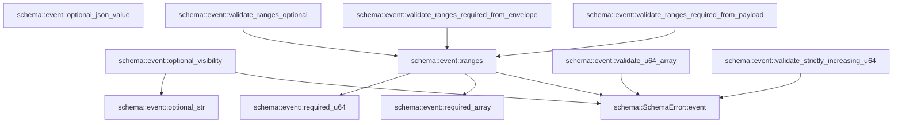

```mermaid
flowchart TD
  n0["schema::event::validate_usage"]
  n1["schema::event::validate_error"]
  n2["schema::event::validate_settle"]
  n3["schema::event::validate_checkpoint"]
  n4["schema::event::validate_compact"]
  n5["schema::event::validate_session_scope"]
  n6["schema::event::validate_meta"]
  n7["schema::event::validate_session_notice"]
  n8["schema::event::validate_blocks"]
  n9["schema::event::validate_blocks_or_spill"]
  n10["schema::event::validate_string_or_spill"]
  n11["schema::event::validate_json_or_spill"]
  n12["schema::event::validate_inline_size"]
  n13["schema::event::is_spill"]
  n14["schema::event::validate_spill"]
  n15["schema::event::validate_resume"]
  n16["schema::event::validate_origin_tuple"]
  n17["schema::event::required"]
  n18["schema::event::required_str"]
  n19["schema::event::required_id"]
  n20["schema::event::optional_str"]
  n21["schema::event::required_u64"]
  n22["schema::event::optional_u64"]
  n23["schema::event::required_bool"]
  n24["schema::event::optional_bool"]
  n25["schema::event::required_object"]
  n26["schema::event::optional_object"]
  n27["schema::event::required_array"]
  n28["schema::event::optional_array"]
  n29["schema::event::required_enum"]
  n30["schema::event::validate_ranges_required_from_payload"]
  n31["schema::event::validate_spawn"]
  n32["schema::event::validate_child_result"]
  n33["schema::event::validate_attempt"]
  n34["schema::event::validate_attempt_recovery"]
  n35["schema::SchemaError::event"]
  n0 --> n20
  n0 --> n29
  n0 --> n35
  n1 --> n0
  n1 --> n10
  n1 --> n17
  n1 --> n18
  n1 --> n20
  n1 --> n21
  n1 --> n23
  n1 --> n25
  n1 --> n26
  n1 --> n29
  n1 --> n35
  n2 --> n21
  n2 --> n22
  n2 --> n26
  n2 --> n29
  n2 --> n35
  n3 --> n10
  n3 --> n17
  n3 --> n21
  n4 --> n10
  n4 --> n16
  n4 --> n17
  n4 --> n18
  n4 --> n23
  n4 --> n25
  n4 --> n26
  n4 --> n30
  n4 --> n35
  n5 --> n25
  n5 --> n35
  n6 --> n5
  n6 --> n7
  n6 --> n16
  n6 --> n18
  n6 --> n19
  n6 --> n20
  n6 --> n21
  n6 --> n22
  n6 --> n26
  n6 --> n27
  n6 --> n28
  n6 --> n35
  n7 --> n18
  n7 --> n35
  n8 --> n8
  n8 --> n17
  n8 --> n18
  n8 --> n19
  n8 --> n20
  n8 --> n21
  n8 --> n24
  n8 --> n27
  n8 --> n29
  n8 --> n35
  n9 --> n8
  n9 --> n12
  n9 --> n13
  n9 --> n14
  n9 --> n35
  n10 --> n12
  n10 --> n13
  n10 --> n14
  n10 --> n35
  n11 --> n12
  n11 --> n13
  n11 --> n14
  n12 --> n35
  n14 --> n18
  n14 --> n21
  n14 --> n35
  n15 --> n21
  n15 --> n35
  n31 --> n15
  n31 --> n17
  n31 --> n18
  n31 --> n19
  n31 --> n25
  n31 --> n27
  n31 --> n35
  n32 --> n18
  n32 --> n19
  n32 --> n20
  n32 --> n28
  n32 --> n29
  n32 --> n35
  n33 --> n18
  n33 --> n19
  n33 --> n21
  n33 --> n25
  n33 --> n30
  n33 --> n35
  n34 --> n18
  n34 --> n19
  n34 --> n25
  n34 --> n27
  n34 --> n29
  n34 --> n35
```

```mermaid
flowchart TD
  n0["schema::event::validate_origin_equality"]
  n1["schema::event::validate_origin_tuple"]
  n2["schema::event::validate_timestamp"]
  n3["schema::event::parse_decimal"]
  n4["schema::event::days_in_month"]
  n5["schema::event::is_leap_year"]
  n6["schema::event::divisible_by"]
  n7["schema::event::required"]
  n8["schema::event::required_str"]
  n9["schema::event::required_id"]
  n10["schema::event::optional_str"]
  n11["schema::event::required_u64"]
  n12["schema::event::optional_u64"]
  n13["schema::event::required_bool"]
  n14["schema::event::optional_bool"]
  n15["schema::event::required_object"]
  n16["schema::event::optional_object"]
  n17["schema::event::required_array"]
  n18["schema::event::optional_array"]
  n19["schema::event::required_enum"]
  n20["schema::SchemaError::event"]
  n21["schema::SchemaError::constraint"]
  n0 --> n8
  n0 --> n20
  n0 --> n21
  n1 --> n8
  n1 --> n20
  n2 --> n3
  n2 --> n4
  n2 --> n20
  n4 --> n5
  n5 --> n6
  n7 --> n20
  n8 --> n20
  n9 --> n8
  n9 --> n20
  n10 --> n20
  n11 --> n20
  n12 --> n20
  n13 --> n20
  n14 --> n20
  n15 --> n7
  n15 --> n20
  n16 --> n20
  n17 --> n7
  n17 --> n20
  n18 --> n20
  n19 --> n8
  n19 --> n20
```

# schema::event

[Package atlas](index.md) · [Source](../../src/event.rs)

## Declarations

Visibility is the declaration spelling; trait members and reexports require their enclosing interface. `cfg` is not evaluated.

| Symbol | Kind | Visibility | Test / cfg |
|---|---|---|---|
| [schema::event::MAX_SAFE_INTEGER](../../src/event.rs#L8) | const_item | `private` |  |
| [schema::event::SPILL_THRESHOLD](../../src/event.rs#L9) | const_item | `private` |  |
| [schema::event::EventKind](../../src/event.rs#L12) | enum_item | `pub` |  |
| [schema::event::EventKind::parse](../../src/event.rs#L44) | function_item | `pub` |  |
| [schema::event::EventKind::as_str](../../src/event.rs#L77) | function_item | `pub` |  |
| [schema::event::EventKind::is_turn_bound](../../src/event.rs#L110) | function_item | `pub` |  |
| [schema::event::Visibility](../../src/event.rs#L144) | enum_item | `pub` |  |
| [schema::event::Event](../../src/event.rs#L152) | struct_item | `pub` |  |
| [schema::event::Event::decode](../../src/event.rs#L166) | function_item | `pub` |  |
| [schema::event::Event::decode_canonical](../../src/event.rs#L171) | function_item | `pub` |  |
| [schema::event::Event::from_value](../../src/event.rs#L182) | function_item | `pub` |  |
| [schema::event::Event::decode_historical_canonical](../../src/event.rs#L186) | function_item | `pub(crate)` |  |
| [schema::event::Event::from_value_mode](../../src/event.rs#L200) | function_item | `private` |  |
| [schema::event::Event::is_historical_only](../../src/event.rs#L280) | function_item | `pub` |  |
| [schema::event::Event::seq](../../src/event.rs#L285) | function_item | `pub` |  |
| [schema::event::Event::turn](../../src/event.rs#L290) | function_item | `pub` |  |
| [schema::event::Event::kind](../../src/event.rs#L295) | function_item | `pub` |  |
| [schema::event::Event::min_reader](../../src/event.rs#L300) | function_item | `pub` |  |
| [schema::event::Event::origin_key](../../src/event.rs#L305) | function_item | `pub` |  |
| [schema::event::Event::effective_visibility](../../src/event.rs#L310) | function_item | `pub` |  |
| [schema::event::Event::default_visibility](../../src/event.rs#L321) | function_item | `pub` |  |
| [schema::event::Event::canonical_bytes](../../src/event.rs#L341) | function_item | `pub` |  |
| [schema::event::Event::raw](../../src/event.rs#L346) | function_item | `pub` |  |
| [schema::event::Event::string_field](../../src/event.rs#L351) | function_item | `pub` |  |
| [schema::event::Event::integer_field](../../src/event.rs#L356) | function_item | `pub` |  |
| [schema::event::Event::has_field](../../src/event.rs#L361) | function_item | `pub` |  |
| [schema::event::Event::is_ephemeral_genesis](../../src/event.rs#L367) | function_item | `pub` |  |
| [schema::event::Event::usage](../../src/event.rs#L374) | function_item | `pub` |  |
| [schema::event::Event::origin_tuple](../../src/event.rs#L378) | function_item | `pub` |  |
| [schema::event::Event::supersedes](../../src/event.rs#L389) | function_item | `pub` |  |
| [schema::event::Event::object](../../src/event.rs#L401) | function_item | `pub(crate)` |  |
| [schema::event::validate_payload](../../src/event.rs#L409) | function_item | `private` |  |
| [schema::event::validate_lower_sha256](../../src/event.rs#L492) | function_item | `private` |  |
| [schema::event::validate_genesis](../../src/event.rs#L507) | function_item | `private` |  |
| [schema::event::validate_epoch](../../src/event.rs#L674) | function_item | `private` |  |
| [schema::event::validate_legacy_epoch](../../src/event.rs#L704) | function_item | `private` |  |
| [schema::event::validate_legacy_usage](../../src/event.rs#L742) | function_item | `private` |  |
| [schema::event::validate_legacy_output](../../src/event.rs#L767) | function_item | `private` |  |
| [schema::event::validate_output_before_inline_usage](../../src/event.rs#L777) | function_item | `private` |  |
| [schema::event::validate_legacy_error](../../src/event.rs#L794) | function_item | `private` |  |
| [schema::event::validate_input](../../src/event.rs#L820) | function_item | `private` |  |
| [schema::event::validate_turn_open](../../src/event.rs#L843) | function_item | `private` |  |
| [schema::event::validate_output](../../src/event.rs#L870) | function_item | `private` |  |
| [schema::event::validate_tool_call](../../src/event.rs#L885) | function_item | `private` |  |
| [schema::event::validate_tool_result](../../src/event.rs#L898) | function_item | `private` |  |
| [schema::event::validate_spawn](../../src/event.rs#L921) | function_item | `private` |  |
| [schema::event::validate_child_result](../../src/event.rs#L938) | function_item | `private` |  |
| [schema::event::validate_attempt](../../src/event.rs#L961) | function_item | `private` |  |
| [schema::event::validate_attempt_recovery](../../src/event.rs#L986) | function_item | `private` |  |
| [schema::event::validate_usage](../../src/event.rs#L1023) | function_item | `private` |  |
| [schema::event::validate_error](../../src/event.rs#L1047) | function_item | `private` |  |
| [schema::event::validate_settle](../../src/event.rs#L1092) | function_item | `private` |  |
| [schema::event::validate_checkpoint](../../src/event.rs#L1171) | function_item | `private` |  |
| [schema::event::validate_compact](../../src/event.rs#L1177) | function_item | `private` |  |
| [schema::event::validate_session_scope](../../src/event.rs#L1199) | function_item | `private` |  |
| [schema::event::validate_meta](../../src/event.rs#L1216) | function_item | `private` |  |
| [schema::event::validate_session_notice](../../src/event.rs#L1288) | function_item | `private` |  |
| [schema::event::validate_blocks](../../src/event.rs#L1307) | function_item | `private` |  |
| [schema::event::validate_blocks_or_spill](../../src/event.rs#L1374) | function_item | `private` |  |
| [schema::event::validate_string_or_spill](../../src/event.rs#L1386) | function_item | `private` |  |
| [schema::event::validate_json_or_spill](../../src/event.rs#L1400) | function_item | `private` |  |
| [schema::event::validate_inline_size](../../src/event.rs#L1408) | function_item | `private` |  |
| [schema::event::is_spill](../../src/event.rs#L1420) | function_item | `private` |  |
| [schema::event::validate_spill](../../src/event.rs#L1426) | function_item | `private` |  |
| [schema::event::validate_resume](../../src/event.rs#L1443) | function_item | `private` |  |
| [schema::event::validate_origin_equality](../../src/event.rs#L1457) | function_item | `private` |  |
| [schema::event::validate_origin_tuple](../../src/event.rs#L1479) | function_item | `private` |  |
| [schema::event::validate_timestamp](../../src/event.rs#L1491) | function_item | `private` |  |
| [schema::event::parse_decimal](../../src/event.rs#L1523) | function_item | `private` |  |
| [schema::event::days_in_month](../../src/event.rs#L1530) | function_item | `private` |  |
| [schema::event::is_leap_year](../../src/event.rs#L1540) | function_item | `private` |  |
| [schema::event::divisible_by](../../src/event.rs#L1544) | function_item | `private` |  |
| [schema::event::required](../../src/event.rs#L1548) | function_item | `private` |  |
| [schema::event::required_str](../../src/event.rs#L1561) | function_item | `private` |  |
| [schema::event::required_id](../../src/event.rs#L1573) | function_item | `private` |  |
| [schema::event::optional_str](../../src/event.rs#L1588) | function_item | `private` |  |
| [schema::event::required_u64](../../src/event.rs#L1603) | function_item | `private` |  |
| [schema::event::optional_u64](../../src/event.rs#L1619) | function_item | `private` |  |
| [schema::event::required_bool](../../src/event.rs#L1640) | function_item | `private` |  |
| [schema::event::optional_bool](../../src/event.rs#L1647) | function_item | `private` |  |
| [schema::event::required_object](../../src/event.rs#L1662) | function_item | `private` |  |
| [schema::event::optional_object](../../src/event.rs#L1672) | function_item | `private` |  |
| [schema::event::required_array](../../src/event.rs#L1687) | function_item | `private` |  |
| [schema::event::optional_array](../../src/event.rs#L1698) | function_item | `private` |  |
| [schema::event::required_enum](../../src/event.rs#L1714) | function_item | `private` |  |
| [schema::event::optional_json_value](../../src/event.rs#L1730) | function_item | `private` |  |
| [schema::event::optional_visibility](../../src/event.rs#L1738) | function_item | `private` |  |
| [schema::event::ranges](../../src/event.rs#L1754) | function_item | `pub(crate)` |  |
| [schema::event::validate_ranges_optional](../../src/event.rs#L1779) | function_item | `private` |  |
| [schema::event::validate_ranges_required_from_envelope](../../src/event.rs#L1790) | function_item | `private` |  |
| [schema::event::validate_ranges_required_from_payload](../../src/event.rs#L1798) | function_item | `private` |  |
| [schema::event::validate_u64_array](../../src/event.rs#L1806) | function_item | `private` |  |
| [schema::event::validate_strictly_increasing_u64](../../src/event.rs#L1822) | function_item | `private` |  |

## Imports / reexports

| Local name | Source path | Visibility |
|---|---|---|
| `BTreeSet` | `std::collections::BTreeSet` | `private` |
| `Map` | `serde_json::Map` | `private` |
| `Value` | `serde_json::Value` | `private` |
| `Uuid` | `uuid::Uuid` | `private` |
| `IJsonValue` | `crate::IJsonValue` | `private` |
| `OriginTuple` | `crate::OriginTuple` | `private` |
| `SchemaError` | `crate::SchemaError` | `private` |
| `SeqRange` | `crate::SeqRange` | `private` |

## Module declarations

| Module | Visibility | Attributes |
|---|---|---|

## Function call graphs

Edges below are syntactically resolved calls only, including private functions. Graphs partition callers into groups of 20; they are not execution order. All unresolved sites are listed below and in the JSON inventory.

```mermaid
flowchart TD
  n0["schema::event::EventKind::is_turn_bound"]
  n1["schema::event::validate_origin_equality"]
  n2["schema::event::validate_timestamp"]
  n3["schema::event::required_str"]
  n4["schema::event::required_id"]
  n5["schema::event::optional_str"]
  n6["schema::event::required_u64"]
  n7["schema::event::optional_u64"]
  n8["schema::event::optional_bool"]
  n9["schema::event::Event::decode"]
  n10["schema::event::Event::decode_canonical"]
  n11["schema::event::optional_visibility"]
  n12["schema::event::validate_ranges_optional"]
  n13["schema::event::validate_ranges_required_from_payload"]
  n14["schema::event::Event::from_value"]
  n15["schema::event::Event::decode_historical_canonical"]
  n16["schema::event::Event::from_value_mode"]
  n17["schema::event::Event::is_historical_only"]
  n18["schema::event::Event::seq"]
  n19["schema::event::Event::turn"]
  n20["schema::event::Event::kind"]
  n21["schema::event::Event::min_reader"]
  n22["schema::event::Event::origin_key"]
  n23["schema::event::Event::effective_visibility"]
  n24["schema::event::Event::default_visibility"]
  n25["schema::event::Event::canonical_bytes"]
  n26["schema::event::Event::raw"]
  n27["schema::event::Event::string_field"]
  n28["schema::event::Event::integer_field"]
  n29["schema::event::Event::object"]
  n30["schema::event::validate_payload"]
  n31["schema::event::EventKind::parse"]
  n32["schema::event::validate_legacy_epoch"]
  n33["schema::event::validate_legacy_usage"]
  n34["schema::event::validate_legacy_output"]
  n35["schema::event::EventKind::as_str"]
  n36["schema::event::validate_legacy_error"]
  n37["schema::event::validate_attempt"]
  n38["schema::ijson::IJsonValue::parse"]
  n39["schema::SchemaError::event"]
  n40["schema::metrics::note_ledger_decode"]
  n9 --> n14
  n9 --> n38
  n10 --> n9
  n10 --> n40
  n14 --> n16
  n15 --> n16
  n15 --> n38
  n16 --> n1
  n16 --> n2
  n16 --> n3
  n16 --> n4
  n16 --> n5
  n16 --> n6
  n16 --> n7
  n16 --> n8
  n16 --> n11
  n16 --> n12
  n16 --> n13
  n16 --> n30
  n16 --> n31
  n16 --> n32
  n16 --> n33
  n16 --> n34
  n16 --> n36
  n16 --> n37
  n16 --> n39
  n23 --> n24
  n27 --> n29
  n28 --> n29
```

Functions 1–20: 29 direct edges

Functions 21–40: 123 direct edges

Functions 41–60: 100 direct edges

Functions 61–80: 27 direct edges

Functions 81–88: 10 direct edges

## Call sites

Includes test functions (marked in declarations). Receiver-type-required sites need type analysis/manual tracing. Calls in closures are attributed to their enclosing function; their occurrence here does not mean the closure executes immediately.

| Caller | Callee expression | Source lines | Target / classification |
|---|---|---|---|
| `parse` | `Self::Extension` | [72](../../src/event.rs#L72) | external-constructor-callback-or-unresolved |
| `parse` | `other.to_owned` | [72](../../src/event.rs#L72) | receiver-type-required |
| `is_turn_bound` | `Some` | [128](../../src/event.rs#L128), [137](../../src/event.rs#L137) | external-constructor-callback-or-unresolved |
| `decode` | `IJsonValue::parse` | [167](../../src/event.rs#L167) | [schema::ijson::IJsonValue::parse](../../src/ijson.rs#L16) |
| `decode` | `Self::from_value` | [168](../../src/event.rs#L168) | [schema::event::Event::from_value](../../src/event.rs#L182) |
| `decode_canonical` | `crate::metrics::note_ledger_decode` | [172](../../src/event.rs#L172) | [schema::metrics::note_ledger_decode](../../src/metrics.rs#L50) |
| `decode_canonical` | `bytes.len` | [172](../../src/event.rs#L172) | receiver-type-required |
| `decode_canonical` | `Self::decode` | [173](../../src/event.rs#L173) | [schema::event::Event::decode](../../src/event.rs#L166) |
| `decode_canonical` | `event.canonical_bytes` | [174](../../src/event.rs#L174) | receiver-type-required |
| `decode_canonical` | `Err` | [175](../../src/event.rs#L175) | external-constructor-callback-or-unresolved |
| `decode_canonical` | `SchemaError::Canonical` | [175](../../src/event.rs#L175) | external-constructor-callback-or-unresolved |
| `decode_canonical` | `"event bytes are not RFC 8785 canonical".to_owned` | [176](../../src/event.rs#L176) | receiver-type-required |
| `decode_canonical` | `Ok` | [179](../../src/event.rs#L179) | external-constructor-callback-or-unresolved |
| `from_value` | `Self::from_value_mode` | [183](../../src/event.rs#L183) | [schema::event::Event::from_value_mode](../../src/event.rs#L200) |
| `decode_historical_canonical` | `IJsonValue::parse` | [190](../../src/event.rs#L190) | [schema::ijson::IJsonValue::parse](../../src/ijson.rs#L16) |
| `decode_historical_canonical` | `Self::from_value_mode` | [191](../../src/event.rs#L191) | [schema::event::Event::from_value_mode](../../src/event.rs#L200) |
| `decode_historical_canonical` | `event.canonical_bytes` | [192](../../src/event.rs#L192) | receiver-type-required |
| `decode_historical_canonical` | `Err` | [193](../../src/event.rs#L193) | external-constructor-callback-or-unresolved |
| `decode_historical_canonical` | `SchemaError::Canonical` | [193](../../src/event.rs#L193) | external-constructor-callback-or-unresolved |
| `decode_historical_canonical` | `"event bytes are not RFC 8785 canonical".to_owned` | [194](../../src/event.rs#L194) | receiver-type-required |
| `decode_historical_canonical` | `Ok` | [197](../../src/event.rs#L197) | external-constructor-callback-or-unresolved |
| `from_value_mode` | `raw             .value()             .as_object()             .ok_or_else` | [205](../../src/event.rs#L205) | receiver-type-required |
| `from_value_mode` | `raw             .value()             .as_object` | [205](../../src/event.rs#L205) | receiver-type-required |
| `from_value_mode` | `raw             .value` | [205](../../src/event.rs#L205) | receiver-type-required |
| `from_value_mode` | `SchemaError::event` | [208](../../src/event.rs#L208), [212](../../src/event.rs#L212), [216](../../src/event.rs#L216), [222](../../src/event.rs#L222), [226](../../src/event.rs#L226), [232](../../src/event.rs#L232) | [schema::SchemaError::event](../../src/lib.rs#L131) |
| `from_value_mode` | `required_u64` | [209](../../src/event.rs#L209), [210](../../src/event.rs#L210) | [schema::event::required_u64](../../src/event.rs#L1603) |
| `from_value_mode` | `Some` | [210](../../src/event.rs#L210), [212](../../src/event.rs#L212), [214](../../src/event.rs#L214), [216](../../src/event.rs#L216), [219](../../src/event.rs#L219), [222](../../src/event.rs#L222), [227](../../src/event.rs#L227), [233](../../src/event.rs#L233), [254](../../src/event.rs#L254) | external-constructor-callback-or-unresolved |
| `from_value_mode` | `Err` | [212](../../src/event.rs#L212), [216](../../src/event.rs#L216), [222](../../src/event.rs#L222), [226](../../src/event.rs#L226), [232](../../src/event.rs#L232) | external-constructor-callback-or-unresolved |
| `from_value_mode` | `required_str` | [214](../../src/event.rs#L214), [219](../../src/event.rs#L219), [254](../../src/event.rs#L254) | [schema::event::required_str](../../src/event.rs#L1561) |
| `from_value_mode` | `kind_text.is_empty` | [215](../../src/event.rs#L215) | receiver-type-required |
| `from_value_mode` | `EventKind::parse` | [218](../../src/event.rs#L218) | [schema::event::EventKind::parse](../../src/event.rs#L44) |
| `from_value_mode` | `validate_timestamp` | [219](../../src/event.rs#L219) | [schema::event::validate_timestamp](../../src/event.rs#L1491) |
| `from_value_mode` | `optional_u64` | [220](../../src/event.rs#L220), [239](../../src/event.rs#L239) | [schema::event::optional_u64](../../src/event.rs#L1619) |
| `from_value_mode` | `kind.as_str` | [221](../../src/event.rs#L221), [257](../../src/event.rs#L257) | receiver-type-required |
| `from_value_mode` | `turn.is_none` | [221](../../src/event.rs#L221), [225](../../src/event.rs#L225) | receiver-type-required |
| `from_value_mode` | `kind.is_turn_bound` | [224](../../src/event.rs#L224) | receiver-type-required |
| `from_value_mode` | `turn.is_some` | [231](../../src/event.rs#L231) | receiver-type-required |
| `from_value_mode` | `optional_visibility` | [240](../../src/event.rs#L240) | [schema::event::optional_visibility](../../src/event.rs#L1738) |
| `from_value_mode` | `optional_bool` | [241](../../src/event.rs#L241) | [schema::event::optional_bool](../../src/event.rs#L1647) |
| `from_value_mode` | `validate_ranges_optional` | [242](../../src/event.rs#L242) | [schema::event::validate_ranges_optional](../../src/event.rs#L1779) |
| `from_value_mode` | `optional_str(object, "origin_key", seq)?.map` | [243](../../src/event.rs#L243) | receiver-type-required |
| `from_value_mode` | `optional_str` | [243](../../src/event.rs#L243) | [schema::event::optional_str](../../src/event.rs#L1588) |
| `from_value_mode` | `validate_legacy_epoch` | [245](../../src/event.rs#L245) | [schema::event::validate_legacy_epoch](../../src/event.rs#L704) |
| `from_value_mode` | `object.contains_key` | [249](../../src/event.rs#L249) | receiver-type-required |
| `from_value_mode` | `validate_attempt` | [250](../../src/event.rs#L250) | [schema::event::validate_attempt](../../src/event.rs#L961) |
| `from_value_mode` | `required_id` | [252](../../src/event.rs#L252), [253](../../src/event.rs#L253) | [schema::event::required_id](../../src/event.rs#L1573) |
| `from_value_mode` | `validate_ranges_required_from_payload` | [255](../../src/event.rs#L255) | [schema::event::validate_ranges_required_from_payload](../../src/event.rs#L1798) |
| `from_value_mode` | `validate_legacy_usage` | [258](../../src/event.rs#L258) | [schema::event::validate_legacy_usage](../../src/event.rs#L742) |
| `from_value_mode` | `validate_legacy_output` | [260](../../src/event.rs#L260) | [schema::event::validate_legacy_output](../../src/event.rs#L767) |
| `from_value_mode` | `validate_legacy_error` | [262](../../src/event.rs#L262) | [schema::event::validate_legacy_error](../../src/event.rs#L794) |
| `from_value_mode` | `validate_payload` | [264](../../src/event.rs#L264) | [schema::event::validate_payload](../../src/event.rs#L409) |
| `from_value_mode` | `validate_origin_equality` | [266](../../src/event.rs#L266) | [schema::event::validate_origin_equality](../../src/event.rs#L1457) |
| `from_value_mode` | `origin_key.as_deref` | [266](../../src/event.rs#L266) | receiver-type-required |
| `from_value_mode` | `Ok` | [267](../../src/event.rs#L267) | external-constructor-callback-or-unresolved |
| `origin_key` | `self.origin_key.as_deref` | [306](../../src/event.rs#L306) | receiver-type-required |
| `effective_visibility` | `self.default_visibility` | [312](../../src/event.rs#L312), [317](../../src/event.rs#L317) | [schema::event::Event::default_visibility](../../src/event.rs#L321) |
| `canonical_bytes` | `self.raw.canonical_bytes` | [342](../../src/event.rs#L342) | receiver-type-required |
| `string_field` | `self.object().get(field).and_then` | [352](../../src/event.rs#L352) | receiver-type-required |
| `string_field` | `self.object().get` | [352](../../src/event.rs#L352) | receiver-type-required |
| `string_field` | `self.object` | [352](../../src/event.rs#L352) | [schema::event::Event::object](../../src/event.rs#L401) |
| `integer_field` | `self.object().get(field).and_then` | [357](../../src/event.rs#L357) | receiver-type-required |
| `integer_field` | `self.object().get` | [357](../../src/event.rs#L357) | receiver-type-required |
| `integer_field` | `self.object` | [357](../../src/event.rs#L357) | [schema::event::Event::object](../../src/event.rs#L401) |
| `has_field` | `self.object().contains_key` | [362](../../src/event.rs#L362) | receiver-type-required |
| `has_field` | `self.object` | [362](../../src/event.rs#L362) | [schema::event::Event::object](../../src/event.rs#L401) |
| `is_ephemeral_genesis` | `self.object().get("ephemeral").and_then` | [369](../../src/event.rs#L369) | receiver-type-required |
| `is_ephemeral_genesis` | `self.object().get` | [369](../../src/event.rs#L369) | receiver-type-required |
| `is_ephemeral_genesis` | `self.object` | [369](../../src/event.rs#L369) | [schema::event::Event::object](../../src/event.rs#L401) |
| `is_ephemeral_genesis` | `Some` | [369](../../src/event.rs#L369) | external-constructor-callback-or-unresolved |
| `usage` | `self.object().get("usage").and_then` | [375](../../src/event.rs#L375) | receiver-type-required |
| `usage` | `self.object().get` | [375](../../src/event.rs#L375) | receiver-type-required |
| `usage` | `self.object` | [375](../../src/event.rs#L375) | [schema::event::Event::object](../../src/event.rs#L401) |
| `origin_tuple` | `self.object()             .get("origin_tuple")             .cloned()             .map(serde_json::from_value)             .transpose()             .map_err` | [379](../../src/event.rs#L379) | receiver-type-required |
| `origin_tuple` | `self.object()             .get("origin_tuple")             .cloned()             .map(serde_json::from_value)             .transpose` | [379](../../src/event.rs#L379) | receiver-type-required |
| `origin_tuple` | `self.object()             .get("origin_tuple")             .cloned()             .map` | [379](../../src/event.rs#L379) | receiver-type-required |
| `origin_tuple` | `self.object()             .get("origin_tuple")             .cloned` | [379](../../src/event.rs#L379) | receiver-type-required |
| `origin_tuple` | `self.object()             .get` | [379](../../src/event.rs#L379) | receiver-type-required |
| `origin_tuple` | `self.object` | [379](../../src/event.rs#L379) | [schema::event::Event::object](../../src/event.rs#L401) |
| `supersedes` | `self.object().contains_key` | [390](../../src/event.rs#L390) | receiver-type-required |
| `supersedes` | `self.object` | [390](../../src/event.rs#L390), [393](../../src/event.rs#L393) | [schema::event::Event::object](../../src/event.rs#L401) |
| `supersedes` | `Ok` | [391](../../src/event.rs#L391) | external-constructor-callback-or-unresolved |
| `supersedes` | `Vec::new` | [391](../../src/event.rs#L391) | external-constructor-callback-or-unresolved |
| `supersedes` | `ranges(self.object(), "supersedes", self.seq).map` | [393](../../src/event.rs#L393) | receiver-type-required |
| `supersedes` | `ranges` | [393](../../src/event.rs#L393) | [schema::event::ranges](../../src/event.rs#L1754) |
| `supersedes` | `values                 .into_iter()                 .map(&#124;(from, to)&#124; SeqRange { from, to })                 .collect` | [394](../../src/event.rs#L394) | receiver-type-required |
| `supersedes` | `values                 .into_iter()                 .map` | [394](../../src/event.rs#L394) | receiver-type-required |
| `supersedes` | `values                 .into_iter` | [394](../../src/event.rs#L394) | receiver-type-required |
| `object` | `self.raw             .value()             .as_object()             .expect` | [402](../../src/event.rs#L402) | receiver-type-required |
| `object` | `self.raw             .value()             .as_object` | [402](../../src/event.rs#L402) | receiver-type-required |
| `object` | `self.raw             .value` | [402](../../src/event.rs#L402) | receiver-type-required |
| `validate_payload` | `validate_genesis` | [415](../../src/event.rs#L415) | [schema::event::validate_genesis](../../src/event.rs#L507) |
| `validate_payload` | `required_id` | [417](../../src/event.rs#L417), [446](../../src/event.rs#L446), [450](../../src/event.rs#L450), [452](../../src/event.rs#L452), [457](../../src/event.rs#L457), [463](../../src/event.rs#L463), [472](../../src/event.rs#L472) | [schema::event::required_id](../../src/event.rs#L1573) |
| `validate_payload` | `required_enum` | [418](../../src/event.rs#L418) | [schema::event::required_enum](../../src/event.rs#L1714) |
| `validate_payload` | `required_u64` | [419](../../src/event.rs#L419), [479](../../src/event.rs#L479) | [schema::event::required_u64](../../src/event.rs#L1603) |
| `validate_payload` | `Some` | [419](../../src/event.rs#L419), [420](../../src/event.rs#L420), [421](../../src/event.rs#L421), [422](../../src/event.rs#L422), [426](../../src/event.rs#L426), [438](../../src/event.rs#L438), [458](../../src/event.rs#L458), [479](../../src/event.rs#L479), [484](../../src/event.rs#L484) | external-constructor-callback-or-unresolved |
| `validate_payload` | `required_str` | [420](../../src/event.rs#L420), [421](../../src/event.rs#L421), [422](../../src/event.rs#L422), [426](../../src/event.rs#L426), [458](../../src/event.rs#L458), [484](../../src/event.rs#L484) | [schema::event::required_str](../../src/event.rs#L1561) |
| `validate_payload` | `optional_str` | [423](../../src/event.rs#L423), [465](../../src/event.rs#L465) | [schema::event::optional_str](../../src/event.rs#L1588) |
| `validate_payload` | `validate_lower_sha256` | [424](../../src/event.rs#L424) | [schema::event::validate_lower_sha256](../../src/event.rs#L492) |
| `validate_payload` | `Ok` | [427](../../src/event.rs#L427), [442](../../src/event.rs#L442), [460](../../src/event.rs#L460), [486](../../src/event.rs#L486), [488](../../src/event.rs#L488) | external-constructor-callback-or-unresolved |
| `validate_payload` | `validate_epoch` | [429](../../src/event.rs#L429) | [schema::event::validate_epoch](../../src/event.rs#L674) |
| `validate_payload` | `validate_input` | [430](../../src/event.rs#L430) | [schema::event::validate_input](../../src/event.rs#L820) |
| `validate_payload` | `validate_turn_open` | [431](../../src/event.rs#L431) | [schema::event::validate_turn_open](../../src/event.rs#L843) |
| `validate_payload` | `required_object(object, "origin_tuple", seq)                 .and_then` | [433](../../src/event.rs#L433) | receiver-type-required |
| `validate_payload` | `required_object` | [433](../../src/event.rs#L433), [467](../../src/event.rs#L467), [480](../../src/event.rs#L480) | [schema::event::required_object](../../src/event.rs#L1662) |
| `validate_payload` | `validate_origin_tuple` | [434](../../src/event.rs#L434), [467](../../src/event.rs#L467), [480](../../src/event.rs#L480) | [schema::event::validate_origin_tuple](../../src/event.rs#L1479) |
| `validate_payload` | `validate_ranges_required_from_envelope` | [435](../../src/event.rs#L435) | [schema::event::validate_ranges_required_from_envelope](../../src/event.rs#L1790) |
| `validate_payload` | `ranges.is_empty` | [436](../../src/event.rs#L436) | receiver-type-required |
| `validate_payload` | `Err` | [437](../../src/event.rs#L437) | external-constructor-callback-or-unresolved |
| `validate_payload` | `SchemaError::event` | [437](../../src/event.rs#L437) | [schema::SchemaError::event](../../src/lib.rs#L131) |
| `validate_payload` | `validate_output` | [444](../../src/event.rs#L444) | [schema::event::validate_output](../../src/event.rs#L870) |
| `validate_payload` | `validate_string_or_spill` | [447](../../src/event.rs#L447) | [schema::event::validate_string_or_spill](../../src/event.rs#L1386) |
| `validate_payload` | `required` | [447](../../src/event.rs#L447), [453](../../src/event.rs#L453), [485](../../src/event.rs#L485) | [schema::event::required](../../src/event.rs#L1548) |
| `validate_payload` | `validate_tool_call` | [449](../../src/event.rs#L449) | [schema::event::validate_tool_call](../../src/event.rs#L885) |
| `validate_payload` | `required_id(object, "call", seq).map` | [450](../../src/event.rs#L450) | receiver-type-required |
| `validate_payload` | `validate_json_or_spill` | [453](../../src/event.rs#L453) | [schema::event::validate_json_or_spill](../../src/event.rs#L1400) |
| `validate_payload` | `validate_tool_result` | [455](../../src/event.rs#L455) | [schema::event::validate_tool_result](../../src/event.rs#L898) |
| `validate_payload` | `optional_json_value` | [459](../../src/event.rs#L459), [466](../../src/event.rs#L466) | [schema::event::optional_json_value](../../src/event.rs#L1730) |
| `validate_payload` | `required_bool` | [464](../../src/event.rs#L464) | [schema::event::required_bool](../../src/event.rs#L1640) |
| `validate_payload` | `validate_spawn` | [469](../../src/event.rs#L469) | [schema::event::validate_spawn](../../src/event.rs#L921) |
| `validate_payload` | `validate_child_result` | [470](../../src/event.rs#L470) | [schema::event::validate_child_result](../../src/event.rs#L938) |
| `validate_payload` | `validate_attempt` | [471](../../src/event.rs#L471) | [schema::event::validate_attempt](../../src/event.rs#L961) |
| `validate_payload` | `required_id(object, "attempt", seq).map` | [472](../../src/event.rs#L472) | receiver-type-required |
| `validate_payload` | `validate_attempt_recovery` | [473](../../src/event.rs#L473) | [schema::event::validate_attempt_recovery](../../src/event.rs#L986) |
| `validate_payload` | `validate_error` | [474](../../src/event.rs#L474) | [schema::event::validate_error](../../src/event.rs#L1047) |
| `validate_payload` | `validate_settle` | [475](../../src/event.rs#L475) | [schema::event::validate_settle](../../src/event.rs#L1092) |
| `validate_payload` | `validate_checkpoint` | [476](../../src/event.rs#L476) | [schema::event::validate_checkpoint](../../src/event.rs#L1171) |
| `validate_payload` | `validate_compact` | [477](../../src/event.rs#L477) | [schema::event::validate_compact](../../src/event.rs#L1177) |
| `validate_payload` | `validate_meta` | [482](../../src/event.rs#L482) | [schema::event::validate_meta](../../src/event.rs#L1216) |
| `validate_lower_sha256` | `value.len` | [493](../../src/event.rs#L493) | receiver-type-required |
| `validate_lower_sha256` | `value             .bytes()             .all` | [494](../../src/event.rs#L494) | receiver-type-required |
| `validate_lower_sha256` | `value             .bytes` | [494](../../src/event.rs#L494) | receiver-type-required |
| `validate_lower_sha256` | `byte.is_ascii_hexdigit` | [496](../../src/event.rs#L496) | receiver-type-required |
| `validate_lower_sha256` | `byte.is_ascii_uppercase` | [496](../../src/event.rs#L496) | receiver-type-required |
| `validate_lower_sha256` | `Ok` | [498](../../src/event.rs#L498) | external-constructor-callback-or-unresolved |
| `validate_lower_sha256` | `Err` | [500](../../src/event.rs#L500) | external-constructor-callback-or-unresolved |
| `validate_lower_sha256` | `SchemaError::event` | [500](../../src/event.rs#L500) | [schema::SchemaError::event](../../src/lib.rs#L131) |
| `validate_lower_sha256` | `Some` | [501](../../src/event.rs#L501) | external-constructor-callback-or-unresolved |
| `validate_genesis` | `Err` | [509](../../src/event.rs#L509), [518](../../src/event.rs#L518), [544](../../src/event.rs#L544), [553](../../src/event.rs#L553), [563](../../src/event.rs#L563), [587](../../src/event.rs#L587), [591](../../src/event.rs#L591), [594](../../src/event.rs#L594), [603](../../src/event.rs#L603), [610](../../src/event.rs#L610), [616](../../src/event.rs#L616), [622](../../src/event.rs#L622), [628](../../src/event.rs#L628), [655](../../src/event.rs#L655) | external-constructor-callback-or-unresolved |
| `validate_genesis` | `SchemaError::event` | [509](../../src/event.rs#L509), [516](../../src/event.rs#L516), [518](../../src/event.rs#L518), [528](../../src/event.rs#L528), [531](../../src/event.rs#L531), [544](../../src/event.rs#L544), [553](../../src/event.rs#L553), [563](../../src/event.rs#L563), [585](../../src/event.rs#L585), [587](../../src/event.rs#L587), [591](../../src/event.rs#L591), [594](../../src/event.rs#L594), [603](../../src/event.rs#L603), [610](../../src/event.rs#L610), [616](../../src/event.rs#L616), [622](../../src/event.rs#L622), [628](../../src/event.rs#L628), [653](../../src/event.rs#L653), [655](../../src/event.rs#L655) | [schema::SchemaError::event](../../src/lib.rs#L131) |
| `validate_genesis` | `Some` | [509](../../src/event.rs#L509), [511](../../src/event.rs#L511), [512](../../src/event.rs#L512), [513](../../src/event.rs#L513), [514](../../src/event.rs#L514), [516](../../src/event.rs#L516), [519](../../src/event.rs#L519), [524](../../src/event.rs#L524), [528](../../src/event.rs#L528), [531](../../src/event.rs#L531), [532](../../src/event.rs#L532), [542](../../src/event.rs#L542), [545](../../src/event.rs#L545), [552](../../src/event.rs#L552), [554](../../src/event.rs#L554), [561](../../src/event.rs#L561), [564](../../src/event.rs#L564), [570](../../src/event.rs#L570), [585](../../src/event.rs#L585), [587](../../src/event.rs#L587), [591](../../src/event.rs#L591), [595](../../src/event.rs#L595), [603](../../src/event.rs#L603), [611](../../src/event.rs#L611), [615](../../src/event.rs#L615), [617](../../src/event.rs#L617), [621](../../src/event.rs#L621), [622](../../src/event.rs#L622), [628](../../src/event.rs#L628), [631](../../src/event.rs#L631), [637](../../src/event.rs#L637), [641](../../src/event.rs#L641), [642](../../src/event.rs#L642), [646](../../src/event.rs#L646), [653](../../src/event.rs#L653), [656](../../src/event.rs#L656), [660](../../src/event.rs#L660), [663](../../src/event.rs#L663), [664](../../src/event.rs#L664), [667](../../src/event.rs#L667), [669](../../src/event.rs#L669) | external-constructor-callback-or-unresolved |
| `validate_genesis` | `required_u64` | [511](../../src/event.rs#L511), [512](../../src/event.rs#L512), [513](../../src/event.rs#L513), [532](../../src/event.rs#L532), [552](../../src/event.rs#L552), [615](../../src/event.rs#L615), [621](../../src/event.rs#L621), [642](../../src/event.rs#L642) | [schema::event::required_u64](../../src/event.rs#L1603) |
| `validate_genesis` | `required_str` | [514](../../src/event.rs#L514), [524](../../src/event.rs#L524), [561](../../src/event.rs#L561), [631](../../src/event.rs#L631), [637](../../src/event.rs#L637), [641](../../src/event.rs#L641), [646](../../src/event.rs#L646), [663](../../src/event.rs#L663), [664](../../src/event.rs#L664), [667](../../src/event.rs#L667), [669](../../src/event.rs#L669) | [schema::event::required_str](../../src/event.rs#L1561) |
| `validate_genesis` | `Uuid::parse_str(thread)         .map_err` | [515](../../src/event.rs#L515) | receiver-type-required |
| `validate_genesis` | `Uuid::parse_str` | [515](../../src/event.rs#L515) | external-constructor-callback-or-unresolved |
| `validate_genesis` | `parsed.hyphenated().to_string` | [517](../../src/event.rs#L517) | receiver-type-required |
| `validate_genesis` | `parsed.hyphenated` | [517](../../src/event.rs#L517) | receiver-type-required |
| `validate_genesis` | `thread.to_ascii_lowercase` | [517](../../src/event.rs#L517) | receiver-type-required |
| `validate_genesis` | `object.contains_key` | [523](../../src/event.rs#L523), [541](../../src/event.rs#L541), [550](../../src/event.rs#L550), [560](../../src/event.rs#L560), [569](../../src/event.rs#L569), [576](../../src/event.rs#L576), [609](../../src/event.rs#L609) | receiver-type-required |
| `validate_genesis` | `object.get` | [526](../../src/event.rs#L526), [542](../../src/event.rs#L542), [600](../../src/event.rs#L600) | receiver-type-required |
| `validate_genesis` | `serde_json::from_value(value.clone())             .map_err` | [527](../../src/event.rs#L527) | receiver-type-required |
| `validate_genesis` | `serde_json::from_value` | [527](../../src/event.rs#L527) | external-constructor-callback-or-unresolved |
| `validate_genesis` | `value.clone` | [527](../../src/event.rs#L527) | receiver-type-required |
| `validate_genesis` | `error.to_string` | [528](../../src/event.rs#L528) | receiver-type-required |
| `validate_genesis` | `execution             .validate()             .map_err` | [529](../../src/event.rs#L529) | receiver-type-required |
| `validate_genesis` | `execution             .validate` | [529](../../src/event.rs#L529) | receiver-type-required |
| `validate_genesis` | `[                 "session_scope",                 "environment",                 "folders",                 "workspace",                 "folder_binding",             ]             .iter()             .any` | [533](../../src/event.rs#L533) | receiver-type-required |
| `validate_genesis` | `[                 "session_scope",                 "environment",                 "folders",                 "workspace",                 "folder_binding",             ]             .iter` | [533](../../src/event.rs#L533) | receiver-type-required |
| `validate_genesis` | `object.get("cwd").and_then` | [542](../../src/event.rs#L542) | receiver-type-required |
| `validate_genesis` | `execution.cwd.as_str` | [542](../../src/event.rs#L542) | receiver-type-required |
| `validate_genesis` | `validate_session_scope` | [551](../../src/event.rs#L551) | [schema::event::validate_session_scope](../../src/event.rs#L1199) |
| `validate_genesis` | `std::path::Path::new(cwd).is_absolute` | [562](../../src/event.rs#L562) | receiver-type-required |
| `validate_genesis` | `std::path::Path::new` | [562](../../src/event.rs#L562) | external-constructor-callback-or-unresolved |
| `validate_genesis` | `cwd.contains` | [562](../../src/event.rs#L562) | receiver-type-required |
| `validate_genesis` | `required_id` | [570](../../src/event.rs#L570), [577](../../src/event.rs#L577), [643](../../src/event.rs#L643) | [schema::event::required_id](../../src/event.rs#L1573) |
| `validate_genesis` | `optional_array` | [579](../../src/event.rs#L579) | [schema::event::optional_array](../../src/event.rs#L1698) |
| `validate_genesis` | `std::collections::BTreeSet::new` | [580](../../src/event.rs#L580) | external-constructor-callback-or-unresolved |
| `validate_genesis` | `folder                 .as_str()                 .filter(&#124;id&#124; !id.is_empty())                 .ok_or_else` | [582](../../src/event.rs#L582) | receiver-type-required |
| `validate_genesis` | `folder                 .as_str()                 .filter` | [582](../../src/event.rs#L582) | receiver-type-required |
| `validate_genesis` | `folder                 .as_str` | [582](../../src/event.rs#L582) | receiver-type-required |
| `validate_genesis` | `id.is_empty` | [584](../../src/event.rs#L584) | receiver-type-required |
| `validate_genesis` | `ids.insert` | [586](../../src/event.rs#L586) | receiver-type-required |
| `validate_genesis` | `ids.is_empty` | [590](../../src/event.rs#L590) | receiver-type-required |
| `validate_genesis` | `folder_binding.is_some_and` | [593](../../src/event.rs#L593) | receiver-type-required |
| `validate_genesis` | `ids.contains` | [593](../../src/event.rs#L593) | receiver-type-required |
| `validate_genesis` | `optional_object` | [608](../../src/event.rs#L608), [640](../../src/event.rs#L640), [645](../../src/event.rs#L645), [668](../../src/event.rs#L668) | [schema::event::optional_object](../../src/event.rs#L1672) |
| `validate_genesis` | `required_array` | [630](../../src/event.rs#L630), [647](../../src/event.rs#L647) | [schema::event::required_array](../../src/event.rs#L1687) |
| `validate_genesis` | `optional_bool` | [636](../../src/event.rs#L636) | [schema::event::optional_bool](../../src/event.rs#L1647) |
| `validate_genesis` | `validate_origin_tuple` | [638](../../src/event.rs#L638) | [schema::event::validate_origin_tuple](../../src/event.rs#L1479) |
| `validate_genesis` | `required_object` | [638](../../src/event.rs#L638), [662](../../src/event.rs#L662), [666](../../src/event.rs#L666) | [schema::event::required_object](../../src/event.rs#L1662) |
| `validate_genesis` | `validate_resume` | [639](../../src/event.rs#L639) | [schema::event::validate_resume](../../src/event.rs#L1443) |
| `validate_genesis` | `required` | [639](../../src/event.rs#L639) | [schema::event::required](../../src/event.rs#L1548) |
| `validate_genesis` | `BTreeSet::new` | [649](../../src/event.rs#L649) | external-constructor-callback-or-unresolved |
| `validate_genesis` | `value                 .as_str()                 .ok_or_else` | [651](../../src/event.rs#L651) | receiver-type-required |
| `validate_genesis` | `value                 .as_str` | [651](../../src/event.rs#L651) | receiver-type-required |
| `validate_genesis` | `previous.is_some_and` | [654](../../src/event.rs#L654) | receiver-type-required |
| `validate_genesis` | `seen.insert` | [654](../../src/event.rs#L654) | receiver-type-required |
| `validate_genesis` | `Ok` | [671](../../src/event.rs#L671) | external-constructor-callback-or-unresolved |
| `validate_epoch` | `required_id` | [675](../../src/event.rs#L675) | [schema::event::required_id](../../src/event.rs#L1573) |
| `validate_epoch` | `required_str` | [676](../../src/event.rs#L676), [677](../../src/event.rs#L677), [678](../../src/event.rs#L678), [680](../../src/event.rs#L680), [681](../../src/event.rs#L681), [686](../../src/event.rs#L686), [687](../../src/event.rs#L687) | [schema::event::required_str](../../src/event.rs#L1561) |
| `validate_epoch` | `Some` | [676](../../src/event.rs#L676), [677](../../src/event.rs#L677), [678](../../src/event.rs#L678), [680](../../src/event.rs#L680), [681](../../src/event.rs#L681), [686](../../src/event.rs#L686), [687](../../src/event.rs#L687), [688](../../src/event.rs#L688) | external-constructor-callback-or-unresolved |
| `validate_epoch` | `required_object` | [679](../../src/event.rs#L679), [685](../../src/event.rs#L685) | [schema::event::required_object](../../src/event.rs#L1662) |
| `validate_epoch` | `required_u64` | [688](../../src/event.rs#L688) | [schema::event::required_u64](../../src/event.rs#L1603) |
| `validate_epoch` | `optional_object` | [689](../../src/event.rs#L689) | [schema::event::optional_object](../../src/event.rs#L1672) |
| `validate_epoch` | `validate_u64_array` | [690](../../src/event.rs#L690), [695](../../src/event.rs#L695) | [schema::event::validate_u64_array](../../src/event.rs#L1806) |
| `validate_epoch` | `required_array` | [691](../../src/event.rs#L691), [696](../../src/event.rs#L696) | [schema::event::required_array](../../src/event.rs#L1687) |
| `validate_epoch` | `Ok` | [701](../../src/event.rs#L701) | external-constructor-callback-or-unresolved |
| `validate_legacy_epoch` | `required_id` | [705](../../src/event.rs#L705) | [schema::event::required_id](../../src/event.rs#L1573) |
| `validate_legacy_epoch` | `required_str` | [706](../../src/event.rs#L706), [707](../../src/event.rs#L707), [708](../../src/event.rs#L708), [710](../../src/event.rs#L710), [711](../../src/event.rs#L711), [712](../../src/event.rs#L712) | [schema::event::required_str](../../src/event.rs#L1561) |
| `validate_legacy_epoch` | `Some` | [706](../../src/event.rs#L706), [707](../../src/event.rs#L707), [708](../../src/event.rs#L708), [710](../../src/event.rs#L710), [711](../../src/event.rs#L711), [712](../../src/event.rs#L712), [715](../../src/event.rs#L715), [722](../../src/event.rs#L722), [726](../../src/event.rs#L726) | external-constructor-callback-or-unresolved |
| `validate_legacy_epoch` | `required_object` | [709](../../src/event.rs#L709) | [schema::event::required_object](../../src/event.rs#L1662) |
| `validate_legacy_epoch` | `tools_digest.strip_prefix("sha256-").ok_or_else` | [713](../../src/event.rs#L713) | receiver-type-required |
| `validate_legacy_epoch` | `tools_digest.strip_prefix` | [713](../../src/event.rs#L713) | receiver-type-required |
| `validate_legacy_epoch` | `SchemaError::event` | [714](../../src/event.rs#L714), [721](../../src/event.rs#L721) | [schema::SchemaError::event](../../src/lib.rs#L131) |
| `validate_legacy_epoch` | `validate_lower_sha256` | [719](../../src/event.rs#L719) | [schema::event::validate_lower_sha256](../../src/event.rs#L492) |
| `validate_legacy_epoch` | `object.contains_key` | [720](../../src/event.rs#L720) | receiver-type-required |
| `validate_legacy_epoch` | `Err` | [721](../../src/event.rs#L721) | external-constructor-callback-or-unresolved |
| `validate_legacy_epoch` | `required_u64` | [726](../../src/event.rs#L726) | [schema::event::required_u64](../../src/event.rs#L1603) |
| `validate_legacy_epoch` | `optional_object` | [727](../../src/event.rs#L727) | [schema::event::optional_object](../../src/event.rs#L1672) |
| `validate_legacy_epoch` | `validate_u64_array` | [728](../../src/event.rs#L728), [733](../../src/event.rs#L733) | [schema::event::validate_u64_array](../../src/event.rs#L1806) |
| `validate_legacy_epoch` | `required_array` | [729](../../src/event.rs#L729), [734](../../src/event.rs#L734) | [schema::event::required_array](../../src/event.rs#L1687) |
| `validate_legacy_epoch` | `Ok` | [739](../../src/event.rs#L739) | external-constructor-callback-or-unresolved |
| `validate_legacy_usage` | `required_id` | [743](../../src/event.rs#L743) | [schema::event::required_id](../../src/event.rs#L1573) |
| `validate_legacy_usage` | `required_enum` | [744](../../src/event.rs#L744) | [schema::event::required_enum](../../src/event.rs#L1714) |
| `validate_legacy_usage` | `optional_str` | [756](../../src/event.rs#L756) | [schema::event::optional_str](../../src/event.rs#L1588) |
| `validate_legacy_usage` | `figures.into_iter().any` | [758](../../src/event.rs#L758) | receiver-type-required |
| `validate_legacy_usage` | `figures.into_iter` | [758](../../src/event.rs#L758) | receiver-type-required |
| `validate_legacy_usage` | `object.contains_key` | [758](../../src/event.rs#L758) | receiver-type-required |
| `validate_legacy_usage` | `Err` | [759](../../src/event.rs#L759) | external-constructor-callback-or-unresolved |
| `validate_legacy_usage` | `SchemaError::event` | [759](../../src/event.rs#L759) | [schema::SchemaError::event](../../src/lib.rs#L131) |
| `validate_legacy_usage` | `Some` | [760](../../src/event.rs#L760) | external-constructor-callback-or-unresolved |
| `validate_legacy_usage` | `Ok` | [764](../../src/event.rs#L764) | external-constructor-callback-or-unresolved |
| `validate_legacy_output` | `object.contains_key` | [768](../../src/event.rs#L768) | receiver-type-required |
| `validate_legacy_output` | `Err` | [769](../../src/event.rs#L769) | external-constructor-callback-or-unresolved |
| `validate_legacy_output` | `SchemaError::event` | [769](../../src/event.rs#L769) | [schema::SchemaError::event](../../src/lib.rs#L131) |
| `validate_legacy_output` | `Some` | [770](../../src/event.rs#L770) | external-constructor-callback-or-unresolved |
| `validate_legacy_output` | `validate_output_before_inline_usage` | [774](../../src/event.rs#L774) | [schema::event::validate_output_before_inline_usage](../../src/event.rs#L777) |
| `validate_output_before_inline_usage` | `required_id` | [781](../../src/event.rs#L781), [789](../../src/event.rs#L789) | [schema::event::required_id](../../src/event.rs#L1573) |
| `validate_output_before_inline_usage` | `optional_bool` | [782](../../src/event.rs#L782) | [schema::event::optional_bool](../../src/event.rs#L1647) |
| `validate_output_before_inline_usage` | `validate_blocks` | [783](../../src/event.rs#L783) | [schema::event::validate_blocks](../../src/event.rs#L1307) |
| `validate_output_before_inline_usage` | `required_array` | [783](../../src/event.rs#L783) | [schema::event::required_array](../../src/event.rs#L1687) |
| `validate_output_before_inline_usage` | `required_object` | [784](../../src/event.rs#L784) | [schema::event::required_object](../../src/event.rs#L1662) |
| `validate_output_before_inline_usage` | `required_u64` | [785](../../src/event.rs#L785) | [schema::event::required_u64](../../src/event.rs#L1603) |
| `validate_output_before_inline_usage` | `Some` | [785](../../src/event.rs#L785), [786](../../src/event.rs#L786) | external-constructor-callback-or-unresolved |
| `validate_output_before_inline_usage` | `required_str` | [786](../../src/event.rs#L786) | [schema::event::required_str](../../src/event.rs#L1561) |
| `validate_output_before_inline_usage` | `validate_string_or_spill` | [787](../../src/event.rs#L787) | [schema::event::validate_string_or_spill](../../src/event.rs#L1386) |
| `validate_output_before_inline_usage` | `required` | [787](../../src/event.rs#L787) | [schema::event::required](../../src/event.rs#L1548) |
| `validate_output_before_inline_usage` | `optional_object` | [788](../../src/event.rs#L788) | [schema::event::optional_object](../../src/event.rs#L1672) |
| `validate_output_before_inline_usage` | `Ok` | [791](../../src/event.rs#L791) | external-constructor-callback-or-unresolved |
| `validate_legacy_error` | `object.contains_key` | [795](../../src/event.rs#L795) | receiver-type-required |
| `validate_legacy_error` | `Err` | [796](../../src/event.rs#L796) | external-constructor-callback-or-unresolved |
| `validate_legacy_error` | `SchemaError::event` | [796](../../src/event.rs#L796) | [schema::SchemaError::event](../../src/lib.rs#L131) |
| `validate_legacy_error` | `Some` | [797](../../src/event.rs#L797) | external-constructor-callback-or-unresolved |
| `validate_legacy_error` | `required_bool` | [801](../../src/event.rs#L801) | [schema::event::required_bool](../../src/event.rs#L1640) |
| `validate_legacy_error` | `required_enum` | [802](../../src/event.rs#L802) | [schema::event::required_enum](../../src/event.rs#L1714) |
| `validate_legacy_error` | `optional_str` | [815](../../src/event.rs#L815), [816](../../src/event.rs#L816) | [schema::event::optional_str](../../src/event.rs#L1588) |
| `validate_legacy_error` | `Ok` | [817](../../src/event.rs#L817) | external-constructor-callback-or-unresolved |
| `validate_input` | `required_array` | [821](../../src/event.rs#L821) | [schema::event::required_array](../../src/event.rs#L1687) |
| `validate_input` | `content.is_empty` | [822](../../src/event.rs#L822) | receiver-type-required |
| `validate_input` | `Err` | [823](../../src/event.rs#L823), [837](../../src/event.rs#L837) | external-constructor-callback-or-unresolved |
| `validate_input` | `SchemaError::event` | [823](../../src/event.rs#L823), [837](../../src/event.rs#L837) | [schema::SchemaError::event](../../src/lib.rs#L131) |
| `validate_input` | `Some` | [824](../../src/event.rs#L824), [835](../../src/event.rs#L835), [837](../../src/event.rs#L837) | external-constructor-callback-or-unresolved |
| `validate_input` | `validate_blocks` | [828](../../src/event.rs#L828) | [schema::event::validate_blocks](../../src/event.rs#L1307) |
| `validate_input` | `optional_bool` | [829](../../src/event.rs#L829) | [schema::event::optional_bool](../../src/event.rs#L1647) |
| `validate_input` | `validate_origin_tuple` | [830](../../src/event.rs#L830) | [schema::event::validate_origin_tuple](../../src/event.rs#L1479) |
| `validate_input` | `required_object` | [830](../../src/event.rs#L830) | [schema::event::required_object](../../src/event.rs#L1662) |
| `validate_input` | `object.get` | [831](../../src/event.rs#L831) | receiver-type-required |
| `validate_input` | `required_str` | [835](../../src/event.rs#L835) | [schema::event::required_str](../../src/event.rs#L1561) |
| `validate_input` | `Ok` | [840](../../src/event.rs#L840) | external-constructor-callback-or-unresolved |
| `validate_turn_open` | `required` | [844](../../src/event.rs#L844) | [schema::event::required](../../src/event.rs#L1548) |
| `validate_turn_open` | `Ok` | [845](../../src/event.rs#L845), [855](../../src/event.rs#L855) | external-constructor-callback-or-unresolved |
| `validate_turn_open` | `value.contains_key` | [847](../../src/event.rs#L847) | receiver-type-required |
| `validate_turn_open` | `value.len` | [848](../../src/event.rs#L848) | receiver-type-required |
| `validate_turn_open` | `Err` | [849](../../src/event.rs#L849), [859](../../src/event.rs#L859), [866](../../src/event.rs#L866) | external-constructor-callback-or-unresolved |
| `validate_turn_open` | `SchemaError::event` | [849](../../src/event.rs#L849), [859](../../src/event.rs#L859), [866](../../src/event.rs#L866) | [schema::SchemaError::event](../../src/lib.rs#L131) |
| `validate_turn_open` | `Some` | [850](../../src/event.rs#L850), [860](../../src/event.rs#L860), [866](../../src/event.rs#L866) | external-constructor-callback-or-unresolved |
| `validate_turn_open` | `required_id` | [854](../../src/event.rs#L854) | [schema::event::required_id](../../src/event.rs#L1573) |
| `validate_turn_open` | `required_array` | [857](../../src/event.rs#L857) | [schema::event::required_array](../../src/event.rs#L1687) |
| `validate_turn_open` | `inputs.is_empty` | [858](../../src/event.rs#L858) | receiver-type-required |
| `validate_turn_open` | `validate_strictly_increasing_u64` | [864](../../src/event.rs#L864) | [schema::event::validate_strictly_increasing_u64](../../src/event.rs#L1822) |
| `validate_output` | `required_id` | [871](../../src/event.rs#L871), [880](../../src/event.rs#L880) | [schema::event::required_id](../../src/event.rs#L1573) |
| `validate_output` | `validate_usage` | [872](../../src/event.rs#L872) | [schema::event::validate_usage](../../src/event.rs#L1023) |
| `validate_output` | `required_object` | [872](../../src/event.rs#L872), [875](../../src/event.rs#L875) | [schema::event::required_object](../../src/event.rs#L1662) |
| `validate_output` | `optional_bool` | [873](../../src/event.rs#L873) | [schema::event::optional_bool](../../src/event.rs#L1647) |
| `validate_output` | `validate_blocks` | [874](../../src/event.rs#L874) | [schema::event::validate_blocks](../../src/event.rs#L1307) |
| `validate_output` | `required_array` | [874](../../src/event.rs#L874) | [schema::event::required_array](../../src/event.rs#L1687) |
| `validate_output` | `required_u64` | [876](../../src/event.rs#L876) | [schema::event::required_u64](../../src/event.rs#L1603) |
| `validate_output` | `Some` | [876](../../src/event.rs#L876), [877](../../src/event.rs#L877) | external-constructor-callback-or-unresolved |
| `validate_output` | `required_str` | [877](../../src/event.rs#L877) | [schema::event::required_str](../../src/event.rs#L1561) |
| `validate_output` | `validate_string_or_spill` | [878](../../src/event.rs#L878) | [schema::event::validate_string_or_spill](../../src/event.rs#L1386) |
| `validate_output` | `required` | [878](../../src/event.rs#L878) | [schema::event::required](../../src/event.rs#L1548) |
| `validate_output` | `optional_object` | [879](../../src/event.rs#L879) | [schema::event::optional_object](../../src/event.rs#L1672) |
| `validate_output` | `Ok` | [882](../../src/event.rs#L882) | external-constructor-callback-or-unresolved |
| `validate_tool_call` | `optional_bool` | [886](../../src/event.rs#L886) | [schema::event::optional_bool](../../src/event.rs#L1647) |
| `validate_tool_call` | `object.contains_key` | [887](../../src/event.rs#L887) | receiver-type-required |
| `validate_tool_call` | `required_id` | [888](../../src/event.rs#L888), [890](../../src/event.rs#L890), [894](../../src/event.rs#L894) | [schema::event::required_id](../../src/event.rs#L1573) |
| `validate_tool_call` | `required_str` | [891](../../src/event.rs#L891) | [schema::event::required_str](../../src/event.rs#L1561) |
| `validate_tool_call` | `Some` | [891](../../src/event.rs#L891) | external-constructor-callback-or-unresolved |
| `validate_tool_call` | `validate_json_or_spill` | [892](../../src/event.rs#L892) | [schema::event::validate_json_or_spill](../../src/event.rs#L1400) |
| `validate_tool_call` | `required` | [892](../../src/event.rs#L892) | [schema::event::required](../../src/event.rs#L1548) |
| `validate_tool_call` | `required_enum` | [893](../../src/event.rs#L893) | [schema::event::required_enum](../../src/event.rs#L1714) |
| `validate_tool_call` | `Ok` | [895](../../src/event.rs#L895) | external-constructor-callback-or-unresolved |
| `validate_tool_result` | `required_id` | [899](../../src/event.rs#L899) | [schema::event::required_id](../../src/event.rs#L1573) |
| `validate_tool_result` | `required` | [900](../../src/event.rs#L900) | [schema::event::required](../../src/event.rs#L1548) |
| `validate_tool_result` | `value.len` | [903](../../src/event.rs#L903), [906](../../src/event.rs#L906), [909](../../src/event.rs#L909) | receiver-type-required |
| `validate_tool_result` | `value.contains_key` | [903](../../src/event.rs#L903), [906](../../src/event.rs#L906), [909](../../src/event.rs#L909) | receiver-type-required |
| `validate_tool_result` | `required_enum` | [904](../../src/event.rs#L904), [910](../../src/event.rs#L910) | [schema::event::required_enum](../../src/event.rs#L1714) |
| `validate_tool_result` | `required_str` | [907](../../src/event.rs#L907) | [schema::event::required_str](../../src/event.rs#L1561) |
| `validate_tool_result` | `Some` | [907](../../src/event.rs#L907), [912](../../src/event.rs#L912) | external-constructor-callback-or-unresolved |
| `validate_tool_result` | `Err` | [912](../../src/event.rs#L912) | external-constructor-callback-or-unresolved |
| `validate_tool_result` | `SchemaError::event` | [912](../../src/event.rs#L912) | [schema::SchemaError::event](../../src/lib.rs#L131) |
| `validate_tool_result` | `object.get` | [914](../../src/event.rs#L914) | receiver-type-required |
| `validate_tool_result` | `validate_blocks_or_spill` | [915](../../src/event.rs#L915) | [schema::event::validate_blocks_or_spill](../../src/event.rs#L1374) |
| `validate_tool_result` | `optional_json_value` | [917](../../src/event.rs#L917) | [schema::event::optional_json_value](../../src/event.rs#L1730) |
| `validate_tool_result` | `Ok` | [918](../../src/event.rs#L918) | external-constructor-callback-or-unresolved |
| `validate_spawn` | `required_str` | [922](../../src/event.rs#L922) | [schema::event::required_str](../../src/event.rs#L1561) |
| `validate_spawn` | `Some` | [922](../../src/event.rs#L922), [930](../../src/event.rs#L930) | external-constructor-callback-or-unresolved |
| `validate_spawn` | `required_id` | [923](../../src/event.rs#L923), [924](../../src/event.rs#L924) | [schema::event::required_id](../../src/event.rs#L1573) |
| `validate_spawn` | `validate_resume` | [925](../../src/event.rs#L925) | [schema::event::validate_resume](../../src/event.rs#L1443) |
| `validate_spawn` | `required` | [925](../../src/event.rs#L925) | [schema::event::required](../../src/event.rs#L1548) |
| `validate_spawn` | `required_object` | [926](../../src/event.rs#L926) | [schema::event::required_object](../../src/event.rs#L1662) |
| `validate_spawn` | `required_array` | [927](../../src/event.rs#L927) | [schema::event::required_array](../../src/event.rs#L1687) |
| `validate_spawn` | `kind.as_str().is_none` | [928](../../src/event.rs#L928) | receiver-type-required |
| `validate_spawn` | `kind.as_str` | [928](../../src/event.rs#L928) | receiver-type-required |
| `validate_spawn` | `Err` | [929](../../src/event.rs#L929) | external-constructor-callback-or-unresolved |
| `validate_spawn` | `SchemaError::event` | [929](../../src/event.rs#L929) | [schema::SchemaError::event](../../src/lib.rs#L131) |
| `validate_spawn` | `Ok` | [935](../../src/event.rs#L935) | external-constructor-callback-or-unresolved |
| `validate_child_result` | `required_str` | [939](../../src/event.rs#L939), [954](../../src/event.rs#L954), [955](../../src/event.rs#L955) | [schema::event::required_str](../../src/event.rs#L1561) |
| `validate_child_result` | `Some` | [939](../../src/event.rs#L939), [952](../../src/event.rs#L952), [954](../../src/event.rs#L954), [955](../../src/event.rs#L955) | external-constructor-callback-or-unresolved |
| `validate_child_result` | `required_id` | [940](../../src/event.rs#L940), [941](../../src/event.rs#L941) | [schema::event::required_id](../../src/event.rs#L1573) |
| `validate_child_result` | `required_enum` | [942](../../src/event.rs#L942) | [schema::event::required_enum](../../src/event.rs#L1714) |
| `validate_child_result` | `optional_str` | [948](../../src/event.rs#L948) | [schema::event::optional_str](../../src/event.rs#L1588) |
| `validate_child_result` | `optional_array` | [949](../../src/event.rs#L949) | [schema::event::optional_array](../../src/event.rs#L1698) |
| `validate_child_result` | `artifact.as_object().ok_or_else` | [951](../../src/event.rs#L951) | receiver-type-required |
| `validate_child_result` | `artifact.as_object` | [951](../../src/event.rs#L951) | receiver-type-required |
| `validate_child_result` | `SchemaError::event` | [952](../../src/event.rs#L952) | [schema::SchemaError::event](../../src/lib.rs#L131) |
| `validate_child_result` | `Ok` | [958](../../src/event.rs#L958) | external-constructor-callback-or-unresolved |
| `validate_attempt` | `required_id` | [962](../../src/event.rs#L962), [963](../../src/event.rs#L963) | [schema::event::required_id](../../src/event.rs#L1573) |
| `validate_attempt` | `required_str` | [964](../../src/event.rs#L964), [975](../../src/event.rs#L975) | [schema::event::required_str](../../src/event.rs#L1561) |
| `validate_attempt` | `Some` | [964](../../src/event.rs#L964), [971](../../src/event.rs#L971), [975](../../src/event.rs#L975), [976](../../src/event.rs#L976), [978](../../src/event.rs#L978) | external-constructor-callback-or-unresolved |
| `validate_attempt` | `required_object` | [968](../../src/event.rs#L968) | [schema::event::required_object](../../src/event.rs#L1662) |
| `validate_attempt` | `request.len` | [969](../../src/event.rs#L969) | receiver-type-required |
| `validate_attempt` | `Err` | [970](../../src/event.rs#L970), [977](../../src/event.rs#L977) | external-constructor-callback-or-unresolved |
| `validate_attempt` | `SchemaError::event` | [970](../../src/event.rs#L970), [977](../../src/event.rs#L977) | [schema::SchemaError::event](../../src/lib.rs#L131) |
| `validate_attempt` | `required_u64` | [976](../../src/event.rs#L976) | [schema::event::required_u64](../../src/event.rs#L1603) |
| `validate_attempt` | `validate_ranges_required_from_payload` | [982](../../src/event.rs#L982) | [schema::event::validate_ranges_required_from_payload](../../src/event.rs#L1798) |
| `validate_attempt` | `Ok` | [983](../../src/event.rs#L983) | external-constructor-callback-or-unresolved |
| `validate_attempt_recovery` | `required_id` | [987](../../src/event.rs#L987) | [schema::event::required_id](../../src/event.rs#L1573) |
| `validate_attempt_recovery` | `required_enum` | [988](../../src/event.rs#L988) | [schema::event::required_enum](../../src/event.rs#L1714) |
| `validate_attempt_recovery` | `required_array` | [1001](../../src/event.rs#L1001) | [schema::event::required_array](../../src/event.rs#L1687) |
| `validate_attempt_recovery` | `call.as_str().is_none` | [1003](../../src/event.rs#L1003) | receiver-type-required |
| `validate_attempt_recovery` | `call.as_str` | [1003](../../src/event.rs#L1003) | receiver-type-required |
| `validate_attempt_recovery` | `Err` | [1004](../../src/event.rs#L1004), [1013](../../src/event.rs#L1013) | external-constructor-callback-or-unresolved |
| `validate_attempt_recovery` | `SchemaError::event` | [1004](../../src/event.rs#L1004), [1013](../../src/event.rs#L1013) | [schema::SchemaError::event](../../src/lib.rs#L131) |
| `validate_attempt_recovery` | `Some` | [1005](../../src/event.rs#L1005), [1011](../../src/event.rs#L1011), [1014](../../src/event.rs#L1014) | external-constructor-callback-or-unresolved |
| `validate_attempt_recovery` | `required_object` | [1010](../../src/event.rs#L1010) | [schema::event::required_object](../../src/event.rs#L1662) |
| `validate_attempt_recovery` | `required_str` | [1011](../../src/event.rs#L1011) | [schema::event::required_str](../../src/event.rs#L1561) |
| `validate_attempt_recovery` | `object.contains_key` | [1012](../../src/event.rs#L1012) | receiver-type-required |
| `validate_attempt_recovery` | `Ok` | [1018](../../src/event.rs#L1018) | external-constructor-callback-or-unresolved |
| `validate_usage` | `required_enum` | [1024](../../src/event.rs#L1024) | [schema::event::required_enum](../../src/event.rs#L1714) |
| `validate_usage` | `optional_str` | [1036](../../src/event.rs#L1036) | [schema::event::optional_str](../../src/event.rs#L1588) |
| `validate_usage` | `figures.into_iter().any` | [1038](../../src/event.rs#L1038) | receiver-type-required |
| `validate_usage` | `figures.into_iter` | [1038](../../src/event.rs#L1038) | receiver-type-required |
| `validate_usage` | `object.contains_key` | [1038](../../src/event.rs#L1038) | receiver-type-required |
| `validate_usage` | `Err` | [1039](../../src/event.rs#L1039) | external-constructor-callback-or-unresolved |
| `validate_usage` | `SchemaError::event` | [1039](../../src/event.rs#L1039) | [schema::SchemaError::event](../../src/lib.rs#L131) |
| `validate_usage` | `Some` | [1040](../../src/event.rs#L1040) | external-constructor-callback-or-unresolved |
| `validate_usage` | `Ok` | [1044](../../src/event.rs#L1044) | external-constructor-callback-or-unresolved |
| `validate_error` | `required_bool` | [1048](../../src/event.rs#L1048) | [schema::event::required_bool](../../src/event.rs#L1640) |
| `validate_error` | `required_enum` | [1049](../../src/event.rs#L1049) | [schema::event::required_enum](../../src/event.rs#L1714) |
| `validate_error` | `optional_str` | [1062](../../src/event.rs#L1062), [1071](../../src/event.rs#L1071) | [schema::event::optional_str](../../src/event.rs#L1588) |
| `validate_error` | `object.contains_key` | [1063](../../src/event.rs#L1063), [1065](../../src/event.rs#L1065), [1076](../../src/event.rs#L1076) | receiver-type-required |
| `validate_error` | `validate_usage` | [1064](../../src/event.rs#L1064) | [schema::event::validate_usage](../../src/event.rs#L1023) |
| `validate_error` | `required_object` | [1064](../../src/event.rs#L1064) | [schema::event::required_object](../../src/event.rs#L1662) |
| `validate_error` | `Err` | [1066](../../src/event.rs#L1066), [1080](../../src/event.rs#L1080) | external-constructor-callback-or-unresolved |
| `validate_error` | `SchemaError::event` | [1066](../../src/event.rs#L1066), [1080](../../src/event.rs#L1080) | [schema::SchemaError::event](../../src/lib.rs#L131) |
| `validate_error` | `Some` | [1067](../../src/event.rs#L1067), [1077](../../src/event.rs#L1077), [1078](../../src/event.rs#L1078), [1081](../../src/event.rs#L1081), [1085](../../src/event.rs#L1085), [1086](../../src/event.rs#L1086) | external-constructor-callback-or-unresolved |
| `validate_error` | `optional_object` | [1075](../../src/event.rs#L1075) | [schema::event::optional_object](../../src/event.rs#L1672) |
| `validate_error` | `object.get` | [1077](../../src/event.rs#L1077), [1078](../../src/event.rs#L1078) | receiver-type-required |
| `validate_error` | `Value::Bool` | [1077](../../src/event.rs#L1077) | external-constructor-callback-or-unresolved |
| `validate_error` | `object.get("classification").and_then` | [1078](../../src/event.rs#L1078) | receiver-type-required |
| `validate_error` | `required_u64` | [1085](../../src/event.rs#L1085) | [schema::event::required_u64](../../src/event.rs#L1603) |
| `validate_error` | `required_str` | [1086](../../src/event.rs#L1086) | [schema::event::required_str](../../src/event.rs#L1561) |
| `validate_error` | `validate_string_or_spill` | [1087](../../src/event.rs#L1087) | [schema::event::validate_string_or_spill](../../src/event.rs#L1386) |
| `validate_error` | `required` | [1087](../../src/event.rs#L1087) | [schema::event::required](../../src/event.rs#L1548) |
| `validate_error` | `Ok` | [1089](../../src/event.rs#L1089) | external-constructor-callback-or-unresolved |
| `validate_settle` | `optional_u64` | [1093](../../src/event.rs#L1093) | [schema::event::optional_u64](../../src/event.rs#L1619) |
| `validate_settle` | `object.get("outcome").and_then` | [1094](../../src/event.rs#L1094), [1105](../../src/event.rs#L1105) | receiver-type-required |
| `validate_settle` | `object.get` | [1094](../../src/event.rs#L1094), [1105](../../src/event.rs#L1105) | receiver-type-required |
| `validate_settle` | `Some` | [1094](../../src/event.rs#L1094), [1100](../../src/event.rs#L1100), [1105](../../src/event.rs#L1105), [1107](../../src/event.rs#L1107), [1117](../../src/event.rs#L1117), [1118](../../src/event.rs#L1118), [1119](../../src/event.rs#L1119), [1122](../../src/event.rs#L1122), [1136](../../src/event.rs#L1136), [1150](../../src/event.rs#L1150), [1163](../../src/event.rs#L1163) | external-constructor-callback-or-unresolved |
| `validate_settle` | `object.contains_key` | [1095](../../src/event.rs#L1095), [1134](../../src/event.rs#L1134), [1148](../../src/event.rs#L1148), [1162](../../src/event.rs#L1162) | receiver-type-required |
| `validate_settle` | `Err` | [1099](../../src/event.rs#L1099), [1106](../../src/event.rs#L1106), [1121](../../src/event.rs#L1121), [1135](../../src/event.rs#L1135), [1149](../../src/event.rs#L1149), [1163](../../src/event.rs#L1163) | external-constructor-callback-or-unresolved |
| `validate_settle` | `SchemaError::event` | [1099](../../src/event.rs#L1099), [1106](../../src/event.rs#L1106), [1121](../../src/event.rs#L1121), [1135](../../src/event.rs#L1135), [1149](../../src/event.rs#L1149), [1163](../../src/event.rs#L1163) | [schema::SchemaError::event](../../src/lib.rs#L131) |
| `validate_settle` | `optional_object` | [1104](../../src/event.rs#L1104) | [schema::event::optional_object](../../src/event.rs#L1672) |
| `validate_settle` | `required_enum` | [1111](../../src/event.rs#L1111), [1127](../../src/event.rs#L1127), [1142](../../src/event.rs#L1142), [1156](../../src/event.rs#L1156) | [schema::event::required_enum](../../src/event.rs#L1714) |
| `validate_settle` | `required_u64` | [1117](../../src/event.rs#L1117), [1118](../../src/event.rs#L1118), [1119](../../src/event.rs#L1119) | [schema::event::required_u64](../../src/event.rs#L1603) |
| `validate_settle` | `Ok` | [1168](../../src/event.rs#L1168) | external-constructor-callback-or-unresolved |
| `validate_checkpoint` | `required_u64` | [1172](../../src/event.rs#L1172) | [schema::event::required_u64](../../src/event.rs#L1603) |
| `validate_checkpoint` | `Some` | [1172](../../src/event.rs#L1172) | external-constructor-callback-or-unresolved |
| `validate_checkpoint` | `validate_string_or_spill` | [1173](../../src/event.rs#L1173) | [schema::event::validate_string_or_spill](../../src/event.rs#L1386) |
| `validate_checkpoint` | `required` | [1173](../../src/event.rs#L1173) | [schema::event::required](../../src/event.rs#L1548) |
| `validate_checkpoint` | `Ok` | [1174](../../src/event.rs#L1174) | external-constructor-callback-or-unresolved |
| `validate_compact` | `validate_ranges_required_from_payload` | [1178](../../src/event.rs#L1178), [1187](../../src/event.rs#L1187) | [schema::event::validate_ranges_required_from_payload](../../src/event.rs#L1798) |
| `validate_compact` | `validate_string_or_spill` | [1179](../../src/event.rs#L1179) | [schema::event::validate_string_or_spill](../../src/event.rs#L1386) |
| `validate_compact` | `required` | [1179](../../src/event.rs#L1179) | [schema::event::required](../../src/event.rs#L1548) |
| `validate_compact` | `optional_object` | [1180](../../src/event.rs#L1180), [1183](../../src/event.rs#L1183) | [schema::event::optional_object](../../src/event.rs#L1672) |
| `validate_compact` | `validate_origin_tuple` | [1181](../../src/event.rs#L1181) | [schema::event::validate_origin_tuple](../../src/event.rs#L1479) |
| `validate_compact` | `required_object` | [1186](../../src/event.rs#L1186) | [schema::event::required_object](../../src/event.rs#L1662) |
| `validate_compact` | `required_str(bundle, "sha256", Some(seq))?.is_empty` | [1188](../../src/event.rs#L1188) | receiver-type-required |
| `validate_compact` | `required_str` | [1188](../../src/event.rs#L1188) | [schema::event::required_str](../../src/event.rs#L1561) |
| `validate_compact` | `Some` | [1188](../../src/event.rs#L1188), [1190](../../src/event.rs#L1190) | external-constructor-callback-or-unresolved |
| `validate_compact` | `Err` | [1189](../../src/event.rs#L1189) | external-constructor-callback-or-unresolved |
| `validate_compact` | `SchemaError::event` | [1189](../../src/event.rs#L1189) | [schema::SchemaError::event](../../src/lib.rs#L131) |
| `validate_compact` | `required_bool` | [1194](../../src/event.rs#L1194) | [schema::event::required_bool](../../src/event.rs#L1640) |
| `validate_compact` | `Ok` | [1196](../../src/event.rs#L1196) | external-constructor-callback-or-unresolved |
| `validate_session_scope` | `required_object` | [1200](../../src/event.rs#L1200), [1201](../../src/event.rs#L1201), [1202](../../src/event.rs#L1202) | [schema::event::required_object](../../src/event.rs#L1662) |
| `validate_session_scope` | `refs.is_empty` | [1203](../../src/event.rs#L1203) | receiver-type-required |
| `validate_session_scope` | `refs             .values()             .any` | [1204](../../src/event.rs#L1204) | receiver-type-required |
| `validate_session_scope` | `refs             .values` | [1204](../../src/event.rs#L1204) | receiver-type-required |
| `validate_session_scope` | `value.as_str().is_none_or` | [1206](../../src/event.rs#L1206) | receiver-type-required |
| `validate_session_scope` | `value.as_str` | [1206](../../src/event.rs#L1206) | receiver-type-required |
| `validate_session_scope` | `Err` | [1208](../../src/event.rs#L1208) | external-constructor-callback-or-unresolved |
| `validate_session_scope` | `SchemaError::event` | [1208](../../src/event.rs#L1208) | [schema::SchemaError::event](../../src/lib.rs#L131) |
| `validate_session_scope` | `Some` | [1209](../../src/event.rs#L1209) | external-constructor-callback-or-unresolved |
| `validate_session_scope` | `Ok` | [1213](../../src/event.rs#L1213) | external-constructor-callback-or-unresolved |
| `validate_meta` | `optional_str` | [1217](../../src/event.rs#L1217) | [schema::event::optional_str](../../src/event.rs#L1588) |
| `validate_meta` | `optional_object` | [1218](../../src/event.rs#L1218), [1256](../../src/event.rs#L1256), [1260](../../src/event.rs#L1260), [1269](../../src/event.rs#L1269) | [schema::event::optional_object](../../src/event.rs#L1672) |
| `validate_meta` | `validate_session_scope` | [1219](../../src/event.rs#L1219) | [schema::event::validate_session_scope](../../src/event.rs#L1199) |
| `validate_meta` | `required_id` | [1220](../../src/event.rs#L1220), [1221](../../src/event.rs#L1221) | [schema::event::required_id](../../src/event.rs#L1573) |
| `validate_meta` | `required_array` | [1222](../../src/event.rs#L1222) | [schema::event::required_array](../../src/event.rs#L1687) |
| `validate_meta` | `folders             .iter()             .filter_map(Value::as_str)             .collect::<std::collections::BTreeSet<_>>` | [1223](../../src/event.rs#L1223) | receiver-type-required |
| `validate_meta` | `folders             .iter()             .filter_map` | [1223](../../src/event.rs#L1223) | receiver-type-required |
| `validate_meta` | `folders             .iter` | [1223](../../src/event.rs#L1223) | receiver-type-required |
| `validate_meta` | `ids.len` | [1227](../../src/event.rs#L1227) | receiver-type-required |
| `validate_meta` | `folders.len` | [1227](../../src/event.rs#L1227) | receiver-type-required |
| `validate_meta` | `ids.contains` | [1227](../../src/event.rs#L1227) | receiver-type-required |
| `validate_meta` | `Err` | [1228](../../src/event.rs#L1228), [1235](../../src/event.rs#L1235), [1241](../../src/event.rs#L1241), [1251](../../src/event.rs#L1251), [1263](../../src/event.rs#L1263), [1278](../../src/event.rs#L1278) | external-constructor-callback-or-unresolved |
| `validate_meta` | `SchemaError::event` | [1228](../../src/event.rs#L1228), [1235](../../src/event.rs#L1235), [1241](../../src/event.rs#L1241), [1251](../../src/event.rs#L1251), [1263](../../src/event.rs#L1263), [1278](../../src/event.rs#L1278) | [schema::SchemaError::event](../../src/lib.rs#L131) |
| `validate_meta` | `Some` | [1229](../../src/event.rs#L1229), [1233](../../src/event.rs#L1233), [1236](../../src/event.rs#L1236), [1240](../../src/event.rs#L1240), [1242](../../src/event.rs#L1242), [1251](../../src/event.rs#L1251), [1257](../../src/event.rs#L1257), [1258](../../src/event.rs#L1258), [1264](../../src/event.rs#L1264), [1278](../../src/event.rs#L1278) | external-constructor-callback-or-unresolved |
| `validate_meta` | `required_str` | [1233](../../src/event.rs#L1233) | [schema::event::required_str](../../src/event.rs#L1561) |
| `validate_meta` | `std::path::Path::new(cwd).is_absolute` | [1234](../../src/event.rs#L1234) | receiver-type-required |
| `validate_meta` | `std::path::Path::new` | [1234](../../src/event.rs#L1234) | external-constructor-callback-or-unresolved |
| `validate_meta` | `cwd.contains` | [1234](../../src/event.rs#L1234) | receiver-type-required |
| `validate_meta` | `required_u64` | [1240](../../src/event.rs#L1240), [1257](../../src/event.rs#L1257), [1258](../../src/event.rs#L1258) | [schema::event::required_u64](../../src/event.rs#L1603) |
| `validate_meta` | `optional_array` | [1248](../../src/event.rs#L1248) | [schema::event::optional_array](../../src/event.rs#L1698) |
| `validate_meta` | `label.as_str().is_none` | [1250](../../src/event.rs#L1250) | receiver-type-required |
| `validate_meta` | `label.as_str` | [1250](../../src/event.rs#L1250) | receiver-type-required |
| `validate_meta` | `optional_u64` | [1255](../../src/event.rs#L1255) | [schema::event::optional_u64](../../src/event.rs#L1619) |
| `validate_meta` | `validate_origin_tuple` | [1261](../../src/event.rs#L1261) | [schema::event::validate_origin_tuple](../../src/event.rs#L1479) |
| `validate_meta` | `object.contains_key` | [1262](../../src/event.rs#L1262) | receiver-type-required |
| `validate_meta` | `validate_session_notice` | [1270](../../src/event.rs#L1270) | [schema::event::validate_session_notice](../../src/event.rs#L1288) |
| `validate_meta` | `object.keys().any` | [1272](../../src/event.rs#L1272) | receiver-type-required |
| `validate_meta` | `object.keys` | [1272](../../src/event.rs#L1272) | receiver-type-required |
| `validate_meta` | `Ok` | [1280](../../src/event.rs#L1280) | external-constructor-callback-or-unresolved |
| `validate_session_notice` | `required_str` | [1289](../../src/event.rs#L1289), [1297](../../src/event.rs#L1297) | [schema::event::required_str](../../src/event.rs#L1561) |
| `validate_session_notice` | `Some` | [1289](../../src/event.rs#L1289), [1292](../../src/event.rs#L1292), [1297](../../src/event.rs#L1297), [1299](../../src/event.rs#L1299) | external-constructor-callback-or-unresolved |
| `validate_session_notice` | `Err` | [1291](../../src/event.rs#L1291), [1298](../../src/event.rs#L1298) | external-constructor-callback-or-unresolved |
| `validate_session_notice` | `SchemaError::event` | [1291](../../src/event.rs#L1291), [1298](../../src/event.rs#L1298) | [schema::SchemaError::event](../../src/lib.rs#L131) |
| `validate_session_notice` | `required_str(notice, field, Some(seq))?.is_empty` | [1297](../../src/event.rs#L1297) | receiver-type-required |
| `validate_session_notice` | `Ok` | [1304](../../src/event.rs#L1304) | external-constructor-callback-or-unresolved |
| `validate_blocks` | `value             .as_object()             .ok_or_else` | [1309](../../src/event.rs#L1309) | receiver-type-required |
| `validate_blocks` | `value             .as_object` | [1309](../../src/event.rs#L1309) | receiver-type-required |
| `validate_blocks` | `SchemaError::event` | [1311](../../src/event.rs#L1311), [1334](../../src/event.rs#L1334), [1349](../../src/event.rs#L1349), [1355](../../src/event.rs#L1355) | [schema::SchemaError::event](../../src/lib.rs#L131) |
| `validate_blocks` | `Some` | [1311](../../src/event.rs#L1311), [1326](../../src/event.rs#L1326), [1329](../../src/event.rs#L1329), [1330](../../src/event.rs#L1330), [1335](../../src/event.rs#L1335), [1341](../../src/event.rs#L1341), [1342](../../src/event.rs#L1342), [1343](../../src/event.rs#L1343), [1350](../../src/event.rs#L1350), [1354](../../src/event.rs#L1354), [1355](../../src/event.rs#L1355), [1360](../../src/event.rs#L1360) | external-constructor-callback-or-unresolved |
| `validate_blocks` | `required_enum` | [1312](../../src/event.rs#L1312) | [schema::event::required_enum](../../src/event.rs#L1714) |
| `validate_blocks` | `required_str` | [1326](../../src/event.rs#L1326), [1329](../../src/event.rs#L1329), [1330](../../src/event.rs#L1330), [1341](../../src/event.rs#L1341), [1342](../../src/event.rs#L1342), [1343](../../src/event.rs#L1343), [1360](../../src/event.rs#L1360) | [schema::event::required_str](../../src/event.rs#L1561) |
| `validate_blocks` | `optional_str` | [1331](../../src/event.rs#L1331) | [schema::event::optional_str](../../src/event.rs#L1588) |
| `validate_blocks` | `name.is_empty` | [1332](../../src/event.rs#L1332), [1344](../../src/event.rs#L1344) | receiver-type-required |
| `validate_blocks` | `name.len` | [1332](../../src/event.rs#L1332), [1345](../../src/event.rs#L1345) | receiver-type-required |
| `validate_blocks` | `name.chars().any` | [1332](../../src/event.rs#L1332), [1346](../../src/event.rs#L1346) | receiver-type-required |
| `validate_blocks` | `name.chars` | [1332](../../src/event.rs#L1332), [1346](../../src/event.rs#L1346) | receiver-type-required |
| `validate_blocks` | `Err` | [1334](../../src/event.rs#L1334), [1349](../../src/event.rs#L1349), [1355](../../src/event.rs#L1355) | external-constructor-callback-or-unresolved |
| `validate_blocks` | `name.contains` | [1347](../../src/event.rs#L1347) | receiver-type-required |
| `validate_blocks` | `required_u64` | [1354](../../src/event.rs#L1354) | [schema::event::required_u64](../../src/event.rs#L1603) |
| `validate_blocks` | `required_id` | [1359](../../src/event.rs#L1359), [1364](../../src/event.rs#L1364) | [schema::event::required_id](../../src/event.rs#L1573) |
| `validate_blocks` | `required` | [1361](../../src/event.rs#L1361) | [schema::event::required](../../src/event.rs#L1548) |
| `validate_blocks` | `validate_blocks` | [1365](../../src/event.rs#L1365) | [schema::event::validate_blocks](../../src/event.rs#L1307) |
| `validate_blocks` | `required_array` | [1365](../../src/event.rs#L1365) | [schema::event::required_array](../../src/event.rs#L1687) |
| `validate_blocks` | `optional_bool` | [1366](../../src/event.rs#L1366) | [schema::event::optional_bool](../../src/event.rs#L1647) |
| `validate_blocks` | `Ok` | [1371](../../src/event.rs#L1371) | external-constructor-callback-or-unresolved |
| `validate_blocks_or_spill` | `is_spill` | [1375](../../src/event.rs#L1375) | [schema::event::is_spill](../../src/event.rs#L1420) |
| `validate_blocks_or_spill` | `validate_spill` | [1376](../../src/event.rs#L1376) | [schema::event::validate_spill](../../src/event.rs#L1426) |
| `validate_blocks_or_spill` | `value             .as_array()             .ok_or_else` | [1378](../../src/event.rs#L1378) | receiver-type-required |
| `validate_blocks_or_spill` | `value             .as_array` | [1378](../../src/event.rs#L1378) | receiver-type-required |
| `validate_blocks_or_spill` | `SchemaError::event` | [1380](../../src/event.rs#L1380) | [schema::SchemaError::event](../../src/lib.rs#L131) |
| `validate_blocks_or_spill` | `Some` | [1380](../../src/event.rs#L1380) | external-constructor-callback-or-unresolved |
| `validate_blocks_or_spill` | `validate_inline_size` | [1381](../../src/event.rs#L1381) | [schema::event::validate_inline_size](../../src/event.rs#L1408) |
| `validate_blocks_or_spill` | `validate_blocks` | [1382](../../src/event.rs#L1382) | [schema::event::validate_blocks](../../src/event.rs#L1307) |
| `validate_string_or_spill` | `is_spill` | [1387](../../src/event.rs#L1387) | [schema::event::is_spill](../../src/event.rs#L1420) |
| `validate_string_or_spill` | `validate_spill` | [1388](../../src/event.rs#L1388) | [schema::event::validate_spill](../../src/event.rs#L1426) |
| `validate_string_or_spill` | `value.as_str().is_none` | [1390](../../src/event.rs#L1390) | receiver-type-required |
| `validate_string_or_spill` | `value.as_str` | [1390](../../src/event.rs#L1390) | receiver-type-required |
| `validate_string_or_spill` | `Err` | [1391](../../src/event.rs#L1391) | external-constructor-callback-or-unresolved |
| `validate_string_or_spill` | `SchemaError::event` | [1391](../../src/event.rs#L1391) | [schema::SchemaError::event](../../src/lib.rs#L131) |
| `validate_string_or_spill` | `Some` | [1392](../../src/event.rs#L1392) | external-constructor-callback-or-unresolved |
| `validate_string_or_spill` | `validate_inline_size` | [1396](../../src/event.rs#L1396) | [schema::event::validate_inline_size](../../src/event.rs#L1408) |
| `validate_json_or_spill` | `is_spill` | [1401](../../src/event.rs#L1401) | [schema::event::is_spill](../../src/event.rs#L1420) |
| `validate_json_or_spill` | `validate_spill` | [1402](../../src/event.rs#L1402) | [schema::event::validate_spill](../../src/event.rs#L1426) |
| `validate_json_or_spill` | `validate_inline_size` | [1404](../../src/event.rs#L1404) | [schema::event::validate_inline_size](../../src/event.rs#L1408) |
| `validate_inline_size` | `serde_json_canonicalizer::to_vec(value)         .map_err` | [1409](../../src/event.rs#L1409) | receiver-type-required |
| `validate_inline_size` | `serde_json_canonicalizer::to_vec` | [1409](../../src/event.rs#L1409) | external-constructor-callback-or-unresolved |
| `validate_inline_size` | `SchemaError::event` | [1410](../../src/event.rs#L1410), [1412](../../src/event.rs#L1412) | [schema::SchemaError::event](../../src/lib.rs#L131) |
| `validate_inline_size` | `Some` | [1410](../../src/event.rs#L1410), [1413](../../src/event.rs#L1413) | external-constructor-callback-or-unresolved |
| `validate_inline_size` | `error.to_string` | [1410](../../src/event.rs#L1410) | receiver-type-required |
| `validate_inline_size` | `bytes.len` | [1411](../../src/event.rs#L1411) | receiver-type-required |
| `validate_inline_size` | `Err` | [1412](../../src/event.rs#L1412) | external-constructor-callback-or-unresolved |
| `validate_inline_size` | `Ok` | [1417](../../src/event.rs#L1417) | external-constructor-callback-or-unresolved |
| `is_spill` | `value         .as_object()         .is_some_and` | [1421](../../src/event.rs#L1421) | receiver-type-required |
| `is_spill` | `value         .as_object` | [1421](../../src/event.rs#L1421) | receiver-type-required |
| `is_spill` | `object.len` | [1423](../../src/event.rs#L1423) | receiver-type-required |
| `is_spill` | `object.contains_key` | [1423](../../src/event.rs#L1423) | receiver-type-required |
| `validate_spill` | `value         .as_object()         .and_then(&#124;object&#124; object.get("$spill"))         .and_then(Value::as_object)         .ok_or_else` | [1427](../../src/event.rs#L1427) | receiver-type-required |
| `validate_spill` | `value         .as_object()         .and_then(&#124;object&#124; object.get("$spill"))         .and_then` | [1427](../../src/event.rs#L1427) | receiver-type-required |
| `validate_spill` | `value         .as_object()         .and_then` | [1427](../../src/event.rs#L1427) | receiver-type-required |
| `validate_spill` | `value         .as_object` | [1427](../../src/event.rs#L1427) | receiver-type-required |
| `validate_spill` | `object.get` | [1429](../../src/event.rs#L1429) | receiver-type-required |
| `validate_spill` | `SchemaError::event` | [1431](../../src/event.rs#L1431), [1435](../../src/event.rs#L1435) | [schema::SchemaError::event](../../src/lib.rs#L131) |
| `validate_spill` | `Some` | [1431](../../src/event.rs#L1431), [1432](../../src/event.rs#L1432), [1433](../../src/event.rs#L1433), [1436](../../src/event.rs#L1436) | external-constructor-callback-or-unresolved |
| `validate_spill` | `required_str` | [1432](../../src/event.rs#L1432) | [schema::event::required_str](../../src/event.rs#L1561) |
| `validate_spill` | `required_u64` | [1433](../../src/event.rs#L1433) | [schema::event::required_u64](../../src/event.rs#L1603) |
| `validate_spill` | `Err` | [1435](../../src/event.rs#L1435) | external-constructor-callback-or-unresolved |
| `validate_spill` | `Ok` | [1440](../../src/event.rs#L1440) | external-constructor-callback-or-unresolved |
| `validate_resume` | `Ok` | [1445](../../src/event.rs#L1445), [1448](../../src/event.rs#L1448) | external-constructor-callback-or-unresolved |
| `validate_resume` | `value.len` | [1446](../../src/event.rs#L1446) | receiver-type-required |
| `validate_resume` | `required_u64` | [1447](../../src/event.rs#L1447) | [schema::event::required_u64](../../src/event.rs#L1603) |
| `validate_resume` | `Some` | [1447](../../src/event.rs#L1447), [1451](../../src/event.rs#L1451) | external-constructor-callback-or-unresolved |
| `validate_resume` | `Err` | [1450](../../src/event.rs#L1450) | external-constructor-callback-or-unresolved |
| `validate_resume` | `SchemaError::event` | [1450](../../src/event.rs#L1450) | [schema::SchemaError::event](../../src/lib.rs#L131) |
| `validate_origin_equality` | `object.get` | [1462](../../src/event.rs#L1462) | receiver-type-required |
| `validate_origin_equality` | `Ok` | [1463](../../src/event.rs#L1463), [1476](../../src/event.rs#L1476) | external-constructor-callback-or-unresolved |
| `validate_origin_equality` | `origin         .as_object()         .ok_or_else` | [1465](../../src/event.rs#L1465) | receiver-type-required |
| `validate_origin_equality` | `origin         .as_object` | [1465](../../src/event.rs#L1465) | receiver-type-required |
| `validate_origin_equality` | `SchemaError::event` | [1467](../../src/event.rs#L1467) | [schema::SchemaError::event](../../src/lib.rs#L131) |
| `validate_origin_equality` | `Some` | [1467](../../src/event.rs#L1467), [1468](../../src/event.rs#L1468), [1469](../../src/event.rs#L1469) | external-constructor-callback-or-unresolved |
| `validate_origin_equality` | `required_str` | [1468](../../src/event.rs#L1468) | [schema::event::required_str](../../src/event.rs#L1561) |
| `validate_origin_equality` | `Err` | [1470](../../src/event.rs#L1470) | external-constructor-callback-or-unresolved |
| `validate_origin_equality` | `SchemaError::constraint` | [1470](../../src/event.rs#L1470) | [schema::SchemaError::constraint](../../src/lib.rs#L138) |
| `validate_origin_tuple` | `required_str(value, field, Some(seq))?.is_empty` | [1481](../../src/event.rs#L1481) | receiver-type-required |
| `validate_origin_tuple` | `required_str` | [1481](../../src/event.rs#L1481) | [schema::event::required_str](../../src/event.rs#L1561) |
| `validate_origin_tuple` | `Some` | [1481](../../src/event.rs#L1481), [1483](../../src/event.rs#L1483) | external-constructor-callback-or-unresolved |
| `validate_origin_tuple` | `Err` | [1482](../../src/event.rs#L1482) | external-constructor-callback-or-unresolved |
| `validate_origin_tuple` | `SchemaError::event` | [1482](../../src/event.rs#L1482) | [schema::SchemaError::event](../../src/lib.rs#L131) |
| `validate_origin_tuple` | `Ok` | [1488](../../src/event.rs#L1488) | external-constructor-callback-or-unresolved |
| `validate_timestamp` | `value.as_bytes` | [1492](../../src/event.rs#L1492) | receiver-type-required |
| `validate_timestamp` | `bytes.len` | [1493](../../src/event.rs#L1493) | receiver-type-required |
| `validate_timestamp` | `bytes.iter().enumerate().all` | [1501](../../src/event.rs#L1501) | receiver-type-required |
| `validate_timestamp` | `bytes.iter().enumerate` | [1501](../../src/event.rs#L1501) | receiver-type-required |
| `validate_timestamp` | `bytes.iter` | [1501](../../src/event.rs#L1501) | receiver-type-required |
| `validate_timestamp` | `byte.is_ascii_digit` | [1502](../../src/event.rs#L1502) | receiver-type-required |
| `validate_timestamp` | `parse_decimal(&bytes[5..7]).is_some_and` | [1505](../../src/event.rs#L1505) | receiver-type-required |
| `validate_timestamp` | `parse_decimal` | [1505](../../src/event.rs#L1505), [1506](../../src/event.rs#L1506), [1507](../../src/event.rs#L1507), [1508](../../src/event.rs#L1508), [1511](../../src/event.rs#L1511), [1512](../../src/event.rs#L1512), [1513](../../src/event.rs#L1513) | [schema::event::parse_decimal](../../src/event.rs#L1523) |
| `validate_timestamp` | `(1..=12).contains` | [1505](../../src/event.rs#L1505) | receiver-type-required |
| `validate_timestamp` | `parse_decimal(&bytes[8..10]).is_some_and` | [1506](../../src/event.rs#L1506) | receiver-type-required |
| `validate_timestamp` | `parse_decimal(&bytes[0..4]).expect` | [1507](../../src/event.rs#L1507) | receiver-type-required |
| `validate_timestamp` | `parse_decimal(&bytes[5..7]).expect` | [1508](../../src/event.rs#L1508) | receiver-type-required |
| `validate_timestamp` | `(1..=days_in_month(year, month)).contains` | [1509](../../src/event.rs#L1509) | receiver-type-required |
| `validate_timestamp` | `days_in_month` | [1509](../../src/event.rs#L1509) | [schema::event::days_in_month](../../src/event.rs#L1530) |
| `validate_timestamp` | `parse_decimal(&bytes[11..13]).is_some_and` | [1511](../../src/event.rs#L1511) | receiver-type-required |
| `validate_timestamp` | `parse_decimal(&bytes[14..16]).is_some_and` | [1512](../../src/event.rs#L1512) | receiver-type-required |
| `validate_timestamp` | `parse_decimal(&bytes[17..19]).is_some_and` | [1513](../../src/event.rs#L1513) | receiver-type-required |
| `validate_timestamp` | `Err` | [1515](../../src/event.rs#L1515) | external-constructor-callback-or-unresolved |
| `validate_timestamp` | `SchemaError::event` | [1515](../../src/event.rs#L1515) | [schema::SchemaError::event](../../src/lib.rs#L131) |
| `validate_timestamp` | `Some` | [1516](../../src/event.rs#L1516) | external-constructor-callback-or-unresolved |
| `validate_timestamp` | `Ok` | [1520](../../src/event.rs#L1520) | external-constructor-callback-or-unresolved |
| `parse_decimal` | `bytes.iter().try_fold` | [1524](../../src/event.rs#L1524) | receiver-type-required |
| `parse_decimal` | `bytes.iter` | [1524](../../src/event.rs#L1524) | receiver-type-required |
| `parse_decimal` | `byte.is_ascii_digit()             .then_some` | [1525](../../src/event.rs#L1525) | receiver-type-required |
| `parse_decimal` | `byte.is_ascii_digit` | [1525](../../src/event.rs#L1525) | receiver-type-required |
| `parse_decimal` | `u32::from` | [1526](../../src/event.rs#L1526) | external-constructor-callback-or-unresolved |
| `days_in_month` | `is_leap_year` | [1534](../../src/event.rs#L1534) | [schema::event::is_leap_year](../../src/event.rs#L1540) |
| `is_leap_year` | `divisible_by` | [1541](../../src/event.rs#L1541) | [schema::event::divisible_by](../../src/event.rs#L1544) |
| `required` | `object         .get(field)         .filter(&#124;value&#124; !value.is_null())         .ok_or_else` | [1553](../../src/event.rs#L1553) | receiver-type-required |
| `required` | `object         .get(field)         .filter` | [1553](../../src/event.rs#L1553) | receiver-type-required |
| `required` | `object         .get` | [1553](../../src/event.rs#L1553) | receiver-type-required |
| `required` | `value.is_null` | [1555](../../src/event.rs#L1555) | receiver-type-required |
| `required` | `SchemaError::event` | [1557](../../src/event.rs#L1557) | [schema::SchemaError::event](../../src/lib.rs#L131) |
| `required` | `Some` | [1557](../../src/event.rs#L1557) | external-constructor-callback-or-unresolved |
| `required_str` | `object         .get(field)         .filter(&#124;value&#124; !value.is_null())         .and_then(Value::as_str)         .ok_or_else` | [1566](../../src/event.rs#L1566) | receiver-type-required |
| `required_str` | `object         .get(field)         .filter(&#124;value&#124; !value.is_null())         .and_then` | [1566](../../src/event.rs#L1566) | receiver-type-required |
| `required_str` | `object         .get(field)         .filter` | [1566](../../src/event.rs#L1566) | receiver-type-required |
| `required_str` | `object         .get` | [1566](../../src/event.rs#L1566) | receiver-type-required |
| `required_str` | `value.is_null` | [1568](../../src/event.rs#L1568) | receiver-type-required |
| `required_str` | `SchemaError::event` | [1570](../../src/event.rs#L1570) | [schema::SchemaError::event](../../src/lib.rs#L131) |
| `required_id` | `required_str` | [1578](../../src/event.rs#L1578) | [schema::event::required_str](../../src/event.rs#L1561) |
| `required_id` | `Some` | [1578](../../src/event.rs#L1578), [1581](../../src/event.rs#L1581) | external-constructor-callback-or-unresolved |
| `required_id` | `value.is_empty` | [1579](../../src/event.rs#L1579) | receiver-type-required |
| `required_id` | `Err` | [1580](../../src/event.rs#L1580) | external-constructor-callback-or-unresolved |
| `required_id` | `SchemaError::event` | [1580](../../src/event.rs#L1580) | [schema::SchemaError::event](../../src/lib.rs#L131) |
| `required_id` | `Ok` | [1585](../../src/event.rs#L1585) | external-constructor-callback-or-unresolved |
| `optional_str` | `object         .get(field)         .map(&#124;value&#124; {             value                 .as_str()                 .ok_or_else(&#124;&#124; SchemaError::event(Some(seq), format!("{field} must be a string")))         })         .transpose` | [1593](../../src/event.rs#L1593) | receiver-type-required |
| `optional_str` | `object         .get(field)         .map` | [1593](../../src/event.rs#L1593) | receiver-type-required |
| `optional_str` | `object         .get` | [1593](../../src/event.rs#L1593) | receiver-type-required |
| `optional_str` | `value                 .as_str()                 .ok_or_else` | [1596](../../src/event.rs#L1596) | receiver-type-required |
| `optional_str` | `value                 .as_str` | [1596](../../src/event.rs#L1596) | receiver-type-required |
| `optional_str` | `SchemaError::event` | [1598](../../src/event.rs#L1598) | [schema::SchemaError::event](../../src/lib.rs#L131) |
| `optional_str` | `Some` | [1598](../../src/event.rs#L1598) | external-constructor-callback-or-unresolved |
| `required_u64` | `object         .get(field)         .filter(&#124;value&#124; !value.is_null())         .and_then(Value::as_u64)         .filter(&#124;value&#124; *value <= MAX_SAFE_INTEGER)         .ok_or_else` | [1608](../../src/event.rs#L1608) | receiver-type-required |
| `required_u64` | `object         .get(field)         .filter(&#124;value&#124; !value.is_null())         .and_then(Value::as_u64)         .filter` | [1608](../../src/event.rs#L1608) | receiver-type-required |
| `required_u64` | `object         .get(field)         .filter(&#124;value&#124; !value.is_null())         .and_then` | [1608](../../src/event.rs#L1608) | receiver-type-required |
| `required_u64` | `object         .get(field)         .filter` | [1608](../../src/event.rs#L1608) | receiver-type-required |
| `required_u64` | `object         .get` | [1608](../../src/event.rs#L1608) | receiver-type-required |
| `required_u64` | `value.is_null` | [1610](../../src/event.rs#L1610) | receiver-type-required |
| `required_u64` | `SchemaError::event` | [1614](../../src/event.rs#L1614) | [schema::SchemaError::event](../../src/lib.rs#L131) |
| `required_u64` | `Ok` | [1616](../../src/event.rs#L1616) | external-constructor-callback-or-unresolved |
| `optional_u64` | `object         .get(field)         .map(&#124;value&#124; {             value                 .as_u64()                 .filter(&#124;value&#124; *value <= MAX_SAFE_INTEGER)                 .ok_or_else(&#124;&#124; {                     SchemaError::event(                         Some(seq),                         format!("{field} must be a nonnegative safe integer"),                     )                 })         })         .transpose` | [1624](../../src/event.rs#L1624) | receiver-type-required |
| `optional_u64` | `object         .get(field)         .map` | [1624](../../src/event.rs#L1624) | receiver-type-required |
| `optional_u64` | `object         .get` | [1624](../../src/event.rs#L1624) | receiver-type-required |
| `optional_u64` | `value                 .as_u64()                 .filter(&#124;value&#124; *value <= MAX_SAFE_INTEGER)                 .ok_or_else` | [1627](../../src/event.rs#L1627) | receiver-type-required |
| `optional_u64` | `value                 .as_u64()                 .filter` | [1627](../../src/event.rs#L1627) | receiver-type-required |
| `optional_u64` | `value                 .as_u64` | [1627](../../src/event.rs#L1627) | receiver-type-required |
| `optional_u64` | `SchemaError::event` | [1631](../../src/event.rs#L1631) | [schema::SchemaError::event](../../src/lib.rs#L131) |
| `optional_u64` | `Some` | [1632](../../src/event.rs#L1632) | external-constructor-callback-or-unresolved |
| `required_bool` | `object         .get(field)         .and_then(Value::as_bool)         .ok_or_else` | [1641](../../src/event.rs#L1641) | receiver-type-required |
| `required_bool` | `object         .get(field)         .and_then` | [1641](../../src/event.rs#L1641) | receiver-type-required |
| `required_bool` | `object         .get` | [1641](../../src/event.rs#L1641) | receiver-type-required |
| `required_bool` | `SchemaError::event` | [1644](../../src/event.rs#L1644) | [schema::SchemaError::event](../../src/lib.rs#L131) |
| `required_bool` | `Some` | [1644](../../src/event.rs#L1644) | external-constructor-callback-or-unresolved |
| `optional_bool` | `object         .get(field)         .map(&#124;value&#124; {             value                 .as_bool()                 .ok_or_else(&#124;&#124; SchemaError::event(Some(seq), format!("{field} must be boolean")))         })         .transpose` | [1652](../../src/event.rs#L1652) | receiver-type-required |
| `optional_bool` | `object         .get(field)         .map` | [1652](../../src/event.rs#L1652) | receiver-type-required |
| `optional_bool` | `object         .get` | [1652](../../src/event.rs#L1652) | receiver-type-required |
| `optional_bool` | `value                 .as_bool()                 .ok_or_else` | [1655](../../src/event.rs#L1655) | receiver-type-required |
| `optional_bool` | `value                 .as_bool` | [1655](../../src/event.rs#L1655) | receiver-type-required |
| `optional_bool` | `SchemaError::event` | [1657](../../src/event.rs#L1657) | [schema::SchemaError::event](../../src/lib.rs#L131) |
| `optional_bool` | `Some` | [1657](../../src/event.rs#L1657) | external-constructor-callback-or-unresolved |
| `required_object` | `required(object, field, seq)?         .as_object()         .ok_or_else` | [1667](../../src/event.rs#L1667) | receiver-type-required |
| `required_object` | `required(object, field, seq)?         .as_object` | [1667](../../src/event.rs#L1667) | receiver-type-required |
| `required_object` | `required` | [1667](../../src/event.rs#L1667) | [schema::event::required](../../src/event.rs#L1548) |
| `required_object` | `SchemaError::event` | [1669](../../src/event.rs#L1669) | [schema::SchemaError::event](../../src/lib.rs#L131) |
| `required_object` | `Some` | [1669](../../src/event.rs#L1669) | external-constructor-callback-or-unresolved |
| `optional_object` | `object         .get(field)         .map(&#124;value&#124; {             value                 .as_object()                 .ok_or_else(&#124;&#124; SchemaError::event(Some(seq), format!("{field} must be an object")))         })         .transpose` | [1677](../../src/event.rs#L1677) | receiver-type-required |
| `optional_object` | `object         .get(field)         .map` | [1677](../../src/event.rs#L1677) | receiver-type-required |
| `optional_object` | `object         .get` | [1677](../../src/event.rs#L1677) | receiver-type-required |
| `optional_object` | `value                 .as_object()                 .ok_or_else` | [1680](../../src/event.rs#L1680) | receiver-type-required |
| `optional_object` | `value                 .as_object` | [1680](../../src/event.rs#L1680) | receiver-type-required |
| `optional_object` | `SchemaError::event` | [1682](../../src/event.rs#L1682) | [schema::SchemaError::event](../../src/lib.rs#L131) |
| `optional_object` | `Some` | [1682](../../src/event.rs#L1682) | external-constructor-callback-or-unresolved |
| `required_array` | `required(object, field, seq)?         .as_array()         .map(Vec::as_slice)         .ok_or_else` | [1692](../../src/event.rs#L1692) | receiver-type-required |
| `required_array` | `required(object, field, seq)?         .as_array()         .map` | [1692](../../src/event.rs#L1692) | receiver-type-required |
| `required_array` | `required(object, field, seq)?         .as_array` | [1692](../../src/event.rs#L1692) | receiver-type-required |
| `required_array` | `required` | [1692](../../src/event.rs#L1692) | [schema::event::required](../../src/event.rs#L1548) |
| `required_array` | `SchemaError::event` | [1695](../../src/event.rs#L1695) | [schema::SchemaError::event](../../src/lib.rs#L131) |
| `required_array` | `Some` | [1695](../../src/event.rs#L1695) | external-constructor-callback-or-unresolved |
| `optional_array` | `object         .get(field)         .map(&#124;value&#124; {             value                 .as_array()                 .map(Vec::as_slice)                 .ok_or_else(&#124;&#124; SchemaError::event(Some(seq), format!("{field} must be an array")))         })         .transpose` | [1703](../../src/event.rs#L1703) | receiver-type-required |
| `optional_array` | `object         .get(field)         .map` | [1703](../../src/event.rs#L1703) | receiver-type-required |
| `optional_array` | `object         .get` | [1703](../../src/event.rs#L1703) | receiver-type-required |
| `optional_array` | `value                 .as_array()                 .map(Vec::as_slice)                 .ok_or_else` | [1706](../../src/event.rs#L1706) | receiver-type-required |
| `optional_array` | `value                 .as_array()                 .map` | [1706](../../src/event.rs#L1706) | receiver-type-required |
| `optional_array` | `value                 .as_array` | [1706](../../src/event.rs#L1706) | receiver-type-required |
| `optional_array` | `SchemaError::event` | [1709](../../src/event.rs#L1709) | [schema::SchemaError::event](../../src/lib.rs#L131) |
| `optional_array` | `Some` | [1709](../../src/event.rs#L1709) | external-constructor-callback-or-unresolved |
| `required_enum` | `required_str` | [1720](../../src/event.rs#L1720) | [schema::event::required_str](../../src/event.rs#L1561) |
| `required_enum` | `Some` | [1720](../../src/event.rs#L1720), [1723](../../src/event.rs#L1723) | external-constructor-callback-or-unresolved |
| `required_enum` | `allowed.contains` | [1721](../../src/event.rs#L1721) | receiver-type-required |
| `required_enum` | `Err` | [1722](../../src/event.rs#L1722) | external-constructor-callback-or-unresolved |
| `required_enum` | `SchemaError::event` | [1722](../../src/event.rs#L1722) | [schema::SchemaError::event](../../src/lib.rs#L131) |
| `required_enum` | `Ok` | [1727](../../src/event.rs#L1727) | external-constructor-callback-or-unresolved |
| `optional_json_value` | `object.get` | [1731](../../src/event.rs#L1731) | receiver-type-required |
| `optional_json_value` | `serde_json_canonicalizer::to_vec(value)             .map_err` | [1732](../../src/event.rs#L1732) | receiver-type-required |
| `optional_json_value` | `serde_json_canonicalizer::to_vec` | [1732](../../src/event.rs#L1732) | external-constructor-callback-or-unresolved |
| `optional_json_value` | `SchemaError::Canonical` | [1733](../../src/event.rs#L1733) | external-constructor-callback-or-unresolved |
| `optional_json_value` | `error.to_string` | [1733](../../src/event.rs#L1733) | receiver-type-required |
| `optional_json_value` | `Ok` | [1735](../../src/event.rs#L1735) | external-constructor-callback-or-unresolved |
| `optional_visibility` | `optional_str(object, "visibility", seq)?         .map(&#124;value&#124; match value {             "model" => Ok(Visibility::Model),             "runtime" => Ok(Visibility::Runtime),             _ => Err(SchemaError::event(                 Some(seq),                 "visibility must be model or runtime",             )),         })         .transpose` | [1742](../../src/event.rs#L1742) | receiver-type-required |
| `optional_visibility` | `optional_str(object, "visibility", seq)?         .map` | [1742](../../src/event.rs#L1742) | receiver-type-required |
| `optional_visibility` | `optional_str` | [1742](../../src/event.rs#L1742) | [schema::event::optional_str](../../src/event.rs#L1588) |
| `optional_visibility` | `Ok` | [1744](../../src/event.rs#L1744), [1745](../../src/event.rs#L1745) | external-constructor-callback-or-unresolved |
| `optional_visibility` | `Err` | [1746](../../src/event.rs#L1746) | external-constructor-callback-or-unresolved |
| `optional_visibility` | `SchemaError::event` | [1746](../../src/event.rs#L1746) | [schema::SchemaError::event](../../src/lib.rs#L131) |
| `optional_visibility` | `Some` | [1747](../../src/event.rs#L1747) | external-constructor-callback-or-unresolved |
| `ranges` | `required_array` | [1759](../../src/event.rs#L1759) | [schema::event::required_array](../../src/event.rs#L1687) |
| `ranges` | `values         .iter()         .map(&#124;value&#124; {             let value = value.as_object().ok_or_else(&#124;&#124; {                 SchemaError::event(Some(seq), format!("{field} range must be object"))             })?;             let from = required_u64(value, "from", Some(seq))?;             let to = required_u64(value, "to", Some(seq))?;             if from > to {                 return Err(SchemaError::event(                     Some(seq),                     format!("{field} range is reversed"),                 ));             }             Ok((from, to))         })         .collect` | [1760](../../src/event.rs#L1760) | receiver-type-required |
| `ranges` | `values         .iter()         .map` | [1760](../../src/event.rs#L1760) | receiver-type-required |
| `ranges` | `values         .iter` | [1760](../../src/event.rs#L1760) | receiver-type-required |
| `ranges` | `value.as_object().ok_or_else` | [1763](../../src/event.rs#L1763) | receiver-type-required |
| `ranges` | `value.as_object` | [1763](../../src/event.rs#L1763) | receiver-type-required |
| `ranges` | `SchemaError::event` | [1764](../../src/event.rs#L1764), [1769](../../src/event.rs#L1769) | [schema::SchemaError::event](../../src/lib.rs#L131) |
| `ranges` | `Some` | [1764](../../src/event.rs#L1764), [1766](../../src/event.rs#L1766), [1767](../../src/event.rs#L1767), [1770](../../src/event.rs#L1770) | external-constructor-callback-or-unresolved |
| `ranges` | `required_u64` | [1766](../../src/event.rs#L1766), [1767](../../src/event.rs#L1767) | [schema::event::required_u64](../../src/event.rs#L1603) |
| `ranges` | `Err` | [1769](../../src/event.rs#L1769) | external-constructor-callback-or-unresolved |
| `ranges` | `Ok` | [1774](../../src/event.rs#L1774) | external-constructor-callback-or-unresolved |
| `validate_ranges_optional` | `object.contains_key` | [1784](../../src/event.rs#L1784) | receiver-type-required |
| `validate_ranges_optional` | `ranges` | [1785](../../src/event.rs#L1785) | [schema::event::ranges](../../src/event.rs#L1754) |
| `validate_ranges_optional` | `Ok` | [1787](../../src/event.rs#L1787) | external-constructor-callback-or-unresolved |
| `validate_ranges_required_from_envelope` | `ranges` | [1795](../../src/event.rs#L1795) | [schema::event::ranges](../../src/event.rs#L1754) |
| `validate_ranges_required_from_payload` | `ranges` | [1803](../../src/event.rs#L1803) | [schema::event::ranges](../../src/event.rs#L1754) |
| `validate_u64_array` | `value             .as_u64()             .filter(&#124;value&#124; *value <= MAX_SAFE_INTEGER)             .is_none` | [1808](../../src/event.rs#L1808) | receiver-type-required |
| `validate_u64_array` | `value             .as_u64()             .filter` | [1808](../../src/event.rs#L1808) | receiver-type-required |
| `validate_u64_array` | `value             .as_u64` | [1808](../../src/event.rs#L1808) | receiver-type-required |
| `validate_u64_array` | `Err` | [1813](../../src/event.rs#L1813) | external-constructor-callback-or-unresolved |
| `validate_u64_array` | `SchemaError::event` | [1813](../../src/event.rs#L1813) | [schema::SchemaError::event](../../src/lib.rs#L131) |
| `validate_u64_array` | `Some` | [1814](../../src/event.rs#L1814) | external-constructor-callback-or-unresolved |
| `validate_u64_array` | `Ok` | [1819](../../src/event.rs#L1819) | external-constructor-callback-or-unresolved |
| `validate_strictly_increasing_u64` | `value             .as_u64()             .filter(&#124;value&#124; *value <= MAX_SAFE_INTEGER)             .ok_or_else` | [1829](../../src/event.rs#L1829) | receiver-type-required |
| `validate_strictly_increasing_u64` | `value             .as_u64()             .filter` | [1829](../../src/event.rs#L1829) | receiver-type-required |
| `validate_strictly_increasing_u64` | `value             .as_u64` | [1829](../../src/event.rs#L1829) | receiver-type-required |
| `validate_strictly_increasing_u64` | `SchemaError::event` | [1833](../../src/event.rs#L1833), [1836](../../src/event.rs#L1836) | [schema::SchemaError::event](../../src/lib.rs#L131) |
| `validate_strictly_increasing_u64` | `Some` | [1833](../../src/event.rs#L1833), [1837](../../src/event.rs#L1837), [1841](../../src/event.rs#L1841) | external-constructor-callback-or-unresolved |
| `validate_strictly_increasing_u64` | `previous.is_some_and` | [1835](../../src/event.rs#L1835) | receiver-type-required |
| `validate_strictly_increasing_u64` | `Err` | [1836](../../src/event.rs#L1836) | external-constructor-callback-or-unresolved |
| `validate_strictly_increasing_u64` | `Ok` | [1843](../../src/event.rs#L1843) | external-constructor-callback-or-unresolved |
