```mermaid
flowchart TD
  n0["schema::event::validate_checkpoint"]
  n1["schema::event::validate_compact"]
  n2["schema::event::validate_session_scope"]
  n3["schema::event::validate_meta"]
  n4["schema::event::validate_blocks"]
  n5["schema::event::validate_blocks_or_spill"]
  n6["schema::event::validate_string_or_spill"]
  n7["schema::event::validate_json_or_spill"]
  n8["schema::event::validate_resume"]
  n9["schema::event::validate_origin_tuple"]
  n10["schema::event::required"]
  n11["schema::event::required_str"]
  n12["schema::event::required_id"]
  n13["schema::event::optional_str"]
  n14["schema::event::required_u64"]
  n15["schema::event::optional_u64"]
  n16["schema::event::required_bool"]
  n17["schema::event::optional_bool"]
  n18["schema::event::required_object"]
  n19["schema::event::optional_object"]
  n20["schema::event::required_array"]
  n21["schema::event::optional_array"]
  n22["schema::event::required_enum"]
  n23["schema::event::optional_json_value"]
  n24["schema::event::ranges"]
  n25["schema::event::validate_ranges_required_from_envelope"]
  n26["schema::event::validate_ranges_required_from_payload"]
  n27["schema::event::validate_u64_array"]
  n28["schema::event::validate_strictly_increasing_u64"]
  n29["schema::event::Event::origin_tuple"]
  n30["schema::event::Event::supersedes"]
  n31["schema::event::Event::object"]
  n32["schema::event::validate_payload"]
  n33["schema::event::validate_lower_sha256"]
  n34["schema::event::validate_genesis"]
  n35["schema::event::validate_epoch"]
  n36["schema::event::validate_input"]
  n37["schema::event::validate_turn_open"]
  n38["schema::event::validate_output"]
  n39["schema::event::validate_tool_call"]
  n40["schema::event::validate_tool_result"]
  n41["schema::event::validate_spawn"]
  n42["schema::event::validate_child_result"]
  n43["schema::event::validate_attempt"]
  n44["schema::event::validate_attempt_recovery"]
  n45["schema::event::validate_usage"]
  n46["schema::event::validate_error"]
  n47["schema::event::validate_settle"]
  n48["schema::SchemaError::event"]
  n0 --> n6
  n0 --> n10
  n0 --> n14
  n29 --> n31
  n30 --> n24
  n30 --> n31
  n32 --> n0
  n32 --> n1
  n32 --> n3
  n32 --> n6
  n32 --> n7
  n32 --> n9
  n32 --> n10
  n32 --> n11
  n32 --> n12
  n32 --> n13
  n32 --> n14
  n32 --> n16
  n32 --> n18
  n32 --> n22
  n32 --> n23
  n32 --> n25
  n32 --> n33
  n32 --> n34
  n32 --> n35
  n32 --> n36
  n32 --> n37
  n32 --> n38
  n32 --> n39
  n32 --> n40
  n32 --> n41
  n32 --> n42
  n32 --> n43
  n32 --> n44
  n32 --> n46
  n32 --> n47
  n32 --> n48
  n33 --> n48
  n34 --> n2
  n34 --> n8
  n34 --> n9
  n34 --> n10
  n34 --> n11
  n34 --> n12
  n34 --> n14
  n34 --> n17
  n34 --> n18
  n34 --> n19
  n34 --> n20
  n34 --> n21
  n34 --> n48
  n35 --> n11
  n35 --> n12
  n35 --> n14
  n35 --> n18
  n35 --> n19
  n35 --> n20
  n35 --> n27
  n36 --> n4
  n36 --> n9
  n36 --> n11
  n36 --> n17
  n36 --> n18
  n36 --> n20
  n36 --> n48
  n37 --> n10
  n37 --> n12
  n37 --> n20
  n37 --> n28
  n37 --> n48
  n38 --> n4
  n38 --> n6
  n38 --> n10
  n38 --> n11
  n38 --> n12
  n38 --> n14
  n38 --> n17
  n38 --> n18
  n38 --> n19
  n38 --> n20
  n38 --> n45
  n39 --> n7
  n39 --> n10
  n39 --> n11
  n39 --> n12
  n39 --> n17
  n39 --> n22
  n40 --> n5
  n40 --> n10
  n40 --> n11
  n40 --> n12
  n40 --> n22
  n40 --> n23
  n40 --> n48
  n41 --> n8
  n41 --> n10
  n41 --> n11
  n41 --> n12
  n41 --> n18
  n41 --> n20
  n41 --> n48
  n42 --> n11
  n42 --> n12
  n42 --> n13
  n42 --> n21
  n42 --> n22
  n42 --> n48
  n43 --> n11
  n43 --> n12
  n43 --> n14
  n43 --> n18
  n43 --> n26
  n43 --> n48
  n44 --> n11
  n44 --> n12
  n44 --> n18
  n44 --> n20
  n44 --> n22
  n44 --> n48
  n45 --> n13
  n45 --> n22
  n45 --> n48
  n46 --> n6
  n46 --> n10
  n46 --> n11
  n46 --> n13
  n46 --> n14
  n46 --> n16
  n46 --> n18
  n46 --> n19
  n46 --> n22
  n46 --> n45
  n46 --> n48
  n47 --> n14
  n47 --> n15
  n47 --> n19
  n47 --> n22
  n47 --> n48
```

```mermaid
flowchart TD
  n0["schema::event::validate_compact"]
  n1["schema::event::validate_session_scope"]
  n2["schema::event::validate_meta"]
  n3["schema::event::validate_session_notice"]
  n4["schema::event::validate_blocks"]
  n5["schema::event::validate_blocks_or_spill"]
  n6["schema::event::validate_string_or_spill"]
  n7["schema::event::validate_json_or_spill"]
  n8["schema::event::validate_inline_size"]
  n9["schema::event::is_spill"]
  n10["schema::event::validate_spill"]
  n11["schema::event::validate_resume"]
  n12["schema::event::validate_origin_equality"]
  n13["schema::event::validate_origin_tuple"]
  n14["schema::event::validate_timestamp"]
  n15["schema::event::parse_decimal"]
  n16["schema::event::days_in_month"]
  n17["schema::event::is_leap_year"]
  n18["schema::event::divisible_by"]
  n19["schema::event::required"]
  n20["schema::event::required_str"]
  n21["schema::event::required_id"]
  n22["schema::event::optional_str"]
  n23["schema::event::required_u64"]
  n24["schema::event::optional_u64"]
  n25["schema::event::required_bool"]
  n26["schema::event::optional_bool"]
  n27["schema::event::required_object"]
  n28["schema::event::optional_object"]
  n29["schema::event::required_array"]
  n30["schema::event::optional_array"]
  n31["schema::event::required_enum"]
  n32["schema::event::validate_ranges_required_from_payload"]
  n33["schema::SchemaError::event"]
  n34["schema::SchemaError::constraint"]
  n0 --> n6
  n0 --> n13
  n0 --> n19
  n0 --> n20
  n0 --> n25
  n0 --> n27
  n0 --> n28
  n0 --> n32
  n0 --> n33
  n1 --> n27
  n1 --> n33
  n2 --> n1
  n2 --> n3
  n2 --> n13
  n2 --> n20
  n2 --> n21
  n2 --> n22
  n2 --> n23
  n2 --> n24
  n2 --> n28
  n2 --> n29
  n2 --> n30
  n2 --> n33
  n3 --> n20
  n3 --> n33
  n4 --> n4
  n4 --> n19
  n4 --> n20
  n4 --> n21
  n4 --> n22
  n4 --> n23
  n4 --> n26
  n4 --> n29
  n4 --> n31
  n4 --> n33
  n5 --> n4
  n5 --> n8
  n5 --> n9
  n5 --> n10
  n5 --> n33
  n6 --> n8
  n6 --> n9
  n6 --> n10
  n6 --> n33
  n7 --> n8
  n7 --> n9
  n7 --> n10
  n8 --> n33
  n10 --> n20
  n10 --> n23
  n10 --> n33
  n11 --> n23
  n11 --> n33
  n12 --> n20
  n12 --> n33
  n12 --> n34
  n13 --> n20
  n13 --> n33
  n14 --> n15
  n14 --> n16
  n14 --> n33
  n16 --> n17
  n17 --> n18
  n19 --> n33
```

# schema::event

[Package atlas](index.md) · [Source](../../src/event.rs)

## Declarations

Visibility is the declaration spelling; trait members and reexports require their enclosing interface. `cfg` is not evaluated.

| Symbol | Kind | Visibility | Test / cfg |
|---|---|---|---|
| [schema::event::MAX_SAFE_INTEGER](../../src/event.rs#L8) | const_item | `private` |  |
| [schema::event::SPILL_THRESHOLD](../../src/event.rs#L9) | const_item | `private` |  |
| [schema::event::EventKind](../../src/event.rs#L12) | enum_item | `pub` |  |
| [schema::event::EventKind::parse](../../src/event.rs#L44) | function_item | `pub` |  |
| [schema::event::EventKind::as_str](../../src/event.rs#L77) | function_item | `pub` |  |
| [schema::event::EventKind::is_turn_bound](../../src/event.rs#L110) | function_item | `pub` |  |
| [schema::event::Visibility](../../src/event.rs#L144) | enum_item | `pub` |  |
| [schema::event::Event](../../src/event.rs#L152) | struct_item | `pub` |  |
| [schema::event::Event::decode](../../src/event.rs#L163) | function_item | `pub` |  |
| [schema::event::Event::decode_canonical](../../src/event.rs#L168) | function_item | `pub` |  |
| [schema::event::Event::from_value](../../src/event.rs#L179) | function_item | `pub` |  |
| [schema::event::Event::seq](../../src/event.rs#L230) | function_item | `pub` |  |
| [schema::event::Event::turn](../../src/event.rs#L235) | function_item | `pub` |  |
| [schema::event::Event::kind](../../src/event.rs#L240) | function_item | `pub` |  |
| [schema::event::Event::min_reader](../../src/event.rs#L245) | function_item | `pub` |  |
| [schema::event::Event::origin_key](../../src/event.rs#L250) | function_item | `pub` |  |
| [schema::event::Event::effective_visibility](../../src/event.rs#L255) | function_item | `pub` |  |
| [schema::event::Event::default_visibility](../../src/event.rs#L266) | function_item | `pub` |  |
| [schema::event::Event::canonical_bytes](../../src/event.rs#L286) | function_item | `pub` |  |
| [schema::event::Event::raw](../../src/event.rs#L291) | function_item | `pub` |  |
| [schema::event::Event::string_field](../../src/event.rs#L296) | function_item | `pub` |  |
| [schema::event::Event::integer_field](../../src/event.rs#L301) | function_item | `pub` |  |
| [schema::event::Event::has_field](../../src/event.rs#L306) | function_item | `pub` |  |
| [schema::event::Event::is_ephemeral_genesis](../../src/event.rs#L312) | function_item | `pub` |  |
| [schema::event::Event::usage](../../src/event.rs#L319) | function_item | `pub` |  |
| [schema::event::Event::origin_tuple](../../src/event.rs#L323) | function_item | `pub` |  |
| [schema::event::Event::supersedes](../../src/event.rs#L334) | function_item | `pub` |  |
| [schema::event::Event::object](../../src/event.rs#L346) | function_item | `pub(crate)` |  |
| [schema::event::validate_payload](../../src/event.rs#L354) | function_item | `private` |  |
| [schema::event::validate_lower_sha256](../../src/event.rs#L437) | function_item | `private` |  |
| [schema::event::validate_genesis](../../src/event.rs#L452) | function_item | `private` |  |
| [schema::event::validate_epoch](../../src/event.rs#L619) | function_item | `private` |  |
| [schema::event::validate_input](../../src/event.rs#L649) | function_item | `private` |  |
| [schema::event::validate_turn_open](../../src/event.rs#L672) | function_item | `private` |  |
| [schema::event::validate_output](../../src/event.rs#L699) | function_item | `private` |  |
| [schema::event::validate_tool_call](../../src/event.rs#L714) | function_item | `private` |  |
| [schema::event::validate_tool_result](../../src/event.rs#L727) | function_item | `private` |  |
| [schema::event::validate_spawn](../../src/event.rs#L750) | function_item | `private` |  |
| [schema::event::validate_child_result](../../src/event.rs#L767) | function_item | `private` |  |
| [schema::event::validate_attempt](../../src/event.rs#L790) | function_item | `private` |  |
| [schema::event::validate_attempt_recovery](../../src/event.rs#L815) | function_item | `private` |  |
| [schema::event::validate_usage](../../src/event.rs#L852) | function_item | `private` |  |
| [schema::event::validate_error](../../src/event.rs#L876) | function_item | `private` |  |
| [schema::event::validate_settle](../../src/event.rs#L921) | function_item | `private` |  |
| [schema::event::validate_checkpoint](../../src/event.rs#L1000) | function_item | `private` |  |
| [schema::event::validate_compact](../../src/event.rs#L1006) | function_item | `private` |  |
| [schema::event::validate_session_scope](../../src/event.rs#L1028) | function_item | `private` |  |
| [schema::event::validate_meta](../../src/event.rs#L1045) | function_item | `private` |  |
| [schema::event::validate_session_notice](../../src/event.rs#L1117) | function_item | `private` |  |
| [schema::event::validate_blocks](../../src/event.rs#L1136) | function_item | `private` |  |
| [schema::event::validate_blocks_or_spill](../../src/event.rs#L1203) | function_item | `private` |  |
| [schema::event::validate_string_or_spill](../../src/event.rs#L1215) | function_item | `private` |  |
| [schema::event::validate_json_or_spill](../../src/event.rs#L1229) | function_item | `private` |  |
| [schema::event::validate_inline_size](../../src/event.rs#L1237) | function_item | `private` |  |
| [schema::event::is_spill](../../src/event.rs#L1249) | function_item | `private` |  |
| [schema::event::validate_spill](../../src/event.rs#L1255) | function_item | `private` |  |
| [schema::event::validate_resume](../../src/event.rs#L1272) | function_item | `private` |  |
| [schema::event::validate_origin_equality](../../src/event.rs#L1286) | function_item | `private` |  |
| [schema::event::validate_origin_tuple](../../src/event.rs#L1308) | function_item | `private` |  |
| [schema::event::validate_timestamp](../../src/event.rs#L1320) | function_item | `private` |  |
| [schema::event::parse_decimal](../../src/event.rs#L1352) | function_item | `private` |  |
| [schema::event::days_in_month](../../src/event.rs#L1359) | function_item | `private` |  |
| [schema::event::is_leap_year](../../src/event.rs#L1369) | function_item | `private` |  |
| [schema::event::divisible_by](../../src/event.rs#L1373) | function_item | `private` |  |
| [schema::event::required](../../src/event.rs#L1377) | function_item | `private` |  |
| [schema::event::required_str](../../src/event.rs#L1390) | function_item | `private` |  |
| [schema::event::required_id](../../src/event.rs#L1402) | function_item | `private` |  |
| [schema::event::optional_str](../../src/event.rs#L1417) | function_item | `private` |  |
| [schema::event::required_u64](../../src/event.rs#L1432) | function_item | `private` |  |
| [schema::event::optional_u64](../../src/event.rs#L1448) | function_item | `private` |  |
| [schema::event::required_bool](../../src/event.rs#L1469) | function_item | `private` |  |
| [schema::event::optional_bool](../../src/event.rs#L1476) | function_item | `private` |  |
| [schema::event::required_object](../../src/event.rs#L1491) | function_item | `private` |  |
| [schema::event::optional_object](../../src/event.rs#L1501) | function_item | `private` |  |
| [schema::event::required_array](../../src/event.rs#L1516) | function_item | `private` |  |
| [schema::event::optional_array](../../src/event.rs#L1527) | function_item | `private` |  |
| [schema::event::required_enum](../../src/event.rs#L1543) | function_item | `private` |  |
| [schema::event::optional_json_value](../../src/event.rs#L1559) | function_item | `private` |  |
| [schema::event::optional_visibility](../../src/event.rs#L1567) | function_item | `private` |  |
| [schema::event::ranges](../../src/event.rs#L1583) | function_item | `pub(crate)` |  |
| [schema::event::validate_ranges_optional](../../src/event.rs#L1608) | function_item | `private` |  |
| [schema::event::validate_ranges_required_from_envelope](../../src/event.rs#L1619) | function_item | `private` |  |
| [schema::event::validate_ranges_required_from_payload](../../src/event.rs#L1627) | function_item | `private` |  |
| [schema::event::validate_u64_array](../../src/event.rs#L1635) | function_item | `private` |  |
| [schema::event::validate_strictly_increasing_u64](../../src/event.rs#L1651) | function_item | `private` |  |

## Imports / reexports

| Local name | Source path | Visibility |
|---|---|---|
| `BTreeSet` | `std::collections::BTreeSet` | `private` |
| `Map` | `serde_json::Map` | `private` |
| `Value` | `serde_json::Value` | `private` |
| `Uuid` | `uuid::Uuid` | `private` |
| `IJsonValue` | `crate::IJsonValue` | `private` |
| `OriginTuple` | `crate::OriginTuple` | `private` |
| `SchemaError` | `crate::SchemaError` | `private` |
| `SeqRange` | `crate::SeqRange` | `private` |

## Module declarations

| Module | Visibility | Attributes |
|---|---|---|

## Function call graphs

Edges below are syntactically resolved calls only, including private functions. Graphs partition callers into groups of 20; they are not execution order. All unresolved sites are listed below and in the JSON inventory.

Functions 1–20: 22 direct edges

Functions 21–40: 138 direct edges

Functions 41–60: 64 direct edges

Functions 61–80: 26 direct edges

```mermaid
flowchart TD
  n0["schema::event::required"]
  n1["schema::event::required_str"]
  n2["schema::event::required_id"]
  n3["schema::event::optional_str"]
  n4["schema::event::required_u64"]
  n5["schema::event::optional_u64"]
  n6["schema::event::required_bool"]
  n7["schema::event::optional_bool"]
  n8["schema::event::required_object"]
  n9["schema::event::optional_object"]
  n10["schema::event::required_array"]
  n11["schema::event::optional_array"]
  n12["schema::event::required_enum"]
  n13["schema::event::optional_json_value"]
  n14["schema::event::optional_visibility"]
  n15["schema::event::ranges"]
  n16["schema::event::validate_ranges_optional"]
  n17["schema::event::validate_ranges_required_from_envelope"]
  n18["schema::event::validate_ranges_required_from_payload"]
  n19["schema::event::validate_u64_array"]
  n20["schema::event::validate_strictly_increasing_u64"]
  n21["schema::SchemaError::event"]
  n1 --> n21
  n2 --> n1
  n2 --> n21
  n3 --> n21
  n4 --> n21
  n5 --> n21
  n6 --> n21
  n7 --> n21
  n8 --> n0
  n8 --> n21
  n9 --> n21
  n10 --> n0
  n10 --> n21
  n11 --> n21
  n12 --> n1
  n12 --> n21
  n14 --> n3
  n14 --> n21
  n15 --> n4
  n15 --> n10
  n15 --> n21
  n16 --> n15
  n17 --> n15
  n18 --> n15
  n19 --> n21
  n20 --> n21
```

## Call sites

Includes test functions (marked in declarations). Receiver-type-required sites need type analysis/manual tracing. Calls in closures are attributed to their enclosing function; their occurrence here does not mean the closure executes immediately.

| Caller | Callee expression | Source lines | Target / classification |
|---|---|---|---|
| `parse` | `Self::Extension` | [72](../../src/event.rs#L72) | external-constructor-callback-or-unresolved |
| `parse` | `other.to_owned` | [72](../../src/event.rs#L72) | receiver-type-required |
| `is_turn_bound` | `Some` | [128](../../src/event.rs#L128), [137](../../src/event.rs#L137) | external-constructor-callback-or-unresolved |
| `decode` | `IJsonValue::parse` | [164](../../src/event.rs#L164) | [schema::ijson::IJsonValue::parse](../../src/ijson.rs#L16) |
| `decode` | `Self::from_value` | [165](../../src/event.rs#L165) | [schema::event::Event::from_value](../../src/event.rs#L179) |
| `decode_canonical` | `crate::metrics::note_ledger_decode` | [169](../../src/event.rs#L169) | [schema::metrics::note_ledger_decode](../../src/metrics.rs#L50) |
| `decode_canonical` | `bytes.len` | [169](../../src/event.rs#L169) | receiver-type-required |
| `decode_canonical` | `Self::decode` | [170](../../src/event.rs#L170) | [schema::event::Event::decode](../../src/event.rs#L163) |
| `decode_canonical` | `event.canonical_bytes` | [171](../../src/event.rs#L171) | receiver-type-required |
| `decode_canonical` | `Err` | [172](../../src/event.rs#L172) | external-constructor-callback-or-unresolved |
| `decode_canonical` | `SchemaError::Canonical` | [172](../../src/event.rs#L172) | external-constructor-callback-or-unresolved |
| `decode_canonical` | `"event bytes are not RFC 8785 canonical".to_owned` | [173](../../src/event.rs#L173) | receiver-type-required |
| `decode_canonical` | `Ok` | [176](../../src/event.rs#L176) | external-constructor-callback-or-unresolved |
| `from_value` | `raw             .value()             .as_object()             .ok_or_else` | [180](../../src/event.rs#L180) | receiver-type-required |
| `from_value` | `raw             .value()             .as_object` | [180](../../src/event.rs#L180) | receiver-type-required |
| `from_value` | `raw             .value` | [180](../../src/event.rs#L180) | receiver-type-required |
| `from_value` | `SchemaError::event` | [183](../../src/event.rs#L183), [187](../../src/event.rs#L187), [191](../../src/event.rs#L191), [198](../../src/event.rs#L198), [204](../../src/event.rs#L204) | [schema::SchemaError::event](../../src/lib.rs#L128) |
| `from_value` | `required_u64` | [184](../../src/event.rs#L184), [185](../../src/event.rs#L185) | [schema::event::required_u64](../../src/event.rs#L1432) |
| `from_value` | `Some` | [185](../../src/event.rs#L185), [187](../../src/event.rs#L187), [189](../../src/event.rs#L189), [191](../../src/event.rs#L191), [194](../../src/event.rs#L194), [199](../../src/event.rs#L199), [205](../../src/event.rs#L205) | external-constructor-callback-or-unresolved |
| `from_value` | `Err` | [187](../../src/event.rs#L187), [191](../../src/event.rs#L191), [198](../../src/event.rs#L198), [204](../../src/event.rs#L204) | external-constructor-callback-or-unresolved |
| `from_value` | `required_str` | [189](../../src/event.rs#L189), [194](../../src/event.rs#L194) | [schema::event::required_str](../../src/event.rs#L1390) |
| `from_value` | `kind_text.is_empty` | [190](../../src/event.rs#L190) | receiver-type-required |
| `from_value` | `EventKind::parse` | [193](../../src/event.rs#L193) | [schema::event::EventKind::parse](../../src/event.rs#L44) |
| `from_value` | `validate_timestamp` | [194](../../src/event.rs#L194) | [schema::event::validate_timestamp](../../src/event.rs#L1320) |
| `from_value` | `optional_u64` | [195](../../src/event.rs#L195), [211](../../src/event.rs#L211) | [schema::event::optional_u64](../../src/event.rs#L1448) |
| `from_value` | `kind.is_turn_bound` | [196](../../src/event.rs#L196) | receiver-type-required |
| `from_value` | `turn.is_none` | [197](../../src/event.rs#L197) | receiver-type-required |
| `from_value` | `turn.is_some` | [203](../../src/event.rs#L203) | receiver-type-required |
| `from_value` | `optional_visibility` | [212](../../src/event.rs#L212) | [schema::event::optional_visibility](../../src/event.rs#L1567) |
| `from_value` | `optional_bool` | [213](../../src/event.rs#L213) | [schema::event::optional_bool](../../src/event.rs#L1476) |
| `from_value` | `validate_ranges_optional` | [214](../../src/event.rs#L214) | [schema::event::validate_ranges_optional](../../src/event.rs#L1608) |
| `from_value` | `optional_str(object, "origin_key", seq)?.map` | [215](../../src/event.rs#L215) | receiver-type-required |
| `from_value` | `optional_str` | [215](../../src/event.rs#L215) | [schema::event::optional_str](../../src/event.rs#L1417) |
| `from_value` | `validate_payload` | [216](../../src/event.rs#L216) | [schema::event::validate_payload](../../src/event.rs#L354) |
| `from_value` | `validate_origin_equality` | [217](../../src/event.rs#L217) | [schema::event::validate_origin_equality](../../src/event.rs#L1286) |
| `from_value` | `origin_key.as_deref` | [217](../../src/event.rs#L217) | receiver-type-required |
| `from_value` | `Ok` | [218](../../src/event.rs#L218) | external-constructor-callback-or-unresolved |
| `origin_key` | `self.origin_key.as_deref` | [251](../../src/event.rs#L251) | receiver-type-required |
| `effective_visibility` | `self.default_visibility` | [257](../../src/event.rs#L257), [262](../../src/event.rs#L262) | [schema::event::Event::default_visibility](../../src/event.rs#L266) |
| `canonical_bytes` | `self.raw.canonical_bytes` | [287](../../src/event.rs#L287) | receiver-type-required |
| `string_field` | `self.object().get(field).and_then` | [297](../../src/event.rs#L297) | receiver-type-required |
| `string_field` | `self.object().get` | [297](../../src/event.rs#L297) | receiver-type-required |
| `string_field` | `self.object` | [297](../../src/event.rs#L297) | [schema::event::Event::object](../../src/event.rs#L346) |
| `integer_field` | `self.object().get(field).and_then` | [302](../../src/event.rs#L302) | receiver-type-required |
| `integer_field` | `self.object().get` | [302](../../src/event.rs#L302) | receiver-type-required |
| `integer_field` | `self.object` | [302](../../src/event.rs#L302) | [schema::event::Event::object](../../src/event.rs#L346) |
| `has_field` | `self.object().contains_key` | [307](../../src/event.rs#L307) | receiver-type-required |
| `has_field` | `self.object` | [307](../../src/event.rs#L307) | [schema::event::Event::object](../../src/event.rs#L346) |
| `is_ephemeral_genesis` | `self.object().get("ephemeral").and_then` | [314](../../src/event.rs#L314) | receiver-type-required |
| `is_ephemeral_genesis` | `self.object().get` | [314](../../src/event.rs#L314) | receiver-type-required |
| `is_ephemeral_genesis` | `self.object` | [314](../../src/event.rs#L314) | [schema::event::Event::object](../../src/event.rs#L346) |
| `is_ephemeral_genesis` | `Some` | [314](../../src/event.rs#L314) | external-constructor-callback-or-unresolved |
| `usage` | `self.object().get("usage").and_then` | [320](../../src/event.rs#L320) | receiver-type-required |
| `usage` | `self.object().get` | [320](../../src/event.rs#L320) | receiver-type-required |
| `usage` | `self.object` | [320](../../src/event.rs#L320) | [schema::event::Event::object](../../src/event.rs#L346) |
| `origin_tuple` | `self.object()             .get("origin_tuple")             .cloned()             .map(serde_json::from_value)             .transpose()             .map_err` | [324](../../src/event.rs#L324) | receiver-type-required |
| `origin_tuple` | `self.object()             .get("origin_tuple")             .cloned()             .map(serde_json::from_value)             .transpose` | [324](../../src/event.rs#L324) | receiver-type-required |
| `origin_tuple` | `self.object()             .get("origin_tuple")             .cloned()             .map` | [324](../../src/event.rs#L324) | receiver-type-required |
| `origin_tuple` | `self.object()             .get("origin_tuple")             .cloned` | [324](../../src/event.rs#L324) | receiver-type-required |
| `origin_tuple` | `self.object()             .get` | [324](../../src/event.rs#L324) | receiver-type-required |
| `origin_tuple` | `self.object` | [324](../../src/event.rs#L324) | [schema::event::Event::object](../../src/event.rs#L346) |
| `supersedes` | `self.object().contains_key` | [335](../../src/event.rs#L335) | receiver-type-required |
| `supersedes` | `self.object` | [335](../../src/event.rs#L335), [338](../../src/event.rs#L338) | [schema::event::Event::object](../../src/event.rs#L346) |
| `supersedes` | `Ok` | [336](../../src/event.rs#L336) | external-constructor-callback-or-unresolved |
| `supersedes` | `Vec::new` | [336](../../src/event.rs#L336) | external-constructor-callback-or-unresolved |
| `supersedes` | `ranges(self.object(), "supersedes", self.seq).map` | [338](../../src/event.rs#L338) | receiver-type-required |
| `supersedes` | `ranges` | [338](../../src/event.rs#L338) | [schema::event::ranges](../../src/event.rs#L1583) |
| `supersedes` | `values                 .into_iter()                 .map(&#124;(from, to)&#124; SeqRange { from, to })                 .collect` | [339](../../src/event.rs#L339) | receiver-type-required |
| `supersedes` | `values                 .into_iter()                 .map` | [339](../../src/event.rs#L339) | receiver-type-required |
| `supersedes` | `values                 .into_iter` | [339](../../src/event.rs#L339) | receiver-type-required |
| `object` | `self.raw             .value()             .as_object()             .expect` | [347](../../src/event.rs#L347) | receiver-type-required |
| `object` | `self.raw             .value()             .as_object` | [347](../../src/event.rs#L347) | receiver-type-required |
| `object` | `self.raw             .value` | [347](../../src/event.rs#L347) | receiver-type-required |
| `validate_payload` | `validate_genesis` | [360](../../src/event.rs#L360) | [schema::event::validate_genesis](../../src/event.rs#L452) |
| `validate_payload` | `required_id` | [362](../../src/event.rs#L362), [391](../../src/event.rs#L391), [395](../../src/event.rs#L395), [397](../../src/event.rs#L397), [402](../../src/event.rs#L402), [408](../../src/event.rs#L408), [417](../../src/event.rs#L417) | [schema::event::required_id](../../src/event.rs#L1402) |
| `validate_payload` | `required_enum` | [363](../../src/event.rs#L363) | [schema::event::required_enum](../../src/event.rs#L1543) |
| `validate_payload` | `required_u64` | [364](../../src/event.rs#L364), [424](../../src/event.rs#L424) | [schema::event::required_u64](../../src/event.rs#L1432) |
| `validate_payload` | `Some` | [364](../../src/event.rs#L364), [365](../../src/event.rs#L365), [366](../../src/event.rs#L366), [367](../../src/event.rs#L367), [371](../../src/event.rs#L371), [383](../../src/event.rs#L383), [403](../../src/event.rs#L403), [424](../../src/event.rs#L424), [429](../../src/event.rs#L429) | external-constructor-callback-or-unresolved |
| `validate_payload` | `required_str` | [365](../../src/event.rs#L365), [366](../../src/event.rs#L366), [367](../../src/event.rs#L367), [371](../../src/event.rs#L371), [403](../../src/event.rs#L403), [429](../../src/event.rs#L429) | [schema::event::required_str](../../src/event.rs#L1390) |
| `validate_payload` | `optional_str` | [368](../../src/event.rs#L368), [410](../../src/event.rs#L410) | [schema::event::optional_str](../../src/event.rs#L1417) |
| `validate_payload` | `validate_lower_sha256` | [369](../../src/event.rs#L369) | [schema::event::validate_lower_sha256](../../src/event.rs#L437) |
| `validate_payload` | `Ok` | [372](../../src/event.rs#L372), [387](../../src/event.rs#L387), [405](../../src/event.rs#L405), [431](../../src/event.rs#L431), [433](../../src/event.rs#L433) | external-constructor-callback-or-unresolved |
| `validate_payload` | `validate_epoch` | [374](../../src/event.rs#L374) | [schema::event::validate_epoch](../../src/event.rs#L619) |
| `validate_payload` | `validate_input` | [375](../../src/event.rs#L375) | [schema::event::validate_input](../../src/event.rs#L649) |
| `validate_payload` | `validate_turn_open` | [376](../../src/event.rs#L376) | [schema::event::validate_turn_open](../../src/event.rs#L672) |
| `validate_payload` | `required_object(object, "origin_tuple", seq)                 .and_then` | [378](../../src/event.rs#L378) | receiver-type-required |
| `validate_payload` | `required_object` | [378](../../src/event.rs#L378), [412](../../src/event.rs#L412), [425](../../src/event.rs#L425) | [schema::event::required_object](../../src/event.rs#L1491) |
| `validate_payload` | `validate_origin_tuple` | [379](../../src/event.rs#L379), [412](../../src/event.rs#L412), [425](../../src/event.rs#L425) | [schema::event::validate_origin_tuple](../../src/event.rs#L1308) |
| `validate_payload` | `validate_ranges_required_from_envelope` | [380](../../src/event.rs#L380) | [schema::event::validate_ranges_required_from_envelope](../../src/event.rs#L1619) |
| `validate_payload` | `ranges.is_empty` | [381](../../src/event.rs#L381) | receiver-type-required |
| `validate_payload` | `Err` | [382](../../src/event.rs#L382) | external-constructor-callback-or-unresolved |
| `validate_payload` | `SchemaError::event` | [382](../../src/event.rs#L382) | [schema::SchemaError::event](../../src/lib.rs#L128) |
| `validate_payload` | `validate_output` | [389](../../src/event.rs#L389) | [schema::event::validate_output](../../src/event.rs#L699) |
| `validate_payload` | `validate_string_or_spill` | [392](../../src/event.rs#L392) | [schema::event::validate_string_or_spill](../../src/event.rs#L1215) |
| `validate_payload` | `required` | [392](../../src/event.rs#L392), [398](../../src/event.rs#L398), [430](../../src/event.rs#L430) | [schema::event::required](../../src/event.rs#L1377) |
| `validate_payload` | `validate_tool_call` | [394](../../src/event.rs#L394) | [schema::event::validate_tool_call](../../src/event.rs#L714) |
| `validate_payload` | `required_id(object, "call", seq).map` | [395](../../src/event.rs#L395) | receiver-type-required |
| `validate_payload` | `validate_json_or_spill` | [398](../../src/event.rs#L398) | [schema::event::validate_json_or_spill](../../src/event.rs#L1229) |
| `validate_payload` | `validate_tool_result` | [400](../../src/event.rs#L400) | [schema::event::validate_tool_result](../../src/event.rs#L727) |
| `validate_payload` | `optional_json_value` | [404](../../src/event.rs#L404), [411](../../src/event.rs#L411) | [schema::event::optional_json_value](../../src/event.rs#L1559) |
| `validate_payload` | `required_bool` | [409](../../src/event.rs#L409) | [schema::event::required_bool](../../src/event.rs#L1469) |
| `validate_payload` | `validate_spawn` | [414](../../src/event.rs#L414) | [schema::event::validate_spawn](../../src/event.rs#L750) |
| `validate_payload` | `validate_child_result` | [415](../../src/event.rs#L415) | [schema::event::validate_child_result](../../src/event.rs#L767) |
| `validate_payload` | `validate_attempt` | [416](../../src/event.rs#L416) | [schema::event::validate_attempt](../../src/event.rs#L790) |
| `validate_payload` | `required_id(object, "attempt", seq).map` | [417](../../src/event.rs#L417) | receiver-type-required |
| `validate_payload` | `validate_attempt_recovery` | [418](../../src/event.rs#L418) | [schema::event::validate_attempt_recovery](../../src/event.rs#L815) |
| `validate_payload` | `validate_error` | [419](../../src/event.rs#L419) | [schema::event::validate_error](../../src/event.rs#L876) |
| `validate_payload` | `validate_settle` | [420](../../src/event.rs#L420) | [schema::event::validate_settle](../../src/event.rs#L921) |
| `validate_payload` | `validate_checkpoint` | [421](../../src/event.rs#L421) | [schema::event::validate_checkpoint](../../src/event.rs#L1000) |
| `validate_payload` | `validate_compact` | [422](../../src/event.rs#L422) | [schema::event::validate_compact](../../src/event.rs#L1006) |
| `validate_payload` | `validate_meta` | [427](../../src/event.rs#L427) | [schema::event::validate_meta](../../src/event.rs#L1045) |
| `validate_lower_sha256` | `value.len` | [438](../../src/event.rs#L438) | receiver-type-required |
| `validate_lower_sha256` | `value             .bytes()             .all` | [439](../../src/event.rs#L439) | receiver-type-required |
| `validate_lower_sha256` | `value             .bytes` | [439](../../src/event.rs#L439) | receiver-type-required |
| `validate_lower_sha256` | `byte.is_ascii_hexdigit` | [441](../../src/event.rs#L441) | receiver-type-required |
| `validate_lower_sha256` | `byte.is_ascii_uppercase` | [441](../../src/event.rs#L441) | receiver-type-required |
| `validate_lower_sha256` | `Ok` | [443](../../src/event.rs#L443) | external-constructor-callback-or-unresolved |
| `validate_lower_sha256` | `Err` | [445](../../src/event.rs#L445) | external-constructor-callback-or-unresolved |
| `validate_lower_sha256` | `SchemaError::event` | [445](../../src/event.rs#L445) | [schema::SchemaError::event](../../src/lib.rs#L128) |
| `validate_lower_sha256` | `Some` | [446](../../src/event.rs#L446) | external-constructor-callback-or-unresolved |
| `validate_genesis` | `Err` | [454](../../src/event.rs#L454), [463](../../src/event.rs#L463), [489](../../src/event.rs#L489), [498](../../src/event.rs#L498), [508](../../src/event.rs#L508), [532](../../src/event.rs#L532), [536](../../src/event.rs#L536), [539](../../src/event.rs#L539), [548](../../src/event.rs#L548), [555](../../src/event.rs#L555), [561](../../src/event.rs#L561), [567](../../src/event.rs#L567), [573](../../src/event.rs#L573), [600](../../src/event.rs#L600) | external-constructor-callback-or-unresolved |
| `validate_genesis` | `SchemaError::event` | [454](../../src/event.rs#L454), [461](../../src/event.rs#L461), [463](../../src/event.rs#L463), [473](../../src/event.rs#L473), [476](../../src/event.rs#L476), [489](../../src/event.rs#L489), [498](../../src/event.rs#L498), [508](../../src/event.rs#L508), [530](../../src/event.rs#L530), [532](../../src/event.rs#L532), [536](../../src/event.rs#L536), [539](../../src/event.rs#L539), [548](../../src/event.rs#L548), [555](../../src/event.rs#L555), [561](../../src/event.rs#L561), [567](../../src/event.rs#L567), [573](../../src/event.rs#L573), [598](../../src/event.rs#L598), [600](../../src/event.rs#L600) | [schema::SchemaError::event](../../src/lib.rs#L128) |
| `validate_genesis` | `Some` | [454](../../src/event.rs#L454), [456](../../src/event.rs#L456), [457](../../src/event.rs#L457), [458](../../src/event.rs#L458), [459](../../src/event.rs#L459), [461](../../src/event.rs#L461), [464](../../src/event.rs#L464), [469](../../src/event.rs#L469), [473](../../src/event.rs#L473), [476](../../src/event.rs#L476), [477](../../src/event.rs#L477), [487](../../src/event.rs#L487), [490](../../src/event.rs#L490), [497](../../src/event.rs#L497), [499](../../src/event.rs#L499), [506](../../src/event.rs#L506), [509](../../src/event.rs#L509), [515](../../src/event.rs#L515), [530](../../src/event.rs#L530), [532](../../src/event.rs#L532), [536](../../src/event.rs#L536), [540](../../src/event.rs#L540), [548](../../src/event.rs#L548), [556](../../src/event.rs#L556), [560](../../src/event.rs#L560), [562](../../src/event.rs#L562), [566](../../src/event.rs#L566), [567](../../src/event.rs#L567), [573](../../src/event.rs#L573), [576](../../src/event.rs#L576), [582](../../src/event.rs#L582), [586](../../src/event.rs#L586), [587](../../src/event.rs#L587), [591](../../src/event.rs#L591), [598](../../src/event.rs#L598), [601](../../src/event.rs#L601), [605](../../src/event.rs#L605), [608](../../src/event.rs#L608), [609](../../src/event.rs#L609), [612](../../src/event.rs#L612), [614](../../src/event.rs#L614) | external-constructor-callback-or-unresolved |
| `validate_genesis` | `required_u64` | [456](../../src/event.rs#L456), [457](../../src/event.rs#L457), [458](../../src/event.rs#L458), [477](../../src/event.rs#L477), [497](../../src/event.rs#L497), [560](../../src/event.rs#L560), [566](../../src/event.rs#L566), [587](../../src/event.rs#L587) | [schema::event::required_u64](../../src/event.rs#L1432) |
| `validate_genesis` | `required_str` | [459](../../src/event.rs#L459), [469](../../src/event.rs#L469), [506](../../src/event.rs#L506), [576](../../src/event.rs#L576), [582](../../src/event.rs#L582), [586](../../src/event.rs#L586), [591](../../src/event.rs#L591), [608](../../src/event.rs#L608), [609](../../src/event.rs#L609), [612](../../src/event.rs#L612), [614](../../src/event.rs#L614) | [schema::event::required_str](../../src/event.rs#L1390) |
| `validate_genesis` | `Uuid::parse_str(thread)         .map_err` | [460](../../src/event.rs#L460) | receiver-type-required |
| `validate_genesis` | `Uuid::parse_str` | [460](../../src/event.rs#L460) | external-constructor-callback-or-unresolved |
| `validate_genesis` | `parsed.hyphenated().to_string` | [462](../../src/event.rs#L462) | receiver-type-required |
| `validate_genesis` | `parsed.hyphenated` | [462](../../src/event.rs#L462) | receiver-type-required |
| `validate_genesis` | `thread.to_ascii_lowercase` | [462](../../src/event.rs#L462) | receiver-type-required |
| `validate_genesis` | `object.contains_key` | [468](../../src/event.rs#L468), [486](../../src/event.rs#L486), [495](../../src/event.rs#L495), [505](../../src/event.rs#L505), [514](../../src/event.rs#L514), [521](../../src/event.rs#L521), [554](../../src/event.rs#L554) | receiver-type-required |
| `validate_genesis` | `object.get` | [471](../../src/event.rs#L471), [487](../../src/event.rs#L487), [545](../../src/event.rs#L545) | receiver-type-required |
| `validate_genesis` | `serde_json::from_value(value.clone())             .map_err` | [472](../../src/event.rs#L472) | receiver-type-required |
| `validate_genesis` | `serde_json::from_value` | [472](../../src/event.rs#L472) | external-constructor-callback-or-unresolved |
| `validate_genesis` | `value.clone` | [472](../../src/event.rs#L472) | receiver-type-required |
| `validate_genesis` | `error.to_string` | [473](../../src/event.rs#L473) | receiver-type-required |
| `validate_genesis` | `execution             .validate()             .map_err` | [474](../../src/event.rs#L474) | receiver-type-required |
| `validate_genesis` | `execution             .validate` | [474](../../src/event.rs#L474) | receiver-type-required |
| `validate_genesis` | `[                 "session_scope",                 "environment",                 "folders",                 "workspace",                 "folder_binding",             ]             .iter()             .any` | [478](../../src/event.rs#L478) | receiver-type-required |
| `validate_genesis` | `[                 "session_scope",                 "environment",                 "folders",                 "workspace",                 "folder_binding",             ]             .iter` | [478](../../src/event.rs#L478) | receiver-type-required |
| `validate_genesis` | `object.get("cwd").and_then` | [487](../../src/event.rs#L487) | receiver-type-required |
| `validate_genesis` | `execution.cwd.as_str` | [487](../../src/event.rs#L487) | receiver-type-required |
| `validate_genesis` | `validate_session_scope` | [496](../../src/event.rs#L496) | [schema::event::validate_session_scope](../../src/event.rs#L1028) |
| `validate_genesis` | `std::path::Path::new(cwd).is_absolute` | [507](../../src/event.rs#L507) | receiver-type-required |
| `validate_genesis` | `std::path::Path::new` | [507](../../src/event.rs#L507) | external-constructor-callback-or-unresolved |
| `validate_genesis` | `cwd.contains` | [507](../../src/event.rs#L507) | receiver-type-required |
| `validate_genesis` | `required_id` | [515](../../src/event.rs#L515), [522](../../src/event.rs#L522), [588](../../src/event.rs#L588) | [schema::event::required_id](../../src/event.rs#L1402) |
| `validate_genesis` | `optional_array` | [524](../../src/event.rs#L524) | [schema::event::optional_array](../../src/event.rs#L1527) |
| `validate_genesis` | `std::collections::BTreeSet::new` | [525](../../src/event.rs#L525) | external-constructor-callback-or-unresolved |
| `validate_genesis` | `folder                 .as_str()                 .filter(&#124;id&#124; !id.is_empty())                 .ok_or_else` | [527](../../src/event.rs#L527) | receiver-type-required |
| `validate_genesis` | `folder                 .as_str()                 .filter` | [527](../../src/event.rs#L527) | receiver-type-required |
| `validate_genesis` | `folder                 .as_str` | [527](../../src/event.rs#L527) | receiver-type-required |
| `validate_genesis` | `id.is_empty` | [529](../../src/event.rs#L529) | receiver-type-required |
| `validate_genesis` | `ids.insert` | [531](../../src/event.rs#L531) | receiver-type-required |
| `validate_genesis` | `ids.is_empty` | [535](../../src/event.rs#L535) | receiver-type-required |
| `validate_genesis` | `folder_binding.is_some_and` | [538](../../src/event.rs#L538) | receiver-type-required |
| `validate_genesis` | `ids.contains` | [538](../../src/event.rs#L538) | receiver-type-required |
| `validate_genesis` | `optional_object` | [553](../../src/event.rs#L553), [585](../../src/event.rs#L585), [590](../../src/event.rs#L590), [613](../../src/event.rs#L613) | [schema::event::optional_object](../../src/event.rs#L1501) |
| `validate_genesis` | `required_array` | [575](../../src/event.rs#L575), [592](../../src/event.rs#L592) | [schema::event::required_array](../../src/event.rs#L1516) |
| `validate_genesis` | `optional_bool` | [581](../../src/event.rs#L581) | [schema::event::optional_bool](../../src/event.rs#L1476) |
| `validate_genesis` | `validate_origin_tuple` | [583](../../src/event.rs#L583) | [schema::event::validate_origin_tuple](../../src/event.rs#L1308) |
| `validate_genesis` | `required_object` | [583](../../src/event.rs#L583), [607](../../src/event.rs#L607), [611](../../src/event.rs#L611) | [schema::event::required_object](../../src/event.rs#L1491) |
| `validate_genesis` | `validate_resume` | [584](../../src/event.rs#L584) | [schema::event::validate_resume](../../src/event.rs#L1272) |
| `validate_genesis` | `required` | [584](../../src/event.rs#L584) | [schema::event::required](../../src/event.rs#L1377) |
| `validate_genesis` | `BTreeSet::new` | [594](../../src/event.rs#L594) | external-constructor-callback-or-unresolved |
| `validate_genesis` | `value                 .as_str()                 .ok_or_else` | [596](../../src/event.rs#L596) | receiver-type-required |
| `validate_genesis` | `value                 .as_str` | [596](../../src/event.rs#L596) | receiver-type-required |
| `validate_genesis` | `previous.is_some_and` | [599](../../src/event.rs#L599) | receiver-type-required |
| `validate_genesis` | `seen.insert` | [599](../../src/event.rs#L599) | receiver-type-required |
| `validate_genesis` | `Ok` | [616](../../src/event.rs#L616) | external-constructor-callback-or-unresolved |
| `validate_epoch` | `required_id` | [620](../../src/event.rs#L620) | [schema::event::required_id](../../src/event.rs#L1402) |
| `validate_epoch` | `required_str` | [621](../../src/event.rs#L621), [622](../../src/event.rs#L622), [623](../../src/event.rs#L623), [625](../../src/event.rs#L625), [626](../../src/event.rs#L626), [631](../../src/event.rs#L631), [632](../../src/event.rs#L632) | [schema::event::required_str](../../src/event.rs#L1390) |
| `validate_epoch` | `Some` | [621](../../src/event.rs#L621), [622](../../src/event.rs#L622), [623](../../src/event.rs#L623), [625](../../src/event.rs#L625), [626](../../src/event.rs#L626), [631](../../src/event.rs#L631), [632](../../src/event.rs#L632), [633](../../src/event.rs#L633) | external-constructor-callback-or-unresolved |
| `validate_epoch` | `required_object` | [624](../../src/event.rs#L624), [630](../../src/event.rs#L630) | [schema::event::required_object](../../src/event.rs#L1491) |
| `validate_epoch` | `required_u64` | [633](../../src/event.rs#L633) | [schema::event::required_u64](../../src/event.rs#L1432) |
| `validate_epoch` | `optional_object` | [634](../../src/event.rs#L634) | [schema::event::optional_object](../../src/event.rs#L1501) |
| `validate_epoch` | `validate_u64_array` | [635](../../src/event.rs#L635), [640](../../src/event.rs#L640) | [schema::event::validate_u64_array](../../src/event.rs#L1635) |
| `validate_epoch` | `required_array` | [636](../../src/event.rs#L636), [641](../../src/event.rs#L641) | [schema::event::required_array](../../src/event.rs#L1516) |
| `validate_epoch` | `Ok` | [646](../../src/event.rs#L646) | external-constructor-callback-or-unresolved |
| `validate_input` | `required_array` | [650](../../src/event.rs#L650) | [schema::event::required_array](../../src/event.rs#L1516) |
| `validate_input` | `content.is_empty` | [651](../../src/event.rs#L651) | receiver-type-required |
| `validate_input` | `Err` | [652](../../src/event.rs#L652), [666](../../src/event.rs#L666) | external-constructor-callback-or-unresolved |
| `validate_input` | `SchemaError::event` | [652](../../src/event.rs#L652), [666](../../src/event.rs#L666) | [schema::SchemaError::event](../../src/lib.rs#L128) |
| `validate_input` | `Some` | [653](../../src/event.rs#L653), [664](../../src/event.rs#L664), [666](../../src/event.rs#L666) | external-constructor-callback-or-unresolved |
| `validate_input` | `validate_blocks` | [657](../../src/event.rs#L657) | [schema::event::validate_blocks](../../src/event.rs#L1136) |
| `validate_input` | `optional_bool` | [658](../../src/event.rs#L658) | [schema::event::optional_bool](../../src/event.rs#L1476) |
| `validate_input` | `validate_origin_tuple` | [659](../../src/event.rs#L659) | [schema::event::validate_origin_tuple](../../src/event.rs#L1308) |
| `validate_input` | `required_object` | [659](../../src/event.rs#L659) | [schema::event::required_object](../../src/event.rs#L1491) |
| `validate_input` | `object.get` | [660](../../src/event.rs#L660) | receiver-type-required |
| `validate_input` | `required_str` | [664](../../src/event.rs#L664) | [schema::event::required_str](../../src/event.rs#L1390) |
| `validate_input` | `Ok` | [669](../../src/event.rs#L669) | external-constructor-callback-or-unresolved |
| `validate_turn_open` | `required` | [673](../../src/event.rs#L673) | [schema::event::required](../../src/event.rs#L1377) |
| `validate_turn_open` | `Ok` | [674](../../src/event.rs#L674), [684](../../src/event.rs#L684) | external-constructor-callback-or-unresolved |
| `validate_turn_open` | `value.contains_key` | [676](../../src/event.rs#L676) | receiver-type-required |
| `validate_turn_open` | `value.len` | [677](../../src/event.rs#L677) | receiver-type-required |
| `validate_turn_open` | `Err` | [678](../../src/event.rs#L678), [688](../../src/event.rs#L688), [695](../../src/event.rs#L695) | external-constructor-callback-or-unresolved |
| `validate_turn_open` | `SchemaError::event` | [678](../../src/event.rs#L678), [688](../../src/event.rs#L688), [695](../../src/event.rs#L695) | [schema::SchemaError::event](../../src/lib.rs#L128) |
| `validate_turn_open` | `Some` | [679](../../src/event.rs#L679), [689](../../src/event.rs#L689), [695](../../src/event.rs#L695) | external-constructor-callback-or-unresolved |
| `validate_turn_open` | `required_id` | [683](../../src/event.rs#L683) | [schema::event::required_id](../../src/event.rs#L1402) |
| `validate_turn_open` | `required_array` | [686](../../src/event.rs#L686) | [schema::event::required_array](../../src/event.rs#L1516) |
| `validate_turn_open` | `inputs.is_empty` | [687](../../src/event.rs#L687) | receiver-type-required |
| `validate_turn_open` | `validate_strictly_increasing_u64` | [693](../../src/event.rs#L693) | [schema::event::validate_strictly_increasing_u64](../../src/event.rs#L1651) |
| `validate_output` | `required_id` | [700](../../src/event.rs#L700), [709](../../src/event.rs#L709) | [schema::event::required_id](../../src/event.rs#L1402) |
| `validate_output` | `validate_usage` | [701](../../src/event.rs#L701) | [schema::event::validate_usage](../../src/event.rs#L852) |
| `validate_output` | `required_object` | [701](../../src/event.rs#L701), [704](../../src/event.rs#L704) | [schema::event::required_object](../../src/event.rs#L1491) |
| `validate_output` | `optional_bool` | [702](../../src/event.rs#L702) | [schema::event::optional_bool](../../src/event.rs#L1476) |
| `validate_output` | `validate_blocks` | [703](../../src/event.rs#L703) | [schema::event::validate_blocks](../../src/event.rs#L1136) |
| `validate_output` | `required_array` | [703](../../src/event.rs#L703) | [schema::event::required_array](../../src/event.rs#L1516) |
| `validate_output` | `required_u64` | [705](../../src/event.rs#L705) | [schema::event::required_u64](../../src/event.rs#L1432) |
| `validate_output` | `Some` | [705](../../src/event.rs#L705), [706](../../src/event.rs#L706) | external-constructor-callback-or-unresolved |
| `validate_output` | `required_str` | [706](../../src/event.rs#L706) | [schema::event::required_str](../../src/event.rs#L1390) |
| `validate_output` | `validate_string_or_spill` | [707](../../src/event.rs#L707) | [schema::event::validate_string_or_spill](../../src/event.rs#L1215) |
| `validate_output` | `required` | [707](../../src/event.rs#L707) | [schema::event::required](../../src/event.rs#L1377) |
| `validate_output` | `optional_object` | [708](../../src/event.rs#L708) | [schema::event::optional_object](../../src/event.rs#L1501) |
| `validate_output` | `Ok` | [711](../../src/event.rs#L711) | external-constructor-callback-or-unresolved |
| `validate_tool_call` | `optional_bool` | [715](../../src/event.rs#L715) | [schema::event::optional_bool](../../src/event.rs#L1476) |
| `validate_tool_call` | `object.contains_key` | [716](../../src/event.rs#L716) | receiver-type-required |
| `validate_tool_call` | `required_id` | [717](../../src/event.rs#L717), [719](../../src/event.rs#L719), [723](../../src/event.rs#L723) | [schema::event::required_id](../../src/event.rs#L1402) |
| `validate_tool_call` | `required_str` | [720](../../src/event.rs#L720) | [schema::event::required_str](../../src/event.rs#L1390) |
| `validate_tool_call` | `Some` | [720](../../src/event.rs#L720) | external-constructor-callback-or-unresolved |
| `validate_tool_call` | `validate_json_or_spill` | [721](../../src/event.rs#L721) | [schema::event::validate_json_or_spill](../../src/event.rs#L1229) |
| `validate_tool_call` | `required` | [721](../../src/event.rs#L721) | [schema::event::required](../../src/event.rs#L1377) |
| `validate_tool_call` | `required_enum` | [722](../../src/event.rs#L722) | [schema::event::required_enum](../../src/event.rs#L1543) |
| `validate_tool_call` | `Ok` | [724](../../src/event.rs#L724) | external-constructor-callback-or-unresolved |
| `validate_tool_result` | `required_id` | [728](../../src/event.rs#L728) | [schema::event::required_id](../../src/event.rs#L1402) |
| `validate_tool_result` | `required` | [729](../../src/event.rs#L729) | [schema::event::required](../../src/event.rs#L1377) |
| `validate_tool_result` | `value.len` | [732](../../src/event.rs#L732), [735](../../src/event.rs#L735), [738](../../src/event.rs#L738) | receiver-type-required |
| `validate_tool_result` | `value.contains_key` | [732](../../src/event.rs#L732), [735](../../src/event.rs#L735), [738](../../src/event.rs#L738) | receiver-type-required |
| `validate_tool_result` | `required_enum` | [733](../../src/event.rs#L733), [739](../../src/event.rs#L739) | [schema::event::required_enum](../../src/event.rs#L1543) |
| `validate_tool_result` | `required_str` | [736](../../src/event.rs#L736) | [schema::event::required_str](../../src/event.rs#L1390) |
| `validate_tool_result` | `Some` | [736](../../src/event.rs#L736), [741](../../src/event.rs#L741) | external-constructor-callback-or-unresolved |
| `validate_tool_result` | `Err` | [741](../../src/event.rs#L741) | external-constructor-callback-or-unresolved |
| `validate_tool_result` | `SchemaError::event` | [741](../../src/event.rs#L741) | [schema::SchemaError::event](../../src/lib.rs#L128) |
| `validate_tool_result` | `object.get` | [743](../../src/event.rs#L743) | receiver-type-required |
| `validate_tool_result` | `validate_blocks_or_spill` | [744](../../src/event.rs#L744) | [schema::event::validate_blocks_or_spill](../../src/event.rs#L1203) |
| `validate_tool_result` | `optional_json_value` | [746](../../src/event.rs#L746) | [schema::event::optional_json_value](../../src/event.rs#L1559) |
| `validate_tool_result` | `Ok` | [747](../../src/event.rs#L747) | external-constructor-callback-or-unresolved |
| `validate_spawn` | `required_str` | [751](../../src/event.rs#L751) | [schema::event::required_str](../../src/event.rs#L1390) |
| `validate_spawn` | `Some` | [751](../../src/event.rs#L751), [759](../../src/event.rs#L759) | external-constructor-callback-or-unresolved |
| `validate_spawn` | `required_id` | [752](../../src/event.rs#L752), [753](../../src/event.rs#L753) | [schema::event::required_id](../../src/event.rs#L1402) |
| `validate_spawn` | `validate_resume` | [754](../../src/event.rs#L754) | [schema::event::validate_resume](../../src/event.rs#L1272) |
| `validate_spawn` | `required` | [754](../../src/event.rs#L754) | [schema::event::required](../../src/event.rs#L1377) |
| `validate_spawn` | `required_object` | [755](../../src/event.rs#L755) | [schema::event::required_object](../../src/event.rs#L1491) |
| `validate_spawn` | `required_array` | [756](../../src/event.rs#L756) | [schema::event::required_array](../../src/event.rs#L1516) |
| `validate_spawn` | `kind.as_str().is_none` | [757](../../src/event.rs#L757) | receiver-type-required |
| `validate_spawn` | `kind.as_str` | [757](../../src/event.rs#L757) | receiver-type-required |
| `validate_spawn` | `Err` | [758](../../src/event.rs#L758) | external-constructor-callback-or-unresolved |
| `validate_spawn` | `SchemaError::event` | [758](../../src/event.rs#L758) | [schema::SchemaError::event](../../src/lib.rs#L128) |
| `validate_spawn` | `Ok` | [764](../../src/event.rs#L764) | external-constructor-callback-or-unresolved |
| `validate_child_result` | `required_str` | [768](../../src/event.rs#L768), [783](../../src/event.rs#L783), [784](../../src/event.rs#L784) | [schema::event::required_str](../../src/event.rs#L1390) |
| `validate_child_result` | `Some` | [768](../../src/event.rs#L768), [781](../../src/event.rs#L781), [783](../../src/event.rs#L783), [784](../../src/event.rs#L784) | external-constructor-callback-or-unresolved |
| `validate_child_result` | `required_id` | [769](../../src/event.rs#L769), [770](../../src/event.rs#L770) | [schema::event::required_id](../../src/event.rs#L1402) |
| `validate_child_result` | `required_enum` | [771](../../src/event.rs#L771) | [schema::event::required_enum](../../src/event.rs#L1543) |
| `validate_child_result` | `optional_str` | [777](../../src/event.rs#L777) | [schema::event::optional_str](../../src/event.rs#L1417) |
| `validate_child_result` | `optional_array` | [778](../../src/event.rs#L778) | [schema::event::optional_array](../../src/event.rs#L1527) |
| `validate_child_result` | `artifact.as_object().ok_or_else` | [780](../../src/event.rs#L780) | receiver-type-required |
| `validate_child_result` | `artifact.as_object` | [780](../../src/event.rs#L780) | receiver-type-required |
| `validate_child_result` | `SchemaError::event` | [781](../../src/event.rs#L781) | [schema::SchemaError::event](../../src/lib.rs#L128) |
| `validate_child_result` | `Ok` | [787](../../src/event.rs#L787) | external-constructor-callback-or-unresolved |
| `validate_attempt` | `required_id` | [791](../../src/event.rs#L791), [792](../../src/event.rs#L792) | [schema::event::required_id](../../src/event.rs#L1402) |
| `validate_attempt` | `required_str` | [793](../../src/event.rs#L793), [804](../../src/event.rs#L804) | [schema::event::required_str](../../src/event.rs#L1390) |
| `validate_attempt` | `Some` | [793](../../src/event.rs#L793), [800](../../src/event.rs#L800), [804](../../src/event.rs#L804), [805](../../src/event.rs#L805), [807](../../src/event.rs#L807) | external-constructor-callback-or-unresolved |
| `validate_attempt` | `required_object` | [797](../../src/event.rs#L797) | [schema::event::required_object](../../src/event.rs#L1491) |
| `validate_attempt` | `request.len` | [798](../../src/event.rs#L798) | receiver-type-required |
| `validate_attempt` | `Err` | [799](../../src/event.rs#L799), [806](../../src/event.rs#L806) | external-constructor-callback-or-unresolved |
| `validate_attempt` | `SchemaError::event` | [799](../../src/event.rs#L799), [806](../../src/event.rs#L806) | [schema::SchemaError::event](../../src/lib.rs#L128) |
| `validate_attempt` | `required_u64` | [805](../../src/event.rs#L805) | [schema::event::required_u64](../../src/event.rs#L1432) |
| `validate_attempt` | `validate_ranges_required_from_payload` | [811](../../src/event.rs#L811) | [schema::event::validate_ranges_required_from_payload](../../src/event.rs#L1627) |
| `validate_attempt` | `Ok` | [812](../../src/event.rs#L812) | external-constructor-callback-or-unresolved |
| `validate_attempt_recovery` | `required_id` | [816](../../src/event.rs#L816) | [schema::event::required_id](../../src/event.rs#L1402) |
| `validate_attempt_recovery` | `required_enum` | [817](../../src/event.rs#L817) | [schema::event::required_enum](../../src/event.rs#L1543) |
| `validate_attempt_recovery` | `required_array` | [830](../../src/event.rs#L830) | [schema::event::required_array](../../src/event.rs#L1516) |
| `validate_attempt_recovery` | `call.as_str().is_none` | [832](../../src/event.rs#L832) | receiver-type-required |
| `validate_attempt_recovery` | `call.as_str` | [832](../../src/event.rs#L832) | receiver-type-required |
| `validate_attempt_recovery` | `Err` | [833](../../src/event.rs#L833), [842](../../src/event.rs#L842) | external-constructor-callback-or-unresolved |
| `validate_attempt_recovery` | `SchemaError::event` | [833](../../src/event.rs#L833), [842](../../src/event.rs#L842) | [schema::SchemaError::event](../../src/lib.rs#L128) |
| `validate_attempt_recovery` | `Some` | [834](../../src/event.rs#L834), [840](../../src/event.rs#L840), [843](../../src/event.rs#L843) | external-constructor-callback-or-unresolved |
| `validate_attempt_recovery` | `required_object` | [839](../../src/event.rs#L839) | [schema::event::required_object](../../src/event.rs#L1491) |
| `validate_attempt_recovery` | `required_str` | [840](../../src/event.rs#L840) | [schema::event::required_str](../../src/event.rs#L1390) |
| `validate_attempt_recovery` | `object.contains_key` | [841](../../src/event.rs#L841) | receiver-type-required |
| `validate_attempt_recovery` | `Ok` | [847](../../src/event.rs#L847) | external-constructor-callback-or-unresolved |
| `validate_usage` | `required_enum` | [853](../../src/event.rs#L853) | [schema::event::required_enum](../../src/event.rs#L1543) |
| `validate_usage` | `optional_str` | [865](../../src/event.rs#L865) | [schema::event::optional_str](../../src/event.rs#L1417) |
| `validate_usage` | `figures.into_iter().any` | [867](../../src/event.rs#L867) | receiver-type-required |
| `validate_usage` | `figures.into_iter` | [867](../../src/event.rs#L867) | receiver-type-required |
| `validate_usage` | `object.contains_key` | [867](../../src/event.rs#L867) | receiver-type-required |
| `validate_usage` | `Err` | [868](../../src/event.rs#L868) | external-constructor-callback-or-unresolved |
| `validate_usage` | `SchemaError::event` | [868](../../src/event.rs#L868) | [schema::SchemaError::event](../../src/lib.rs#L128) |
| `validate_usage` | `Some` | [869](../../src/event.rs#L869) | external-constructor-callback-or-unresolved |
| `validate_usage` | `Ok` | [873](../../src/event.rs#L873) | external-constructor-callback-or-unresolved |
| `validate_error` | `required_bool` | [877](../../src/event.rs#L877) | [schema::event::required_bool](../../src/event.rs#L1469) |
| `validate_error` | `required_enum` | [878](../../src/event.rs#L878) | [schema::event::required_enum](../../src/event.rs#L1543) |
| `validate_error` | `optional_str` | [891](../../src/event.rs#L891), [900](../../src/event.rs#L900) | [schema::event::optional_str](../../src/event.rs#L1417) |
| `validate_error` | `object.contains_key` | [892](../../src/event.rs#L892), [894](../../src/event.rs#L894), [905](../../src/event.rs#L905) | receiver-type-required |
| `validate_error` | `validate_usage` | [893](../../src/event.rs#L893) | [schema::event::validate_usage](../../src/event.rs#L852) |
| `validate_error` | `required_object` | [893](../../src/event.rs#L893) | [schema::event::required_object](../../src/event.rs#L1491) |
| `validate_error` | `Err` | [895](../../src/event.rs#L895), [909](../../src/event.rs#L909) | external-constructor-callback-or-unresolved |
| `validate_error` | `SchemaError::event` | [895](../../src/event.rs#L895), [909](../../src/event.rs#L909) | [schema::SchemaError::event](../../src/lib.rs#L128) |
| `validate_error` | `Some` | [896](../../src/event.rs#L896), [906](../../src/event.rs#L906), [907](../../src/event.rs#L907), [910](../../src/event.rs#L910), [914](../../src/event.rs#L914), [915](../../src/event.rs#L915) | external-constructor-callback-or-unresolved |
| `validate_error` | `optional_object` | [904](../../src/event.rs#L904) | [schema::event::optional_object](../../src/event.rs#L1501) |
| `validate_error` | `object.get` | [906](../../src/event.rs#L906), [907](../../src/event.rs#L907) | receiver-type-required |
| `validate_error` | `Value::Bool` | [906](../../src/event.rs#L906) | external-constructor-callback-or-unresolved |
| `validate_error` | `object.get("classification").and_then` | [907](../../src/event.rs#L907) | receiver-type-required |
| `validate_error` | `required_u64` | [914](../../src/event.rs#L914) | [schema::event::required_u64](../../src/event.rs#L1432) |
| `validate_error` | `required_str` | [915](../../src/event.rs#L915) | [schema::event::required_str](../../src/event.rs#L1390) |
| `validate_error` | `validate_string_or_spill` | [916](../../src/event.rs#L916) | [schema::event::validate_string_or_spill](../../src/event.rs#L1215) |
| `validate_error` | `required` | [916](../../src/event.rs#L916) | [schema::event::required](../../src/event.rs#L1377) |
| `validate_error` | `Ok` | [918](../../src/event.rs#L918) | external-constructor-callback-or-unresolved |
| `validate_settle` | `optional_u64` | [922](../../src/event.rs#L922) | [schema::event::optional_u64](../../src/event.rs#L1448) |
| `validate_settle` | `object.get("outcome").and_then` | [923](../../src/event.rs#L923), [934](../../src/event.rs#L934) | receiver-type-required |
| `validate_settle` | `object.get` | [923](../../src/event.rs#L923), [934](../../src/event.rs#L934) | receiver-type-required |
| `validate_settle` | `Some` | [923](../../src/event.rs#L923), [929](../../src/event.rs#L929), [934](../../src/event.rs#L934), [936](../../src/event.rs#L936), [946](../../src/event.rs#L946), [947](../../src/event.rs#L947), [948](../../src/event.rs#L948), [951](../../src/event.rs#L951), [965](../../src/event.rs#L965), [979](../../src/event.rs#L979), [992](../../src/event.rs#L992) | external-constructor-callback-or-unresolved |
| `validate_settle` | `object.contains_key` | [924](../../src/event.rs#L924), [963](../../src/event.rs#L963), [977](../../src/event.rs#L977), [991](../../src/event.rs#L991) | receiver-type-required |
| `validate_settle` | `Err` | [928](../../src/event.rs#L928), [935](../../src/event.rs#L935), [950](../../src/event.rs#L950), [964](../../src/event.rs#L964), [978](../../src/event.rs#L978), [992](../../src/event.rs#L992) | external-constructor-callback-or-unresolved |
| `validate_settle` | `SchemaError::event` | [928](../../src/event.rs#L928), [935](../../src/event.rs#L935), [950](../../src/event.rs#L950), [964](../../src/event.rs#L964), [978](../../src/event.rs#L978), [992](../../src/event.rs#L992) | [schema::SchemaError::event](../../src/lib.rs#L128) |
| `validate_settle` | `optional_object` | [933](../../src/event.rs#L933) | [schema::event::optional_object](../../src/event.rs#L1501) |
| `validate_settle` | `required_enum` | [940](../../src/event.rs#L940), [956](../../src/event.rs#L956), [971](../../src/event.rs#L971), [985](../../src/event.rs#L985) | [schema::event::required_enum](../../src/event.rs#L1543) |
| `validate_settle` | `required_u64` | [946](../../src/event.rs#L946), [947](../../src/event.rs#L947), [948](../../src/event.rs#L948) | [schema::event::required_u64](../../src/event.rs#L1432) |
| `validate_settle` | `Ok` | [997](../../src/event.rs#L997) | external-constructor-callback-or-unresolved |
| `validate_checkpoint` | `required_u64` | [1001](../../src/event.rs#L1001) | [schema::event::required_u64](../../src/event.rs#L1432) |
| `validate_checkpoint` | `Some` | [1001](../../src/event.rs#L1001) | external-constructor-callback-or-unresolved |
| `validate_checkpoint` | `validate_string_or_spill` | [1002](../../src/event.rs#L1002) | [schema::event::validate_string_or_spill](../../src/event.rs#L1215) |
| `validate_checkpoint` | `required` | [1002](../../src/event.rs#L1002) | [schema::event::required](../../src/event.rs#L1377) |
| `validate_checkpoint` | `Ok` | [1003](../../src/event.rs#L1003) | external-constructor-callback-or-unresolved |
| `validate_compact` | `validate_ranges_required_from_payload` | [1007](../../src/event.rs#L1007), [1016](../../src/event.rs#L1016) | [schema::event::validate_ranges_required_from_payload](../../src/event.rs#L1627) |
| `validate_compact` | `validate_string_or_spill` | [1008](../../src/event.rs#L1008) | [schema::event::validate_string_or_spill](../../src/event.rs#L1215) |
| `validate_compact` | `required` | [1008](../../src/event.rs#L1008) | [schema::event::required](../../src/event.rs#L1377) |
| `validate_compact` | `optional_object` | [1009](../../src/event.rs#L1009), [1012](../../src/event.rs#L1012) | [schema::event::optional_object](../../src/event.rs#L1501) |
| `validate_compact` | `validate_origin_tuple` | [1010](../../src/event.rs#L1010) | [schema::event::validate_origin_tuple](../../src/event.rs#L1308) |
| `validate_compact` | `required_object` | [1015](../../src/event.rs#L1015) | [schema::event::required_object](../../src/event.rs#L1491) |
| `validate_compact` | `required_str(bundle, "sha256", Some(seq))?.is_empty` | [1017](../../src/event.rs#L1017) | receiver-type-required |
| `validate_compact` | `required_str` | [1017](../../src/event.rs#L1017) | [schema::event::required_str](../../src/event.rs#L1390) |
| `validate_compact` | `Some` | [1017](../../src/event.rs#L1017), [1019](../../src/event.rs#L1019) | external-constructor-callback-or-unresolved |
| `validate_compact` | `Err` | [1018](../../src/event.rs#L1018) | external-constructor-callback-or-unresolved |
| `validate_compact` | `SchemaError::event` | [1018](../../src/event.rs#L1018) | [schema::SchemaError::event](../../src/lib.rs#L128) |
| `validate_compact` | `required_bool` | [1023](../../src/event.rs#L1023) | [schema::event::required_bool](../../src/event.rs#L1469) |
| `validate_compact` | `Ok` | [1025](../../src/event.rs#L1025) | external-constructor-callback-or-unresolved |
| `validate_session_scope` | `required_object` | [1029](../../src/event.rs#L1029), [1030](../../src/event.rs#L1030), [1031](../../src/event.rs#L1031) | [schema::event::required_object](../../src/event.rs#L1491) |
| `validate_session_scope` | `refs.is_empty` | [1032](../../src/event.rs#L1032) | receiver-type-required |
| `validate_session_scope` | `refs             .values()             .any` | [1033](../../src/event.rs#L1033) | receiver-type-required |
| `validate_session_scope` | `refs             .values` | [1033](../../src/event.rs#L1033) | receiver-type-required |
| `validate_session_scope` | `value.as_str().is_none_or` | [1035](../../src/event.rs#L1035) | receiver-type-required |
| `validate_session_scope` | `value.as_str` | [1035](../../src/event.rs#L1035) | receiver-type-required |
| `validate_session_scope` | `Err` | [1037](../../src/event.rs#L1037) | external-constructor-callback-or-unresolved |
| `validate_session_scope` | `SchemaError::event` | [1037](../../src/event.rs#L1037) | [schema::SchemaError::event](../../src/lib.rs#L128) |
| `validate_session_scope` | `Some` | [1038](../../src/event.rs#L1038) | external-constructor-callback-or-unresolved |
| `validate_session_scope` | `Ok` | [1042](../../src/event.rs#L1042) | external-constructor-callback-or-unresolved |
| `validate_meta` | `optional_str` | [1046](../../src/event.rs#L1046) | [schema::event::optional_str](../../src/event.rs#L1417) |
| `validate_meta` | `optional_object` | [1047](../../src/event.rs#L1047), [1085](../../src/event.rs#L1085), [1089](../../src/event.rs#L1089), [1098](../../src/event.rs#L1098) | [schema::event::optional_object](../../src/event.rs#L1501) |
| `validate_meta` | `validate_session_scope` | [1048](../../src/event.rs#L1048) | [schema::event::validate_session_scope](../../src/event.rs#L1028) |
| `validate_meta` | `required_id` | [1049](../../src/event.rs#L1049), [1050](../../src/event.rs#L1050) | [schema::event::required_id](../../src/event.rs#L1402) |
| `validate_meta` | `required_array` | [1051](../../src/event.rs#L1051) | [schema::event::required_array](../../src/event.rs#L1516) |
| `validate_meta` | `folders             .iter()             .filter_map(Value::as_str)             .collect::<std::collections::BTreeSet<_>>` | [1052](../../src/event.rs#L1052) | receiver-type-required |
| `validate_meta` | `folders             .iter()             .filter_map` | [1052](../../src/event.rs#L1052) | receiver-type-required |
| `validate_meta` | `folders             .iter` | [1052](../../src/event.rs#L1052) | receiver-type-required |
| `validate_meta` | `ids.len` | [1056](../../src/event.rs#L1056) | receiver-type-required |
| `validate_meta` | `folders.len` | [1056](../../src/event.rs#L1056) | receiver-type-required |
| `validate_meta` | `ids.contains` | [1056](../../src/event.rs#L1056) | receiver-type-required |
| `validate_meta` | `Err` | [1057](../../src/event.rs#L1057), [1064](../../src/event.rs#L1064), [1070](../../src/event.rs#L1070), [1080](../../src/event.rs#L1080), [1092](../../src/event.rs#L1092), [1107](../../src/event.rs#L1107) | external-constructor-callback-or-unresolved |
| `validate_meta` | `SchemaError::event` | [1057](../../src/event.rs#L1057), [1064](../../src/event.rs#L1064), [1070](../../src/event.rs#L1070), [1080](../../src/event.rs#L1080), [1092](../../src/event.rs#L1092), [1107](../../src/event.rs#L1107) | [schema::SchemaError::event](../../src/lib.rs#L128) |
| `validate_meta` | `Some` | [1058](../../src/event.rs#L1058), [1062](../../src/event.rs#L1062), [1065](../../src/event.rs#L1065), [1069](../../src/event.rs#L1069), [1071](../../src/event.rs#L1071), [1080](../../src/event.rs#L1080), [1086](../../src/event.rs#L1086), [1087](../../src/event.rs#L1087), [1093](../../src/event.rs#L1093), [1107](../../src/event.rs#L1107) | external-constructor-callback-or-unresolved |
| `validate_meta` | `required_str` | [1062](../../src/event.rs#L1062) | [schema::event::required_str](../../src/event.rs#L1390) |
| `validate_meta` | `std::path::Path::new(cwd).is_absolute` | [1063](../../src/event.rs#L1063) | receiver-type-required |
| `validate_meta` | `std::path::Path::new` | [1063](../../src/event.rs#L1063) | external-constructor-callback-or-unresolved |
| `validate_meta` | `cwd.contains` | [1063](../../src/event.rs#L1063) | receiver-type-required |
| `validate_meta` | `required_u64` | [1069](../../src/event.rs#L1069), [1086](../../src/event.rs#L1086), [1087](../../src/event.rs#L1087) | [schema::event::required_u64](../../src/event.rs#L1432) |
| `validate_meta` | `optional_array` | [1077](../../src/event.rs#L1077) | [schema::event::optional_array](../../src/event.rs#L1527) |
| `validate_meta` | `label.as_str().is_none` | [1079](../../src/event.rs#L1079) | receiver-type-required |
| `validate_meta` | `label.as_str` | [1079](../../src/event.rs#L1079) | receiver-type-required |
| `validate_meta` | `optional_u64` | [1084](../../src/event.rs#L1084) | [schema::event::optional_u64](../../src/event.rs#L1448) |
| `validate_meta` | `validate_origin_tuple` | [1090](../../src/event.rs#L1090) | [schema::event::validate_origin_tuple](../../src/event.rs#L1308) |
| `validate_meta` | `object.contains_key` | [1091](../../src/event.rs#L1091) | receiver-type-required |
| `validate_meta` | `validate_session_notice` | [1099](../../src/event.rs#L1099) | [schema::event::validate_session_notice](../../src/event.rs#L1117) |
| `validate_meta` | `object.keys().any` | [1101](../../src/event.rs#L1101) | receiver-type-required |
| `validate_meta` | `object.keys` | [1101](../../src/event.rs#L1101) | receiver-type-required |
| `validate_meta` | `Ok` | [1109](../../src/event.rs#L1109) | external-constructor-callback-or-unresolved |
| `validate_session_notice` | `required_str` | [1118](../../src/event.rs#L1118), [1126](../../src/event.rs#L1126) | [schema::event::required_str](../../src/event.rs#L1390) |
| `validate_session_notice` | `Some` | [1118](../../src/event.rs#L1118), [1121](../../src/event.rs#L1121), [1126](../../src/event.rs#L1126), [1128](../../src/event.rs#L1128) | external-constructor-callback-or-unresolved |
| `validate_session_notice` | `Err` | [1120](../../src/event.rs#L1120), [1127](../../src/event.rs#L1127) | external-constructor-callback-or-unresolved |
| `validate_session_notice` | `SchemaError::event` | [1120](../../src/event.rs#L1120), [1127](../../src/event.rs#L1127) | [schema::SchemaError::event](../../src/lib.rs#L128) |
| `validate_session_notice` | `required_str(notice, field, Some(seq))?.is_empty` | [1126](../../src/event.rs#L1126) | receiver-type-required |
| `validate_session_notice` | `Ok` | [1133](../../src/event.rs#L1133) | external-constructor-callback-or-unresolved |
| `validate_blocks` | `value             .as_object()             .ok_or_else` | [1138](../../src/event.rs#L1138) | receiver-type-required |
| `validate_blocks` | `value             .as_object` | [1138](../../src/event.rs#L1138) | receiver-type-required |
| `validate_blocks` | `SchemaError::event` | [1140](../../src/event.rs#L1140), [1163](../../src/event.rs#L1163), [1178](../../src/event.rs#L1178), [1184](../../src/event.rs#L1184) | [schema::SchemaError::event](../../src/lib.rs#L128) |
| `validate_blocks` | `Some` | [1140](../../src/event.rs#L1140), [1155](../../src/event.rs#L1155), [1158](../../src/event.rs#L1158), [1159](../../src/event.rs#L1159), [1164](../../src/event.rs#L1164), [1170](../../src/event.rs#L1170), [1171](../../src/event.rs#L1171), [1172](../../src/event.rs#L1172), [1179](../../src/event.rs#L1179), [1183](../../src/event.rs#L1183), [1184](../../src/event.rs#L1184), [1189](../../src/event.rs#L1189) | external-constructor-callback-or-unresolved |
| `validate_blocks` | `required_enum` | [1141](../../src/event.rs#L1141) | [schema::event::required_enum](../../src/event.rs#L1543) |
| `validate_blocks` | `required_str` | [1155](../../src/event.rs#L1155), [1158](../../src/event.rs#L1158), [1159](../../src/event.rs#L1159), [1170](../../src/event.rs#L1170), [1171](../../src/event.rs#L1171), [1172](../../src/event.rs#L1172), [1189](../../src/event.rs#L1189) | [schema::event::required_str](../../src/event.rs#L1390) |
| `validate_blocks` | `optional_str` | [1160](../../src/event.rs#L1160) | [schema::event::optional_str](../../src/event.rs#L1417) |
| `validate_blocks` | `name.is_empty` | [1161](../../src/event.rs#L1161), [1173](../../src/event.rs#L1173) | receiver-type-required |
| `validate_blocks` | `name.len` | [1161](../../src/event.rs#L1161), [1174](../../src/event.rs#L1174) | receiver-type-required |
| `validate_blocks` | `name.chars().any` | [1161](../../src/event.rs#L1161), [1175](../../src/event.rs#L1175) | receiver-type-required |
| `validate_blocks` | `name.chars` | [1161](../../src/event.rs#L1161), [1175](../../src/event.rs#L1175) | receiver-type-required |
| `validate_blocks` | `Err` | [1163](../../src/event.rs#L1163), [1178](../../src/event.rs#L1178), [1184](../../src/event.rs#L1184) | external-constructor-callback-or-unresolved |
| `validate_blocks` | `name.contains` | [1176](../../src/event.rs#L1176) | receiver-type-required |
| `validate_blocks` | `required_u64` | [1183](../../src/event.rs#L1183) | [schema::event::required_u64](../../src/event.rs#L1432) |
| `validate_blocks` | `required_id` | [1188](../../src/event.rs#L1188), [1193](../../src/event.rs#L1193) | [schema::event::required_id](../../src/event.rs#L1402) |
| `validate_blocks` | `required` | [1190](../../src/event.rs#L1190) | [schema::event::required](../../src/event.rs#L1377) |
| `validate_blocks` | `validate_blocks` | [1194](../../src/event.rs#L1194) | [schema::event::validate_blocks](../../src/event.rs#L1136) |
| `validate_blocks` | `required_array` | [1194](../../src/event.rs#L1194) | [schema::event::required_array](../../src/event.rs#L1516) |
| `validate_blocks` | `optional_bool` | [1195](../../src/event.rs#L1195) | [schema::event::optional_bool](../../src/event.rs#L1476) |
| `validate_blocks` | `Ok` | [1200](../../src/event.rs#L1200) | external-constructor-callback-or-unresolved |
| `validate_blocks_or_spill` | `is_spill` | [1204](../../src/event.rs#L1204) | [schema::event::is_spill](../../src/event.rs#L1249) |
| `validate_blocks_or_spill` | `validate_spill` | [1205](../../src/event.rs#L1205) | [schema::event::validate_spill](../../src/event.rs#L1255) |
| `validate_blocks_or_spill` | `value             .as_array()             .ok_or_else` | [1207](../../src/event.rs#L1207) | receiver-type-required |
| `validate_blocks_or_spill` | `value             .as_array` | [1207](../../src/event.rs#L1207) | receiver-type-required |
| `validate_blocks_or_spill` | `SchemaError::event` | [1209](../../src/event.rs#L1209) | [schema::SchemaError::event](../../src/lib.rs#L128) |
| `validate_blocks_or_spill` | `Some` | [1209](../../src/event.rs#L1209) | external-constructor-callback-or-unresolved |
| `validate_blocks_or_spill` | `validate_inline_size` | [1210](../../src/event.rs#L1210) | [schema::event::validate_inline_size](../../src/event.rs#L1237) |
| `validate_blocks_or_spill` | `validate_blocks` | [1211](../../src/event.rs#L1211) | [schema::event::validate_blocks](../../src/event.rs#L1136) |
| `validate_string_or_spill` | `is_spill` | [1216](../../src/event.rs#L1216) | [schema::event::is_spill](../../src/event.rs#L1249) |
| `validate_string_or_spill` | `validate_spill` | [1217](../../src/event.rs#L1217) | [schema::event::validate_spill](../../src/event.rs#L1255) |
| `validate_string_or_spill` | `value.as_str().is_none` | [1219](../../src/event.rs#L1219) | receiver-type-required |
| `validate_string_or_spill` | `value.as_str` | [1219](../../src/event.rs#L1219) | receiver-type-required |
| `validate_string_or_spill` | `Err` | [1220](../../src/event.rs#L1220) | external-constructor-callback-or-unresolved |
| `validate_string_or_spill` | `SchemaError::event` | [1220](../../src/event.rs#L1220) | [schema::SchemaError::event](../../src/lib.rs#L128) |
| `validate_string_or_spill` | `Some` | [1221](../../src/event.rs#L1221) | external-constructor-callback-or-unresolved |
| `validate_string_or_spill` | `validate_inline_size` | [1225](../../src/event.rs#L1225) | [schema::event::validate_inline_size](../../src/event.rs#L1237) |
| `validate_json_or_spill` | `is_spill` | [1230](../../src/event.rs#L1230) | [schema::event::is_spill](../../src/event.rs#L1249) |
| `validate_json_or_spill` | `validate_spill` | [1231](../../src/event.rs#L1231) | [schema::event::validate_spill](../../src/event.rs#L1255) |
| `validate_json_or_spill` | `validate_inline_size` | [1233](../../src/event.rs#L1233) | [schema::event::validate_inline_size](../../src/event.rs#L1237) |
| `validate_inline_size` | `serde_json_canonicalizer::to_vec(value)         .map_err` | [1238](../../src/event.rs#L1238) | receiver-type-required |
| `validate_inline_size` | `serde_json_canonicalizer::to_vec` | [1238](../../src/event.rs#L1238) | external-constructor-callback-or-unresolved |
| `validate_inline_size` | `SchemaError::event` | [1239](../../src/event.rs#L1239), [1241](../../src/event.rs#L1241) | [schema::SchemaError::event](../../src/lib.rs#L128) |
| `validate_inline_size` | `Some` | [1239](../../src/event.rs#L1239), [1242](../../src/event.rs#L1242) | external-constructor-callback-or-unresolved |
| `validate_inline_size` | `error.to_string` | [1239](../../src/event.rs#L1239) | receiver-type-required |
| `validate_inline_size` | `bytes.len` | [1240](../../src/event.rs#L1240) | receiver-type-required |
| `validate_inline_size` | `Err` | [1241](../../src/event.rs#L1241) | external-constructor-callback-or-unresolved |
| `validate_inline_size` | `Ok` | [1246](../../src/event.rs#L1246) | external-constructor-callback-or-unresolved |
| `is_spill` | `value         .as_object()         .is_some_and` | [1250](../../src/event.rs#L1250) | receiver-type-required |
| `is_spill` | `value         .as_object` | [1250](../../src/event.rs#L1250) | receiver-type-required |
| `is_spill` | `object.len` | [1252](../../src/event.rs#L1252) | receiver-type-required |
| `is_spill` | `object.contains_key` | [1252](../../src/event.rs#L1252) | receiver-type-required |
| `validate_spill` | `value         .as_object()         .and_then(&#124;object&#124; object.get("$spill"))         .and_then(Value::as_object)         .ok_or_else` | [1256](../../src/event.rs#L1256) | receiver-type-required |
| `validate_spill` | `value         .as_object()         .and_then(&#124;object&#124; object.get("$spill"))         .and_then` | [1256](../../src/event.rs#L1256) | receiver-type-required |
| `validate_spill` | `value         .as_object()         .and_then` | [1256](../../src/event.rs#L1256) | receiver-type-required |
| `validate_spill` | `value         .as_object` | [1256](../../src/event.rs#L1256) | receiver-type-required |
| `validate_spill` | `object.get` | [1258](../../src/event.rs#L1258) | receiver-type-required |
| `validate_spill` | `SchemaError::event` | [1260](../../src/event.rs#L1260), [1264](../../src/event.rs#L1264) | [schema::SchemaError::event](../../src/lib.rs#L128) |
| `validate_spill` | `Some` | [1260](../../src/event.rs#L1260), [1261](../../src/event.rs#L1261), [1262](../../src/event.rs#L1262), [1265](../../src/event.rs#L1265) | external-constructor-callback-or-unresolved |
| `validate_spill` | `required_str` | [1261](../../src/event.rs#L1261) | [schema::event::required_str](../../src/event.rs#L1390) |
| `validate_spill` | `required_u64` | [1262](../../src/event.rs#L1262) | [schema::event::required_u64](../../src/event.rs#L1432) |
| `validate_spill` | `Err` | [1264](../../src/event.rs#L1264) | external-constructor-callback-or-unresolved |
| `validate_spill` | `Ok` | [1269](../../src/event.rs#L1269) | external-constructor-callback-or-unresolved |
| `validate_resume` | `Ok` | [1274](../../src/event.rs#L1274), [1277](../../src/event.rs#L1277) | external-constructor-callback-or-unresolved |
| `validate_resume` | `value.len` | [1275](../../src/event.rs#L1275) | receiver-type-required |
| `validate_resume` | `required_u64` | [1276](../../src/event.rs#L1276) | [schema::event::required_u64](../../src/event.rs#L1432) |
| `validate_resume` | `Some` | [1276](../../src/event.rs#L1276), [1280](../../src/event.rs#L1280) | external-constructor-callback-or-unresolved |
| `validate_resume` | `Err` | [1279](../../src/event.rs#L1279) | external-constructor-callback-or-unresolved |
| `validate_resume` | `SchemaError::event` | [1279](../../src/event.rs#L1279) | [schema::SchemaError::event](../../src/lib.rs#L128) |
| `validate_origin_equality` | `object.get` | [1291](../../src/event.rs#L1291) | receiver-type-required |
| `validate_origin_equality` | `Ok` | [1292](../../src/event.rs#L1292), [1305](../../src/event.rs#L1305) | external-constructor-callback-or-unresolved |
| `validate_origin_equality` | `origin         .as_object()         .ok_or_else` | [1294](../../src/event.rs#L1294) | receiver-type-required |
| `validate_origin_equality` | `origin         .as_object` | [1294](../../src/event.rs#L1294) | receiver-type-required |
| `validate_origin_equality` | `SchemaError::event` | [1296](../../src/event.rs#L1296) | [schema::SchemaError::event](../../src/lib.rs#L128) |
| `validate_origin_equality` | `Some` | [1296](../../src/event.rs#L1296), [1297](../../src/event.rs#L1297), [1298](../../src/event.rs#L1298) | external-constructor-callback-or-unresolved |
| `validate_origin_equality` | `required_str` | [1297](../../src/event.rs#L1297) | [schema::event::required_str](../../src/event.rs#L1390) |
| `validate_origin_equality` | `Err` | [1299](../../src/event.rs#L1299) | external-constructor-callback-or-unresolved |
| `validate_origin_equality` | `SchemaError::constraint` | [1299](../../src/event.rs#L1299) | [schema::SchemaError::constraint](../../src/lib.rs#L135) |
| `validate_origin_tuple` | `required_str(value, field, Some(seq))?.is_empty` | [1310](../../src/event.rs#L1310) | receiver-type-required |
| `validate_origin_tuple` | `required_str` | [1310](../../src/event.rs#L1310) | [schema::event::required_str](../../src/event.rs#L1390) |
| `validate_origin_tuple` | `Some` | [1310](../../src/event.rs#L1310), [1312](../../src/event.rs#L1312) | external-constructor-callback-or-unresolved |
| `validate_origin_tuple` | `Err` | [1311](../../src/event.rs#L1311) | external-constructor-callback-or-unresolved |
| `validate_origin_tuple` | `SchemaError::event` | [1311](../../src/event.rs#L1311) | [schema::SchemaError::event](../../src/lib.rs#L128) |
| `validate_origin_tuple` | `Ok` | [1317](../../src/event.rs#L1317) | external-constructor-callback-or-unresolved |
| `validate_timestamp` | `value.as_bytes` | [1321](../../src/event.rs#L1321) | receiver-type-required |
| `validate_timestamp` | `bytes.len` | [1322](../../src/event.rs#L1322) | receiver-type-required |
| `validate_timestamp` | `bytes.iter().enumerate().all` | [1330](../../src/event.rs#L1330) | receiver-type-required |
| `validate_timestamp` | `bytes.iter().enumerate` | [1330](../../src/event.rs#L1330) | receiver-type-required |
| `validate_timestamp` | `bytes.iter` | [1330](../../src/event.rs#L1330) | receiver-type-required |
| `validate_timestamp` | `byte.is_ascii_digit` | [1331](../../src/event.rs#L1331) | receiver-type-required |
| `validate_timestamp` | `parse_decimal(&bytes[5..7]).is_some_and` | [1334](../../src/event.rs#L1334) | receiver-type-required |
| `validate_timestamp` | `parse_decimal` | [1334](../../src/event.rs#L1334), [1335](../../src/event.rs#L1335), [1336](../../src/event.rs#L1336), [1337](../../src/event.rs#L1337), [1340](../../src/event.rs#L1340), [1341](../../src/event.rs#L1341), [1342](../../src/event.rs#L1342) | [schema::event::parse_decimal](../../src/event.rs#L1352) |
| `validate_timestamp` | `(1..=12).contains` | [1334](../../src/event.rs#L1334) | receiver-type-required |
| `validate_timestamp` | `parse_decimal(&bytes[8..10]).is_some_and` | [1335](../../src/event.rs#L1335) | receiver-type-required |
| `validate_timestamp` | `parse_decimal(&bytes[0..4]).expect` | [1336](../../src/event.rs#L1336) | receiver-type-required |
| `validate_timestamp` | `parse_decimal(&bytes[5..7]).expect` | [1337](../../src/event.rs#L1337) | receiver-type-required |
| `validate_timestamp` | `(1..=days_in_month(year, month)).contains` | [1338](../../src/event.rs#L1338) | receiver-type-required |
| `validate_timestamp` | `days_in_month` | [1338](../../src/event.rs#L1338) | [schema::event::days_in_month](../../src/event.rs#L1359) |
| `validate_timestamp` | `parse_decimal(&bytes[11..13]).is_some_and` | [1340](../../src/event.rs#L1340) | receiver-type-required |
| `validate_timestamp` | `parse_decimal(&bytes[14..16]).is_some_and` | [1341](../../src/event.rs#L1341) | receiver-type-required |
| `validate_timestamp` | `parse_decimal(&bytes[17..19]).is_some_and` | [1342](../../src/event.rs#L1342) | receiver-type-required |
| `validate_timestamp` | `Err` | [1344](../../src/event.rs#L1344) | external-constructor-callback-or-unresolved |
| `validate_timestamp` | `SchemaError::event` | [1344](../../src/event.rs#L1344) | [schema::SchemaError::event](../../src/lib.rs#L128) |
| `validate_timestamp` | `Some` | [1345](../../src/event.rs#L1345) | external-constructor-callback-or-unresolved |
| `validate_timestamp` | `Ok` | [1349](../../src/event.rs#L1349) | external-constructor-callback-or-unresolved |
| `parse_decimal` | `bytes.iter().try_fold` | [1353](../../src/event.rs#L1353) | receiver-type-required |
| `parse_decimal` | `bytes.iter` | [1353](../../src/event.rs#L1353) | receiver-type-required |
| `parse_decimal` | `byte.is_ascii_digit()             .then_some` | [1354](../../src/event.rs#L1354) | receiver-type-required |
| `parse_decimal` | `byte.is_ascii_digit` | [1354](../../src/event.rs#L1354) | receiver-type-required |
| `parse_decimal` | `u32::from` | [1355](../../src/event.rs#L1355) | external-constructor-callback-or-unresolved |
| `days_in_month` | `is_leap_year` | [1363](../../src/event.rs#L1363) | [schema::event::is_leap_year](../../src/event.rs#L1369) |
| `is_leap_year` | `divisible_by` | [1370](../../src/event.rs#L1370) | [schema::event::divisible_by](../../src/event.rs#L1373) |
| `required` | `object         .get(field)         .filter(&#124;value&#124; !value.is_null())         .ok_or_else` | [1382](../../src/event.rs#L1382) | receiver-type-required |
| `required` | `object         .get(field)         .filter` | [1382](../../src/event.rs#L1382) | receiver-type-required |
| `required` | `object         .get` | [1382](../../src/event.rs#L1382) | receiver-type-required |
| `required` | `value.is_null` | [1384](../../src/event.rs#L1384) | receiver-type-required |
| `required` | `SchemaError::event` | [1386](../../src/event.rs#L1386) | [schema::SchemaError::event](../../src/lib.rs#L128) |
| `required` | `Some` | [1386](../../src/event.rs#L1386) | external-constructor-callback-or-unresolved |
| `required_str` | `object         .get(field)         .filter(&#124;value&#124; !value.is_null())         .and_then(Value::as_str)         .ok_or_else` | [1395](../../src/event.rs#L1395) | receiver-type-required |
| `required_str` | `object         .get(field)         .filter(&#124;value&#124; !value.is_null())         .and_then` | [1395](../../src/event.rs#L1395) | receiver-type-required |
| `required_str` | `object         .get(field)         .filter` | [1395](../../src/event.rs#L1395) | receiver-type-required |
| `required_str` | `object         .get` | [1395](../../src/event.rs#L1395) | receiver-type-required |
| `required_str` | `value.is_null` | [1397](../../src/event.rs#L1397) | receiver-type-required |
| `required_str` | `SchemaError::event` | [1399](../../src/event.rs#L1399) | [schema::SchemaError::event](../../src/lib.rs#L128) |
| `required_id` | `required_str` | [1407](../../src/event.rs#L1407) | [schema::event::required_str](../../src/event.rs#L1390) |
| `required_id` | `Some` | [1407](../../src/event.rs#L1407), [1410](../../src/event.rs#L1410) | external-constructor-callback-or-unresolved |
| `required_id` | `value.is_empty` | [1408](../../src/event.rs#L1408) | receiver-type-required |
| `required_id` | `Err` | [1409](../../src/event.rs#L1409) | external-constructor-callback-or-unresolved |
| `required_id` | `SchemaError::event` | [1409](../../src/event.rs#L1409) | [schema::SchemaError::event](../../src/lib.rs#L128) |
| `required_id` | `Ok` | [1414](../../src/event.rs#L1414) | external-constructor-callback-or-unresolved |
| `optional_str` | `object         .get(field)         .map(&#124;value&#124; {             value                 .as_str()                 .ok_or_else(&#124;&#124; SchemaError::event(Some(seq), format!("{field} must be a string")))         })         .transpose` | [1422](../../src/event.rs#L1422) | receiver-type-required |
| `optional_str` | `object         .get(field)         .map` | [1422](../../src/event.rs#L1422) | receiver-type-required |
| `optional_str` | `object         .get` | [1422](../../src/event.rs#L1422) | receiver-type-required |
| `optional_str` | `value                 .as_str()                 .ok_or_else` | [1425](../../src/event.rs#L1425) | receiver-type-required |
| `optional_str` | `value                 .as_str` | [1425](../../src/event.rs#L1425) | receiver-type-required |
| `optional_str` | `SchemaError::event` | [1427](../../src/event.rs#L1427) | [schema::SchemaError::event](../../src/lib.rs#L128) |
| `optional_str` | `Some` | [1427](../../src/event.rs#L1427) | external-constructor-callback-or-unresolved |
| `required_u64` | `object         .get(field)         .filter(&#124;value&#124; !value.is_null())         .and_then(Value::as_u64)         .filter(&#124;value&#124; *value <= MAX_SAFE_INTEGER)         .ok_or_else` | [1437](../../src/event.rs#L1437) | receiver-type-required |
| `required_u64` | `object         .get(field)         .filter(&#124;value&#124; !value.is_null())         .and_then(Value::as_u64)         .filter` | [1437](../../src/event.rs#L1437) | receiver-type-required |
| `required_u64` | `object         .get(field)         .filter(&#124;value&#124; !value.is_null())         .and_then` | [1437](../../src/event.rs#L1437) | receiver-type-required |
| `required_u64` | `object         .get(field)         .filter` | [1437](../../src/event.rs#L1437) | receiver-type-required |
| `required_u64` | `object         .get` | [1437](../../src/event.rs#L1437) | receiver-type-required |
| `required_u64` | `value.is_null` | [1439](../../src/event.rs#L1439) | receiver-type-required |
| `required_u64` | `SchemaError::event` | [1443](../../src/event.rs#L1443) | [schema::SchemaError::event](../../src/lib.rs#L128) |
| `required_u64` | `Ok` | [1445](../../src/event.rs#L1445) | external-constructor-callback-or-unresolved |
| `optional_u64` | `object         .get(field)         .map(&#124;value&#124; {             value                 .as_u64()                 .filter(&#124;value&#124; *value <= MAX_SAFE_INTEGER)                 .ok_or_else(&#124;&#124; {                     SchemaError::event(                         Some(seq),                         format!("{field} must be a nonnegative safe integer"),                     )                 })         })         .transpose` | [1453](../../src/event.rs#L1453) | receiver-type-required |
| `optional_u64` | `object         .get(field)         .map` | [1453](../../src/event.rs#L1453) | receiver-type-required |
| `optional_u64` | `object         .get` | [1453](../../src/event.rs#L1453) | receiver-type-required |
| `optional_u64` | `value                 .as_u64()                 .filter(&#124;value&#124; *value <= MAX_SAFE_INTEGER)                 .ok_or_else` | [1456](../../src/event.rs#L1456) | receiver-type-required |
| `optional_u64` | `value                 .as_u64()                 .filter` | [1456](../../src/event.rs#L1456) | receiver-type-required |
| `optional_u64` | `value                 .as_u64` | [1456](../../src/event.rs#L1456) | receiver-type-required |
| `optional_u64` | `SchemaError::event` | [1460](../../src/event.rs#L1460) | [schema::SchemaError::event](../../src/lib.rs#L128) |
| `optional_u64` | `Some` | [1461](../../src/event.rs#L1461) | external-constructor-callback-or-unresolved |
| `required_bool` | `object         .get(field)         .and_then(Value::as_bool)         .ok_or_else` | [1470](../../src/event.rs#L1470) | receiver-type-required |
| `required_bool` | `object         .get(field)         .and_then` | [1470](../../src/event.rs#L1470) | receiver-type-required |
| `required_bool` | `object         .get` | [1470](../../src/event.rs#L1470) | receiver-type-required |
| `required_bool` | `SchemaError::event` | [1473](../../src/event.rs#L1473) | [schema::SchemaError::event](../../src/lib.rs#L128) |
| `required_bool` | `Some` | [1473](../../src/event.rs#L1473) | external-constructor-callback-or-unresolved |
| `optional_bool` | `object         .get(field)         .map(&#124;value&#124; {             value                 .as_bool()                 .ok_or_else(&#124;&#124; SchemaError::event(Some(seq), format!("{field} must be boolean")))         })         .transpose` | [1481](../../src/event.rs#L1481) | receiver-type-required |
| `optional_bool` | `object         .get(field)         .map` | [1481](../../src/event.rs#L1481) | receiver-type-required |
| `optional_bool` | `object         .get` | [1481](../../src/event.rs#L1481) | receiver-type-required |
| `optional_bool` | `value                 .as_bool()                 .ok_or_else` | [1484](../../src/event.rs#L1484) | receiver-type-required |
| `optional_bool` | `value                 .as_bool` | [1484](../../src/event.rs#L1484) | receiver-type-required |
| `optional_bool` | `SchemaError::event` | [1486](../../src/event.rs#L1486) | [schema::SchemaError::event](../../src/lib.rs#L128) |
| `optional_bool` | `Some` | [1486](../../src/event.rs#L1486) | external-constructor-callback-or-unresolved |
| `required_object` | `required(object, field, seq)?         .as_object()         .ok_or_else` | [1496](../../src/event.rs#L1496) | receiver-type-required |
| `required_object` | `required(object, field, seq)?         .as_object` | [1496](../../src/event.rs#L1496) | receiver-type-required |
| `required_object` | `required` | [1496](../../src/event.rs#L1496) | [schema::event::required](../../src/event.rs#L1377) |
| `required_object` | `SchemaError::event` | [1498](../../src/event.rs#L1498) | [schema::SchemaError::event](../../src/lib.rs#L128) |
| `required_object` | `Some` | [1498](../../src/event.rs#L1498) | external-constructor-callback-or-unresolved |
| `optional_object` | `object         .get(field)         .map(&#124;value&#124; {             value                 .as_object()                 .ok_or_else(&#124;&#124; SchemaError::event(Some(seq), format!("{field} must be an object")))         })         .transpose` | [1506](../../src/event.rs#L1506) | receiver-type-required |
| `optional_object` | `object         .get(field)         .map` | [1506](../../src/event.rs#L1506) | receiver-type-required |
| `optional_object` | `object         .get` | [1506](../../src/event.rs#L1506) | receiver-type-required |
| `optional_object` | `value                 .as_object()                 .ok_or_else` | [1509](../../src/event.rs#L1509) | receiver-type-required |
| `optional_object` | `value                 .as_object` | [1509](../../src/event.rs#L1509) | receiver-type-required |
| `optional_object` | `SchemaError::event` | [1511](../../src/event.rs#L1511) | [schema::SchemaError::event](../../src/lib.rs#L128) |
| `optional_object` | `Some` | [1511](../../src/event.rs#L1511) | external-constructor-callback-or-unresolved |
| `required_array` | `required(object, field, seq)?         .as_array()         .map(Vec::as_slice)         .ok_or_else` | [1521](../../src/event.rs#L1521) | receiver-type-required |
| `required_array` | `required(object, field, seq)?         .as_array()         .map` | [1521](../../src/event.rs#L1521) | receiver-type-required |
| `required_array` | `required(object, field, seq)?         .as_array` | [1521](../../src/event.rs#L1521) | receiver-type-required |
| `required_array` | `required` | [1521](../../src/event.rs#L1521) | [schema::event::required](../../src/event.rs#L1377) |
| `required_array` | `SchemaError::event` | [1524](../../src/event.rs#L1524) | [schema::SchemaError::event](../../src/lib.rs#L128) |
| `required_array` | `Some` | [1524](../../src/event.rs#L1524) | external-constructor-callback-or-unresolved |
| `optional_array` | `object         .get(field)         .map(&#124;value&#124; {             value                 .as_array()                 .map(Vec::as_slice)                 .ok_or_else(&#124;&#124; SchemaError::event(Some(seq), format!("{field} must be an array")))         })         .transpose` | [1532](../../src/event.rs#L1532) | receiver-type-required |
| `optional_array` | `object         .get(field)         .map` | [1532](../../src/event.rs#L1532) | receiver-type-required |
| `optional_array` | `object         .get` | [1532](../../src/event.rs#L1532) | receiver-type-required |
| `optional_array` | `value                 .as_array()                 .map(Vec::as_slice)                 .ok_or_else` | [1535](../../src/event.rs#L1535) | receiver-type-required |
| `optional_array` | `value                 .as_array()                 .map` | [1535](../../src/event.rs#L1535) | receiver-type-required |
| `optional_array` | `value                 .as_array` | [1535](../../src/event.rs#L1535) | receiver-type-required |
| `optional_array` | `SchemaError::event` | [1538](../../src/event.rs#L1538) | [schema::SchemaError::event](../../src/lib.rs#L128) |
| `optional_array` | `Some` | [1538](../../src/event.rs#L1538) | external-constructor-callback-or-unresolved |
| `required_enum` | `required_str` | [1549](../../src/event.rs#L1549) | [schema::event::required_str](../../src/event.rs#L1390) |
| `required_enum` | `Some` | [1549](../../src/event.rs#L1549), [1552](../../src/event.rs#L1552) | external-constructor-callback-or-unresolved |
| `required_enum` | `allowed.contains` | [1550](../../src/event.rs#L1550) | receiver-type-required |
| `required_enum` | `Err` | [1551](../../src/event.rs#L1551) | external-constructor-callback-or-unresolved |
| `required_enum` | `SchemaError::event` | [1551](../../src/event.rs#L1551) | [schema::SchemaError::event](../../src/lib.rs#L128) |
| `required_enum` | `Ok` | [1556](../../src/event.rs#L1556) | external-constructor-callback-or-unresolved |
| `optional_json_value` | `object.get` | [1560](../../src/event.rs#L1560) | receiver-type-required |
| `optional_json_value` | `serde_json_canonicalizer::to_vec(value)             .map_err` | [1561](../../src/event.rs#L1561) | receiver-type-required |
| `optional_json_value` | `serde_json_canonicalizer::to_vec` | [1561](../../src/event.rs#L1561) | external-constructor-callback-or-unresolved |
| `optional_json_value` | `SchemaError::Canonical` | [1562](../../src/event.rs#L1562) | external-constructor-callback-or-unresolved |
| `optional_json_value` | `error.to_string` | [1562](../../src/event.rs#L1562) | receiver-type-required |
| `optional_json_value` | `Ok` | [1564](../../src/event.rs#L1564) | external-constructor-callback-or-unresolved |
| `optional_visibility` | `optional_str(object, "visibility", seq)?         .map(&#124;value&#124; match value {             "model" => Ok(Visibility::Model),             "runtime" => Ok(Visibility::Runtime),             _ => Err(SchemaError::event(                 Some(seq),                 "visibility must be model or runtime",             )),         })         .transpose` | [1571](../../src/event.rs#L1571) | receiver-type-required |
| `optional_visibility` | `optional_str(object, "visibility", seq)?         .map` | [1571](../../src/event.rs#L1571) | receiver-type-required |
| `optional_visibility` | `optional_str` | [1571](../../src/event.rs#L1571) | [schema::event::optional_str](../../src/event.rs#L1417) |
| `optional_visibility` | `Ok` | [1573](../../src/event.rs#L1573), [1574](../../src/event.rs#L1574) | external-constructor-callback-or-unresolved |
| `optional_visibility` | `Err` | [1575](../../src/event.rs#L1575) | external-constructor-callback-or-unresolved |
| `optional_visibility` | `SchemaError::event` | [1575](../../src/event.rs#L1575) | [schema::SchemaError::event](../../src/lib.rs#L128) |
| `optional_visibility` | `Some` | [1576](../../src/event.rs#L1576) | external-constructor-callback-or-unresolved |
| `ranges` | `required_array` | [1588](../../src/event.rs#L1588) | [schema::event::required_array](../../src/event.rs#L1516) |
| `ranges` | `values         .iter()         .map(&#124;value&#124; {             let value = value.as_object().ok_or_else(&#124;&#124; {                 SchemaError::event(Some(seq), format!("{field} range must be object"))             })?;             let from = required_u64(value, "from", Some(seq))?;             let to = required_u64(value, "to", Some(seq))?;             if from > to {                 return Err(SchemaError::event(                     Some(seq),                     format!("{field} range is reversed"),                 ));             }             Ok((from, to))         })         .collect` | [1589](../../src/event.rs#L1589) | receiver-type-required |
| `ranges` | `values         .iter()         .map` | [1589](../../src/event.rs#L1589) | receiver-type-required |
| `ranges` | `values         .iter` | [1589](../../src/event.rs#L1589) | receiver-type-required |
| `ranges` | `value.as_object().ok_or_else` | [1592](../../src/event.rs#L1592) | receiver-type-required |
| `ranges` | `value.as_object` | [1592](../../src/event.rs#L1592) | receiver-type-required |
| `ranges` | `SchemaError::event` | [1593](../../src/event.rs#L1593), [1598](../../src/event.rs#L1598) | [schema::SchemaError::event](../../src/lib.rs#L128) |
| `ranges` | `Some` | [1593](../../src/event.rs#L1593), [1595](../../src/event.rs#L1595), [1596](../../src/event.rs#L1596), [1599](../../src/event.rs#L1599) | external-constructor-callback-or-unresolved |
| `ranges` | `required_u64` | [1595](../../src/event.rs#L1595), [1596](../../src/event.rs#L1596) | [schema::event::required_u64](../../src/event.rs#L1432) |
| `ranges` | `Err` | [1598](../../src/event.rs#L1598) | external-constructor-callback-or-unresolved |
| `ranges` | `Ok` | [1603](../../src/event.rs#L1603) | external-constructor-callback-or-unresolved |
| `validate_ranges_optional` | `object.contains_key` | [1613](../../src/event.rs#L1613) | receiver-type-required |
| `validate_ranges_optional` | `ranges` | [1614](../../src/event.rs#L1614) | [schema::event::ranges](../../src/event.rs#L1583) |
| `validate_ranges_optional` | `Ok` | [1616](../../src/event.rs#L1616) | external-constructor-callback-or-unresolved |
| `validate_ranges_required_from_envelope` | `ranges` | [1624](../../src/event.rs#L1624) | [schema::event::ranges](../../src/event.rs#L1583) |
| `validate_ranges_required_from_payload` | `ranges` | [1632](../../src/event.rs#L1632) | [schema::event::ranges](../../src/event.rs#L1583) |
| `validate_u64_array` | `value             .as_u64()             .filter(&#124;value&#124; *value <= MAX_SAFE_INTEGER)             .is_none` | [1637](../../src/event.rs#L1637) | receiver-type-required |
| `validate_u64_array` | `value             .as_u64()             .filter` | [1637](../../src/event.rs#L1637) | receiver-type-required |
| `validate_u64_array` | `value             .as_u64` | [1637](../../src/event.rs#L1637) | receiver-type-required |
| `validate_u64_array` | `Err` | [1642](../../src/event.rs#L1642) | external-constructor-callback-or-unresolved |
| `validate_u64_array` | `SchemaError::event` | [1642](../../src/event.rs#L1642) | [schema::SchemaError::event](../../src/lib.rs#L128) |
| `validate_u64_array` | `Some` | [1643](../../src/event.rs#L1643) | external-constructor-callback-or-unresolved |
| `validate_u64_array` | `Ok` | [1648](../../src/event.rs#L1648) | external-constructor-callback-or-unresolved |
| `validate_strictly_increasing_u64` | `value             .as_u64()             .filter(&#124;value&#124; *value <= MAX_SAFE_INTEGER)             .ok_or_else` | [1658](../../src/event.rs#L1658) | receiver-type-required |
| `validate_strictly_increasing_u64` | `value             .as_u64()             .filter` | [1658](../../src/event.rs#L1658) | receiver-type-required |
| `validate_strictly_increasing_u64` | `value             .as_u64` | [1658](../../src/event.rs#L1658) | receiver-type-required |
| `validate_strictly_increasing_u64` | `SchemaError::event` | [1662](../../src/event.rs#L1662), [1665](../../src/event.rs#L1665) | [schema::SchemaError::event](../../src/lib.rs#L128) |
| `validate_strictly_increasing_u64` | `Some` | [1662](../../src/event.rs#L1662), [1666](../../src/event.rs#L1666), [1670](../../src/event.rs#L1670) | external-constructor-callback-or-unresolved |
| `validate_strictly_increasing_u64` | `previous.is_some_and` | [1664](../../src/event.rs#L1664) | receiver-type-required |
| `validate_strictly_increasing_u64` | `Err` | [1665](../../src/event.rs#L1665) | external-constructor-callback-or-unresolved |
| `validate_strictly_increasing_u64` | `Ok` | [1672](../../src/event.rs#L1672) | external-constructor-callback-or-unresolved |
