# schema::fold

[Package atlas](index.md) · [Source](../../src/fold.rs)

## Declarations

Visibility is the declaration spelling; trait members and reexports require their enclosing interface. `cfg` is not evaluated.

| Symbol | Kind | Visibility | Test / cfg |
|---|---|---|---|
| [schema::fold::LedgerProjection](../../src/fold.rs#L10) | struct_item | `pub` |  |
| [schema::fold::RunRange](../../src/fold.rs#L24) | struct_item | `pub` |  |
| [schema::fold::ContinuationFold](../../src/fold.rs#L33) | struct_item | `private` |  |
| [schema::fold::LifecycleFacts](../../src/fold.rs#L38) | struct_item | `pub` |  |
| [schema::fold::LifecycleFacts::steer_window_open](../../src/fold.rs#L65) | function_item | `pub` |  |
| [schema::fold::LifecycleFacts::durable_wait_until](../../src/fold.rs#L72) | function_item | `pub` |  |
| [schema::fold::InputState](../../src/fold.rs#L84) | struct_item | `private` |  |
| [schema::fold::AttemptStage](../../src/fold.rs#L93) | enum_item | `private` |  |
| [schema::fold::AttemptState](../../src/fold.rs#L102) | struct_item | `private` |  |
| [schema::fold::StopState](../../src/fold.rs#L108) | struct_item | `private` |  |
| [schema::fold::ApprovalState](../../src/fold.rs#L113) | struct_item | `private` |  |
| [schema::fold::LedgerValidator](../../src/fold.rs#L119) | struct_item | `pub` |  |
| [schema::fold::LedgerValidator::default](../../src/fold.rs#L145) | function_item | `private` |  |
| [schema::fold::LedgerValidator::new](../../src/fold.rs#L152) | function_item | `pub` |  |
| [schema::fold::LedgerValidator::push](../../src/fold.rs#L179) | function_item | `pub` |  |
| [schema::fold::LedgerValidator::push_historical](../../src/fold.rs#L189) | function_item | `private` |  |
| [schema::fold::LedgerValidator::push_inner](../../src/fold.rs#L199) | function_item | `private` |  |
| [schema::fold::LedgerValidator::finish](../../src/fold.rs#L228) | function_item | `pub` |  |
| [schema::fold::LedgerValidator::lifecycle_facts](../../src/fold.rs#L262) | function_item | `private` |  |
| [schema::fold::LedgerValidator::apply_reader_gate](../../src/fold.rs#L393) | function_item | `private` |  |
| [schema::fold::LedgerValidator::validate_backward_references](../../src/fold.rs#L416) | function_item | `private` |  |
| [schema::fold::LedgerValidator::validate_turn_allocation](../../src/fold.rs#L508) | function_item | `private` |  |
| [schema::fold::LedgerValidator::validate_turn_trigger](../../src/fold.rs#L552) | function_item | `private` |  |
| [schema::fold::LedgerValidator::validate_kind_relations](../../src/fold.rs#L658) | function_item | `private` |  |
| [schema::fold::LedgerValidator::open_attempt](../../src/fold.rs#L951) | function_item | `private` |  |
| [schema::fold::LedgerValidator::turn_consumed_input](../../src/fold.rs#L1012) | function_item | `private` |  |
| [schema::fold::LedgerValidator::finish_attempt](../../src/fold.rs#L1023) | function_item | `private` |  |
| [schema::fold::LedgerValidator::apply_supersedes](../../src/fold.rs#L1043) | function_item | `private` |  |
| [schema::fold::LedgerValidator::record_origin](../../src/fold.rs#L1075) | function_item | `private` |  |
| [schema::fold::LedgerValidator::has_open_hold](../../src/fold.rs#L1092) | function_item | `private` |  |
| [schema::fold::validate_ledger](../../src/fold.rs#L1101) | function_item | `pub` |  |
| [schema::fold::HistoricalLedger](../../src/fold.rs#L1125) | struct_item | `pub` |  |
| [schema::fold::HistoricalLedger::events](../../src/fold.rs#L1132) | function_item | `pub` |  |
| [schema::fold::HistoricalLedger::last_seq](../../src/fold.rs#L1137) | function_item | `pub` |  |
| [schema::fold::LEGACY_TOOLS_DIGEST_WRITERS](../../src/fold.rs#L1142) | const_item | `private` |  |
| [schema::fold::is_proven_legacy_writer](../../src/fold.rs#L1158) | function_item | `private` |  |
| [schema::fold::is_historical_core_kind](../../src/fold.rs#L1172) | function_item | `private` |  |
| [schema::fold::validate_historical_ledger](../../src/fold.rs#L1208) | function_item | `pub` |  |
| [schema::fold::trigger_inputs](../../src/fold.rs#L1299) | function_item | `private` |  |
| [schema::fold::value_str](../../src/fold.rs#L1320) | function_item | `private` |  |
| [schema::fold::value_u64](../../src/fold.rs#L1331) | function_item | `private` |  |
| [schema::fold::value_array](../../src/fold.rs#L1338) | function_item | `private` |  |
| [schema::fold::parse_resume](../../src/fold.rs#L1350) | function_item | `private` |  |

## Imports / reexports

| Local name | Source path | Visibility |
|---|---|---|
| `BTreeMap` | `std::collections::BTreeMap` | `private` |
| `BTreeSet` | `std::collections::BTreeSet` | `private` |
| `HashMap` | `std::collections::HashMap` | `private` |
| `HashSet` | `std::collections::HashSet` | `private` |
| `Map` | `serde_json::Map` | `private` |
| `Value` | `serde_json::Value` | `private` |
| `ranges` | `crate::event::ranges` | `private` |
| `Event` | `crate::Event` | `private` |
| `EventKind` | `crate::EventKind` | `private` |
| `SchemaError` | `crate::SchemaError` | `private` |
| `Visibility` | `crate::Visibility` | `private` |
| `OriginTuple` | `crate::OriginTuple` | `private` |
| `ResumePolicy` | `crate::ResumePolicy` | `private` |

## Module declarations

| Module | Visibility | Attributes |
|---|---|---|

## Function call graphs

Edges below are syntactically resolved calls only, including private functions. Graphs partition callers into groups of 20; they are not execution order. All unresolved sites are listed below and in the JSON inventory.

```mermaid
flowchart TD
  n0["schema::event::ranges"]
  n1["schema::fold::LedgerValidator::turn_consumed_input"]
  n2["schema::fold::LedgerValidator::finish_attempt"]
  n3["schema::fold::LedgerValidator::apply_supersedes"]
  n4["schema::fold::LedgerValidator::record_origin"]
  n5["schema::fold::LedgerValidator::has_open_hold"]
  n6["schema::fold::trigger_inputs"]
  n7["schema::fold::value_str"]
  n8["schema::fold::value_u64"]
  n9["schema::fold::value_array"]
  n10["schema::fold::parse_resume"]
  n11["schema::fold::LedgerValidator::default"]
  n12["schema::fold::LedgerValidator::new"]
  n13["schema::fold::LedgerValidator::push"]
  n14["schema::fold::LedgerValidator::push_historical"]
  n15["schema::fold::LedgerValidator::push_inner"]
  n16["schema::fold::LedgerValidator::finish"]
  n17["schema::fold::LedgerValidator::lifecycle_facts"]
  n18["schema::fold::LedgerValidator::apply_reader_gate"]
  n19["schema::fold::LedgerValidator::validate_backward_references"]
  n20["schema::fold::LedgerValidator::validate_turn_allocation"]
  n21["schema::fold::LedgerValidator::validate_turn_trigger"]
  n22["schema::fold::LedgerValidator::validate_kind_relations"]
  n23["schema::fold::LifecycleFacts::steer_window_open"]
  n24["schema::fold::LifecycleFacts::durable_wait_until"]
  n25["schema::fold::LedgerValidator::open_attempt"]
  n26["schema::SchemaError::event"]
  n27["schema::SchemaError::constraint"]
  n1 --> n6
  n2 --> n7
  n2 --> n27
  n3 --> n0
  n3 --> n27
  n4 --> n26
  n13 --> n15
  n13 --> n26
  n14 --> n15
  n14 --> n26
  n15 --> n3
  n15 --> n4
  n15 --> n18
  n15 --> n19
  n15 --> n20
  n15 --> n22
  n15 --> n26
  n16 --> n17
  n18 --> n8
  n18 --> n10
  n19 --> n0
  n19 --> n6
  n19 --> n7
  n19 --> n8
  n19 --> n9
  n19 --> n27
  n20 --> n21
  n20 --> n27
  n21 --> n5
  n21 --> n6
  n21 --> n27
  n22 --> n0
  n22 --> n2
  n22 --> n5
  n22 --> n7
  n22 --> n8
  n22 --> n25
  n22 --> n27
  n25 --> n0
  n25 --> n1
  n25 --> n7
  n25 --> n27
```

Functions 1–20: 42 direct edges

Functions 21–31: 15 direct edges

```mermaid
flowchart TD
  n0["schema::event::Event::decode_canonical"]
  n1["schema::event::Event::decode_historical_canonical"]
  n2["schema::fold::validate_ledger"]
  n3["schema::fold::HistoricalLedger::events"]
  n4["schema::fold::HistoricalLedger::last_seq"]
  n5["schema::fold::is_proven_legacy_writer"]
  n6["schema::fold::is_historical_core_kind"]
  n7["schema::fold::validate_historical_ledger"]
  n8["schema::fold::trigger_inputs"]
  n9["schema::fold::value_str"]
  n10["schema::fold::value_u64"]
  n11["schema::fold::value_array"]
  n12["schema::fold::parse_resume"]
  n13["schema::fold::LedgerValidator::new"]
  n14["schema::ijson::IJsonValue::parse"]
  n15["schema::SchemaError::event"]
  n2 --> n0
  n2 --> n13
  n2 --> n15
  n7 --> n1
  n7 --> n5
  n7 --> n6
  n7 --> n13
  n7 --> n14
  n7 --> n15
  n8 --> n11
  n8 --> n15
  n9 --> n15
  n10 --> n15
  n11 --> n15
  n12 --> n15
```

## Call sites

Includes test functions (marked in declarations). Receiver-type-required sites need type analysis/manual tracing. Calls in closures are attributed to their enclosing function; their occurrence here does not mean the closure executes immediately.

| Caller | Callee expression | Source lines | Target / classification |
|---|---|---|---|
| `steer_window_open` | `self.latest_turn.is_some` | [66](../../src/fold.rs#L66) | receiver-type-required |
| `durable_wait_until` | `[             self.continuation_wait_until.as_deref(),             self.admission_wait_until.as_deref(),         ]         .into_iter()         .flatten()         .max` | [73](../../src/fold.rs#L73) | receiver-type-required |
| `durable_wait_until` | `[             self.continuation_wait_until.as_deref(),             self.admission_wait_until.as_deref(),         ]         .into_iter()         .flatten` | [73](../../src/fold.rs#L73) | receiver-type-required |
| `durable_wait_until` | `[             self.continuation_wait_until.as_deref(),             self.admission_wait_until.as_deref(),         ]         .into_iter` | [73](../../src/fold.rs#L73) | receiver-type-required |
| `durable_wait_until` | `self.continuation_wait_until.as_deref` | [74](../../src/fold.rs#L74) | receiver-type-required |
| `durable_wait_until` | `self.admission_wait_until.as_deref` | [75](../../src/fold.rs#L75) | receiver-type-required |
| `default` | `Self::new` | [146](../../src/fold.rs#L146) | external-constructor-callback-or-unresolved |
| `new` | `Vec::new` | [155](../../src/fold.rs#L155) | external-constructor-callback-or-unresolved |
| `new` | `BTreeMap::new` | [156](../../src/fold.rs#L156), [172](../../src/fold.rs#L172), [173](../../src/fold.rs#L173) | external-constructor-callback-or-unresolved |
| `new` | `HashMap::new` | [157](../../src/fold.rs#L157), [158](../../src/fold.rs#L158), [159](../../src/fold.rs#L159), [160](../../src/fold.rs#L160), [162](../../src/fold.rs#L162), [163](../../src/fold.rs#L163), [165](../../src/fold.rs#L165) | external-constructor-callback-or-unresolved |
| `new` | `HashSet::new` | [161](../../src/fold.rs#L161), [167](../../src/fold.rs#L167) | external-constructor-callback-or-unresolved |
| `push` | `event.is_historical_only` | [180](../../src/fold.rs#L180) | receiver-type-required |
| `push` | `Err` | [181](../../src/fold.rs#L181) | external-constructor-callback-or-unresolved |
| `push` | `SchemaError::event` | [181](../../src/fold.rs#L181) | [schema::SchemaError::event](../../src/lib.rs#L131) |
| `push` | `Some` | [182](../../src/fold.rs#L182) | external-constructor-callback-or-unresolved |
| `push` | `event.seq` | [182](../../src/fold.rs#L182) | receiver-type-required |
| `push` | `self.push_inner` | [186](../../src/fold.rs#L186) | [schema::fold::LedgerValidator::push_inner](../../src/fold.rs#L199) |
| `push_historical` | `event.is_historical_only` | [190](../../src/fold.rs#L190) | receiver-type-required |
| `push_historical` | `Err` | [191](../../src/fold.rs#L191) | external-constructor-callback-or-unresolved |
| `push_historical` | `SchemaError::event` | [191](../../src/fold.rs#L191) | [schema::SchemaError::event](../../src/lib.rs#L131) |
| `push_historical` | `Some` | [192](../../src/fold.rs#L192) | external-constructor-callback-or-unresolved |
| `push_historical` | `event.seq` | [192](../../src/fold.rs#L192) | receiver-type-required |
| `push_historical` | `self.push_inner` | [196](../../src/fold.rs#L196) | [schema::fold::LedgerValidator::push_inner](../../src/fold.rs#L199) |
| `push_inner` | `event.seq` | [200](../../src/fold.rs#L200) | receiver-type-required |
| `push_inner` | `self.events.len` | [201](../../src/fold.rs#L201) | receiver-type-required |
| `push_inner` | `Err` | [203](../../src/fold.rs#L203), [209](../../src/fold.rs#L209), [212](../../src/fold.rs#L212) | external-constructor-callback-or-unresolved |
| `push_inner` | `SchemaError::event` | [203](../../src/fold.rs#L203), [209](../../src/fold.rs#L209), [212](../../src/fold.rs#L212) | [schema::SchemaError::event](../../src/lib.rs#L131) |
| `push_inner` | `Some` | [204](../../src/fold.rs#L204), [209](../../src/fold.rs#L209), [213](../../src/fold.rs#L213) | external-constructor-callback-or-unresolved |
| `push_inner` | `self.apply_reader_gate` | [218](../../src/fold.rs#L218) | [schema::fold::LedgerValidator::apply_reader_gate](../../src/fold.rs#L393) |
| `push_inner` | `self.validate_backward_references` | [219](../../src/fold.rs#L219) | [schema::fold::LedgerValidator::validate_backward_references](../../src/fold.rs#L416) |
| `push_inner` | `self.validate_turn_allocation` | [220](../../src/fold.rs#L220) | [schema::fold::LedgerValidator::validate_turn_allocation](../../src/fold.rs#L508) |
| `push_inner` | `self.validate_kind_relations` | [221](../../src/fold.rs#L221) | [schema::fold::LedgerValidator::validate_kind_relations](../../src/fold.rs#L658) |
| `push_inner` | `self.apply_supersedes` | [222](../../src/fold.rs#L222) | [schema::fold::LedgerValidator::apply_supersedes](../../src/fold.rs#L1043) |
| `push_inner` | `self.record_origin` | [223](../../src/fold.rs#L223) | [schema::fold::LedgerValidator::record_origin](../../src/fold.rs#L1075) |
| `push_inner` | `self.events.push` | [224](../../src/fold.rs#L224) | receiver-type-required |
| `push_inner` | `Ok` | [225](../../src/fold.rs#L225) | external-constructor-callback-or-unresolved |
| `finish` | `self.lifecycle_facts` | [229](../../src/fold.rs#L229) | [schema::fold::LedgerValidator::lifecycle_facts](../../src/fold.rs#L262) |
| `finish` | `Vec::<RunRange>::new` | [230](../../src/fold.rs#L230) | external-constructor-callback-or-unresolved |
| `finish` | `run_ranges.last_mut` | [233](../../src/fold.rs#L233) | receiver-type-required |
| `finish` | `event.seq` | [234](../../src/fold.rs#L234), [241](../../src/fold.rs#L241), [242](../../src/fold.rs#L242) | receiver-type-required |
| `finish` | `run_ranges.push` | [236](../../src/fold.rs#L236) | receiver-type-required |
| `finish` | `event                         .string_field("run")                         .expect("validated run_start has run")                         .to_owned` | [237](../../src/fold.rs#L237) | receiver-type-required |
| `finish` | `event                         .string_field("run")                         .expect` | [237](../../src/fold.rs#L237) | receiver-type-required |
| `finish` | `event                         .string_field` | [237](../../src/fold.rs#L237) | receiver-type-required |
| `finish` | `self.events.last().map_or` | [242](../../src/fold.rs#L242), [247](../../src/fold.rs#L247) | receiver-type-required |
| `finish` | `self.events.last` | [242](../../src/fold.rs#L242), [247](../../src/fold.rs#L247) | receiver-type-required |
| `finish` | `Ok` | [246](../../src/fold.rs#L246) | external-constructor-callback-or-unresolved |
| `finish` | `self                 .latest_turn                 .is_some_and` | [249](../../src/fold.rs#L249) | receiver-type-required |
| `finish` | `self.settled_turns.contains` | [251](../../src/fold.rs#L251) | receiver-type-required |
| `lifecycle_facts` | `self             .latest_turn             .is_some_and` | [263](../../src/fold.rs#L263) | receiver-type-required |
| `lifecycle_facts` | `self.settled_turns.contains` | [265](../../src/fold.rs#L265) | receiver-type-required |
| `lifecycle_facts` | `self             .approvals             .iter()             .filter(&#124;(call, _)&#124; !self.tool_results.contains_key(*call))             .max_by_key(&#124;(_, state)&#124; state.seq)             .map` | [266](../../src/fold.rs#L266) | receiver-type-required |
| `lifecycle_facts` | `self             .approvals             .iter()             .filter(&#124;(call, _)&#124; !self.tool_results.contains_key(*call))             .max_by_key` | [266](../../src/fold.rs#L266) | receiver-type-required |
| `lifecycle_facts` | `self             .approvals             .iter()             .filter` | [266](../../src/fold.rs#L266) | receiver-type-required |
| `lifecycle_facts` | `self             .approvals             .iter` | [266](../../src/fold.rs#L266) | receiver-type-required |
| `lifecycle_facts` | `self.tool_results.contains_key` | [269](../../src/fold.rs#L269), [343](../../src/fold.rs#L343), [356](../../src/fold.rs#L356), [369](../../src/fold.rs#L369) | receiver-type-required |
| `lifecycle_facts` | `latest_hold.is_some_and` | [272](../../src/fold.rs#L272), [273](../../src/fold.rs#L273) | receiver-type-required |
| `lifecycle_facts` | `self             .latest_stop             .as_ref()             .is_some_and` | [274](../../src/fold.rs#L274) | receiver-type-required |
| `lifecycle_facts` | `self             .latest_stop             .as_ref` | [274](../../src/fold.rs#L274), [278](../../src/fold.rs#L278) | receiver-type-required |
| `lifecycle_facts` | `stop.closure_point.is_none` | [277](../../src/fold.rs#L277) | receiver-type-required |
| `lifecycle_facts` | `self             .latest_stop             .as_ref()             .and_then` | [278](../../src/fold.rs#L278) | receiver-type-required |
| `lifecycle_facts` | `Vec::new` | [283](../../src/fold.rs#L283) | external-constructor-callback-or-unresolved |
| `lifecycle_facts` | `self.inputs                 .iter()                 .filter_map(&#124;(seq, input)&#124; {                     (!input.steer                         && !input.consumed                         && !input.superseded                         && (!input.queued_behind_hold &#124;&#124; terminal_tail)                         && closure_point.is_none_or(&#124;closure&#124; *seq > closure))                     .then_some(*seq)                 })                 .collect` | [285](../../src/fold.rs#L285) | receiver-type-required |
| `lifecycle_facts` | `self.inputs                 .iter()                 .filter_map` | [285](../../src/fold.rs#L285), [298](../../src/fold.rs#L298) | receiver-type-required |
| `lifecycle_facts` | `self.inputs                 .iter` | [285](../../src/fold.rs#L285), [298](../../src/fold.rs#L298) | receiver-type-required |
| `lifecycle_facts` | `(!input.steer                         && !input.consumed                         && !input.superseded                         && (!input.queued_behind_hold &#124;&#124; terminal_tail)                         && closure_point.is_none_or(&#124;closure&#124; *seq > closure))                     .then_some` | [288](../../src/fold.rs#L288) | receiver-type-required |
| `lifecycle_facts` | `closure_point.is_none_or` | [292](../../src/fold.rs#L292) | receiver-type-required |
| `lifecycle_facts` | `runnable_inputs.last().map_or_else` | [297](../../src/fold.rs#L297) | receiver-type-required |
| `lifecycle_facts` | `runnable_inputs.last` | [297](../../src/fold.rs#L297) | receiver-type-required |
| `lifecycle_facts` | `self.inputs                 .iter()                 .filter_map(&#124;(seq, input)&#124; {                     (*seq <= *maximum && !input.steer && !input.consumed && !input.superseded)                         .then_some(*seq)                 })                 .collect` | [298](../../src/fold.rs#L298) | receiver-type-required |
| `lifecycle_facts` | `(*seq <= *maximum && !input.steer && !input.consumed && !input.superseded)                         .then_some` | [301](../../src/fold.rs#L301) | receiver-type-required |
| `lifecycle_facts` | `self             .inputs             .iter()             .filter_map(&#124;(seq, input)&#124; (!input.consumed && !input.superseded).then_some(*seq))             .collect` | [306](../../src/fold.rs#L306) | receiver-type-required |
| `lifecycle_facts` | `self             .inputs             .iter()             .filter_map` | [306](../../src/fold.rs#L306) | receiver-type-required |
| `lifecycle_facts` | `self             .inputs             .iter` | [306](../../src/fold.rs#L306) | receiver-type-required |
| `lifecycle_facts` | `(!input.consumed && !input.superseded).then_some` | [309](../../src/fold.rs#L309) | receiver-type-required |
| `lifecycle_facts` | `self             .attempts             .values()             .any` | [311](../../src/fold.rs#L311) | receiver-type-required |
| `lifecycle_facts` | `self             .attempts             .values` | [311](../../src/fold.rs#L311) | receiver-type-required |
| `lifecycle_facts` | `self                 .events                 .iter()                 .filter(&#124;e&#124; e.kind() == &EventKind::ToolCall)                 .filter_map(&#124;e&#124; e.string_field("call").map(&#124;id&#124; (id, e)))                 .collect` | [321](../../src/fold.rs#L321) | receiver-type-required |
| `lifecycle_facts` | `self                 .events                 .iter()                 .filter(&#124;e&#124; e.kind() == &EventKind::ToolCall)                 .filter_map` | [321](../../src/fold.rs#L321) | receiver-type-required |
| `lifecycle_facts` | `self                 .events                 .iter()                 .filter` | [321](../../src/fold.rs#L321), [327](../../src/fold.rs#L327) | receiver-type-required |
| `lifecycle_facts` | `self                 .events                 .iter` | [321](../../src/fold.rs#L321), [327](../../src/fold.rs#L327) | receiver-type-required |
| `lifecycle_facts` | `e.kind` | [324](../../src/fold.rs#L324), [330](../../src/fold.rs#L330) | receiver-type-required |
| `lifecycle_facts` | `e.string_field("call").map` | [325](../../src/fold.rs#L325) | receiver-type-required |
| `lifecycle_facts` | `e.string_field` | [325](../../src/fold.rs#L325), [331](../../src/fold.rs#L331) | receiver-type-required |
| `lifecycle_facts` | `self                 .events                 .iter()                 .filter(&#124;e&#124; e.kind() == &EventKind::ToolExecutionStarted)                 .filter_map(&#124;e&#124; e.string_field("call"))                 .collect` | [327](../../src/fold.rs#L327) | receiver-type-required |
| `lifecycle_facts` | `self                 .events                 .iter()                 .filter(&#124;e&#124; e.kind() == &EventKind::ToolExecutionStarted)                 .filter_map` | [327](../../src/fold.rs#L327) | receiver-type-required |
| `lifecycle_facts` | `calls                 .iter()                 .filter_map(&#124;(id, event)&#124; {                     let tracked = event                         .object()                         .get("execution_tracked")                         .and_then(Value::as_bool)                         == Some(true);                     let behind_hold = self.approvals.iter().any(&#124;(held, approval)&#124; {                         !approval.answered                             && !self.tool_results.contains_key(held)                             && calls.get(held.as_str()).is_some_and(&#124;head&#124; {                                 head.seq() < event.seq()                                     && head.string_field("attempt") == event.string_field("attempt")                             })                     });                     (tracked && !started.contains(id) && behind_hold).then_some(*id)                 })                 .collect::<HashSet<_>>` | [333](../../src/fold.rs#L333) | receiver-type-required |
| `lifecycle_facts` | `calls                 .iter()                 .filter_map` | [333](../../src/fold.rs#L333) | receiver-type-required |
| `lifecycle_facts` | `calls                 .iter` | [333](../../src/fold.rs#L333) | receiver-type-required |
| `lifecycle_facts` | `event                         .object()                         .get("execution_tracked")                         .and_then` | [336](../../src/fold.rs#L336) | receiver-type-required |
| `lifecycle_facts` | `event                         .object()                         .get` | [336](../../src/fold.rs#L336) | receiver-type-required |
| `lifecycle_facts` | `event                         .object` | [336](../../src/fold.rs#L336) | receiver-type-required |
| `lifecycle_facts` | `Some` | [340](../../src/fold.rs#L340) | external-constructor-callback-or-unresolved |
| `lifecycle_facts` | `self.approvals.iter().any` | [341](../../src/fold.rs#L341) | receiver-type-required |
| `lifecycle_facts` | `self.approvals.iter` | [341](../../src/fold.rs#L341) | receiver-type-required |
| `lifecycle_facts` | `calls.get(held.as_str()).is_some_and` | [344](../../src/fold.rs#L344) | receiver-type-required |
| `lifecycle_facts` | `calls.get` | [344](../../src/fold.rs#L344) | receiver-type-required |
| `lifecycle_facts` | `held.as_str` | [344](../../src/fold.rs#L344) | receiver-type-required |
| `lifecycle_facts` | `head.seq` | [345](../../src/fold.rs#L345) | receiver-type-required |
| `lifecycle_facts` | `event.seq` | [345](../../src/fold.rs#L345) | receiver-type-required |
| `lifecycle_facts` | `head.string_field` | [346](../../src/fold.rs#L346) | receiver-type-required |
| `lifecycle_facts` | `event.string_field` | [346](../../src/fold.rs#L346) | receiver-type-required |
| `lifecycle_facts` | `(tracked && !started.contains(id) && behind_hold).then_some` | [349](../../src/fold.rs#L349) | receiver-type-required |
| `lifecycle_facts` | `started.contains` | [349](../../src/fold.rs#L349) | receiver-type-required |
| `lifecycle_facts` | `HashSet::new` | [353](../../src/fold.rs#L353) | external-constructor-callback-or-unresolved |
| `lifecycle_facts` | `self.tool_calls.keys().any` | [355](../../src/fold.rs#L355) | receiver-type-required |
| `lifecycle_facts` | `self.tool_calls.keys` | [355](../../src/fold.rs#L355) | receiver-type-required |
| `lifecycle_facts` | `self.approvals.contains_key` | [357](../../src/fold.rs#L357), [370](../../src/fold.rs#L370) | receiver-type-required |
| `lifecycle_facts` | `waiting_siblings.contains` | [358](../../src/fold.rs#L358) | receiver-type-required |
| `lifecycle_facts` | `call.as_str` | [358](../../src/fold.rs#L358) | receiver-type-required |
| `lifecycle_facts` | `self             .spawns             .keys()             .any` | [360](../../src/fold.rs#L360) | receiver-type-required |
| `lifecycle_facts` | `self             .spawns             .keys` | [360](../../src/fold.rs#L360) | receiver-type-required |
| `lifecycle_facts` | `self.child_results.contains` | [363](../../src/fold.rs#L363) | receiver-type-required |
| `lifecycle_facts` | `self             .continuations             .iter()             .filter(&#124;(call, _)&#124; {                 self.tool_calls.contains_key(*call)                     && !self.tool_results.contains_key(*call)                     && !self.approvals.contains_key(*call)             })             .filter_map(&#124;(_, fold)&#124; fold.poll_after.clone())             .max` | [364](../../src/fold.rs#L364) | receiver-type-required |
| `lifecycle_facts` | `self             .continuations             .iter()             .filter(&#124;(call, _)&#124; {                 self.tool_calls.contains_key(*call)                     && !self.tool_results.contains_key(*call)                     && !self.approvals.contains_key(*call)             })             .filter_map` | [364](../../src/fold.rs#L364) | receiver-type-required |
| `lifecycle_facts` | `self             .continuations             .iter()             .filter` | [364](../../src/fold.rs#L364) | receiver-type-required |
| `lifecycle_facts` | `self             .continuations             .iter` | [364](../../src/fold.rs#L364) | receiver-type-required |
| `lifecycle_facts` | `self.tool_calls.contains_key` | [368](../../src/fold.rs#L368) | receiver-type-required |
| `lifecycle_facts` | `fold.poll_after.clone` | [372](../../src/fold.rs#L372) | receiver-type-required |
| `lifecycle_facts` | `self.latest_turn.is_none` | [384](../../src/fold.rs#L384) | receiver-type-required |
| `lifecycle_facts` | `self.admission_wait.clone` | [389](../../src/fold.rs#L389) | receiver-type-required |
| `apply_reader_gate` | `event.object` | [394](../../src/fold.rs#L394) | receiver-type-required |
| `apply_reader_gate` | `value_u64` | [396](../../src/fold.rs#L396), [408](../../src/fold.rs#L408) | [schema::fold::value_u64](../../src/fold.rs#L1331) |
| `apply_reader_gate` | `event.seq` | [396](../../src/fold.rs#L396), [398](../../src/fold.rs#L398), [408](../../src/fold.rs#L408) | receiver-type-required |
| `apply_reader_gate` | `object.contains_key` | [397](../../src/fold.rs#L397) | receiver-type-required |
| `apply_reader_gate` | `parse_resume` | [398](../../src/fold.rs#L398) | [schema::fold::parse_resume](../../src/fold.rs#L1350) |
| `apply_reader_gate` | `object.get` | [398](../../src/fold.rs#L398), [404](../../src/fold.rs#L404) | receiver-type-required |
| `apply_reader_gate` | `event.min_reader` | [400](../../src/fold.rs#L400) | receiver-type-required |
| `apply_reader_gate` | `self.required_reader.max` | [401](../../src/fold.rs#L401) | receiver-type-required |
| `apply_reader_gate` | `object.get("upgrade").and_then` | [404](../../src/fold.rs#L404) | receiver-type-required |
| `apply_reader_gate` | `self.required_reader                     .max` | [407](../../src/fold.rs#L407) | receiver-type-required |
| `apply_reader_gate` | `Ok` | [413](../../src/fold.rs#L413) | external-constructor-callback-or-unresolved |
| `validate_backward_references` | `event.seq` | [417](../../src/fold.rs#L417) | receiver-type-required |
| `validate_backward_references` | `event.object` | [418](../../src/fold.rs#L418) | receiver-type-required |
| `validate_backward_references` | `object.contains_key` | [420](../../src/fold.rs#L420) | receiver-type-required |
| `validate_backward_references` | `ranges` | [421](../../src/fold.rs#L421), [434](../../src/fold.rs#L434), [467](../../src/fold.rs#L467) | [schema::event::ranges](../../src/event.rs#L1754) |
| `validate_backward_references` | `Err` | [423](../../src/fold.rs#L423), [436](../../src/fold.rs#L436), [447](../../src/fold.rs#L447), [461](../../src/fold.rs#L461), [469](../../src/fold.rs#L469), [482](../../src/fold.rs#L482), [496](../../src/fold.rs#L496) | external-constructor-callback-or-unresolved |
| `validate_backward_references` | `SchemaError::constraint` | [423](../../src/fold.rs#L423), [436](../../src/fold.rs#L436), [447](../../src/fold.rs#L447), [461](../../src/fold.rs#L461), [469](../../src/fold.rs#L469), [482](../../src/fold.rs#L482), [496](../../src/fold.rs#L496) | [schema::SchemaError::constraint](../../src/lib.rs#L138) |
| `validate_backward_references` | `event.kind` | [432](../../src/fold.rs#L432) | receiver-type-required |
| `validate_backward_references` | `value_u64` | [445](../../src/fold.rs#L445) | [schema::fold::value_u64](../../src/fold.rs#L1331) |
| `validate_backward_references` | `value_str` | [455](../../src/fold.rs#L455) | [schema::fold::value_str](../../src/fold.rs#L1320) |
| `validate_backward_references` | `self                     .epochs                     .get(epoch)                     .is_none_or` | [456](../../src/fold.rs#L456) | receiver-type-required |
| `validate_backward_references` | `self                     .epochs                     .get` | [456](../../src/fold.rs#L456) | receiver-type-required |
| `validate_backward_references` | `object.get("pending").and_then` | [478](../../src/fold.rs#L478) | receiver-type-required |
| `validate_backward_references` | `object.get` | [478](../../src/fold.rs#L478) | receiver-type-required |
| `validate_backward_references` | `value_array` | [480](../../src/fold.rs#L480) | [schema::fold::value_array](../../src/fold.rs#L1338) |
| `validate_backward_references` | `reference.as_u64().is_none_or` | [481](../../src/fold.rs#L481) | receiver-type-required |
| `validate_backward_references` | `reference.as_u64` | [481](../../src/fold.rs#L481) | receiver-type-required |
| `validate_backward_references` | `trigger_inputs` | [493](../../src/fold.rs#L493) | [schema::fold::trigger_inputs](../../src/fold.rs#L1299) |
| `validate_backward_references` | `inputs.iter().any` | [494](../../src/fold.rs#L494) | receiver-type-required |
| `validate_backward_references` | `inputs.iter` | [494](../../src/fold.rs#L494) | receiver-type-required |
| `validate_backward_references` | `Ok` | [505](../../src/fold.rs#L505) | external-constructor-callback-or-unresolved |
| `validate_turn_allocation` | `event.seq` | [509](../../src/fold.rs#L509) | receiver-type-required |
| `validate_turn_allocation` | `event.turn` | [510](../../src/fold.rs#L510) | receiver-type-required |
| `validate_turn_allocation` | `Ok` | [511](../../src/fold.rs#L511), [533](../../src/fold.rs#L533), [549](../../src/fold.rs#L549) | external-constructor-callback-or-unresolved |
| `validate_turn_allocation` | `self.latest_turn.map_or` | [514](../../src/fold.rs#L514) | receiver-type-required |
| `validate_turn_allocation` | `Err` | [516](../../src/fold.rs#L516), [525](../../src/fold.rs#L525), [536](../../src/fold.rs#L536), [543](../../src/fold.rs#L543) | external-constructor-callback-or-unresolved |
| `validate_turn_allocation` | `SchemaError::constraint` | [516](../../src/fold.rs#L516), [525](../../src/fold.rs#L525), [536](../../src/fold.rs#L536), [543](../../src/fold.rs#L543) | [schema::SchemaError::constraint](../../src/lib.rs#L138) |
| `validate_turn_allocation` | `self.settled_turns.contains` | [523](../../src/fold.rs#L523), [542](../../src/fold.rs#L542) | receiver-type-required |
| `validate_turn_allocation` | `self.validate_turn_trigger` | [531](../../src/fold.rs#L531) | [schema::fold::LedgerValidator::validate_turn_trigger](../../src/fold.rs#L552) |
| `validate_turn_allocation` | `Some` | [532](../../src/fold.rs#L532), [535](../../src/fold.rs#L535) | external-constructor-callback-or-unresolved |
| `validate_turn_trigger` | `event.seq` | [553](../../src/fold.rs#L553) | receiver-type-required |
| `validate_turn_trigger` | `event.turn().expect` | [554](../../src/fold.rs#L554) | receiver-type-required |
| `validate_turn_trigger` | `event.turn` | [554](../../src/fold.rs#L554) | receiver-type-required |
| `validate_turn_trigger` | `event.object` | [555](../../src/fold.rs#L555) | receiver-type-required |
| `validate_turn_trigger` | `object.get("trigger").expect` | [556](../../src/fold.rs#L556) | receiver-type-required |
| `validate_turn_trigger` | `object.get` | [556](../../src/fold.rs#L556) | receiver-type-required |
| `validate_turn_trigger` | `trigger.as_str` | [557](../../src/fold.rs#L557) | receiver-type-required |
| `validate_turn_trigger` | `Some` | [557](../../src/fold.rs#L557) | external-constructor-callback-or-unresolved |
| `validate_turn_trigger` | `Err` | [559](../../src/fold.rs#L559), [581](../../src/fold.rs#L581), [598](../../src/fold.rs#L598), [610](../../src/fold.rs#L610), [617](../../src/fold.rs#L617), [633](../../src/fold.rs#L633), [642](../../src/fold.rs#L642) | external-constructor-callback-or-unresolved |
| `validate_turn_trigger` | `SchemaError::constraint` | [559](../../src/fold.rs#L559), [581](../../src/fold.rs#L581), [598](../../src/fold.rs#L598), [610](../../src/fold.rs#L610), [617](../../src/fold.rs#L617), [626](../../src/fold.rs#L626), [633](../../src/fold.rs#L633), [642](../../src/fold.rs#L642) | [schema::SchemaError::constraint](../../src/lib.rs#L138) |
| `validate_turn_trigger` | `Ok` | [565](../../src/fold.rs#L565), [587](../../src/fold.rs#L587), [655](../../src/fold.rs#L655) | external-constructor-callback-or-unresolved |
| `validate_turn_trigger` | `trigger.get("goal").is_some` | [567](../../src/fold.rs#L567) | receiver-type-required |
| `validate_turn_trigger` | `trigger.get` | [567](../../src/fold.rs#L567) | receiver-type-required |
| `validate_turn_trigger` | `self.settled_turns.contains` | [570](../../src/fold.rs#L570) | receiver-type-required |
| `validate_turn_trigger` | `self                     .latest_stop                     .as_ref()                     .is_some_and` | [571](../../src/fold.rs#L571) | receiver-type-required |
| `validate_turn_trigger` | `self                     .latest_stop                     .as_ref` | [571](../../src/fold.rs#L571) | receiver-type-required |
| `validate_turn_trigger` | `stop.closure_point.is_none` | [574](../../src/fold.rs#L574), [596](../../src/fold.rs#L596) | receiver-type-required |
| `validate_turn_trigger` | `self.has_open_hold` | [575](../../src/fold.rs#L575), [616](../../src/fold.rs#L616) | [schema::fold::LedgerValidator::has_open_hold](../../src/fold.rs#L1092) |
| `validate_turn_trigger` | `self                     .inputs                     .values()                     .any` | [576](../../src/fold.rs#L576) | receiver-type-required |
| `validate_turn_trigger` | `self                     .inputs                     .values` | [576](../../src/fold.rs#L576) | receiver-type-required |
| `validate_turn_trigger` | `trigger_inputs(object, seq)?.expect` | [589](../../src/fold.rs#L589) | receiver-type-required |
| `validate_turn_trigger` | `trigger_inputs` | [589](../../src/fold.rs#L589) | [schema::fold::trigger_inputs](../../src/fold.rs#L1299) |
| `validate_turn_trigger` | `inputs             .last()             .expect` | [590](../../src/fold.rs#L590) | receiver-type-required |
| `validate_turn_trigger` | `inputs             .last` | [590](../../src/fold.rs#L590) | receiver-type-required |
| `validate_turn_trigger` | `self             .latest_stop             .as_ref()             .is_some_and` | [593](../../src/fold.rs#L593) | receiver-type-required |
| `validate_turn_trigger` | `self             .latest_stop             .as_ref` | [593](../../src/fold.rs#L593), [604](../../src/fold.rs#L604) | receiver-type-required |
| `validate_turn_trigger` | `self             .latest_stop             .as_ref()             .and_then(&#124;stop&#124; stop.closure_point)             .is_some_and` | [604](../../src/fold.rs#L604) | receiver-type-required |
| `validate_turn_trigger` | `self             .latest_stop             .as_ref()             .and_then` | [604](../../src/fold.rs#L604) | receiver-type-required |
| `validate_turn_trigger` | `inputs.iter().copied().collect` | [623](../../src/fold.rs#L623) | receiver-type-required |
| `validate_turn_trigger` | `inputs.iter().copied` | [623](../../src/fold.rs#L623) | receiver-type-required |
| `validate_turn_trigger` | `inputs.iter` | [623](../../src/fold.rs#L623) | receiver-type-required |
| `validate_turn_trigger` | `self.inputs.get(input_seq).ok_or_else` | [625](../../src/fold.rs#L625) | receiver-type-required |
| `validate_turn_trigger` | `self.inputs.get` | [625](../../src/fold.rs#L625) | receiver-type-required |
| `validate_turn_trigger` | `self.inputs.range` | [640](../../src/fold.rs#L640) | receiver-type-required |
| `validate_turn_trigger` | `named.contains` | [641](../../src/fold.rs#L641) | receiver-type-required |
| `validate_turn_trigger` | `self.inputs                 .get_mut(&input_seq)                 .expect` | [650](../../src/fold.rs#L650) | receiver-type-required |
| `validate_turn_trigger` | `self.inputs                 .get_mut` | [650](../../src/fold.rs#L650) | receiver-type-required |
| `validate_kind_relations` | `event.seq` | [659](../../src/fold.rs#L659) | receiver-type-required |
| `validate_kind_relations` | `event.object` | [660](../../src/fold.rs#L660), [788](../../src/fold.rs#L788) | receiver-type-required |
| `validate_kind_relations` | `event.kind` | [661](../../src/fold.rs#L661), [784](../../src/fold.rs#L784) | receiver-type-required |
| `validate_kind_relations` | `object                     .get("steer")                     .and_then(Value::as_bool)                     .unwrap_or` | [663](../../src/fold.rs#L663) | receiver-type-required |
| `validate_kind_relations` | `object                     .get("steer")                     .and_then` | [663](../../src/fold.rs#L663) | receiver-type-required |
| `validate_kind_relations` | `object                     .get` | [663](../../src/fold.rs#L663), [844](../../src/fold.rs#L844) | receiver-type-required |
| `validate_kind_relations` | `self.has_open_hold` | [667](../../src/fold.rs#L667) | [schema::fold::LedgerValidator::has_open_hold](../../src/fold.rs#L1092) |
| `validate_kind_relations` | `self.inputs.insert` | [668](../../src/fold.rs#L668) | receiver-type-required |
| `validate_kind_relations` | `steer.then_some(self.latest_turn).flatten` | [672](../../src/fold.rs#L672) | receiver-type-required |
| `validate_kind_relations` | `steer.then_some` | [672](../../src/fold.rs#L672) | receiver-type-required |
| `validate_kind_relations` | `value_str(object, "id", seq)?.to_owned` | [680](../../src/fold.rs#L680) | receiver-type-required |
| `validate_kind_relations` | `value_str` | [680](../../src/fold.rs#L680), [690](../../src/fold.rs#L690), [705](../../src/fold.rs#L705), [723](../../src/fold.rs#L723), [737](../../src/fold.rs#L737), [754](../../src/fold.rs#L754), [760](../../src/fold.rs#L760), [799](../../src/fold.rs#L799), [825](../../src/fold.rs#L825), [831](../../src/fold.rs#L831), [867](../../src/fold.rs#L867), [887](../../src/fold.rs#L887), [930](../../src/fold.rs#L930) | [schema::fold::value_str](../../src/fold.rs#L1320) |
| `validate_kind_relations` | `self.epochs.insert(id, seq).is_some` | [681](../../src/fold.rs#L681) | receiver-type-required |
| `validate_kind_relations` | `self.epochs.insert` | [681](../../src/fold.rs#L681) | receiver-type-required |
| `validate_kind_relations` | `Err` | [682](../../src/fold.rs#L682), [696](../../src/fold.rs#L696), [714](../../src/fold.rs#L714), [729](../../src/fold.rs#L729), [743](../../src/fold.rs#L743), [756](../../src/fold.rs#L756), [762](../../src/fold.rs#L762), [773](../../src/fold.rs#L773), [791](../../src/fold.rs#L791), [801](../../src/fold.rs#L801), [816](../../src/fold.rs#L816), [827](../../src/fold.rs#L827), [833](../../src/fold.rs#L833), [879](../../src/fold.rs#L879), [892](../../src/fold.rs#L892), [904](../../src/fold.rs#L904), [933](../../src/fold.rs#L933) | external-constructor-callback-or-unresolved |
| `validate_kind_relations` | `SchemaError::constraint` | [682](../../src/fold.rs#L682), [694](../../src/fold.rs#L694), [696](../../src/fold.rs#L696), [709](../../src/fold.rs#L709), [714](../../src/fold.rs#L714), [727](../../src/fold.rs#L727), [729](../../src/fold.rs#L729), [741](../../src/fold.rs#L741), [743](../../src/fold.rs#L743), [756](../../src/fold.rs#L756), [762](../../src/fold.rs#L762), [773](../../src/fold.rs#L773), [791](../../src/fold.rs#L791), [801](../../src/fold.rs#L801), [816](../../src/fold.rs#L816), [827](../../src/fold.rs#L827), [833](../../src/fold.rs#L833), [879](../../src/fold.rs#L879), [889](../../src/fold.rs#L889), [892](../../src/fold.rs#L892), [904](../../src/fold.rs#L904), [933](../../src/fold.rs#L933) | [schema::SchemaError::constraint](../../src/lib.rs#L138) |
| `validate_kind_relations` | `self.open_attempt` | [687](../../src/fold.rs#L687) | [schema::fold::LedgerValidator::open_attempt](../../src/fold.rs#L951) |
| `validate_kind_relations` | `self                     .attempts                     .get_mut(id)                     .ok_or_else` | [691](../../src/fold.rs#L691), [706](../../src/fold.rs#L706), [738](../../src/fold.rs#L738) | receiver-type-required |
| `validate_kind_relations` | `self                     .attempts                     .get_mut` | [691](../../src/fold.rs#L691), [706](../../src/fold.rs#L706), [738](../../src/fold.rs#L738) | receiver-type-required |
| `validate_kind_relations` | `self                     .attempts                     .get(id)                     .ok_or_else` | [724](../../src/fold.rs#L724) | receiver-type-required |
| `validate_kind_relations` | `self                     .attempts                     .get` | [724](../../src/fold.rs#L724) | receiver-type-required |
| `validate_kind_relations` | `event.is_historical_only` | [736](../../src/fold.rs#L736) | receiver-type-required |
| `validate_kind_relations` | `self.finish_attempt` | [751](../../src/fold.rs#L751), [752](../../src/fold.rs#L752) | [schema::fold::LedgerValidator::finish_attempt](../../src/fold.rs#L1023) |
| `validate_kind_relations` | `object.contains_key` | [752](../../src/fold.rs#L752) | receiver-type-required |
| `validate_kind_relations` | `value_str(object, "call", seq)?.to_owned` | [754](../../src/fold.rs#L754), [799](../../src/fold.rs#L799), [825](../../src/fold.rs#L825), [831](../../src/fold.rs#L831), [867](../../src/fold.rs#L867) | receiver-type-required |
| `validate_kind_relations` | `self.tool_calls.insert(call, seq).is_some` | [755](../../src/fold.rs#L755) | receiver-type-required |
| `validate_kind_relations` | `self.tool_calls.insert` | [755](../../src/fold.rs#L755) | receiver-type-required |
| `validate_kind_relations` | `self.tool_calls.contains_key` | [761](../../src/fold.rs#L761), [800](../../src/fold.rs#L800) | receiver-type-required |
| `validate_kind_relations` | `self.tool_results.contains_key` | [761](../../src/fold.rs#L761) | receiver-type-required |
| `validate_kind_relations` | `self                     .approvals                     .get(call)                     .is_some_and` | [768](../../src/fold.rs#L768) | receiver-type-required |
| `validate_kind_relations` | `self                     .approvals                     .get` | [768](../../src/fold.rs#L768) | receiver-type-required |
| `validate_kind_relations` | `self                     .events                     .iter()                     .rev()                     .find(&#124;event&#124; {                         event.kind() == &EventKind::ApprovalResponse                             && event.string_field("call") == Some(call)                     })                     .is_some_and` | [779](../../src/fold.rs#L779) | receiver-type-required |
| `validate_kind_relations` | `self                     .events                     .iter()                     .rev()                     .find` | [779](../../src/fold.rs#L779) | receiver-type-required |
| `validate_kind_relations` | `self                     .events                     .iter()                     .rev` | [779](../../src/fold.rs#L779) | receiver-type-required |
| `validate_kind_relations` | `self                     .events                     .iter` | [779](../../src/fold.rs#L779) | receiver-type-required |
| `validate_kind_relations` | `event.string_field` | [785](../../src/fold.rs#L785) | receiver-type-required |
| `validate_kind_relations` | `Some` | [785](../../src/fold.rs#L785), [788](../../src/fold.rs#L788), [842](../../src/fold.rs#L842), [853](../../src/fold.rs#L853), [913](../../src/fold.rs#L913), [925](../../src/fold.rs#L925), [927](../../src/fold.rs#L927) | external-constructor-callback-or-unresolved |
| `validate_kind_relations` | `event.object().get("grant").and_then` | [788](../../src/fold.rs#L788) | receiver-type-required |
| `validate_kind_relations` | `event.object().get` | [788](../../src/fold.rs#L788) | receiver-type-required |
| `validate_kind_relations` | `self.tool_results.insert` | [807](../../src/fold.rs#L807) | receiver-type-required |
| `validate_kind_relations` | `object                         .contains_key("supersedes")                         .then(&#124;&#124; ranges(object, "supersedes", seq))                         .transpose()?                         .unwrap_or_default()                         .into_iter()                         .any` | [808](../../src/fold.rs#L808) | receiver-type-required |
| `validate_kind_relations` | `object                         .contains_key("supersedes")                         .then(&#124;&#124; ranges(object, "supersedes", seq))                         .transpose()?                         .unwrap_or_default()                         .into_iter` | [808](../../src/fold.rs#L808) | receiver-type-required |
| `validate_kind_relations` | `object                         .contains_key("supersedes")                         .then(&#124;&#124; ranges(object, "supersedes", seq))                         .transpose()?                         .unwrap_or_default` | [808](../../src/fold.rs#L808) | receiver-type-required |
| `validate_kind_relations` | `object                         .contains_key("supersedes")                         .then(&#124;&#124; ranges(object, "supersedes", seq))                         .transpose` | [808](../../src/fold.rs#L808) | receiver-type-required |
| `validate_kind_relations` | `object                         .contains_key("supersedes")                         .then` | [808](../../src/fold.rs#L808) | receiver-type-required |
| `validate_kind_relations` | `object                         .contains_key` | [808](../../src/fold.rs#L808) | receiver-type-required |
| `validate_kind_relations` | `ranges` | [810](../../src/fold.rs#L810) | [schema::event::ranges](../../src/event.rs#L1754) |
| `validate_kind_relations` | `self.spawns.insert(call, seq).is_some` | [826](../../src/fold.rs#L826) | receiver-type-required |
| `validate_kind_relations` | `self.spawns.insert` | [826](../../src/fold.rs#L826) | receiver-type-required |
| `validate_kind_relations` | `self.spawns.contains_key` | [832](../../src/fold.rs#L832) | receiver-type-required |
| `validate_kind_relations` | `self.child_results.insert` | [832](../../src/fold.rs#L832) | receiver-type-required |
| `validate_kind_relations` | `object.get("subkind").and_then` | [841](../../src/fold.rs#L841), [852](../../src/fold.rs#L852) | receiver-type-required |
| `validate_kind_relations` | `object.get` | [841](../../src/fold.rs#L841), [852](../../src/fold.rs#L852), [855](../../src/fold.rs#L855) | receiver-type-required |
| `validate_kind_relations` | `object                     .get("payload")                     .and_then(serde_json::Value::as_object)                     .and_then(&#124;payload&#124; payload.get("next_attempt_at"))                     .and_then(serde_json::Value::as_str)                     .map` | [844](../../src/fold.rs#L844) | receiver-type-required |
| `validate_kind_relations` | `object                     .get("payload")                     .and_then(serde_json::Value::as_object)                     .and_then(&#124;payload&#124; payload.get("next_attempt_at"))                     .and_then` | [844](../../src/fold.rs#L844) | receiver-type-required |
| `validate_kind_relations` | `object                     .get("payload")                     .and_then(serde_json::Value::as_object)                     .and_then` | [844](../../src/fold.rs#L844) | receiver-type-required |
| `validate_kind_relations` | `object                     .get("payload")                     .and_then` | [844](../../src/fold.rs#L844) | receiver-type-required |
| `validate_kind_relations` | `payload.get` | [847](../../src/fold.rs#L847), [856](../../src/fold.rs#L856) | receiver-type-required |
| `validate_kind_relations` | `object.get("payload").and_then` | [855](../../src/fold.rs#L855) | receiver-type-required |
| `validate_kind_relations` | `payload.get("call").and_then` | [856](../../src/fold.rs#L856) | receiver-type-required |
| `validate_kind_relations` | `payload                         .get("poll_after")                         .and_then(serde_json::Value::as_str)                         .map` | [858](../../src/fold.rs#L858) | receiver-type-required |
| `validate_kind_relations` | `payload                         .get("poll_after")                         .and_then` | [858](../../src/fold.rs#L858) | receiver-type-required |
| `validate_kind_relations` | `payload                         .get` | [858](../../src/fold.rs#L858) | receiver-type-required |
| `validate_kind_relations` | `self.continuations                         .insert` | [862](../../src/fold.rs#L862) | receiver-type-required |
| `validate_kind_relations` | `call.to_owned` | [863](../../src/fold.rs#L863) | receiver-type-required |
| `validate_kind_relations` | `self                     .approvals                     .insert(                         call,                         ApprovalState {                             seq,                             answered: false,                         },                     )                     .is_some` | [868](../../src/fold.rs#L868) | receiver-type-required |
| `validate_kind_relations` | `self                     .approvals                     .insert` | [868](../../src/fold.rs#L868) | receiver-type-required |
| `validate_kind_relations` | `self.approvals.get_mut(call).ok_or_else` | [888](../../src/fold.rs#L888) | receiver-type-required |
| `validate_kind_relations` | `self.approvals.get_mut` | [888](../../src/fold.rs#L888) | receiver-type-required |
| `validate_kind_relations` | `event.turn().expect` | [902](../../src/fold.rs#L902) | receiver-type-required |
| `validate_kind_relations` | `event.turn` | [902](../../src/fold.rs#L902) | receiver-type-required |
| `validate_kind_relations` | `self.settled_turns.insert` | [903](../../src/fold.rs#L903) | receiver-type-required |
| `validate_kind_relations` | `self.latest_stop.as_mut` | [910](../../src/fold.rs#L910) | receiver-type-required |
| `validate_kind_relations` | `stop.closure_point.is_none` | [911](../../src/fold.rs#L911) | receiver-type-required |
| `validate_kind_relations` | `self                     .latest_turn                     .is_some_and` | [918](../../src/fold.rs#L918) | receiver-type-required |
| `validate_kind_relations` | `self.settled_turns.contains` | [920](../../src/fold.rs#L920) | receiver-type-required |
| `validate_kind_relations` | `self.latest_turn.is_none` | [921](../../src/fold.rs#L921) | receiver-type-required |
| `validate_kind_relations` | `value_u64` | [931](../../src/fold.rs#L931) | [schema::fold::value_u64](../../src/fold.rs#L1331) |
| `validate_kind_relations` | `Ok` | [948](../../src/fold.rs#L948) | external-constructor-callback-or-unresolved |
| `open_attempt` | `event.seq` | [952](../../src/fold.rs#L952) | receiver-type-required |
| `open_attempt` | `event.object` | [953](../../src/fold.rs#L953) | receiver-type-required |
| `open_attempt` | `value_str(object, "attempt", seq)?.to_owned` | [954](../../src/fold.rs#L954) | receiver-type-required |
| `open_attempt` | `value_str` | [954](../../src/fold.rs#L954) | [schema::fold::value_str](../../src/fold.rs#L1320) |
| `open_attempt` | `self.attempts.contains_key` | [955](../../src/fold.rs#L955) | receiver-type-required |
| `open_attempt` | `Err` | [956](../../src/fold.rs#L956), [972](../../src/fold.rs#L972), [990](../../src/fold.rs#L990) | external-constructor-callback-or-unresolved |
| `open_attempt` | `SchemaError::constraint` | [956](../../src/fold.rs#L956), [962](../../src/fold.rs#L962), [965](../../src/fold.rs#L965), [972](../../src/fold.rs#L972), [990](../../src/fold.rs#L990) | [schema::SchemaError::constraint](../../src/lib.rs#L138) |
| `open_attempt` | `event.turn().expect` | [958](../../src/fold.rs#L958) | receiver-type-required |
| `open_attempt` | `event.turn` | [958](../../src/fold.rs#L958) | receiver-type-required |
| `open_attempt` | `ranges` | [959](../../src/fold.rs#L959) | [schema::event::ranges](../../src/event.rs#L1754) |
| `open_attempt` | `usize::try_from(admitted_seq - 1).map_err` | [961](../../src/fold.rs#L961) | receiver-type-required |
| `open_attempt` | `usize::try_from` | [961](../../src/fold.rs#L961) | external-constructor-callback-or-unresolved |
| `open_attempt` | `self.events.get(admitted_index).ok_or_else` | [964](../../src/fold.rs#L964) | receiver-type-required |
| `open_attempt` | `self.events.get` | [964](../../src/fold.rs#L964) | receiver-type-required |
| `open_attempt` | `admitted.effective_visibility` | [971](../../src/fold.rs#L971) | receiver-type-required |
| `open_attempt` | `self.turn_consumed_input` | [979](../../src/fold.rs#L979) | [schema::fold::LedgerValidator::turn_consumed_input](../../src/fold.rs#L1012) |
| `open_attempt` | `self                         .inputs                         .get_mut(&admitted_seq)                         .expect` | [980](../../src/fold.rs#L980) | receiver-type-required |
| `open_attempt` | `self                         .inputs                         .get_mut` | [980](../../src/fold.rs#L980) | receiver-type-required |
| `open_attempt` | `Some` | [985](../../src/fold.rs#L985) | external-constructor-callback-or-unresolved |
| `open_attempt` | `self.attempts.insert` | [1002](../../src/fold.rs#L1002) | receiver-type-required |
| `open_attempt` | `Ok` | [1009](../../src/fold.rs#L1009) | external-constructor-callback-or-unresolved |
| `turn_consumed_input` | `self.events.iter().any` | [1013](../../src/fold.rs#L1013) | receiver-type-required |
| `turn_consumed_input` | `self.events.iter` | [1013](../../src/fold.rs#L1013) | receiver-type-required |
| `turn_consumed_input` | `event.turn` | [1014](../../src/fold.rs#L1014) | receiver-type-required |
| `turn_consumed_input` | `Some` | [1014](../../src/fold.rs#L1014) | external-constructor-callback-or-unresolved |
| `turn_consumed_input` | `trigger_inputs(event.object(), event.seq())                     .ok()                     .flatten()                     .is_some_and` | [1016](../../src/fold.rs#L1016) | receiver-type-required |
| `turn_consumed_input` | `trigger_inputs(event.object(), event.seq())                     .ok()                     .flatten` | [1016](../../src/fold.rs#L1016) | receiver-type-required |
| `turn_consumed_input` | `trigger_inputs(event.object(), event.seq())                     .ok` | [1016](../../src/fold.rs#L1016) | receiver-type-required |
| `turn_consumed_input` | `trigger_inputs` | [1016](../../src/fold.rs#L1016) | [schema::fold::trigger_inputs](../../src/fold.rs#L1299) |
| `turn_consumed_input` | `event.object` | [1016](../../src/fold.rs#L1016) | receiver-type-required |
| `turn_consumed_input` | `event.seq` | [1016](../../src/fold.rs#L1016) | receiver-type-required |
| `turn_consumed_input` | `inputs.contains` | [1019](../../src/fold.rs#L1019) | receiver-type-required |
| `finish_attempt` | `event.seq` | [1024](../../src/fold.rs#L1024) | receiver-type-required |
| `finish_attempt` | `value_str` | [1025](../../src/fold.rs#L1025) | [schema::fold::value_str](../../src/fold.rs#L1320) |
| `finish_attempt` | `event.object` | [1025](../../src/fold.rs#L1025) | receiver-type-required |
| `finish_attempt` | `self             .attempts             .get_mut(id)             .ok_or_else` | [1026](../../src/fold.rs#L1026) | receiver-type-required |
| `finish_attempt` | `self             .attempts             .get_mut` | [1026](../../src/fold.rs#L1026) | receiver-type-required |
| `finish_attempt` | `SchemaError::constraint` | [1029](../../src/fold.rs#L1029), [1033](../../src/fold.rs#L1033) | [schema::SchemaError::constraint](../../src/lib.rs#L138) |
| `finish_attempt` | `event.turn().expect` | [1030](../../src/fold.rs#L1030) | receiver-type-required |
| `finish_attempt` | `event.turn` | [1030](../../src/fold.rs#L1030) | receiver-type-required |
| `finish_attempt` | `Err` | [1033](../../src/fold.rs#L1033) | external-constructor-callback-or-unresolved |
| `finish_attempt` | `Ok` | [1040](../../src/fold.rs#L1040) | external-constructor-callback-or-unresolved |
| `apply_supersedes` | `event.seq` | [1044](../../src/fold.rs#L1044) | receiver-type-required |
| `apply_supersedes` | `event.object` | [1045](../../src/fold.rs#L1045) | receiver-type-required |
| `apply_supersedes` | `object.get` | [1046](../../src/fold.rs#L1046) | receiver-type-required |
| `apply_supersedes` | `Ok` | [1047](../../src/fold.rs#L1047), [1072](../../src/fold.rs#L1072) | external-constructor-callback-or-unresolved |
| `apply_supersedes` | `ranges` | [1049](../../src/fold.rs#L1049) | [schema::event::ranges](../../src/event.rs#L1754) |
| `apply_supersedes` | `self.inputs.get_mut(&target).ok_or_else` | [1052](../../src/fold.rs#L1052) | receiver-type-required |
| `apply_supersedes` | `self.inputs.get_mut` | [1052](../../src/fold.rs#L1052), [1067](../../src/fold.rs#L1067) | receiver-type-required |
| `apply_supersedes` | `SchemaError::constraint` | [1053](../../src/fold.rs#L1053), [1060](../../src/fold.rs#L1060) | [schema::SchemaError::constraint](../../src/lib.rs#L138) |
| `apply_supersedes` | `Err` | [1060](../../src/fold.rs#L1060) | external-constructor-callback-or-unresolved |
| `record_origin` | `event.origin_key` | [1076](../../src/fold.rs#L1076) | receiver-type-required |
| `record_origin` | `Ok` | [1077](../../src/fold.rs#L1077), [1089](../../src/fold.rs#L1089) | external-constructor-callback-or-unresolved |
| `record_origin` | `event.origin_tuple` | [1079](../../src/fold.rs#L1079) | receiver-type-required |
| `record_origin` | `self.origin_tuples.get` | [1080](../../src/fold.rs#L1080) | receiver-type-required |
| `record_origin` | `Err` | [1081](../../src/fold.rs#L1081) | external-constructor-callback-or-unresolved |
| `record_origin` | `SchemaError::event` | [1081](../../src/fold.rs#L1081) | [schema::SchemaError::event](../../src/lib.rs#L131) |
| `record_origin` | `Some` | [1082](../../src/fold.rs#L1082) | external-constructor-callback-or-unresolved |
| `record_origin` | `event.seq` | [1082](../../src/fold.rs#L1082), [1086](../../src/fold.rs#L1086), [1088](../../src/fold.rs#L1088) | receiver-type-required |
| `record_origin` | `self.origin_tuples.insert` | [1086](../../src/fold.rs#L1086) | receiver-type-required |
| `record_origin` | `self.origin_keys.insert` | [1088](../../src/fold.rs#L1088) | receiver-type-required |
| `record_origin` | `origin_key.to_owned` | [1088](../../src/fold.rs#L1088) | receiver-type-required |
| `has_open_hold` | `self.approvals             .iter()             .filter(&#124;(call, _)&#124; !self.tool_results.contains_key(*call))             .max_by_key(&#124;(_, state)&#124; state.seq)             .is_some_and` | [1093](../../src/fold.rs#L1093) | receiver-type-required |
| `has_open_hold` | `self.approvals             .iter()             .filter(&#124;(call, _)&#124; !self.tool_results.contains_key(*call))             .max_by_key` | [1093](../../src/fold.rs#L1093) | receiver-type-required |
| `has_open_hold` | `self.approvals             .iter()             .filter` | [1093](../../src/fold.rs#L1093) | receiver-type-required |
| `has_open_hold` | `self.approvals             .iter` | [1093](../../src/fold.rs#L1093) | receiver-type-required |
| `has_open_hold` | `self.tool_results.contains_key` | [1095](../../src/fold.rs#L1095) | receiver-type-required |
| `validate_ledger` | `bytes.is_empty` | [1102](../../src/fold.rs#L1102) | receiver-type-required |
| `validate_ledger` | `Err` | [1103](../../src/fold.rs#L1103), [1106](../../src/fold.rs#L1106) | external-constructor-callback-or-unresolved |
| `validate_ledger` | `SchemaError::event` | [1103](../../src/fold.rs#L1103), [1106](../../src/fold.rs#L1106) | [schema::SchemaError::event](../../src/lib.rs#L131) |
| `validate_ledger` | `bytes.ends_with` | [1105](../../src/fold.rs#L1105) | receiver-type-required |
| `validate_ledger` | `LedgerValidator::new` | [1111](../../src/fold.rs#L1111) | [schema::fold::LedgerValidator::new](../../src/fold.rs#L152) |
| `validate_ledger` | `bytes         .split(&#124;byte&#124; *byte == b'\n')         .take_while` | [1112](../../src/fold.rs#L1112) | receiver-type-required |
| `validate_ledger` | `bytes         .split` | [1112](../../src/fold.rs#L1112) | receiver-type-required |
| `validate_ledger` | `line.is_empty` | [1114](../../src/fold.rs#L1114) | receiver-type-required |
| `validate_ledger` | `validator.push` | [1116](../../src/fold.rs#L1116) | receiver-type-required |
| `validate_ledger` | `Event::decode_canonical` | [1116](../../src/fold.rs#L1116) | [schema::event::Event::decode_canonical](../../src/event.rs#L171) |
| `validate_ledger` | `validator.finish` | [1118](../../src/fold.rs#L1118) | receiver-type-required |
| `is_proven_legacy_writer` | `binary.strip_prefix` | [1159](../../src/fold.rs#L1159) | receiver-type-required |
| `is_proven_legacy_writer` | `rest.split_once` | [1162](../../src/fold.rs#L1162) | receiver-type-required |
| `is_proven_legacy_writer` | `LEGACY_TOOLS_DIGEST_WRITERS.contains` | [1165](../../src/fold.rs#L1165) | receiver-type-required |
| `is_proven_legacy_writer` | `build.len` | [1166](../../src/fold.rs#L1166) | receiver-type-required |
| `is_proven_legacy_writer` | `build             .bytes()             .all` | [1167](../../src/fold.rs#L1167) | receiver-type-required |
| `is_proven_legacy_writer` | `build             .bytes` | [1167](../../src/fold.rs#L1167) | receiver-type-required |
| `is_proven_legacy_writer` | `byte.is_ascii_hexdigit` | [1169](../../src/fold.rs#L1169) | receiver-type-required |
| `is_proven_legacy_writer` | `byte.is_ascii_uppercase` | [1169](../../src/fold.rs#L1169) | receiver-type-required |
| `validate_historical_ledger` | `bytes.is_empty` | [1212](../../src/fold.rs#L1212) | receiver-type-required |
| `validate_historical_ledger` | `Err` | [1213](../../src/fold.rs#L1213), [1216](../../src/fold.rs#L1216), [1223](../../src/fold.rs#L1223), [1232](../../src/fold.rs#L1232), [1244](../../src/fold.rs#L1244), [1256](../../src/fold.rs#L1256), [1263](../../src/fold.rs#L1263), [1275](../../src/fold.rs#L1275), [1290](../../src/fold.rs#L1290) | external-constructor-callback-or-unresolved |
| `validate_historical_ledger` | `SchemaError::event` | [1213](../../src/fold.rs#L1213), [1216](../../src/fold.rs#L1216), [1223](../../src/fold.rs#L1223), [1232](../../src/fold.rs#L1232), [1238](../../src/fold.rs#L1238), [1244](../../src/fold.rs#L1244), [1256](../../src/fold.rs#L1256), [1263](../../src/fold.rs#L1263), [1275](../../src/fold.rs#L1275), [1290](../../src/fold.rs#L1290) | [schema::SchemaError::event](../../src/lib.rs#L131) |
| `validate_historical_ledger` | `bytes.ends_with` | [1215](../../src/fold.rs#L1215) | receiver-type-required |
| `validate_historical_ledger` | `bytes.len` | [1221](../../src/fold.rs#L1221) | receiver-type-required |
| `validate_historical_ledger` | `content.is_empty` | [1222](../../src/fold.rs#L1222) | receiver-type-required |
| `validate_historical_ledger` | `LedgerValidator::new` | [1226](../../src/fold.rs#L1226) | [schema::fold::LedgerValidator::new](../../src/fold.rs#L152) |
| `validate_historical_ledger` | `Vec::new` | [1227](../../src/fold.rs#L1227) | external-constructor-callback-or-unresolved |
| `validate_historical_ledger` | `content.split` | [1230](../../src/fold.rs#L1230) | receiver-type-required |
| `validate_historical_ledger` | `line.is_empty` | [1231](../../src/fold.rs#L1231) | receiver-type-required |
| `validate_historical_ledger` | `crate::IJsonValue::parse` | [1234](../../src/fold.rs#L1234) | [schema::ijson::IJsonValue::parse](../../src/ijson.rs#L16) |
| `validate_historical_ledger` | `raw             .value()             .as_object()             .ok_or_else` | [1235](../../src/fold.rs#L1235) | receiver-type-required |
| `validate_historical_ledger` | `raw             .value()             .as_object` | [1235](../../src/fold.rs#L1235) | receiver-type-required |
| `validate_historical_ledger` | `raw             .value` | [1235](../../src/fold.rs#L1235) | receiver-type-required |
| `validate_historical_ledger` | `object             .get("kind")             .and_then(Value::as_str)             .unwrap_or_default` | [1239](../../src/fold.rs#L1239) | receiver-type-required |
| `validate_historical_ledger` | `object             .get("kind")             .and_then` | [1239](../../src/fold.rs#L1239) | receiver-type-required |
| `validate_historical_ledger` | `object             .get` | [1239](../../src/fold.rs#L1239) | receiver-type-required |
| `validate_historical_ledger` | `is_historical_core_kind` | [1243](../../src/fold.rs#L1243) | [schema::fold::is_historical_core_kind](../../src/fold.rs#L1172) |
| `validate_historical_ledger` | `object.get("seq").and_then` | [1245](../../src/fold.rs#L1245), [1257](../../src/fold.rs#L1257), [1264](../../src/fold.rs#L1264) | receiver-type-required |
| `validate_historical_ledger` | `object.get` | [1245](../../src/fold.rs#L1245), [1257](../../src/fold.rs#L1257), [1264](../../src/fold.rs#L1264) | receiver-type-required |
| `validate_historical_ledger` | `run_binary.as_deref().is_some_and` | [1249](../../src/fold.rs#L1249) | receiver-type-required |
| `validate_historical_ledger` | `run_binary.as_deref` | [1249](../../src/fold.rs#L1249) | receiver-type-required |
| `validate_historical_ledger` | `object                 .get("binary")                 .and_then(Value::as_str)                 .unwrap_or_default` | [1251](../../src/fold.rs#L1251) | receiver-type-required |
| `validate_historical_ledger` | `object                 .get("binary")                 .and_then` | [1251](../../src/fold.rs#L1251) | receiver-type-required |
| `validate_historical_ledger` | `object                 .get` | [1251](../../src/fold.rs#L1251) | receiver-type-required |
| `validate_historical_ledger` | `is_proven_legacy_writer` | [1255](../../src/fold.rs#L1255) | [schema::fold::is_proven_legacy_writer](../../src/fold.rs#L1158) |
| `validate_historical_ledger` | `Event::decode_historical_canonical` | [1268](../../src/fold.rs#L1268) | [schema::event::Event::decode_historical_canonical](../../src/event.rs#L186) |
| `validate_historical_ledger` | `event.seq` | [1270](../../src/fold.rs#L1270) | receiver-type-required |
| `validate_historical_ledger` | `event.integer_field` | [1271](../../src/fold.rs#L1271), [1272](../../src/fold.rs#L1272), [1273](../../src/fold.rs#L1273) | receiver-type-required |
| `validate_historical_ledger` | `Some` | [1271](../../src/fold.rs#L1271), [1272](../../src/fold.rs#L1272), [1273](../../src/fold.rs#L1273), [1276](../../src/fold.rs#L1276) | external-constructor-callback-or-unresolved |
| `validate_historical_ledger` | `event.string_field("binary").map` | [1284](../../src/fold.rs#L1284) | receiver-type-required |
| `validate_historical_ledger` | `event.string_field` | [1284](../../src/fold.rs#L1284) | receiver-type-required |
| `validate_historical_ledger` | `validator.push_historical` | [1286](../../src/fold.rs#L1286) | receiver-type-required |
| `validate_historical_ledger` | `event.clone` | [1286](../../src/fold.rs#L1286) | receiver-type-required |
| `validate_historical_ledger` | `events.push` | [1287](../../src/fold.rs#L1287) | receiver-type-required |
| `validate_historical_ledger` | `validator.finish` | [1295](../../src/fold.rs#L1295) | receiver-type-required |
| `validate_historical_ledger` | `Ok` | [1296](../../src/fold.rs#L1296) | external-constructor-callback-or-unresolved |
| `trigger_inputs` | `object         .get("trigger")         .ok_or_else` | [1300](../../src/fold.rs#L1300) | receiver-type-required |
| `trigger_inputs` | `object         .get` | [1300](../../src/fold.rs#L1300) | receiver-type-required |
| `trigger_inputs` | `SchemaError::event` | [1302](../../src/fold.rs#L1302), [1308](../../src/fold.rs#L1308), [1314](../../src/fold.rs#L1314) | [schema::SchemaError::event](../../src/lib.rs#L131) |
| `trigger_inputs` | `Some` | [1302](../../src/fold.rs#L1302), [1303](../../src/fold.rs#L1303), [1308](../../src/fold.rs#L1308), [1314](../../src/fold.rs#L1314) | external-constructor-callback-or-unresolved |
| `trigger_inputs` | `trigger.as_str` | [1303](../../src/fold.rs#L1303) | receiver-type-required |
| `trigger_inputs` | `trigger.get("goal").is_some` | [1303](../../src/fold.rs#L1303) | receiver-type-required |
| `trigger_inputs` | `trigger.get` | [1303](../../src/fold.rs#L1303) | receiver-type-required |
| `trigger_inputs` | `Ok` | [1304](../../src/fold.rs#L1304) | external-constructor-callback-or-unresolved |
| `trigger_inputs` | `trigger         .as_object()         .ok_or_else` | [1306](../../src/fold.rs#L1306) | receiver-type-required |
| `trigger_inputs` | `trigger         .as_object` | [1306](../../src/fold.rs#L1306) | receiver-type-required |
| `trigger_inputs` | `value_array(trigger, "inputs", seq)?         .iter()         .map(&#124;value&#124; {             value                 .as_u64()                 .ok_or_else(&#124;&#124; SchemaError::event(Some(seq), "turn_open input must be integer"))         })         .collect::<Result<Vec<_>, _>>()         .map` | [1309](../../src/fold.rs#L1309) | receiver-type-required |
| `trigger_inputs` | `value_array(trigger, "inputs", seq)?         .iter()         .map(&#124;value&#124; {             value                 .as_u64()                 .ok_or_else(&#124;&#124; SchemaError::event(Some(seq), "turn_open input must be integer"))         })         .collect::<Result<Vec<_>, _>>` | [1309](../../src/fold.rs#L1309) | receiver-type-required |
| `trigger_inputs` | `value_array(trigger, "inputs", seq)?         .iter()         .map` | [1309](../../src/fold.rs#L1309) | receiver-type-required |
| `trigger_inputs` | `value_array(trigger, "inputs", seq)?         .iter` | [1309](../../src/fold.rs#L1309) | receiver-type-required |
| `trigger_inputs` | `value_array` | [1309](../../src/fold.rs#L1309) | [schema::fold::value_array](../../src/fold.rs#L1338) |
| `trigger_inputs` | `value                 .as_u64()                 .ok_or_else` | [1312](../../src/fold.rs#L1312) | receiver-type-required |
| `trigger_inputs` | `value                 .as_u64` | [1312](../../src/fold.rs#L1312) | receiver-type-required |
| `value_str` | `object         .get(field)         .and_then(Value::as_str)         .ok_or_else` | [1325](../../src/fold.rs#L1325) | receiver-type-required |
| `value_str` | `object         .get(field)         .and_then` | [1325](../../src/fold.rs#L1325) | receiver-type-required |
| `value_str` | `object         .get` | [1325](../../src/fold.rs#L1325) | receiver-type-required |
| `value_str` | `SchemaError::event` | [1328](../../src/fold.rs#L1328) | [schema::SchemaError::event](../../src/lib.rs#L131) |
| `value_str` | `Some` | [1328](../../src/fold.rs#L1328) | external-constructor-callback-or-unresolved |
| `value_u64` | `object         .get(field)         .and_then(Value::as_u64)         .ok_or_else` | [1332](../../src/fold.rs#L1332) | receiver-type-required |
| `value_u64` | `object         .get(field)         .and_then` | [1332](../../src/fold.rs#L1332) | receiver-type-required |
| `value_u64` | `object         .get` | [1332](../../src/fold.rs#L1332) | receiver-type-required |
| `value_u64` | `SchemaError::event` | [1335](../../src/fold.rs#L1335) | [schema::SchemaError::event](../../src/lib.rs#L131) |
| `value_u64` | `Some` | [1335](../../src/fold.rs#L1335) | external-constructor-callback-or-unresolved |
| `value_array` | `object         .get(field)         .and_then(Value::as_array)         .map(Vec::as_slice)         .ok_or_else` | [1343](../../src/fold.rs#L1343) | receiver-type-required |
| `value_array` | `object         .get(field)         .and_then(Value::as_array)         .map` | [1343](../../src/fold.rs#L1343) | receiver-type-required |
| `value_array` | `object         .get(field)         .and_then` | [1343](../../src/fold.rs#L1343) | receiver-type-required |
| `value_array` | `object         .get` | [1343](../../src/fold.rs#L1343) | receiver-type-required |
| `value_array` | `SchemaError::event` | [1347](../../src/fold.rs#L1347) | [schema::SchemaError::event](../../src/lib.rs#L131) |
| `value_array` | `Some` | [1347](../../src/fold.rs#L1347) | external-constructor-callback-or-unresolved |
| `parse_resume` | `value.ok_or_else` | [1351](../../src/fold.rs#L1351) | receiver-type-required |
| `parse_resume` | `SchemaError::event` | [1351](../../src/fold.rs#L1351), [1359](../../src/fold.rs#L1359) | [schema::SchemaError::event](../../src/lib.rs#L131) |
| `parse_resume` | `Some` | [1351](../../src/fold.rs#L1351), [1352](../../src/fold.rs#L1352), [1359](../../src/fold.rs#L1359) | external-constructor-callback-or-unresolved |
| `parse_resume` | `value.as_str` | [1352](../../src/fold.rs#L1352) | receiver-type-required |
| `parse_resume` | `Ok` | [1353](../../src/fold.rs#L1353), [1360](../../src/fold.rs#L1360) | external-constructor-callback-or-unresolved |
| `parse_resume` | `value         .as_object()         .and_then(&#124;object&#124; object.get("bounded"))         .and_then(Value::as_u64)         .ok_or_else` | [1355](../../src/fold.rs#L1355) | receiver-type-required |
| `parse_resume` | `value         .as_object()         .and_then(&#124;object&#124; object.get("bounded"))         .and_then` | [1355](../../src/fold.rs#L1355) | receiver-type-required |
| `parse_resume` | `value         .as_object()         .and_then` | [1355](../../src/fold.rs#L1355) | receiver-type-required |
| `parse_resume` | `value         .as_object` | [1355](../../src/fold.rs#L1355) | receiver-type-required |
| `parse_resume` | `object.get` | [1357](../../src/fold.rs#L1357) | receiver-type-required |
| `parse_resume` | `ResumePolicy::Bounded` | [1360](../../src/fold.rs#L1360) | external-constructor-callback-or-unresolved |
