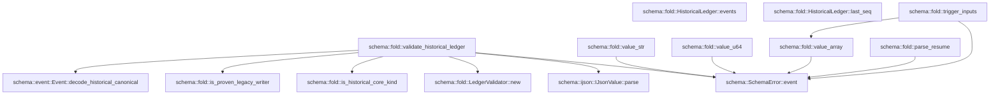

# schema::fold

[Package atlas](index.md) · [Source](../../src/fold.rs)

## Declarations

Visibility is the declaration spelling; trait members and reexports require their enclosing interface. `cfg` is not evaluated.

| Symbol | Kind | Visibility | Test / cfg |
|---|---|---|---|
| [schema::fold::LedgerProjection](../../src/fold.rs#L10) | struct_item | `pub` |  |
| [schema::fold::RunRange](../../src/fold.rs#L24) | struct_item | `pub` |  |
| [schema::fold::ContinuationFold](../../src/fold.rs#L33) | struct_item | `private` |  |
| [schema::fold::LifecycleFacts](../../src/fold.rs#L38) | struct_item | `pub` |  |
| [schema::fold::LifecycleFacts::durable_wait_until](../../src/fold.rs#L67) | function_item | `pub` |  |
| [schema::fold::InputState](../../src/fold.rs#L79) | struct_item | `private` |  |
| [schema::fold::AttemptStage](../../src/fold.rs#L88) | enum_item | `private` |  |
| [schema::fold::AttemptState](../../src/fold.rs#L97) | struct_item | `private` |  |
| [schema::fold::StopState](../../src/fold.rs#L103) | struct_item | `private` |  |
| [schema::fold::ApprovalState](../../src/fold.rs#L108) | struct_item | `private` |  |
| [schema::fold::LedgerValidator](../../src/fold.rs#L114) | struct_item | `pub` |  |
| [schema::fold::LedgerValidator::default](../../src/fold.rs#L140) | function_item | `private` |  |
| [schema::fold::LedgerValidator::new](../../src/fold.rs#L147) | function_item | `pub` |  |
| [schema::fold::LedgerValidator::push](../../src/fold.rs#L174) | function_item | `pub` |  |
| [schema::fold::LedgerValidator::push_historical](../../src/fold.rs#L184) | function_item | `private` |  |
| [schema::fold::LedgerValidator::push_inner](../../src/fold.rs#L194) | function_item | `private` |  |
| [schema::fold::LedgerValidator::finish](../../src/fold.rs#L223) | function_item | `pub` |  |
| [schema::fold::LedgerValidator::lifecycle_facts](../../src/fold.rs#L257) | function_item | `private` |  |
| [schema::fold::LedgerValidator::apply_reader_gate](../../src/fold.rs#L388) | function_item | `private` |  |
| [schema::fold::LedgerValidator::validate_backward_references](../../src/fold.rs#L411) | function_item | `private` |  |
| [schema::fold::LedgerValidator::validate_turn_allocation](../../src/fold.rs#L503) | function_item | `private` |  |
| [schema::fold::LedgerValidator::validate_turn_trigger](../../src/fold.rs#L547) | function_item | `private` |  |
| [schema::fold::LedgerValidator::validate_kind_relations](../../src/fold.rs#L653) | function_item | `private` |  |
| [schema::fold::LedgerValidator::open_attempt](../../src/fold.rs#L946) | function_item | `private` |  |
| [schema::fold::LedgerValidator::turn_consumed_input](../../src/fold.rs#L1003) | function_item | `private` |  |
| [schema::fold::LedgerValidator::finish_attempt](../../src/fold.rs#L1014) | function_item | `private` |  |
| [schema::fold::LedgerValidator::apply_supersedes](../../src/fold.rs#L1034) | function_item | `private` |  |
| [schema::fold::LedgerValidator::record_origin](../../src/fold.rs#L1066) | function_item | `private` |  |
| [schema::fold::LedgerValidator::has_open_hold](../../src/fold.rs#L1083) | function_item | `private` |  |
| [schema::fold::validate_ledger](../../src/fold.rs#L1092) | function_item | `pub` |  |
| [schema::fold::HistoricalLedger](../../src/fold.rs#L1116) | struct_item | `pub` |  |
| [schema::fold::HistoricalLedger::events](../../src/fold.rs#L1123) | function_item | `pub` |  |
| [schema::fold::HistoricalLedger::last_seq](../../src/fold.rs#L1128) | function_item | `pub` |  |
| [schema::fold::LEGACY_TOOLS_DIGEST_WRITERS](../../src/fold.rs#L1133) | const_item | `private` |  |
| [schema::fold::is_proven_legacy_writer](../../src/fold.rs#L1149) | function_item | `private` |  |
| [schema::fold::is_historical_core_kind](../../src/fold.rs#L1163) | function_item | `private` |  |
| [schema::fold::validate_historical_ledger](../../src/fold.rs#L1199) | function_item | `pub` |  |
| [schema::fold::trigger_inputs](../../src/fold.rs#L1290) | function_item | `private` |  |
| [schema::fold::value_str](../../src/fold.rs#L1311) | function_item | `private` |  |
| [schema::fold::value_u64](../../src/fold.rs#L1322) | function_item | `private` |  |
| [schema::fold::value_array](../../src/fold.rs#L1329) | function_item | `private` |  |
| [schema::fold::parse_resume](../../src/fold.rs#L1341) | function_item | `private` |  |

## Imports / reexports

| Local name | Source path | Visibility |
|---|---|---|
| `BTreeMap` | `std::collections::BTreeMap` | `private` |
| `BTreeSet` | `std::collections::BTreeSet` | `private` |
| `HashMap` | `std::collections::HashMap` | `private` |
| `HashSet` | `std::collections::HashSet` | `private` |
| `Map` | `serde_json::Map` | `private` |
| `Value` | `serde_json::Value` | `private` |
| `ranges` | `crate::event::ranges` | `private` |
| `Event` | `crate::Event` | `private` |
| `EventKind` | `crate::EventKind` | `private` |
| `SchemaError` | `crate::SchemaError` | `private` |
| `Visibility` | `crate::Visibility` | `private` |
| `OriginTuple` | `crate::OriginTuple` | `private` |
| `ResumePolicy` | `crate::ResumePolicy` | `private` |

## Module declarations

| Module | Visibility | Attributes |
|---|---|---|

## Function call graphs

Edges below are syntactically resolved calls only, including private functions. Graphs partition callers into groups of 20; they are not execution order. All unresolved sites are listed below and in the JSON inventory.

```mermaid
flowchart TD
  n0["schema::event::Event::decode_canonical"]
  n1["schema::event::ranges"]
  n2["schema::fold::LedgerValidator::turn_consumed_input"]
  n3["schema::fold::LedgerValidator::finish_attempt"]
  n4["schema::fold::LedgerValidator::apply_supersedes"]
  n5["schema::fold::LedgerValidator::record_origin"]
  n6["schema::fold::LedgerValidator::has_open_hold"]
  n7["schema::fold::validate_ledger"]
  n8["schema::fold::trigger_inputs"]
  n9["schema::fold::value_str"]
  n10["schema::fold::value_u64"]
  n11["schema::fold::value_array"]
  n12["schema::fold::parse_resume"]
  n13["schema::fold::LedgerValidator::default"]
  n14["schema::fold::LedgerValidator::new"]
  n15["schema::fold::LedgerValidator::push"]
  n16["schema::fold::LedgerValidator::push_historical"]
  n17["schema::fold::LedgerValidator::push_inner"]
  n18["schema::fold::LedgerValidator::finish"]
  n19["schema::fold::LedgerValidator::lifecycle_facts"]
  n20["schema::fold::LedgerValidator::apply_reader_gate"]
  n21["schema::fold::LedgerValidator::validate_backward_references"]
  n22["schema::fold::LedgerValidator::validate_turn_allocation"]
  n23["schema::fold::LedgerValidator::validate_turn_trigger"]
  n24["schema::fold::LedgerValidator::validate_kind_relations"]
  n25["schema::fold::LifecycleFacts::durable_wait_until"]
  n26["schema::fold::LedgerValidator::open_attempt"]
  n27["schema::SchemaError::event"]
  n28["schema::SchemaError::constraint"]
  n2 --> n8
  n3 --> n9
  n3 --> n28
  n4 --> n1
  n4 --> n28
  n5 --> n27
  n7 --> n0
  n7 --> n14
  n7 --> n27
  n15 --> n17
  n15 --> n27
  n16 --> n17
  n16 --> n27
  n17 --> n4
  n17 --> n5
  n17 --> n20
  n17 --> n21
  n17 --> n22
  n17 --> n24
  n17 --> n27
  n18 --> n19
  n20 --> n10
  n20 --> n12
  n21 --> n1
  n21 --> n8
  n21 --> n9
  n21 --> n10
  n21 --> n11
  n21 --> n28
  n22 --> n23
  n22 --> n28
  n23 --> n6
  n23 --> n8
  n23 --> n28
  n24 --> n1
  n24 --> n3
  n24 --> n6
  n24 --> n9
  n24 --> n10
  n24 --> n26
  n24 --> n28
  n26 --> n1
  n26 --> n2
  n26 --> n9
  n26 --> n28
```

Functions 1–20: 45 direct edges

Functions 21–30: 12 direct edges

## Call sites

Includes test functions (marked in declarations). Receiver-type-required sites need type analysis/manual tracing. Calls in closures are attributed to their enclosing function; their occurrence here does not mean the closure executes immediately.

| Caller | Callee expression | Source lines | Target / classification |
|---|---|---|---|
| `durable_wait_until` | `[             self.continuation_wait_until.as_deref(),             self.admission_wait_until.as_deref(),         ]         .into_iter()         .flatten()         .max` | [68](../../src/fold.rs#L68) | receiver-type-required |
| `durable_wait_until` | `[             self.continuation_wait_until.as_deref(),             self.admission_wait_until.as_deref(),         ]         .into_iter()         .flatten` | [68](../../src/fold.rs#L68) | receiver-type-required |
| `durable_wait_until` | `[             self.continuation_wait_until.as_deref(),             self.admission_wait_until.as_deref(),         ]         .into_iter` | [68](../../src/fold.rs#L68) | receiver-type-required |
| `durable_wait_until` | `self.continuation_wait_until.as_deref` | [69](../../src/fold.rs#L69) | receiver-type-required |
| `durable_wait_until` | `self.admission_wait_until.as_deref` | [70](../../src/fold.rs#L70) | receiver-type-required |
| `default` | `Self::new` | [141](../../src/fold.rs#L141) | external-constructor-callback-or-unresolved |
| `new` | `Vec::new` | [150](../../src/fold.rs#L150) | external-constructor-callback-or-unresolved |
| `new` | `BTreeMap::new` | [151](../../src/fold.rs#L151), [167](../../src/fold.rs#L167), [168](../../src/fold.rs#L168) | external-constructor-callback-or-unresolved |
| `new` | `HashMap::new` | [152](../../src/fold.rs#L152), [153](../../src/fold.rs#L153), [154](../../src/fold.rs#L154), [155](../../src/fold.rs#L155), [157](../../src/fold.rs#L157), [158](../../src/fold.rs#L158), [160](../../src/fold.rs#L160) | external-constructor-callback-or-unresolved |
| `new` | `HashSet::new` | [156](../../src/fold.rs#L156), [162](../../src/fold.rs#L162) | external-constructor-callback-or-unresolved |
| `push` | `event.is_historical_only` | [175](../../src/fold.rs#L175) | receiver-type-required |
| `push` | `Err` | [176](../../src/fold.rs#L176) | external-constructor-callback-or-unresolved |
| `push` | `SchemaError::event` | [176](../../src/fold.rs#L176) | [schema::SchemaError::event](../../src/lib.rs#L131) |
| `push` | `Some` | [177](../../src/fold.rs#L177) | external-constructor-callback-or-unresolved |
| `push` | `event.seq` | [177](../../src/fold.rs#L177) | receiver-type-required |
| `push` | `self.push_inner` | [181](../../src/fold.rs#L181) | [schema::fold::LedgerValidator::push_inner](../../src/fold.rs#L194) |
| `push_historical` | `event.is_historical_only` | [185](../../src/fold.rs#L185) | receiver-type-required |
| `push_historical` | `Err` | [186](../../src/fold.rs#L186) | external-constructor-callback-or-unresolved |
| `push_historical` | `SchemaError::event` | [186](../../src/fold.rs#L186) | [schema::SchemaError::event](../../src/lib.rs#L131) |
| `push_historical` | `Some` | [187](../../src/fold.rs#L187) | external-constructor-callback-or-unresolved |
| `push_historical` | `event.seq` | [187](../../src/fold.rs#L187) | receiver-type-required |
| `push_historical` | `self.push_inner` | [191](../../src/fold.rs#L191) | [schema::fold::LedgerValidator::push_inner](../../src/fold.rs#L194) |
| `push_inner` | `event.seq` | [195](../../src/fold.rs#L195) | receiver-type-required |
| `push_inner` | `self.events.len` | [196](../../src/fold.rs#L196) | receiver-type-required |
| `push_inner` | `Err` | [198](../../src/fold.rs#L198), [204](../../src/fold.rs#L204), [207](../../src/fold.rs#L207) | external-constructor-callback-or-unresolved |
| `push_inner` | `SchemaError::event` | [198](../../src/fold.rs#L198), [204](../../src/fold.rs#L204), [207](../../src/fold.rs#L207) | [schema::SchemaError::event](../../src/lib.rs#L131) |
| `push_inner` | `Some` | [199](../../src/fold.rs#L199), [204](../../src/fold.rs#L204), [208](../../src/fold.rs#L208) | external-constructor-callback-or-unresolved |
| `push_inner` | `self.apply_reader_gate` | [213](../../src/fold.rs#L213) | [schema::fold::LedgerValidator::apply_reader_gate](../../src/fold.rs#L388) |
| `push_inner` | `self.validate_backward_references` | [214](../../src/fold.rs#L214) | [schema::fold::LedgerValidator::validate_backward_references](../../src/fold.rs#L411) |
| `push_inner` | `self.validate_turn_allocation` | [215](../../src/fold.rs#L215) | [schema::fold::LedgerValidator::validate_turn_allocation](../../src/fold.rs#L503) |
| `push_inner` | `self.validate_kind_relations` | [216](../../src/fold.rs#L216) | [schema::fold::LedgerValidator::validate_kind_relations](../../src/fold.rs#L653) |
| `push_inner` | `self.apply_supersedes` | [217](../../src/fold.rs#L217) | [schema::fold::LedgerValidator::apply_supersedes](../../src/fold.rs#L1034) |
| `push_inner` | `self.record_origin` | [218](../../src/fold.rs#L218) | [schema::fold::LedgerValidator::record_origin](../../src/fold.rs#L1066) |
| `push_inner` | `self.events.push` | [219](../../src/fold.rs#L219) | receiver-type-required |
| `push_inner` | `Ok` | [220](../../src/fold.rs#L220) | external-constructor-callback-or-unresolved |
| `finish` | `self.lifecycle_facts` | [224](../../src/fold.rs#L224) | [schema::fold::LedgerValidator::lifecycle_facts](../../src/fold.rs#L257) |
| `finish` | `Vec::<RunRange>::new` | [225](../../src/fold.rs#L225) | external-constructor-callback-or-unresolved |
| `finish` | `run_ranges.last_mut` | [228](../../src/fold.rs#L228) | receiver-type-required |
| `finish` | `event.seq` | [229](../../src/fold.rs#L229), [236](../../src/fold.rs#L236), [237](../../src/fold.rs#L237) | receiver-type-required |
| `finish` | `run_ranges.push` | [231](../../src/fold.rs#L231) | receiver-type-required |
| `finish` | `event                         .string_field("run")                         .expect("validated run_start has run")                         .to_owned` | [232](../../src/fold.rs#L232) | receiver-type-required |
| `finish` | `event                         .string_field("run")                         .expect` | [232](../../src/fold.rs#L232) | receiver-type-required |
| `finish` | `event                         .string_field` | [232](../../src/fold.rs#L232) | receiver-type-required |
| `finish` | `self.events.last().map_or` | [237](../../src/fold.rs#L237), [242](../../src/fold.rs#L242) | receiver-type-required |
| `finish` | `self.events.last` | [237](../../src/fold.rs#L237), [242](../../src/fold.rs#L242) | receiver-type-required |
| `finish` | `Ok` | [241](../../src/fold.rs#L241) | external-constructor-callback-or-unresolved |
| `finish` | `self                 .latest_turn                 .is_some_and` | [244](../../src/fold.rs#L244) | receiver-type-required |
| `finish` | `self.settled_turns.contains` | [246](../../src/fold.rs#L246) | receiver-type-required |
| `lifecycle_facts` | `self             .latest_turn             .is_some_and` | [258](../../src/fold.rs#L258) | receiver-type-required |
| `lifecycle_facts` | `self.settled_turns.contains` | [260](../../src/fold.rs#L260) | receiver-type-required |
| `lifecycle_facts` | `self             .approvals             .iter()             .filter(&#124;(call, _)&#124; !self.tool_results.contains_key(*call))             .max_by_key(&#124;(_, state)&#124; state.seq)             .map` | [261](../../src/fold.rs#L261) | receiver-type-required |
| `lifecycle_facts` | `self             .approvals             .iter()             .filter(&#124;(call, _)&#124; !self.tool_results.contains_key(*call))             .max_by_key` | [261](../../src/fold.rs#L261) | receiver-type-required |
| `lifecycle_facts` | `self             .approvals             .iter()             .filter` | [261](../../src/fold.rs#L261) | receiver-type-required |
| `lifecycle_facts` | `self             .approvals             .iter` | [261](../../src/fold.rs#L261) | receiver-type-required |
| `lifecycle_facts` | `self.tool_results.contains_key` | [264](../../src/fold.rs#L264), [338](../../src/fold.rs#L338), [351](../../src/fold.rs#L351), [364](../../src/fold.rs#L364) | receiver-type-required |
| `lifecycle_facts` | `latest_hold.is_some_and` | [267](../../src/fold.rs#L267), [268](../../src/fold.rs#L268) | receiver-type-required |
| `lifecycle_facts` | `self             .latest_stop             .as_ref()             .is_some_and` | [269](../../src/fold.rs#L269) | receiver-type-required |
| `lifecycle_facts` | `self             .latest_stop             .as_ref` | [269](../../src/fold.rs#L269), [273](../../src/fold.rs#L273) | receiver-type-required |
| `lifecycle_facts` | `stop.closure_point.is_none` | [272](../../src/fold.rs#L272) | receiver-type-required |
| `lifecycle_facts` | `self             .latest_stop             .as_ref()             .and_then` | [273](../../src/fold.rs#L273) | receiver-type-required |
| `lifecycle_facts` | `Vec::new` | [278](../../src/fold.rs#L278) | external-constructor-callback-or-unresolved |
| `lifecycle_facts` | `self.inputs                 .iter()                 .filter_map(&#124;(seq, input)&#124; {                     (!input.steer                         && !input.consumed                         && !input.superseded                         && (!input.queued_behind_hold &#124;&#124; terminal_tail)                         && closure_point.is_none_or(&#124;closure&#124; *seq > closure))                     .then_some(*seq)                 })                 .collect` | [280](../../src/fold.rs#L280) | receiver-type-required |
| `lifecycle_facts` | `self.inputs                 .iter()                 .filter_map` | [280](../../src/fold.rs#L280), [293](../../src/fold.rs#L293) | receiver-type-required |
| `lifecycle_facts` | `self.inputs                 .iter` | [280](../../src/fold.rs#L280), [293](../../src/fold.rs#L293) | receiver-type-required |
| `lifecycle_facts` | `(!input.steer                         && !input.consumed                         && !input.superseded                         && (!input.queued_behind_hold &#124;&#124; terminal_tail)                         && closure_point.is_none_or(&#124;closure&#124; *seq > closure))                     .then_some` | [283](../../src/fold.rs#L283) | receiver-type-required |
| `lifecycle_facts` | `closure_point.is_none_or` | [287](../../src/fold.rs#L287) | receiver-type-required |
| `lifecycle_facts` | `runnable_inputs.last().map_or_else` | [292](../../src/fold.rs#L292) | receiver-type-required |
| `lifecycle_facts` | `runnable_inputs.last` | [292](../../src/fold.rs#L292) | receiver-type-required |
| `lifecycle_facts` | `self.inputs                 .iter()                 .filter_map(&#124;(seq, input)&#124; {                     (*seq <= *maximum && !input.steer && !input.consumed && !input.superseded)                         .then_some(*seq)                 })                 .collect` | [293](../../src/fold.rs#L293) | receiver-type-required |
| `lifecycle_facts` | `(*seq <= *maximum && !input.steer && !input.consumed && !input.superseded)                         .then_some` | [296](../../src/fold.rs#L296) | receiver-type-required |
| `lifecycle_facts` | `self             .inputs             .iter()             .filter_map(&#124;(seq, input)&#124; (!input.consumed && !input.superseded).then_some(*seq))             .collect` | [301](../../src/fold.rs#L301) | receiver-type-required |
| `lifecycle_facts` | `self             .inputs             .iter()             .filter_map` | [301](../../src/fold.rs#L301) | receiver-type-required |
| `lifecycle_facts` | `self             .inputs             .iter` | [301](../../src/fold.rs#L301) | receiver-type-required |
| `lifecycle_facts` | `(!input.consumed && !input.superseded).then_some` | [304](../../src/fold.rs#L304) | receiver-type-required |
| `lifecycle_facts` | `self             .attempts             .values()             .any` | [306](../../src/fold.rs#L306) | receiver-type-required |
| `lifecycle_facts` | `self             .attempts             .values` | [306](../../src/fold.rs#L306) | receiver-type-required |
| `lifecycle_facts` | `self                 .events                 .iter()                 .filter(&#124;e&#124; e.kind() == &EventKind::ToolCall)                 .filter_map(&#124;e&#124; e.string_field("call").map(&#124;id&#124; (id, e)))                 .collect` | [316](../../src/fold.rs#L316) | receiver-type-required |
| `lifecycle_facts` | `self                 .events                 .iter()                 .filter(&#124;e&#124; e.kind() == &EventKind::ToolCall)                 .filter_map` | [316](../../src/fold.rs#L316) | receiver-type-required |
| `lifecycle_facts` | `self                 .events                 .iter()                 .filter` | [316](../../src/fold.rs#L316), [322](../../src/fold.rs#L322) | receiver-type-required |
| `lifecycle_facts` | `self                 .events                 .iter` | [316](../../src/fold.rs#L316), [322](../../src/fold.rs#L322) | receiver-type-required |
| `lifecycle_facts` | `e.kind` | [319](../../src/fold.rs#L319), [325](../../src/fold.rs#L325) | receiver-type-required |
| `lifecycle_facts` | `e.string_field("call").map` | [320](../../src/fold.rs#L320) | receiver-type-required |
| `lifecycle_facts` | `e.string_field` | [320](../../src/fold.rs#L320), [326](../../src/fold.rs#L326) | receiver-type-required |
| `lifecycle_facts` | `self                 .events                 .iter()                 .filter(&#124;e&#124; e.kind() == &EventKind::ToolExecutionStarted)                 .filter_map(&#124;e&#124; e.string_field("call"))                 .collect` | [322](../../src/fold.rs#L322) | receiver-type-required |
| `lifecycle_facts` | `self                 .events                 .iter()                 .filter(&#124;e&#124; e.kind() == &EventKind::ToolExecutionStarted)                 .filter_map` | [322](../../src/fold.rs#L322) | receiver-type-required |
| `lifecycle_facts` | `calls                 .iter()                 .filter_map(&#124;(id, event)&#124; {                     let tracked = event                         .object()                         .get("execution_tracked")                         .and_then(Value::as_bool)                         == Some(true);                     let behind_hold = self.approvals.iter().any(&#124;(held, approval)&#124; {                         !approval.answered                             && !self.tool_results.contains_key(held)                             && calls.get(held.as_str()).is_some_and(&#124;head&#124; {                                 head.seq() < event.seq()                                     && head.string_field("attempt") == event.string_field("attempt")                             })                     });                     (tracked && !started.contains(id) && behind_hold).then_some(*id)                 })                 .collect::<HashSet<_>>` | [328](../../src/fold.rs#L328) | receiver-type-required |
| `lifecycle_facts` | `calls                 .iter()                 .filter_map` | [328](../../src/fold.rs#L328) | receiver-type-required |
| `lifecycle_facts` | `calls                 .iter` | [328](../../src/fold.rs#L328) | receiver-type-required |
| `lifecycle_facts` | `event                         .object()                         .get("execution_tracked")                         .and_then` | [331](../../src/fold.rs#L331) | receiver-type-required |
| `lifecycle_facts` | `event                         .object()                         .get` | [331](../../src/fold.rs#L331) | receiver-type-required |
| `lifecycle_facts` | `event                         .object` | [331](../../src/fold.rs#L331) | receiver-type-required |
| `lifecycle_facts` | `Some` | [335](../../src/fold.rs#L335) | external-constructor-callback-or-unresolved |
| `lifecycle_facts` | `self.approvals.iter().any` | [336](../../src/fold.rs#L336) | receiver-type-required |
| `lifecycle_facts` | `self.approvals.iter` | [336](../../src/fold.rs#L336) | receiver-type-required |
| `lifecycle_facts` | `calls.get(held.as_str()).is_some_and` | [339](../../src/fold.rs#L339) | receiver-type-required |
| `lifecycle_facts` | `calls.get` | [339](../../src/fold.rs#L339) | receiver-type-required |
| `lifecycle_facts` | `held.as_str` | [339](../../src/fold.rs#L339) | receiver-type-required |
| `lifecycle_facts` | `head.seq` | [340](../../src/fold.rs#L340) | receiver-type-required |
| `lifecycle_facts` | `event.seq` | [340](../../src/fold.rs#L340) | receiver-type-required |
| `lifecycle_facts` | `head.string_field` | [341](../../src/fold.rs#L341) | receiver-type-required |
| `lifecycle_facts` | `event.string_field` | [341](../../src/fold.rs#L341) | receiver-type-required |
| `lifecycle_facts` | `(tracked && !started.contains(id) && behind_hold).then_some` | [344](../../src/fold.rs#L344) | receiver-type-required |
| `lifecycle_facts` | `started.contains` | [344](../../src/fold.rs#L344) | receiver-type-required |
| `lifecycle_facts` | `HashSet::new` | [348](../../src/fold.rs#L348) | external-constructor-callback-or-unresolved |
| `lifecycle_facts` | `self.tool_calls.keys().any` | [350](../../src/fold.rs#L350) | receiver-type-required |
| `lifecycle_facts` | `self.tool_calls.keys` | [350](../../src/fold.rs#L350) | receiver-type-required |
| `lifecycle_facts` | `self.approvals.contains_key` | [352](../../src/fold.rs#L352), [365](../../src/fold.rs#L365) | receiver-type-required |
| `lifecycle_facts` | `waiting_siblings.contains` | [353](../../src/fold.rs#L353) | receiver-type-required |
| `lifecycle_facts` | `call.as_str` | [353](../../src/fold.rs#L353) | receiver-type-required |
| `lifecycle_facts` | `self             .spawns             .keys()             .any` | [355](../../src/fold.rs#L355) | receiver-type-required |
| `lifecycle_facts` | `self             .spawns             .keys` | [355](../../src/fold.rs#L355) | receiver-type-required |
| `lifecycle_facts` | `self.child_results.contains` | [358](../../src/fold.rs#L358) | receiver-type-required |
| `lifecycle_facts` | `self             .continuations             .iter()             .filter(&#124;(call, _)&#124; {                 self.tool_calls.contains_key(*call)                     && !self.tool_results.contains_key(*call)                     && !self.approvals.contains_key(*call)             })             .filter_map(&#124;(_, fold)&#124; fold.poll_after.clone())             .max` | [359](../../src/fold.rs#L359) | receiver-type-required |
| `lifecycle_facts` | `self             .continuations             .iter()             .filter(&#124;(call, _)&#124; {                 self.tool_calls.contains_key(*call)                     && !self.tool_results.contains_key(*call)                     && !self.approvals.contains_key(*call)             })             .filter_map` | [359](../../src/fold.rs#L359) | receiver-type-required |
| `lifecycle_facts` | `self             .continuations             .iter()             .filter` | [359](../../src/fold.rs#L359) | receiver-type-required |
| `lifecycle_facts` | `self             .continuations             .iter` | [359](../../src/fold.rs#L359) | receiver-type-required |
| `lifecycle_facts` | `self.tool_calls.contains_key` | [363](../../src/fold.rs#L363) | receiver-type-required |
| `lifecycle_facts` | `fold.poll_after.clone` | [367](../../src/fold.rs#L367) | receiver-type-required |
| `lifecycle_facts` | `self.latest_turn.is_none` | [379](../../src/fold.rs#L379) | receiver-type-required |
| `lifecycle_facts` | `self.admission_wait.clone` | [384](../../src/fold.rs#L384) | receiver-type-required |
| `apply_reader_gate` | `event.object` | [389](../../src/fold.rs#L389) | receiver-type-required |
| `apply_reader_gate` | `value_u64` | [391](../../src/fold.rs#L391), [403](../../src/fold.rs#L403) | [schema::fold::value_u64](../../src/fold.rs#L1322) |
| `apply_reader_gate` | `event.seq` | [391](../../src/fold.rs#L391), [393](../../src/fold.rs#L393), [403](../../src/fold.rs#L403) | receiver-type-required |
| `apply_reader_gate` | `object.contains_key` | [392](../../src/fold.rs#L392) | receiver-type-required |
| `apply_reader_gate` | `parse_resume` | [393](../../src/fold.rs#L393) | [schema::fold::parse_resume](../../src/fold.rs#L1341) |
| `apply_reader_gate` | `object.get` | [393](../../src/fold.rs#L393), [399](../../src/fold.rs#L399) | receiver-type-required |
| `apply_reader_gate` | `event.min_reader` | [395](../../src/fold.rs#L395) | receiver-type-required |
| `apply_reader_gate` | `self.required_reader.max` | [396](../../src/fold.rs#L396) | receiver-type-required |
| `apply_reader_gate` | `object.get("upgrade").and_then` | [399](../../src/fold.rs#L399) | receiver-type-required |
| `apply_reader_gate` | `self.required_reader                     .max` | [402](../../src/fold.rs#L402) | receiver-type-required |
| `apply_reader_gate` | `Ok` | [408](../../src/fold.rs#L408) | external-constructor-callback-or-unresolved |
| `validate_backward_references` | `event.seq` | [412](../../src/fold.rs#L412) | receiver-type-required |
| `validate_backward_references` | `event.object` | [413](../../src/fold.rs#L413) | receiver-type-required |
| `validate_backward_references` | `object.contains_key` | [415](../../src/fold.rs#L415) | receiver-type-required |
| `validate_backward_references` | `ranges` | [416](../../src/fold.rs#L416), [429](../../src/fold.rs#L429), [462](../../src/fold.rs#L462) | [schema::event::ranges](../../src/event.rs#L1754) |
| `validate_backward_references` | `Err` | [418](../../src/fold.rs#L418), [431](../../src/fold.rs#L431), [442](../../src/fold.rs#L442), [456](../../src/fold.rs#L456), [464](../../src/fold.rs#L464), [477](../../src/fold.rs#L477), [491](../../src/fold.rs#L491) | external-constructor-callback-or-unresolved |
| `validate_backward_references` | `SchemaError::constraint` | [418](../../src/fold.rs#L418), [431](../../src/fold.rs#L431), [442](../../src/fold.rs#L442), [456](../../src/fold.rs#L456), [464](../../src/fold.rs#L464), [477](../../src/fold.rs#L477), [491](../../src/fold.rs#L491) | [schema::SchemaError::constraint](../../src/lib.rs#L138) |
| `validate_backward_references` | `event.kind` | [427](../../src/fold.rs#L427) | receiver-type-required |
| `validate_backward_references` | `value_u64` | [440](../../src/fold.rs#L440) | [schema::fold::value_u64](../../src/fold.rs#L1322) |
| `validate_backward_references` | `value_str` | [450](../../src/fold.rs#L450) | [schema::fold::value_str](../../src/fold.rs#L1311) |
| `validate_backward_references` | `self                     .epochs                     .get(epoch)                     .is_none_or` | [451](../../src/fold.rs#L451) | receiver-type-required |
| `validate_backward_references` | `self                     .epochs                     .get` | [451](../../src/fold.rs#L451) | receiver-type-required |
| `validate_backward_references` | `object.get("pending").and_then` | [473](../../src/fold.rs#L473) | receiver-type-required |
| `validate_backward_references` | `object.get` | [473](../../src/fold.rs#L473) | receiver-type-required |
| `validate_backward_references` | `value_array` | [475](../../src/fold.rs#L475) | [schema::fold::value_array](../../src/fold.rs#L1329) |
| `validate_backward_references` | `reference.as_u64().is_none_or` | [476](../../src/fold.rs#L476) | receiver-type-required |
| `validate_backward_references` | `reference.as_u64` | [476](../../src/fold.rs#L476) | receiver-type-required |
| `validate_backward_references` | `trigger_inputs` | [488](../../src/fold.rs#L488) | [schema::fold::trigger_inputs](../../src/fold.rs#L1290) |
| `validate_backward_references` | `inputs.iter().any` | [489](../../src/fold.rs#L489) | receiver-type-required |
| `validate_backward_references` | `inputs.iter` | [489](../../src/fold.rs#L489) | receiver-type-required |
| `validate_backward_references` | `Ok` | [500](../../src/fold.rs#L500) | external-constructor-callback-or-unresolved |
| `validate_turn_allocation` | `event.seq` | [504](../../src/fold.rs#L504) | receiver-type-required |
| `validate_turn_allocation` | `event.turn` | [505](../../src/fold.rs#L505) | receiver-type-required |
| `validate_turn_allocation` | `Ok` | [506](../../src/fold.rs#L506), [528](../../src/fold.rs#L528), [544](../../src/fold.rs#L544) | external-constructor-callback-or-unresolved |
| `validate_turn_allocation` | `self.latest_turn.map_or` | [509](../../src/fold.rs#L509) | receiver-type-required |
| `validate_turn_allocation` | `Err` | [511](../../src/fold.rs#L511), [520](../../src/fold.rs#L520), [531](../../src/fold.rs#L531), [538](../../src/fold.rs#L538) | external-constructor-callback-or-unresolved |
| `validate_turn_allocation` | `SchemaError::constraint` | [511](../../src/fold.rs#L511), [520](../../src/fold.rs#L520), [531](../../src/fold.rs#L531), [538](../../src/fold.rs#L538) | [schema::SchemaError::constraint](../../src/lib.rs#L138) |
| `validate_turn_allocation` | `self.settled_turns.contains` | [518](../../src/fold.rs#L518), [537](../../src/fold.rs#L537) | receiver-type-required |
| `validate_turn_allocation` | `self.validate_turn_trigger` | [526](../../src/fold.rs#L526) | [schema::fold::LedgerValidator::validate_turn_trigger](../../src/fold.rs#L547) |
| `validate_turn_allocation` | `Some` | [527](../../src/fold.rs#L527), [530](../../src/fold.rs#L530) | external-constructor-callback-or-unresolved |
| `validate_turn_trigger` | `event.seq` | [548](../../src/fold.rs#L548) | receiver-type-required |
| `validate_turn_trigger` | `event.turn().expect` | [549](../../src/fold.rs#L549) | receiver-type-required |
| `validate_turn_trigger` | `event.turn` | [549](../../src/fold.rs#L549) | receiver-type-required |
| `validate_turn_trigger` | `event.object` | [550](../../src/fold.rs#L550) | receiver-type-required |
| `validate_turn_trigger` | `object.get("trigger").expect` | [551](../../src/fold.rs#L551) | receiver-type-required |
| `validate_turn_trigger` | `object.get` | [551](../../src/fold.rs#L551) | receiver-type-required |
| `validate_turn_trigger` | `trigger.as_str` | [552](../../src/fold.rs#L552) | receiver-type-required |
| `validate_turn_trigger` | `Some` | [552](../../src/fold.rs#L552) | external-constructor-callback-or-unresolved |
| `validate_turn_trigger` | `Err` | [554](../../src/fold.rs#L554), [576](../../src/fold.rs#L576), [593](../../src/fold.rs#L593), [605](../../src/fold.rs#L605), [612](../../src/fold.rs#L612), [628](../../src/fold.rs#L628), [637](../../src/fold.rs#L637) | external-constructor-callback-or-unresolved |
| `validate_turn_trigger` | `SchemaError::constraint` | [554](../../src/fold.rs#L554), [576](../../src/fold.rs#L576), [593](../../src/fold.rs#L593), [605](../../src/fold.rs#L605), [612](../../src/fold.rs#L612), [621](../../src/fold.rs#L621), [628](../../src/fold.rs#L628), [637](../../src/fold.rs#L637) | [schema::SchemaError::constraint](../../src/lib.rs#L138) |
| `validate_turn_trigger` | `Ok` | [560](../../src/fold.rs#L560), [582](../../src/fold.rs#L582), [650](../../src/fold.rs#L650) | external-constructor-callback-or-unresolved |
| `validate_turn_trigger` | `trigger.get("goal").is_some` | [562](../../src/fold.rs#L562) | receiver-type-required |
| `validate_turn_trigger` | `trigger.get` | [562](../../src/fold.rs#L562) | receiver-type-required |
| `validate_turn_trigger` | `self.settled_turns.contains` | [565](../../src/fold.rs#L565) | receiver-type-required |
| `validate_turn_trigger` | `self                     .latest_stop                     .as_ref()                     .is_some_and` | [566](../../src/fold.rs#L566) | receiver-type-required |
| `validate_turn_trigger` | `self                     .latest_stop                     .as_ref` | [566](../../src/fold.rs#L566) | receiver-type-required |
| `validate_turn_trigger` | `stop.closure_point.is_none` | [569](../../src/fold.rs#L569), [591](../../src/fold.rs#L591) | receiver-type-required |
| `validate_turn_trigger` | `self.has_open_hold` | [570](../../src/fold.rs#L570), [611](../../src/fold.rs#L611) | [schema::fold::LedgerValidator::has_open_hold](../../src/fold.rs#L1083) |
| `validate_turn_trigger` | `self                     .inputs                     .values()                     .any` | [571](../../src/fold.rs#L571) | receiver-type-required |
| `validate_turn_trigger` | `self                     .inputs                     .values` | [571](../../src/fold.rs#L571) | receiver-type-required |
| `validate_turn_trigger` | `trigger_inputs(object, seq)?.expect` | [584](../../src/fold.rs#L584) | receiver-type-required |
| `validate_turn_trigger` | `trigger_inputs` | [584](../../src/fold.rs#L584) | [schema::fold::trigger_inputs](../../src/fold.rs#L1290) |
| `validate_turn_trigger` | `inputs             .last()             .expect` | [585](../../src/fold.rs#L585) | receiver-type-required |
| `validate_turn_trigger` | `inputs             .last` | [585](../../src/fold.rs#L585) | receiver-type-required |
| `validate_turn_trigger` | `self             .latest_stop             .as_ref()             .is_some_and` | [588](../../src/fold.rs#L588) | receiver-type-required |
| `validate_turn_trigger` | `self             .latest_stop             .as_ref` | [588](../../src/fold.rs#L588), [599](../../src/fold.rs#L599) | receiver-type-required |
| `validate_turn_trigger` | `self             .latest_stop             .as_ref()             .and_then(&#124;stop&#124; stop.closure_point)             .is_some_and` | [599](../../src/fold.rs#L599) | receiver-type-required |
| `validate_turn_trigger` | `self             .latest_stop             .as_ref()             .and_then` | [599](../../src/fold.rs#L599) | receiver-type-required |
| `validate_turn_trigger` | `inputs.iter().copied().collect` | [618](../../src/fold.rs#L618) | receiver-type-required |
| `validate_turn_trigger` | `inputs.iter().copied` | [618](../../src/fold.rs#L618) | receiver-type-required |
| `validate_turn_trigger` | `inputs.iter` | [618](../../src/fold.rs#L618) | receiver-type-required |
| `validate_turn_trigger` | `self.inputs.get(input_seq).ok_or_else` | [620](../../src/fold.rs#L620) | receiver-type-required |
| `validate_turn_trigger` | `self.inputs.get` | [620](../../src/fold.rs#L620) | receiver-type-required |
| `validate_turn_trigger` | `self.inputs.range` | [635](../../src/fold.rs#L635) | receiver-type-required |
| `validate_turn_trigger` | `named.contains` | [636](../../src/fold.rs#L636) | receiver-type-required |
| `validate_turn_trigger` | `self.inputs                 .get_mut(&input_seq)                 .expect` | [645](../../src/fold.rs#L645) | receiver-type-required |
| `validate_turn_trigger` | `self.inputs                 .get_mut` | [645](../../src/fold.rs#L645) | receiver-type-required |
| `validate_kind_relations` | `event.seq` | [654](../../src/fold.rs#L654) | receiver-type-required |
| `validate_kind_relations` | `event.object` | [655](../../src/fold.rs#L655), [783](../../src/fold.rs#L783) | receiver-type-required |
| `validate_kind_relations` | `event.kind` | [656](../../src/fold.rs#L656), [779](../../src/fold.rs#L779) | receiver-type-required |
| `validate_kind_relations` | `object                     .get("steer")                     .and_then(Value::as_bool)                     .unwrap_or` | [658](../../src/fold.rs#L658) | receiver-type-required |
| `validate_kind_relations` | `object                     .get("steer")                     .and_then` | [658](../../src/fold.rs#L658) | receiver-type-required |
| `validate_kind_relations` | `object                     .get` | [658](../../src/fold.rs#L658), [839](../../src/fold.rs#L839) | receiver-type-required |
| `validate_kind_relations` | `self.has_open_hold` | [662](../../src/fold.rs#L662) | [schema::fold::LedgerValidator::has_open_hold](../../src/fold.rs#L1083) |
| `validate_kind_relations` | `self.inputs.insert` | [663](../../src/fold.rs#L663) | receiver-type-required |
| `validate_kind_relations` | `steer.then_some(self.latest_turn).flatten` | [667](../../src/fold.rs#L667) | receiver-type-required |
| `validate_kind_relations` | `steer.then_some` | [667](../../src/fold.rs#L667) | receiver-type-required |
| `validate_kind_relations` | `value_str(object, "id", seq)?.to_owned` | [675](../../src/fold.rs#L675) | receiver-type-required |
| `validate_kind_relations` | `value_str` | [675](../../src/fold.rs#L675), [685](../../src/fold.rs#L685), [700](../../src/fold.rs#L700), [718](../../src/fold.rs#L718), [732](../../src/fold.rs#L732), [749](../../src/fold.rs#L749), [755](../../src/fold.rs#L755), [794](../../src/fold.rs#L794), [820](../../src/fold.rs#L820), [826](../../src/fold.rs#L826), [862](../../src/fold.rs#L862), [882](../../src/fold.rs#L882), [925](../../src/fold.rs#L925) | [schema::fold::value_str](../../src/fold.rs#L1311) |
| `validate_kind_relations` | `self.epochs.insert(id, seq).is_some` | [676](../../src/fold.rs#L676) | receiver-type-required |
| `validate_kind_relations` | `self.epochs.insert` | [676](../../src/fold.rs#L676) | receiver-type-required |
| `validate_kind_relations` | `Err` | [677](../../src/fold.rs#L677), [691](../../src/fold.rs#L691), [709](../../src/fold.rs#L709), [724](../../src/fold.rs#L724), [738](../../src/fold.rs#L738), [751](../../src/fold.rs#L751), [757](../../src/fold.rs#L757), [768](../../src/fold.rs#L768), [786](../../src/fold.rs#L786), [796](../../src/fold.rs#L796), [811](../../src/fold.rs#L811), [822](../../src/fold.rs#L822), [828](../../src/fold.rs#L828), [874](../../src/fold.rs#L874), [887](../../src/fold.rs#L887), [899](../../src/fold.rs#L899), [928](../../src/fold.rs#L928) | external-constructor-callback-or-unresolved |
| `validate_kind_relations` | `SchemaError::constraint` | [677](../../src/fold.rs#L677), [689](../../src/fold.rs#L689), [691](../../src/fold.rs#L691), [704](../../src/fold.rs#L704), [709](../../src/fold.rs#L709), [722](../../src/fold.rs#L722), [724](../../src/fold.rs#L724), [736](../../src/fold.rs#L736), [738](../../src/fold.rs#L738), [751](../../src/fold.rs#L751), [757](../../src/fold.rs#L757), [768](../../src/fold.rs#L768), [786](../../src/fold.rs#L786), [796](../../src/fold.rs#L796), [811](../../src/fold.rs#L811), [822](../../src/fold.rs#L822), [828](../../src/fold.rs#L828), [874](../../src/fold.rs#L874), [884](../../src/fold.rs#L884), [887](../../src/fold.rs#L887), [899](../../src/fold.rs#L899), [928](../../src/fold.rs#L928) | [schema::SchemaError::constraint](../../src/lib.rs#L138) |
| `validate_kind_relations` | `self.open_attempt` | [682](../../src/fold.rs#L682) | [schema::fold::LedgerValidator::open_attempt](../../src/fold.rs#L946) |
| `validate_kind_relations` | `self                     .attempts                     .get_mut(id)                     .ok_or_else` | [686](../../src/fold.rs#L686), [701](../../src/fold.rs#L701), [733](../../src/fold.rs#L733) | receiver-type-required |
| `validate_kind_relations` | `self                     .attempts                     .get_mut` | [686](../../src/fold.rs#L686), [701](../../src/fold.rs#L701), [733](../../src/fold.rs#L733) | receiver-type-required |
| `validate_kind_relations` | `self                     .attempts                     .get(id)                     .ok_or_else` | [719](../../src/fold.rs#L719) | receiver-type-required |
| `validate_kind_relations` | `self                     .attempts                     .get` | [719](../../src/fold.rs#L719) | receiver-type-required |
| `validate_kind_relations` | `event.is_historical_only` | [731](../../src/fold.rs#L731) | receiver-type-required |
| `validate_kind_relations` | `self.finish_attempt` | [746](../../src/fold.rs#L746), [747](../../src/fold.rs#L747) | [schema::fold::LedgerValidator::finish_attempt](../../src/fold.rs#L1014) |
| `validate_kind_relations` | `object.contains_key` | [747](../../src/fold.rs#L747) | receiver-type-required |
| `validate_kind_relations` | `value_str(object, "call", seq)?.to_owned` | [749](../../src/fold.rs#L749), [794](../../src/fold.rs#L794), [820](../../src/fold.rs#L820), [826](../../src/fold.rs#L826), [862](../../src/fold.rs#L862) | receiver-type-required |
| `validate_kind_relations` | `self.tool_calls.insert(call, seq).is_some` | [750](../../src/fold.rs#L750) | receiver-type-required |
| `validate_kind_relations` | `self.tool_calls.insert` | [750](../../src/fold.rs#L750) | receiver-type-required |
| `validate_kind_relations` | `self.tool_calls.contains_key` | [756](../../src/fold.rs#L756), [795](../../src/fold.rs#L795) | receiver-type-required |
| `validate_kind_relations` | `self.tool_results.contains_key` | [756](../../src/fold.rs#L756) | receiver-type-required |
| `validate_kind_relations` | `self                     .approvals                     .get(call)                     .is_some_and` | [763](../../src/fold.rs#L763) | receiver-type-required |
| `validate_kind_relations` | `self                     .approvals                     .get` | [763](../../src/fold.rs#L763) | receiver-type-required |
| `validate_kind_relations` | `self                     .events                     .iter()                     .rev()                     .find(&#124;event&#124; {                         event.kind() == &EventKind::ApprovalResponse                             && event.string_field("call") == Some(call)                     })                     .is_some_and` | [774](../../src/fold.rs#L774) | receiver-type-required |
| `validate_kind_relations` | `self                     .events                     .iter()                     .rev()                     .find` | [774](../../src/fold.rs#L774) | receiver-type-required |
| `validate_kind_relations` | `self                     .events                     .iter()                     .rev` | [774](../../src/fold.rs#L774) | receiver-type-required |
| `validate_kind_relations` | `self                     .events                     .iter` | [774](../../src/fold.rs#L774) | receiver-type-required |
| `validate_kind_relations` | `event.string_field` | [780](../../src/fold.rs#L780) | receiver-type-required |
| `validate_kind_relations` | `Some` | [780](../../src/fold.rs#L780), [783](../../src/fold.rs#L783), [837](../../src/fold.rs#L837), [848](../../src/fold.rs#L848), [908](../../src/fold.rs#L908), [920](../../src/fold.rs#L920), [922](../../src/fold.rs#L922) | external-constructor-callback-or-unresolved |
| `validate_kind_relations` | `event.object().get("grant").and_then` | [783](../../src/fold.rs#L783) | receiver-type-required |
| `validate_kind_relations` | `event.object().get` | [783](../../src/fold.rs#L783) | receiver-type-required |
| `validate_kind_relations` | `self.tool_results.insert` | [802](../../src/fold.rs#L802) | receiver-type-required |
| `validate_kind_relations` | `object                         .contains_key("supersedes")                         .then(&#124;&#124; ranges(object, "supersedes", seq))                         .transpose()?                         .unwrap_or_default()                         .into_iter()                         .any` | [803](../../src/fold.rs#L803) | receiver-type-required |
| `validate_kind_relations` | `object                         .contains_key("supersedes")                         .then(&#124;&#124; ranges(object, "supersedes", seq))                         .transpose()?                         .unwrap_or_default()                         .into_iter` | [803](../../src/fold.rs#L803) | receiver-type-required |
| `validate_kind_relations` | `object                         .contains_key("supersedes")                         .then(&#124;&#124; ranges(object, "supersedes", seq))                         .transpose()?                         .unwrap_or_default` | [803](../../src/fold.rs#L803) | receiver-type-required |
| `validate_kind_relations` | `object                         .contains_key("supersedes")                         .then(&#124;&#124; ranges(object, "supersedes", seq))                         .transpose` | [803](../../src/fold.rs#L803) | receiver-type-required |
| `validate_kind_relations` | `object                         .contains_key("supersedes")                         .then` | [803](../../src/fold.rs#L803) | receiver-type-required |
| `validate_kind_relations` | `object                         .contains_key` | [803](../../src/fold.rs#L803) | receiver-type-required |
| `validate_kind_relations` | `ranges` | [805](../../src/fold.rs#L805) | [schema::event::ranges](../../src/event.rs#L1754) |
| `validate_kind_relations` | `self.spawns.insert(call, seq).is_some` | [821](../../src/fold.rs#L821) | receiver-type-required |
| `validate_kind_relations` | `self.spawns.insert` | [821](../../src/fold.rs#L821) | receiver-type-required |
| `validate_kind_relations` | `self.spawns.contains_key` | [827](../../src/fold.rs#L827) | receiver-type-required |
| `validate_kind_relations` | `self.child_results.insert` | [827](../../src/fold.rs#L827) | receiver-type-required |
| `validate_kind_relations` | `object.get("subkind").and_then` | [836](../../src/fold.rs#L836), [847](../../src/fold.rs#L847) | receiver-type-required |
| `validate_kind_relations` | `object.get` | [836](../../src/fold.rs#L836), [847](../../src/fold.rs#L847), [850](../../src/fold.rs#L850) | receiver-type-required |
| `validate_kind_relations` | `object                     .get("payload")                     .and_then(serde_json::Value::as_object)                     .and_then(&#124;payload&#124; payload.get("next_attempt_at"))                     .and_then(serde_json::Value::as_str)                     .map` | [839](../../src/fold.rs#L839) | receiver-type-required |
| `validate_kind_relations` | `object                     .get("payload")                     .and_then(serde_json::Value::as_object)                     .and_then(&#124;payload&#124; payload.get("next_attempt_at"))                     .and_then` | [839](../../src/fold.rs#L839) | receiver-type-required |
| `validate_kind_relations` | `object                     .get("payload")                     .and_then(serde_json::Value::as_object)                     .and_then` | [839](../../src/fold.rs#L839) | receiver-type-required |
| `validate_kind_relations` | `object                     .get("payload")                     .and_then` | [839](../../src/fold.rs#L839) | receiver-type-required |
| `validate_kind_relations` | `payload.get` | [842](../../src/fold.rs#L842), [851](../../src/fold.rs#L851) | receiver-type-required |
| `validate_kind_relations` | `object.get("payload").and_then` | [850](../../src/fold.rs#L850) | receiver-type-required |
| `validate_kind_relations` | `payload.get("call").and_then` | [851](../../src/fold.rs#L851) | receiver-type-required |
| `validate_kind_relations` | `payload                         .get("poll_after")                         .and_then(serde_json::Value::as_str)                         .map` | [853](../../src/fold.rs#L853) | receiver-type-required |
| `validate_kind_relations` | `payload                         .get("poll_after")                         .and_then` | [853](../../src/fold.rs#L853) | receiver-type-required |
| `validate_kind_relations` | `payload                         .get` | [853](../../src/fold.rs#L853) | receiver-type-required |
| `validate_kind_relations` | `self.continuations                         .insert` | [857](../../src/fold.rs#L857) | receiver-type-required |
| `validate_kind_relations` | `call.to_owned` | [858](../../src/fold.rs#L858) | receiver-type-required |
| `validate_kind_relations` | `self                     .approvals                     .insert(                         call,                         ApprovalState {                             seq,                             answered: false,                         },                     )                     .is_some` | [863](../../src/fold.rs#L863) | receiver-type-required |
| `validate_kind_relations` | `self                     .approvals                     .insert` | [863](../../src/fold.rs#L863) | receiver-type-required |
| `validate_kind_relations` | `self.approvals.get_mut(call).ok_or_else` | [883](../../src/fold.rs#L883) | receiver-type-required |
| `validate_kind_relations` | `self.approvals.get_mut` | [883](../../src/fold.rs#L883) | receiver-type-required |
| `validate_kind_relations` | `event.turn().expect` | [897](../../src/fold.rs#L897) | receiver-type-required |
| `validate_kind_relations` | `event.turn` | [897](../../src/fold.rs#L897) | receiver-type-required |
| `validate_kind_relations` | `self.settled_turns.insert` | [898](../../src/fold.rs#L898) | receiver-type-required |
| `validate_kind_relations` | `self.latest_stop.as_mut` | [905](../../src/fold.rs#L905) | receiver-type-required |
| `validate_kind_relations` | `stop.closure_point.is_none` | [906](../../src/fold.rs#L906) | receiver-type-required |
| `validate_kind_relations` | `self                     .latest_turn                     .is_some_and` | [913](../../src/fold.rs#L913) | receiver-type-required |
| `validate_kind_relations` | `self.settled_turns.contains` | [915](../../src/fold.rs#L915) | receiver-type-required |
| `validate_kind_relations` | `self.latest_turn.is_none` | [916](../../src/fold.rs#L916) | receiver-type-required |
| `validate_kind_relations` | `value_u64` | [926](../../src/fold.rs#L926) | [schema::fold::value_u64](../../src/fold.rs#L1322) |
| `validate_kind_relations` | `Ok` | [943](../../src/fold.rs#L943) | external-constructor-callback-or-unresolved |
| `open_attempt` | `event.seq` | [947](../../src/fold.rs#L947) | receiver-type-required |
| `open_attempt` | `event.object` | [948](../../src/fold.rs#L948) | receiver-type-required |
| `open_attempt` | `value_str(object, "attempt", seq)?.to_owned` | [949](../../src/fold.rs#L949) | receiver-type-required |
| `open_attempt` | `value_str` | [949](../../src/fold.rs#L949) | [schema::fold::value_str](../../src/fold.rs#L1311) |
| `open_attempt` | `self.attempts.contains_key` | [950](../../src/fold.rs#L950) | receiver-type-required |
| `open_attempt` | `Err` | [951](../../src/fold.rs#L951), [967](../../src/fold.rs#L967), [984](../../src/fold.rs#L984) | external-constructor-callback-or-unresolved |
| `open_attempt` | `SchemaError::constraint` | [951](../../src/fold.rs#L951), [957](../../src/fold.rs#L957), [960](../../src/fold.rs#L960), [967](../../src/fold.rs#L967), [984](../../src/fold.rs#L984) | [schema::SchemaError::constraint](../../src/lib.rs#L138) |
| `open_attempt` | `event.turn().expect` | [953](../../src/fold.rs#L953) | receiver-type-required |
| `open_attempt` | `event.turn` | [953](../../src/fold.rs#L953) | receiver-type-required |
| `open_attempt` | `ranges` | [954](../../src/fold.rs#L954) | [schema::event::ranges](../../src/event.rs#L1754) |
| `open_attempt` | `usize::try_from(admitted_seq - 1).map_err` | [956](../../src/fold.rs#L956) | receiver-type-required |
| `open_attempt` | `usize::try_from` | [956](../../src/fold.rs#L956) | external-constructor-callback-or-unresolved |
| `open_attempt` | `self.events.get(admitted_index).ok_or_else` | [959](../../src/fold.rs#L959) | receiver-type-required |
| `open_attempt` | `self.events.get` | [959](../../src/fold.rs#L959) | receiver-type-required |
| `open_attempt` | `admitted.effective_visibility` | [966](../../src/fold.rs#L966) | receiver-type-required |
| `open_attempt` | `self                         .inputs                         .get(&admitted_seq)                         .expect` | [974](../../src/fold.rs#L974) | receiver-type-required |
| `open_attempt` | `self                         .inputs                         .get` | [974](../../src/fold.rs#L974) | receiver-type-required |
| `open_attempt` | `Some` | [979](../../src/fold.rs#L979) | external-constructor-callback-or-unresolved |
| `open_attempt` | `self.turn_consumed_input` | [981](../../src/fold.rs#L981) | [schema::fold::LedgerValidator::turn_consumed_input](../../src/fold.rs#L1003) |
| `open_attempt` | `self.attempts.insert` | [993](../../src/fold.rs#L993) | receiver-type-required |
| `open_attempt` | `Ok` | [1000](../../src/fold.rs#L1000) | external-constructor-callback-or-unresolved |
| `turn_consumed_input` | `self.events.iter().any` | [1004](../../src/fold.rs#L1004) | receiver-type-required |
| `turn_consumed_input` | `self.events.iter` | [1004](../../src/fold.rs#L1004) | receiver-type-required |
| `turn_consumed_input` | `event.turn` | [1005](../../src/fold.rs#L1005) | receiver-type-required |
| `turn_consumed_input` | `Some` | [1005](../../src/fold.rs#L1005) | external-constructor-callback-or-unresolved |
| `turn_consumed_input` | `trigger_inputs(event.object(), event.seq())                     .ok()                     .flatten()                     .is_some_and` | [1007](../../src/fold.rs#L1007) | receiver-type-required |
| `turn_consumed_input` | `trigger_inputs(event.object(), event.seq())                     .ok()                     .flatten` | [1007](../../src/fold.rs#L1007) | receiver-type-required |
| `turn_consumed_input` | `trigger_inputs(event.object(), event.seq())                     .ok` | [1007](../../src/fold.rs#L1007) | receiver-type-required |
| `turn_consumed_input` | `trigger_inputs` | [1007](../../src/fold.rs#L1007) | [schema::fold::trigger_inputs](../../src/fold.rs#L1290) |
| `turn_consumed_input` | `event.object` | [1007](../../src/fold.rs#L1007) | receiver-type-required |
| `turn_consumed_input` | `event.seq` | [1007](../../src/fold.rs#L1007) | receiver-type-required |
| `turn_consumed_input` | `inputs.contains` | [1010](../../src/fold.rs#L1010) | receiver-type-required |
| `finish_attempt` | `event.seq` | [1015](../../src/fold.rs#L1015) | receiver-type-required |
| `finish_attempt` | `value_str` | [1016](../../src/fold.rs#L1016) | [schema::fold::value_str](../../src/fold.rs#L1311) |
| `finish_attempt` | `event.object` | [1016](../../src/fold.rs#L1016) | receiver-type-required |
| `finish_attempt` | `self             .attempts             .get_mut(id)             .ok_or_else` | [1017](../../src/fold.rs#L1017) | receiver-type-required |
| `finish_attempt` | `self             .attempts             .get_mut` | [1017](../../src/fold.rs#L1017) | receiver-type-required |
| `finish_attempt` | `SchemaError::constraint` | [1020](../../src/fold.rs#L1020), [1024](../../src/fold.rs#L1024) | [schema::SchemaError::constraint](../../src/lib.rs#L138) |
| `finish_attempt` | `event.turn().expect` | [1021](../../src/fold.rs#L1021) | receiver-type-required |
| `finish_attempt` | `event.turn` | [1021](../../src/fold.rs#L1021) | receiver-type-required |
| `finish_attempt` | `Err` | [1024](../../src/fold.rs#L1024) | external-constructor-callback-or-unresolved |
| `finish_attempt` | `Ok` | [1031](../../src/fold.rs#L1031) | external-constructor-callback-or-unresolved |
| `apply_supersedes` | `event.seq` | [1035](../../src/fold.rs#L1035) | receiver-type-required |
| `apply_supersedes` | `event.object` | [1036](../../src/fold.rs#L1036) | receiver-type-required |
| `apply_supersedes` | `object.get` | [1037](../../src/fold.rs#L1037) | receiver-type-required |
| `apply_supersedes` | `Ok` | [1038](../../src/fold.rs#L1038), [1063](../../src/fold.rs#L1063) | external-constructor-callback-or-unresolved |
| `apply_supersedes` | `ranges` | [1040](../../src/fold.rs#L1040) | [schema::event::ranges](../../src/event.rs#L1754) |
| `apply_supersedes` | `self.inputs.get_mut(&target).ok_or_else` | [1043](../../src/fold.rs#L1043) | receiver-type-required |
| `apply_supersedes` | `self.inputs.get_mut` | [1043](../../src/fold.rs#L1043), [1058](../../src/fold.rs#L1058) | receiver-type-required |
| `apply_supersedes` | `SchemaError::constraint` | [1044](../../src/fold.rs#L1044), [1051](../../src/fold.rs#L1051) | [schema::SchemaError::constraint](../../src/lib.rs#L138) |
| `apply_supersedes` | `Err` | [1051](../../src/fold.rs#L1051) | external-constructor-callback-or-unresolved |
| `record_origin` | `event.origin_key` | [1067](../../src/fold.rs#L1067) | receiver-type-required |
| `record_origin` | `Ok` | [1068](../../src/fold.rs#L1068), [1080](../../src/fold.rs#L1080) | external-constructor-callback-or-unresolved |
| `record_origin` | `event.origin_tuple` | [1070](../../src/fold.rs#L1070) | receiver-type-required |
| `record_origin` | `self.origin_tuples.get` | [1071](../../src/fold.rs#L1071) | receiver-type-required |
| `record_origin` | `Err` | [1072](../../src/fold.rs#L1072) | external-constructor-callback-or-unresolved |
| `record_origin` | `SchemaError::event` | [1072](../../src/fold.rs#L1072) | [schema::SchemaError::event](../../src/lib.rs#L131) |
| `record_origin` | `Some` | [1073](../../src/fold.rs#L1073) | external-constructor-callback-or-unresolved |
| `record_origin` | `event.seq` | [1073](../../src/fold.rs#L1073), [1077](../../src/fold.rs#L1077), [1079](../../src/fold.rs#L1079) | receiver-type-required |
| `record_origin` | `self.origin_tuples.insert` | [1077](../../src/fold.rs#L1077) | receiver-type-required |
| `record_origin` | `self.origin_keys.insert` | [1079](../../src/fold.rs#L1079) | receiver-type-required |
| `record_origin` | `origin_key.to_owned` | [1079](../../src/fold.rs#L1079) | receiver-type-required |
| `has_open_hold` | `self.approvals             .iter()             .filter(&#124;(call, _)&#124; !self.tool_results.contains_key(*call))             .max_by_key(&#124;(_, state)&#124; state.seq)             .is_some_and` | [1084](../../src/fold.rs#L1084) | receiver-type-required |
| `has_open_hold` | `self.approvals             .iter()             .filter(&#124;(call, _)&#124; !self.tool_results.contains_key(*call))             .max_by_key` | [1084](../../src/fold.rs#L1084) | receiver-type-required |
| `has_open_hold` | `self.approvals             .iter()             .filter` | [1084](../../src/fold.rs#L1084) | receiver-type-required |
| `has_open_hold` | `self.approvals             .iter` | [1084](../../src/fold.rs#L1084) | receiver-type-required |
| `has_open_hold` | `self.tool_results.contains_key` | [1086](../../src/fold.rs#L1086) | receiver-type-required |
| `validate_ledger` | `bytes.is_empty` | [1093](../../src/fold.rs#L1093) | receiver-type-required |
| `validate_ledger` | `Err` | [1094](../../src/fold.rs#L1094), [1097](../../src/fold.rs#L1097) | external-constructor-callback-or-unresolved |
| `validate_ledger` | `SchemaError::event` | [1094](../../src/fold.rs#L1094), [1097](../../src/fold.rs#L1097) | [schema::SchemaError::event](../../src/lib.rs#L131) |
| `validate_ledger` | `bytes.ends_with` | [1096](../../src/fold.rs#L1096) | receiver-type-required |
| `validate_ledger` | `LedgerValidator::new` | [1102](../../src/fold.rs#L1102) | [schema::fold::LedgerValidator::new](../../src/fold.rs#L147) |
| `validate_ledger` | `bytes         .split(&#124;byte&#124; *byte == b'\n')         .take_while` | [1103](../../src/fold.rs#L1103) | receiver-type-required |
| `validate_ledger` | `bytes         .split` | [1103](../../src/fold.rs#L1103) | receiver-type-required |
| `validate_ledger` | `line.is_empty` | [1105](../../src/fold.rs#L1105) | receiver-type-required |
| `validate_ledger` | `validator.push` | [1107](../../src/fold.rs#L1107) | receiver-type-required |
| `validate_ledger` | `Event::decode_canonical` | [1107](../../src/fold.rs#L1107) | [schema::event::Event::decode_canonical](../../src/event.rs#L171) |
| `validate_ledger` | `validator.finish` | [1109](../../src/fold.rs#L1109) | receiver-type-required |
| `is_proven_legacy_writer` | `binary.strip_prefix` | [1150](../../src/fold.rs#L1150) | receiver-type-required |
| `is_proven_legacy_writer` | `rest.split_once` | [1153](../../src/fold.rs#L1153) | receiver-type-required |
| `is_proven_legacy_writer` | `LEGACY_TOOLS_DIGEST_WRITERS.contains` | [1156](../../src/fold.rs#L1156) | receiver-type-required |
| `is_proven_legacy_writer` | `build.len` | [1157](../../src/fold.rs#L1157) | receiver-type-required |
| `is_proven_legacy_writer` | `build             .bytes()             .all` | [1158](../../src/fold.rs#L1158) | receiver-type-required |
| `is_proven_legacy_writer` | `build             .bytes` | [1158](../../src/fold.rs#L1158) | receiver-type-required |
| `is_proven_legacy_writer` | `byte.is_ascii_hexdigit` | [1160](../../src/fold.rs#L1160) | receiver-type-required |
| `is_proven_legacy_writer` | `byte.is_ascii_uppercase` | [1160](../../src/fold.rs#L1160) | receiver-type-required |
| `validate_historical_ledger` | `bytes.is_empty` | [1203](../../src/fold.rs#L1203) | receiver-type-required |
| `validate_historical_ledger` | `Err` | [1204](../../src/fold.rs#L1204), [1207](../../src/fold.rs#L1207), [1214](../../src/fold.rs#L1214), [1223](../../src/fold.rs#L1223), [1235](../../src/fold.rs#L1235), [1247](../../src/fold.rs#L1247), [1254](../../src/fold.rs#L1254), [1266](../../src/fold.rs#L1266), [1281](../../src/fold.rs#L1281) | external-constructor-callback-or-unresolved |
| `validate_historical_ledger` | `SchemaError::event` | [1204](../../src/fold.rs#L1204), [1207](../../src/fold.rs#L1207), [1214](../../src/fold.rs#L1214), [1223](../../src/fold.rs#L1223), [1229](../../src/fold.rs#L1229), [1235](../../src/fold.rs#L1235), [1247](../../src/fold.rs#L1247), [1254](../../src/fold.rs#L1254), [1266](../../src/fold.rs#L1266), [1281](../../src/fold.rs#L1281) | [schema::SchemaError::event](../../src/lib.rs#L131) |
| `validate_historical_ledger` | `bytes.ends_with` | [1206](../../src/fold.rs#L1206) | receiver-type-required |
| `validate_historical_ledger` | `bytes.len` | [1212](../../src/fold.rs#L1212) | receiver-type-required |
| `validate_historical_ledger` | `content.is_empty` | [1213](../../src/fold.rs#L1213) | receiver-type-required |
| `validate_historical_ledger` | `LedgerValidator::new` | [1217](../../src/fold.rs#L1217) | [schema::fold::LedgerValidator::new](../../src/fold.rs#L147) |
| `validate_historical_ledger` | `Vec::new` | [1218](../../src/fold.rs#L1218) | external-constructor-callback-or-unresolved |
| `validate_historical_ledger` | `content.split` | [1221](../../src/fold.rs#L1221) | receiver-type-required |
| `validate_historical_ledger` | `line.is_empty` | [1222](../../src/fold.rs#L1222) | receiver-type-required |
| `validate_historical_ledger` | `crate::IJsonValue::parse` | [1225](../../src/fold.rs#L1225) | [schema::ijson::IJsonValue::parse](../../src/ijson.rs#L16) |
| `validate_historical_ledger` | `raw             .value()             .as_object()             .ok_or_else` | [1226](../../src/fold.rs#L1226) | receiver-type-required |
| `validate_historical_ledger` | `raw             .value()             .as_object` | [1226](../../src/fold.rs#L1226) | receiver-type-required |
| `validate_historical_ledger` | `raw             .value` | [1226](../../src/fold.rs#L1226) | receiver-type-required |
| `validate_historical_ledger` | `object             .get("kind")             .and_then(Value::as_str)             .unwrap_or_default` | [1230](../../src/fold.rs#L1230) | receiver-type-required |
| `validate_historical_ledger` | `object             .get("kind")             .and_then` | [1230](../../src/fold.rs#L1230) | receiver-type-required |
| `validate_historical_ledger` | `object             .get` | [1230](../../src/fold.rs#L1230) | receiver-type-required |
| `validate_historical_ledger` | `is_historical_core_kind` | [1234](../../src/fold.rs#L1234) | [schema::fold::is_historical_core_kind](../../src/fold.rs#L1163) |
| `validate_historical_ledger` | `object.get("seq").and_then` | [1236](../../src/fold.rs#L1236), [1248](../../src/fold.rs#L1248), [1255](../../src/fold.rs#L1255) | receiver-type-required |
| `validate_historical_ledger` | `object.get` | [1236](../../src/fold.rs#L1236), [1248](../../src/fold.rs#L1248), [1255](../../src/fold.rs#L1255) | receiver-type-required |
| `validate_historical_ledger` | `run_binary.as_deref().is_some_and` | [1240](../../src/fold.rs#L1240) | receiver-type-required |
| `validate_historical_ledger` | `run_binary.as_deref` | [1240](../../src/fold.rs#L1240) | receiver-type-required |
| `validate_historical_ledger` | `object                 .get("binary")                 .and_then(Value::as_str)                 .unwrap_or_default` | [1242](../../src/fold.rs#L1242) | receiver-type-required |
| `validate_historical_ledger` | `object                 .get("binary")                 .and_then` | [1242](../../src/fold.rs#L1242) | receiver-type-required |
| `validate_historical_ledger` | `object                 .get` | [1242](../../src/fold.rs#L1242) | receiver-type-required |
| `validate_historical_ledger` | `is_proven_legacy_writer` | [1246](../../src/fold.rs#L1246) | [schema::fold::is_proven_legacy_writer](../../src/fold.rs#L1149) |
| `validate_historical_ledger` | `Event::decode_historical_canonical` | [1259](../../src/fold.rs#L1259) | [schema::event::Event::decode_historical_canonical](../../src/event.rs#L186) |
| `validate_historical_ledger` | `event.seq` | [1261](../../src/fold.rs#L1261) | receiver-type-required |
| `validate_historical_ledger` | `event.integer_field` | [1262](../../src/fold.rs#L1262), [1263](../../src/fold.rs#L1263), [1264](../../src/fold.rs#L1264) | receiver-type-required |
| `validate_historical_ledger` | `Some` | [1262](../../src/fold.rs#L1262), [1263](../../src/fold.rs#L1263), [1264](../../src/fold.rs#L1264), [1267](../../src/fold.rs#L1267) | external-constructor-callback-or-unresolved |
| `validate_historical_ledger` | `event.string_field("binary").map` | [1275](../../src/fold.rs#L1275) | receiver-type-required |
| `validate_historical_ledger` | `event.string_field` | [1275](../../src/fold.rs#L1275) | receiver-type-required |
| `validate_historical_ledger` | `validator.push_historical` | [1277](../../src/fold.rs#L1277) | receiver-type-required |
| `validate_historical_ledger` | `event.clone` | [1277](../../src/fold.rs#L1277) | receiver-type-required |
| `validate_historical_ledger` | `events.push` | [1278](../../src/fold.rs#L1278) | receiver-type-required |
| `validate_historical_ledger` | `validator.finish` | [1286](../../src/fold.rs#L1286) | receiver-type-required |
| `validate_historical_ledger` | `Ok` | [1287](../../src/fold.rs#L1287) | external-constructor-callback-or-unresolved |
| `trigger_inputs` | `object         .get("trigger")         .ok_or_else` | [1291](../../src/fold.rs#L1291) | receiver-type-required |
| `trigger_inputs` | `object         .get` | [1291](../../src/fold.rs#L1291) | receiver-type-required |
| `trigger_inputs` | `SchemaError::event` | [1293](../../src/fold.rs#L1293), [1299](../../src/fold.rs#L1299), [1305](../../src/fold.rs#L1305) | [schema::SchemaError::event](../../src/lib.rs#L131) |
| `trigger_inputs` | `Some` | [1293](../../src/fold.rs#L1293), [1294](../../src/fold.rs#L1294), [1299](../../src/fold.rs#L1299), [1305](../../src/fold.rs#L1305) | external-constructor-callback-or-unresolved |
| `trigger_inputs` | `trigger.as_str` | [1294](../../src/fold.rs#L1294) | receiver-type-required |
| `trigger_inputs` | `trigger.get("goal").is_some` | [1294](../../src/fold.rs#L1294) | receiver-type-required |
| `trigger_inputs` | `trigger.get` | [1294](../../src/fold.rs#L1294) | receiver-type-required |
| `trigger_inputs` | `Ok` | [1295](../../src/fold.rs#L1295) | external-constructor-callback-or-unresolved |
| `trigger_inputs` | `trigger         .as_object()         .ok_or_else` | [1297](../../src/fold.rs#L1297) | receiver-type-required |
| `trigger_inputs` | `trigger         .as_object` | [1297](../../src/fold.rs#L1297) | receiver-type-required |
| `trigger_inputs` | `value_array(trigger, "inputs", seq)?         .iter()         .map(&#124;value&#124; {             value                 .as_u64()                 .ok_or_else(&#124;&#124; SchemaError::event(Some(seq), "turn_open input must be integer"))         })         .collect::<Result<Vec<_>, _>>()         .map` | [1300](../../src/fold.rs#L1300) | receiver-type-required |
| `trigger_inputs` | `value_array(trigger, "inputs", seq)?         .iter()         .map(&#124;value&#124; {             value                 .as_u64()                 .ok_or_else(&#124;&#124; SchemaError::event(Some(seq), "turn_open input must be integer"))         })         .collect::<Result<Vec<_>, _>>` | [1300](../../src/fold.rs#L1300) | receiver-type-required |
| `trigger_inputs` | `value_array(trigger, "inputs", seq)?         .iter()         .map` | [1300](../../src/fold.rs#L1300) | receiver-type-required |
| `trigger_inputs` | `value_array(trigger, "inputs", seq)?         .iter` | [1300](../../src/fold.rs#L1300) | receiver-type-required |
| `trigger_inputs` | `value_array` | [1300](../../src/fold.rs#L1300) | [schema::fold::value_array](../../src/fold.rs#L1329) |
| `trigger_inputs` | `value                 .as_u64()                 .ok_or_else` | [1303](../../src/fold.rs#L1303) | receiver-type-required |
| `trigger_inputs` | `value                 .as_u64` | [1303](../../src/fold.rs#L1303) | receiver-type-required |
| `value_str` | `object         .get(field)         .and_then(Value::as_str)         .ok_or_else` | [1316](../../src/fold.rs#L1316) | receiver-type-required |
| `value_str` | `object         .get(field)         .and_then` | [1316](../../src/fold.rs#L1316) | receiver-type-required |
| `value_str` | `object         .get` | [1316](../../src/fold.rs#L1316) | receiver-type-required |
| `value_str` | `SchemaError::event` | [1319](../../src/fold.rs#L1319) | [schema::SchemaError::event](../../src/lib.rs#L131) |
| `value_str` | `Some` | [1319](../../src/fold.rs#L1319) | external-constructor-callback-or-unresolved |
| `value_u64` | `object         .get(field)         .and_then(Value::as_u64)         .ok_or_else` | [1323](../../src/fold.rs#L1323) | receiver-type-required |
| `value_u64` | `object         .get(field)         .and_then` | [1323](../../src/fold.rs#L1323) | receiver-type-required |
| `value_u64` | `object         .get` | [1323](../../src/fold.rs#L1323) | receiver-type-required |
| `value_u64` | `SchemaError::event` | [1326](../../src/fold.rs#L1326) | [schema::SchemaError::event](../../src/lib.rs#L131) |
| `value_u64` | `Some` | [1326](../../src/fold.rs#L1326) | external-constructor-callback-or-unresolved |
| `value_array` | `object         .get(field)         .and_then(Value::as_array)         .map(Vec::as_slice)         .ok_or_else` | [1334](../../src/fold.rs#L1334) | receiver-type-required |
| `value_array` | `object         .get(field)         .and_then(Value::as_array)         .map` | [1334](../../src/fold.rs#L1334) | receiver-type-required |
| `value_array` | `object         .get(field)         .and_then` | [1334](../../src/fold.rs#L1334) | receiver-type-required |
| `value_array` | `object         .get` | [1334](../../src/fold.rs#L1334) | receiver-type-required |
| `value_array` | `SchemaError::event` | [1338](../../src/fold.rs#L1338) | [schema::SchemaError::event](../../src/lib.rs#L131) |
| `value_array` | `Some` | [1338](../../src/fold.rs#L1338) | external-constructor-callback-or-unresolved |
| `parse_resume` | `value.ok_or_else` | [1342](../../src/fold.rs#L1342) | receiver-type-required |
| `parse_resume` | `SchemaError::event` | [1342](../../src/fold.rs#L1342), [1350](../../src/fold.rs#L1350) | [schema::SchemaError::event](../../src/lib.rs#L131) |
| `parse_resume` | `Some` | [1342](../../src/fold.rs#L1342), [1343](../../src/fold.rs#L1343), [1350](../../src/fold.rs#L1350) | external-constructor-callback-or-unresolved |
| `parse_resume` | `value.as_str` | [1343](../../src/fold.rs#L1343) | receiver-type-required |
| `parse_resume` | `Ok` | [1344](../../src/fold.rs#L1344), [1351](../../src/fold.rs#L1351) | external-constructor-callback-or-unresolved |
| `parse_resume` | `value         .as_object()         .and_then(&#124;object&#124; object.get("bounded"))         .and_then(Value::as_u64)         .ok_or_else` | [1346](../../src/fold.rs#L1346) | receiver-type-required |
| `parse_resume` | `value         .as_object()         .and_then(&#124;object&#124; object.get("bounded"))         .and_then` | [1346](../../src/fold.rs#L1346) | receiver-type-required |
| `parse_resume` | `value         .as_object()         .and_then` | [1346](../../src/fold.rs#L1346) | receiver-type-required |
| `parse_resume` | `value         .as_object` | [1346](../../src/fold.rs#L1346) | receiver-type-required |
| `parse_resume` | `object.get` | [1348](../../src/fold.rs#L1348) | receiver-type-required |
| `parse_resume` | `ResumePolicy::Bounded` | [1351](../../src/fold.rs#L1351) | external-constructor-callback-or-unresolved |
