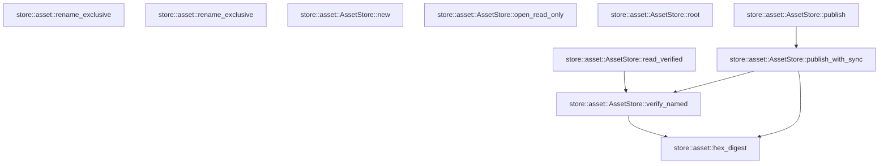

# store::asset

[Package atlas](index.md) · [Source](../../src/asset.rs)

## Declarations

Visibility is the declaration spelling; trait members and reexports require their enclosing interface. `cfg` is not evaluated.

| Symbol | Kind | Visibility | Test / cfg |
|---|---|---|---|
| [store::asset::TEMP_ORDINAL](../../src/asset.rs#L13) | static_item | `private` |  |
| [store::asset::AssetRef](../../src/asset.rs#L16) | struct_item | `pub` |  |
| [store::asset::AssetStore](../../src/asset.rs#L22) | struct_item | `pub` |  |
| [store::asset::AssetStore::new](../../src/asset.rs#L27) | function_item | `pub` |  |
| [store::asset::AssetStore::open_read_only](../../src/asset.rs#L35) | function_item | `pub` |  |
| [store::asset::AssetStore::root](../../src/asset.rs#L49) | function_item | `pub` |  |
| [store::asset::AssetStore::publish](../../src/asset.rs#L53) | function_item | `pub` |  |
| [store::asset::AssetStore::publish_with_sync](../../src/asset.rs#L57) | function_item | `pub` |  |
| [store::asset::AssetStore::verify_named](../../src/asset.rs#L113) | function_item | `pub` |  |
| [store::asset::AssetStore::read_verified](../../src/asset.rs#L128) | function_item | `pub` |  |
| [store::asset::rename_exclusive](../../src/asset.rs#L135) | function_item | `private` | #[cfg(target_os = "macos")] |
| [store::asset::rename_exclusive](../../src/asset.rs#L166) | function_item | `private` | #[cfg(not(target_os = "macos"))] |
| [store::asset::hex_digest](../../src/asset.rs#L171) | function_item | `pub(crate)` |  |
| [store::asset::tests::concurrent_identical_publication_never_replaces_content](../../src/asset.rs#L187) | function_item | `private` | test; #[cfg(test)] |

## Imports / reexports

| Local name | Source path | Visibility |
|---|---|---|
| `_` | `std::fmt::Write` | `private` |
| `fs` | `std::fs` | `private` |
| `File` | `std::fs::File` | `private` |
| `OpenOptions` | `std::fs::OpenOptions` | `private` |
| `io` | `std::io` | `private` |
| `Write` | `std::io::Write` | `private` |
| `OpenOptionsExt` | `std::os::unix::fs::OpenOptionsExt` | `private` |
| `Path` | `std::path::Path` | `private` |
| `PathBuf` | `std::path::PathBuf` | `private` |
| `AtomicU64` | `std::sync::atomic::AtomicU64` | `private` |
| `Ordering` | `std::sync::atomic::Ordering` | `private` |
| `Digest` | `sha2::Digest` | `private` |
| `Sha256` | `sha2::Sha256` | `private` |
| `StoreError` | `crate::StoreError` | `private` |
| `SyncPolicy` | `crate::platform::SyncPolicy` | `private` |
| `SystemSync` | `crate::platform::SystemSync` | `private` |
| `*` | `super::*` | `private` |

## Module declarations

| Module | Visibility | Attributes |
|---|---|---|
| `store::asset::tests` | `private` | #[cfg(test)] |

## Function call graphs

Edges below are syntactically resolved calls only, including private functions. Graphs partition callers into groups of 20; they are not execution order. All unresolved sites are listed below and in the JSON inventory.

Functions 1–10: 5 direct edges

## Call sites

Includes test functions (marked in declarations). Receiver-type-required sites need type analysis/manual tracing. Calls in closures are attributed to their enclosing function; their occurrence here does not mean the closure executes immediately.

| Caller | Callee expression | Source lines | Target / classification |
|---|---|---|---|
| `TEMP_ORDINAL` | `AtomicU64::new` | [13](../../src/asset.rs#L13) | external-constructor-callback-or-unresolved |
| `new` | `fs::create_dir_all` | [28](../../src/asset.rs#L28) | external-constructor-callback-or-unresolved |
| `new` | `root.as_ref` | [28](../../src/asset.rs#L28), [30](../../src/asset.rs#L30) | receiver-type-required |
| `new` | `Ok` | [29](../../src/asset.rs#L29) | external-constructor-callback-or-unresolved |
| `new` | `root.as_ref().to_path_buf` | [30](../../src/asset.rs#L30) | receiver-type-required |
| `open_read_only` | `fs::symlink_metadata` | [36](../../src/asset.rs#L36) | external-constructor-callback-or-unresolved |
| `open_read_only` | `root.as_ref` | [36](../../src/asset.rs#L36), [44](../../src/asset.rs#L44) | receiver-type-required |
| `open_read_only` | `metadata.is_dir` | [37](../../src/asset.rs#L37) | receiver-type-required |
| `open_read_only` | `metadata.file_type().is_symlink` | [37](../../src/asset.rs#L37) | receiver-type-required |
| `open_read_only` | `metadata.file_type` | [37](../../src/asset.rs#L37) | receiver-type-required |
| `open_read_only` | `Err` | [38](../../src/asset.rs#L38) | external-constructor-callback-or-unresolved |
| `open_read_only` | `StoreError::Io` | [38](../../src/asset.rs#L38) | external-constructor-callback-or-unresolved |
| `open_read_only` | `io::Error::new` | [38](../../src/asset.rs#L38) | external-constructor-callback-or-unresolved |
| `open_read_only` | `Ok` | [43](../../src/asset.rs#L43) | external-constructor-callback-or-unresolved |
| `open_read_only` | `root.as_ref().to_path_buf` | [44](../../src/asset.rs#L44) | receiver-type-required |
| `publish` | `self.publish_with_sync` | [54](../../src/asset.rs#L54) | [store::asset::AssetStore::publish_with_sync](../../src/asset.rs#L57) |
| `publish_with_sync` | `hex_digest` | [62](../../src/asset.rs#L62) | [store::asset::hex_digest](../../src/asset.rs#L171) |
| `publish_with_sync` | `self.root.join` | [64](../../src/asset.rs#L64), [78](../../src/asset.rs#L78) | receiver-type-required |
| `publish_with_sync` | `destination.exists` | [65](../../src/asset.rs#L65), [90](../../src/asset.rs#L90) | receiver-type-required |
| `publish_with_sync` | `self.verify_named` | [66](../../src/asset.rs#L66), [92](../../src/asset.rs#L92) | [store::asset::AssetStore::verify_named](../../src/asset.rs#L113) |
| `publish_with_sync` | `File::open` | [67](../../src/asset.rs#L67), [69](../../src/asset.rs#L69), [100](../../src/asset.rs#L100) | external-constructor-callback-or-unresolved |
| `publish_with_sync` | `sync.full_sync` | [68](../../src/asset.rs#L68), [86](../../src/asset.rs#L86) | receiver-type-required |
| `publish_with_sync` | `File::open(&self.root)?.sync_all` | [69](../../src/asset.rs#L69) | receiver-type-required |
| `publish_with_sync` | `Ok` | [70](../../src/asset.rs#L70), [93](../../src/asset.rs#L93), [102](../../src/asset.rs#L102) | external-constructor-callback-or-unresolved |
| `publish_with_sync` | `content.len` | [72](../../src/asset.rs#L72), [95](../../src/asset.rs#L95), [104](../../src/asset.rs#L104) | receiver-type-required |
| `publish_with_sync` | `TEMP_ORDINAL.fetch_add` | [76](../../src/asset.rs#L76) | receiver-type-required |
| `publish_with_sync` | `(&#124;&#124; {             let mut file = OpenOptions::new()                 .write(true)                 .create_new(true)                 .mode(0o600)                 .open(&temp)?;             file.write_all(content)?;             sync.full_sync(&file)?;             drop(file);             match rename_exclusive(&temp, &destination) {                 Ok(()) => {}                 Err(_error) if destination.exists() => {                     let _ = fs::remove_file(&temp);                     self.verify_named(&name)?;                     return Ok(AssetRef {                         asset: name.clone(),                         bytes: content.len() as u64,                     });                 }                 Err(error) => return Err(StoreError::Io(error)),             }             let directory = File::open(&self.root)?;             directory.sync_all()?;             Ok(AssetRef {                 asset: name.clone(),                 bytes: content.len() as u64,             })         })` | [79](../../src/asset.rs#L79) | external-constructor-callback-or-unresolved |
| `publish_with_sync` | `OpenOptions::new()                 .write(true)                 .create_new(true)                 .mode(0o600)                 .open` | [80](../../src/asset.rs#L80) | receiver-type-required |
| `publish_with_sync` | `OpenOptions::new()                 .write(true)                 .create_new(true)                 .mode` | [80](../../src/asset.rs#L80) | receiver-type-required |
| `publish_with_sync` | `OpenOptions::new()                 .write(true)                 .create_new` | [80](../../src/asset.rs#L80) | receiver-type-required |
| `publish_with_sync` | `OpenOptions::new()                 .write` | [80](../../src/asset.rs#L80) | receiver-type-required |
| `publish_with_sync` | `OpenOptions::new` | [80](../../src/asset.rs#L80) | external-constructor-callback-or-unresolved |
| `publish_with_sync` | `file.write_all` | [85](../../src/asset.rs#L85) | receiver-type-required |
| `publish_with_sync` | `drop` | [87](../../src/asset.rs#L87) | external-constructor-callback-or-unresolved |
| `publish_with_sync` | `rename_exclusive` | [88](../../src/asset.rs#L88) | ambiguous-cfg-or-overload |
| `publish_with_sync` | `fs::remove_file` | [91](../../src/asset.rs#L91), [108](../../src/asset.rs#L108) | external-constructor-callback-or-unresolved |
| `publish_with_sync` | `name.clone` | [94](../../src/asset.rs#L94), [103](../../src/asset.rs#L103) | receiver-type-required |
| `publish_with_sync` | `Err` | [98](../../src/asset.rs#L98) | external-constructor-callback-or-unresolved |
| `publish_with_sync` | `StoreError::Io` | [98](../../src/asset.rs#L98) | external-constructor-callback-or-unresolved |
| `publish_with_sync` | `directory.sync_all` | [101](../../src/asset.rs#L101) | receiver-type-required |
| `publish_with_sync` | `result.is_err` | [107](../../src/asset.rs#L107) | receiver-type-required |
| `verify_named` | `name.strip_prefix("sha256-").ok_or_else` | [114](../../src/asset.rs#L114) | receiver-type-required |
| `verify_named` | `name.strip_prefix` | [114](../../src/asset.rs#L114) | receiver-type-required |
| `verify_named` | `StoreError::Corruption` | [115](../../src/asset.rs#L115) | external-constructor-callback-or-unresolved |
| `verify_named` | `fs::read` | [117](../../src/asset.rs#L117) | external-constructor-callback-or-unresolved |
| `verify_named` | `self.root.join` | [117](../../src/asset.rs#L117) | receiver-type-required |
| `verify_named` | `hex_digest` | [118](../../src/asset.rs#L118) | [store::asset::hex_digest](../../src/asset.rs#L171) |
| `verify_named` | `Err` | [120](../../src/asset.rs#L120) | external-constructor-callback-or-unresolved |
| `verify_named` | `expected.to_owned` | [121](../../src/asset.rs#L121) | receiver-type-required |
| `verify_named` | `Ok` | [125](../../src/asset.rs#L125) | external-constructor-callback-or-unresolved |
| `verify_named` | `content.len` | [125](../../src/asset.rs#L125) | receiver-type-required |
| `read_verified` | `self.verify_named` | [129](../../src/asset.rs#L129) | [store::asset::AssetStore::verify_named](../../src/asset.rs#L113) |
| `read_verified` | `Ok` | [130](../../src/asset.rs#L130) | external-constructor-callback-or-unresolved |
| `read_verified` | `fs::read` | [130](../../src/asset.rs#L130) | external-constructor-callback-or-unresolved |
| `read_verified` | `self.root.join` | [130](../../src/asset.rs#L130) | receiver-type-required |
| `rename_exclusive` | `CString::new(source.as_os_str().as_bytes())         .map_err` | [139](../../src/asset.rs#L139) | receiver-type-required |
| `rename_exclusive` | `CString::new` | [139](../../src/asset.rs#L139), [141](../../src/asset.rs#L141) | external-constructor-callback-or-unresolved |
| `rename_exclusive` | `source.as_os_str().as_bytes` | [139](../../src/asset.rs#L139) | receiver-type-required |
| `rename_exclusive` | `source.as_os_str` | [139](../../src/asset.rs#L139) | receiver-type-required |
| `rename_exclusive` | `io::Error::new` | [140](../../src/asset.rs#L140), [142](../../src/asset.rs#L142) | external-constructor-callback-or-unresolved |
| `rename_exclusive` | `CString::new(destination.as_os_str().as_bytes()).map_err` | [141](../../src/asset.rs#L141) | receiver-type-required |
| `rename_exclusive` | `destination.as_os_str().as_bytes` | [141](../../src/asset.rs#L141) | receiver-type-required |
| `rename_exclusive` | `destination.as_os_str` | [141](../../src/asset.rs#L141) | receiver-type-required |
| `rename_exclusive` | `libc::renameatx_np` | [147](../../src/asset.rs#L147) | external-constructor-callback-or-unresolved |
| `rename_exclusive` | `source.as_ptr` | [149](../../src/asset.rs#L149) | receiver-type-required |
| `rename_exclusive` | `destination.as_ptr` | [151](../../src/asset.rs#L151) | receiver-type-required |
| `rename_exclusive` | `Ok` | [156](../../src/asset.rs#L156) | external-constructor-callback-or-unresolved |
| `rename_exclusive` | `io::Error::last_os_error` | [158](../../src/asset.rs#L158) | external-constructor-callback-or-unresolved |
| `rename_exclusive` | `error.kind` | [159](../../src/asset.rs#L159) | receiver-type-required |
| `rename_exclusive` | `Err` | [160](../../src/asset.rs#L160) | external-constructor-callback-or-unresolved |
| `rename_exclusive` | `fs::hard_link` | [167](../../src/asset.rs#L167) | external-constructor-callback-or-unresolved |
| `rename_exclusive` | `fs::remove_file` | [168](../../src/asset.rs#L168) | external-constructor-callback-or-unresolved |
| `hex_digest` | `Sha256::digest` | [172](../../src/asset.rs#L172) | external-constructor-callback-or-unresolved |
| `hex_digest` | `digest.iter().fold` | [173](../../src/asset.rs#L173) | receiver-type-required |
| `hex_digest` | `digest.iter` | [173](../../src/asset.rs#L173) | receiver-type-required |
| `hex_digest` | `String::with_capacity` | [174](../../src/asset.rs#L174) | external-constructor-callback-or-unresolved |
| `hex_digest` | `digest.len` | [174](../../src/asset.rs#L174) | receiver-type-required |
| `hex_digest` | `write!(result, "{byte:02x}").expect` | [176](../../src/asset.rs#L176) | receiver-type-required |
| `concurrent_identical_publication_never_replaces_content` | `tempfile::tempdir().expect` | [188](../../src/asset.rs#L188) | receiver-type-required |
| `concurrent_identical_publication_never_replaces_content` | `tempfile::tempdir` | [188](../../src/asset.rs#L188) | external-constructor-callback-or-unresolved |
| `concurrent_identical_publication_never_replaces_content` | `AssetStore::new(directory.path()).expect` | [189](../../src/asset.rs#L189) | receiver-type-required |
| `concurrent_identical_publication_never_replaces_content` | `AssetStore::new` | [189](../../src/asset.rs#L189) | external-constructor-callback-or-unresolved |
| `concurrent_identical_publication_never_replaces_content` | `directory.path` | [189](../../src/asset.rs#L189) | receiver-type-required |
| `concurrent_identical_publication_never_replaces_content` | `std::thread::scope` | [190](../../src/asset.rs#L190) | external-constructor-callback-or-unresolved |
| `concurrent_identical_publication_never_replaces_content` | `(0..8)                 .map(&#124;_&#124; {                     let store = store.clone();                     scope.spawn(move &#124;&#124; store.publish(b"same immutable bytes"))                 })                 .collect::<Vec<_>>()                 .into_iter()                 .map(&#124;thread&#124; thread.join().expect("publisher").expect("publication"))                 .collect::<Vec<_>>` | [191](../../src/asset.rs#L191) | receiver-type-required |
| `concurrent_identical_publication_never_replaces_content` | `(0..8)                 .map(&#124;_&#124; {                     let store = store.clone();                     scope.spawn(move &#124;&#124; store.publish(b"same immutable bytes"))                 })                 .collect::<Vec<_>>()                 .into_iter()                 .map` | [191](../../src/asset.rs#L191) | receiver-type-required |
| `concurrent_identical_publication_never_replaces_content` | `(0..8)                 .map(&#124;_&#124; {                     let store = store.clone();                     scope.spawn(move &#124;&#124; store.publish(b"same immutable bytes"))                 })                 .collect::<Vec<_>>()                 .into_iter` | [191](../../src/asset.rs#L191) | receiver-type-required |
| `concurrent_identical_publication_never_replaces_content` | `(0..8)                 .map(&#124;_&#124; {                     let store = store.clone();                     scope.spawn(move &#124;&#124; store.publish(b"same immutable bytes"))                 })                 .collect::<Vec<_>>` | [191](../../src/asset.rs#L191) | receiver-type-required |
| `concurrent_identical_publication_never_replaces_content` | `(0..8)                 .map` | [191](../../src/asset.rs#L191) | receiver-type-required |
| `concurrent_identical_publication_never_replaces_content` | `store.clone` | [193](../../src/asset.rs#L193) | receiver-type-required |
| `concurrent_identical_publication_never_replaces_content` | `scope.spawn` | [194](../../src/asset.rs#L194) | receiver-type-required |
| `concurrent_identical_publication_never_replaces_content` | `store.publish` | [194](../../src/asset.rs#L194) | receiver-type-required |
| `concurrent_identical_publication_never_replaces_content` | `thread.join().expect("publisher").expect` | [198](../../src/asset.rs#L198) | receiver-type-required |
| `concurrent_identical_publication_never_replaces_content` | `thread.join().expect` | [198](../../src/asset.rs#L198) | receiver-type-required |
| `concurrent_identical_publication_never_replaces_content` | `thread.join` | [198](../../src/asset.rs#L198) | receiver-type-required |
