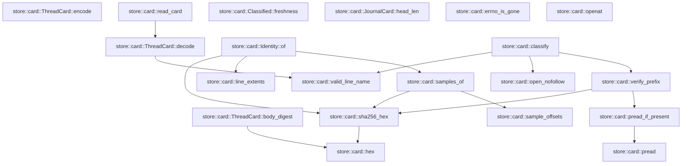
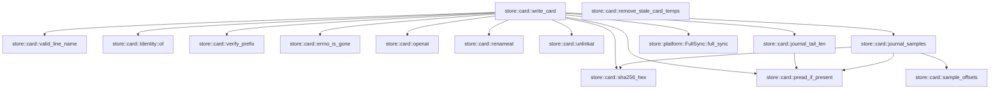

# store::card

[Package atlas](index.md) · [Source](../../src/card.rs)

## Declarations

Visibility is the declaration spelling; trait members and reexports require their enclosing interface. `cfg` is not evaluated.

| Symbol | Kind | Visibility | Test / cfg |
|---|---|---|---|
| [store::card::CARD_FILE](../../src/card.rs#L32) | const_item | `pub` |  |
| [store::card::CARD_VERSION](../../src/card.rs#L33) | const_item | `pub` |  |
| [store::card::JOURNAL_FILE](../../src/card.rs#L34) | const_item | `private` |  |
| [store::card::SAMPLE_COUNT](../../src/card.rs#L36) | const_item | `private` |  |
| [store::card::SAMPLE_LEN](../../src/card.rs#L37) | const_item | `private` |  |
| [store::card::MAX_CARD_BYTES](../../src/card.rs#L39) | const_item | `private` |  |
| [store::card::TEMP_ORDINAL](../../src/card.rs#L41) | static_item | `private` |  |
| [store::card::Sample](../../src/card.rs#L46) | struct_item | `pub` |  |
| [store::card::Hold](../../src/card.rs#L56) | struct_item | `pub` |  |
| [store::card::HoldResolution](../../src/card.rs#L66) | struct_item | `pub` |  |
| [store::card::LineCard](../../src/card.rs#L74) | struct_item | `pub` |  |
| [store::card::CardSummary](../../src/card.rs#L93) | struct_item | `pub` |  |
| [store::card::JournalCard](../../src/card.rs#L111) | struct_item | `pub` |  |
| [store::card::ThreadCard](../../src/card.rs#L124) | struct_item | `pub` |  |
| [store::card::ThreadCard::body_digest](../../src/card.rs#L137) | function_item | `private` |  |
| [store::card::ThreadCard::encode](../../src/card.rs#L146) | function_item | `pub` |  |
| [store::card::ThreadCard::decode](../../src/card.rs#L158) | function_item | `pub` |  |
| [store::card::read_card](../../src/card.rs#L176) | function_item | `pub` |  |
| [store::card::hex](../../src/card.rs#L189) | function_item | `private` |  |
| [store::card::sha256_hex](../../src/card.rs#L199) | function_item | `private` |  |
| [store::card::sample_offsets](../../src/card.rs#L204) | function_item | `private` |  |
| [store::card::line_extents](../../src/card.rs#L219) | function_item | `private` |  |
| [store::card::samples_of](../../src/card.rs#L226) | function_item | `private` |  |
| [store::card::pread](../../src/card.rs#L237) | function_item | `private` |  |
| [store::card::pread_if_present](../../src/card.rs#L245) | function_item | `private` |  |
| [store::card::valid_line_name](../../src/card.rs#L256) | function_item | `pub` |  |
| [store::card::Identity](../../src/card.rs#L266) | struct_item | `private` |  |
| [store::card::Identity::of](../../src/card.rs#L275) | function_item | `private` |  |
| [store::card::LineVerdict](../../src/card.rs#L292) | enum_item | `pub` |  |
| [store::card::JournalVerdict](../../src/card.rs#L302) | enum_item | `pub` |  |
| [store::card::Classified](../../src/card.rs#L311) | struct_item | `pub` |  |
| [store::card::Freshness](../../src/card.rs#L320) | enum_item | `pub` |  |
| [store::card::Classified::freshness](../../src/card.rs#L329) | function_item | `pub` |  |
| [store::card::open_nofollow](../../src/card.rs#L342) | function_item | `private` |  |
| [store::card::verify_prefix](../../src/card.rs#L350) | function_item | `private` |  |
| [store::card::classify](../../src/card.rs#L391) | function_item | `pub` |  |
| [store::card::JournalCard::head_len](../../src/card.rs#L468) | function_item | `private` |  |
| [store::card::LineInput](../../src/card.rs#L477) | struct_item | `pub` |  |
| [store::card::JournalInput](../../src/card.rs#L491) | struct_item | `pub` |  |
| [store::card::CardInput](../../src/card.rs#L498) | struct_item | `pub` |  |
| [store::card::WriteOutcome](../../src/card.rs#L508) | enum_item | `pub` |  |
| [store::card::SkipReason](../../src/card.rs#L516) | enum_item | `pub` |  |
| [store::card::errno_is_gone](../../src/card.rs#L524) | function_item | `private` |  |
| [store::card::openat](../../src/card.rs#L531) | function_item | `private` |  |
| [store::card::renameat](../../src/card.rs#L555) | function_item | `private` |  |
| [store::card::unlinkat](../../src/card.rs#L568) | function_item | `private` |  |
| [store::card::write_card](../../src/card.rs#L582) | function_item | `pub` |  |
| [store::card::remove_stale_card_temps](../../src/card.rs#L718) | function_item | `pub` |  |
| [store::card::journal_tail_len](../../src/card.rs#L754) | function_item | `private` |  |
| [store::card::journal_samples](../../src/card.rs#L769) | function_item | `private` |  |

## Imports / reexports

| Local name | Source path | Visibility |
|---|---|---|
| `CString` | `std::ffi::CString` | `private` |
| `File` | `std::fs::File` | `private` |
| `io` | `std::io` | `private` |
| `AsRawFd` | `std::os::fd::AsRawFd` | `private` |
| `FromRawFd` | `std::os::fd::FromRawFd` | `private` |
| `FileExt` | `std::os::unix::fs::FileExt` | `private` |
| `Path` | `std::path::Path` | `private` |
| `AtomicU64` | `std::sync::atomic::AtomicU64` | `private` |
| `Ordering` | `std::sync::atomic::Ordering` | `private` |
| `LifecycleFacts` | `schema::LifecycleFacts` | `private` |
| `Deserialize` | `serde::Deserialize` | `private` |
| `Serialize` | `serde::Serialize` | `private` |
| `Digest` | `sha2::Digest` | `private` |
| `Sha256` | `sha2::Sha256` | `private` |
| `StoreError` | `crate::StoreError` | `private` |
| `FullSync` | `crate::platform::FullSync` | `private` |

## Module declarations

| Module | Visibility | Attributes |
|---|---|---|
| `store::card::tests` | `private` | #[cfg(test)] |

## Function call graphs

Edges below are syntactically resolved calls only, including private functions. Graphs partition callers into groups of 20; they are not execution order. All unresolved sites are listed below and in the JSON inventory.

Functions 1–20: 15 direct edges

Functions 21–26: 16 direct edges

## Call sites

Includes test functions (marked in declarations). Receiver-type-required sites need type analysis/manual tracing. Calls in closures are attributed to their enclosing function; their occurrence here does not mean the closure executes immediately.

| Caller | Callee expression | Source lines | Target / classification |
|---|---|---|---|
| `TEMP_ORDINAL` | `AtomicU64::new` | [41](../../src/card.rs#L41) | external-constructor-callback-or-unresolved |
| `body_digest` | `self.clone` | [138](../../src/card.rs#L138) | receiver-type-required |
| `body_digest` | `String::new` | [139](../../src/card.rs#L139) | external-constructor-callback-or-unresolved |
| `body_digest` | `serde_json_canonicalizer::to_vec(&blank)             .map_err` | [140](../../src/card.rs#L140) | receiver-type-required |
| `body_digest` | `serde_json_canonicalizer::to_vec` | [140](../../src/card.rs#L140) | external-constructor-callback-or-unresolved |
| `body_digest` | `StoreError::Corruption` | [141](../../src/card.rs#L141) | external-constructor-callback-or-unresolved |
| `body_digest` | `error.to_string` | [141](../../src/card.rs#L141) | receiver-type-required |
| `body_digest` | `Ok` | [142](../../src/card.rs#L142) | external-constructor-callback-or-unresolved |
| `body_digest` | `hex` | [142](../../src/card.rs#L142) | [store::card::hex](../../src/card.rs#L189) |
| `body_digest` | `Sha256::digest` | [142](../../src/card.rs#L142) | external-constructor-callback-or-unresolved |
| `encode` | `self.clone` | [147](../../src/card.rs#L147) | receiver-type-required |
| `encode` | `sealed.body_digest` | [148](../../src/card.rs#L148) | receiver-type-required |
| `encode` | `serde_json_canonicalizer::to_vec(&sealed)             .map_err` | [149](../../src/card.rs#L149) | receiver-type-required |
| `encode` | `serde_json_canonicalizer::to_vec` | [149](../../src/card.rs#L149) | external-constructor-callback-or-unresolved |
| `encode` | `StoreError::Corruption` | [150](../../src/card.rs#L150) | external-constructor-callback-or-unresolved |
| `encode` | `error.to_string` | [150](../../src/card.rs#L150) | receiver-type-required |
| `encode` | `bytes.push` | [151](../../src/card.rs#L151) | receiver-type-required |
| `encode` | `Ok` | [152](../../src/card.rs#L152) | external-constructor-callback-or-unresolved |
| `decode` | `bytes.strip_suffix` | [159](../../src/card.rs#L159) | receiver-type-required |
| `decode` | `line.contains` | [160](../../src/card.rs#L160) | receiver-type-required |
| `decode` | `serde_json::from_slice(line).ok` | [163](../../src/card.rs#L163) | receiver-type-required |
| `decode` | `serde_json::from_slice` | [163](../../src/card.rs#L163) | external-constructor-callback-or-unresolved |
| `decode` | `card.body_digest().ok` | [165](../../src/card.rs#L165) | receiver-type-required |
| `decode` | `card.body_digest` | [165](../../src/card.rs#L165) | receiver-type-required |
| `decode` | `card.lines.iter().all` | [166](../../src/card.rs#L166) | receiver-type-required |
| `decode` | `card.lines.iter` | [166](../../src/card.rs#L166) | receiver-type-required |
| `decode` | `valid_line_name` | [166](../../src/card.rs#L166) | [store::card::valid_line_name](../../src/card.rs#L256) |
| `decode` | `Some` | [170](../../src/card.rs#L170) | external-constructor-callback-or-unresolved |
| `read_card` | `File::open(folder.join(CARD_FILE)).ok` | [177](../../src/card.rs#L177) | receiver-type-required |
| `read_card` | `File::open` | [177](../../src/card.rs#L177) | external-constructor-callback-or-unresolved |
| `read_card` | `folder.join` | [177](../../src/card.rs#L177) | receiver-type-required |
| `read_card` | `file.metadata().ok()?.len` | [178](../../src/card.rs#L178) | receiver-type-required |
| `read_card` | `file.metadata().ok` | [178](../../src/card.rs#L178) | receiver-type-required |
| `read_card` | `file.metadata` | [178](../../src/card.rs#L178) | receiver-type-required |
| `read_card` | `Vec::new` | [181](../../src/card.rs#L181) | external-constructor-callback-or-unresolved |
| `read_card` | `io::Read::read_to_end(&mut io::Read::take(&file, MAX_CARD_BYTES), &mut bytes).ok` | [182](../../src/card.rs#L182) | receiver-type-required |
| `read_card` | `io::Read::read_to_end` | [182](../../src/card.rs#L182) | external-constructor-callback-or-unresolved |
| `read_card` | `io::Read::take` | [182](../../src/card.rs#L182) | external-constructor-callback-or-unresolved |
| `read_card` | `ThreadCard::decode` | [183](../../src/card.rs#L183) | [store::card::ThreadCard::decode](../../src/card.rs#L158) |
| `hex` | `digest         .iter()         .fold` | [191](../../src/card.rs#L191) | receiver-type-required |
| `hex` | `digest         .iter` | [191](../../src/card.rs#L191) | receiver-type-required |
| `hex` | `String::with_capacity` | [193](../../src/card.rs#L193) | external-constructor-callback-or-unresolved |
| `sha256_hex` | `hex` | [200](../../src/card.rs#L200) | [store::card::hex](../../src/card.rs#L189) |
| `sha256_hex` | `Sha256::digest` | [200](../../src/card.rs#L200) | external-constructor-callback-or-unresolved |
| `sample_offsets` | `Vec::new` | [205](../../src/card.rs#L205) | external-constructor-callback-or-unresolved |
| `sample_offsets` | `SAMPLE_LEN.min` | [207](../../src/card.rs#L207) | receiver-type-required |
| `sample_offsets` | `(len.saturating_sub(width) / SAMPLE_COUNT.max(1)).saturating_mul` | [208](../../src/card.rs#L208) | receiver-type-required |
| `sample_offsets` | `len.saturating_sub` | [208](../../src/card.rs#L208), [209](../../src/card.rs#L209) | receiver-type-required |
| `sample_offsets` | `SAMPLE_COUNT.max` | [208](../../src/card.rs#L208) | receiver-type-required |
| `sample_offsets` | `off.min` | [209](../../src/card.rs#L209) | receiver-type-required |
| `sample_offsets` | `windows.contains` | [210](../../src/card.rs#L210) | receiver-type-required |
| `sample_offsets` | `windows.push` | [211](../../src/card.rs#L211) | receiver-type-required |
| `line_extents` | `bytes.iter().position` | [220](../../src/card.rs#L220) | receiver-type-required |
| `line_extents` | `bytes.iter` | [220](../../src/card.rs#L220) | receiver-type-required |
| `line_extents` | `bytes.strip_suffix` | [221](../../src/card.rs#L221) | receiver-type-required |
| `line_extents` | `body.iter().rposition(&#124;b&#124; *b == b'\n').map_or` | [222](../../src/card.rs#L222) | receiver-type-required |
| `line_extents` | `body.iter().rposition` | [222](../../src/card.rs#L222) | receiver-type-required |
| `line_extents` | `body.iter` | [222](../../src/card.rs#L222) | receiver-type-required |
| `line_extents` | `Some` | [223](../../src/card.rs#L223) | external-constructor-callback-or-unresolved |
| `line_extents` | `bytes.len` | [223](../../src/card.rs#L223) | receiver-type-required |
| `samples_of` | `sample_offsets(bytes.len() as u64)         .into_iter()         .map(&#124;(off, len)&#124; Sample {             off,             len,             sha256: sha256_hex(&bytes[off as usize..(off + len) as usize]),         })         .collect` | [227](../../src/card.rs#L227) | receiver-type-required |
| `samples_of` | `sample_offsets(bytes.len() as u64)         .into_iter()         .map` | [227](../../src/card.rs#L227) | receiver-type-required |
| `samples_of` | `sample_offsets(bytes.len() as u64)         .into_iter` | [227](../../src/card.rs#L227) | receiver-type-required |
| `samples_of` | `sample_offsets` | [227](../../src/card.rs#L227) | [store::card::sample_offsets](../../src/card.rs#L204) |
| `samples_of` | `bytes.len` | [227](../../src/card.rs#L227) | receiver-type-required |
| `samples_of` | `sha256_hex` | [232](../../src/card.rs#L232) | [store::card::sha256_hex](../../src/card.rs#L199) |
| `pread` | `file.read_exact_at` | [239](../../src/card.rs#L239) | receiver-type-required |
| `pread` | `Ok` | [240](../../src/card.rs#L240) | external-constructor-callback-or-unresolved |
| `pread_if_present` | `pread` | [246](../../src/card.rs#L246) | [store::card::pread](../../src/card.rs#L237) |
| `pread_if_present` | `Ok` | [247](../../src/card.rs#L247), [248](../../src/card.rs#L248) | external-constructor-callback-or-unresolved |
| `pread_if_present` | `Some` | [247](../../src/card.rs#L247) | external-constructor-callback-or-unresolved |
| `pread_if_present` | `error.kind` | [248](../../src/card.rs#L248) | receiver-type-required |
| `pread_if_present` | `Err` | [249](../../src/card.rs#L249) | external-constructor-callback-or-unresolved |
| `valid_line_name` | `name.len` | [257](../../src/card.rs#L257) | receiver-type-required |
| `valid_line_name` | `".jsonl".len` | [257](../../src/card.rs#L257) | receiver-type-required |
| `valid_line_name` | `name.ends_with` | [258](../../src/card.rs#L258) | receiver-type-required |
| `valid_line_name` | `name.starts_with` | [259](../../src/card.rs#L259) | receiver-type-required |
| `valid_line_name` | `name.contains` | [260](../../src/card.rs#L260) | receiver-type-required |
| `of` | `line_extents` | [276](../../src/card.rs#L276) | [store::card::line_extents](../../src/card.rs#L219) |
| `of` | `Some` | [277](../../src/card.rs#L277) | external-constructor-callback-or-unresolved |
| `of` | `sha256_hex` | [279](../../src/card.rs#L279), [281](../../src/card.rs#L281) | [store::card::sha256_hex](../../src/card.rs#L199) |
| `of` | `prefix.len` | [281](../../src/card.rs#L281) | receiver-type-required |
| `of` | `samples_of` | [282](../../src/card.rs#L282) | [store::card::samples_of](../../src/card.rs#L226) |
| `freshness` | `self.lines.iter().any` | [330](../../src/card.rs#L330) | receiver-type-required |
| `freshness` | `self.lines.iter` | [330](../../src/card.rs#L330), [332](../../src/card.rs#L332) | receiver-type-required |
| `freshness` | `self.lines.iter().all` | [332](../../src/card.rs#L332) | receiver-type-required |
| `freshness` | `self.unlisted_lines.is_empty` | [333](../../src/card.rs#L333) | receiver-type-required |
| `open_nofollow` | `std::fs::OpenOptions::new()         .read(true)         .custom_flags(libc::O_CLOEXEC &#124; libc::O_NOFOLLOW)         .open` | [344](../../src/card.rs#L344) | receiver-type-required |
| `open_nofollow` | `std::fs::OpenOptions::new()         .read(true)         .custom_flags` | [344](../../src/card.rs#L344) | receiver-type-required |
| `open_nofollow` | `std::fs::OpenOptions::new()         .read` | [344](../../src/card.rs#L344) | receiver-type-required |
| `open_nofollow` | `std::fs::OpenOptions::new` | [344](../../src/card.rs#L344) | external-constructor-callback-or-unresolved |
| `verify_prefix` | `file.metadata()?.len` | [359](../../src/card.rs#L359) | receiver-type-required |
| `verify_prefix` | `file.metadata` | [359](../../src/card.rs#L359) | receiver-type-required |
| `verify_prefix` | `Ok` | [362](../../src/card.rs#L362), [365](../../src/card.rs#L365), [368](../../src/card.rs#L368), [371](../../src/card.rs#L371), [375](../../src/card.rs#L375), [379](../../src/card.rs#L379), [382](../../src/card.rs#L382) | external-constructor-callback-or-unresolved |
| `verify_prefix` | `pread_if_present` | [364](../../src/card.rs#L364), [367](../../src/card.rs#L367), [377](../../src/card.rs#L377) | [store::card::pread_if_present](../../src/card.rs#L245) |
| `verify_prefix` | `sha256_hex` | [370](../../src/card.rs#L370), [378](../../src/card.rs#L378) | [store::card::sha256_hex](../../src/card.rs#L199) |
| `verify_prefix` | `sample.off.saturating_add` | [374](../../src/card.rs#L374) | receiver-type-required |
| `classify` | `folder         .file_name()         .and_then(&#124;name&#124; name.to_str())         .is_some_and` | [392](../../src/card.rs#L392) | receiver-type-required |
| `classify` | `folder         .file_name()         .and_then` | [392](../../src/card.rs#L392) | receiver-type-required |
| `classify` | `folder         .file_name` | [392](../../src/card.rs#L392) | receiver-type-required |
| `classify` | `name.to_str` | [394](../../src/card.rs#L394) | receiver-type-required |
| `classify` | `Vec::with_capacity` | [396](../../src/card.rs#L396) | external-constructor-callback-or-unresolved |
| `classify` | `card.lines.len` | [396](../../src/card.rs#L396) | receiver-type-required |
| `classify` | `valid_line_name` | [398](../../src/card.rs#L398), [421](../../src/card.rs#L421) | [store::card::valid_line_name](../../src/card.rs#L256) |
| `classify` | `open_nofollow` | [401](../../src/card.rs#L401), [437](../../src/card.rs#L437) | [store::card::open_nofollow](../../src/card.rs#L342) |
| `classify` | `folder.join` | [401](../../src/card.rs#L401), [431](../../src/card.rs#L431), [437](../../src/card.rs#L437) | receiver-type-required |
| `classify` | `verify_prefix` | [402](../../src/card.rs#L402), [438](../../src/card.rs#L438) | [store::card::verify_prefix](../../src/card.rs#L350) |
| `classify` | `error.kind` | [411](../../src/card.rs#L411), [434](../../src/card.rs#L434), [451](../../src/card.rs#L451), [454](../../src/card.rs#L454) | receiver-type-required |
| `classify` | `Err` | [412](../../src/card.rs#L412), [435](../../src/card.rs#L435), [455](../../src/card.rs#L455) | external-constructor-callback-or-unresolved |
| `classify` | `lines.push` | [415](../../src/card.rs#L415) | receiver-type-required |
| `classify` | `line.file.clone` | [415](../../src/card.rs#L415) | receiver-type-required |
| `classify` | `Vec::new` | [417](../../src/card.rs#L417) | external-constructor-callback-or-unresolved |
| `classify` | `std::fs::read_dir` | [418](../../src/card.rs#L418) | external-constructor-callback-or-unresolved |
| `classify` | `entry.file_name().to_string_lossy().into_owned` | [420](../../src/card.rs#L420) | receiver-type-required |
| `classify` | `entry.file_name().to_string_lossy` | [420](../../src/card.rs#L420) | receiver-type-required |
| `classify` | `entry.file_name` | [420](../../src/card.rs#L420) | receiver-type-required |
| `classify` | `entry.file_type()?.is_file` | [422](../../src/card.rs#L422) | receiver-type-required |
| `classify` | `entry.file_type` | [422](../../src/card.rs#L422) | receiver-type-required |
| `classify` | `card.lines.iter().any` | [423](../../src/card.rs#L423) | receiver-type-required |
| `classify` | `card.lines.iter` | [423](../../src/card.rs#L423) | receiver-type-required |
| `classify` | `unlisted_lines.push` | [425](../../src/card.rs#L425) | receiver-type-required |
| `classify` | `unlisted_lines.sort` | [428](../../src/card.rs#L428) | receiver-type-required |
| `classify` | `std::fs::metadata` | [431](../../src/card.rs#L431) | external-constructor-callback-or-unresolved |
| `classify` | `metadata.len` | [432](../../src/card.rs#L432) | receiver-type-required |
| `classify` | `journal.head_len` | [441](../../src/card.rs#L441) | receiver-type-required |
| `classify` | `Ok` | [458](../../src/card.rs#L458) | external-constructor-callback-or-unresolved |
| `head_len` | `SAMPLE_LEN.min` | [469](../../src/card.rs#L469) | receiver-type-required |
| `openat` | `CString::new(name).map_err` | [532](../../src/card.rs#L532) | receiver-type-required |
| `openat` | `CString::new` | [532](../../src/card.rs#L532) | external-constructor-callback-or-unresolved |
| `openat` | `libc::openat` | [537](../../src/card.rs#L537) | external-constructor-callback-or-unresolved |
| `openat` | `dir.as_raw_fd` | [538](../../src/card.rs#L538) | receiver-type-required |
| `openat` | `name.as_ptr` | [539](../../src/card.rs#L539) | receiver-type-required |
| `openat` | `libc::c_uint::from` | [541](../../src/card.rs#L541) | external-constructor-callback-or-unresolved |
| `openat` | `Ok` | [546](../../src/card.rs#L546) | external-constructor-callback-or-unresolved |
| `openat` | `File::from_raw_fd` | [546](../../src/card.rs#L546) | external-constructor-callback-or-unresolved |
| `openat` | `io::Error::last_os_error` | [548](../../src/card.rs#L548) | external-constructor-callback-or-unresolved |
| `openat` | `error.kind` | [549](../../src/card.rs#L549) | receiver-type-required |
| `openat` | `Err` | [550](../../src/card.rs#L550) | external-constructor-callback-or-unresolved |
| `renameat` | `CString::new(from).map_err` | [556](../../src/card.rs#L556) | receiver-type-required |
| `renameat` | `CString::new` | [556](../../src/card.rs#L556), [557](../../src/card.rs#L557) | external-constructor-callback-or-unresolved |
| `renameat` | `CString::new(to).map_err` | [557](../../src/card.rs#L557) | receiver-type-required |
| `renameat` | `libc::renameat` | [560](../../src/card.rs#L560) | external-constructor-callback-or-unresolved |
| `renameat` | `dir.as_raw_fd` | [560](../../src/card.rs#L560) | receiver-type-required |
| `renameat` | `from.as_ptr` | [560](../../src/card.rs#L560) | receiver-type-required |
| `renameat` | `to.as_ptr` | [560](../../src/card.rs#L560) | receiver-type-required |
| `renameat` | `Ok` | [562](../../src/card.rs#L562) | external-constructor-callback-or-unresolved |
| `renameat` | `Err` | [564](../../src/card.rs#L564) | external-constructor-callback-or-unresolved |
| `renameat` | `io::Error::last_os_error` | [564](../../src/card.rs#L564) | external-constructor-callback-or-unresolved |
| `unlinkat` | `CString::new` | [569](../../src/card.rs#L569) | external-constructor-callback-or-unresolved |
| `unlinkat` | `libc::unlinkat` | [571](../../src/card.rs#L571) | external-constructor-callback-or-unresolved |
| `unlinkat` | `dir.as_raw_fd` | [571](../../src/card.rs#L571) | receiver-type-required |
| `unlinkat` | `name.as_ptr` | [571](../../src/card.rs#L571) | receiver-type-required |
| `write_card` | `File::open` | [583](../../src/card.rs#L583) | external-constructor-callback-or-unresolved |
| `write_card` | `errno_is_gone` | [585](../../src/card.rs#L585), [600](../../src/card.rs#L600), [618](../../src/card.rs#L618), [668](../../src/card.rs#L668), [669](../../src/card.rs#L669), [706](../../src/card.rs#L706) | [store::card::errno_is_gone](../../src/card.rs#L524) |
| `write_card` | `Ok` | [586](../../src/card.rs#L586), [593](../../src/card.rs#L593), [596](../../src/card.rs#L596), [601](../../src/card.rs#L601), [617](../../src/card.rs#L617), [619](../../src/card.rs#L619), [644](../../src/card.rs#L644), [648](../../src/card.rs#L648), [655](../../src/card.rs#L655), [670](../../src/card.rs#L670), [703](../../src/card.rs#L703), [707](../../src/card.rs#L707) | external-constructor-callback-or-unresolved |
| `write_card` | `WriteOutcome::Skipped` | [586](../../src/card.rs#L586), [593](../../src/card.rs#L593), [596](../../src/card.rs#L596), [601](../../src/card.rs#L601), [617](../../src/card.rs#L617), [619](../../src/card.rs#L619), [644](../../src/card.rs#L644), [648](../../src/card.rs#L648), [655](../../src/card.rs#L655), [670](../../src/card.rs#L670), [707](../../src/card.rs#L707) | external-constructor-callback-or-unresolved |
| `write_card` | `Err` | [588](../../src/card.rs#L588), [603](../../src/card.rs#L603), [621](../../src/card.rs#L621), [672](../../src/card.rs#L672), [709](../../src/card.rs#L709) | external-constructor-callback-or-unresolved |
| `write_card` | `error.into` | [588](../../src/card.rs#L588), [603](../../src/card.rs#L603), [621](../../src/card.rs#L621), [672](../../src/card.rs#L672), [709](../../src/card.rs#L709) | receiver-type-required |
| `write_card` | `Vec::with_capacity` | [590](../../src/card.rs#L590) | external-constructor-callback-or-unresolved |
| `write_card` | `input.lines.len` | [590](../../src/card.rs#L590) | receiver-type-required |
| `write_card` | `valid_line_name` | [592](../../src/card.rs#L592) | [store::card::valid_line_name](../../src/card.rs#L256) |
| `write_card` | `Identity::of` | [595](../../src/card.rs#L595) | [store::card::Identity::of](../../src/card.rs#L275) |
| `write_card` | `openat` | [598](../../src/card.rs#L598), [641](../../src/card.rs#L641), [692](../../src/card.rs#L692) | [store::card::openat](../../src/card.rs#L531) |
| `write_card` | `line.verified_prefix.len` | [605](../../src/card.rs#L605) | receiver-type-required |
| `write_card` | `verify_prefix` | [607](../../src/card.rs#L607) | [store::card::verify_prefix](../../src/card.rs#L350) |
| `write_card` | `FullSync::full_sync` | [623](../../src/card.rs#L623) | [store::platform::FullSync::full_sync](../../src/platform.rs#L31) |
| `write_card` | `lines.push` | [624](../../src/card.rs#L624) | receiver-type-required |
| `write_card` | `line.file.to_owned` | [625](../../src/card.rs#L625) | receiver-type-required |
| `write_card` | `line.line.clone` | [633](../../src/card.rs#L633) | receiver-type-required |
| `write_card` | `line.parent_file.clone` | [634](../../src/card.rs#L634) | receiver-type-required |
| `write_card` | `line.facts.clone` | [635](../../src/card.rs#L635) | receiver-type-required |
| `write_card` | `line.holds.clone` | [636](../../src/card.rs#L636) | receiver-type-required |
| `write_card` | `file.metadata()?.len` | [643](../../src/card.rs#L643) | receiver-type-required |
| `write_card` | `file.metadata` | [643](../../src/card.rs#L643) | receiver-type-required |
| `write_card` | `SAMPLE_LEN.min` | [646](../../src/card.rs#L646) | receiver-type-required |
| `write_card` | `journal_tail_len` | [647](../../src/card.rs#L647) | [store::card::journal_tail_len](../../src/card.rs#L754) |
| `write_card` | `pread_if_present` | [651](../../src/card.rs#L651), [652](../../src/card.rs#L652) | [store::card::pread_if_present](../../src/card.rs#L245) |
| `write_card` | `journal_samples` | [653](../../src/card.rs#L653) | [store::card::journal_samples](../../src/card.rs#L769) |
| `write_card` | `Some` | [657](../../src/card.rs#L657) | external-constructor-callback-or-unresolved |
| `write_card` | `sha256_hex` | [662](../../src/card.rs#L662), [663](../../src/card.rs#L663) | [store::card::sha256_hex](../../src/card.rs#L199) |
| `write_card` | `input.kernel.to_owned` | [677](../../src/card.rs#L677) | receiver-type-required |
| `write_card` | `input.thread.to_owned` | [678](../../src/card.rs#L678) | receiver-type-required |
| `write_card` | `input.written.clone` | [679](../../src/card.rs#L679) | receiver-type-required |
| `write_card` | `input.summary.clone` | [681](../../src/card.rs#L681) | receiver-type-required |
| `write_card` | `String::new` | [683](../../src/card.rs#L683) | external-constructor-callback-or-unresolved |
| `write_card` | `card.encode` | [685](../../src/card.rs#L685) | receiver-type-required |
| `write_card` | `(&#124;&#124; -> io::Result<()> {         let file = openat(             &dir,             &temp,             libc::O_WRONLY &#124; libc::O_CREAT &#124; libc::O_EXCL,             0o600,         )?;         file.write_all_at(&bytes, 0)?;         drop(file);         renameat(&dir, &temp, CARD_FILE)     })` | [691](../../src/card.rs#L691) | external-constructor-callback-or-unresolved |
| `write_card` | `file.write_all_at` | [698](../../src/card.rs#L698) | receiver-type-required |
| `write_card` | `drop` | [699](../../src/card.rs#L699) | external-constructor-callback-or-unresolved |
| `write_card` | `renameat` | [700](../../src/card.rs#L700) | [store::card::renameat](../../src/card.rs#L555) |
| `write_card` | `unlinkat` | [705](../../src/card.rs#L705) | [store::card::unlinkat](../../src/card.rs#L568) |
| `remove_stale_card_temps` | `std::fs::read_dir` | [720](../../src/card.rs#L720) | external-constructor-callback-or-unresolved |
| `remove_stale_card_temps` | `entries.flatten` | [724](../../src/card.rs#L724) | receiver-type-required |
| `remove_stale_card_temps` | `entry.file_name().to_string_lossy().into_owned` | [725](../../src/card.rs#L725) | receiver-type-required |
| `remove_stale_card_temps` | `entry.file_name().to_string_lossy` | [725](../../src/card.rs#L725) | receiver-type-required |
| `remove_stale_card_temps` | `entry.file_name` | [725](../../src/card.rs#L725) | receiver-type-required |
| `remove_stale_card_temps` | `name             .strip_prefix(&prefix)             .and_then` | [726](../../src/card.rs#L726) | receiver-type-required |
| `remove_stale_card_temps` | `name             .strip_prefix` | [726](../../src/card.rs#L726) | receiver-type-required |
| `remove_stale_card_temps` | `rest.strip_suffix` | [728](../../src/card.rs#L728) | receiver-type-required |
| `remove_stale_card_temps` | `rest             .split('.')             .next()             .and_then` | [732](../../src/card.rs#L732) | receiver-type-required |
| `remove_stale_card_temps` | `rest             .split('.')             .next` | [732](../../src/card.rs#L732) | receiver-type-required |
| `remove_stale_card_temps` | `rest             .split` | [732](../../src/card.rs#L732) | receiver-type-required |
| `remove_stale_card_temps` | `pid.parse::<i32>().ok` | [735](../../src/card.rs#L735) | receiver-type-required |
| `remove_stale_card_temps` | `pid.parse::<i32>` | [735](../../src/card.rs#L735) | receiver-type-required |
| `remove_stale_card_temps` | `u32::try_from(pid).is_ok_and` | [739](../../src/card.rs#L739) | receiver-type-required |
| `remove_stale_card_temps` | `u32::try_from` | [739](../../src/card.rs#L739) | external-constructor-callback-or-unresolved |
| `remove_stale_card_temps` | `std::process::id` | [739](../../src/card.rs#L739) | external-constructor-callback-or-unresolved |
| `remove_stale_card_temps` | `libc::kill` | [743](../../src/card.rs#L743) | external-constructor-callback-or-unresolved |
| `remove_stale_card_temps` | `io::Error::last_os_error().raw_os_error` | [744](../../src/card.rs#L744) | receiver-type-required |
| `remove_stale_card_temps` | `io::Error::last_os_error` | [744](../../src/card.rs#L744) | external-constructor-callback-or-unresolved |
| `remove_stale_card_temps` | `Some` | [744](../../src/card.rs#L744) | external-constructor-callback-or-unresolved |
| `remove_stale_card_temps` | `std::fs::remove_file(entry.path()).is_ok` | [745](../../src/card.rs#L745) | receiver-type-required |
| `remove_stale_card_temps` | `std::fs::remove_file` | [745](../../src/card.rs#L745) | external-constructor-callback-or-unresolved |
| `remove_stale_card_temps` | `entry.path` | [745](../../src/card.rs#L745) | receiver-type-required |
| `journal_tail_len` | `Ok` | [756](../../src/card.rs#L756), [760](../../src/card.rs#L760), [763](../../src/card.rs#L763) | external-constructor-callback-or-unresolved |
| `journal_tail_len` | `Some` | [756](../../src/card.rs#L756), [763](../../src/card.rs#L763) | external-constructor-callback-or-unresolved |
| `journal_tail_len` | `len.min` | [758](../../src/card.rs#L758) | receiver-type-required |
| `journal_tail_len` | `pread_if_present` | [759](../../src/card.rs#L759) | [store::card::pread_if_present](../../src/card.rs#L245) |
| `journal_tail_len` | `bytes.strip_suffix(b"\n").unwrap_or` | [762](../../src/card.rs#L762) | receiver-type-required |
| `journal_tail_len` | `bytes.strip_suffix` | [762](../../src/card.rs#L762) | receiver-type-required |
| `journal_tail_len` | `body.iter().rposition` | [763](../../src/card.rs#L763) | receiver-type-required |
| `journal_tail_len` | `body.iter` | [763](../../src/card.rs#L763) | receiver-type-required |
| `journal_tail_len` | `bytes.len` | [764](../../src/card.rs#L764) | receiver-type-required |
| `journal_samples` | `Vec::new` | [770](../../src/card.rs#L770) | external-constructor-callback-or-unresolved |
| `journal_samples` | `sample_offsets` | [771](../../src/card.rs#L771) | [store::card::sample_offsets](../../src/card.rs#L204) |
| `journal_samples` | `pread_if_present` | [772](../../src/card.rs#L772) | [store::card::pread_if_present](../../src/card.rs#L245) |
| `journal_samples` | `Ok` | [773](../../src/card.rs#L773), [781](../../src/card.rs#L781) | external-constructor-callback-or-unresolved |
| `journal_samples` | `samples.push` | [775](../../src/card.rs#L775) | receiver-type-required |
| `journal_samples` | `sha256_hex` | [778](../../src/card.rs#L778) | [store::card::sha256_hex](../../src/card.rs#L199) |
| `journal_samples` | `Some` | [781](../../src/card.rs#L781) | external-constructor-callback-or-unresolved |
