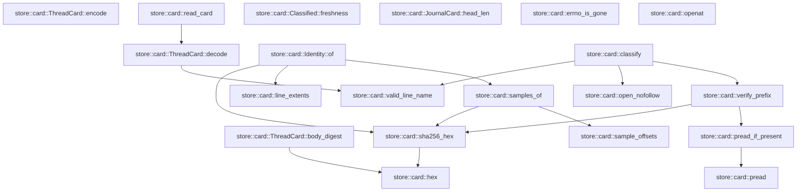
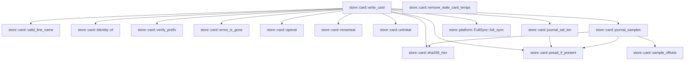

# store::card

[Package atlas](index.md) · [Source](../../src/card.rs)

## Declarations

Visibility is the declaration spelling; trait members and reexports require their enclosing interface. `cfg` is not evaluated.

| Symbol | Kind | Visibility | Test / cfg |
|---|---|---|---|
| [store::card::CARD_FILE](../../src/card.rs#L32) | const_item | `pub` |  |
| [store::card::CARD_VERSION](../../src/card.rs#L33) | const_item | `pub` |  |
| [store::card::JOURNAL_FILE](../../src/card.rs#L34) | const_item | `private` |  |
| [store::card::SAMPLE_COUNT](../../src/card.rs#L36) | const_item | `private` |  |
| [store::card::SAMPLE_LEN](../../src/card.rs#L37) | const_item | `private` |  |
| [store::card::MAX_CARD_BYTES](../../src/card.rs#L39) | const_item | `private` |  |
| [store::card::TEMP_ORDINAL](../../src/card.rs#L41) | static_item | `private` |  |
| [store::card::Sample](../../src/card.rs#L46) | struct_item | `pub` |  |
| [store::card::Hold](../../src/card.rs#L56) | struct_item | `pub` |  |
| [store::card::HoldResolution](../../src/card.rs#L66) | struct_item | `pub` |  |
| [store::card::LineCard](../../src/card.rs#L74) | struct_item | `pub` |  |
| [store::card::CardSummary](../../src/card.rs#L93) | struct_item | `pub` |  |
| [store::card::JournalCard](../../src/card.rs#L114) | struct_item | `pub` |  |
| [store::card::ThreadCard](../../src/card.rs#L127) | struct_item | `pub` |  |
| [store::card::ThreadCard::body_digest](../../src/card.rs#L140) | function_item | `private` |  |
| [store::card::ThreadCard::encode](../../src/card.rs#L149) | function_item | `pub` |  |
| [store::card::ThreadCard::decode](../../src/card.rs#L161) | function_item | `pub` |  |
| [store::card::read_card](../../src/card.rs#L179) | function_item | `pub` |  |
| [store::card::hex](../../src/card.rs#L192) | function_item | `private` |  |
| [store::card::sha256_hex](../../src/card.rs#L202) | function_item | `private` |  |
| [store::card::sample_offsets](../../src/card.rs#L207) | function_item | `private` |  |
| [store::card::line_extents](../../src/card.rs#L222) | function_item | `private` |  |
| [store::card::samples_of](../../src/card.rs#L229) | function_item | `private` |  |
| [store::card::pread](../../src/card.rs#L240) | function_item | `private` |  |
| [store::card::pread_if_present](../../src/card.rs#L248) | function_item | `private` |  |
| [store::card::valid_line_name](../../src/card.rs#L259) | function_item | `pub` |  |
| [store::card::Identity](../../src/card.rs#L269) | struct_item | `private` |  |
| [store::card::Identity::of](../../src/card.rs#L278) | function_item | `private` |  |
| [store::card::LineVerdict](../../src/card.rs#L295) | enum_item | `pub` |  |
| [store::card::JournalVerdict](../../src/card.rs#L305) | enum_item | `pub` |  |
| [store::card::Classified](../../src/card.rs#L314) | struct_item | `pub` |  |
| [store::card::Freshness](../../src/card.rs#L323) | enum_item | `pub` |  |
| [store::card::Classified::freshness](../../src/card.rs#L332) | function_item | `pub` |  |
| [store::card::open_nofollow](../../src/card.rs#L345) | function_item | `private` |  |
| [store::card::verify_prefix](../../src/card.rs#L353) | function_item | `private` |  |
| [store::card::classify](../../src/card.rs#L394) | function_item | `pub` |  |
| [store::card::JournalCard::head_len](../../src/card.rs#L471) | function_item | `private` |  |
| [store::card::LineInput](../../src/card.rs#L480) | struct_item | `pub` |  |
| [store::card::JournalInput](../../src/card.rs#L494) | struct_item | `pub` |  |
| [store::card::CardInput](../../src/card.rs#L501) | struct_item | `pub` |  |
| [store::card::WriteOutcome](../../src/card.rs#L511) | enum_item | `pub` |  |
| [store::card::SkipReason](../../src/card.rs#L519) | enum_item | `pub` |  |
| [store::card::errno_is_gone](../../src/card.rs#L527) | function_item | `private` |  |
| [store::card::openat](../../src/card.rs#L534) | function_item | `private` |  |
| [store::card::renameat](../../src/card.rs#L558) | function_item | `private` |  |
| [store::card::unlinkat](../../src/card.rs#L571) | function_item | `private` |  |
| [store::card::write_card](../../src/card.rs#L585) | function_item | `pub` |  |
| [store::card::remove_stale_card_temps](../../src/card.rs#L721) | function_item | `pub` |  |
| [store::card::journal_tail_len](../../src/card.rs#L757) | function_item | `private` |  |
| [store::card::journal_samples](../../src/card.rs#L772) | function_item | `private` |  |

## Imports / reexports

| Local name | Source path | Visibility |
|---|---|---|
| `CString` | `std::ffi::CString` | `private` |
| `File` | `std::fs::File` | `private` |
| `io` | `std::io` | `private` |
| `AsRawFd` | `std::os::fd::AsRawFd` | `private` |
| `FromRawFd` | `std::os::fd::FromRawFd` | `private` |
| `FileExt` | `std::os::unix::fs::FileExt` | `private` |
| `Path` | `std::path::Path` | `private` |
| `AtomicU64` | `std::sync::atomic::AtomicU64` | `private` |
| `Ordering` | `std::sync::atomic::Ordering` | `private` |
| `LifecycleFacts` | `schema::LifecycleFacts` | `private` |
| `Deserialize` | `serde::Deserialize` | `private` |
| `Serialize` | `serde::Serialize` | `private` |
| `Digest` | `sha2::Digest` | `private` |
| `Sha256` | `sha2::Sha256` | `private` |
| `StoreError` | `crate::StoreError` | `private` |
| `FullSync` | `crate::platform::FullSync` | `private` |

## Module declarations

| Module | Visibility | Attributes |
|---|---|---|
| `store::card::tests` | `private` | #[cfg(test)] |

## Function call graphs

Edges below are syntactically resolved calls only, including private functions. Graphs partition callers into groups of 20; they are not execution order. All unresolved sites are listed below and in the JSON inventory.

Functions 1–20: 15 direct edges

Functions 21–26: 16 direct edges

## Call sites

Includes test functions (marked in declarations). Receiver-type-required sites need type analysis/manual tracing. Calls in closures are attributed to their enclosing function; their occurrence here does not mean the closure executes immediately.

| Caller | Callee expression | Source lines | Target / classification |
|---|---|---|---|
| `TEMP_ORDINAL` | `AtomicU64::new` | [41](../../src/card.rs#L41) | external-constructor-callback-or-unresolved |
| `body_digest` | `self.clone` | [141](../../src/card.rs#L141) | receiver-type-required |
| `body_digest` | `String::new` | [142](../../src/card.rs#L142) | external-constructor-callback-or-unresolved |
| `body_digest` | `serde_json_canonicalizer::to_vec(&blank)             .map_err` | [143](../../src/card.rs#L143) | receiver-type-required |
| `body_digest` | `serde_json_canonicalizer::to_vec` | [143](../../src/card.rs#L143) | external-constructor-callback-or-unresolved |
| `body_digest` | `StoreError::Corruption` | [144](../../src/card.rs#L144) | external-constructor-callback-or-unresolved |
| `body_digest` | `error.to_string` | [144](../../src/card.rs#L144) | receiver-type-required |
| `body_digest` | `Ok` | [145](../../src/card.rs#L145) | external-constructor-callback-or-unresolved |
| `body_digest` | `hex` | [145](../../src/card.rs#L145) | [store::card::hex](../../src/card.rs#L192) |
| `body_digest` | `Sha256::digest` | [145](../../src/card.rs#L145) | external-constructor-callback-or-unresolved |
| `encode` | `self.clone` | [150](../../src/card.rs#L150) | receiver-type-required |
| `encode` | `sealed.body_digest` | [151](../../src/card.rs#L151) | receiver-type-required |
| `encode` | `serde_json_canonicalizer::to_vec(&sealed)             .map_err` | [152](../../src/card.rs#L152) | receiver-type-required |
| `encode` | `serde_json_canonicalizer::to_vec` | [152](../../src/card.rs#L152) | external-constructor-callback-or-unresolved |
| `encode` | `StoreError::Corruption` | [153](../../src/card.rs#L153) | external-constructor-callback-or-unresolved |
| `encode` | `error.to_string` | [153](../../src/card.rs#L153) | receiver-type-required |
| `encode` | `bytes.push` | [154](../../src/card.rs#L154) | receiver-type-required |
| `encode` | `Ok` | [155](../../src/card.rs#L155) | external-constructor-callback-or-unresolved |
| `decode` | `bytes.strip_suffix` | [162](../../src/card.rs#L162) | receiver-type-required |
| `decode` | `line.contains` | [163](../../src/card.rs#L163) | receiver-type-required |
| `decode` | `serde_json::from_slice(line).ok` | [166](../../src/card.rs#L166) | receiver-type-required |
| `decode` | `serde_json::from_slice` | [166](../../src/card.rs#L166) | external-constructor-callback-or-unresolved |
| `decode` | `card.body_digest().ok` | [168](../../src/card.rs#L168) | receiver-type-required |
| `decode` | `card.body_digest` | [168](../../src/card.rs#L168) | receiver-type-required |
| `decode` | `card.lines.iter().all` | [169](../../src/card.rs#L169) | receiver-type-required |
| `decode` | `card.lines.iter` | [169](../../src/card.rs#L169) | receiver-type-required |
| `decode` | `valid_line_name` | [169](../../src/card.rs#L169) | [store::card::valid_line_name](../../src/card.rs#L259) |
| `decode` | `Some` | [173](../../src/card.rs#L173) | external-constructor-callback-or-unresolved |
| `read_card` | `File::open(folder.join(CARD_FILE)).ok` | [180](../../src/card.rs#L180) | receiver-type-required |
| `read_card` | `File::open` | [180](../../src/card.rs#L180) | external-constructor-callback-or-unresolved |
| `read_card` | `folder.join` | [180](../../src/card.rs#L180) | receiver-type-required |
| `read_card` | `file.metadata().ok()?.len` | [181](../../src/card.rs#L181) | receiver-type-required |
| `read_card` | `file.metadata().ok` | [181](../../src/card.rs#L181) | receiver-type-required |
| `read_card` | `file.metadata` | [181](../../src/card.rs#L181) | receiver-type-required |
| `read_card` | `Vec::new` | [184](../../src/card.rs#L184) | external-constructor-callback-or-unresolved |
| `read_card` | `io::Read::read_to_end(&mut io::Read::take(&file, MAX_CARD_BYTES), &mut bytes).ok` | [185](../../src/card.rs#L185) | receiver-type-required |
| `read_card` | `io::Read::read_to_end` | [185](../../src/card.rs#L185) | external-constructor-callback-or-unresolved |
| `read_card` | `io::Read::take` | [185](../../src/card.rs#L185) | external-constructor-callback-or-unresolved |
| `read_card` | `ThreadCard::decode` | [186](../../src/card.rs#L186) | [store::card::ThreadCard::decode](../../src/card.rs#L161) |
| `hex` | `digest         .iter()         .fold` | [194](../../src/card.rs#L194) | receiver-type-required |
| `hex` | `digest         .iter` | [194](../../src/card.rs#L194) | receiver-type-required |
| `hex` | `String::with_capacity` | [196](../../src/card.rs#L196) | external-constructor-callback-or-unresolved |
| `sha256_hex` | `hex` | [203](../../src/card.rs#L203) | [store::card::hex](../../src/card.rs#L192) |
| `sha256_hex` | `Sha256::digest` | [203](../../src/card.rs#L203) | external-constructor-callback-or-unresolved |
| `sample_offsets` | `Vec::new` | [208](../../src/card.rs#L208) | external-constructor-callback-or-unresolved |
| `sample_offsets` | `SAMPLE_LEN.min` | [210](../../src/card.rs#L210) | receiver-type-required |
| `sample_offsets` | `(len.saturating_sub(width) / SAMPLE_COUNT.max(1)).saturating_mul` | [211](../../src/card.rs#L211) | receiver-type-required |
| `sample_offsets` | `len.saturating_sub` | [211](../../src/card.rs#L211), [212](../../src/card.rs#L212) | receiver-type-required |
| `sample_offsets` | `SAMPLE_COUNT.max` | [211](../../src/card.rs#L211) | receiver-type-required |
| `sample_offsets` | `off.min` | [212](../../src/card.rs#L212) | receiver-type-required |
| `sample_offsets` | `windows.contains` | [213](../../src/card.rs#L213) | receiver-type-required |
| `sample_offsets` | `windows.push` | [214](../../src/card.rs#L214) | receiver-type-required |
| `line_extents` | `bytes.iter().position` | [223](../../src/card.rs#L223) | receiver-type-required |
| `line_extents` | `bytes.iter` | [223](../../src/card.rs#L223) | receiver-type-required |
| `line_extents` | `bytes.strip_suffix` | [224](../../src/card.rs#L224) | receiver-type-required |
| `line_extents` | `body.iter().rposition(&#124;b&#124; *b == b'\n').map_or` | [225](../../src/card.rs#L225) | receiver-type-required |
| `line_extents` | `body.iter().rposition` | [225](../../src/card.rs#L225) | receiver-type-required |
| `line_extents` | `body.iter` | [225](../../src/card.rs#L225) | receiver-type-required |
| `line_extents` | `Some` | [226](../../src/card.rs#L226) | external-constructor-callback-or-unresolved |
| `line_extents` | `bytes.len` | [226](../../src/card.rs#L226) | receiver-type-required |
| `samples_of` | `sample_offsets(bytes.len() as u64)         .into_iter()         .map(&#124;(off, len)&#124; Sample {             off,             len,             sha256: sha256_hex(&bytes[off as usize..(off + len) as usize]),         })         .collect` | [230](../../src/card.rs#L230) | receiver-type-required |
| `samples_of` | `sample_offsets(bytes.len() as u64)         .into_iter()         .map` | [230](../../src/card.rs#L230) | receiver-type-required |
| `samples_of` | `sample_offsets(bytes.len() as u64)         .into_iter` | [230](../../src/card.rs#L230) | receiver-type-required |
| `samples_of` | `sample_offsets` | [230](../../src/card.rs#L230) | [store::card::sample_offsets](../../src/card.rs#L207) |
| `samples_of` | `bytes.len` | [230](../../src/card.rs#L230) | receiver-type-required |
| `samples_of` | `sha256_hex` | [235](../../src/card.rs#L235) | [store::card::sha256_hex](../../src/card.rs#L202) |
| `pread` | `file.read_exact_at` | [242](../../src/card.rs#L242) | receiver-type-required |
| `pread` | `Ok` | [243](../../src/card.rs#L243) | external-constructor-callback-or-unresolved |
| `pread_if_present` | `pread` | [249](../../src/card.rs#L249) | [store::card::pread](../../src/card.rs#L240) |
| `pread_if_present` | `Ok` | [250](../../src/card.rs#L250), [251](../../src/card.rs#L251) | external-constructor-callback-or-unresolved |
| `pread_if_present` | `Some` | [250](../../src/card.rs#L250) | external-constructor-callback-or-unresolved |
| `pread_if_present` | `error.kind` | [251](../../src/card.rs#L251) | receiver-type-required |
| `pread_if_present` | `Err` | [252](../../src/card.rs#L252) | external-constructor-callback-or-unresolved |
| `valid_line_name` | `name.len` | [260](../../src/card.rs#L260) | receiver-type-required |
| `valid_line_name` | `".jsonl".len` | [260](../../src/card.rs#L260) | receiver-type-required |
| `valid_line_name` | `name.ends_with` | [261](../../src/card.rs#L261) | receiver-type-required |
| `valid_line_name` | `name.starts_with` | [262](../../src/card.rs#L262) | receiver-type-required |
| `valid_line_name` | `name.contains` | [263](../../src/card.rs#L263) | receiver-type-required |
| `of` | `line_extents` | [279](../../src/card.rs#L279) | [store::card::line_extents](../../src/card.rs#L222) |
| `of` | `Some` | [280](../../src/card.rs#L280) | external-constructor-callback-or-unresolved |
| `of` | `sha256_hex` | [282](../../src/card.rs#L282), [284](../../src/card.rs#L284) | [store::card::sha256_hex](../../src/card.rs#L202) |
| `of` | `prefix.len` | [284](../../src/card.rs#L284) | receiver-type-required |
| `of` | `samples_of` | [285](../../src/card.rs#L285) | [store::card::samples_of](../../src/card.rs#L229) |
| `freshness` | `self.lines.iter().any` | [333](../../src/card.rs#L333) | receiver-type-required |
| `freshness` | `self.lines.iter` | [333](../../src/card.rs#L333), [335](../../src/card.rs#L335) | receiver-type-required |
| `freshness` | `self.lines.iter().all` | [335](../../src/card.rs#L335) | receiver-type-required |
| `freshness` | `self.unlisted_lines.is_empty` | [336](../../src/card.rs#L336) | receiver-type-required |
| `open_nofollow` | `std::fs::OpenOptions::new()         .read(true)         .custom_flags(libc::O_CLOEXEC &#124; libc::O_NOFOLLOW)         .open` | [347](../../src/card.rs#L347) | receiver-type-required |
| `open_nofollow` | `std::fs::OpenOptions::new()         .read(true)         .custom_flags` | [347](../../src/card.rs#L347) | receiver-type-required |
| `open_nofollow` | `std::fs::OpenOptions::new()         .read` | [347](../../src/card.rs#L347) | receiver-type-required |
| `open_nofollow` | `std::fs::OpenOptions::new` | [347](../../src/card.rs#L347) | external-constructor-callback-or-unresolved |
| `verify_prefix` | `file.metadata()?.len` | [362](../../src/card.rs#L362) | receiver-type-required |
| `verify_prefix` | `file.metadata` | [362](../../src/card.rs#L362) | receiver-type-required |
| `verify_prefix` | `Ok` | [365](../../src/card.rs#L365), [368](../../src/card.rs#L368), [371](../../src/card.rs#L371), [374](../../src/card.rs#L374), [378](../../src/card.rs#L378), [382](../../src/card.rs#L382), [385](../../src/card.rs#L385) | external-constructor-callback-or-unresolved |
| `verify_prefix` | `pread_if_present` | [367](../../src/card.rs#L367), [370](../../src/card.rs#L370), [380](../../src/card.rs#L380) | [store::card::pread_if_present](../../src/card.rs#L248) |
| `verify_prefix` | `sha256_hex` | [373](../../src/card.rs#L373), [381](../../src/card.rs#L381) | [store::card::sha256_hex](../../src/card.rs#L202) |
| `verify_prefix` | `sample.off.saturating_add` | [377](../../src/card.rs#L377) | receiver-type-required |
| `classify` | `folder         .file_name()         .and_then(&#124;name&#124; name.to_str())         .is_some_and` | [395](../../src/card.rs#L395) | receiver-type-required |
| `classify` | `folder         .file_name()         .and_then` | [395](../../src/card.rs#L395) | receiver-type-required |
| `classify` | `folder         .file_name` | [395](../../src/card.rs#L395) | receiver-type-required |
| `classify` | `name.to_str` | [397](../../src/card.rs#L397) | receiver-type-required |
| `classify` | `Vec::with_capacity` | [399](../../src/card.rs#L399) | external-constructor-callback-or-unresolved |
| `classify` | `card.lines.len` | [399](../../src/card.rs#L399) | receiver-type-required |
| `classify` | `valid_line_name` | [401](../../src/card.rs#L401), [424](../../src/card.rs#L424) | [store::card::valid_line_name](../../src/card.rs#L259) |
| `classify` | `open_nofollow` | [404](../../src/card.rs#L404), [440](../../src/card.rs#L440) | [store::card::open_nofollow](../../src/card.rs#L345) |
| `classify` | `folder.join` | [404](../../src/card.rs#L404), [434](../../src/card.rs#L434), [440](../../src/card.rs#L440) | receiver-type-required |
| `classify` | `verify_prefix` | [405](../../src/card.rs#L405), [441](../../src/card.rs#L441) | [store::card::verify_prefix](../../src/card.rs#L353) |
| `classify` | `error.kind` | [414](../../src/card.rs#L414), [437](../../src/card.rs#L437), [454](../../src/card.rs#L454), [457](../../src/card.rs#L457) | receiver-type-required |
| `classify` | `Err` | [415](../../src/card.rs#L415), [438](../../src/card.rs#L438), [458](../../src/card.rs#L458) | external-constructor-callback-or-unresolved |
| `classify` | `lines.push` | [418](../../src/card.rs#L418) | receiver-type-required |
| `classify` | `line.file.clone` | [418](../../src/card.rs#L418) | receiver-type-required |
| `classify` | `Vec::new` | [420](../../src/card.rs#L420) | external-constructor-callback-or-unresolved |
| `classify` | `std::fs::read_dir` | [421](../../src/card.rs#L421) | external-constructor-callback-or-unresolved |
| `classify` | `entry.file_name().to_string_lossy().into_owned` | [423](../../src/card.rs#L423) | receiver-type-required |
| `classify` | `entry.file_name().to_string_lossy` | [423](../../src/card.rs#L423) | receiver-type-required |
| `classify` | `entry.file_name` | [423](../../src/card.rs#L423) | receiver-type-required |
| `classify` | `entry.file_type()?.is_file` | [425](../../src/card.rs#L425) | receiver-type-required |
| `classify` | `entry.file_type` | [425](../../src/card.rs#L425) | receiver-type-required |
| `classify` | `card.lines.iter().any` | [426](../../src/card.rs#L426) | receiver-type-required |
| `classify` | `card.lines.iter` | [426](../../src/card.rs#L426) | receiver-type-required |
| `classify` | `unlisted_lines.push` | [428](../../src/card.rs#L428) | receiver-type-required |
| `classify` | `unlisted_lines.sort` | [431](../../src/card.rs#L431) | receiver-type-required |
| `classify` | `std::fs::metadata` | [434](../../src/card.rs#L434) | external-constructor-callback-or-unresolved |
| `classify` | `metadata.len` | [435](../../src/card.rs#L435) | receiver-type-required |
| `classify` | `journal.head_len` | [444](../../src/card.rs#L444) | receiver-type-required |
| `classify` | `Ok` | [461](../../src/card.rs#L461) | external-constructor-callback-or-unresolved |
| `head_len` | `SAMPLE_LEN.min` | [472](../../src/card.rs#L472) | receiver-type-required |
| `openat` | `CString::new(name).map_err` | [535](../../src/card.rs#L535) | receiver-type-required |
| `openat` | `CString::new` | [535](../../src/card.rs#L535) | external-constructor-callback-or-unresolved |
| `openat` | `libc::openat` | [540](../../src/card.rs#L540) | external-constructor-callback-or-unresolved |
| `openat` | `dir.as_raw_fd` | [541](../../src/card.rs#L541) | receiver-type-required |
| `openat` | `name.as_ptr` | [542](../../src/card.rs#L542) | receiver-type-required |
| `openat` | `libc::c_uint::from` | [544](../../src/card.rs#L544) | external-constructor-callback-or-unresolved |
| `openat` | `Ok` | [549](../../src/card.rs#L549) | external-constructor-callback-or-unresolved |
| `openat` | `File::from_raw_fd` | [549](../../src/card.rs#L549) | external-constructor-callback-or-unresolved |
| `openat` | `io::Error::last_os_error` | [551](../../src/card.rs#L551) | external-constructor-callback-or-unresolved |
| `openat` | `error.kind` | [552](../../src/card.rs#L552) | receiver-type-required |
| `openat` | `Err` | [553](../../src/card.rs#L553) | external-constructor-callback-or-unresolved |
| `renameat` | `CString::new(from).map_err` | [559](../../src/card.rs#L559) | receiver-type-required |
| `renameat` | `CString::new` | [559](../../src/card.rs#L559), [560](../../src/card.rs#L560) | external-constructor-callback-or-unresolved |
| `renameat` | `CString::new(to).map_err` | [560](../../src/card.rs#L560) | receiver-type-required |
| `renameat` | `libc::renameat` | [563](../../src/card.rs#L563) | external-constructor-callback-or-unresolved |
| `renameat` | `dir.as_raw_fd` | [563](../../src/card.rs#L563) | receiver-type-required |
| `renameat` | `from.as_ptr` | [563](../../src/card.rs#L563) | receiver-type-required |
| `renameat` | `to.as_ptr` | [563](../../src/card.rs#L563) | receiver-type-required |
| `renameat` | `Ok` | [565](../../src/card.rs#L565) | external-constructor-callback-or-unresolved |
| `renameat` | `Err` | [567](../../src/card.rs#L567) | external-constructor-callback-or-unresolved |
| `renameat` | `io::Error::last_os_error` | [567](../../src/card.rs#L567) | external-constructor-callback-or-unresolved |
| `unlinkat` | `CString::new` | [572](../../src/card.rs#L572) | external-constructor-callback-or-unresolved |
| `unlinkat` | `libc::unlinkat` | [574](../../src/card.rs#L574) | external-constructor-callback-or-unresolved |
| `unlinkat` | `dir.as_raw_fd` | [574](../../src/card.rs#L574) | receiver-type-required |
| `unlinkat` | `name.as_ptr` | [574](../../src/card.rs#L574) | receiver-type-required |
| `write_card` | `File::open` | [586](../../src/card.rs#L586) | external-constructor-callback-or-unresolved |
| `write_card` | `errno_is_gone` | [588](../../src/card.rs#L588), [603](../../src/card.rs#L603), [621](../../src/card.rs#L621), [671](../../src/card.rs#L671), [672](../../src/card.rs#L672), [709](../../src/card.rs#L709) | [store::card::errno_is_gone](../../src/card.rs#L527) |
| `write_card` | `Ok` | [589](../../src/card.rs#L589), [596](../../src/card.rs#L596), [599](../../src/card.rs#L599), [604](../../src/card.rs#L604), [620](../../src/card.rs#L620), [622](../../src/card.rs#L622), [647](../../src/card.rs#L647), [651](../../src/card.rs#L651), [658](../../src/card.rs#L658), [673](../../src/card.rs#L673), [706](../../src/card.rs#L706), [710](../../src/card.rs#L710) | external-constructor-callback-or-unresolved |
| `write_card` | `WriteOutcome::Skipped` | [589](../../src/card.rs#L589), [596](../../src/card.rs#L596), [599](../../src/card.rs#L599), [604](../../src/card.rs#L604), [620](../../src/card.rs#L620), [622](../../src/card.rs#L622), [647](../../src/card.rs#L647), [651](../../src/card.rs#L651), [658](../../src/card.rs#L658), [673](../../src/card.rs#L673), [710](../../src/card.rs#L710) | external-constructor-callback-or-unresolved |
| `write_card` | `Err` | [591](../../src/card.rs#L591), [606](../../src/card.rs#L606), [624](../../src/card.rs#L624), [675](../../src/card.rs#L675), [712](../../src/card.rs#L712) | external-constructor-callback-or-unresolved |
| `write_card` | `error.into` | [591](../../src/card.rs#L591), [606](../../src/card.rs#L606), [624](../../src/card.rs#L624), [675](../../src/card.rs#L675), [712](../../src/card.rs#L712) | receiver-type-required |
| `write_card` | `Vec::with_capacity` | [593](../../src/card.rs#L593) | external-constructor-callback-or-unresolved |
| `write_card` | `input.lines.len` | [593](../../src/card.rs#L593) | receiver-type-required |
| `write_card` | `valid_line_name` | [595](../../src/card.rs#L595) | [store::card::valid_line_name](../../src/card.rs#L259) |
| `write_card` | `Identity::of` | [598](../../src/card.rs#L598) | [store::card::Identity::of](../../src/card.rs#L278) |
| `write_card` | `openat` | [601](../../src/card.rs#L601), [644](../../src/card.rs#L644), [695](../../src/card.rs#L695) | [store::card::openat](../../src/card.rs#L534) |
| `write_card` | `line.verified_prefix.len` | [608](../../src/card.rs#L608) | receiver-type-required |
| `write_card` | `verify_prefix` | [610](../../src/card.rs#L610) | [store::card::verify_prefix](../../src/card.rs#L353) |
| `write_card` | `FullSync::full_sync` | [626](../../src/card.rs#L626) | [store::platform::FullSync::full_sync](../../src/platform.rs#L31) |
| `write_card` | `lines.push` | [627](../../src/card.rs#L627) | receiver-type-required |
| `write_card` | `line.file.to_owned` | [628](../../src/card.rs#L628) | receiver-type-required |
| `write_card` | `line.line.clone` | [636](../../src/card.rs#L636) | receiver-type-required |
| `write_card` | `line.parent_file.clone` | [637](../../src/card.rs#L637) | receiver-type-required |
| `write_card` | `line.facts.clone` | [638](../../src/card.rs#L638) | receiver-type-required |
| `write_card` | `line.holds.clone` | [639](../../src/card.rs#L639) | receiver-type-required |
| `write_card` | `file.metadata()?.len` | [646](../../src/card.rs#L646) | receiver-type-required |
| `write_card` | `file.metadata` | [646](../../src/card.rs#L646) | receiver-type-required |
| `write_card` | `SAMPLE_LEN.min` | [649](../../src/card.rs#L649) | receiver-type-required |
| `write_card` | `journal_tail_len` | [650](../../src/card.rs#L650) | [store::card::journal_tail_len](../../src/card.rs#L757) |
| `write_card` | `pread_if_present` | [654](../../src/card.rs#L654), [655](../../src/card.rs#L655) | [store::card::pread_if_present](../../src/card.rs#L248) |
| `write_card` | `journal_samples` | [656](../../src/card.rs#L656) | [store::card::journal_samples](../../src/card.rs#L772) |
| `write_card` | `Some` | [660](../../src/card.rs#L660) | external-constructor-callback-or-unresolved |
| `write_card` | `sha256_hex` | [665](../../src/card.rs#L665), [666](../../src/card.rs#L666) | [store::card::sha256_hex](../../src/card.rs#L202) |
| `write_card` | `input.kernel.to_owned` | [680](../../src/card.rs#L680) | receiver-type-required |
| `write_card` | `input.thread.to_owned` | [681](../../src/card.rs#L681) | receiver-type-required |
| `write_card` | `input.written.clone` | [682](../../src/card.rs#L682) | receiver-type-required |
| `write_card` | `input.summary.clone` | [684](../../src/card.rs#L684) | receiver-type-required |
| `write_card` | `String::new` | [686](../../src/card.rs#L686) | external-constructor-callback-or-unresolved |
| `write_card` | `card.encode` | [688](../../src/card.rs#L688) | receiver-type-required |
| `write_card` | `(&#124;&#124; -> io::Result<()> {         let file = openat(             &dir,             &temp,             libc::O_WRONLY &#124; libc::O_CREAT &#124; libc::O_EXCL,             0o600,         )?;         file.write_all_at(&bytes, 0)?;         drop(file);         renameat(&dir, &temp, CARD_FILE)     })` | [694](../../src/card.rs#L694) | external-constructor-callback-or-unresolved |
| `write_card` | `file.write_all_at` | [701](../../src/card.rs#L701) | receiver-type-required |
| `write_card` | `drop` | [702](../../src/card.rs#L702) | external-constructor-callback-or-unresolved |
| `write_card` | `renameat` | [703](../../src/card.rs#L703) | [store::card::renameat](../../src/card.rs#L558) |
| `write_card` | `unlinkat` | [708](../../src/card.rs#L708) | [store::card::unlinkat](../../src/card.rs#L571) |
| `remove_stale_card_temps` | `std::fs::read_dir` | [723](../../src/card.rs#L723) | external-constructor-callback-or-unresolved |
| `remove_stale_card_temps` | `entries.flatten` | [727](../../src/card.rs#L727) | receiver-type-required |
| `remove_stale_card_temps` | `entry.file_name().to_string_lossy().into_owned` | [728](../../src/card.rs#L728) | receiver-type-required |
| `remove_stale_card_temps` | `entry.file_name().to_string_lossy` | [728](../../src/card.rs#L728) | receiver-type-required |
| `remove_stale_card_temps` | `entry.file_name` | [728](../../src/card.rs#L728) | receiver-type-required |
| `remove_stale_card_temps` | `name             .strip_prefix(&prefix)             .and_then` | [729](../../src/card.rs#L729) | receiver-type-required |
| `remove_stale_card_temps` | `name             .strip_prefix` | [729](../../src/card.rs#L729) | receiver-type-required |
| `remove_stale_card_temps` | `rest.strip_suffix` | [731](../../src/card.rs#L731) | receiver-type-required |
| `remove_stale_card_temps` | `rest             .split('.')             .next()             .and_then` | [735](../../src/card.rs#L735) | receiver-type-required |
| `remove_stale_card_temps` | `rest             .split('.')             .next` | [735](../../src/card.rs#L735) | receiver-type-required |
| `remove_stale_card_temps` | `rest             .split` | [735](../../src/card.rs#L735) | receiver-type-required |
| `remove_stale_card_temps` | `pid.parse::<i32>().ok` | [738](../../src/card.rs#L738) | receiver-type-required |
| `remove_stale_card_temps` | `pid.parse::<i32>` | [738](../../src/card.rs#L738) | receiver-type-required |
| `remove_stale_card_temps` | `u32::try_from(pid).is_ok_and` | [742](../../src/card.rs#L742) | receiver-type-required |
| `remove_stale_card_temps` | `u32::try_from` | [742](../../src/card.rs#L742) | external-constructor-callback-or-unresolved |
| `remove_stale_card_temps` | `std::process::id` | [742](../../src/card.rs#L742) | external-constructor-callback-or-unresolved |
| `remove_stale_card_temps` | `libc::kill` | [746](../../src/card.rs#L746) | external-constructor-callback-or-unresolved |
| `remove_stale_card_temps` | `io::Error::last_os_error().raw_os_error` | [747](../../src/card.rs#L747) | receiver-type-required |
| `remove_stale_card_temps` | `io::Error::last_os_error` | [747](../../src/card.rs#L747) | external-constructor-callback-or-unresolved |
| `remove_stale_card_temps` | `Some` | [747](../../src/card.rs#L747) | external-constructor-callback-or-unresolved |
| `remove_stale_card_temps` | `std::fs::remove_file(entry.path()).is_ok` | [748](../../src/card.rs#L748) | receiver-type-required |
| `remove_stale_card_temps` | `std::fs::remove_file` | [748](../../src/card.rs#L748) | external-constructor-callback-or-unresolved |
| `remove_stale_card_temps` | `entry.path` | [748](../../src/card.rs#L748) | receiver-type-required |
| `journal_tail_len` | `Ok` | [759](../../src/card.rs#L759), [763](../../src/card.rs#L763), [766](../../src/card.rs#L766) | external-constructor-callback-or-unresolved |
| `journal_tail_len` | `Some` | [759](../../src/card.rs#L759), [766](../../src/card.rs#L766) | external-constructor-callback-or-unresolved |
| `journal_tail_len` | `len.min` | [761](../../src/card.rs#L761) | receiver-type-required |
| `journal_tail_len` | `pread_if_present` | [762](../../src/card.rs#L762) | [store::card::pread_if_present](../../src/card.rs#L248) |
| `journal_tail_len` | `bytes.strip_suffix(b"\n").unwrap_or` | [765](../../src/card.rs#L765) | receiver-type-required |
| `journal_tail_len` | `bytes.strip_suffix` | [765](../../src/card.rs#L765) | receiver-type-required |
| `journal_tail_len` | `body.iter().rposition` | [766](../../src/card.rs#L766) | receiver-type-required |
| `journal_tail_len` | `body.iter` | [766](../../src/card.rs#L766) | receiver-type-required |
| `journal_tail_len` | `bytes.len` | [767](../../src/card.rs#L767) | receiver-type-required |
| `journal_samples` | `Vec::new` | [773](../../src/card.rs#L773) | external-constructor-callback-or-unresolved |
| `journal_samples` | `sample_offsets` | [774](../../src/card.rs#L774) | [store::card::sample_offsets](../../src/card.rs#L207) |
| `journal_samples` | `pread_if_present` | [775](../../src/card.rs#L775) | [store::card::pread_if_present](../../src/card.rs#L248) |
| `journal_samples` | `Ok` | [776](../../src/card.rs#L776), [784](../../src/card.rs#L784) | external-constructor-callback-or-unresolved |
| `journal_samples` | `samples.push` | [778](../../src/card.rs#L778) | receiver-type-required |
| `journal_samples` | `sha256_hex` | [781](../../src/card.rs#L781) | [store::card::sha256_hex](../../src/card.rs#L202) |
| `journal_samples` | `Some` | [784](../../src/card.rs#L784) | external-constructor-callback-or-unresolved |
