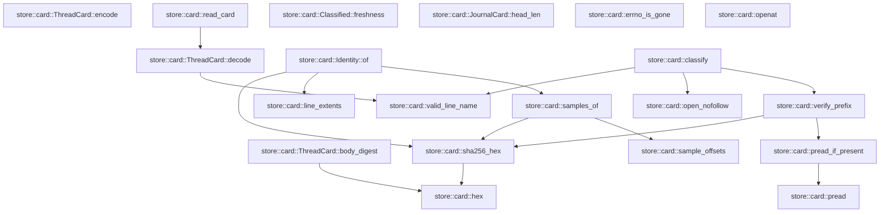
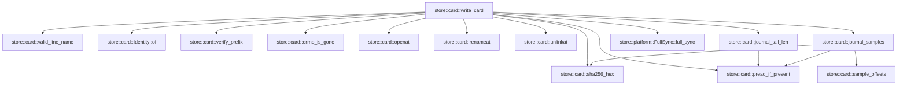

# store::card

[Package atlas](index.md) · [Source](../../src/card.rs)

## Declarations

Visibility is the declaration spelling; trait members and reexports require their enclosing interface. `cfg` is not evaluated.

| Symbol | Kind | Visibility | Test / cfg |
|---|---|---|---|
| [store::card::CARD_FILE](../../src/card.rs#L32) | const_item | `pub` |  |
| [store::card::CARD_VERSION](../../src/card.rs#L33) | const_item | `pub` |  |
| [store::card::JOURNAL_FILE](../../src/card.rs#L34) | const_item | `private` |  |
| [store::card::SAMPLE_COUNT](../../src/card.rs#L36) | const_item | `private` |  |
| [store::card::SAMPLE_LEN](../../src/card.rs#L37) | const_item | `private` |  |
| [store::card::MAX_CARD_BYTES](../../src/card.rs#L39) | const_item | `private` |  |
| [store::card::TEMP_ORDINAL](../../src/card.rs#L41) | static_item | `private` |  |
| [store::card::Sample](../../src/card.rs#L46) | struct_item | `pub` |  |
| [store::card::Hold](../../src/card.rs#L56) | struct_item | `pub` |  |
| [store::card::HoldResolution](../../src/card.rs#L66) | struct_item | `pub` |  |
| [store::card::LineCard](../../src/card.rs#L74) | struct_item | `pub` |  |
| [store::card::CardSummary](../../src/card.rs#L93) | struct_item | `pub` |  |
| [store::card::JournalCard](../../src/card.rs#L107) | struct_item | `pub` |  |
| [store::card::ThreadCard](../../src/card.rs#L120) | struct_item | `pub` |  |
| [store::card::ThreadCard::body_digest](../../src/card.rs#L133) | function_item | `private` |  |
| [store::card::ThreadCard::encode](../../src/card.rs#L142) | function_item | `pub` |  |
| [store::card::ThreadCard::decode](../../src/card.rs#L154) | function_item | `pub` |  |
| [store::card::read_card](../../src/card.rs#L172) | function_item | `pub` |  |
| [store::card::hex](../../src/card.rs#L185) | function_item | `private` |  |
| [store::card::sha256_hex](../../src/card.rs#L195) | function_item | `private` |  |
| [store::card::sample_offsets](../../src/card.rs#L200) | function_item | `private` |  |
| [store::card::line_extents](../../src/card.rs#L215) | function_item | `private` |  |
| [store::card::samples_of](../../src/card.rs#L222) | function_item | `private` |  |
| [store::card::pread](../../src/card.rs#L233) | function_item | `private` |  |
| [store::card::pread_if_present](../../src/card.rs#L241) | function_item | `private` |  |
| [store::card::valid_line_name](../../src/card.rs#L252) | function_item | `pub` |  |
| [store::card::Identity](../../src/card.rs#L262) | struct_item | `private` |  |
| [store::card::Identity::of](../../src/card.rs#L271) | function_item | `private` |  |
| [store::card::LineVerdict](../../src/card.rs#L288) | enum_item | `pub` |  |
| [store::card::JournalVerdict](../../src/card.rs#L298) | enum_item | `pub` |  |
| [store::card::Classified](../../src/card.rs#L307) | struct_item | `pub` |  |
| [store::card::Freshness](../../src/card.rs#L316) | enum_item | `pub` |  |
| [store::card::Classified::freshness](../../src/card.rs#L325) | function_item | `pub` |  |
| [store::card::open_nofollow](../../src/card.rs#L338) | function_item | `private` |  |
| [store::card::verify_prefix](../../src/card.rs#L346) | function_item | `private` |  |
| [store::card::classify](../../src/card.rs#L387) | function_item | `pub` |  |
| [store::card::JournalCard::head_len](../../src/card.rs#L464) | function_item | `private` |  |
| [store::card::LineInput](../../src/card.rs#L473) | struct_item | `pub` |  |
| [store::card::JournalInput](../../src/card.rs#L487) | struct_item | `pub` |  |
| [store::card::CardInput](../../src/card.rs#L494) | struct_item | `pub` |  |
| [store::card::WriteOutcome](../../src/card.rs#L504) | enum_item | `pub` |  |
| [store::card::SkipReason](../../src/card.rs#L512) | enum_item | `pub` |  |
| [store::card::errno_is_gone](../../src/card.rs#L520) | function_item | `private` |  |
| [store::card::openat](../../src/card.rs#L527) | function_item | `private` |  |
| [store::card::renameat](../../src/card.rs#L551) | function_item | `private` |  |
| [store::card::unlinkat](../../src/card.rs#L564) | function_item | `private` |  |
| [store::card::write_card](../../src/card.rs#L578) | function_item | `pub` |  |
| [store::card::journal_tail_len](../../src/card.rs#L713) | function_item | `private` |  |
| [store::card::journal_samples](../../src/card.rs#L728) | function_item | `private` |  |

## Imports / reexports

| Local name | Source path | Visibility |
|---|---|---|
| `CString` | `std::ffi::CString` | `private` |
| `File` | `std::fs::File` | `private` |
| `io` | `std::io` | `private` |
| `AsRawFd` | `std::os::fd::AsRawFd` | `private` |
| `FromRawFd` | `std::os::fd::FromRawFd` | `private` |
| `FileExt` | `std::os::unix::fs::FileExt` | `private` |
| `Path` | `std::path::Path` | `private` |
| `AtomicU64` | `std::sync::atomic::AtomicU64` | `private` |
| `Ordering` | `std::sync::atomic::Ordering` | `private` |
| `LifecycleFacts` | `schema::LifecycleFacts` | `private` |
| `Deserialize` | `serde::Deserialize` | `private` |
| `Serialize` | `serde::Serialize` | `private` |
| `Digest` | `sha2::Digest` | `private` |
| `Sha256` | `sha2::Sha256` | `private` |
| `StoreError` | `crate::StoreError` | `private` |
| `FullSync` | `crate::platform::FullSync` | `private` |

## Module declarations

| Module | Visibility | Attributes |
|---|---|---|
| `store::card::tests` | `private` | #[cfg(test)] |

## Function call graphs

Edges below are syntactically resolved calls only, including private functions. Graphs partition callers into groups of 20; they are not execution order. All unresolved sites are listed below and in the JSON inventory.

Functions 1–20: 15 direct edges

Functions 21–25: 16 direct edges

## Call sites

Includes test functions (marked in declarations). Receiver-type-required sites need type analysis/manual tracing. Calls in closures are attributed to their enclosing function; their occurrence here does not mean the closure executes immediately.

| Caller | Callee expression | Source lines | Target / classification |
|---|---|---|---|
| `TEMP_ORDINAL` | `AtomicU64::new` | [41](../../src/card.rs#L41) | external-constructor-callback-or-unresolved |
| `body_digest` | `self.clone` | [134](../../src/card.rs#L134) | receiver-type-required |
| `body_digest` | `String::new` | [135](../../src/card.rs#L135) | external-constructor-callback-or-unresolved |
| `body_digest` | `serde_json_canonicalizer::to_vec(&blank)             .map_err` | [136](../../src/card.rs#L136) | receiver-type-required |
| `body_digest` | `serde_json_canonicalizer::to_vec` | [136](../../src/card.rs#L136) | external-constructor-callback-or-unresolved |
| `body_digest` | `StoreError::Corruption` | [137](../../src/card.rs#L137) | external-constructor-callback-or-unresolved |
| `body_digest` | `error.to_string` | [137](../../src/card.rs#L137) | receiver-type-required |
| `body_digest` | `Ok` | [138](../../src/card.rs#L138) | external-constructor-callback-or-unresolved |
| `body_digest` | `hex` | [138](../../src/card.rs#L138) | [store::card::hex](../../src/card.rs#L185) |
| `body_digest` | `Sha256::digest` | [138](../../src/card.rs#L138) | external-constructor-callback-or-unresolved |
| `encode` | `self.clone` | [143](../../src/card.rs#L143) | receiver-type-required |
| `encode` | `sealed.body_digest` | [144](../../src/card.rs#L144) | receiver-type-required |
| `encode` | `serde_json_canonicalizer::to_vec(&sealed)             .map_err` | [145](../../src/card.rs#L145) | receiver-type-required |
| `encode` | `serde_json_canonicalizer::to_vec` | [145](../../src/card.rs#L145) | external-constructor-callback-or-unresolved |
| `encode` | `StoreError::Corruption` | [146](../../src/card.rs#L146) | external-constructor-callback-or-unresolved |
| `encode` | `error.to_string` | [146](../../src/card.rs#L146) | receiver-type-required |
| `encode` | `bytes.push` | [147](../../src/card.rs#L147) | receiver-type-required |
| `encode` | `Ok` | [148](../../src/card.rs#L148) | external-constructor-callback-or-unresolved |
| `decode` | `bytes.strip_suffix` | [155](../../src/card.rs#L155) | receiver-type-required |
| `decode` | `line.contains` | [156](../../src/card.rs#L156) | receiver-type-required |
| `decode` | `serde_json::from_slice(line).ok` | [159](../../src/card.rs#L159) | receiver-type-required |
| `decode` | `serde_json::from_slice` | [159](../../src/card.rs#L159) | external-constructor-callback-or-unresolved |
| `decode` | `card.body_digest().ok` | [161](../../src/card.rs#L161) | receiver-type-required |
| `decode` | `card.body_digest` | [161](../../src/card.rs#L161) | receiver-type-required |
| `decode` | `card.lines.iter().all` | [162](../../src/card.rs#L162) | receiver-type-required |
| `decode` | `card.lines.iter` | [162](../../src/card.rs#L162) | receiver-type-required |
| `decode` | `valid_line_name` | [162](../../src/card.rs#L162) | [store::card::valid_line_name](../../src/card.rs#L252) |
| `decode` | `Some` | [166](../../src/card.rs#L166) | external-constructor-callback-or-unresolved |
| `read_card` | `File::open(folder.join(CARD_FILE)).ok` | [173](../../src/card.rs#L173) | receiver-type-required |
| `read_card` | `File::open` | [173](../../src/card.rs#L173) | external-constructor-callback-or-unresolved |
| `read_card` | `folder.join` | [173](../../src/card.rs#L173) | receiver-type-required |
| `read_card` | `file.metadata().ok()?.len` | [174](../../src/card.rs#L174) | receiver-type-required |
| `read_card` | `file.metadata().ok` | [174](../../src/card.rs#L174) | receiver-type-required |
| `read_card` | `file.metadata` | [174](../../src/card.rs#L174) | receiver-type-required |
| `read_card` | `Vec::new` | [177](../../src/card.rs#L177) | external-constructor-callback-or-unresolved |
| `read_card` | `io::Read::read_to_end(&mut io::Read::take(&file, MAX_CARD_BYTES), &mut bytes).ok` | [178](../../src/card.rs#L178) | receiver-type-required |
| `read_card` | `io::Read::read_to_end` | [178](../../src/card.rs#L178) | external-constructor-callback-or-unresolved |
| `read_card` | `io::Read::take` | [178](../../src/card.rs#L178) | external-constructor-callback-or-unresolved |
| `read_card` | `ThreadCard::decode` | [179](../../src/card.rs#L179) | [store::card::ThreadCard::decode](../../src/card.rs#L154) |
| `hex` | `digest         .iter()         .fold` | [187](../../src/card.rs#L187) | receiver-type-required |
| `hex` | `digest         .iter` | [187](../../src/card.rs#L187) | receiver-type-required |
| `hex` | `String::with_capacity` | [189](../../src/card.rs#L189) | external-constructor-callback-or-unresolved |
| `sha256_hex` | `hex` | [196](../../src/card.rs#L196) | [store::card::hex](../../src/card.rs#L185) |
| `sha256_hex` | `Sha256::digest` | [196](../../src/card.rs#L196) | external-constructor-callback-or-unresolved |
| `sample_offsets` | `Vec::new` | [201](../../src/card.rs#L201) | external-constructor-callback-or-unresolved |
| `sample_offsets` | `SAMPLE_LEN.min` | [203](../../src/card.rs#L203) | receiver-type-required |
| `sample_offsets` | `(len.saturating_sub(width) / SAMPLE_COUNT.max(1)).saturating_mul` | [204](../../src/card.rs#L204) | receiver-type-required |
| `sample_offsets` | `len.saturating_sub` | [204](../../src/card.rs#L204), [205](../../src/card.rs#L205) | receiver-type-required |
| `sample_offsets` | `SAMPLE_COUNT.max` | [204](../../src/card.rs#L204) | receiver-type-required |
| `sample_offsets` | `off.min` | [205](../../src/card.rs#L205) | receiver-type-required |
| `sample_offsets` | `windows.contains` | [206](../../src/card.rs#L206) | receiver-type-required |
| `sample_offsets` | `windows.push` | [207](../../src/card.rs#L207) | receiver-type-required |
| `line_extents` | `bytes.iter().position` | [216](../../src/card.rs#L216) | receiver-type-required |
| `line_extents` | `bytes.iter` | [216](../../src/card.rs#L216) | receiver-type-required |
| `line_extents` | `bytes.strip_suffix` | [217](../../src/card.rs#L217) | receiver-type-required |
| `line_extents` | `body.iter().rposition(&#124;b&#124; *b == b'\n').map_or` | [218](../../src/card.rs#L218) | receiver-type-required |
| `line_extents` | `body.iter().rposition` | [218](../../src/card.rs#L218) | receiver-type-required |
| `line_extents` | `body.iter` | [218](../../src/card.rs#L218) | receiver-type-required |
| `line_extents` | `Some` | [219](../../src/card.rs#L219) | external-constructor-callback-or-unresolved |
| `line_extents` | `bytes.len` | [219](../../src/card.rs#L219) | receiver-type-required |
| `samples_of` | `sample_offsets(bytes.len() as u64)         .into_iter()         .map(&#124;(off, len)&#124; Sample {             off,             len,             sha256: sha256_hex(&bytes[off as usize..(off + len) as usize]),         })         .collect` | [223](../../src/card.rs#L223) | receiver-type-required |
| `samples_of` | `sample_offsets(bytes.len() as u64)         .into_iter()         .map` | [223](../../src/card.rs#L223) | receiver-type-required |
| `samples_of` | `sample_offsets(bytes.len() as u64)         .into_iter` | [223](../../src/card.rs#L223) | receiver-type-required |
| `samples_of` | `sample_offsets` | [223](../../src/card.rs#L223) | [store::card::sample_offsets](../../src/card.rs#L200) |
| `samples_of` | `bytes.len` | [223](../../src/card.rs#L223) | receiver-type-required |
| `samples_of` | `sha256_hex` | [228](../../src/card.rs#L228) | [store::card::sha256_hex](../../src/card.rs#L195) |
| `pread` | `file.read_exact_at` | [235](../../src/card.rs#L235) | receiver-type-required |
| `pread` | `Ok` | [236](../../src/card.rs#L236) | external-constructor-callback-or-unresolved |
| `pread_if_present` | `pread` | [242](../../src/card.rs#L242) | [store::card::pread](../../src/card.rs#L233) |
| `pread_if_present` | `Ok` | [243](../../src/card.rs#L243), [244](../../src/card.rs#L244) | external-constructor-callback-or-unresolved |
| `pread_if_present` | `Some` | [243](../../src/card.rs#L243) | external-constructor-callback-or-unresolved |
| `pread_if_present` | `error.kind` | [244](../../src/card.rs#L244) | receiver-type-required |
| `pread_if_present` | `Err` | [245](../../src/card.rs#L245) | external-constructor-callback-or-unresolved |
| `valid_line_name` | `name.len` | [253](../../src/card.rs#L253) | receiver-type-required |
| `valid_line_name` | `".jsonl".len` | [253](../../src/card.rs#L253) | receiver-type-required |
| `valid_line_name` | `name.ends_with` | [254](../../src/card.rs#L254) | receiver-type-required |
| `valid_line_name` | `name.starts_with` | [255](../../src/card.rs#L255) | receiver-type-required |
| `valid_line_name` | `name.contains` | [256](../../src/card.rs#L256) | receiver-type-required |
| `of` | `line_extents` | [272](../../src/card.rs#L272) | [store::card::line_extents](../../src/card.rs#L215) |
| `of` | `Some` | [273](../../src/card.rs#L273) | external-constructor-callback-or-unresolved |
| `of` | `sha256_hex` | [275](../../src/card.rs#L275), [277](../../src/card.rs#L277) | [store::card::sha256_hex](../../src/card.rs#L195) |
| `of` | `prefix.len` | [277](../../src/card.rs#L277) | receiver-type-required |
| `of` | `samples_of` | [278](../../src/card.rs#L278) | [store::card::samples_of](../../src/card.rs#L222) |
| `freshness` | `self.lines.iter().any` | [326](../../src/card.rs#L326) | receiver-type-required |
| `freshness` | `self.lines.iter` | [326](../../src/card.rs#L326), [328](../../src/card.rs#L328) | receiver-type-required |
| `freshness` | `self.lines.iter().all` | [328](../../src/card.rs#L328) | receiver-type-required |
| `freshness` | `self.unlisted_lines.is_empty` | [329](../../src/card.rs#L329) | receiver-type-required |
| `open_nofollow` | `std::fs::OpenOptions::new()         .read(true)         .custom_flags(libc::O_CLOEXEC &#124; libc::O_NOFOLLOW)         .open` | [340](../../src/card.rs#L340) | receiver-type-required |
| `open_nofollow` | `std::fs::OpenOptions::new()         .read(true)         .custom_flags` | [340](../../src/card.rs#L340) | receiver-type-required |
| `open_nofollow` | `std::fs::OpenOptions::new()         .read` | [340](../../src/card.rs#L340) | receiver-type-required |
| `open_nofollow` | `std::fs::OpenOptions::new` | [340](../../src/card.rs#L340) | external-constructor-callback-or-unresolved |
| `verify_prefix` | `file.metadata()?.len` | [355](../../src/card.rs#L355) | receiver-type-required |
| `verify_prefix` | `file.metadata` | [355](../../src/card.rs#L355) | receiver-type-required |
| `verify_prefix` | `Ok` | [358](../../src/card.rs#L358), [361](../../src/card.rs#L361), [364](../../src/card.rs#L364), [367](../../src/card.rs#L367), [371](../../src/card.rs#L371), [375](../../src/card.rs#L375), [378](../../src/card.rs#L378) | external-constructor-callback-or-unresolved |
| `verify_prefix` | `pread_if_present` | [360](../../src/card.rs#L360), [363](../../src/card.rs#L363), [373](../../src/card.rs#L373) | [store::card::pread_if_present](../../src/card.rs#L241) |
| `verify_prefix` | `sha256_hex` | [366](../../src/card.rs#L366), [374](../../src/card.rs#L374) | [store::card::sha256_hex](../../src/card.rs#L195) |
| `verify_prefix` | `sample.off.saturating_add` | [370](../../src/card.rs#L370) | receiver-type-required |
| `classify` | `folder         .file_name()         .and_then(&#124;name&#124; name.to_str())         .is_some_and` | [388](../../src/card.rs#L388) | receiver-type-required |
| `classify` | `folder         .file_name()         .and_then` | [388](../../src/card.rs#L388) | receiver-type-required |
| `classify` | `folder         .file_name` | [388](../../src/card.rs#L388) | receiver-type-required |
| `classify` | `name.to_str` | [390](../../src/card.rs#L390) | receiver-type-required |
| `classify` | `Vec::with_capacity` | [392](../../src/card.rs#L392) | external-constructor-callback-or-unresolved |
| `classify` | `card.lines.len` | [392](../../src/card.rs#L392) | receiver-type-required |
| `classify` | `valid_line_name` | [394](../../src/card.rs#L394), [417](../../src/card.rs#L417) | [store::card::valid_line_name](../../src/card.rs#L252) |
| `classify` | `open_nofollow` | [397](../../src/card.rs#L397), [433](../../src/card.rs#L433) | [store::card::open_nofollow](../../src/card.rs#L338) |
| `classify` | `folder.join` | [397](../../src/card.rs#L397), [427](../../src/card.rs#L427), [433](../../src/card.rs#L433) | receiver-type-required |
| `classify` | `verify_prefix` | [398](../../src/card.rs#L398), [434](../../src/card.rs#L434) | [store::card::verify_prefix](../../src/card.rs#L346) |
| `classify` | `error.kind` | [407](../../src/card.rs#L407), [430](../../src/card.rs#L430), [447](../../src/card.rs#L447), [450](../../src/card.rs#L450) | receiver-type-required |
| `classify` | `Err` | [408](../../src/card.rs#L408), [431](../../src/card.rs#L431), [451](../../src/card.rs#L451) | external-constructor-callback-or-unresolved |
| `classify` | `lines.push` | [411](../../src/card.rs#L411) | receiver-type-required |
| `classify` | `line.file.clone` | [411](../../src/card.rs#L411) | receiver-type-required |
| `classify` | `Vec::new` | [413](../../src/card.rs#L413) | external-constructor-callback-or-unresolved |
| `classify` | `std::fs::read_dir` | [414](../../src/card.rs#L414) | external-constructor-callback-or-unresolved |
| `classify` | `entry.file_name().to_string_lossy().into_owned` | [416](../../src/card.rs#L416) | receiver-type-required |
| `classify` | `entry.file_name().to_string_lossy` | [416](../../src/card.rs#L416) | receiver-type-required |
| `classify` | `entry.file_name` | [416](../../src/card.rs#L416) | receiver-type-required |
| `classify` | `entry.file_type()?.is_file` | [418](../../src/card.rs#L418) | receiver-type-required |
| `classify` | `entry.file_type` | [418](../../src/card.rs#L418) | receiver-type-required |
| `classify` | `card.lines.iter().any` | [419](../../src/card.rs#L419) | receiver-type-required |
| `classify` | `card.lines.iter` | [419](../../src/card.rs#L419) | receiver-type-required |
| `classify` | `unlisted_lines.push` | [421](../../src/card.rs#L421) | receiver-type-required |
| `classify` | `unlisted_lines.sort` | [424](../../src/card.rs#L424) | receiver-type-required |
| `classify` | `std::fs::metadata` | [427](../../src/card.rs#L427) | external-constructor-callback-or-unresolved |
| `classify` | `metadata.len` | [428](../../src/card.rs#L428) | receiver-type-required |
| `classify` | `journal.head_len` | [437](../../src/card.rs#L437) | receiver-type-required |
| `classify` | `Ok` | [454](../../src/card.rs#L454) | external-constructor-callback-or-unresolved |
| `head_len` | `SAMPLE_LEN.min` | [465](../../src/card.rs#L465) | receiver-type-required |
| `openat` | `CString::new(name).map_err` | [528](../../src/card.rs#L528) | receiver-type-required |
| `openat` | `CString::new` | [528](../../src/card.rs#L528) | external-constructor-callback-or-unresolved |
| `openat` | `libc::openat` | [533](../../src/card.rs#L533) | external-constructor-callback-or-unresolved |
| `openat` | `dir.as_raw_fd` | [534](../../src/card.rs#L534) | receiver-type-required |
| `openat` | `name.as_ptr` | [535](../../src/card.rs#L535) | receiver-type-required |
| `openat` | `libc::c_uint::from` | [537](../../src/card.rs#L537) | external-constructor-callback-or-unresolved |
| `openat` | `Ok` | [542](../../src/card.rs#L542) | external-constructor-callback-or-unresolved |
| `openat` | `File::from_raw_fd` | [542](../../src/card.rs#L542) | external-constructor-callback-or-unresolved |
| `openat` | `io::Error::last_os_error` | [544](../../src/card.rs#L544) | external-constructor-callback-or-unresolved |
| `openat` | `error.kind` | [545](../../src/card.rs#L545) | receiver-type-required |
| `openat` | `Err` | [546](../../src/card.rs#L546) | external-constructor-callback-or-unresolved |
| `renameat` | `CString::new(from).map_err` | [552](../../src/card.rs#L552) | receiver-type-required |
| `renameat` | `CString::new` | [552](../../src/card.rs#L552), [553](../../src/card.rs#L553) | external-constructor-callback-or-unresolved |
| `renameat` | `CString::new(to).map_err` | [553](../../src/card.rs#L553) | receiver-type-required |
| `renameat` | `libc::renameat` | [556](../../src/card.rs#L556) | external-constructor-callback-or-unresolved |
| `renameat` | `dir.as_raw_fd` | [556](../../src/card.rs#L556) | receiver-type-required |
| `renameat` | `from.as_ptr` | [556](../../src/card.rs#L556) | receiver-type-required |
| `renameat` | `to.as_ptr` | [556](../../src/card.rs#L556) | receiver-type-required |
| `renameat` | `Ok` | [558](../../src/card.rs#L558) | external-constructor-callback-or-unresolved |
| `renameat` | `Err` | [560](../../src/card.rs#L560) | external-constructor-callback-or-unresolved |
| `renameat` | `io::Error::last_os_error` | [560](../../src/card.rs#L560) | external-constructor-callback-or-unresolved |
| `unlinkat` | `CString::new` | [565](../../src/card.rs#L565) | external-constructor-callback-or-unresolved |
| `unlinkat` | `libc::unlinkat` | [567](../../src/card.rs#L567) | external-constructor-callback-or-unresolved |
| `unlinkat` | `dir.as_raw_fd` | [567](../../src/card.rs#L567) | receiver-type-required |
| `unlinkat` | `name.as_ptr` | [567](../../src/card.rs#L567) | receiver-type-required |
| `write_card` | `File::open` | [579](../../src/card.rs#L579) | external-constructor-callback-or-unresolved |
| `write_card` | `errno_is_gone` | [581](../../src/card.rs#L581), [596](../../src/card.rs#L596), [614](../../src/card.rs#L614), [664](../../src/card.rs#L664), [665](../../src/card.rs#L665), [702](../../src/card.rs#L702) | [store::card::errno_is_gone](../../src/card.rs#L520) |
| `write_card` | `Ok` | [582](../../src/card.rs#L582), [589](../../src/card.rs#L589), [592](../../src/card.rs#L592), [597](../../src/card.rs#L597), [613](../../src/card.rs#L613), [615](../../src/card.rs#L615), [640](../../src/card.rs#L640), [644](../../src/card.rs#L644), [651](../../src/card.rs#L651), [666](../../src/card.rs#L666), [699](../../src/card.rs#L699), [703](../../src/card.rs#L703) | external-constructor-callback-or-unresolved |
| `write_card` | `WriteOutcome::Skipped` | [582](../../src/card.rs#L582), [589](../../src/card.rs#L589), [592](../../src/card.rs#L592), [597](../../src/card.rs#L597), [613](../../src/card.rs#L613), [615](../../src/card.rs#L615), [640](../../src/card.rs#L640), [644](../../src/card.rs#L644), [651](../../src/card.rs#L651), [666](../../src/card.rs#L666), [703](../../src/card.rs#L703) | external-constructor-callback-or-unresolved |
| `write_card` | `Err` | [584](../../src/card.rs#L584), [599](../../src/card.rs#L599), [617](../../src/card.rs#L617), [668](../../src/card.rs#L668), [705](../../src/card.rs#L705) | external-constructor-callback-or-unresolved |
| `write_card` | `error.into` | [584](../../src/card.rs#L584), [599](../../src/card.rs#L599), [617](../../src/card.rs#L617), [668](../../src/card.rs#L668), [705](../../src/card.rs#L705) | receiver-type-required |
| `write_card` | `Vec::with_capacity` | [586](../../src/card.rs#L586) | external-constructor-callback-or-unresolved |
| `write_card` | `input.lines.len` | [586](../../src/card.rs#L586) | receiver-type-required |
| `write_card` | `valid_line_name` | [588](../../src/card.rs#L588) | [store::card::valid_line_name](../../src/card.rs#L252) |
| `write_card` | `Identity::of` | [591](../../src/card.rs#L591) | [store::card::Identity::of](../../src/card.rs#L271) |
| `write_card` | `openat` | [594](../../src/card.rs#L594), [637](../../src/card.rs#L637), [688](../../src/card.rs#L688) | [store::card::openat](../../src/card.rs#L527) |
| `write_card` | `line.verified_prefix.len` | [601](../../src/card.rs#L601) | receiver-type-required |
| `write_card` | `verify_prefix` | [603](../../src/card.rs#L603) | [store::card::verify_prefix](../../src/card.rs#L346) |
| `write_card` | `FullSync::full_sync` | [619](../../src/card.rs#L619) | [store::platform::FullSync::full_sync](../../src/platform.rs#L31) |
| `write_card` | `lines.push` | [620](../../src/card.rs#L620) | receiver-type-required |
| `write_card` | `line.file.to_owned` | [621](../../src/card.rs#L621) | receiver-type-required |
| `write_card` | `line.line.clone` | [629](../../src/card.rs#L629) | receiver-type-required |
| `write_card` | `line.parent_file.clone` | [630](../../src/card.rs#L630) | receiver-type-required |
| `write_card` | `line.facts.clone` | [631](../../src/card.rs#L631) | receiver-type-required |
| `write_card` | `line.holds.clone` | [632](../../src/card.rs#L632) | receiver-type-required |
| `write_card` | `file.metadata()?.len` | [639](../../src/card.rs#L639) | receiver-type-required |
| `write_card` | `file.metadata` | [639](../../src/card.rs#L639) | receiver-type-required |
| `write_card` | `SAMPLE_LEN.min` | [642](../../src/card.rs#L642) | receiver-type-required |
| `write_card` | `journal_tail_len` | [643](../../src/card.rs#L643) | [store::card::journal_tail_len](../../src/card.rs#L713) |
| `write_card` | `pread_if_present` | [647](../../src/card.rs#L647), [648](../../src/card.rs#L648) | [store::card::pread_if_present](../../src/card.rs#L241) |
| `write_card` | `journal_samples` | [649](../../src/card.rs#L649) | [store::card::journal_samples](../../src/card.rs#L728) |
| `write_card` | `Some` | [653](../../src/card.rs#L653) | external-constructor-callback-or-unresolved |
| `write_card` | `sha256_hex` | [658](../../src/card.rs#L658), [659](../../src/card.rs#L659) | [store::card::sha256_hex](../../src/card.rs#L195) |
| `write_card` | `input.kernel.to_owned` | [673](../../src/card.rs#L673) | receiver-type-required |
| `write_card` | `input.thread.to_owned` | [674](../../src/card.rs#L674) | receiver-type-required |
| `write_card` | `input.written.clone` | [675](../../src/card.rs#L675) | receiver-type-required |
| `write_card` | `input.summary.clone` | [677](../../src/card.rs#L677) | receiver-type-required |
| `write_card` | `String::new` | [679](../../src/card.rs#L679) | external-constructor-callback-or-unresolved |
| `write_card` | `card.encode` | [681](../../src/card.rs#L681) | receiver-type-required |
| `write_card` | `(&#124;&#124; -> io::Result<()> {         let file = openat(             &dir,             &temp,             libc::O_WRONLY &#124; libc::O_CREAT &#124; libc::O_EXCL,             0o600,         )?;         file.write_all_at(&bytes, 0)?;         drop(file);         renameat(&dir, &temp, CARD_FILE)     })` | [687](../../src/card.rs#L687) | external-constructor-callback-or-unresolved |
| `write_card` | `file.write_all_at` | [694](../../src/card.rs#L694) | receiver-type-required |
| `write_card` | `drop` | [695](../../src/card.rs#L695) | external-constructor-callback-or-unresolved |
| `write_card` | `renameat` | [696](../../src/card.rs#L696) | [store::card::renameat](../../src/card.rs#L551) |
| `write_card` | `unlinkat` | [701](../../src/card.rs#L701) | [store::card::unlinkat](../../src/card.rs#L564) |
| `journal_tail_len` | `Ok` | [715](../../src/card.rs#L715), [719](../../src/card.rs#L719), [722](../../src/card.rs#L722) | external-constructor-callback-or-unresolved |
| `journal_tail_len` | `Some` | [715](../../src/card.rs#L715), [722](../../src/card.rs#L722) | external-constructor-callback-or-unresolved |
| `journal_tail_len` | `len.min` | [717](../../src/card.rs#L717) | receiver-type-required |
| `journal_tail_len` | `pread_if_present` | [718](../../src/card.rs#L718) | [store::card::pread_if_present](../../src/card.rs#L241) |
| `journal_tail_len` | `bytes.strip_suffix(b"\n").unwrap_or` | [721](../../src/card.rs#L721) | receiver-type-required |
| `journal_tail_len` | `bytes.strip_suffix` | [721](../../src/card.rs#L721) | receiver-type-required |
| `journal_tail_len` | `body.iter().rposition` | [722](../../src/card.rs#L722) | receiver-type-required |
| `journal_tail_len` | `body.iter` | [722](../../src/card.rs#L722) | receiver-type-required |
| `journal_tail_len` | `bytes.len` | [723](../../src/card.rs#L723) | receiver-type-required |
| `journal_samples` | `Vec::new` | [729](../../src/card.rs#L729) | external-constructor-callback-or-unresolved |
| `journal_samples` | `sample_offsets` | [730](../../src/card.rs#L730) | [store::card::sample_offsets](../../src/card.rs#L200) |
| `journal_samples` | `pread_if_present` | [731](../../src/card.rs#L731) | [store::card::pread_if_present](../../src/card.rs#L241) |
| `journal_samples` | `Ok` | [732](../../src/card.rs#L732), [740](../../src/card.rs#L740) | external-constructor-callback-or-unresolved |
| `journal_samples` | `samples.push` | [734](../../src/card.rs#L734) | receiver-type-required |
| `journal_samples` | `sha256_hex` | [737](../../src/card.rs#L737) | [store::card::sha256_hex](../../src/card.rs#L195) |
| `journal_samples` | `Some` | [740](../../src/card.rs#L740) | external-constructor-callback-or-unresolved |
