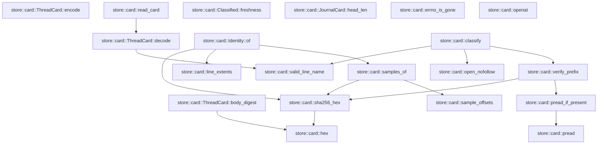
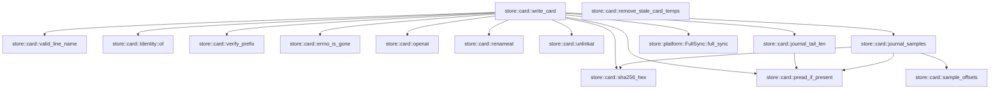

# store::card

[Package atlas](index.md) · [Source](../../src/card.rs)

## Declarations

Visibility is the declaration spelling; trait members and reexports require their enclosing interface. `cfg` is not evaluated.

| Symbol | Kind | Visibility | Test / cfg |
|---|---|---|---|
| [store::card::CARD_FILE](../../src/card.rs#L32) | const_item | `pub` |  |
| [store::card::CARD_VERSION](../../src/card.rs#L33) | const_item | `pub` |  |
| [store::card::JOURNAL_FILE](../../src/card.rs#L34) | const_item | `private` |  |
| [store::card::SAMPLE_COUNT](../../src/card.rs#L36) | const_item | `private` |  |
| [store::card::SAMPLE_LEN](../../src/card.rs#L37) | const_item | `private` |  |
| [store::card::MAX_CARD_BYTES](../../src/card.rs#L39) | const_item | `private` |  |
| [store::card::TEMP_ORDINAL](../../src/card.rs#L41) | static_item | `private` |  |
| [store::card::Sample](../../src/card.rs#L46) | struct_item | `pub` |  |
| [store::card::Hold](../../src/card.rs#L56) | struct_item | `pub` |  |
| [store::card::HoldResolution](../../src/card.rs#L66) | struct_item | `pub` |  |
| [store::card::LineCard](../../src/card.rs#L74) | struct_item | `pub` |  |
| [store::card::CardSummary](../../src/card.rs#L93) | struct_item | `pub` |  |
| [store::card::JournalCard](../../src/card.rs#L110) | struct_item | `pub` |  |
| [store::card::ThreadCard](../../src/card.rs#L123) | struct_item | `pub` |  |
| [store::card::ThreadCard::body_digest](../../src/card.rs#L136) | function_item | `private` |  |
| [store::card::ThreadCard::encode](../../src/card.rs#L145) | function_item | `pub` |  |
| [store::card::ThreadCard::decode](../../src/card.rs#L157) | function_item | `pub` |  |
| [store::card::read_card](../../src/card.rs#L175) | function_item | `pub` |  |
| [store::card::hex](../../src/card.rs#L188) | function_item | `private` |  |
| [store::card::sha256_hex](../../src/card.rs#L198) | function_item | `private` |  |
| [store::card::sample_offsets](../../src/card.rs#L203) | function_item | `private` |  |
| [store::card::line_extents](../../src/card.rs#L218) | function_item | `private` |  |
| [store::card::samples_of](../../src/card.rs#L225) | function_item | `private` |  |
| [store::card::pread](../../src/card.rs#L236) | function_item | `private` |  |
| [store::card::pread_if_present](../../src/card.rs#L244) | function_item | `private` |  |
| [store::card::valid_line_name](../../src/card.rs#L255) | function_item | `pub` |  |
| [store::card::Identity](../../src/card.rs#L265) | struct_item | `private` |  |
| [store::card::Identity::of](../../src/card.rs#L274) | function_item | `private` |  |
| [store::card::LineVerdict](../../src/card.rs#L291) | enum_item | `pub` |  |
| [store::card::JournalVerdict](../../src/card.rs#L301) | enum_item | `pub` |  |
| [store::card::Classified](../../src/card.rs#L310) | struct_item | `pub` |  |
| [store::card::Freshness](../../src/card.rs#L319) | enum_item | `pub` |  |
| [store::card::Classified::freshness](../../src/card.rs#L328) | function_item | `pub` |  |
| [store::card::open_nofollow](../../src/card.rs#L341) | function_item | `private` |  |
| [store::card::verify_prefix](../../src/card.rs#L349) | function_item | `private` |  |
| [store::card::classify](../../src/card.rs#L390) | function_item | `pub` |  |
| [store::card::JournalCard::head_len](../../src/card.rs#L467) | function_item | `private` |  |
| [store::card::LineInput](../../src/card.rs#L476) | struct_item | `pub` |  |
| [store::card::JournalInput](../../src/card.rs#L490) | struct_item | `pub` |  |
| [store::card::CardInput](../../src/card.rs#L497) | struct_item | `pub` |  |
| [store::card::WriteOutcome](../../src/card.rs#L507) | enum_item | `pub` |  |
| [store::card::SkipReason](../../src/card.rs#L515) | enum_item | `pub` |  |
| [store::card::errno_is_gone](../../src/card.rs#L523) | function_item | `private` |  |
| [store::card::openat](../../src/card.rs#L530) | function_item | `private` |  |
| [store::card::renameat](../../src/card.rs#L554) | function_item | `private` |  |
| [store::card::unlinkat](../../src/card.rs#L567) | function_item | `private` |  |
| [store::card::write_card](../../src/card.rs#L581) | function_item | `pub` |  |
| [store::card::remove_stale_card_temps](../../src/card.rs#L717) | function_item | `pub` |  |
| [store::card::journal_tail_len](../../src/card.rs#L753) | function_item | `private` |  |
| [store::card::journal_samples](../../src/card.rs#L768) | function_item | `private` |  |

## Imports / reexports

| Local name | Source path | Visibility |
|---|---|---|
| `CString` | `std::ffi::CString` | `private` |
| `File` | `std::fs::File` | `private` |
| `io` | `std::io` | `private` |
| `AsRawFd` | `std::os::fd::AsRawFd` | `private` |
| `FromRawFd` | `std::os::fd::FromRawFd` | `private` |
| `FileExt` | `std::os::unix::fs::FileExt` | `private` |
| `Path` | `std::path::Path` | `private` |
| `AtomicU64` | `std::sync::atomic::AtomicU64` | `private` |
| `Ordering` | `std::sync::atomic::Ordering` | `private` |
| `LifecycleFacts` | `schema::LifecycleFacts` | `private` |
| `Deserialize` | `serde::Deserialize` | `private` |
| `Serialize` | `serde::Serialize` | `private` |
| `Digest` | `sha2::Digest` | `private` |
| `Sha256` | `sha2::Sha256` | `private` |
| `StoreError` | `crate::StoreError` | `private` |
| `FullSync` | `crate::platform::FullSync` | `private` |

## Module declarations

| Module | Visibility | Attributes |
|---|---|---|
| `store::card::tests` | `private` | #[cfg(test)] |

## Function call graphs

Edges below are syntactically resolved calls only, including private functions. Graphs partition callers into groups of 20; they are not execution order. All unresolved sites are listed below and in the JSON inventory.

Functions 1–20: 15 direct edges

Functions 21–26: 16 direct edges

## Call sites

Includes test functions (marked in declarations). Receiver-type-required sites need type analysis/manual tracing. Calls in closures are attributed to their enclosing function; their occurrence here does not mean the closure executes immediately.

| Caller | Callee expression | Source lines | Target / classification |
|---|---|---|---|
| `TEMP_ORDINAL` | `AtomicU64::new` | [41](../../src/card.rs#L41) | external-constructor-callback-or-unresolved |
| `body_digest` | `self.clone` | [137](../../src/card.rs#L137) | receiver-type-required |
| `body_digest` | `String::new` | [138](../../src/card.rs#L138) | external-constructor-callback-or-unresolved |
| `body_digest` | `serde_json_canonicalizer::to_vec(&blank)             .map_err` | [139](../../src/card.rs#L139) | receiver-type-required |
| `body_digest` | `serde_json_canonicalizer::to_vec` | [139](../../src/card.rs#L139) | external-constructor-callback-or-unresolved |
| `body_digest` | `StoreError::Corruption` | [140](../../src/card.rs#L140) | external-constructor-callback-or-unresolved |
| `body_digest` | `error.to_string` | [140](../../src/card.rs#L140) | receiver-type-required |
| `body_digest` | `Ok` | [141](../../src/card.rs#L141) | external-constructor-callback-or-unresolved |
| `body_digest` | `hex` | [141](../../src/card.rs#L141) | [store::card::hex](../../src/card.rs#L188) |
| `body_digest` | `Sha256::digest` | [141](../../src/card.rs#L141) | external-constructor-callback-or-unresolved |
| `encode` | `self.clone` | [146](../../src/card.rs#L146) | receiver-type-required |
| `encode` | `sealed.body_digest` | [147](../../src/card.rs#L147) | receiver-type-required |
| `encode` | `serde_json_canonicalizer::to_vec(&sealed)             .map_err` | [148](../../src/card.rs#L148) | receiver-type-required |
| `encode` | `serde_json_canonicalizer::to_vec` | [148](../../src/card.rs#L148) | external-constructor-callback-or-unresolved |
| `encode` | `StoreError::Corruption` | [149](../../src/card.rs#L149) | external-constructor-callback-or-unresolved |
| `encode` | `error.to_string` | [149](../../src/card.rs#L149) | receiver-type-required |
| `encode` | `bytes.push` | [150](../../src/card.rs#L150) | receiver-type-required |
| `encode` | `Ok` | [151](../../src/card.rs#L151) | external-constructor-callback-or-unresolved |
| `decode` | `bytes.strip_suffix` | [158](../../src/card.rs#L158) | receiver-type-required |
| `decode` | `line.contains` | [159](../../src/card.rs#L159) | receiver-type-required |
| `decode` | `serde_json::from_slice(line).ok` | [162](../../src/card.rs#L162) | receiver-type-required |
| `decode` | `serde_json::from_slice` | [162](../../src/card.rs#L162) | external-constructor-callback-or-unresolved |
| `decode` | `card.body_digest().ok` | [164](../../src/card.rs#L164) | receiver-type-required |
| `decode` | `card.body_digest` | [164](../../src/card.rs#L164) | receiver-type-required |
| `decode` | `card.lines.iter().all` | [165](../../src/card.rs#L165) | receiver-type-required |
| `decode` | `card.lines.iter` | [165](../../src/card.rs#L165) | receiver-type-required |
| `decode` | `valid_line_name` | [165](../../src/card.rs#L165) | [store::card::valid_line_name](../../src/card.rs#L255) |
| `decode` | `Some` | [169](../../src/card.rs#L169) | external-constructor-callback-or-unresolved |
| `read_card` | `File::open(folder.join(CARD_FILE)).ok` | [176](../../src/card.rs#L176) | receiver-type-required |
| `read_card` | `File::open` | [176](../../src/card.rs#L176) | external-constructor-callback-or-unresolved |
| `read_card` | `folder.join` | [176](../../src/card.rs#L176) | receiver-type-required |
| `read_card` | `file.metadata().ok()?.len` | [177](../../src/card.rs#L177) | receiver-type-required |
| `read_card` | `file.metadata().ok` | [177](../../src/card.rs#L177) | receiver-type-required |
| `read_card` | `file.metadata` | [177](../../src/card.rs#L177) | receiver-type-required |
| `read_card` | `Vec::new` | [180](../../src/card.rs#L180) | external-constructor-callback-or-unresolved |
| `read_card` | `io::Read::read_to_end(&mut io::Read::take(&file, MAX_CARD_BYTES), &mut bytes).ok` | [181](../../src/card.rs#L181) | receiver-type-required |
| `read_card` | `io::Read::read_to_end` | [181](../../src/card.rs#L181) | external-constructor-callback-or-unresolved |
| `read_card` | `io::Read::take` | [181](../../src/card.rs#L181) | external-constructor-callback-or-unresolved |
| `read_card` | `ThreadCard::decode` | [182](../../src/card.rs#L182) | [store::card::ThreadCard::decode](../../src/card.rs#L157) |
| `hex` | `digest         .iter()         .fold` | [190](../../src/card.rs#L190) | receiver-type-required |
| `hex` | `digest         .iter` | [190](../../src/card.rs#L190) | receiver-type-required |
| `hex` | `String::with_capacity` | [192](../../src/card.rs#L192) | external-constructor-callback-or-unresolved |
| `sha256_hex` | `hex` | [199](../../src/card.rs#L199) | [store::card::hex](../../src/card.rs#L188) |
| `sha256_hex` | `Sha256::digest` | [199](../../src/card.rs#L199) | external-constructor-callback-or-unresolved |
| `sample_offsets` | `Vec::new` | [204](../../src/card.rs#L204) | external-constructor-callback-or-unresolved |
| `sample_offsets` | `SAMPLE_LEN.min` | [206](../../src/card.rs#L206) | receiver-type-required |
| `sample_offsets` | `(len.saturating_sub(width) / SAMPLE_COUNT.max(1)).saturating_mul` | [207](../../src/card.rs#L207) | receiver-type-required |
| `sample_offsets` | `len.saturating_sub` | [207](../../src/card.rs#L207), [208](../../src/card.rs#L208) | receiver-type-required |
| `sample_offsets` | `SAMPLE_COUNT.max` | [207](../../src/card.rs#L207) | receiver-type-required |
| `sample_offsets` | `off.min` | [208](../../src/card.rs#L208) | receiver-type-required |
| `sample_offsets` | `windows.contains` | [209](../../src/card.rs#L209) | receiver-type-required |
| `sample_offsets` | `windows.push` | [210](../../src/card.rs#L210) | receiver-type-required |
| `line_extents` | `bytes.iter().position` | [219](../../src/card.rs#L219) | receiver-type-required |
| `line_extents` | `bytes.iter` | [219](../../src/card.rs#L219) | receiver-type-required |
| `line_extents` | `bytes.strip_suffix` | [220](../../src/card.rs#L220) | receiver-type-required |
| `line_extents` | `body.iter().rposition(&#124;b&#124; *b == b'\n').map_or` | [221](../../src/card.rs#L221) | receiver-type-required |
| `line_extents` | `body.iter().rposition` | [221](../../src/card.rs#L221) | receiver-type-required |
| `line_extents` | `body.iter` | [221](../../src/card.rs#L221) | receiver-type-required |
| `line_extents` | `Some` | [222](../../src/card.rs#L222) | external-constructor-callback-or-unresolved |
| `line_extents` | `bytes.len` | [222](../../src/card.rs#L222) | receiver-type-required |
| `samples_of` | `sample_offsets(bytes.len() as u64)         .into_iter()         .map(&#124;(off, len)&#124; Sample {             off,             len,             sha256: sha256_hex(&bytes[off as usize..(off + len) as usize]),         })         .collect` | [226](../../src/card.rs#L226) | receiver-type-required |
| `samples_of` | `sample_offsets(bytes.len() as u64)         .into_iter()         .map` | [226](../../src/card.rs#L226) | receiver-type-required |
| `samples_of` | `sample_offsets(bytes.len() as u64)         .into_iter` | [226](../../src/card.rs#L226) | receiver-type-required |
| `samples_of` | `sample_offsets` | [226](../../src/card.rs#L226) | [store::card::sample_offsets](../../src/card.rs#L203) |
| `samples_of` | `bytes.len` | [226](../../src/card.rs#L226) | receiver-type-required |
| `samples_of` | `sha256_hex` | [231](../../src/card.rs#L231) | [store::card::sha256_hex](../../src/card.rs#L198) |
| `pread` | `file.read_exact_at` | [238](../../src/card.rs#L238) | receiver-type-required |
| `pread` | `Ok` | [239](../../src/card.rs#L239) | external-constructor-callback-or-unresolved |
| `pread_if_present` | `pread` | [245](../../src/card.rs#L245) | [store::card::pread](../../src/card.rs#L236) |
| `pread_if_present` | `Ok` | [246](../../src/card.rs#L246), [247](../../src/card.rs#L247) | external-constructor-callback-or-unresolved |
| `pread_if_present` | `Some` | [246](../../src/card.rs#L246) | external-constructor-callback-or-unresolved |
| `pread_if_present` | `error.kind` | [247](../../src/card.rs#L247) | receiver-type-required |
| `pread_if_present` | `Err` | [248](../../src/card.rs#L248) | external-constructor-callback-or-unresolved |
| `valid_line_name` | `name.len` | [256](../../src/card.rs#L256) | receiver-type-required |
| `valid_line_name` | `".jsonl".len` | [256](../../src/card.rs#L256) | receiver-type-required |
| `valid_line_name` | `name.ends_with` | [257](../../src/card.rs#L257) | receiver-type-required |
| `valid_line_name` | `name.starts_with` | [258](../../src/card.rs#L258) | receiver-type-required |
| `valid_line_name` | `name.contains` | [259](../../src/card.rs#L259) | receiver-type-required |
| `of` | `line_extents` | [275](../../src/card.rs#L275) | [store::card::line_extents](../../src/card.rs#L218) |
| `of` | `Some` | [276](../../src/card.rs#L276) | external-constructor-callback-or-unresolved |
| `of` | `sha256_hex` | [278](../../src/card.rs#L278), [280](../../src/card.rs#L280) | [store::card::sha256_hex](../../src/card.rs#L198) |
| `of` | `prefix.len` | [280](../../src/card.rs#L280) | receiver-type-required |
| `of` | `samples_of` | [281](../../src/card.rs#L281) | [store::card::samples_of](../../src/card.rs#L225) |
| `freshness` | `self.lines.iter().any` | [329](../../src/card.rs#L329) | receiver-type-required |
| `freshness` | `self.lines.iter` | [329](../../src/card.rs#L329), [331](../../src/card.rs#L331) | receiver-type-required |
| `freshness` | `self.lines.iter().all` | [331](../../src/card.rs#L331) | receiver-type-required |
| `freshness` | `self.unlisted_lines.is_empty` | [332](../../src/card.rs#L332) | receiver-type-required |
| `open_nofollow` | `std::fs::OpenOptions::new()         .read(true)         .custom_flags(libc::O_CLOEXEC &#124; libc::O_NOFOLLOW)         .open` | [343](../../src/card.rs#L343) | receiver-type-required |
| `open_nofollow` | `std::fs::OpenOptions::new()         .read(true)         .custom_flags` | [343](../../src/card.rs#L343) | receiver-type-required |
| `open_nofollow` | `std::fs::OpenOptions::new()         .read` | [343](../../src/card.rs#L343) | receiver-type-required |
| `open_nofollow` | `std::fs::OpenOptions::new` | [343](../../src/card.rs#L343) | external-constructor-callback-or-unresolved |
| `verify_prefix` | `file.metadata()?.len` | [358](../../src/card.rs#L358) | receiver-type-required |
| `verify_prefix` | `file.metadata` | [358](../../src/card.rs#L358) | receiver-type-required |
| `verify_prefix` | `Ok` | [361](../../src/card.rs#L361), [364](../../src/card.rs#L364), [367](../../src/card.rs#L367), [370](../../src/card.rs#L370), [374](../../src/card.rs#L374), [378](../../src/card.rs#L378), [381](../../src/card.rs#L381) | external-constructor-callback-or-unresolved |
| `verify_prefix` | `pread_if_present` | [363](../../src/card.rs#L363), [366](../../src/card.rs#L366), [376](../../src/card.rs#L376) | [store::card::pread_if_present](../../src/card.rs#L244) |
| `verify_prefix` | `sha256_hex` | [369](../../src/card.rs#L369), [377](../../src/card.rs#L377) | [store::card::sha256_hex](../../src/card.rs#L198) |
| `verify_prefix` | `sample.off.saturating_add` | [373](../../src/card.rs#L373) | receiver-type-required |
| `classify` | `folder         .file_name()         .and_then(&#124;name&#124; name.to_str())         .is_some_and` | [391](../../src/card.rs#L391) | receiver-type-required |
| `classify` | `folder         .file_name()         .and_then` | [391](../../src/card.rs#L391) | receiver-type-required |
| `classify` | `folder         .file_name` | [391](../../src/card.rs#L391) | receiver-type-required |
| `classify` | `name.to_str` | [393](../../src/card.rs#L393) | receiver-type-required |
| `classify` | `Vec::with_capacity` | [395](../../src/card.rs#L395) | external-constructor-callback-or-unresolved |
| `classify` | `card.lines.len` | [395](../../src/card.rs#L395) | receiver-type-required |
| `classify` | `valid_line_name` | [397](../../src/card.rs#L397), [420](../../src/card.rs#L420) | [store::card::valid_line_name](../../src/card.rs#L255) |
| `classify` | `open_nofollow` | [400](../../src/card.rs#L400), [436](../../src/card.rs#L436) | [store::card::open_nofollow](../../src/card.rs#L341) |
| `classify` | `folder.join` | [400](../../src/card.rs#L400), [430](../../src/card.rs#L430), [436](../../src/card.rs#L436) | receiver-type-required |
| `classify` | `verify_prefix` | [401](../../src/card.rs#L401), [437](../../src/card.rs#L437) | [store::card::verify_prefix](../../src/card.rs#L349) |
| `classify` | `error.kind` | [410](../../src/card.rs#L410), [433](../../src/card.rs#L433), [450](../../src/card.rs#L450), [453](../../src/card.rs#L453) | receiver-type-required |
| `classify` | `Err` | [411](../../src/card.rs#L411), [434](../../src/card.rs#L434), [454](../../src/card.rs#L454) | external-constructor-callback-or-unresolved |
| `classify` | `lines.push` | [414](../../src/card.rs#L414) | receiver-type-required |
| `classify` | `line.file.clone` | [414](../../src/card.rs#L414) | receiver-type-required |
| `classify` | `Vec::new` | [416](../../src/card.rs#L416) | external-constructor-callback-or-unresolved |
| `classify` | `std::fs::read_dir` | [417](../../src/card.rs#L417) | external-constructor-callback-or-unresolved |
| `classify` | `entry.file_name().to_string_lossy().into_owned` | [419](../../src/card.rs#L419) | receiver-type-required |
| `classify` | `entry.file_name().to_string_lossy` | [419](../../src/card.rs#L419) | receiver-type-required |
| `classify` | `entry.file_name` | [419](../../src/card.rs#L419) | receiver-type-required |
| `classify` | `entry.file_type()?.is_file` | [421](../../src/card.rs#L421) | receiver-type-required |
| `classify` | `entry.file_type` | [421](../../src/card.rs#L421) | receiver-type-required |
| `classify` | `card.lines.iter().any` | [422](../../src/card.rs#L422) | receiver-type-required |
| `classify` | `card.lines.iter` | [422](../../src/card.rs#L422) | receiver-type-required |
| `classify` | `unlisted_lines.push` | [424](../../src/card.rs#L424) | receiver-type-required |
| `classify` | `unlisted_lines.sort` | [427](../../src/card.rs#L427) | receiver-type-required |
| `classify` | `std::fs::metadata` | [430](../../src/card.rs#L430) | external-constructor-callback-or-unresolved |
| `classify` | `metadata.len` | [431](../../src/card.rs#L431) | receiver-type-required |
| `classify` | `journal.head_len` | [440](../../src/card.rs#L440) | receiver-type-required |
| `classify` | `Ok` | [457](../../src/card.rs#L457) | external-constructor-callback-or-unresolved |
| `head_len` | `SAMPLE_LEN.min` | [468](../../src/card.rs#L468) | receiver-type-required |
| `openat` | `CString::new(name).map_err` | [531](../../src/card.rs#L531) | receiver-type-required |
| `openat` | `CString::new` | [531](../../src/card.rs#L531) | external-constructor-callback-or-unresolved |
| `openat` | `libc::openat` | [536](../../src/card.rs#L536) | external-constructor-callback-or-unresolved |
| `openat` | `dir.as_raw_fd` | [537](../../src/card.rs#L537) | receiver-type-required |
| `openat` | `name.as_ptr` | [538](../../src/card.rs#L538) | receiver-type-required |
| `openat` | `libc::c_uint::from` | [540](../../src/card.rs#L540) | external-constructor-callback-or-unresolved |
| `openat` | `Ok` | [545](../../src/card.rs#L545) | external-constructor-callback-or-unresolved |
| `openat` | `File::from_raw_fd` | [545](../../src/card.rs#L545) | external-constructor-callback-or-unresolved |
| `openat` | `io::Error::last_os_error` | [547](../../src/card.rs#L547) | external-constructor-callback-or-unresolved |
| `openat` | `error.kind` | [548](../../src/card.rs#L548) | receiver-type-required |
| `openat` | `Err` | [549](../../src/card.rs#L549) | external-constructor-callback-or-unresolved |
| `renameat` | `CString::new(from).map_err` | [555](../../src/card.rs#L555) | receiver-type-required |
| `renameat` | `CString::new` | [555](../../src/card.rs#L555), [556](../../src/card.rs#L556) | external-constructor-callback-or-unresolved |
| `renameat` | `CString::new(to).map_err` | [556](../../src/card.rs#L556) | receiver-type-required |
| `renameat` | `libc::renameat` | [559](../../src/card.rs#L559) | external-constructor-callback-or-unresolved |
| `renameat` | `dir.as_raw_fd` | [559](../../src/card.rs#L559) | receiver-type-required |
| `renameat` | `from.as_ptr` | [559](../../src/card.rs#L559) | receiver-type-required |
| `renameat` | `to.as_ptr` | [559](../../src/card.rs#L559) | receiver-type-required |
| `renameat` | `Ok` | [561](../../src/card.rs#L561) | external-constructor-callback-or-unresolved |
| `renameat` | `Err` | [563](../../src/card.rs#L563) | external-constructor-callback-or-unresolved |
| `renameat` | `io::Error::last_os_error` | [563](../../src/card.rs#L563) | external-constructor-callback-or-unresolved |
| `unlinkat` | `CString::new` | [568](../../src/card.rs#L568) | external-constructor-callback-or-unresolved |
| `unlinkat` | `libc::unlinkat` | [570](../../src/card.rs#L570) | external-constructor-callback-or-unresolved |
| `unlinkat` | `dir.as_raw_fd` | [570](../../src/card.rs#L570) | receiver-type-required |
| `unlinkat` | `name.as_ptr` | [570](../../src/card.rs#L570) | receiver-type-required |
| `write_card` | `File::open` | [582](../../src/card.rs#L582) | external-constructor-callback-or-unresolved |
| `write_card` | `errno_is_gone` | [584](../../src/card.rs#L584), [599](../../src/card.rs#L599), [617](../../src/card.rs#L617), [667](../../src/card.rs#L667), [668](../../src/card.rs#L668), [705](../../src/card.rs#L705) | [store::card::errno_is_gone](../../src/card.rs#L523) |
| `write_card` | `Ok` | [585](../../src/card.rs#L585), [592](../../src/card.rs#L592), [595](../../src/card.rs#L595), [600](../../src/card.rs#L600), [616](../../src/card.rs#L616), [618](../../src/card.rs#L618), [643](../../src/card.rs#L643), [647](../../src/card.rs#L647), [654](../../src/card.rs#L654), [669](../../src/card.rs#L669), [702](../../src/card.rs#L702), [706](../../src/card.rs#L706) | external-constructor-callback-or-unresolved |
| `write_card` | `WriteOutcome::Skipped` | [585](../../src/card.rs#L585), [592](../../src/card.rs#L592), [595](../../src/card.rs#L595), [600](../../src/card.rs#L600), [616](../../src/card.rs#L616), [618](../../src/card.rs#L618), [643](../../src/card.rs#L643), [647](../../src/card.rs#L647), [654](../../src/card.rs#L654), [669](../../src/card.rs#L669), [706](../../src/card.rs#L706) | external-constructor-callback-or-unresolved |
| `write_card` | `Err` | [587](../../src/card.rs#L587), [602](../../src/card.rs#L602), [620](../../src/card.rs#L620), [671](../../src/card.rs#L671), [708](../../src/card.rs#L708) | external-constructor-callback-or-unresolved |
| `write_card` | `error.into` | [587](../../src/card.rs#L587), [602](../../src/card.rs#L602), [620](../../src/card.rs#L620), [671](../../src/card.rs#L671), [708](../../src/card.rs#L708) | receiver-type-required |
| `write_card` | `Vec::with_capacity` | [589](../../src/card.rs#L589) | external-constructor-callback-or-unresolved |
| `write_card` | `input.lines.len` | [589](../../src/card.rs#L589) | receiver-type-required |
| `write_card` | `valid_line_name` | [591](../../src/card.rs#L591) | [store::card::valid_line_name](../../src/card.rs#L255) |
| `write_card` | `Identity::of` | [594](../../src/card.rs#L594) | [store::card::Identity::of](../../src/card.rs#L274) |
| `write_card` | `openat` | [597](../../src/card.rs#L597), [640](../../src/card.rs#L640), [691](../../src/card.rs#L691) | [store::card::openat](../../src/card.rs#L530) |
| `write_card` | `line.verified_prefix.len` | [604](../../src/card.rs#L604) | receiver-type-required |
| `write_card` | `verify_prefix` | [606](../../src/card.rs#L606) | [store::card::verify_prefix](../../src/card.rs#L349) |
| `write_card` | `FullSync::full_sync` | [622](../../src/card.rs#L622) | [store::platform::FullSync::full_sync](../../src/platform.rs#L31) |
| `write_card` | `lines.push` | [623](../../src/card.rs#L623) | receiver-type-required |
| `write_card` | `line.file.to_owned` | [624](../../src/card.rs#L624) | receiver-type-required |
| `write_card` | `line.line.clone` | [632](../../src/card.rs#L632) | receiver-type-required |
| `write_card` | `line.parent_file.clone` | [633](../../src/card.rs#L633) | receiver-type-required |
| `write_card` | `line.facts.clone` | [634](../../src/card.rs#L634) | receiver-type-required |
| `write_card` | `line.holds.clone` | [635](../../src/card.rs#L635) | receiver-type-required |
| `write_card` | `file.metadata()?.len` | [642](../../src/card.rs#L642) | receiver-type-required |
| `write_card` | `file.metadata` | [642](../../src/card.rs#L642) | receiver-type-required |
| `write_card` | `SAMPLE_LEN.min` | [645](../../src/card.rs#L645) | receiver-type-required |
| `write_card` | `journal_tail_len` | [646](../../src/card.rs#L646) | [store::card::journal_tail_len](../../src/card.rs#L753) |
| `write_card` | `pread_if_present` | [650](../../src/card.rs#L650), [651](../../src/card.rs#L651) | [store::card::pread_if_present](../../src/card.rs#L244) |
| `write_card` | `journal_samples` | [652](../../src/card.rs#L652) | [store::card::journal_samples](../../src/card.rs#L768) |
| `write_card` | `Some` | [656](../../src/card.rs#L656) | external-constructor-callback-or-unresolved |
| `write_card` | `sha256_hex` | [661](../../src/card.rs#L661), [662](../../src/card.rs#L662) | [store::card::sha256_hex](../../src/card.rs#L198) |
| `write_card` | `input.kernel.to_owned` | [676](../../src/card.rs#L676) | receiver-type-required |
| `write_card` | `input.thread.to_owned` | [677](../../src/card.rs#L677) | receiver-type-required |
| `write_card` | `input.written.clone` | [678](../../src/card.rs#L678) | receiver-type-required |
| `write_card` | `input.summary.clone` | [680](../../src/card.rs#L680) | receiver-type-required |
| `write_card` | `String::new` | [682](../../src/card.rs#L682) | external-constructor-callback-or-unresolved |
| `write_card` | `card.encode` | [684](../../src/card.rs#L684) | receiver-type-required |
| `write_card` | `(&#124;&#124; -> io::Result<()> {         let file = openat(             &dir,             &temp,             libc::O_WRONLY &#124; libc::O_CREAT &#124; libc::O_EXCL,             0o600,         )?;         file.write_all_at(&bytes, 0)?;         drop(file);         renameat(&dir, &temp, CARD_FILE)     })` | [690](../../src/card.rs#L690) | external-constructor-callback-or-unresolved |
| `write_card` | `file.write_all_at` | [697](../../src/card.rs#L697) | receiver-type-required |
| `write_card` | `drop` | [698](../../src/card.rs#L698) | external-constructor-callback-or-unresolved |
| `write_card` | `renameat` | [699](../../src/card.rs#L699) | [store::card::renameat](../../src/card.rs#L554) |
| `write_card` | `unlinkat` | [704](../../src/card.rs#L704) | [store::card::unlinkat](../../src/card.rs#L567) |
| `remove_stale_card_temps` | `std::fs::read_dir` | [719](../../src/card.rs#L719) | external-constructor-callback-or-unresolved |
| `remove_stale_card_temps` | `entries.flatten` | [723](../../src/card.rs#L723) | receiver-type-required |
| `remove_stale_card_temps` | `entry.file_name().to_string_lossy().into_owned` | [724](../../src/card.rs#L724) | receiver-type-required |
| `remove_stale_card_temps` | `entry.file_name().to_string_lossy` | [724](../../src/card.rs#L724) | receiver-type-required |
| `remove_stale_card_temps` | `entry.file_name` | [724](../../src/card.rs#L724) | receiver-type-required |
| `remove_stale_card_temps` | `name             .strip_prefix(&prefix)             .and_then` | [725](../../src/card.rs#L725) | receiver-type-required |
| `remove_stale_card_temps` | `name             .strip_prefix` | [725](../../src/card.rs#L725) | receiver-type-required |
| `remove_stale_card_temps` | `rest.strip_suffix` | [727](../../src/card.rs#L727) | receiver-type-required |
| `remove_stale_card_temps` | `rest             .split('.')             .next()             .and_then` | [731](../../src/card.rs#L731) | receiver-type-required |
| `remove_stale_card_temps` | `rest             .split('.')             .next` | [731](../../src/card.rs#L731) | receiver-type-required |
| `remove_stale_card_temps` | `rest             .split` | [731](../../src/card.rs#L731) | receiver-type-required |
| `remove_stale_card_temps` | `pid.parse::<i32>().ok` | [734](../../src/card.rs#L734) | receiver-type-required |
| `remove_stale_card_temps` | `pid.parse::<i32>` | [734](../../src/card.rs#L734) | receiver-type-required |
| `remove_stale_card_temps` | `u32::try_from(pid).is_ok_and` | [738](../../src/card.rs#L738) | receiver-type-required |
| `remove_stale_card_temps` | `u32::try_from` | [738](../../src/card.rs#L738) | external-constructor-callback-or-unresolved |
| `remove_stale_card_temps` | `std::process::id` | [738](../../src/card.rs#L738) | external-constructor-callback-or-unresolved |
| `remove_stale_card_temps` | `libc::kill` | [742](../../src/card.rs#L742) | external-constructor-callback-or-unresolved |
| `remove_stale_card_temps` | `io::Error::last_os_error().raw_os_error` | [743](../../src/card.rs#L743) | receiver-type-required |
| `remove_stale_card_temps` | `io::Error::last_os_error` | [743](../../src/card.rs#L743) | external-constructor-callback-or-unresolved |
| `remove_stale_card_temps` | `Some` | [743](../../src/card.rs#L743) | external-constructor-callback-or-unresolved |
| `remove_stale_card_temps` | `std::fs::remove_file(entry.path()).is_ok` | [744](../../src/card.rs#L744) | receiver-type-required |
| `remove_stale_card_temps` | `std::fs::remove_file` | [744](../../src/card.rs#L744) | external-constructor-callback-or-unresolved |
| `remove_stale_card_temps` | `entry.path` | [744](../../src/card.rs#L744) | receiver-type-required |
| `journal_tail_len` | `Ok` | [755](../../src/card.rs#L755), [759](../../src/card.rs#L759), [762](../../src/card.rs#L762) | external-constructor-callback-or-unresolved |
| `journal_tail_len` | `Some` | [755](../../src/card.rs#L755), [762](../../src/card.rs#L762) | external-constructor-callback-or-unresolved |
| `journal_tail_len` | `len.min` | [757](../../src/card.rs#L757) | receiver-type-required |
| `journal_tail_len` | `pread_if_present` | [758](../../src/card.rs#L758) | [store::card::pread_if_present](../../src/card.rs#L244) |
| `journal_tail_len` | `bytes.strip_suffix(b"\n").unwrap_or` | [761](../../src/card.rs#L761) | receiver-type-required |
| `journal_tail_len` | `bytes.strip_suffix` | [761](../../src/card.rs#L761) | receiver-type-required |
| `journal_tail_len` | `body.iter().rposition` | [762](../../src/card.rs#L762) | receiver-type-required |
| `journal_tail_len` | `body.iter` | [762](../../src/card.rs#L762) | receiver-type-required |
| `journal_tail_len` | `bytes.len` | [763](../../src/card.rs#L763) | receiver-type-required |
| `journal_samples` | `Vec::new` | [769](../../src/card.rs#L769) | external-constructor-callback-or-unresolved |
| `journal_samples` | `sample_offsets` | [770](../../src/card.rs#L770) | [store::card::sample_offsets](../../src/card.rs#L203) |
| `journal_samples` | `pread_if_present` | [771](../../src/card.rs#L771) | [store::card::pread_if_present](../../src/card.rs#L244) |
| `journal_samples` | `Ok` | [772](../../src/card.rs#L772), [780](../../src/card.rs#L780) | external-constructor-callback-or-unresolved |
| `journal_samples` | `samples.push` | [774](../../src/card.rs#L774) | receiver-type-required |
| `journal_samples` | `sha256_hex` | [777](../../src/card.rs#L777) | [store::card::sha256_hex](../../src/card.rs#L198) |
| `journal_samples` | `Some` | [780](../../src/card.rs#L780) | external-constructor-callback-or-unresolved |
