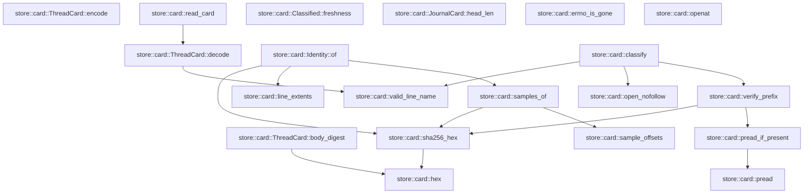
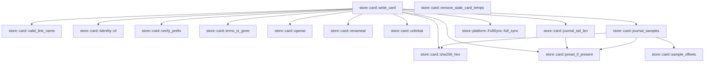

# store::card

[Package atlas](index.md) · [Source](../../src/card.rs)

## Declarations

Visibility is the declaration spelling; trait members and reexports require their enclosing interface. `cfg` is not evaluated.

| Symbol | Kind | Visibility | Test / cfg |
|---|---|---|---|
| [store::card::CARD_FILE](../../src/card.rs#L32) | const_item | `pub` |  |
| [store::card::CARD_VERSION](../../src/card.rs#L33) | const_item | `pub` |  |
| [store::card::JOURNAL_FILE](../../src/card.rs#L34) | const_item | `private` |  |
| [store::card::SAMPLE_COUNT](../../src/card.rs#L36) | const_item | `private` |  |
| [store::card::SAMPLE_LEN](../../src/card.rs#L37) | const_item | `private` |  |
| [store::card::MAX_CARD_BYTES](../../src/card.rs#L39) | const_item | `private` |  |
| [store::card::TEMP_ORDINAL](../../src/card.rs#L41) | static_item | `private` |  |
| [store::card::Sample](../../src/card.rs#L46) | struct_item | `pub` |  |
| [store::card::Hold](../../src/card.rs#L56) | struct_item | `pub` |  |
| [store::card::HoldResolution](../../src/card.rs#L66) | struct_item | `pub` |  |
| [store::card::LineCard](../../src/card.rs#L74) | struct_item | `pub` |  |
| [store::card::CardSummary](../../src/card.rs#L93) | struct_item | `pub` |  |
| [store::card::JournalCard](../../src/card.rs#L111) | struct_item | `pub` |  |
| [store::card::ThreadCard](../../src/card.rs#L124) | struct_item | `pub` |  |
| [store::card::ThreadCard::body_digest](../../src/card.rs#L137) | function_item | `private` |  |
| [store::card::ThreadCard::encode](../../src/card.rs#L146) | function_item | `pub` |  |
| [store::card::ThreadCard::decode](../../src/card.rs#L158) | function_item | `pub` |  |
| [store::card::read_card](../../src/card.rs#L176) | function_item | `pub` |  |
| [store::card::hex](../../src/card.rs#L189) | function_item | `private` |  |
| [store::card::sha256_hex](../../src/card.rs#L199) | function_item | `private` |  |
| [store::card::sample_offsets](../../src/card.rs#L204) | function_item | `private` |  |
| [store::card::line_extents](../../src/card.rs#L219) | function_item | `private` |  |
| [store::card::samples_of](../../src/card.rs#L226) | function_item | `private` |  |
| [store::card::pread](../../src/card.rs#L237) | function_item | `private` |  |
| [store::card::pread_if_present](../../src/card.rs#L245) | function_item | `private` |  |
| [store::card::valid_line_name](../../src/card.rs#L256) | function_item | `pub` |  |
| [store::card::Identity](../../src/card.rs#L270) | struct_item | `private` |  |
| [store::card::Identity::of](../../src/card.rs#L279) | function_item | `private` |  |
| [store::card::LineVerdict](../../src/card.rs#L296) | enum_item | `pub` |  |
| [store::card::JournalVerdict](../../src/card.rs#L306) | enum_item | `pub` |  |
| [store::card::Classified](../../src/card.rs#L315) | struct_item | `pub` |  |
| [store::card::Freshness](../../src/card.rs#L324) | enum_item | `pub` |  |
| [store::card::Classified::freshness](../../src/card.rs#L333) | function_item | `pub` |  |
| [store::card::open_nofollow](../../src/card.rs#L346) | function_item | `private` |  |
| [store::card::verify_prefix](../../src/card.rs#L354) | function_item | `private` |  |
| [store::card::classify](../../src/card.rs#L395) | function_item | `pub` |  |
| [store::card::JournalCard::head_len](../../src/card.rs#L472) | function_item | `private` |  |
| [store::card::LineInput](../../src/card.rs#L481) | struct_item | `pub` |  |
| [store::card::JournalInput](../../src/card.rs#L495) | struct_item | `pub` |  |
| [store::card::CardInput](../../src/card.rs#L502) | struct_item | `pub` |  |
| [store::card::WriteOutcome](../../src/card.rs#L512) | enum_item | `pub` |  |
| [store::card::SkipReason](../../src/card.rs#L520) | enum_item | `pub` |  |
| [store::card::errno_is_gone](../../src/card.rs#L528) | function_item | `private` |  |
| [store::card::openat](../../src/card.rs#L535) | function_item | `private` |  |
| [store::card::renameat](../../src/card.rs#L559) | function_item | `private` |  |
| [store::card::unlinkat](../../src/card.rs#L572) | function_item | `private` |  |
| [store::card::write_card](../../src/card.rs#L586) | function_item | `pub` |  |
| [store::card::remove_stale_card_temps](../../src/card.rs#L722) | function_item | `pub` |  |
| [store::card::journal_tail_len](../../src/card.rs#L758) | function_item | `private` |  |
| [store::card::journal_samples](../../src/card.rs#L773) | function_item | `private` |  |

## Imports / reexports

| Local name | Source path | Visibility |
|---|---|---|
| `CString` | `std::ffi::CString` | `private` |
| `File` | `std::fs::File` | `private` |
| `io` | `std::io` | `private` |
| `AsRawFd` | `std::os::fd::AsRawFd` | `private` |
| `FromRawFd` | `std::os::fd::FromRawFd` | `private` |
| `FileExt` | `std::os::unix::fs::FileExt` | `private` |
| `Path` | `std::path::Path` | `private` |
| `AtomicU64` | `std::sync::atomic::AtomicU64` | `private` |
| `Ordering` | `std::sync::atomic::Ordering` | `private` |
| `LifecycleFacts` | `schema::LifecycleFacts` | `private` |
| `Deserialize` | `serde::Deserialize` | `private` |
| `Serialize` | `serde::Serialize` | `private` |
| `Digest` | `sha2::Digest` | `private` |
| `Sha256` | `sha2::Sha256` | `private` |
| `StoreError` | `crate::StoreError` | `private` |
| `FullSync` | `crate::platform::FullSync` | `private` |

## Module declarations

| Module | Visibility | Attributes |
|---|---|---|
| `store::card::tests` | `private` | #[cfg(test)] |

## Function call graphs

Edges below are syntactically resolved calls only, including private functions. Graphs partition callers into groups of 20; they are not execution order. All unresolved sites are listed below and in the JSON inventory.

Functions 1–20: 15 direct edges

Functions 21–26: 16 direct edges

## Call sites

Includes test functions (marked in declarations). Receiver-type-required sites need type analysis/manual tracing. Calls in closures are attributed to their enclosing function; their occurrence here does not mean the closure executes immediately.

| Caller | Callee expression | Source lines | Target / classification |
|---|---|---|---|
| `TEMP_ORDINAL` | `AtomicU64::new` | [41](../../src/card.rs#L41) | external-constructor-callback-or-unresolved |
| `body_digest` | `self.clone` | [138](../../src/card.rs#L138) | receiver-type-required |
| `body_digest` | `String::new` | [139](../../src/card.rs#L139) | external-constructor-callback-or-unresolved |
| `body_digest` | `serde_json_canonicalizer::to_vec(&blank)             .map_err` | [140](../../src/card.rs#L140) | receiver-type-required |
| `body_digest` | `serde_json_canonicalizer::to_vec` | [140](../../src/card.rs#L140) | external-constructor-callback-or-unresolved |
| `body_digest` | `StoreError::Corruption` | [141](../../src/card.rs#L141) | external-constructor-callback-or-unresolved |
| `body_digest` | `error.to_string` | [141](../../src/card.rs#L141) | receiver-type-required |
| `body_digest` | `Ok` | [142](../../src/card.rs#L142) | external-constructor-callback-or-unresolved |
| `body_digest` | `hex` | [142](../../src/card.rs#L142) | [store::card::hex](../../src/card.rs#L189) |
| `body_digest` | `Sha256::digest` | [142](../../src/card.rs#L142) | external-constructor-callback-or-unresolved |
| `encode` | `self.clone` | [147](../../src/card.rs#L147) | receiver-type-required |
| `encode` | `sealed.body_digest` | [148](../../src/card.rs#L148) | receiver-type-required |
| `encode` | `serde_json_canonicalizer::to_vec(&sealed)             .map_err` | [149](../../src/card.rs#L149) | receiver-type-required |
| `encode` | `serde_json_canonicalizer::to_vec` | [149](../../src/card.rs#L149) | external-constructor-callback-or-unresolved |
| `encode` | `StoreError::Corruption` | [150](../../src/card.rs#L150) | external-constructor-callback-or-unresolved |
| `encode` | `error.to_string` | [150](../../src/card.rs#L150) | receiver-type-required |
| `encode` | `bytes.push` | [151](../../src/card.rs#L151) | receiver-type-required |
| `encode` | `Ok` | [152](../../src/card.rs#L152) | external-constructor-callback-or-unresolved |
| `decode` | `bytes.strip_suffix` | [159](../../src/card.rs#L159) | receiver-type-required |
| `decode` | `line.contains` | [160](../../src/card.rs#L160) | receiver-type-required |
| `decode` | `serde_json::from_slice(line).ok` | [163](../../src/card.rs#L163) | receiver-type-required |
| `decode` | `serde_json::from_slice` | [163](../../src/card.rs#L163) | external-constructor-callback-or-unresolved |
| `decode` | `card.body_digest().ok` | [165](../../src/card.rs#L165) | receiver-type-required |
| `decode` | `card.body_digest` | [165](../../src/card.rs#L165) | receiver-type-required |
| `decode` | `card.lines.iter().all` | [166](../../src/card.rs#L166) | receiver-type-required |
| `decode` | `card.lines.iter` | [166](../../src/card.rs#L166) | receiver-type-required |
| `decode` | `valid_line_name` | [166](../../src/card.rs#L166) | [store::card::valid_line_name](../../src/card.rs#L256) |
| `decode` | `Some` | [170](../../src/card.rs#L170) | external-constructor-callback-or-unresolved |
| `read_card` | `File::open(folder.join(CARD_FILE)).ok` | [177](../../src/card.rs#L177) | receiver-type-required |
| `read_card` | `File::open` | [177](../../src/card.rs#L177) | external-constructor-callback-or-unresolved |
| `read_card` | `folder.join` | [177](../../src/card.rs#L177) | receiver-type-required |
| `read_card` | `file.metadata().ok()?.len` | [178](../../src/card.rs#L178) | receiver-type-required |
| `read_card` | `file.metadata().ok` | [178](../../src/card.rs#L178) | receiver-type-required |
| `read_card` | `file.metadata` | [178](../../src/card.rs#L178) | receiver-type-required |
| `read_card` | `Vec::new` | [181](../../src/card.rs#L181) | external-constructor-callback-or-unresolved |
| `read_card` | `io::Read::read_to_end(&mut io::Read::take(&file, MAX_CARD_BYTES), &mut bytes).ok` | [182](../../src/card.rs#L182) | receiver-type-required |
| `read_card` | `io::Read::read_to_end` | [182](../../src/card.rs#L182) | external-constructor-callback-or-unresolved |
| `read_card` | `io::Read::take` | [182](../../src/card.rs#L182) | external-constructor-callback-or-unresolved |
| `read_card` | `ThreadCard::decode` | [183](../../src/card.rs#L183) | [store::card::ThreadCard::decode](../../src/card.rs#L158) |
| `hex` | `digest         .iter()         .fold` | [191](../../src/card.rs#L191) | receiver-type-required |
| `hex` | `digest         .iter` | [191](../../src/card.rs#L191) | receiver-type-required |
| `hex` | `String::with_capacity` | [193](../../src/card.rs#L193) | external-constructor-callback-or-unresolved |
| `sha256_hex` | `hex` | [200](../../src/card.rs#L200) | [store::card::hex](../../src/card.rs#L189) |
| `sha256_hex` | `Sha256::digest` | [200](../../src/card.rs#L200) | external-constructor-callback-or-unresolved |
| `sample_offsets` | `Vec::new` | [205](../../src/card.rs#L205) | external-constructor-callback-or-unresolved |
| `sample_offsets` | `SAMPLE_LEN.min` | [207](../../src/card.rs#L207) | receiver-type-required |
| `sample_offsets` | `(len.saturating_sub(width) / SAMPLE_COUNT.max(1)).saturating_mul` | [208](../../src/card.rs#L208) | receiver-type-required |
| `sample_offsets` | `len.saturating_sub` | [208](../../src/card.rs#L208), [209](../../src/card.rs#L209) | receiver-type-required |
| `sample_offsets` | `SAMPLE_COUNT.max` | [208](../../src/card.rs#L208) | receiver-type-required |
| `sample_offsets` | `off.min` | [209](../../src/card.rs#L209) | receiver-type-required |
| `sample_offsets` | `windows.contains` | [210](../../src/card.rs#L210) | receiver-type-required |
| `sample_offsets` | `windows.push` | [211](../../src/card.rs#L211) | receiver-type-required |
| `line_extents` | `bytes.iter().position` | [220](../../src/card.rs#L220) | receiver-type-required |
| `line_extents` | `bytes.iter` | [220](../../src/card.rs#L220) | receiver-type-required |
| `line_extents` | `bytes.strip_suffix` | [221](../../src/card.rs#L221) | receiver-type-required |
| `line_extents` | `body.iter().rposition(&#124;b&#124; *b == b'\n').map_or` | [222](../../src/card.rs#L222) | receiver-type-required |
| `line_extents` | `body.iter().rposition` | [222](../../src/card.rs#L222) | receiver-type-required |
| `line_extents` | `body.iter` | [222](../../src/card.rs#L222) | receiver-type-required |
| `line_extents` | `Some` | [223](../../src/card.rs#L223) | external-constructor-callback-or-unresolved |
| `line_extents` | `bytes.len` | [223](../../src/card.rs#L223) | receiver-type-required |
| `samples_of` | `sample_offsets(bytes.len() as u64)         .into_iter()         .map(&#124;(off, len)&#124; Sample {             off,             len,             sha256: sha256_hex(&bytes[off as usize..(off + len) as usize]),         })         .collect` | [227](../../src/card.rs#L227) | receiver-type-required |
| `samples_of` | `sample_offsets(bytes.len() as u64)         .into_iter()         .map` | [227](../../src/card.rs#L227) | receiver-type-required |
| `samples_of` | `sample_offsets(bytes.len() as u64)         .into_iter` | [227](../../src/card.rs#L227) | receiver-type-required |
| `samples_of` | `sample_offsets` | [227](../../src/card.rs#L227) | [store::card::sample_offsets](../../src/card.rs#L204) |
| `samples_of` | `bytes.len` | [227](../../src/card.rs#L227) | receiver-type-required |
| `samples_of` | `sha256_hex` | [232](../../src/card.rs#L232) | [store::card::sha256_hex](../../src/card.rs#L199) |
| `pread` | `file.read_exact_at` | [239](../../src/card.rs#L239) | receiver-type-required |
| `pread` | `Ok` | [240](../../src/card.rs#L240) | external-constructor-callback-or-unresolved |
| `pread_if_present` | `pread` | [246](../../src/card.rs#L246) | [store::card::pread](../../src/card.rs#L237) |
| `pread_if_present` | `Ok` | [247](../../src/card.rs#L247), [248](../../src/card.rs#L248) | external-constructor-callback-or-unresolved |
| `pread_if_present` | `Some` | [247](../../src/card.rs#L247) | external-constructor-callback-or-unresolved |
| `pread_if_present` | `error.kind` | [248](../../src/card.rs#L248) | receiver-type-required |
| `pread_if_present` | `Err` | [249](../../src/card.rs#L249) | external-constructor-callback-or-unresolved |
| `valid_line_name` | `name.len` | [257](../../src/card.rs#L257) | receiver-type-required |
| `valid_line_name` | `".jsonl".len` | [257](../../src/card.rs#L257) | receiver-type-required |
| `valid_line_name` | `name.ends_with` | [258](../../src/card.rs#L258) | receiver-type-required |
| `valid_line_name` | `name.starts_with` | [259](../../src/card.rs#L259) | receiver-type-required |
| `valid_line_name` | `name.contains` | [260](../../src/card.rs#L260) | receiver-type-required |
| `of` | `line_extents` | [280](../../src/card.rs#L280) | [store::card::line_extents](../../src/card.rs#L219) |
| `of` | `Some` | [281](../../src/card.rs#L281) | external-constructor-callback-or-unresolved |
| `of` | `sha256_hex` | [283](../../src/card.rs#L283), [285](../../src/card.rs#L285) | [store::card::sha256_hex](../../src/card.rs#L199) |
| `of` | `prefix.len` | [285](../../src/card.rs#L285) | receiver-type-required |
| `of` | `samples_of` | [286](../../src/card.rs#L286) | [store::card::samples_of](../../src/card.rs#L226) |
| `freshness` | `self.lines.iter().any` | [334](../../src/card.rs#L334) | receiver-type-required |
| `freshness` | `self.lines.iter` | [334](../../src/card.rs#L334), [336](../../src/card.rs#L336) | receiver-type-required |
| `freshness` | `self.lines.iter().all` | [336](../../src/card.rs#L336) | receiver-type-required |
| `freshness` | `self.unlisted_lines.is_empty` | [337](../../src/card.rs#L337) | receiver-type-required |
| `open_nofollow` | `std::fs::OpenOptions::new()         .read(true)         .custom_flags(libc::O_CLOEXEC &#124; libc::O_NOFOLLOW)         .open` | [348](../../src/card.rs#L348) | receiver-type-required |
| `open_nofollow` | `std::fs::OpenOptions::new()         .read(true)         .custom_flags` | [348](../../src/card.rs#L348) | receiver-type-required |
| `open_nofollow` | `std::fs::OpenOptions::new()         .read` | [348](../../src/card.rs#L348) | receiver-type-required |
| `open_nofollow` | `std::fs::OpenOptions::new` | [348](../../src/card.rs#L348) | external-constructor-callback-or-unresolved |
| `verify_prefix` | `file.metadata()?.len` | [363](../../src/card.rs#L363) | receiver-type-required |
| `verify_prefix` | `file.metadata` | [363](../../src/card.rs#L363) | receiver-type-required |
| `verify_prefix` | `Ok` | [366](../../src/card.rs#L366), [369](../../src/card.rs#L369), [372](../../src/card.rs#L372), [375](../../src/card.rs#L375), [379](../../src/card.rs#L379), [383](../../src/card.rs#L383), [386](../../src/card.rs#L386) | external-constructor-callback-or-unresolved |
| `verify_prefix` | `pread_if_present` | [368](../../src/card.rs#L368), [371](../../src/card.rs#L371), [381](../../src/card.rs#L381) | [store::card::pread_if_present](../../src/card.rs#L245) |
| `verify_prefix` | `sha256_hex` | [374](../../src/card.rs#L374), [382](../../src/card.rs#L382) | [store::card::sha256_hex](../../src/card.rs#L199) |
| `verify_prefix` | `sample.off.saturating_add` | [378](../../src/card.rs#L378) | receiver-type-required |
| `classify` | `folder         .file_name()         .and_then(&#124;name&#124; name.to_str())         .is_some_and` | [396](../../src/card.rs#L396) | receiver-type-required |
| `classify` | `folder         .file_name()         .and_then` | [396](../../src/card.rs#L396) | receiver-type-required |
| `classify` | `folder         .file_name` | [396](../../src/card.rs#L396) | receiver-type-required |
| `classify` | `name.to_str` | [398](../../src/card.rs#L398) | receiver-type-required |
| `classify` | `Vec::with_capacity` | [400](../../src/card.rs#L400) | external-constructor-callback-or-unresolved |
| `classify` | `card.lines.len` | [400](../../src/card.rs#L400) | receiver-type-required |
| `classify` | `valid_line_name` | [402](../../src/card.rs#L402), [425](../../src/card.rs#L425) | [store::card::valid_line_name](../../src/card.rs#L256) |
| `classify` | `open_nofollow` | [405](../../src/card.rs#L405), [441](../../src/card.rs#L441) | [store::card::open_nofollow](../../src/card.rs#L346) |
| `classify` | `folder.join` | [405](../../src/card.rs#L405), [435](../../src/card.rs#L435), [441](../../src/card.rs#L441) | receiver-type-required |
| `classify` | `verify_prefix` | [406](../../src/card.rs#L406), [442](../../src/card.rs#L442) | [store::card::verify_prefix](../../src/card.rs#L354) |
| `classify` | `error.kind` | [415](../../src/card.rs#L415), [438](../../src/card.rs#L438), [455](../../src/card.rs#L455), [458](../../src/card.rs#L458) | receiver-type-required |
| `classify` | `Err` | [416](../../src/card.rs#L416), [439](../../src/card.rs#L439), [459](../../src/card.rs#L459) | external-constructor-callback-or-unresolved |
| `classify` | `lines.push` | [419](../../src/card.rs#L419) | receiver-type-required |
| `classify` | `line.file.clone` | [419](../../src/card.rs#L419) | receiver-type-required |
| `classify` | `Vec::new` | [421](../../src/card.rs#L421) | external-constructor-callback-or-unresolved |
| `classify` | `std::fs::read_dir` | [422](../../src/card.rs#L422) | external-constructor-callback-or-unresolved |
| `classify` | `entry.file_name().to_string_lossy().into_owned` | [424](../../src/card.rs#L424) | receiver-type-required |
| `classify` | `entry.file_name().to_string_lossy` | [424](../../src/card.rs#L424) | receiver-type-required |
| `classify` | `entry.file_name` | [424](../../src/card.rs#L424) | receiver-type-required |
| `classify` | `entry.file_type()?.is_file` | [426](../../src/card.rs#L426) | receiver-type-required |
| `classify` | `entry.file_type` | [426](../../src/card.rs#L426) | receiver-type-required |
| `classify` | `card.lines.iter().any` | [427](../../src/card.rs#L427) | receiver-type-required |
| `classify` | `card.lines.iter` | [427](../../src/card.rs#L427) | receiver-type-required |
| `classify` | `unlisted_lines.push` | [429](../../src/card.rs#L429) | receiver-type-required |
| `classify` | `unlisted_lines.sort` | [432](../../src/card.rs#L432) | receiver-type-required |
| `classify` | `std::fs::metadata` | [435](../../src/card.rs#L435) | external-constructor-callback-or-unresolved |
| `classify` | `metadata.len` | [436](../../src/card.rs#L436) | receiver-type-required |
| `classify` | `journal.head_len` | [445](../../src/card.rs#L445) | receiver-type-required |
| `classify` | `Ok` | [462](../../src/card.rs#L462) | external-constructor-callback-or-unresolved |
| `head_len` | `SAMPLE_LEN.min` | [473](../../src/card.rs#L473) | receiver-type-required |
| `openat` | `CString::new(name).map_err` | [536](../../src/card.rs#L536) | receiver-type-required |
| `openat` | `CString::new` | [536](../../src/card.rs#L536) | external-constructor-callback-or-unresolved |
| `openat` | `libc::openat` | [541](../../src/card.rs#L541) | external-constructor-callback-or-unresolved |
| `openat` | `dir.as_raw_fd` | [542](../../src/card.rs#L542) | receiver-type-required |
| `openat` | `name.as_ptr` | [543](../../src/card.rs#L543) | receiver-type-required |
| `openat` | `libc::c_uint::from` | [545](../../src/card.rs#L545) | external-constructor-callback-or-unresolved |
| `openat` | `Ok` | [550](../../src/card.rs#L550) | external-constructor-callback-or-unresolved |
| `openat` | `File::from_raw_fd` | [550](../../src/card.rs#L550) | external-constructor-callback-or-unresolved |
| `openat` | `io::Error::last_os_error` | [552](../../src/card.rs#L552) | external-constructor-callback-or-unresolved |
| `openat` | `error.kind` | [553](../../src/card.rs#L553) | receiver-type-required |
| `openat` | `Err` | [554](../../src/card.rs#L554) | external-constructor-callback-or-unresolved |
| `renameat` | `CString::new(from).map_err` | [560](../../src/card.rs#L560) | receiver-type-required |
| `renameat` | `CString::new` | [560](../../src/card.rs#L560), [561](../../src/card.rs#L561) | external-constructor-callback-or-unresolved |
| `renameat` | `CString::new(to).map_err` | [561](../../src/card.rs#L561) | receiver-type-required |
| `renameat` | `libc::renameat` | [564](../../src/card.rs#L564) | external-constructor-callback-or-unresolved |
| `renameat` | `dir.as_raw_fd` | [564](../../src/card.rs#L564) | receiver-type-required |
| `renameat` | `from.as_ptr` | [564](../../src/card.rs#L564) | receiver-type-required |
| `renameat` | `to.as_ptr` | [564](../../src/card.rs#L564) | receiver-type-required |
| `renameat` | `Ok` | [566](../../src/card.rs#L566) | external-constructor-callback-or-unresolved |
| `renameat` | `Err` | [568](../../src/card.rs#L568) | external-constructor-callback-or-unresolved |
| `renameat` | `io::Error::last_os_error` | [568](../../src/card.rs#L568) | external-constructor-callback-or-unresolved |
| `unlinkat` | `CString::new` | [573](../../src/card.rs#L573) | external-constructor-callback-or-unresolved |
| `unlinkat` | `libc::unlinkat` | [575](../../src/card.rs#L575) | external-constructor-callback-or-unresolved |
| `unlinkat` | `dir.as_raw_fd` | [575](../../src/card.rs#L575) | receiver-type-required |
| `unlinkat` | `name.as_ptr` | [575](../../src/card.rs#L575) | receiver-type-required |
| `write_card` | `File::open` | [587](../../src/card.rs#L587) | external-constructor-callback-or-unresolved |
| `write_card` | `errno_is_gone` | [589](../../src/card.rs#L589), [604](../../src/card.rs#L604), [622](../../src/card.rs#L622), [672](../../src/card.rs#L672), [673](../../src/card.rs#L673), [710](../../src/card.rs#L710) | [store::card::errno_is_gone](../../src/card.rs#L528) |
| `write_card` | `Ok` | [590](../../src/card.rs#L590), [597](../../src/card.rs#L597), [600](../../src/card.rs#L600), [605](../../src/card.rs#L605), [621](../../src/card.rs#L621), [623](../../src/card.rs#L623), [648](../../src/card.rs#L648), [652](../../src/card.rs#L652), [659](../../src/card.rs#L659), [674](../../src/card.rs#L674), [707](../../src/card.rs#L707), [711](../../src/card.rs#L711) | external-constructor-callback-or-unresolved |
| `write_card` | `WriteOutcome::Skipped` | [590](../../src/card.rs#L590), [597](../../src/card.rs#L597), [600](../../src/card.rs#L600), [605](../../src/card.rs#L605), [621](../../src/card.rs#L621), [623](../../src/card.rs#L623), [648](../../src/card.rs#L648), [652](../../src/card.rs#L652), [659](../../src/card.rs#L659), [674](../../src/card.rs#L674), [711](../../src/card.rs#L711) | external-constructor-callback-or-unresolved |
| `write_card` | `Err` | [592](../../src/card.rs#L592), [607](../../src/card.rs#L607), [625](../../src/card.rs#L625), [676](../../src/card.rs#L676), [713](../../src/card.rs#L713) | external-constructor-callback-or-unresolved |
| `write_card` | `error.into` | [592](../../src/card.rs#L592), [607](../../src/card.rs#L607), [625](../../src/card.rs#L625), [676](../../src/card.rs#L676), [713](../../src/card.rs#L713) | receiver-type-required |
| `write_card` | `Vec::with_capacity` | [594](../../src/card.rs#L594) | external-constructor-callback-or-unresolved |
| `write_card` | `input.lines.len` | [594](../../src/card.rs#L594) | receiver-type-required |
| `write_card` | `valid_line_name` | [596](../../src/card.rs#L596) | [store::card::valid_line_name](../../src/card.rs#L256) |
| `write_card` | `Identity::of` | [599](../../src/card.rs#L599) | [store::card::Identity::of](../../src/card.rs#L279) |
| `write_card` | `openat` | [602](../../src/card.rs#L602), [645](../../src/card.rs#L645), [696](../../src/card.rs#L696) | [store::card::openat](../../src/card.rs#L535) |
| `write_card` | `line.verified_prefix.len` | [609](../../src/card.rs#L609) | receiver-type-required |
| `write_card` | `verify_prefix` | [611](../../src/card.rs#L611) | [store::card::verify_prefix](../../src/card.rs#L354) |
| `write_card` | `FullSync::full_sync` | [627](../../src/card.rs#L627) | [store::platform::FullSync::full_sync](../../src/platform.rs#L31) |
| `write_card` | `lines.push` | [628](../../src/card.rs#L628) | receiver-type-required |
| `write_card` | `line.file.to_owned` | [629](../../src/card.rs#L629) | receiver-type-required |
| `write_card` | `line.line.clone` | [637](../../src/card.rs#L637) | receiver-type-required |
| `write_card` | `line.parent_file.clone` | [638](../../src/card.rs#L638) | receiver-type-required |
| `write_card` | `line.facts.clone` | [639](../../src/card.rs#L639) | receiver-type-required |
| `write_card` | `line.holds.clone` | [640](../../src/card.rs#L640) | receiver-type-required |
| `write_card` | `file.metadata()?.len` | [647](../../src/card.rs#L647) | receiver-type-required |
| `write_card` | `file.metadata` | [647](../../src/card.rs#L647) | receiver-type-required |
| `write_card` | `SAMPLE_LEN.min` | [650](../../src/card.rs#L650) | receiver-type-required |
| `write_card` | `journal_tail_len` | [651](../../src/card.rs#L651) | [store::card::journal_tail_len](../../src/card.rs#L758) |
| `write_card` | `pread_if_present` | [655](../../src/card.rs#L655), [656](../../src/card.rs#L656) | [store::card::pread_if_present](../../src/card.rs#L245) |
| `write_card` | `journal_samples` | [657](../../src/card.rs#L657) | [store::card::journal_samples](../../src/card.rs#L773) |
| `write_card` | `Some` | [661](../../src/card.rs#L661) | external-constructor-callback-or-unresolved |
| `write_card` | `sha256_hex` | [666](../../src/card.rs#L666), [667](../../src/card.rs#L667) | [store::card::sha256_hex](../../src/card.rs#L199) |
| `write_card` | `input.kernel.to_owned` | [681](../../src/card.rs#L681) | receiver-type-required |
| `write_card` | `input.thread.to_owned` | [682](../../src/card.rs#L682) | receiver-type-required |
| `write_card` | `input.written.clone` | [683](../../src/card.rs#L683) | receiver-type-required |
| `write_card` | `input.summary.clone` | [685](../../src/card.rs#L685) | receiver-type-required |
| `write_card` | `String::new` | [687](../../src/card.rs#L687) | external-constructor-callback-or-unresolved |
| `write_card` | `card.encode` | [689](../../src/card.rs#L689) | receiver-type-required |
| `write_card` | `(&#124;&#124; -> io::Result<()> {         let file = openat(             &dir,             &temp,             libc::O_WRONLY &#124; libc::O_CREAT &#124; libc::O_EXCL,             0o600,         )?;         file.write_all_at(&bytes, 0)?;         drop(file);         renameat(&dir, &temp, CARD_FILE)     })` | [695](../../src/card.rs#L695) | external-constructor-callback-or-unresolved |
| `write_card` | `file.write_all_at` | [702](../../src/card.rs#L702) | receiver-type-required |
| `write_card` | `drop` | [703](../../src/card.rs#L703) | external-constructor-callback-or-unresolved |
| `write_card` | `renameat` | [704](../../src/card.rs#L704) | [store::card::renameat](../../src/card.rs#L559) |
| `write_card` | `unlinkat` | [709](../../src/card.rs#L709) | [store::card::unlinkat](../../src/card.rs#L572) |
| `remove_stale_card_temps` | `std::fs::read_dir` | [724](../../src/card.rs#L724) | external-constructor-callback-or-unresolved |
| `remove_stale_card_temps` | `entries.flatten` | [728](../../src/card.rs#L728) | receiver-type-required |
| `remove_stale_card_temps` | `entry.file_name().to_string_lossy().into_owned` | [729](../../src/card.rs#L729) | receiver-type-required |
| `remove_stale_card_temps` | `entry.file_name().to_string_lossy` | [729](../../src/card.rs#L729) | receiver-type-required |
| `remove_stale_card_temps` | `entry.file_name` | [729](../../src/card.rs#L729) | receiver-type-required |
| `remove_stale_card_temps` | `name             .strip_prefix(&prefix)             .and_then` | [730](../../src/card.rs#L730) | receiver-type-required |
| `remove_stale_card_temps` | `name             .strip_prefix` | [730](../../src/card.rs#L730) | receiver-type-required |
| `remove_stale_card_temps` | `rest.strip_suffix` | [732](../../src/card.rs#L732) | receiver-type-required |
| `remove_stale_card_temps` | `rest             .split('.')             .next()             .and_then` | [736](../../src/card.rs#L736) | receiver-type-required |
| `remove_stale_card_temps` | `rest             .split('.')             .next` | [736](../../src/card.rs#L736) | receiver-type-required |
| `remove_stale_card_temps` | `rest             .split` | [736](../../src/card.rs#L736) | receiver-type-required |
| `remove_stale_card_temps` | `pid.parse::<i32>().ok` | [739](../../src/card.rs#L739) | receiver-type-required |
| `remove_stale_card_temps` | `pid.parse::<i32>` | [739](../../src/card.rs#L739) | receiver-type-required |
| `remove_stale_card_temps` | `u32::try_from(pid).is_ok_and` | [743](../../src/card.rs#L743) | receiver-type-required |
| `remove_stale_card_temps` | `u32::try_from` | [743](../../src/card.rs#L743) | external-constructor-callback-or-unresolved |
| `remove_stale_card_temps` | `std::process::id` | [743](../../src/card.rs#L743) | external-constructor-callback-or-unresolved |
| `remove_stale_card_temps` | `libc::kill` | [747](../../src/card.rs#L747) | external-constructor-callback-or-unresolved |
| `remove_stale_card_temps` | `io::Error::last_os_error().raw_os_error` | [748](../../src/card.rs#L748) | receiver-type-required |
| `remove_stale_card_temps` | `io::Error::last_os_error` | [748](../../src/card.rs#L748) | external-constructor-callback-or-unresolved |
| `remove_stale_card_temps` | `Some` | [748](../../src/card.rs#L748) | external-constructor-callback-or-unresolved |
| `remove_stale_card_temps` | `std::fs::remove_file(entry.path()).is_ok` | [749](../../src/card.rs#L749) | receiver-type-required |
| `remove_stale_card_temps` | `std::fs::remove_file` | [749](../../src/card.rs#L749) | external-constructor-callback-or-unresolved |
| `remove_stale_card_temps` | `entry.path` | [749](../../src/card.rs#L749) | receiver-type-required |
| `journal_tail_len` | `Ok` | [760](../../src/card.rs#L760), [764](../../src/card.rs#L764), [767](../../src/card.rs#L767) | external-constructor-callback-or-unresolved |
| `journal_tail_len` | `Some` | [760](../../src/card.rs#L760), [767](../../src/card.rs#L767) | external-constructor-callback-or-unresolved |
| `journal_tail_len` | `len.min` | [762](../../src/card.rs#L762) | receiver-type-required |
| `journal_tail_len` | `pread_if_present` | [763](../../src/card.rs#L763) | [store::card::pread_if_present](../../src/card.rs#L245) |
| `journal_tail_len` | `bytes.strip_suffix(b"\n").unwrap_or` | [766](../../src/card.rs#L766) | receiver-type-required |
| `journal_tail_len` | `bytes.strip_suffix` | [766](../../src/card.rs#L766) | receiver-type-required |
| `journal_tail_len` | `body.iter().rposition` | [767](../../src/card.rs#L767) | receiver-type-required |
| `journal_tail_len` | `body.iter` | [767](../../src/card.rs#L767) | receiver-type-required |
| `journal_tail_len` | `bytes.len` | [768](../../src/card.rs#L768) | receiver-type-required |
| `journal_samples` | `Vec::new` | [774](../../src/card.rs#L774) | external-constructor-callback-or-unresolved |
| `journal_samples` | `sample_offsets` | [775](../../src/card.rs#L775) | [store::card::sample_offsets](../../src/card.rs#L204) |
| `journal_samples` | `pread_if_present` | [776](../../src/card.rs#L776) | [store::card::pread_if_present](../../src/card.rs#L245) |
| `journal_samples` | `Ok` | [777](../../src/card.rs#L777), [785](../../src/card.rs#L785) | external-constructor-callback-or-unresolved |
| `journal_samples` | `samples.push` | [779](../../src/card.rs#L779) | receiver-type-required |
| `journal_samples` | `sha256_hex` | [782](../../src/card.rs#L782) | [store::card::sha256_hex](../../src/card.rs#L199) |
| `journal_samples` | `Some` | [785](../../src/card.rs#L785) | external-constructor-callback-or-unresolved |
