# store::folder

[Package atlas](index.md) · [Source](../../src/folder.rs)

## Declarations

Visibility is the declaration spelling; trait members and reexports require their enclosing interface. `cfg` is not evaluated.

| Symbol | Kind | Visibility | Test / cfg |
|---|---|---|---|
| [store::folder::CreateOutcome](../../src/folder.rs#L13) | struct_item | `pub` |  |
| [store::folder::AppendOutcome](../../src/folder.rs#L19) | struct_item | `pub` |  |
| [store::folder::ConditionalAppendOutcome](../../src/folder.rs#L25) | enum_item | `pub` |  |
| [store::folder::ThreadStore](../../src/folder.rs#L31) | struct_item | `pub` |  |
| [store::folder::ThreadStore::open](../../src/folder.rs#L36) | function_item | `pub` |  |
| [store::folder::ThreadStore::root](../../src/folder.rs#L65) | function_item | `pub` |  |
| [store::folder::ThreadStore::session_has_live_line_holder](../../src/folder.rs#L72) | function_item | `pub` |  |
| [store::folder::ThreadStore::create_thread](../../src/folder.rs#L97) | function_item | `pub` |  |
| [store::folder::ThreadStore::create_thread_with_assets](../../src/folder.rs#L109) | function_item | `pub` |  |
| [store::folder::ThreadStore::append_keyed](../../src/folder.rs#L219) | function_item | `pub` |  |
| [store::folder::ThreadStore::append_keyed_with_projection](../../src/folder.rs#L231) | function_item | `pub` |  |
| [store::folder::ThreadStore::append_keyed_with_projection_if](../../src/folder.rs#L253) | function_item | `pub` |  |
| [store::folder::ThreadStore::validated_line_projection](../../src/folder.rs#L270) | function_item | `pub` |  |
| [store::folder::ThreadStore::append_line_keyed_with_projection_if](../../src/folder.rs#L318) | function_item | `pub` |  |
| [store::folder::ThreadStore::append_keyed_with_ledger_if](../../src/folder.rs#L400) | function_item | `pub` |  |
| [store::folder::ThreadStore::archive](../../src/folder.rs#L465) | function_item | `pub` |  |
| [store::folder::ThreadStore::archive_nonblocking](../../src/folder.rs#L469) | function_item | `pub` |  |
| [store::folder::ThreadStore::move_folder](../../src/folder.rs#L473) | function_item | `private` |  |
| [store::folder::ThreadStore::unarchive](../../src/folder.rs#L502) | function_item | `pub` |  |
| [store::folder::ThreadStore::session_is_ephemeral](../../src/folder.rs#L509) | function_item | `pub` |  |
| [store::folder::ThreadStore::discard_ephemeral](../../src/folder.rs#L522) | function_item | `pub` |  |
| [store::folder::ThreadStore::sweep_ephemeral](../../src/folder.rs#L552) | function_item | `pub` |  |
| [store::folder::ThreadStore::retire_ephemeral_folder](../../src/folder.rs#L556) | function_item | `private` |  |
| [store::folder::ThreadStore::retire_to](../../src/folder.rs#L572) | function_item | `private` |  |
| [store::folder::ThreadStore::remove_tombstone](../../src/folder.rs#L589) | function_item | `private` |  |
| [store::folder::ThreadStore::cleanup_stale_ephemeral](../../src/folder.rs#L601) | function_item | `pub` |  |
| [store::folder::ThreadStore::cleanup_ephemeral_threads](../../src/folder.rs#L614) | function_item | `private` |  |
| [store::folder::ThreadStore::cleanup_discard_tombstones](../../src/folder.rs#L675) | function_item | `pub` |  |
| [store::folder::ThreadStore::find_by_origin](../../src/folder.rs#L694) | function_item | `private` |  |
| [store::folder::ThreadStore::find_staged_create_by_origin](../../src/folder.rs#L717) | function_item | `private` |  |
| [store::folder::ThreadStore::remove_incomplete_create_stages](../../src/folder.rs#L762) | function_item | `private` |  |
| [store::folder::publish_create_assets](../../src/folder.rs#L799) | function_item | `private` |  |
| [store::folder::validate_line_name](../../src/folder.rs#L808) | function_item | `private` |  |
| [store::folder::validate_line_ancestry](../../src/folder.rs#L823) | function_item | `private` |  |
| [store::folder::DISCARD_TOMBSTONE_PREFIX](../../src/folder.rs#L907) | const_item | `private` |  |
| [store::folder::TOMBSTONE_ORDINAL](../../src/folder.rs#L908) | static_item | `private` |  |
| [store::folder::CleanupReport](../../src/folder.rs#L912) | struct_item | `pub` |  |
| [store::folder::TREE_REMOVAL_WAIT](../../src/folder.rs#L921) | const_item | `private` |  |
| [store::folder::remove_tree_if_present](../../src/folder.rs#L925) | function_item | `pub(crate)` |  |
| [store::folder::park_stale_tombstone](../../src/folder.rs#L952) | function_item | `pub(crate)` |  |
| [store::folder::move_thread_folder](../../src/folder.rs#L986) | function_item | `pub` |  |
| [store::folder::move_thread_folder::area](../../src/folder.rs#L987) | function_item | `private` |  |
| [store::folder::read_first_line](../../src/folder.rs#L1033) | function_item | `private` |  |
| [store::folder::folder_is_ephemeral](../../src/folder.rs#L1047) | function_item | `private` |  |
| [store::folder::child_line_tests::child_append_requires_matching_durable_spawn](../../src/folder.rs#L1059) | function_item | `private` | test; #[cfg(test)] |
| [store::folder::ephemeral_tests::write_genesis](../../src/folder.rs#L1180) | function_item | `private` | test; #[cfg(test)] |
| [store::folder::ephemeral_tests::discard_removes_only_idle_ephemeral_folders_and_sweep_leaves_durable_ones](../../src/folder.rs#L1200) | function_item | `private` | test; #[cfg(test)] |

## Imports / reexports

| Local name | Source path | Visibility |
|---|---|---|
| `fs` | `std::fs` | `private` |
| `File` | `std::fs::File` | `private` |
| `Read` | `std::io::Read` | `private` |
| `OpenOptionsExt` | `std::os::unix::fs::OpenOptionsExt` | `private` |
| `Path` | `std::path::Path` | `private` |
| `PathBuf` | `std::path::PathBuf` | `private` |
| `Event` | `schema::Event` | `private` |
| `EventKind` | `schema::EventKind` | `private` |
| `OriginTuple` | `schema::OriginTuple` | `private` |
| `Area` | `crate::folder_events::Area` | `private` |
| `FolderEvent` | `crate::folder_events::FolderEvent` | `private` |
| `RemoveReason` | `crate::folder_events::RemoveReason` | `private` |
| `DirectoryLock` | `crate::platform::DirectoryLock` | `private` |
| `NamedLock` | `crate::platform::NamedLock` | `private` |
| `open_exclusive_create` | `crate::platform::open_exclusive_create` | `private` |
| `AssetStore` | `crate::AssetStore` | `private` |
| `BarrierContext` | `crate::BarrierContext` | `private` |
| `LockedLedger` | `crate::LockedLedger` | `private` |
| `StoreError` | `crate::StoreError` | `private` |
| `probe_local_filesystem` | `crate::probe_local_filesystem` | `private` |
| `*` | `super::*` | `private` |
| `json` | `serde_json::json` | `private` |
| `*` | `super::*` | `private` |
| `json` | `serde_json::json` | `private` |

## Module declarations

| Module | Visibility | Attributes |
|---|---|---|
| `store::folder::child_line_tests` | `private` | #[cfg(test)] |
| `store::folder::ephemeral_tests` | `private` | #[cfg(test)] |

## Function call graphs

Edges below are syntactically resolved calls only, including private functions. Graphs partition callers into groups of 20; they are not execution order. All unresolved sites are listed below and in the JSON inventory.

```mermaid
flowchart TD
  n0["store::card::valid_line_name"]
  n1["store::folder::folder_is_ephemeral"]
  n2["store::folder::ThreadStore::create_thread_with_assets"]
  n3["store::folder::ThreadStore::append_keyed"]
  n4["store::folder::ThreadStore::append_keyed_with_projection"]
  n5["store::folder::ThreadStore::append_keyed_with_projection_if"]
  n6["store::folder::ThreadStore::validated_line_projection"]
  n7["store::folder::ThreadStore::append_line_keyed_with_projection_if"]
  n8["store::folder::ThreadStore::open"]
  n9["store::folder::ThreadStore::append_keyed_with_ledger_if"]
  n10["store::folder::ThreadStore::archive"]
  n11["store::folder::ThreadStore::archive_nonblocking"]
  n12["store::folder::ThreadStore::move_folder"]
  n13["store::folder::ThreadStore::unarchive"]
  n14["store::folder::ThreadStore::session_is_ephemeral"]
  n15["store::folder::ThreadStore::discard_ephemeral"]
  n16["store::folder::ThreadStore::sweep_ephemeral"]
  n17["store::folder::ThreadStore::retire_ephemeral_folder"]
  n18["store::folder::ThreadStore::retire_to"]
  n19["store::folder::ThreadStore::remove_tombstone"]
  n20["store::folder::ThreadStore::cleanup_stale_ephemeral"]
  n21["store::folder::ThreadStore::root"]
  n22["store::folder::ThreadStore::find_by_origin"]
  n23["store::folder::ThreadStore::find_staged_create_by_origin"]
  n24["store::folder::ThreadStore::session_has_live_line_holder"]
  n25["store::folder::ThreadStore::remove_incomplete_create_stages"]
  n26["store::folder::publish_create_assets"]
  n27["store::folder::validate_line_name"]
  n28["store::folder::validate_line_ancestry"]
  n29["store::folder::park_stale_tombstone"]
  n30["store::folder::ThreadStore::create_thread"]
  n31["store::folder::move_thread_folder"]
  n32["store::folder_events::emit"]
  n33["store::platform::NamedLock::exclusive"]
  n34["store::platform::try_lock_exclusive"]
  n35["store::platform::open_exclusive_create"]
  n36["store::platform::probe_local_filesystem"]
  n37["store::platform::DirectoryLock::shared"]
  n38["store::platform::DirectoryLock::exclusive"]
  n39["store::platform::DirectoryLock::try_exclusive"]
  n40["store::tail::check_ledger_write_versions"]
  n41["store::tail::check_write_versions"]
  n42["store::tail::LockedLedger::open"]
  n43["store::tail::read_ledger_repaired"]
  n2 --> n22
  n2 --> n23
  n2 --> n25
  n2 --> n26
  n2 --> n32
  n2 --> n33
  n2 --> n35
  n2 --> n40
  n2 --> n41
  n2 --> n42
  n3 --> n4
  n4 --> n5
  n5 --> n7
  n6 --> n27
  n6 --> n28
  n6 --> n37
  n6 --> n43
  n7 --> n27
  n7 --> n28
  n7 --> n37
  n7 --> n42
  n8 --> n36
  n9 --> n37
  n9 --> n42
  n10 --> n12
  n11 --> n12
  n12 --> n31
  n12 --> n33
  n12 --> n38
  n12 --> n39
  n13 --> n12
  n14 --> n1
  n15 --> n1
  n15 --> n17
  n15 --> n19
  n15 --> n21
  n15 --> n24
  n15 --> n33
  n15 --> n39
  n16 --> n20
  n17 --> n18
  n17 --> n29
  n18 --> n32
  n24 --> n0
  n24 --> n34
  n30 --> n2
```

Functions 1–20: 46 direct edges

Functions 21–36: 21 direct edges

```mermaid
flowchart TD
  n0["schema::event::Event::decode_canonical"]
  n1["store::asset::AssetStore::new"]
  n2["store::folder::read_first_line"]
  n3["store::folder::folder_is_ephemeral"]
  n4["store::folder::ThreadStore::retire_to"]
  n5["store::folder::ThreadStore::remove_tombstone"]
  n6["store::folder::ThreadStore::cleanup_stale_ephemeral"]
  n7["store::folder::ThreadStore::cleanup_ephemeral_threads"]
  n8["store::folder::ThreadStore::root"]
  n9["store::folder::ThreadStore::cleanup_discard_tombstones"]
  n10["store::folder::ThreadStore::find_by_origin"]
  n11["store::folder::ThreadStore::find_staged_create_by_origin"]
  n12["store::folder::ThreadStore::session_has_live_line_holder"]
  n13["store::folder::ThreadStore::remove_incomplete_create_stages"]
  n14["store::folder::publish_create_assets"]
  n15["store::folder::validate_line_name"]
  n16["store::folder::validate_line_ancestry"]
  n17["store::folder::remove_tree_if_present"]
  n18["store::folder::park_stale_tombstone"]
  n19["store::folder::move_thread_folder"]
  n20["store::folder::move_thread_folder::area"]
  n21["store::folder_events::emit"]
  n22["store::platform::NamedLock::exclusive"]
  n23["store::platform::DirectoryLock::try_exclusive"]
  n24["store::tail::scan_valid_prefix"]
  n25["store::tail::read_genesis"]
  n3 --> n25
  n5 --> n17
  n6 --> n7
  n6 --> n9
  n7 --> n3
  n7 --> n4
  n7 --> n5
  n7 --> n8
  n7 --> n12
  n7 --> n22
  n7 --> n23
  n9 --> n17
  n10 --> n0
  n10 --> n2
  n11 --> n0
  n13 --> n0
  n14 --> n1
  n16 --> n15
  n16 --> n24
  n18 --> n17
  n19 --> n21
```

## Call sites

Includes test functions (marked in declarations). Receiver-type-required sites need type analysis/manual tracing. Calls in closures are attributed to their enclosing function; their occurrence here does not mean the closure executes immediately.

| Caller | Callee expression | Source lines | Target / classification |
|---|---|---|---|
| `open` | `root.as_ref().to_path_buf` | [37](../../src/folder.rs#L37) | receiver-type-required |
| `open` | `root.as_ref` | [37](../../src/folder.rs#L37) | receiver-type-required |
| `open` | `probe_local_filesystem` | [38](../../src/folder.rs#L38) | [store::platform::probe_local_filesystem](../../src/platform.rs#L231) |
| `open` | `root.join` | [46](../../src/folder.rs#L46) | receiver-type-required |
| `open` | `fs::symlink_metadata` | [47](../../src/folder.rs#L47) | external-constructor-callback-or-unresolved |
| `open` | `metadata.file_type().is_dir` | [48](../../src/folder.rs#L48) | receiver-type-required |
| `open` | `metadata.file_type` | [48](../../src/folder.rs#L48) | receiver-type-required |
| `open` | `Err` | [50](../../src/folder.rs#L50), [58](../../src/folder.rs#L58) | external-constructor-callback-or-unresolved |
| `open` | `StoreError::Corruption` | [50](../../src/folder.rs#L50) | external-constructor-callback-or-unresolved |
| `open` | `error.kind` | [55](../../src/folder.rs#L55) | receiver-type-required |
| `open` | `fs::create_dir_all` | [56](../../src/folder.rs#L56) | external-constructor-callback-or-unresolved |
| `open` | `StoreError::Io` | [58](../../src/folder.rs#L58) | external-constructor-callback-or-unresolved |
| `open` | `Ok` | [61](../../src/folder.rs#L61) | external-constructor-callback-or-unresolved |
| `session_has_live_line_holder` | `self.root.join("threads").join` | [73](../../src/folder.rs#L73) | receiver-type-required |
| `session_has_live_line_holder` | `self.root.join` | [73](../../src/folder.rs#L73) | receiver-type-required |
| `session_has_live_line_holder` | `folder.is_dir` | [74](../../src/folder.rs#L74) | receiver-type-required |
| `session_has_live_line_holder` | `Err` | [75](../../src/folder.rs#L75), [91](../../src/folder.rs#L91) | external-constructor-callback-or-unresolved |
| `session_has_live_line_holder` | `fs::read_dir` | [77](../../src/folder.rs#L77) | external-constructor-callback-or-unresolved |
| `session_has_live_line_holder` | `entry.file_type()?.is_file` | [79](../../src/folder.rs#L79) | receiver-type-required |
| `session_has_live_line_holder` | `entry.file_type` | [79](../../src/folder.rs#L79) | receiver-type-required |
| `session_has_live_line_holder` | `entry.path().extension().and_then` | [80](../../src/folder.rs#L80) | receiver-type-required |
| `session_has_live_line_holder` | `entry.path().extension` | [80](../../src/folder.rs#L80) | receiver-type-required |
| `session_has_live_line_holder` | `entry.path` | [80](../../src/folder.rs#L80), [87](../../src/folder.rs#L87) | receiver-type-required |
| `session_has_live_line_holder` | `value.to_str` | [80](../../src/folder.rs#L80) | receiver-type-required |
| `session_has_live_line_holder` | `Some` | [80](../../src/folder.rs#L80) | external-constructor-callback-or-unresolved |
| `session_has_live_line_holder` | `crate::card::valid_line_name` | [83](../../src/folder.rs#L83) | [store::card::valid_line_name](../../src/card.rs#L256) |
| `session_has_live_line_holder` | `entry.file_name().to_string_lossy` | [83](../../src/folder.rs#L83) | receiver-type-required |
| `session_has_live_line_holder` | `entry.file_name` | [83](../../src/folder.rs#L83) | receiver-type-required |
| `session_has_live_line_holder` | `File::open` | [87](../../src/folder.rs#L87) | external-constructor-callback-or-unresolved |
| `session_has_live_line_holder` | `crate::platform::try_lock_exclusive` | [88](../../src/folder.rs#L88) | [store::platform::try_lock_exclusive](../../src/platform.rs#L166) |
| `session_has_live_line_holder` | `Ok` | [90](../../src/folder.rs#L90), [94](../../src/folder.rs#L94) | external-constructor-callback-or-unresolved |
| `create_thread` | `self.create_thread_with_assets` | [102](../../src/folder.rs#L102) | [store::folder::ThreadStore::create_thread_with_assets](../../src/folder.rs#L109) |
| `create_thread_with_assets` | `genesis.seq` | [116](../../src/folder.rs#L116) | receiver-type-required |
| `create_thread_with_assets` | `genesis.string_field` | [117](../../src/folder.rs#L117) | receiver-type-required |
| `create_thread_with_assets` | `Some` | [117](../../src/folder.rs#L117) | external-constructor-callback-or-unresolved |
| `create_thread_with_assets` | `Err` | [119](../../src/folder.rs#L119), [143](../../src/folder.rs#L143), [158](../../src/folder.rs#L158), [163](../../src/folder.rs#L163), [184](../../src/folder.rs#L184), [192](../../src/folder.rs#L192) | external-constructor-callback-or-unresolved |
| `create_thread_with_assets` | `StoreError::Corruption` | [119](../../src/folder.rs#L119), [125](../../src/folder.rs#L125), [143](../../src/folder.rs#L143), [192](../../src/folder.rs#L192) | external-constructor-callback-or-unresolved |
| `create_thread_with_assets` | `"create requires matching seq-1 genesis".to_owned` | [120](../../src/folder.rs#L120) | receiver-type-required |
| `create_thread_with_assets` | `genesis             .origin_tuple()?             .ok_or_else` | [123](../../src/folder.rs#L123) | receiver-type-required |
| `create_thread_with_assets` | `genesis             .origin_tuple` | [123](../../src/folder.rs#L123) | receiver-type-required |
| `create_thread_with_assets` | `"genesis is missing origin tuple".to_owned` | [125](../../src/folder.rs#L125) | receiver-type-required |
| `create_thread_with_assets` | `crate::tail::check_write_versions` | [126](../../src/folder.rs#L126) | [store::tail::check_write_versions](../../src/tail.rs#L154) |
| `create_thread_with_assets` | `std::iter::once` | [126](../../src/folder.rs#L126) | external-constructor-callback-or-unresolved |
| `create_thread_with_assets` | `NamedLock::exclusive` | [131](../../src/folder.rs#L131) | [store::platform::NamedLock::exclusive](../../src/platform.rs#L103) |
| `create_thread_with_assets` | `self.root.join` | [131](../../src/folder.rs#L131), [132](../../src/folder.rs#L132), [136](../../src/folder.rs#L136), [137](../../src/folder.rs#L137), [161](../../src/folder.rs#L161), [162](../../src/folder.rs#L162), [171](../../src/folder.rs#L171), [172](../../src/folder.rs#L172), [182](../../src/folder.rs#L182), [183](../../src/folder.rs#L183), [208](../../src/folder.rs#L208) | receiver-type-required |
| `create_thread_with_assets` | `open_exclusive_create` | [133](../../src/folder.rs#L133) | [store::platform::open_exclusive_create](../../src/platform.rs#L170) |
| `create_thread_with_assets` | `self.find_by_origin` | [135](../../src/folder.rs#L135) | [store::folder::ThreadStore::find_by_origin](../../src/folder.rs#L694) |
| `create_thread_with_assets` | `self.root.join("threads").join` | [136](../../src/folder.rs#L136), [161](../../src/folder.rs#L161), [182](../../src/folder.rs#L182) | receiver-type-required |
| `create_thread_with_assets` | `self.root.join("archive").join` | [137](../../src/folder.rs#L137), [162](../../src/folder.rs#L162), [183](../../src/folder.rs#L183) | receiver-type-required |
| `create_thread_with_assets` | `active.is_dir` | [138](../../src/folder.rs#L138) | receiver-type-required |
| `create_thread_with_assets` | `archived.is_dir` | [140](../../src/folder.rs#L140) | receiver-type-required |
| `create_thread_with_assets` | `"origin index names a missing active/archive folder".to_owned` | [144](../../src/folder.rs#L144) | receiver-type-required |
| `create_thread_with_assets` | `crate::tail::check_ledger_write_versions` | [147](../../src/folder.rs#L147), [165](../../src/folder.rs#L165) | [store::tail::check_ledger_write_versions](../../src/tail.rs#L147) |
| `create_thread_with_assets` | `fs::read` | [148](../../src/folder.rs#L148), [166](../../src/folder.rs#L166) | external-constructor-callback-or-unresolved |
| `create_thread_with_assets` | `folder.join` | [148](../../src/folder.rs#L148), [151](../../src/folder.rs#L151) | receiver-type-required |
| `create_thread_with_assets` | `publish_create_assets` | [151](../../src/folder.rs#L151), [169](../../src/folder.rs#L169), [199](../../src/folder.rs#L199) | [store::folder::publish_create_assets](../../src/folder.rs#L799) |
| `create_thread_with_assets` | `Ok` | [152](../../src/folder.rs#L152), [177](../../src/folder.rs#L177), [213](../../src/folder.rs#L213) | external-constructor-callback-or-unresolved |
| `create_thread_with_assets` | `self.destination_has_live_rewrite` | [157](../../src/folder.rs#L157) | receiver-type-required |
| `create_thread_with_assets` | `self.find_staged_create_by_origin` | [160](../../src/folder.rs#L160) | [store::folder::ThreadStore::find_staged_create_by_origin](../../src/folder.rs#L717) |
| `create_thread_with_assets` | `destination.exists` | [162](../../src/folder.rs#L162), [183](../../src/folder.rs#L183) | receiver-type-required |
| `create_thread_with_assets` | `self.root.join("archive").join(&existing).exists` | [162](../../src/folder.rs#L162) | receiver-type-required |
| `create_thread_with_assets` | `stage.join` | [166](../../src/folder.rs#L166), [169](../../src/folder.rs#L169), [198](../../src/folder.rs#L198), [199](../../src/folder.rs#L199), [200](../../src/folder.rs#L200) | receiver-type-required |
| `create_thread_with_assets` | `fs::rename` | [170](../../src/folder.rs#L170), [207](../../src/folder.rs#L207) | external-constructor-callback-or-unresolved |
| `create_thread_with_assets` | `File::open(self.root.join(".create-staging"))?.sync_all` | [171](../../src/folder.rs#L171) | receiver-type-required |
| `create_thread_with_assets` | `File::open` | [171](../../src/folder.rs#L171), [172](../../src/folder.rs#L172), [206](../../src/folder.rs#L206), [208](../../src/folder.rs#L208) | external-constructor-callback-or-unresolved |
| `create_thread_with_assets` | `File::open(self.root.join("threads"))?.sync_all` | [172](../../src/folder.rs#L172), [208](../../src/folder.rs#L208) | receiver-type-required |
| `create_thread_with_assets` | `crate::folder_events::emit` | [173](../../src/folder.rs#L173), [209](../../src/folder.rs#L209) | [store::folder_events::emit](../../src/folder_events.rs#L167) |
| `create_thread_with_assets` | `self.root.clone` | [174](../../src/folder.rs#L174), [210](../../src/folder.rs#L210) | receiver-type-required |
| `create_thread_with_assets` | `existing.clone` | [175](../../src/folder.rs#L175) | receiver-type-required |
| `create_thread_with_assets` | `self.root.join("archive").join(thread_id).exists` | [183](../../src/folder.rs#L183) | receiver-type-required |
| `create_thread_with_assets` | `self.remove_incomplete_create_stages` | [186](../../src/folder.rs#L186) | [store::folder::ThreadStore::remove_incomplete_create_stages](../../src/folder.rs#L762) |
| `create_thread_with_assets` | `self             .root             .join(".create-staging")             .join` | [187](../../src/folder.rs#L187) | receiver-type-required |
| `create_thread_with_assets` | `self             .root             .join` | [187](../../src/folder.rs#L187) | receiver-type-required |
| `create_thread_with_assets` | `stage.exists` | [191](../../src/folder.rs#L191) | receiver-type-required |
| `create_thread_with_assets` | `fs::create_dir` | [197](../../src/folder.rs#L197), [198](../../src/folder.rs#L198) | external-constructor-callback-or-unresolved |
| `create_thread_with_assets` | `File::create` | [201](../../src/folder.rs#L201) | external-constructor-callback-or-unresolved |
| `create_thread_with_assets` | `LockedLedger::open` | [203](../../src/folder.rs#L203) | [store::tail::LockedLedger::open](../../src/tail.rs#L186) |
| `create_thread_with_assets` | `ledger.append_contract` | [204](../../src/folder.rs#L204) | receiver-type-required |
| `create_thread_with_assets` | `BarrierContext::default` | [204](../../src/folder.rs#L204) | external-constructor-callback-or-unresolved |
| `create_thread_with_assets` | `File::open(&stage)?.sync_all` | [206](../../src/folder.rs#L206) | receiver-type-required |
| `create_thread_with_assets` | `thread_id.to_owned` | [211](../../src/folder.rs#L211), [214](../../src/folder.rs#L214) | receiver-type-required |
| `append_keyed` | `self.append_keyed_with_projection` | [228](../../src/folder.rs#L228) | [store::folder::ThreadStore::append_keyed_with_projection](../../src/folder.rs#L231) |
| `append_keyed` | `build` | [228](../../src/folder.rs#L228) | external-constructor-callback-or-unresolved |
| `append_keyed_with_projection` | `self.append_keyed_with_projection_if` | [240](../../src/folder.rs#L240) | [store::folder::ThreadStore::append_keyed_with_projection_if](../../src/folder.rs#L253) |
| `append_keyed_with_projection` | `build(seq, projection).map` | [241](../../src/folder.rs#L241) | receiver-type-required |
| `append_keyed_with_projection` | `build` | [241](../../src/folder.rs#L241) | external-constructor-callback-or-unresolved |
| `append_keyed_with_projection` | `Ok` | [243](../../src/folder.rs#L243) | external-constructor-callback-or-unresolved |
| `append_keyed_with_projection_if` | `self.append_line_keyed_with_projection_if` | [262](../../src/folder.rs#L262) | [store::folder::ThreadStore::append_line_keyed_with_projection_if](../../src/folder.rs#L318) |
| `validated_line_projection` | `Path::new(thread_id)             .file_name()             .and_then` | [275](../../src/folder.rs#L275) | receiver-type-required |
| `validated_line_projection` | `Path::new(thread_id)             .file_name` | [275](../../src/folder.rs#L275) | receiver-type-required |
| `validated_line_projection` | `Path::new` | [275](../../src/folder.rs#L275) | external-constructor-callback-or-unresolved |
| `validated_line_projection` | `name.to_str` | [277](../../src/folder.rs#L277) | receiver-type-required |
| `validated_line_projection` | `Some` | [278](../../src/folder.rs#L278), [314](../../src/folder.rs#L314) | external-constructor-callback-or-unresolved |
| `validated_line_projection` | `Err` | [281](../../src/folder.rs#L281), [285](../../src/folder.rs#L285), [288](../../src/folder.rs#L288), [292](../../src/folder.rs#L292), [296](../../src/folder.rs#L296), [300](../../src/folder.rs#L300), [307](../../src/folder.rs#L307) | external-constructor-callback-or-unresolved |
| `validated_line_projection` | `StoreError::Corruption` | [281](../../src/folder.rs#L281), [300](../../src/folder.rs#L300), [307](../../src/folder.rs#L307), [313](../../src/folder.rs#L313) | external-constructor-callback-or-unresolved |
| `validated_line_projection` | `"invalid session directory".into` | [281](../../src/folder.rs#L281) | receiver-type-required |
| `validated_line_projection` | `validate_line_name` | [283](../../src/folder.rs#L283) | [store::folder::validate_line_name](../../src/folder.rs#L808) |
| `validated_line_projection` | `self.root.join("archive").join(thread_id).exists` | [284](../../src/folder.rs#L284) | receiver-type-required |
| `validated_line_projection` | `self.root.join("archive").join` | [284](../../src/folder.rs#L284) | receiver-type-required |
| `validated_line_projection` | `self.root.join` | [284](../../src/folder.rs#L284), [290](../../src/folder.rs#L290) | receiver-type-required |
| `validated_line_projection` | `self.source_has_live_rewrite` | [287](../../src/folder.rs#L287), [295](../../src/folder.rs#L295) | receiver-type-required |
| `validated_line_projection` | `self.root.join("threads").join` | [290](../../src/folder.rs#L290) | receiver-type-required |
| `validated_line_projection` | `folder.is_dir` | [291](../../src/folder.rs#L291) | receiver-type-required |
| `validated_line_projection` | `DirectoryLock::shared` | [294](../../src/folder.rs#L294) | [store::platform::DirectoryLock::shared](../../src/platform.rs#L58) |
| `validated_line_projection` | `folder.join` | [298](../../src/folder.rs#L298) | receiver-type-required |
| `validated_line_projection` | `fs::symlink_metadata(&path)?.file_type().is_file` | [299](../../src/folder.rs#L299) | receiver-type-required |
| `validated_line_projection` | `fs::symlink_metadata(&path)?.file_type` | [299](../../src/folder.rs#L299) | receiver-type-required |
| `validated_line_projection` | `fs::symlink_metadata` | [299](../../src/folder.rs#L299) | external-constructor-callback-or-unresolved |
| `validated_line_projection` | `"ledger is not a regular file".into` | [301](../../src/folder.rs#L301) | receiver-type-required |
| `validated_line_projection` | `crate::read_ledger_repaired` | [305](../../src/folder.rs#L305) | [store::tail::read_ledger_repaired](../../src/tail.rs#L651) |
| `validated_line_projection` | `scan.needs_repair` | [306](../../src/folder.rs#L306) | receiver-type-required |
| `validated_line_projection` | `"ledger requires tail recovery".into` | [308](../../src/folder.rs#L308) | receiver-type-required |
| `validated_line_projection` | `scan             .projection             .ok_or_else` | [311](../../src/folder.rs#L311) | receiver-type-required |
| `validated_line_projection` | `"empty ledger".into` | [313](../../src/folder.rs#L313) | receiver-type-required |
| `validated_line_projection` | `validate_line_ancestry` | [314](../../src/folder.rs#L314) | [store::folder::validate_line_ancestry](../../src/folder.rs#L823) |
| `validated_line_projection` | `Ok` | [315](../../src/folder.rs#L315) | external-constructor-callback-or-unresolved |
| `append_line_keyed_with_projection_if` | `Path::new(thread_id)             .file_name()             .and_then` | [328](../../src/folder.rs#L328) | receiver-type-required |
| `append_line_keyed_with_projection_if` | `Path::new(thread_id)             .file_name` | [328](../../src/folder.rs#L328) | receiver-type-required |
| `append_line_keyed_with_projection_if` | `Path::new` | [328](../../src/folder.rs#L328) | external-constructor-callback-or-unresolved |
| `append_line_keyed_with_projection_if` | `name.to_str` | [330](../../src/folder.rs#L330) | receiver-type-required |
| `append_line_keyed_with_projection_if` | `Some` | [331](../../src/folder.rs#L331), [379](../../src/folder.rs#L379), [380](../../src/folder.rs#L380) | external-constructor-callback-or-unresolved |
| `append_line_keyed_with_projection_if` | `Err` | [335](../../src/folder.rs#L335), [341](../../src/folder.rs#L341), [344](../../src/folder.rs#L344), [348](../../src/folder.rs#L348), [352](../../src/folder.rs#L352), [382](../../src/folder.rs#L382) | external-constructor-callback-or-unresolved |
| `append_line_keyed_with_projection_if` | `StoreError::Corruption` | [335](../../src/folder.rs#L335), [360](../../src/folder.rs#L360), [373](../../src/folder.rs#L373), [382](../../src/folder.rs#L382) | external-constructor-callback-or-unresolved |
| `append_line_keyed_with_projection_if` | `"invalid session directory".to_owned` | [336](../../src/folder.rs#L336) | receiver-type-required |
| `append_line_keyed_with_projection_if` | `validate_line_name` | [339](../../src/folder.rs#L339) | [store::folder::validate_line_name](../../src/folder.rs#L808) |
| `append_line_keyed_with_projection_if` | `self.root.join("archive").join(thread_id).exists` | [340](../../src/folder.rs#L340) | receiver-type-required |
| `append_line_keyed_with_projection_if` | `self.root.join("archive").join` | [340](../../src/folder.rs#L340) | receiver-type-required |
| `append_line_keyed_with_projection_if` | `self.root.join` | [340](../../src/folder.rs#L340), [346](../../src/folder.rs#L346) | receiver-type-required |
| `append_line_keyed_with_projection_if` | `self.source_has_live_rewrite` | [343](../../src/folder.rs#L343), [351](../../src/folder.rs#L351) | receiver-type-required |
| `append_line_keyed_with_projection_if` | `self.root.join("threads").join` | [346](../../src/folder.rs#L346) | receiver-type-required |
| `append_line_keyed_with_projection_if` | `folder.is_dir` | [347](../../src/folder.rs#L347) | receiver-type-required |
| `append_line_keyed_with_projection_if` | `DirectoryLock::shared` | [350](../../src/folder.rs#L350) | [store::platform::DirectoryLock::shared](../../src/platform.rs#L58) |
| `append_line_keyed_with_projection_if` | `LockedLedger::open` | [354](../../src/folder.rs#L354) | [store::tail::LockedLedger::open](../../src/tail.rs#L186) |
| `append_line_keyed_with_projection_if` | `folder.join` | [354](../../src/folder.rs#L354) | receiver-type-required |
| `append_line_keyed_with_projection_if` | `validate_line_ancestry` | [356](../../src/folder.rs#L356) | [store::folder::validate_line_ancestry](../../src/folder.rs#L823) |
| `append_line_keyed_with_projection_if` | `ledger.projection` | [356](../../src/folder.rs#L356) | receiver-type-required |
| `append_line_keyed_with_projection_if` | `ledger             .projection()             .ok_or_else(&#124;&#124; StoreError::Corruption("empty thread ledger".to_owned()))?             .origin_tuples             .get` | [358](../../src/folder.rs#L358) | receiver-type-required |
| `append_line_keyed_with_projection_if` | `ledger             .projection()             .ok_or_else` | [358](../../src/folder.rs#L358) | receiver-type-required |
| `append_line_keyed_with_projection_if` | `ledger             .projection` | [358](../../src/folder.rs#L358) | receiver-type-required |
| `append_line_keyed_with_projection_if` | `"empty thread ledger".to_owned` | [360](../../src/folder.rs#L360), [373](../../src/folder.rs#L373) | receiver-type-required |
| `append_line_keyed_with_projection_if` | `Ok` | [364](../../src/folder.rs#L364), [376](../../src/folder.rs#L376), [388](../../src/folder.rs#L388) | external-constructor-callback-or-unresolved |
| `append_line_keyed_with_projection_if` | `ConditionalAppendOutcome::Appended` | [364](../../src/folder.rs#L364), [388](../../src/folder.rs#L388) | external-constructor-callback-or-unresolved |
| `append_line_keyed_with_projection_if` | `build` | [369](../../src/folder.rs#L369) | external-constructor-callback-or-unresolved |
| `append_line_keyed_with_projection_if` | `ledger.next_seq` | [370](../../src/folder.rs#L370), [378](../../src/folder.rs#L378) | receiver-type-required |
| `append_line_keyed_with_projection_if` | `ledger                 .projection()                 .ok_or_else` | [371](../../src/folder.rs#L371) | receiver-type-required |
| `append_line_keyed_with_projection_if` | `ledger                 .projection` | [371](../../src/folder.rs#L371) | receiver-type-required |
| `append_line_keyed_with_projection_if` | `event.seq` | [378](../../src/folder.rs#L378), [386](../../src/folder.rs#L386) | receiver-type-required |
| `append_line_keyed_with_projection_if` | `event.origin_key` | [379](../../src/folder.rs#L379) | receiver-type-required |
| `append_line_keyed_with_projection_if` | `origin.key.as_str` | [379](../../src/folder.rs#L379) | receiver-type-required |
| `append_line_keyed_with_projection_if` | `event.origin_tuple()?.as_ref` | [380](../../src/folder.rs#L380) | receiver-type-required |
| `append_line_keyed_with_projection_if` | `event.origin_tuple` | [380](../../src/folder.rs#L380) | receiver-type-required |
| `append_line_keyed_with_projection_if` | `"keyed append builder changed seq or origin".to_owned` | [383](../../src/folder.rs#L383) | receiver-type-required |
| `append_line_keyed_with_projection_if` | `ledger.append_contract` | [387](../../src/folder.rs#L387) | receiver-type-required |
| `append_line_keyed_with_projection_if` | `BarrierContext::default` | [387](../../src/folder.rs#L387) | external-constructor-callback-or-unresolved |
| `append_keyed_with_ledger_if` | `Path::new(thread_id)             .file_name()             .and_then` | [409](../../src/folder.rs#L409) | receiver-type-required |
| `append_keyed_with_ledger_if` | `Path::new(thread_id)             .file_name` | [409](../../src/folder.rs#L409) | receiver-type-required |
| `append_keyed_with_ledger_if` | `Path::new` | [409](../../src/folder.rs#L409) | external-constructor-callback-or-unresolved |
| `append_keyed_with_ledger_if` | `name.to_str` | [411](../../src/folder.rs#L411) | receiver-type-required |
| `append_keyed_with_ledger_if` | `Some` | [412](../../src/folder.rs#L412), [450](../../src/folder.rs#L450), [451](../../src/folder.rs#L451) | external-constructor-callback-or-unresolved |
| `append_keyed_with_ledger_if` | `Err` | [416](../../src/folder.rs#L416), [421](../../src/folder.rs#L421), [424](../../src/folder.rs#L424), [428](../../src/folder.rs#L428), [432](../../src/folder.rs#L432), [453](../../src/folder.rs#L453) | external-constructor-callback-or-unresolved |
| `append_keyed_with_ledger_if` | `StoreError::Corruption` | [416](../../src/folder.rs#L416), [437](../../src/folder.rs#L437), [453](../../src/folder.rs#L453) | external-constructor-callback-or-unresolved |
| `append_keyed_with_ledger_if` | `"invalid session directory".to_owned` | [417](../../src/folder.rs#L417) | receiver-type-required |
| `append_keyed_with_ledger_if` | `self.root.join("archive").join(thread_id).exists` | [420](../../src/folder.rs#L420) | receiver-type-required |
| `append_keyed_with_ledger_if` | `self.root.join("archive").join` | [420](../../src/folder.rs#L420) | receiver-type-required |
| `append_keyed_with_ledger_if` | `self.root.join` | [420](../../src/folder.rs#L420), [426](../../src/folder.rs#L426) | receiver-type-required |
| `append_keyed_with_ledger_if` | `self.source_has_live_rewrite` | [423](../../src/folder.rs#L423), [431](../../src/folder.rs#L431) | receiver-type-required |
| `append_keyed_with_ledger_if` | `self.root.join("threads").join` | [426](../../src/folder.rs#L426) | receiver-type-required |
| `append_keyed_with_ledger_if` | `folder.is_dir` | [427](../../src/folder.rs#L427) | receiver-type-required |
| `append_keyed_with_ledger_if` | `DirectoryLock::shared` | [430](../../src/folder.rs#L430) | [store::platform::DirectoryLock::shared](../../src/platform.rs#L58) |
| `append_keyed_with_ledger_if` | `LockedLedger::open` | [434](../../src/folder.rs#L434) | [store::tail::LockedLedger::open](../../src/tail.rs#L186) |
| `append_keyed_with_ledger_if` | `folder.join` | [434](../../src/folder.rs#L434) | receiver-type-required |
| `append_keyed_with_ledger_if` | `ledger             .projection()             .ok_or_else(&#124;&#124; StoreError::Corruption("empty thread ledger".to_owned()))?             .origin_tuples             .get` | [435](../../src/folder.rs#L435) | receiver-type-required |
| `append_keyed_with_ledger_if` | `ledger             .projection()             .ok_or_else` | [435](../../src/folder.rs#L435) | receiver-type-required |
| `append_keyed_with_ledger_if` | `ledger             .projection` | [435](../../src/folder.rs#L435) | receiver-type-required |
| `append_keyed_with_ledger_if` | `"empty thread ledger".to_owned` | [437](../../src/folder.rs#L437) | receiver-type-required |
| `append_keyed_with_ledger_if` | `Ok` | [441](../../src/folder.rs#L441), [447](../../src/folder.rs#L447), [459](../../src/folder.rs#L459) | external-constructor-callback-or-unresolved |
| `append_keyed_with_ledger_if` | `ConditionalAppendOutcome::Appended` | [441](../../src/folder.rs#L441), [459](../../src/folder.rs#L459) | external-constructor-callback-or-unresolved |
| `append_keyed_with_ledger_if` | `build` | [446](../../src/folder.rs#L446) | external-constructor-callback-or-unresolved |
| `append_keyed_with_ledger_if` | `event.seq` | [449](../../src/folder.rs#L449), [457](../../src/folder.rs#L457) | receiver-type-required |
| `append_keyed_with_ledger_if` | `ledger.next_seq` | [449](../../src/folder.rs#L449) | receiver-type-required |
| `append_keyed_with_ledger_if` | `event.origin_key` | [450](../../src/folder.rs#L450) | receiver-type-required |
| `append_keyed_with_ledger_if` | `origin.key.as_str` | [450](../../src/folder.rs#L450) | receiver-type-required |
| `append_keyed_with_ledger_if` | `event.origin_tuple()?.as_ref` | [451](../../src/folder.rs#L451) | receiver-type-required |
| `append_keyed_with_ledger_if` | `event.origin_tuple` | [451](../../src/folder.rs#L451) | receiver-type-required |
| `append_keyed_with_ledger_if` | `"keyed append builder changed seq or origin".to_owned` | [454](../../src/folder.rs#L454) | receiver-type-required |
| `append_keyed_with_ledger_if` | `ledger.append_contract` | [458](../../src/folder.rs#L458) | receiver-type-required |
| `append_keyed_with_ledger_if` | `BarrierContext::default` | [458](../../src/folder.rs#L458) | external-constructor-callback-or-unresolved |
| `archive` | `self.move_folder` | [466](../../src/folder.rs#L466) | [store::folder::ThreadStore::move_folder](../../src/folder.rs#L473) |
| `archive_nonblocking` | `self.move_folder` | [470](../../src/folder.rs#L470) | [store::folder::ThreadStore::move_folder](../../src/folder.rs#L473) |
| `move_folder` | `NamedLock::exclusive` | [483](../../src/folder.rs#L483) | [store::platform::NamedLock::exclusive](../../src/platform.rs#L103) |
| `move_folder` | `self.root.join` | [483](../../src/folder.rs#L483), [487](../../src/folder.rs#L487), [499](../../src/folder.rs#L499) | receiver-type-required |
| `move_folder` | `self.source_has_live_rewrite` | [484](../../src/folder.rs#L484), [496](../../src/folder.rs#L496) | receiver-type-required |
| `move_folder` | `Err` | [485](../../src/folder.rs#L485), [489](../../src/folder.rs#L489), [497](../../src/folder.rs#L497) | external-constructor-callback-or-unresolved |
| `move_folder` | `self.root.join(source_area).join` | [487](../../src/folder.rs#L487) | receiver-type-required |
| `move_folder` | `source.is_dir` | [488](../../src/folder.rs#L488) | receiver-type-required |
| `move_folder` | `DirectoryLock::try_exclusive` | [492](../../src/folder.rs#L492) | [store::platform::DirectoryLock::try_exclusive](../../src/platform.rs#L66) |
| `move_folder` | `DirectoryLock::exclusive` | [494](../../src/folder.rs#L494) | [store::platform::DirectoryLock::exclusive](../../src/platform.rs#L62) |
| `move_folder` | `move_thread_folder` | [499](../../src/folder.rs#L499) | [store::folder::move_thread_folder](../../src/folder.rs#L986) |
| `move_folder` | `self.root.join(destination_area).join` | [499](../../src/folder.rs#L499) | receiver-type-required |
| `unarchive` | `self.move_folder` | [503](../../src/folder.rs#L503) | [store::folder::ThreadStore::move_folder](../../src/folder.rs#L473) |
| `session_is_ephemeral` | `self.root.join("threads").join` | [510](../../src/folder.rs#L510) | receiver-type-required |
| `session_is_ephemeral` | `self.root.join` | [510](../../src/folder.rs#L510) | receiver-type-required |
| `session_is_ephemeral` | `folder.is_dir` | [511](../../src/folder.rs#L511) | receiver-type-required |
| `session_is_ephemeral` | `Err` | [512](../../src/folder.rs#L512) | external-constructor-callback-or-unresolved |
| `session_is_ephemeral` | `folder_is_ephemeral` | [514](../../src/folder.rs#L514) | [store::folder::folder_is_ephemeral](../../src/folder.rs#L1047) |
| `discard_ephemeral` | `NamedLock::exclusive` | [526](../../src/folder.rs#L526) | [store::platform::NamedLock::exclusive](../../src/platform.rs#L103) |
| `discard_ephemeral` | `self.root.join` | [526](../../src/folder.rs#L526), [530](../../src/folder.rs#L530) | receiver-type-required |
| `discard_ephemeral` | `self.source_has_live_rewrite` | [527](../../src/folder.rs#L527) | receiver-type-required |
| `discard_ephemeral` | `Err` | [528](../../src/folder.rs#L528), [532](../../src/folder.rs#L532), [536](../../src/folder.rs#L536), [539](../../src/folder.rs#L539) | external-constructor-callback-or-unresolved |
| `discard_ephemeral` | `self.root.join("threads").join` | [530](../../src/folder.rs#L530) | receiver-type-required |
| `discard_ephemeral` | `source.is_dir` | [531](../../src/folder.rs#L531) | receiver-type-required |
| `discard_ephemeral` | `DirectoryLock::try_exclusive` | [534](../../src/folder.rs#L534) | [store::platform::DirectoryLock::try_exclusive](../../src/platform.rs#L66) |
| `discard_ephemeral` | `folder_is_ephemeral` | [535](../../src/folder.rs#L535) | [store::folder::folder_is_ephemeral](../../src/folder.rs#L1047) |
| `discard_ephemeral` | `self.session_has_live_line_holder` | [538](../../src/folder.rs#L538) | [store::folder::ThreadStore::session_has_live_line_holder](../../src/folder.rs#L72) |
| `discard_ephemeral` | `self.retire_ephemeral_folder` | [541](../../src/folder.rs#L541) | [store::folder::ThreadStore::retire_ephemeral_folder](../../src/folder.rs#L556) |
| `discard_ephemeral` | `drop` | [544](../../src/folder.rs#L544) | external-constructor-callback-or-unresolved |
| `discard_ephemeral` | `Self::remove_tombstone` | [547](../../src/folder.rs#L547) | [store::folder::ThreadStore::remove_tombstone](../../src/folder.rs#L589) |
| `discard_ephemeral` | `self.root` | [547](../../src/folder.rs#L547) | [store::folder::ThreadStore::root](../../src/folder.rs#L65) |
| `sweep_ephemeral` | `Ok` | [553](../../src/folder.rs#L553) | external-constructor-callback-or-unresolved |
| `sweep_ephemeral` | `self.cleanup_stale_ephemeral` | [553](../../src/folder.rs#L553) | [store::folder::ThreadStore::cleanup_stale_ephemeral](../../src/folder.rs#L601) |
| `retire_ephemeral_folder` | `self             .root             .join(".rewrite-trash")             .join` | [561](../../src/folder.rs#L561) | receiver-type-required |
| `retire_ephemeral_folder` | `self             .root             .join` | [561](../../src/folder.rs#L561) | receiver-type-required |
| `retire_ephemeral_folder` | `park_stale_tombstone` | [565](../../src/folder.rs#L565) | [store::folder::park_stale_tombstone](../../src/folder.rs#L952) |
| `retire_ephemeral_folder` | `self.retire_to` | [566](../../src/folder.rs#L566) | [store::folder::ThreadStore::retire_to](../../src/folder.rs#L572) |
| `retire_ephemeral_folder` | `Ok` | [567](../../src/folder.rs#L567) | external-constructor-callback-or-unresolved |
| `retire_to` | `fs::rename` | [578](../../src/folder.rs#L578) | external-constructor-callback-or-unresolved |
| `retire_to` | `File::open(self.root.join("threads"))?.sync_all` | [579](../../src/folder.rs#L579) | receiver-type-required |
| `retire_to` | `File::open` | [579](../../src/folder.rs#L579), [580](../../src/folder.rs#L580) | external-constructor-callback-or-unresolved |
| `retire_to` | `self.root.join` | [579](../../src/folder.rs#L579), [580](../../src/folder.rs#L580) | receiver-type-required |
| `retire_to` | `File::open(self.root.join(".rewrite-trash"))?.sync_all` | [580](../../src/folder.rs#L580) | receiver-type-required |
| `retire_to` | `crate::folder_events::emit` | [581](../../src/folder.rs#L581) | [store::folder_events::emit](../../src/folder_events.rs#L167) |
| `retire_to` | `self.root.clone` | [582](../../src/folder.rs#L582) | receiver-type-required |
| `retire_to` | `thread_id.to_owned` | [583](../../src/folder.rs#L583) | receiver-type-required |
| `retire_to` | `Ok` | [586](../../src/folder.rs#L586) | external-constructor-callback-or-unresolved |
| `remove_tombstone` | `remove_tree_if_present` | [590](../../src/folder.rs#L590) | [store::folder::remove_tree_if_present](../../src/folder.rs#L925) |
| `remove_tombstone` | `File::open(root.join(".rewrite-trash"))?.sync_all` | [591](../../src/folder.rs#L591) | receiver-type-required |
| `remove_tombstone` | `File::open` | [591](../../src/folder.rs#L591) | external-constructor-callback-or-unresolved |
| `remove_tombstone` | `root.join` | [591](../../src/folder.rs#L591) | receiver-type-required |
| `remove_tombstone` | `Ok` | [592](../../src/folder.rs#L592) | external-constructor-callback-or-unresolved |
| `cleanup_stale_ephemeral` | `CleanupReport::default` | [605](../../src/folder.rs#L605) | external-constructor-callback-or-unresolved |
| `cleanup_stale_ephemeral` | `self.cleanup_ephemeral_threads` | [606](../../src/folder.rs#L606) | [store::folder::ThreadStore::cleanup_ephemeral_threads](../../src/folder.rs#L614) |
| `cleanup_stale_ephemeral` | `self.cleanup_discard_tombstones` | [608](../../src/folder.rs#L608) | [store::folder::ThreadStore::cleanup_discard_tombstones](../../src/folder.rs#L675) |
| `cleanup_stale_ephemeral` | `Ok` | [611](../../src/folder.rs#L611) | external-constructor-callback-or-unresolved |
| `cleanup_ephemeral_threads` | `fs::read_dir(self.root.join("threads"))?.collect::<Result<Vec<_>, _>>` | [620](../../src/folder.rs#L620) | receiver-type-required |
| `cleanup_ephemeral_threads` | `fs::read_dir` | [620](../../src/folder.rs#L620) | external-constructor-callback-or-unresolved |
| `cleanup_ephemeral_threads` | `self.root.join` | [620](../../src/folder.rs#L620), [635](../../src/folder.rs#L635), [636](../../src/folder.rs#L636), [655](../../src/folder.rs#L655) | receiver-type-required |
| `cleanup_ephemeral_threads` | `entries.sort_by_key` | [621](../../src/folder.rs#L621) | receiver-type-required |
| `cleanup_ephemeral_threads` | `entry.file_type()?.is_dir` | [623](../../src/folder.rs#L623) | receiver-type-required |
| `cleanup_ephemeral_threads` | `entry.file_type` | [623](../../src/folder.rs#L623) | receiver-type-required |
| `cleanup_ephemeral_threads` | `entry.file_name().to_string_lossy().into_owned` | [626](../../src/folder.rs#L626) | receiver-type-required |
| `cleanup_ephemeral_threads` | `entry.file_name().to_string_lossy` | [626](../../src/folder.rs#L626) | receiver-type-required |
| `cleanup_ephemeral_threads` | `entry.file_name` | [626](../../src/folder.rs#L626) | receiver-type-required |
| `cleanup_ephemeral_threads` | `excluded` | [627](../../src/folder.rs#L627), [637](../../src/folder.rs#L637) | external-constructor-callback-or-unresolved |
| `cleanup_ephemeral_threads` | `folder_is_ephemeral(&entry.path()).unwrap_or` | [631](../../src/folder.rs#L631) | receiver-type-required |
| `cleanup_ephemeral_threads` | `folder_is_ephemeral` | [631](../../src/folder.rs#L631) | [store::folder::folder_is_ephemeral](../../src/folder.rs#L1047) |
| `cleanup_ephemeral_threads` | `entry.path` | [631](../../src/folder.rs#L631) | receiver-type-required |
| `cleanup_ephemeral_threads` | `NamedLock::exclusive` | [635](../../src/folder.rs#L635) | [store::platform::NamedLock::exclusive](../../src/platform.rs#L103) |
| `cleanup_ephemeral_threads` | `self.root.join("threads").join` | [636](../../src/folder.rs#L636) | receiver-type-required |
| `cleanup_ephemeral_threads` | `source.is_dir` | [638](../../src/folder.rs#L638) | receiver-type-required |
| `cleanup_ephemeral_threads` | `self.source_has_live_rewrite` | [639](../../src/folder.rs#L639) | receiver-type-required |
| `cleanup_ephemeral_threads` | `self.destination_has_live_rewrite` | [640](../../src/folder.rs#L640) | receiver-type-required |
| `cleanup_ephemeral_threads` | `DirectoryLock::try_exclusive` | [644](../../src/folder.rs#L644) | [store::platform::DirectoryLock::try_exclusive](../../src/platform.rs#L66) |
| `cleanup_ephemeral_threads` | `report.busy.push` | [645](../../src/folder.rs#L645), [652](../../src/folder.rs#L652) | receiver-type-required |
| `cleanup_ephemeral_threads` | `self                     .session_has_live_line_holder(&thread_id)                     .unwrap_or` | [648](../../src/folder.rs#L648) | receiver-type-required |
| `cleanup_ephemeral_threads` | `self                     .session_has_live_line_holder` | [648](../../src/folder.rs#L648) | [store::folder::ThreadStore::session_has_live_line_holder](../../src/folder.rs#L72) |
| `cleanup_ephemeral_threads` | `self.root.join(".rewrite-trash").join` | [655](../../src/folder.rs#L655) | receiver-type-required |
| `cleanup_ephemeral_threads` | `self.retire_to` | [660](../../src/folder.rs#L660) | [store::folder::ThreadStore::retire_to](../../src/folder.rs#L572) |
| `cleanup_ephemeral_threads` | `drop` | [661](../../src/folder.rs#L661) | external-constructor-callback-or-unresolved |
| `cleanup_ephemeral_threads` | `Self::remove_tombstone` | [664](../../src/folder.rs#L664) | [store::folder::ThreadStore::remove_tombstone](../../src/folder.rs#L589) |
| `cleanup_ephemeral_threads` | `self.root` | [664](../../src/folder.rs#L664) | [store::folder::ThreadStore::root](../../src/folder.rs#L65) |
| `cleanup_ephemeral_threads` | `report.removed.push` | [668](../../src/folder.rs#L668) | receiver-type-required |
| `cleanup_ephemeral_threads` | `Ok` | [670](../../src/folder.rs#L670) | external-constructor-callback-or-unresolved |
| `cleanup_discard_tombstones` | `fs::read_dir` | [677](../../src/folder.rs#L677) | external-constructor-callback-or-unresolved |
| `cleanup_discard_tombstones` | `self.root.join` | [677](../../src/folder.rs#L677), [689](../../src/folder.rs#L689) | receiver-type-required |
| `cleanup_discard_tombstones` | `entry                 .file_name()                 .to_string_lossy()                 .starts_with` | [679](../../src/folder.rs#L679) | receiver-type-required |
| `cleanup_discard_tombstones` | `entry                 .file_name()                 .to_string_lossy` | [679](../../src/folder.rs#L679) | receiver-type-required |
| `cleanup_discard_tombstones` | `entry                 .file_name` | [679](../../src/folder.rs#L679) | receiver-type-required |
| `cleanup_discard_tombstones` | `remove_tree_if_present` | [684](../../src/folder.rs#L684) | [store::folder::remove_tree_if_present](../../src/folder.rs#L925) |
| `cleanup_discard_tombstones` | `entry.path` | [684](../../src/folder.rs#L684) | receiver-type-required |
| `cleanup_discard_tombstones` | `File::open(self.root.join(".rewrite-trash"))?.sync_all` | [689](../../src/folder.rs#L689) | receiver-type-required |
| `cleanup_discard_tombstones` | `File::open` | [689](../../src/folder.rs#L689) | external-constructor-callback-or-unresolved |
| `cleanup_discard_tombstones` | `Ok` | [691](../../src/folder.rs#L691) | external-constructor-callback-or-unresolved |
| `find_by_origin` | `fs::read_dir` | [696](../../src/folder.rs#L696) | external-constructor-callback-or-unresolved |
| `find_by_origin` | `self.root.join` | [696](../../src/folder.rs#L696) | receiver-type-required |
| `find_by_origin` | `entry.file_type()?.is_dir` | [698](../../src/folder.rs#L698) | receiver-type-required |
| `find_by_origin` | `entry.file_type` | [698](../../src/folder.rs#L698) | receiver-type-required |
| `find_by_origin` | `read_first_line` | [703](../../src/folder.rs#L703) | [store::folder::read_first_line](../../src/folder.rs#L1033) |
| `find_by_origin` | `entry.path().join` | [703](../../src/folder.rs#L703) | receiver-type-required |
| `find_by_origin` | `entry.path` | [703](../../src/folder.rs#L703) | receiver-type-required |
| `find_by_origin` | `bytes.as_slice` | [704](../../src/folder.rs#L704) | receiver-type-required |
| `find_by_origin` | `line.is_empty` | [705](../../src/folder.rs#L705) | receiver-type-required |
| `find_by_origin` | `Event::decode_canonical` | [708](../../src/folder.rs#L708) | [schema::event::Event::decode_canonical](../../../schema/src/event.rs#L168) |
| `find_by_origin` | `genesis.origin_tuple()?.as_ref` | [709](../../src/folder.rs#L709) | receiver-type-required |
| `find_by_origin` | `genesis.origin_tuple` | [709](../../src/folder.rs#L709) | receiver-type-required |
| `find_by_origin` | `Some` | [709](../../src/folder.rs#L709), [710](../../src/folder.rs#L710) | external-constructor-callback-or-unresolved |
| `find_by_origin` | `Ok` | [710](../../src/folder.rs#L710), [714](../../src/folder.rs#L714) | external-constructor-callback-or-unresolved |
| `find_by_origin` | `entry.file_name().to_string_lossy().into_owned` | [710](../../src/folder.rs#L710) | receiver-type-required |
| `find_by_origin` | `entry.file_name().to_string_lossy` | [710](../../src/folder.rs#L710) | receiver-type-required |
| `find_by_origin` | `entry.file_name` | [710](../../src/folder.rs#L710) | receiver-type-required |
| `find_staged_create_by_origin` | `Vec::new` | [721](../../src/folder.rs#L721) | external-constructor-callback-or-unresolved |
| `find_staged_create_by_origin` | `fs::read_dir` | [722](../../src/folder.rs#L722) | external-constructor-callback-or-unresolved |
| `find_staged_create_by_origin` | `self.root.join` | [722](../../src/folder.rs#L722) | receiver-type-required |
| `find_staged_create_by_origin` | `entry.file_type()?.is_dir` | [724](../../src/folder.rs#L724) | receiver-type-required |
| `find_staged_create_by_origin` | `entry.file_type` | [724](../../src/folder.rs#L724) | receiver-type-required |
| `find_staged_create_by_origin` | `entry.file_name().to_string_lossy().starts_with` | [725](../../src/folder.rs#L725) | receiver-type-required |
| `find_staged_create_by_origin` | `entry.file_name().to_string_lossy` | [725](../../src/folder.rs#L725) | receiver-type-required |
| `find_staged_create_by_origin` | `entry.file_name` | [725](../../src/folder.rs#L725) | receiver-type-required |
| `find_staged_create_by_origin` | `entry.path` | [729](../../src/folder.rs#L729) | receiver-type-required |
| `find_staged_create_by_origin` | `fs::read` | [730](../../src/folder.rs#L730) | external-constructor-callback-or-unresolved |
| `find_staged_create_by_origin` | `path.join` | [730](../../src/folder.rs#L730) | receiver-type-required |
| `find_staged_create_by_origin` | `bytes.split(&#124;byte&#124; *byte == b'\n').next` | [733](../../src/folder.rs#L733) | receiver-type-required |
| `find_staged_create_by_origin` | `bytes.split` | [733](../../src/folder.rs#L733) | receiver-type-required |
| `find_staged_create_by_origin` | `line.is_empty` | [736](../../src/folder.rs#L736) | receiver-type-required |
| `find_staged_create_by_origin` | `Event::decode_canonical` | [739](../../src/folder.rs#L739) | [schema::event::Event::decode_canonical](../../../schema/src/event.rs#L168) |
| `find_staged_create_by_origin` | `genesis.seq` | [740](../../src/folder.rs#L740) | receiver-type-required |
| `find_staged_create_by_origin` | `genesis.origin_tuple()?.as_ref` | [743](../../src/folder.rs#L743) | receiver-type-required |
| `find_staged_create_by_origin` | `genesis.origin_tuple` | [743](../../src/folder.rs#L743) | receiver-type-required |
| `find_staged_create_by_origin` | `Some` | [743](../../src/folder.rs#L743) | external-constructor-callback-or-unresolved |
| `find_staged_create_by_origin` | `genesis                     .string_field("thread")                     .ok_or_else(&#124;&#124; {                         StoreError::Corruption("staged genesis lacks thread id".to_owned())                     })?                     .to_owned` | [744](../../src/folder.rs#L744) | receiver-type-required |
| `find_staged_create_by_origin` | `genesis                     .string_field("thread")                     .ok_or_else` | [744](../../src/folder.rs#L744) | receiver-type-required |
| `find_staged_create_by_origin` | `genesis                     .string_field` | [744](../../src/folder.rs#L744) | receiver-type-required |
| `find_staged_create_by_origin` | `StoreError::Corruption` | [747](../../src/folder.rs#L747), [756](../../src/folder.rs#L756) | external-constructor-callback-or-unresolved |
| `find_staged_create_by_origin` | `"staged genesis lacks thread id".to_owned` | [747](../../src/folder.rs#L747) | receiver-type-required |
| `find_staged_create_by_origin` | `candidates.push` | [750](../../src/folder.rs#L750) | receiver-type-required |
| `find_staged_create_by_origin` | `candidates.len` | [753](../../src/folder.rs#L753) | receiver-type-required |
| `find_staged_create_by_origin` | `Ok` | [754](../../src/folder.rs#L754), [755](../../src/folder.rs#L755) | external-constructor-callback-or-unresolved |
| `find_staged_create_by_origin` | `candidates.pop` | [755](../../src/folder.rs#L755) | receiver-type-required |
| `find_staged_create_by_origin` | `Err` | [756](../../src/folder.rs#L756) | external-constructor-callback-or-unresolved |
| `find_staged_create_by_origin` | `"multiple durable staged creates share one origin tuple".to_owned` | [757](../../src/folder.rs#L757) | receiver-type-required |
| `remove_incomplete_create_stages` | `self.root.join` | [763](../../src/folder.rs#L763) | receiver-type-required |
| `remove_incomplete_create_stages` | `fs::read_dir` | [766](../../src/folder.rs#L766) | external-constructor-callback-or-unresolved |
| `remove_incomplete_create_stages` | `entry.file_type()?.is_dir` | [768](../../src/folder.rs#L768) | receiver-type-required |
| `remove_incomplete_create_stages` | `entry.file_type` | [768](../../src/folder.rs#L768) | receiver-type-required |
| `remove_incomplete_create_stages` | `entry.file_name().to_string_lossy().starts_with` | [769](../../src/folder.rs#L769) | receiver-type-required |
| `remove_incomplete_create_stages` | `entry.file_name().to_string_lossy` | [769](../../src/folder.rs#L769) | receiver-type-required |
| `remove_incomplete_create_stages` | `entry.file_name` | [769](../../src/folder.rs#L769) | receiver-type-required |
| `remove_incomplete_create_stages` | `entry.path().join` | [773](../../src/folder.rs#L773) | receiver-type-required |
| `remove_incomplete_create_stages` | `entry.path` | [773](../../src/folder.rs#L773), [789](../../src/folder.rs#L789) | receiver-type-required |
| `remove_incomplete_create_stages` | `fs::read(&main).ok().is_some_and` | [774](../../src/folder.rs#L774) | receiver-type-required |
| `remove_incomplete_create_stages` | `fs::read(&main).ok` | [774](../../src/folder.rs#L774) | receiver-type-required |
| `remove_incomplete_create_stages` | `fs::read` | [774](../../src/folder.rs#L774) | external-constructor-callback-or-unresolved |
| `remove_incomplete_create_stages` | `bytes                     .split(&#124;byte&#124; *byte == b'\n')                     .next()                     .unwrap_or_default` | [775](../../src/folder.rs#L775) | receiver-type-required |
| `remove_incomplete_create_stages` | `bytes                     .split(&#124;byte&#124; *byte == b'\n')                     .next` | [775](../../src/folder.rs#L775) | receiver-type-required |
| `remove_incomplete_create_stages` | `bytes                     .split` | [775](../../src/folder.rs#L775) | receiver-type-required |
| `remove_incomplete_create_stages` | `line.is_empty` | [779](../../src/folder.rs#L779) | receiver-type-required |
| `remove_incomplete_create_stages` | `Event::decode_canonical(line).is_ok_and` | [780](../../src/folder.rs#L780) | receiver-type-required |
| `remove_incomplete_create_stages` | `Event::decode_canonical` | [780](../../src/folder.rs#L780) | [schema::event::Event::decode_canonical](../../../schema/src/event.rs#L168) |
| `remove_incomplete_create_stages` | `event.seq` | [782](../../src/folder.rs#L782) | receiver-type-required |
| `remove_incomplete_create_stages` | `event.string_field` | [783](../../src/folder.rs#L783) | receiver-type-required |
| `remove_incomplete_create_stages` | `Some` | [783](../../src/folder.rs#L783) | external-constructor-callback-or-unresolved |
| `remove_incomplete_create_stages` | `fs::remove_dir_all` | [789](../../src/folder.rs#L789) | external-constructor-callback-or-unresolved |
| `remove_incomplete_create_stages` | `File::open(staging)?.sync_all` | [793](../../src/folder.rs#L793) | receiver-type-required |
| `remove_incomplete_create_stages` | `File::open` | [793](../../src/folder.rs#L793) | external-constructor-callback-or-unresolved |
| `remove_incomplete_create_stages` | `Ok` | [795](../../src/folder.rs#L795) | external-constructor-callback-or-unresolved |
| `publish_create_assets` | `AssetStore::new` | [800](../../src/folder.rs#L800) | [store::asset::AssetStore::new](../../src/asset.rs#L27) |
| `publish_create_assets` | `store.publish` | [802](../../src/folder.rs#L802) | receiver-type-required |
| `publish_create_assets` | `File::open(root)?.sync_all` | [804](../../src/folder.rs#L804) | receiver-type-required |
| `publish_create_assets` | `File::open` | [804](../../src/folder.rs#L804) | external-constructor-callback-or-unresolved |
| `publish_create_assets` | `Ok` | [805](../../src/folder.rs#L805) | external-constructor-callback-or-unresolved |
| `validate_line_name` | `Ok` | [810](../../src/folder.rs#L810), [816](../../src/folder.rs#L816) | external-constructor-callback-or-unresolved |
| `validate_line_name` | `name         .strip_suffix(".jsonl")         .is_some_and` | [812](../../src/folder.rs#L812) | receiver-type-required |
| `validate_line_name` | `name         .strip_suffix` | [812](../../src/folder.rs#L812) | receiver-type-required |
| `validate_line_name` | `uuid::Uuid::parse_str(id).is_ok_and` | [814](../../src/folder.rs#L814) | receiver-type-required |
| `validate_line_name` | `uuid::Uuid::parse_str` | [814](../../src/folder.rs#L814) | external-constructor-callback-or-unresolved |
| `validate_line_name` | `parsed.to_string` | [814](../../src/folder.rs#L814) | receiver-type-required |
| `validate_line_name` | `Err` | [818](../../src/folder.rs#L818) | external-constructor-callback-or-unresolved |
| `validate_line_name` | `StoreError::Corruption` | [818](../../src/folder.rs#L818) | external-constructor-callback-or-unresolved |
| `validate_line_name` | `"invalid child ledger name".to_owned` | [819](../../src/folder.rs#L819) | receiver-type-required |
| `validate_line_ancestry` | `StoreError::Corruption` | [829](../../src/folder.rs#L829) | external-constructor-callback-or-unresolved |
| `validate_line_ancestry` | `message.to_owned` | [829](../../src/folder.rs#L829) | receiver-type-required |
| `validate_line_ancestry` | `projection         .ok_or_else(&#124;&#124; corrupt("empty child ledger"))?         .clone` | [830](../../src/folder.rs#L830) | receiver-type-required |
| `validate_line_ancestry` | `projection         .ok_or_else` | [830](../../src/folder.rs#L830) | receiver-type-required |
| `validate_line_ancestry` | `corrupt` | [831](../../src/folder.rs#L831), [837](../../src/folder.rs#L837), [842](../../src/folder.rs#L842), [847](../../src/folder.rs#L847), [851](../../src/folder.rs#L851), [855](../../src/folder.rs#L855), [860](../../src/folder.rs#L860), [863](../../src/folder.rs#L863), [867](../../src/folder.rs#L867), [872](../../src/folder.rs#L872), [876](../../src/folder.rs#L876), [879](../../src/folder.rs#L879), [890](../../src/folder.rs#L890), [895](../../src/folder.rs#L895), [900](../../src/folder.rs#L900) | external-constructor-callback-or-unresolved |
| `validate_line_ancestry` | `line_file.to_owned` | [833](../../src/folder.rs#L833) | receiver-type-required |
| `validate_line_ancestry` | `std::collections::HashSet::new` | [834](../../src/folder.rs#L834) | external-constructor-callback-or-unresolved |
| `validate_line_ancestry` | `visited.insert` | [836](../../src/folder.rs#L836) | receiver-type-required |
| `validate_line_ancestry` | `file.clone` | [836](../../src/folder.rs#L836) | receiver-type-required |
| `validate_line_ancestry` | `Err` | [837](../../src/folder.rs#L837), [851](../../src/folder.rs#L851), [855](../../src/folder.rs#L855), [879](../../src/folder.rs#L879), [900](../../src/folder.rs#L900) | external-constructor-callback-or-unresolved |
| `validate_line_ancestry` | `current             .events             .first()             .ok_or_else` | [839](../../src/folder.rs#L839) | receiver-type-required |
| `validate_line_ancestry` | `current             .events             .first` | [839](../../src/folder.rs#L839) | receiver-type-required |
| `validate_line_ancestry` | `file.strip_suffix(".jsonl")                 .ok_or_else` | [846](../../src/folder.rs#L846) | receiver-type-required |
| `validate_line_ancestry` | `file.strip_suffix` | [846](../../src/folder.rs#L846) | receiver-type-required |
| `validate_line_ancestry` | `genesis.kind` | [849](../../src/folder.rs#L849) | receiver-type-required |
| `validate_line_ancestry` | `genesis.string_field` | [849](../../src/folder.rs#L849) | receiver-type-required |
| `validate_line_ancestry` | `Some` | [849](../../src/folder.rs#L849), [898](../../src/folder.rs#L898) | external-constructor-callback-or-unresolved |
| `validate_line_ancestry` | `Ok` | [857](../../src/folder.rs#L857) | external-constructor-callback-or-unresolved |
| `validate_line_ancestry` | `serde_json::from_slice(&genesis.canonical_bytes()?)             .map_err` | [859](../../src/folder.rs#L859) | receiver-type-required |
| `validate_line_ancestry` | `serde_json::from_slice` | [859](../../src/folder.rs#L859) | external-constructor-callback-or-unresolved |
| `validate_line_ancestry` | `genesis.canonical_bytes` | [859](../../src/folder.rs#L859) | receiver-type-required |
| `validate_line_ancestry` | `error.to_string` | [860](../../src/folder.rs#L860) | receiver-type-required |
| `validate_line_ancestry` | `value             .get("parent")             .ok_or_else` | [861](../../src/folder.rs#L861) | receiver-type-required |
| `validate_line_ancestry` | `value             .get` | [861](../../src/folder.rs#L861) | receiver-type-required |
| `validate_line_ancestry` | `parent             .get("file")             .and_then(serde_json::Value::as_str)             .ok_or_else` | [864](../../src/folder.rs#L864) | receiver-type-required |
| `validate_line_ancestry` | `parent             .get("file")             .and_then` | [864](../../src/folder.rs#L864) | receiver-type-required |
| `validate_line_ancestry` | `parent             .get` | [864](../../src/folder.rs#L864), [869](../../src/folder.rs#L869), [873](../../src/folder.rs#L873) | receiver-type-required |
| `validate_line_ancestry` | `validate_line_name` | [868](../../src/folder.rs#L868) | [store::folder::validate_line_name](../../src/folder.rs#L808) |
| `validate_line_ancestry` | `parent             .get("seq")             .and_then(serde_json::Value::as_u64)             .ok_or_else` | [869](../../src/folder.rs#L869) | receiver-type-required |
| `validate_line_ancestry` | `parent             .get("seq")             .and_then` | [869](../../src/folder.rs#L869) | receiver-type-required |
| `validate_line_ancestry` | `parent             .get("spawn_id")             .and_then(serde_json::Value::as_str)             .ok_or_else` | [873](../../src/folder.rs#L873) | receiver-type-required |
| `validate_line_ancestry` | `parent             .get("spawn_id")             .and_then` | [873](../../src/folder.rs#L873) | receiver-type-required |
| `validate_line_ancestry` | `folder.join` | [877](../../src/folder.rs#L877) | receiver-type-required |
| `validate_line_ancestry` | `fs::symlink_metadata(&path)?.file_type().is_file` | [878](../../src/folder.rs#L878) | receiver-type-required |
| `validate_line_ancestry` | `fs::symlink_metadata(&path)?.file_type` | [878](../../src/folder.rs#L878) | receiver-type-required |
| `validate_line_ancestry` | `fs::symlink_metadata` | [878](../../src/folder.rs#L878) | external-constructor-callback-or-unresolved |
| `validate_line_ancestry` | `Vec::new` | [881](../../src/folder.rs#L881) | external-constructor-callback-or-unresolved |
| `validate_line_ancestry` | `fs::OpenOptions::new()             .read(true)             .custom_flags(libc::O_CLOEXEC &#124; libc::O_NOFOLLOW)             .open(path)?             .read_to_end` | [882](../../src/folder.rs#L882) | receiver-type-required |
| `validate_line_ancestry` | `fs::OpenOptions::new()             .read(true)             .custom_flags(libc::O_CLOEXEC &#124; libc::O_NOFOLLOW)             .open` | [882](../../src/folder.rs#L882) | receiver-type-required |
| `validate_line_ancestry` | `fs::OpenOptions::new()             .read(true)             .custom_flags` | [882](../../src/folder.rs#L882) | receiver-type-required |
| `validate_line_ancestry` | `fs::OpenOptions::new()             .read` | [882](../../src/folder.rs#L882) | receiver-type-required |
| `validate_line_ancestry` | `fs::OpenOptions::new` | [882](../../src/folder.rs#L882) | external-constructor-callback-or-unresolved |
| `validate_line_ancestry` | `crate::scan_valid_prefix` | [887](../../src/folder.rs#L887) | [store::tail::scan_valid_prefix](../../src/tail.rs#L37) |
| `validate_line_ancestry` | `scan             .projection             .ok_or_else` | [888](../../src/folder.rs#L888) | receiver-type-required |
| `validate_line_ancestry` | `parent_projection             .events             .iter()             .find(&#124;event&#124; event.seq() == parent_seq)             .ok_or_else` | [891](../../src/folder.rs#L891) | receiver-type-required |
| `validate_line_ancestry` | `parent_projection             .events             .iter()             .find` | [891](../../src/folder.rs#L891) | receiver-type-required |
| `validate_line_ancestry` | `parent_projection             .events             .iter` | [891](../../src/folder.rs#L891) | receiver-type-required |
| `validate_line_ancestry` | `event.seq` | [894](../../src/folder.rs#L894) | receiver-type-required |
| `validate_line_ancestry` | `spawn.kind` | [896](../../src/folder.rs#L896) | receiver-type-required |
| `validate_line_ancestry` | `spawn.string_field` | [898](../../src/folder.rs#L898) | receiver-type-required |
| `validate_line_ancestry` | `parent_file.to_owned` | [902](../../src/folder.rs#L902) | receiver-type-required |
| `TOMBSTONE_ORDINAL` | `std::sync::atomic::AtomicU64::new` | [908](../../src/folder.rs#L908) | external-constructor-callback-or-unresolved |
| `TREE_REMOVAL_WAIT` | `std::time::Duration::from_secs` | [921](../../src/folder.rs#L921) | external-constructor-callback-or-unresolved |
| `remove_tree_if_present` | `std::time::Instant::now` | [926](../../src/folder.rs#L926), [937](../../src/folder.rs#L937) | external-constructor-callback-or-unresolved |
| `remove_tree_if_present` | `fs::remove_dir_all` | [928](../../src/folder.rs#L928) | external-constructor-callback-or-unresolved |
| `remove_tree_if_present` | `Ok` | [929](../../src/folder.rs#L929), [931](../../src/folder.rs#L931) | external-constructor-callback-or-unresolved |
| `remove_tree_if_present` | `error.kind` | [930](../../src/folder.rs#L930) | receiver-type-required |
| `remove_tree_if_present` | `path.exists` | [930](../../src/folder.rs#L930) | receiver-type-required |
| `remove_tree_if_present` | `error.raw_os_error` | [936](../../src/folder.rs#L936) | receiver-type-required |
| `remove_tree_if_present` | `Some` | [936](../../src/folder.rs#L936) | external-constructor-callback-or-unresolved |
| `remove_tree_if_present` | `std::thread::sleep` | [939](../../src/folder.rs#L939) | external-constructor-callback-or-unresolved |
| `remove_tree_if_present` | `std::time::Duration::from_millis` | [939](../../src/folder.rs#L939) | external-constructor-callback-or-unresolved |
| `remove_tree_if_present` | `Err` | [941](../../src/folder.rs#L941) | external-constructor-callback-or-unresolved |
| `remove_tree_if_present` | `error.into` | [941](../../src/folder.rs#L941) | receiver-type-required |
| `park_stale_tombstone` | `root.join` | [953](../../src/folder.rs#L953) | receiver-type-required |
| `park_stale_tombstone` | `trash.join` | [954](../../src/folder.rs#L954), [958](../../src/folder.rs#L958) | receiver-type-required |
| `park_stale_tombstone` | `fs::symlink_metadata(&stale).is_err` | [955](../../src/folder.rs#L955) | receiver-type-required |
| `park_stale_tombstone` | `fs::symlink_metadata` | [955](../../src/folder.rs#L955) | external-constructor-callback-or-unresolved |
| `park_stale_tombstone` | `Ok` | [956](../../src/folder.rs#L956), [965](../../src/folder.rs#L965), [980](../../src/folder.rs#L980) | external-constructor-callback-or-unresolved |
| `park_stale_tombstone` | `fs::rename` | [963](../../src/folder.rs#L963) | external-constructor-callback-or-unresolved |
| `park_stale_tombstone` | `error.kind` | [965](../../src/folder.rs#L965) | receiver-type-required |
| `park_stale_tombstone` | `Err` | [966](../../src/folder.rs#L966) | external-constructor-callback-or-unresolved |
| `park_stale_tombstone` | `error.into` | [966](../../src/folder.rs#L966) | receiver-type-required |
| `park_stale_tombstone` | `trash.clone` | [968](../../src/folder.rs#L968) | receiver-type-required |
| `park_stale_tombstone` | `std::thread::Builder::new()         .name("tombstone-delete".to_owned())         .spawn` | [969](../../src/folder.rs#L969) | receiver-type-required |
| `park_stale_tombstone` | `std::thread::Builder::new()         .name` | [969](../../src/folder.rs#L969) | receiver-type-required |
| `park_stale_tombstone` | `std::thread::Builder::new` | [969](../../src/folder.rs#L969) | external-constructor-callback-or-unresolved |
| `park_stale_tombstone` | `"tombstone-delete".to_owned` | [970](../../src/folder.rs#L970) | receiver-type-required |
| `park_stale_tombstone` | `remove_tree_if_present(&private).is_ok` | [972](../../src/folder.rs#L972) | receiver-type-required |
| `park_stale_tombstone` | `remove_tree_if_present` | [972](../../src/folder.rs#L972) | [store::folder::remove_tree_if_present](../../src/folder.rs#L925) |
| `park_stale_tombstone` | `File::open` | [973](../../src/folder.rs#L973) | external-constructor-callback-or-unresolved |
| `park_stale_tombstone` | `directory.sync_all` | [975](../../src/folder.rs#L975) | receiver-type-required |
| `park_stale_tombstone` | `drop` | [979](../../src/folder.rs#L979) | external-constructor-callback-or-unresolved |
| `move_thread_folder` | `StoreError::Corruption` | [997](../../src/folder.rs#L997) | external-constructor-callback-or-unresolved |
| `move_thread_folder` | `source         .parent()         .ok_or_else` | [998](../../src/folder.rs#L998) | receiver-type-required |
| `move_thread_folder` | `source         .parent` | [998](../../src/folder.rs#L998) | receiver-type-required |
| `move_thread_folder` | `corrupt` | [1000](../../src/folder.rs#L1000), [1003](../../src/folder.rs#L1003), [1006](../../src/folder.rs#L1006), [1008](../../src/folder.rs#L1008), [1013](../../src/folder.rs#L1013), [1015](../../src/folder.rs#L1015) | external-constructor-callback-or-unresolved |
| `move_thread_folder` | `destination         .parent()         .ok_or_else` | [1001](../../src/folder.rs#L1001) | receiver-type-required |
| `move_thread_folder` | `destination         .parent` | [1001](../../src/folder.rs#L1001) | receiver-type-required |
| `move_thread_folder` | `from_parent         .parent()         .ok_or_else` | [1004](../../src/folder.rs#L1004) | receiver-type-required |
| `move_thread_folder` | `from_parent         .parent` | [1004](../../src/folder.rs#L1004) | receiver-type-required |
| `move_thread_folder` | `to_parent.parent` | [1007](../../src/folder.rs#L1007) | receiver-type-required |
| `move_thread_folder` | `Some` | [1007](../../src/folder.rs#L1007), [1014](../../src/folder.rs#L1014) | external-constructor-callback-or-unresolved |
| `move_thread_folder` | `Err` | [1008](../../src/folder.rs#L1008), [1015](../../src/folder.rs#L1015) | external-constructor-callback-or-unresolved |
| `move_thread_folder` | `source         .file_name()         .and_then(&#124;name&#124; name.to_str())         .ok_or_else` | [1010](../../src/folder.rs#L1010) | receiver-type-required |
| `move_thread_folder` | `source         .file_name()         .and_then` | [1010](../../src/folder.rs#L1010) | receiver-type-required |
| `move_thread_folder` | `source         .file_name` | [1010](../../src/folder.rs#L1010) | receiver-type-required |
| `move_thread_folder` | `name.to_str` | [1012](../../src/folder.rs#L1012), [1014](../../src/folder.rs#L1014) | receiver-type-required |
| `move_thread_folder` | `destination.file_name().and_then` | [1014](../../src/folder.rs#L1014) | receiver-type-required |
| `move_thread_folder` | `destination.file_name` | [1014](../../src/folder.rs#L1014) | receiver-type-required |
| `move_thread_folder` | `area` | [1017](../../src/folder.rs#L1017) | external-constructor-callback-or-unresolved |
| `move_thread_folder` | `fs::rename` | [1018](../../src/folder.rs#L1018) | external-constructor-callback-or-unresolved |
| `move_thread_folder` | `File::open(from_parent)?.sync_all` | [1019](../../src/folder.rs#L1019) | receiver-type-required |
| `move_thread_folder` | `File::open` | [1019](../../src/folder.rs#L1019), [1020](../../src/folder.rs#L1020) | external-constructor-callback-or-unresolved |
| `move_thread_folder` | `File::open(to_parent)?.sync_all` | [1020](../../src/folder.rs#L1020) | receiver-type-required |
| `move_thread_folder` | `crate::folder_events::emit` | [1021](../../src/folder.rs#L1021) | [store::folder_events::emit](../../src/folder_events.rs#L167) |
| `move_thread_folder` | `root.to_path_buf` | [1022](../../src/folder.rs#L1022) | receiver-type-required |
| `move_thread_folder` | `id.to_owned` | [1023](../../src/folder.rs#L1023) | receiver-type-required |
| `move_thread_folder` | `Ok` | [1027](../../src/folder.rs#L1027) | external-constructor-callback-or-unresolved |
| `area` | `directory.file_name().and_then` | [988](../../src/folder.rs#L988) | receiver-type-required |
| `area` | `directory.file_name` | [988](../../src/folder.rs#L988) | receiver-type-required |
| `area` | `name.to_str` | [988](../../src/folder.rs#L988) | receiver-type-required |
| `area` | `Ok` | [989](../../src/folder.rs#L989), [990](../../src/folder.rs#L990) | external-constructor-callback-or-unresolved |
| `area` | `Err` | [991](../../src/folder.rs#L991) | external-constructor-callback-or-unresolved |
| `area` | `StoreError::Corruption` | [991](../../src/folder.rs#L991) | external-constructor-callback-or-unresolved |
| `read_first_line` | `File::open` | [1035](../../src/folder.rs#L1035) | external-constructor-callback-or-unresolved |
| `read_first_line` | `std::io::BufReader::new` | [1036](../../src/folder.rs#L1036) | external-constructor-callback-or-unresolved |
| `read_first_line` | `file.take` | [1036](../../src/folder.rs#L1036) | receiver-type-required |
| `read_first_line` | `Vec::new` | [1037](../../src/folder.rs#L1037) | external-constructor-callback-or-unresolved |
| `read_first_line` | `reader.read_until` | [1038](../../src/folder.rs#L1038) | receiver-type-required |
| `read_first_line` | `line.last` | [1039](../../src/folder.rs#L1039) | receiver-type-required |
| `read_first_line` | `Some` | [1039](../../src/folder.rs#L1039) | external-constructor-callback-or-unresolved |
| `read_first_line` | `line.pop` | [1040](../../src/folder.rs#L1040) | receiver-type-required |
| `read_first_line` | `Ok` | [1042](../../src/folder.rs#L1042) | external-constructor-callback-or-unresolved |
| `folder_is_ephemeral` | `Ok` | [1048](../../src/folder.rs#L1048) | external-constructor-callback-or-unresolved |
| `folder_is_ephemeral` | `crate::read_genesis(folder.join("main.jsonl"))?         .as_ref()         .is_some_and` | [1048](../../src/folder.rs#L1048) | receiver-type-required |
| `folder_is_ephemeral` | `crate::read_genesis(folder.join("main.jsonl"))?         .as_ref` | [1048](../../src/folder.rs#L1048) | receiver-type-required |
| `folder_is_ephemeral` | `crate::read_genesis` | [1048](../../src/folder.rs#L1048) | [store::tail::read_genesis](../../src/tail.rs#L86) |
| `folder_is_ephemeral` | `folder.join` | [1048](../../src/folder.rs#L1048) | receiver-type-required |
| `child_append_requires_matching_durable_spawn` | `tempfile::tempdir().unwrap` | [1060](../../src/folder.rs#L1060) | receiver-type-required |
| `child_append_requires_matching_durable_spawn` | `tempfile::tempdir` | [1060](../../src/folder.rs#L1060) | external-constructor-callback-or-unresolved |
| `child_append_requires_matching_durable_spawn` | `ThreadStore::open(temp.path()).unwrap` | [1061](../../src/folder.rs#L1061) | receiver-type-required |
| `child_append_requires_matching_durable_spawn` | `ThreadStore::open` | [1061](../../src/folder.rs#L1061) | external-constructor-callback-or-unresolved |
| `child_append_requires_matching_durable_spawn` | `temp.path` | [1061](../../src/folder.rs#L1061), [1064](../../src/folder.rs#L1064) | receiver-type-required |
| `child_append_requires_matching_durable_spawn` | `temp.path().join("threads").join` | [1064](../../src/folder.rs#L1064) | receiver-type-required |
| `child_append_requires_matching_durable_spawn` | `temp.path().join` | [1064](../../src/folder.rs#L1064) | receiver-type-required |
| `child_append_requires_matching_durable_spawn` | `fs::create_dir(&folder).unwrap` | [1065](../../src/folder.rs#L1065) | receiver-type-required |
| `child_append_requires_matching_durable_spawn` | `fs::create_dir` | [1065](../../src/folder.rs#L1065) | external-constructor-callback-or-unresolved |
| `child_append_requires_matching_durable_spawn` | `Vec::new` | [1077](../../src/folder.rs#L1077) | external-constructor-callback-or-unresolved |
| `child_append_requires_matching_durable_spawn` | `bytes.extend` | [1079](../../src/folder.rs#L1079) | receiver-type-required |
| `child_append_requires_matching_durable_spawn` | `serde_json_canonicalizer::to_vec(event).unwrap` | [1079](../../src/folder.rs#L1079) | receiver-type-required |
| `child_append_requires_matching_durable_spawn` | `serde_json_canonicalizer::to_vec` | [1079](../../src/folder.rs#L1079), [1121](../../src/folder.rs#L1121) | external-constructor-callback-or-unresolved |
| `child_append_requires_matching_durable_spawn` | `bytes.push` | [1080](../../src/folder.rs#L1080) | receiver-type-required |
| `child_append_requires_matching_durable_spawn` | `fs::write(folder.join(file), bytes).unwrap` | [1082](../../src/folder.rs#L1082) | receiver-type-required |
| `child_append_requires_matching_durable_spawn` | `fs::write` | [1082](../../src/folder.rs#L1082) | external-constructor-callback-or-unresolved |
| `child_append_requires_matching_durable_spawn` | `folder.join` | [1082](../../src/folder.rs#L1082), [1114](../../src/folder.rs#L1114), [1132](../../src/folder.rs#L1132) | receiver-type-required |
| `child_append_requires_matching_durable_spawn` | `write` | [1084](../../src/folder.rs#L1084), [1098](../../src/folder.rs#L1098), [1153](../../src/folder.rs#L1153) | external-constructor-callback-or-unresolved |
| `child_append_requires_matching_durable_spawn` | `genesis` | [1087](../../src/folder.rs#L1087), [1095](../../src/folder.rs#L1095) | external-constructor-callback-or-unresolved |
| `child_append_requires_matching_durable_spawn` | `child_genesis.clone` | [1098](../../src/folder.rs#L1098), [1153](../../src/folder.rs#L1153) | receiver-type-required |
| `child_append_requires_matching_durable_spawn` | `"p".into` | [1100](../../src/folder.rs#L1100) | receiver-type-required |
| `child_append_requires_matching_durable_spawn` | `"c".into` | [1101](../../src/folder.rs#L1101) | receiver-type-required |
| `child_append_requires_matching_durable_spawn` | `root.into` | [1102](../../src/folder.rs#L1102) | receiver-type-required |
| `child_append_requires_matching_durable_spawn` | `"respond".into` | [1103](../../src/folder.rs#L1103) | receiver-type-required |
| `child_append_requires_matching_durable_spawn` | `"reply".into` | [1104](../../src/folder.rs#L1104) | receiver-type-required |
| `child_append_requires_matching_durable_spawn` | `store             .append_line_keyed_with_projection_if(root, &file, &origin, &#124;seq, projection&#124; {                 assert_eq!(seq, 2);                 assert_eq!(projection.events[0].string_field("thread"), Some(child));                 Ok(None)             })             .unwrap` | [1106](../../src/folder.rs#L1106) | receiver-type-required |
| `child_append_requires_matching_durable_spawn` | `store             .append_line_keyed_with_projection_if` | [1106](../../src/folder.rs#L1106), [1115](../../src/folder.rs#L1115), [1133](../../src/folder.rs#L1133) | receiver-type-required |
| `child_append_requires_matching_durable_spawn` | `Ok` | [1110](../../src/folder.rs#L1110), [1120](../../src/folder.rs#L1120) | external-constructor-callback-or-unresolved |
| `child_append_requires_matching_durable_spawn` | `fs::read(folder.join("main.jsonl")).unwrap` | [1114](../../src/folder.rs#L1114) | receiver-type-required |
| `child_append_requires_matching_durable_spawn` | `fs::read` | [1114](../../src/folder.rs#L1114), [1132](../../src/folder.rs#L1132) | external-constructor-callback-or-unresolved |
| `child_append_requires_matching_durable_spawn` | `store             .append_line_keyed_with_projection_if(root, &file, &origin, &#124;seq, _&#124; {                 let value = json!({"v":1,"seq":seq,"kind":"input","ts":"2026-08-28T09:00:00.000Z",                 "origin_key":origin.key,"origin_tuple":origin,                 "content":[{"type":"text","text":"child-only input"}]});                 Ok(Some(Event::decode_canonical(                     &serde_json_canonicalizer::to_vec(&value).unwrap(),                 )?))             })             .unwrap` | [1115](../../src/folder.rs#L1115) | receiver-type-required |
| `child_append_requires_matching_durable_spawn` | `Some` | [1120](../../src/folder.rs#L1120) | external-constructor-callback-or-unresolved |
| `child_append_requires_matching_durable_spawn` | `Event::decode_canonical` | [1120](../../src/folder.rs#L1120) | external-constructor-callback-or-unresolved |
| `child_append_requires_matching_durable_spawn` | `serde_json_canonicalizer::to_vec(&value).unwrap` | [1121](../../src/folder.rs#L1121) | receiver-type-required |
| `child_append_requires_matching_durable_spawn` | `fs::read(folder.join(&file)).unwrap` | [1132](../../src/folder.rs#L1132) | receiver-type-required |
| `child_append_requires_matching_durable_spawn` | `store             .append_line_keyed_with_projection_if(root, &file, &origin, &#124;_, _&#124; {                 panic!("deduplicated child append rebuilt the event")             })             .unwrap` | [1133](../../src/folder.rs#L1133) | receiver-type-required |
| `write_genesis` | `root.join("threads").join` | [1181](../../src/folder.rs#L1181) | receiver-type-required |
| `write_genesis` | `root.join` | [1181](../../src/folder.rs#L1181) | receiver-type-required |
| `write_genesis` | `fs::create_dir(&folder).unwrap` | [1182](../../src/folder.rs#L1182) | receiver-type-required |
| `write_genesis` | `fs::create_dir` | [1182](../../src/folder.rs#L1182) | external-constructor-callback-or-unresolved |
| `write_genesis` | `serde_json_canonicalizer::to_vec(&genesis).unwrap` | [1194](../../src/folder.rs#L1194) | receiver-type-required |
| `write_genesis` | `serde_json_canonicalizer::to_vec` | [1194](../../src/folder.rs#L1194) | external-constructor-callback-or-unresolved |
| `write_genesis` | `bytes.push` | [1195](../../src/folder.rs#L1195) | receiver-type-required |
| `write_genesis` | `fs::write(folder.join("main.jsonl"), bytes).unwrap` | [1196](../../src/folder.rs#L1196) | receiver-type-required |
| `write_genesis` | `fs::write` | [1196](../../src/folder.rs#L1196) | external-constructor-callback-or-unresolved |
| `write_genesis` | `folder.join` | [1196](../../src/folder.rs#L1196) | receiver-type-required |
| `discard_removes_only_idle_ephemeral_folders_and_sweep_leaves_durable_ones` | `tempfile::tempdir().unwrap` | [1201](../../src/folder.rs#L1201) | receiver-type-required |
| `discard_removes_only_idle_ephemeral_folders_and_sweep_leaves_durable_ones` | `tempfile::tempdir` | [1201](../../src/folder.rs#L1201) | external-constructor-callback-or-unresolved |
| `discard_removes_only_idle_ephemeral_folders_and_sweep_leaves_durable_ones` | `ThreadStore::open(temp.path()).unwrap` | [1202](../../src/folder.rs#L1202) | receiver-type-required |
| `discard_removes_only_idle_ephemeral_folders_and_sweep_leaves_durable_ones` | `ThreadStore::open` | [1202](../../src/folder.rs#L1202) | external-constructor-callback-or-unresolved |
| `discard_removes_only_idle_ephemeral_folders_and_sweep_leaves_durable_ones` | `temp.path` | [1202](../../src/folder.rs#L1202), [1206](../../src/folder.rs#L1206), [1207](../../src/folder.rs#L1207), [1208](../../src/folder.rs#L1208), [1220](../../src/folder.rs#L1220), [1239](../../src/folder.rs#L1239) | receiver-type-required |
| `discard_removes_only_idle_ephemeral_folders_and_sweep_leaves_durable_ones` | `write_genesis` | [1206](../../src/folder.rs#L1206), [1207](../../src/folder.rs#L1207), [1208](../../src/folder.rs#L1208) | [store::folder::ephemeral_tests::write_genesis](../../src/folder.rs#L1180) |
| `discard_removes_only_idle_ephemeral_folders_and_sweep_leaves_durable_ones` | `File::open(temp.path().join("threads").join(held).join("main.jsonl")).unwrap` | [1220](../../src/folder.rs#L1220) | receiver-type-required |
| `discard_removes_only_idle_ephemeral_folders_and_sweep_leaves_durable_ones` | `File::open` | [1220](../../src/folder.rs#L1220) | external-constructor-callback-or-unresolved |
| `discard_removes_only_idle_ephemeral_folders_and_sweep_leaves_durable_ones` | `temp.path().join("threads").join(held).join` | [1220](../../src/folder.rs#L1220) | receiver-type-required |
| `discard_removes_only_idle_ephemeral_folders_and_sweep_leaves_durable_ones` | `temp.path().join("threads").join` | [1220](../../src/folder.rs#L1220) | receiver-type-required |
| `discard_removes_only_idle_ephemeral_folders_and_sweep_leaves_durable_ones` | `temp.path().join` | [1220](../../src/folder.rs#L1220), [1239](../../src/folder.rs#L1239) | receiver-type-required |
| `discard_removes_only_idle_ephemeral_folders_and_sweep_leaves_durable_ones` | `crate::platform::try_lock_exclusive(&ledger).unwrap` | [1221](../../src/folder.rs#L1221) | receiver-type-required |
| `discard_removes_only_idle_ephemeral_folders_and_sweep_leaves_durable_ones` | `crate::platform::try_lock_exclusive` | [1221](../../src/folder.rs#L1221) | [store::platform::try_lock_exclusive](../../src/platform.rs#L166) |
| `discard_removes_only_idle_ephemeral_folders_and_sweep_leaves_durable_ones` | `drop` | [1227](../../src/folder.rs#L1227) | external-constructor-callback-or-unresolved |
| `discard_removes_only_idle_ephemeral_folders_and_sweep_leaves_durable_ones` | `store.discard_ephemeral(scratch).unwrap` | [1229](../../src/folder.rs#L1229) | receiver-type-required |
| `discard_removes_only_idle_ephemeral_folders_and_sweep_leaves_durable_ones` | `store.discard_ephemeral` | [1229](../../src/folder.rs#L1229) | receiver-type-required |
| `discard_removes_only_idle_ephemeral_folders_and_sweep_leaves_durable_ones` | `fs::create_dir(temp.path().join(".rewrite-trash").join("discard-orphan")).unwrap` | [1239](../../src/folder.rs#L1239) | receiver-type-required |
| `discard_removes_only_idle_ephemeral_folders_and_sweep_leaves_durable_ones` | `fs::create_dir` | [1239](../../src/folder.rs#L1239) | external-constructor-callback-or-unresolved |
| `discard_removes_only_idle_ephemeral_folders_and_sweep_leaves_durable_ones` | `temp.path().join(".rewrite-trash").join` | [1239](../../src/folder.rs#L1239) | receiver-type-required |
| `discard_removes_only_idle_ephemeral_folders_and_sweep_leaves_durable_ones` | `store.sweep_ephemeral().unwrap` | [1240](../../src/folder.rs#L1240) | receiver-type-required |
| `discard_removes_only_idle_ephemeral_folders_and_sweep_leaves_durable_ones` | `store.sweep_ephemeral` | [1240](../../src/folder.rs#L1240) | receiver-type-required |
