# store::folder

[Package atlas](index.md) · [Source](../../src/folder.rs)

## Declarations

Visibility is the declaration spelling; trait members and reexports require their enclosing interface. `cfg` is not evaluated.

| Symbol | Kind | Visibility | Test / cfg |
|---|---|---|---|
| [store::folder::CreateOutcome](../../src/folder.rs#L13) | struct_item | `pub` |  |
| [store::folder::AppendOutcome](../../src/folder.rs#L19) | struct_item | `pub` |  |
| [store::folder::ConditionalAppendOutcome](../../src/folder.rs#L25) | enum_item | `pub` |  |
| [store::folder::ThreadStore](../../src/folder.rs#L31) | struct_item | `pub` |  |
| [store::folder::ThreadStore::open](../../src/folder.rs#L36) | function_item | `pub` |  |
| [store::folder::ThreadStore::root](../../src/folder.rs#L65) | function_item | `pub` |  |
| [store::folder::ThreadStore::session_has_live_line_holder](../../src/folder.rs#L72) | function_item | `pub` |  |
| [store::folder::ThreadStore::create_thread](../../src/folder.rs#L97) | function_item | `pub` |  |
| [store::folder::ThreadStore::create_thread_with_assets](../../src/folder.rs#L109) | function_item | `pub` |  |
| [store::folder::ThreadStore::append_keyed](../../src/folder.rs#L213) | function_item | `pub` |  |
| [store::folder::ThreadStore::append_keyed_with_projection](../../src/folder.rs#L225) | function_item | `pub` |  |
| [store::folder::ThreadStore::append_keyed_with_projection_if](../../src/folder.rs#L247) | function_item | `pub` |  |
| [store::folder::ThreadStore::validated_line_projection](../../src/folder.rs#L264) | function_item | `pub` |  |
| [store::folder::ThreadStore::append_line_keyed_with_projection_if](../../src/folder.rs#L312) | function_item | `pub` |  |
| [store::folder::ThreadStore::append_keyed_with_ledger_if](../../src/folder.rs#L394) | function_item | `pub` |  |
| [store::folder::ThreadStore::archive](../../src/folder.rs#L459) | function_item | `pub` |  |
| [store::folder::ThreadStore::archive_nonblocking](../../src/folder.rs#L463) | function_item | `pub` |  |
| [store::folder::ThreadStore::move_folder](../../src/folder.rs#L467) | function_item | `private` |  |
| [store::folder::ThreadStore::unarchive](../../src/folder.rs#L496) | function_item | `pub` |  |
| [store::folder::ThreadStore::session_is_ephemeral](../../src/folder.rs#L503) | function_item | `pub` |  |
| [store::folder::ThreadStore::discard_ephemeral](../../src/folder.rs#L516) | function_item | `pub` |  |
| [store::folder::ThreadStore::sweep_ephemeral](../../src/folder.rs#L546) | function_item | `pub` |  |
| [store::folder::ThreadStore::retire_ephemeral_folder](../../src/folder.rs#L550) | function_item | `private` |  |
| [store::folder::ThreadStore::retire_to](../../src/folder.rs#L566) | function_item | `private` |  |
| [store::folder::ThreadStore::remove_tombstone](../../src/folder.rs#L583) | function_item | `private` |  |
| [store::folder::ThreadStore::cleanup_stale_ephemeral](../../src/folder.rs#L595) | function_item | `pub` |  |
| [store::folder::ThreadStore::cleanup_ephemeral_threads](../../src/folder.rs#L608) | function_item | `private` |  |
| [store::folder::ThreadStore::cleanup_discard_tombstones](../../src/folder.rs#L669) | function_item | `pub` |  |
| [store::folder::ThreadStore::find_by_origin](../../src/folder.rs#L688) | function_item | `private` |  |
| [store::folder::ThreadStore::find_staged_create_by_origin](../../src/folder.rs#L711) | function_item | `private` |  |
| [store::folder::ThreadStore::remove_incomplete_create_stages](../../src/folder.rs#L756) | function_item | `private` |  |
| [store::folder::publish_create_assets](../../src/folder.rs#L793) | function_item | `private` |  |
| [store::folder::validate_line_name](../../src/folder.rs#L802) | function_item | `private` |  |
| [store::folder::validate_line_ancestry](../../src/folder.rs#L817) | function_item | `private` |  |
| [store::folder::DISCARD_TOMBSTONE_PREFIX](../../src/folder.rs#L901) | const_item | `private` |  |
| [store::folder::TOMBSTONE_ORDINAL](../../src/folder.rs#L902) | static_item | `private` |  |
| [store::folder::CleanupReport](../../src/folder.rs#L906) | struct_item | `pub` |  |
| [store::folder::TREE_REMOVAL_WAIT](../../src/folder.rs#L915) | const_item | `private` |  |
| [store::folder::remove_tree_if_present](../../src/folder.rs#L919) | function_item | `pub(crate)` |  |
| [store::folder::park_stale_tombstone](../../src/folder.rs#L946) | function_item | `pub(crate)` |  |
| [store::folder::move_thread_folder](../../src/folder.rs#L980) | function_item | `pub` |  |
| [store::folder::move_thread_folder::area](../../src/folder.rs#L981) | function_item | `private` |  |
| [store::folder::read_first_line](../../src/folder.rs#L1027) | function_item | `private` |  |
| [store::folder::folder_is_ephemeral](../../src/folder.rs#L1041) | function_item | `private` |  |
| [store::folder::child_line_tests::child_append_requires_matching_durable_spawn](../../src/folder.rs#L1053) | function_item | `private` | test; #[cfg(test)] |
| [store::folder::ephemeral_tests::write_genesis](../../src/folder.rs#L1174) | function_item | `private` | test; #[cfg(test)] |
| [store::folder::ephemeral_tests::discard_removes_only_idle_ephemeral_folders_and_sweep_leaves_durable_ones](../../src/folder.rs#L1194) | function_item | `private` | test; #[cfg(test)] |

## Imports / reexports

| Local name | Source path | Visibility |
|---|---|---|
| `fs` | `std::fs` | `private` |
| `File` | `std::fs::File` | `private` |
| `Read` | `std::io::Read` | `private` |
| `OpenOptionsExt` | `std::os::unix::fs::OpenOptionsExt` | `private` |
| `Path` | `std::path::Path` | `private` |
| `PathBuf` | `std::path::PathBuf` | `private` |
| `Event` | `schema::Event` | `private` |
| `EventKind` | `schema::EventKind` | `private` |
| `OriginTuple` | `schema::OriginTuple` | `private` |
| `Area` | `crate::folder_events::Area` | `private` |
| `FolderEvent` | `crate::folder_events::FolderEvent` | `private` |
| `RemoveReason` | `crate::folder_events::RemoveReason` | `private` |
| `DirectoryLock` | `crate::platform::DirectoryLock` | `private` |
| `NamedLock` | `crate::platform::NamedLock` | `private` |
| `open_exclusive_create` | `crate::platform::open_exclusive_create` | `private` |
| `AssetStore` | `crate::AssetStore` | `private` |
| `BarrierContext` | `crate::BarrierContext` | `private` |
| `LockedLedger` | `crate::LockedLedger` | `private` |
| `StoreError` | `crate::StoreError` | `private` |
| `probe_local_filesystem` | `crate::probe_local_filesystem` | `private` |
| `*` | `super::*` | `private` |
| `json` | `serde_json::json` | `private` |
| `*` | `super::*` | `private` |
| `json` | `serde_json::json` | `private` |

## Module declarations

| Module | Visibility | Attributes |
|---|---|---|
| `store::folder::child_line_tests` | `private` | #[cfg(test)] |
| `store::folder::ephemeral_tests` | `private` | #[cfg(test)] |

## Function call graphs

Edges below are syntactically resolved calls only, including private functions. Graphs partition callers into groups of 20; they are not execution order. All unresolved sites are listed below and in the JSON inventory.

```mermaid
flowchart TD
  n0["store::card::valid_line_name"]
  n1["store::folder::folder_is_ephemeral"]
  n2["store::folder::ThreadStore::create_thread_with_assets"]
  n3["store::folder::ThreadStore::append_keyed"]
  n4["store::folder::ThreadStore::append_keyed_with_projection"]
  n5["store::folder::ThreadStore::append_keyed_with_projection_if"]
  n6["store::folder::ThreadStore::validated_line_projection"]
  n7["store::folder::ThreadStore::append_line_keyed_with_projection_if"]
  n8["store::folder::ThreadStore::open"]
  n9["store::folder::ThreadStore::append_keyed_with_ledger_if"]
  n10["store::folder::ThreadStore::archive"]
  n11["store::folder::ThreadStore::archive_nonblocking"]
  n12["store::folder::ThreadStore::move_folder"]
  n13["store::folder::ThreadStore::unarchive"]
  n14["store::folder::ThreadStore::session_is_ephemeral"]
  n15["store::folder::ThreadStore::discard_ephemeral"]
  n16["store::folder::ThreadStore::sweep_ephemeral"]
  n17["store::folder::ThreadStore::retire_ephemeral_folder"]
  n18["store::folder::ThreadStore::retire_to"]
  n19["store::folder::ThreadStore::remove_tombstone"]
  n20["store::folder::ThreadStore::cleanup_stale_ephemeral"]
  n21["store::folder::ThreadStore::root"]
  n22["store::folder::ThreadStore::find_by_origin"]
  n23["store::folder::ThreadStore::find_staged_create_by_origin"]
  n24["store::folder::ThreadStore::session_has_live_line_holder"]
  n25["store::folder::ThreadStore::remove_incomplete_create_stages"]
  n26["store::folder::publish_create_assets"]
  n27["store::folder::validate_line_name"]
  n28["store::folder::validate_line_ancestry"]
  n29["store::folder::park_stale_tombstone"]
  n30["store::folder::ThreadStore::create_thread"]
  n31["store::folder::move_thread_folder"]
  n32["store::folder_events::emit"]
  n33["store::platform::NamedLock::exclusive"]
  n34["store::platform::try_lock_exclusive"]
  n35["store::platform::open_exclusive_create"]
  n36["store::platform::probe_local_filesystem"]
  n37["store::platform::DirectoryLock::shared"]
  n38["store::platform::DirectoryLock::exclusive"]
  n39["store::platform::DirectoryLock::try_exclusive"]
  n40["store::tail::check_ledger_write_versions"]
  n41["store::tail::check_write_versions"]
  n42["store::tail::LockedLedger::open"]
  n43["store::tail::read_ledger_repaired"]
  n2 --> n22
  n2 --> n23
  n2 --> n25
  n2 --> n26
  n2 --> n32
  n2 --> n33
  n2 --> n35
  n2 --> n40
  n2 --> n41
  n2 --> n42
  n3 --> n4
  n4 --> n5
  n5 --> n7
  n6 --> n27
  n6 --> n28
  n6 --> n37
  n6 --> n43
  n7 --> n27
  n7 --> n28
  n7 --> n37
  n7 --> n42
  n8 --> n36
  n9 --> n37
  n9 --> n42
  n10 --> n12
  n11 --> n12
  n12 --> n31
  n12 --> n33
  n12 --> n38
  n12 --> n39
  n13 --> n12
  n14 --> n1
  n15 --> n1
  n15 --> n17
  n15 --> n19
  n15 --> n21
  n15 --> n24
  n15 --> n33
  n15 --> n39
  n16 --> n20
  n17 --> n18
  n17 --> n29
  n18 --> n32
  n24 --> n0
  n24 --> n34
  n30 --> n2
```

Functions 1–20: 46 direct edges

Functions 21–36: 21 direct edges

```mermaid
flowchart TD
  n0["schema::event::Event::decode_canonical"]
  n1["store::asset::AssetStore::new"]
  n2["store::folder::read_first_line"]
  n3["store::folder::folder_is_ephemeral"]
  n4["store::folder::ThreadStore::retire_to"]
  n5["store::folder::ThreadStore::remove_tombstone"]
  n6["store::folder::ThreadStore::cleanup_stale_ephemeral"]
  n7["store::folder::ThreadStore::cleanup_ephemeral_threads"]
  n8["store::folder::ThreadStore::root"]
  n9["store::folder::ThreadStore::cleanup_discard_tombstones"]
  n10["store::folder::ThreadStore::find_by_origin"]
  n11["store::folder::ThreadStore::find_staged_create_by_origin"]
  n12["store::folder::ThreadStore::session_has_live_line_holder"]
  n13["store::folder::ThreadStore::remove_incomplete_create_stages"]
  n14["store::folder::publish_create_assets"]
  n15["store::folder::validate_line_name"]
  n16["store::folder::validate_line_ancestry"]
  n17["store::folder::remove_tree_if_present"]
  n18["store::folder::park_stale_tombstone"]
  n19["store::folder::move_thread_folder"]
  n20["store::folder::move_thread_folder::area"]
  n21["store::folder_events::emit"]
  n22["store::platform::NamedLock::exclusive"]
  n23["store::platform::DirectoryLock::try_exclusive"]
  n24["store::tail::scan_valid_prefix"]
  n25["store::tail::read_genesis"]
  n3 --> n25
  n5 --> n17
  n6 --> n7
  n6 --> n9
  n7 --> n3
  n7 --> n4
  n7 --> n5
  n7 --> n8
  n7 --> n12
  n7 --> n22
  n7 --> n23
  n9 --> n17
  n10 --> n0
  n10 --> n2
  n11 --> n0
  n13 --> n0
  n14 --> n1
  n16 --> n15
  n16 --> n24
  n18 --> n17
  n19 --> n21
```

## Call sites

Includes test functions (marked in declarations). Receiver-type-required sites need type analysis/manual tracing. Calls in closures are attributed to their enclosing function; their occurrence here does not mean the closure executes immediately.

| Caller | Callee expression | Source lines | Target / classification |
|---|---|---|---|
| `open` | `root.as_ref().to_path_buf` | [37](../../src/folder.rs#L37) | receiver-type-required |
| `open` | `root.as_ref` | [37](../../src/folder.rs#L37) | receiver-type-required |
| `open` | `probe_local_filesystem` | [38](../../src/folder.rs#L38) | [store::platform::probe_local_filesystem](../../src/platform.rs#L231) |
| `open` | `root.join` | [46](../../src/folder.rs#L46) | receiver-type-required |
| `open` | `fs::symlink_metadata` | [47](../../src/folder.rs#L47) | external-constructor-callback-or-unresolved |
| `open` | `metadata.file_type().is_dir` | [48](../../src/folder.rs#L48) | receiver-type-required |
| `open` | `metadata.file_type` | [48](../../src/folder.rs#L48) | receiver-type-required |
| `open` | `Err` | [50](../../src/folder.rs#L50), [58](../../src/folder.rs#L58) | external-constructor-callback-or-unresolved |
| `open` | `StoreError::Corruption` | [50](../../src/folder.rs#L50) | external-constructor-callback-or-unresolved |
| `open` | `error.kind` | [55](../../src/folder.rs#L55) | receiver-type-required |
| `open` | `fs::create_dir_all` | [56](../../src/folder.rs#L56) | external-constructor-callback-or-unresolved |
| `open` | `StoreError::Io` | [58](../../src/folder.rs#L58) | external-constructor-callback-or-unresolved |
| `open` | `Ok` | [61](../../src/folder.rs#L61) | external-constructor-callback-or-unresolved |
| `session_has_live_line_holder` | `self.root.join("threads").join` | [73](../../src/folder.rs#L73) | receiver-type-required |
| `session_has_live_line_holder` | `self.root.join` | [73](../../src/folder.rs#L73) | receiver-type-required |
| `session_has_live_line_holder` | `folder.is_dir` | [74](../../src/folder.rs#L74) | receiver-type-required |
| `session_has_live_line_holder` | `Err` | [75](../../src/folder.rs#L75), [91](../../src/folder.rs#L91) | external-constructor-callback-or-unresolved |
| `session_has_live_line_holder` | `fs::read_dir` | [77](../../src/folder.rs#L77) | external-constructor-callback-or-unresolved |
| `session_has_live_line_holder` | `entry.file_type()?.is_file` | [79](../../src/folder.rs#L79) | receiver-type-required |
| `session_has_live_line_holder` | `entry.file_type` | [79](../../src/folder.rs#L79) | receiver-type-required |
| `session_has_live_line_holder` | `entry.path().extension().and_then` | [80](../../src/folder.rs#L80) | receiver-type-required |
| `session_has_live_line_holder` | `entry.path().extension` | [80](../../src/folder.rs#L80) | receiver-type-required |
| `session_has_live_line_holder` | `entry.path` | [80](../../src/folder.rs#L80), [87](../../src/folder.rs#L87) | receiver-type-required |
| `session_has_live_line_holder` | `value.to_str` | [80](../../src/folder.rs#L80) | receiver-type-required |
| `session_has_live_line_holder` | `Some` | [80](../../src/folder.rs#L80) | external-constructor-callback-or-unresolved |
| `session_has_live_line_holder` | `crate::card::valid_line_name` | [83](../../src/folder.rs#L83) | [store::card::valid_line_name](../../src/card.rs#L252) |
| `session_has_live_line_holder` | `entry.file_name().to_string_lossy` | [83](../../src/folder.rs#L83) | receiver-type-required |
| `session_has_live_line_holder` | `entry.file_name` | [83](../../src/folder.rs#L83) | receiver-type-required |
| `session_has_live_line_holder` | `File::open` | [87](../../src/folder.rs#L87) | external-constructor-callback-or-unresolved |
| `session_has_live_line_holder` | `crate::platform::try_lock_exclusive` | [88](../../src/folder.rs#L88) | [store::platform::try_lock_exclusive](../../src/platform.rs#L166) |
| `session_has_live_line_holder` | `Ok` | [90](../../src/folder.rs#L90), [94](../../src/folder.rs#L94) | external-constructor-callback-or-unresolved |
| `create_thread` | `self.create_thread_with_assets` | [102](../../src/folder.rs#L102) | [store::folder::ThreadStore::create_thread_with_assets](../../src/folder.rs#L109) |
| `create_thread_with_assets` | `genesis.seq` | [116](../../src/folder.rs#L116) | receiver-type-required |
| `create_thread_with_assets` | `genesis.string_field` | [117](../../src/folder.rs#L117) | receiver-type-required |
| `create_thread_with_assets` | `Some` | [117](../../src/folder.rs#L117) | external-constructor-callback-or-unresolved |
| `create_thread_with_assets` | `Err` | [119](../../src/folder.rs#L119), [143](../../src/folder.rs#L143), [155](../../src/folder.rs#L155), [160](../../src/folder.rs#L160), [178](../../src/folder.rs#L178), [186](../../src/folder.rs#L186) | external-constructor-callback-or-unresolved |
| `create_thread_with_assets` | `StoreError::Corruption` | [119](../../src/folder.rs#L119), [125](../../src/folder.rs#L125), [143](../../src/folder.rs#L143), [186](../../src/folder.rs#L186) | external-constructor-callback-or-unresolved |
| `create_thread_with_assets` | `"create requires matching seq-1 genesis".to_owned` | [120](../../src/folder.rs#L120) | receiver-type-required |
| `create_thread_with_assets` | `genesis             .origin_tuple()?             .ok_or_else` | [123](../../src/folder.rs#L123) | receiver-type-required |
| `create_thread_with_assets` | `genesis             .origin_tuple` | [123](../../src/folder.rs#L123) | receiver-type-required |
| `create_thread_with_assets` | `"genesis is missing origin tuple".to_owned` | [125](../../src/folder.rs#L125) | receiver-type-required |
| `create_thread_with_assets` | `crate::tail::check_write_versions` | [126](../../src/folder.rs#L126) | [store::tail::check_write_versions](../../src/tail.rs#L154) |
| `create_thread_with_assets` | `std::iter::once` | [126](../../src/folder.rs#L126) | external-constructor-callback-or-unresolved |
| `create_thread_with_assets` | `NamedLock::exclusive` | [131](../../src/folder.rs#L131) | [store::platform::NamedLock::exclusive](../../src/platform.rs#L103) |
| `create_thread_with_assets` | `self.root.join` | [131](../../src/folder.rs#L131), [132](../../src/folder.rs#L132), [136](../../src/folder.rs#L136), [137](../../src/folder.rs#L137), [158](../../src/folder.rs#L158), [159](../../src/folder.rs#L159), [165](../../src/folder.rs#L165), [166](../../src/folder.rs#L166), [176](../../src/folder.rs#L176), [177](../../src/folder.rs#L177), [202](../../src/folder.rs#L202) | receiver-type-required |
| `create_thread_with_assets` | `open_exclusive_create` | [133](../../src/folder.rs#L133) | [store::platform::open_exclusive_create](../../src/platform.rs#L170) |
| `create_thread_with_assets` | `self.find_by_origin` | [135](../../src/folder.rs#L135) | [store::folder::ThreadStore::find_by_origin](../../src/folder.rs#L688) |
| `create_thread_with_assets` | `self.root.join("threads").join` | [136](../../src/folder.rs#L136), [158](../../src/folder.rs#L158), [176](../../src/folder.rs#L176) | receiver-type-required |
| `create_thread_with_assets` | `self.root.join("archive").join` | [137](../../src/folder.rs#L137), [159](../../src/folder.rs#L159), [177](../../src/folder.rs#L177) | receiver-type-required |
| `create_thread_with_assets` | `active.is_dir` | [138](../../src/folder.rs#L138) | receiver-type-required |
| `create_thread_with_assets` | `archived.is_dir` | [140](../../src/folder.rs#L140) | receiver-type-required |
| `create_thread_with_assets` | `"origin index names a missing active/archive folder".to_owned` | [144](../../src/folder.rs#L144) | receiver-type-required |
| `create_thread_with_assets` | `crate::tail::check_ledger_write_versions` | [147](../../src/folder.rs#L147), [162](../../src/folder.rs#L162) | [store::tail::check_ledger_write_versions](../../src/tail.rs#L147) |
| `create_thread_with_assets` | `fs::read` | [147](../../src/folder.rs#L147), [162](../../src/folder.rs#L162) | external-constructor-callback-or-unresolved |
| `create_thread_with_assets` | `folder.join` | [147](../../src/folder.rs#L147), [148](../../src/folder.rs#L148) | receiver-type-required |
| `create_thread_with_assets` | `publish_create_assets` | [148](../../src/folder.rs#L148), [163](../../src/folder.rs#L163), [193](../../src/folder.rs#L193) | [store::folder::publish_create_assets](../../src/folder.rs#L793) |
| `create_thread_with_assets` | `Ok` | [149](../../src/folder.rs#L149), [171](../../src/folder.rs#L171), [207](../../src/folder.rs#L207) | external-constructor-callback-or-unresolved |
| `create_thread_with_assets` | `self.destination_has_live_rewrite` | [154](../../src/folder.rs#L154) | receiver-type-required |
| `create_thread_with_assets` | `self.find_staged_create_by_origin` | [157](../../src/folder.rs#L157) | [store::folder::ThreadStore::find_staged_create_by_origin](../../src/folder.rs#L711) |
| `create_thread_with_assets` | `destination.exists` | [159](../../src/folder.rs#L159), [177](../../src/folder.rs#L177) | receiver-type-required |
| `create_thread_with_assets` | `self.root.join("archive").join(&existing).exists` | [159](../../src/folder.rs#L159) | receiver-type-required |
| `create_thread_with_assets` | `stage.join` | [162](../../src/folder.rs#L162), [163](../../src/folder.rs#L163), [192](../../src/folder.rs#L192), [193](../../src/folder.rs#L193), [194](../../src/folder.rs#L194) | receiver-type-required |
| `create_thread_with_assets` | `fs::rename` | [164](../../src/folder.rs#L164), [201](../../src/folder.rs#L201) | external-constructor-callback-or-unresolved |
| `create_thread_with_assets` | `File::open(self.root.join(".create-staging"))?.sync_all` | [165](../../src/folder.rs#L165) | receiver-type-required |
| `create_thread_with_assets` | `File::open` | [165](../../src/folder.rs#L165), [166](../../src/folder.rs#L166), [200](../../src/folder.rs#L200), [202](../../src/folder.rs#L202) | external-constructor-callback-or-unresolved |
| `create_thread_with_assets` | `File::open(self.root.join("threads"))?.sync_all` | [166](../../src/folder.rs#L166), [202](../../src/folder.rs#L202) | receiver-type-required |
| `create_thread_with_assets` | `crate::folder_events::emit` | [167](../../src/folder.rs#L167), [203](../../src/folder.rs#L203) | [store::folder_events::emit](../../src/folder_events.rs#L167) |
| `create_thread_with_assets` | `self.root.clone` | [168](../../src/folder.rs#L168), [204](../../src/folder.rs#L204) | receiver-type-required |
| `create_thread_with_assets` | `existing.clone` | [169](../../src/folder.rs#L169) | receiver-type-required |
| `create_thread_with_assets` | `self.root.join("archive").join(thread_id).exists` | [177](../../src/folder.rs#L177) | receiver-type-required |
| `create_thread_with_assets` | `self.remove_incomplete_create_stages` | [180](../../src/folder.rs#L180) | [store::folder::ThreadStore::remove_incomplete_create_stages](../../src/folder.rs#L756) |
| `create_thread_with_assets` | `self             .root             .join(".create-staging")             .join` | [181](../../src/folder.rs#L181) | receiver-type-required |
| `create_thread_with_assets` | `self             .root             .join` | [181](../../src/folder.rs#L181) | receiver-type-required |
| `create_thread_with_assets` | `stage.exists` | [185](../../src/folder.rs#L185) | receiver-type-required |
| `create_thread_with_assets` | `fs::create_dir` | [191](../../src/folder.rs#L191), [192](../../src/folder.rs#L192) | external-constructor-callback-or-unresolved |
| `create_thread_with_assets` | `File::create` | [195](../../src/folder.rs#L195) | external-constructor-callback-or-unresolved |
| `create_thread_with_assets` | `LockedLedger::open` | [197](../../src/folder.rs#L197) | [store::tail::LockedLedger::open](../../src/tail.rs#L186) |
| `create_thread_with_assets` | `ledger.append_contract` | [198](../../src/folder.rs#L198) | receiver-type-required |
| `create_thread_with_assets` | `BarrierContext::default` | [198](../../src/folder.rs#L198) | external-constructor-callback-or-unresolved |
| `create_thread_with_assets` | `File::open(&stage)?.sync_all` | [200](../../src/folder.rs#L200) | receiver-type-required |
| `create_thread_with_assets` | `thread_id.to_owned` | [205](../../src/folder.rs#L205), [208](../../src/folder.rs#L208) | receiver-type-required |
| `append_keyed` | `self.append_keyed_with_projection` | [222](../../src/folder.rs#L222) | [store::folder::ThreadStore::append_keyed_with_projection](../../src/folder.rs#L225) |
| `append_keyed` | `build` | [222](../../src/folder.rs#L222) | external-constructor-callback-or-unresolved |
| `append_keyed_with_projection` | `self.append_keyed_with_projection_if` | [234](../../src/folder.rs#L234) | [store::folder::ThreadStore::append_keyed_with_projection_if](../../src/folder.rs#L247) |
| `append_keyed_with_projection` | `build(seq, projection).map` | [235](../../src/folder.rs#L235) | receiver-type-required |
| `append_keyed_with_projection` | `build` | [235](../../src/folder.rs#L235) | external-constructor-callback-or-unresolved |
| `append_keyed_with_projection` | `Ok` | [237](../../src/folder.rs#L237) | external-constructor-callback-or-unresolved |
| `append_keyed_with_projection_if` | `self.append_line_keyed_with_projection_if` | [256](../../src/folder.rs#L256) | [store::folder::ThreadStore::append_line_keyed_with_projection_if](../../src/folder.rs#L312) |
| `validated_line_projection` | `Path::new(thread_id)             .file_name()             .and_then` | [269](../../src/folder.rs#L269) | receiver-type-required |
| `validated_line_projection` | `Path::new(thread_id)             .file_name` | [269](../../src/folder.rs#L269) | receiver-type-required |
| `validated_line_projection` | `Path::new` | [269](../../src/folder.rs#L269) | external-constructor-callback-or-unresolved |
| `validated_line_projection` | `name.to_str` | [271](../../src/folder.rs#L271) | receiver-type-required |
| `validated_line_projection` | `Some` | [272](../../src/folder.rs#L272), [308](../../src/folder.rs#L308) | external-constructor-callback-or-unresolved |
| `validated_line_projection` | `Err` | [275](../../src/folder.rs#L275), [279](../../src/folder.rs#L279), [282](../../src/folder.rs#L282), [286](../../src/folder.rs#L286), [290](../../src/folder.rs#L290), [294](../../src/folder.rs#L294), [301](../../src/folder.rs#L301) | external-constructor-callback-or-unresolved |
| `validated_line_projection` | `StoreError::Corruption` | [275](../../src/folder.rs#L275), [294](../../src/folder.rs#L294), [301](../../src/folder.rs#L301), [307](../../src/folder.rs#L307) | external-constructor-callback-or-unresolved |
| `validated_line_projection` | `"invalid session directory".into` | [275](../../src/folder.rs#L275) | receiver-type-required |
| `validated_line_projection` | `validate_line_name` | [277](../../src/folder.rs#L277) | [store::folder::validate_line_name](../../src/folder.rs#L802) |
| `validated_line_projection` | `self.root.join("archive").join(thread_id).exists` | [278](../../src/folder.rs#L278) | receiver-type-required |
| `validated_line_projection` | `self.root.join("archive").join` | [278](../../src/folder.rs#L278) | receiver-type-required |
| `validated_line_projection` | `self.root.join` | [278](../../src/folder.rs#L278), [284](../../src/folder.rs#L284) | receiver-type-required |
| `validated_line_projection` | `self.source_has_live_rewrite` | [281](../../src/folder.rs#L281), [289](../../src/folder.rs#L289) | receiver-type-required |
| `validated_line_projection` | `self.root.join("threads").join` | [284](../../src/folder.rs#L284) | receiver-type-required |
| `validated_line_projection` | `folder.is_dir` | [285](../../src/folder.rs#L285) | receiver-type-required |
| `validated_line_projection` | `DirectoryLock::shared` | [288](../../src/folder.rs#L288) | [store::platform::DirectoryLock::shared](../../src/platform.rs#L58) |
| `validated_line_projection` | `folder.join` | [292](../../src/folder.rs#L292) | receiver-type-required |
| `validated_line_projection` | `fs::symlink_metadata(&path)?.file_type().is_file` | [293](../../src/folder.rs#L293) | receiver-type-required |
| `validated_line_projection` | `fs::symlink_metadata(&path)?.file_type` | [293](../../src/folder.rs#L293) | receiver-type-required |
| `validated_line_projection` | `fs::symlink_metadata` | [293](../../src/folder.rs#L293) | external-constructor-callback-or-unresolved |
| `validated_line_projection` | `"ledger is not a regular file".into` | [295](../../src/folder.rs#L295) | receiver-type-required |
| `validated_line_projection` | `crate::read_ledger_repaired` | [299](../../src/folder.rs#L299) | [store::tail::read_ledger_repaired](../../src/tail.rs#L651) |
| `validated_line_projection` | `scan.needs_repair` | [300](../../src/folder.rs#L300) | receiver-type-required |
| `validated_line_projection` | `"ledger requires tail recovery".into` | [302](../../src/folder.rs#L302) | receiver-type-required |
| `validated_line_projection` | `scan             .projection             .ok_or_else` | [305](../../src/folder.rs#L305) | receiver-type-required |
| `validated_line_projection` | `"empty ledger".into` | [307](../../src/folder.rs#L307) | receiver-type-required |
| `validated_line_projection` | `validate_line_ancestry` | [308](../../src/folder.rs#L308) | [store::folder::validate_line_ancestry](../../src/folder.rs#L817) |
| `validated_line_projection` | `Ok` | [309](../../src/folder.rs#L309) | external-constructor-callback-or-unresolved |
| `append_line_keyed_with_projection_if` | `Path::new(thread_id)             .file_name()             .and_then` | [322](../../src/folder.rs#L322) | receiver-type-required |
| `append_line_keyed_with_projection_if` | `Path::new(thread_id)             .file_name` | [322](../../src/folder.rs#L322) | receiver-type-required |
| `append_line_keyed_with_projection_if` | `Path::new` | [322](../../src/folder.rs#L322) | external-constructor-callback-or-unresolved |
| `append_line_keyed_with_projection_if` | `name.to_str` | [324](../../src/folder.rs#L324) | receiver-type-required |
| `append_line_keyed_with_projection_if` | `Some` | [325](../../src/folder.rs#L325), [373](../../src/folder.rs#L373), [374](../../src/folder.rs#L374) | external-constructor-callback-or-unresolved |
| `append_line_keyed_with_projection_if` | `Err` | [329](../../src/folder.rs#L329), [335](../../src/folder.rs#L335), [338](../../src/folder.rs#L338), [342](../../src/folder.rs#L342), [346](../../src/folder.rs#L346), [376](../../src/folder.rs#L376) | external-constructor-callback-or-unresolved |
| `append_line_keyed_with_projection_if` | `StoreError::Corruption` | [329](../../src/folder.rs#L329), [354](../../src/folder.rs#L354), [367](../../src/folder.rs#L367), [376](../../src/folder.rs#L376) | external-constructor-callback-or-unresolved |
| `append_line_keyed_with_projection_if` | `"invalid session directory".to_owned` | [330](../../src/folder.rs#L330) | receiver-type-required |
| `append_line_keyed_with_projection_if` | `validate_line_name` | [333](../../src/folder.rs#L333) | [store::folder::validate_line_name](../../src/folder.rs#L802) |
| `append_line_keyed_with_projection_if` | `self.root.join("archive").join(thread_id).exists` | [334](../../src/folder.rs#L334) | receiver-type-required |
| `append_line_keyed_with_projection_if` | `self.root.join("archive").join` | [334](../../src/folder.rs#L334) | receiver-type-required |
| `append_line_keyed_with_projection_if` | `self.root.join` | [334](../../src/folder.rs#L334), [340](../../src/folder.rs#L340) | receiver-type-required |
| `append_line_keyed_with_projection_if` | `self.source_has_live_rewrite` | [337](../../src/folder.rs#L337), [345](../../src/folder.rs#L345) | receiver-type-required |
| `append_line_keyed_with_projection_if` | `self.root.join("threads").join` | [340](../../src/folder.rs#L340) | receiver-type-required |
| `append_line_keyed_with_projection_if` | `folder.is_dir` | [341](../../src/folder.rs#L341) | receiver-type-required |
| `append_line_keyed_with_projection_if` | `DirectoryLock::shared` | [344](../../src/folder.rs#L344) | [store::platform::DirectoryLock::shared](../../src/platform.rs#L58) |
| `append_line_keyed_with_projection_if` | `LockedLedger::open` | [348](../../src/folder.rs#L348) | [store::tail::LockedLedger::open](../../src/tail.rs#L186) |
| `append_line_keyed_with_projection_if` | `folder.join` | [348](../../src/folder.rs#L348) | receiver-type-required |
| `append_line_keyed_with_projection_if` | `validate_line_ancestry` | [350](../../src/folder.rs#L350) | [store::folder::validate_line_ancestry](../../src/folder.rs#L817) |
| `append_line_keyed_with_projection_if` | `ledger.projection` | [350](../../src/folder.rs#L350) | receiver-type-required |
| `append_line_keyed_with_projection_if` | `ledger             .projection()             .ok_or_else(&#124;&#124; StoreError::Corruption("empty thread ledger".to_owned()))?             .origin_tuples             .get` | [352](../../src/folder.rs#L352) | receiver-type-required |
| `append_line_keyed_with_projection_if` | `ledger             .projection()             .ok_or_else` | [352](../../src/folder.rs#L352) | receiver-type-required |
| `append_line_keyed_with_projection_if` | `ledger             .projection` | [352](../../src/folder.rs#L352) | receiver-type-required |
| `append_line_keyed_with_projection_if` | `"empty thread ledger".to_owned` | [354](../../src/folder.rs#L354), [367](../../src/folder.rs#L367) | receiver-type-required |
| `append_line_keyed_with_projection_if` | `Ok` | [358](../../src/folder.rs#L358), [370](../../src/folder.rs#L370), [382](../../src/folder.rs#L382) | external-constructor-callback-or-unresolved |
| `append_line_keyed_with_projection_if` | `ConditionalAppendOutcome::Appended` | [358](../../src/folder.rs#L358), [382](../../src/folder.rs#L382) | external-constructor-callback-or-unresolved |
| `append_line_keyed_with_projection_if` | `build` | [363](../../src/folder.rs#L363) | external-constructor-callback-or-unresolved |
| `append_line_keyed_with_projection_if` | `ledger.next_seq` | [364](../../src/folder.rs#L364), [372](../../src/folder.rs#L372) | receiver-type-required |
| `append_line_keyed_with_projection_if` | `ledger                 .projection()                 .ok_or_else` | [365](../../src/folder.rs#L365) | receiver-type-required |
| `append_line_keyed_with_projection_if` | `ledger                 .projection` | [365](../../src/folder.rs#L365) | receiver-type-required |
| `append_line_keyed_with_projection_if` | `event.seq` | [372](../../src/folder.rs#L372), [380](../../src/folder.rs#L380) | receiver-type-required |
| `append_line_keyed_with_projection_if` | `event.origin_key` | [373](../../src/folder.rs#L373) | receiver-type-required |
| `append_line_keyed_with_projection_if` | `origin.key.as_str` | [373](../../src/folder.rs#L373) | receiver-type-required |
| `append_line_keyed_with_projection_if` | `event.origin_tuple()?.as_ref` | [374](../../src/folder.rs#L374) | receiver-type-required |
| `append_line_keyed_with_projection_if` | `event.origin_tuple` | [374](../../src/folder.rs#L374) | receiver-type-required |
| `append_line_keyed_with_projection_if` | `"keyed append builder changed seq or origin".to_owned` | [377](../../src/folder.rs#L377) | receiver-type-required |
| `append_line_keyed_with_projection_if` | `ledger.append_contract` | [381](../../src/folder.rs#L381) | receiver-type-required |
| `append_line_keyed_with_projection_if` | `BarrierContext::default` | [381](../../src/folder.rs#L381) | external-constructor-callback-or-unresolved |
| `append_keyed_with_ledger_if` | `Path::new(thread_id)             .file_name()             .and_then` | [403](../../src/folder.rs#L403) | receiver-type-required |
| `append_keyed_with_ledger_if` | `Path::new(thread_id)             .file_name` | [403](../../src/folder.rs#L403) | receiver-type-required |
| `append_keyed_with_ledger_if` | `Path::new` | [403](../../src/folder.rs#L403) | external-constructor-callback-or-unresolved |
| `append_keyed_with_ledger_if` | `name.to_str` | [405](../../src/folder.rs#L405) | receiver-type-required |
| `append_keyed_with_ledger_if` | `Some` | [406](../../src/folder.rs#L406), [444](../../src/folder.rs#L444), [445](../../src/folder.rs#L445) | external-constructor-callback-or-unresolved |
| `append_keyed_with_ledger_if` | `Err` | [410](../../src/folder.rs#L410), [415](../../src/folder.rs#L415), [418](../../src/folder.rs#L418), [422](../../src/folder.rs#L422), [426](../../src/folder.rs#L426), [447](../../src/folder.rs#L447) | external-constructor-callback-or-unresolved |
| `append_keyed_with_ledger_if` | `StoreError::Corruption` | [410](../../src/folder.rs#L410), [431](../../src/folder.rs#L431), [447](../../src/folder.rs#L447) | external-constructor-callback-or-unresolved |
| `append_keyed_with_ledger_if` | `"invalid session directory".to_owned` | [411](../../src/folder.rs#L411) | receiver-type-required |
| `append_keyed_with_ledger_if` | `self.root.join("archive").join(thread_id).exists` | [414](../../src/folder.rs#L414) | receiver-type-required |
| `append_keyed_with_ledger_if` | `self.root.join("archive").join` | [414](../../src/folder.rs#L414) | receiver-type-required |
| `append_keyed_with_ledger_if` | `self.root.join` | [414](../../src/folder.rs#L414), [420](../../src/folder.rs#L420) | receiver-type-required |
| `append_keyed_with_ledger_if` | `self.source_has_live_rewrite` | [417](../../src/folder.rs#L417), [425](../../src/folder.rs#L425) | receiver-type-required |
| `append_keyed_with_ledger_if` | `self.root.join("threads").join` | [420](../../src/folder.rs#L420) | receiver-type-required |
| `append_keyed_with_ledger_if` | `folder.is_dir` | [421](../../src/folder.rs#L421) | receiver-type-required |
| `append_keyed_with_ledger_if` | `DirectoryLock::shared` | [424](../../src/folder.rs#L424) | [store::platform::DirectoryLock::shared](../../src/platform.rs#L58) |
| `append_keyed_with_ledger_if` | `LockedLedger::open` | [428](../../src/folder.rs#L428) | [store::tail::LockedLedger::open](../../src/tail.rs#L186) |
| `append_keyed_with_ledger_if` | `folder.join` | [428](../../src/folder.rs#L428) | receiver-type-required |
| `append_keyed_with_ledger_if` | `ledger             .projection()             .ok_or_else(&#124;&#124; StoreError::Corruption("empty thread ledger".to_owned()))?             .origin_tuples             .get` | [429](../../src/folder.rs#L429) | receiver-type-required |
| `append_keyed_with_ledger_if` | `ledger             .projection()             .ok_or_else` | [429](../../src/folder.rs#L429) | receiver-type-required |
| `append_keyed_with_ledger_if` | `ledger             .projection` | [429](../../src/folder.rs#L429) | receiver-type-required |
| `append_keyed_with_ledger_if` | `"empty thread ledger".to_owned` | [431](../../src/folder.rs#L431) | receiver-type-required |
| `append_keyed_with_ledger_if` | `Ok` | [435](../../src/folder.rs#L435), [441](../../src/folder.rs#L441), [453](../../src/folder.rs#L453) | external-constructor-callback-or-unresolved |
| `append_keyed_with_ledger_if` | `ConditionalAppendOutcome::Appended` | [435](../../src/folder.rs#L435), [453](../../src/folder.rs#L453) | external-constructor-callback-or-unresolved |
| `append_keyed_with_ledger_if` | `build` | [440](../../src/folder.rs#L440) | external-constructor-callback-or-unresolved |
| `append_keyed_with_ledger_if` | `event.seq` | [443](../../src/folder.rs#L443), [451](../../src/folder.rs#L451) | receiver-type-required |
| `append_keyed_with_ledger_if` | `ledger.next_seq` | [443](../../src/folder.rs#L443) | receiver-type-required |
| `append_keyed_with_ledger_if` | `event.origin_key` | [444](../../src/folder.rs#L444) | receiver-type-required |
| `append_keyed_with_ledger_if` | `origin.key.as_str` | [444](../../src/folder.rs#L444) | receiver-type-required |
| `append_keyed_with_ledger_if` | `event.origin_tuple()?.as_ref` | [445](../../src/folder.rs#L445) | receiver-type-required |
| `append_keyed_with_ledger_if` | `event.origin_tuple` | [445](../../src/folder.rs#L445) | receiver-type-required |
| `append_keyed_with_ledger_if` | `"keyed append builder changed seq or origin".to_owned` | [448](../../src/folder.rs#L448) | receiver-type-required |
| `append_keyed_with_ledger_if` | `ledger.append_contract` | [452](../../src/folder.rs#L452) | receiver-type-required |
| `append_keyed_with_ledger_if` | `BarrierContext::default` | [452](../../src/folder.rs#L452) | external-constructor-callback-or-unresolved |
| `archive` | `self.move_folder` | [460](../../src/folder.rs#L460) | [store::folder::ThreadStore::move_folder](../../src/folder.rs#L467) |
| `archive_nonblocking` | `self.move_folder` | [464](../../src/folder.rs#L464) | [store::folder::ThreadStore::move_folder](../../src/folder.rs#L467) |
| `move_folder` | `NamedLock::exclusive` | [477](../../src/folder.rs#L477) | [store::platform::NamedLock::exclusive](../../src/platform.rs#L103) |
| `move_folder` | `self.root.join` | [477](../../src/folder.rs#L477), [481](../../src/folder.rs#L481), [493](../../src/folder.rs#L493) | receiver-type-required |
| `move_folder` | `self.source_has_live_rewrite` | [478](../../src/folder.rs#L478), [490](../../src/folder.rs#L490) | receiver-type-required |
| `move_folder` | `Err` | [479](../../src/folder.rs#L479), [483](../../src/folder.rs#L483), [491](../../src/folder.rs#L491) | external-constructor-callback-or-unresolved |
| `move_folder` | `self.root.join(source_area).join` | [481](../../src/folder.rs#L481) | receiver-type-required |
| `move_folder` | `source.is_dir` | [482](../../src/folder.rs#L482) | receiver-type-required |
| `move_folder` | `DirectoryLock::try_exclusive` | [486](../../src/folder.rs#L486) | [store::platform::DirectoryLock::try_exclusive](../../src/platform.rs#L66) |
| `move_folder` | `DirectoryLock::exclusive` | [488](../../src/folder.rs#L488) | [store::platform::DirectoryLock::exclusive](../../src/platform.rs#L62) |
| `move_folder` | `move_thread_folder` | [493](../../src/folder.rs#L493) | [store::folder::move_thread_folder](../../src/folder.rs#L980) |
| `move_folder` | `self.root.join(destination_area).join` | [493](../../src/folder.rs#L493) | receiver-type-required |
| `unarchive` | `self.move_folder` | [497](../../src/folder.rs#L497) | [store::folder::ThreadStore::move_folder](../../src/folder.rs#L467) |
| `session_is_ephemeral` | `self.root.join("threads").join` | [504](../../src/folder.rs#L504) | receiver-type-required |
| `session_is_ephemeral` | `self.root.join` | [504](../../src/folder.rs#L504) | receiver-type-required |
| `session_is_ephemeral` | `folder.is_dir` | [505](../../src/folder.rs#L505) | receiver-type-required |
| `session_is_ephemeral` | `Err` | [506](../../src/folder.rs#L506) | external-constructor-callback-or-unresolved |
| `session_is_ephemeral` | `folder_is_ephemeral` | [508](../../src/folder.rs#L508) | [store::folder::folder_is_ephemeral](../../src/folder.rs#L1041) |
| `discard_ephemeral` | `NamedLock::exclusive` | [520](../../src/folder.rs#L520) | [store::platform::NamedLock::exclusive](../../src/platform.rs#L103) |
| `discard_ephemeral` | `self.root.join` | [520](../../src/folder.rs#L520), [524](../../src/folder.rs#L524) | receiver-type-required |
| `discard_ephemeral` | `self.source_has_live_rewrite` | [521](../../src/folder.rs#L521) | receiver-type-required |
| `discard_ephemeral` | `Err` | [522](../../src/folder.rs#L522), [526](../../src/folder.rs#L526), [530](../../src/folder.rs#L530), [533](../../src/folder.rs#L533) | external-constructor-callback-or-unresolved |
| `discard_ephemeral` | `self.root.join("threads").join` | [524](../../src/folder.rs#L524) | receiver-type-required |
| `discard_ephemeral` | `source.is_dir` | [525](../../src/folder.rs#L525) | receiver-type-required |
| `discard_ephemeral` | `DirectoryLock::try_exclusive` | [528](../../src/folder.rs#L528) | [store::platform::DirectoryLock::try_exclusive](../../src/platform.rs#L66) |
| `discard_ephemeral` | `folder_is_ephemeral` | [529](../../src/folder.rs#L529) | [store::folder::folder_is_ephemeral](../../src/folder.rs#L1041) |
| `discard_ephemeral` | `self.session_has_live_line_holder` | [532](../../src/folder.rs#L532) | [store::folder::ThreadStore::session_has_live_line_holder](../../src/folder.rs#L72) |
| `discard_ephemeral` | `self.retire_ephemeral_folder` | [535](../../src/folder.rs#L535) | [store::folder::ThreadStore::retire_ephemeral_folder](../../src/folder.rs#L550) |
| `discard_ephemeral` | `drop` | [538](../../src/folder.rs#L538) | external-constructor-callback-or-unresolved |
| `discard_ephemeral` | `Self::remove_tombstone` | [541](../../src/folder.rs#L541) | [store::folder::ThreadStore::remove_tombstone](../../src/folder.rs#L583) |
| `discard_ephemeral` | `self.root` | [541](../../src/folder.rs#L541) | [store::folder::ThreadStore::root](../../src/folder.rs#L65) |
| `sweep_ephemeral` | `Ok` | [547](../../src/folder.rs#L547) | external-constructor-callback-or-unresolved |
| `sweep_ephemeral` | `self.cleanup_stale_ephemeral` | [547](../../src/folder.rs#L547) | [store::folder::ThreadStore::cleanup_stale_ephemeral](../../src/folder.rs#L595) |
| `retire_ephemeral_folder` | `self             .root             .join(".rewrite-trash")             .join` | [555](../../src/folder.rs#L555) | receiver-type-required |
| `retire_ephemeral_folder` | `self             .root             .join` | [555](../../src/folder.rs#L555) | receiver-type-required |
| `retire_ephemeral_folder` | `park_stale_tombstone` | [559](../../src/folder.rs#L559) | [store::folder::park_stale_tombstone](../../src/folder.rs#L946) |
| `retire_ephemeral_folder` | `self.retire_to` | [560](../../src/folder.rs#L560) | [store::folder::ThreadStore::retire_to](../../src/folder.rs#L566) |
| `retire_ephemeral_folder` | `Ok` | [561](../../src/folder.rs#L561) | external-constructor-callback-or-unresolved |
| `retire_to` | `fs::rename` | [572](../../src/folder.rs#L572) | external-constructor-callback-or-unresolved |
| `retire_to` | `File::open(self.root.join("threads"))?.sync_all` | [573](../../src/folder.rs#L573) | receiver-type-required |
| `retire_to` | `File::open` | [573](../../src/folder.rs#L573), [574](../../src/folder.rs#L574) | external-constructor-callback-or-unresolved |
| `retire_to` | `self.root.join` | [573](../../src/folder.rs#L573), [574](../../src/folder.rs#L574) | receiver-type-required |
| `retire_to` | `File::open(self.root.join(".rewrite-trash"))?.sync_all` | [574](../../src/folder.rs#L574) | receiver-type-required |
| `retire_to` | `crate::folder_events::emit` | [575](../../src/folder.rs#L575) | [store::folder_events::emit](../../src/folder_events.rs#L167) |
| `retire_to` | `self.root.clone` | [576](../../src/folder.rs#L576) | receiver-type-required |
| `retire_to` | `thread_id.to_owned` | [577](../../src/folder.rs#L577) | receiver-type-required |
| `retire_to` | `Ok` | [580](../../src/folder.rs#L580) | external-constructor-callback-or-unresolved |
| `remove_tombstone` | `remove_tree_if_present` | [584](../../src/folder.rs#L584) | [store::folder::remove_tree_if_present](../../src/folder.rs#L919) |
| `remove_tombstone` | `File::open(root.join(".rewrite-trash"))?.sync_all` | [585](../../src/folder.rs#L585) | receiver-type-required |
| `remove_tombstone` | `File::open` | [585](../../src/folder.rs#L585) | external-constructor-callback-or-unresolved |
| `remove_tombstone` | `root.join` | [585](../../src/folder.rs#L585) | receiver-type-required |
| `remove_tombstone` | `Ok` | [586](../../src/folder.rs#L586) | external-constructor-callback-or-unresolved |
| `cleanup_stale_ephemeral` | `CleanupReport::default` | [599](../../src/folder.rs#L599) | external-constructor-callback-or-unresolved |
| `cleanup_stale_ephemeral` | `self.cleanup_ephemeral_threads` | [600](../../src/folder.rs#L600) | [store::folder::ThreadStore::cleanup_ephemeral_threads](../../src/folder.rs#L608) |
| `cleanup_stale_ephemeral` | `self.cleanup_discard_tombstones` | [602](../../src/folder.rs#L602) | [store::folder::ThreadStore::cleanup_discard_tombstones](../../src/folder.rs#L669) |
| `cleanup_stale_ephemeral` | `Ok` | [605](../../src/folder.rs#L605) | external-constructor-callback-or-unresolved |
| `cleanup_ephemeral_threads` | `fs::read_dir(self.root.join("threads"))?.collect::<Result<Vec<_>, _>>` | [614](../../src/folder.rs#L614) | receiver-type-required |
| `cleanup_ephemeral_threads` | `fs::read_dir` | [614](../../src/folder.rs#L614) | external-constructor-callback-or-unresolved |
| `cleanup_ephemeral_threads` | `self.root.join` | [614](../../src/folder.rs#L614), [629](../../src/folder.rs#L629), [630](../../src/folder.rs#L630), [649](../../src/folder.rs#L649) | receiver-type-required |
| `cleanup_ephemeral_threads` | `entries.sort_by_key` | [615](../../src/folder.rs#L615) | receiver-type-required |
| `cleanup_ephemeral_threads` | `entry.file_type()?.is_dir` | [617](../../src/folder.rs#L617) | receiver-type-required |
| `cleanup_ephemeral_threads` | `entry.file_type` | [617](../../src/folder.rs#L617) | receiver-type-required |
| `cleanup_ephemeral_threads` | `entry.file_name().to_string_lossy().into_owned` | [620](../../src/folder.rs#L620) | receiver-type-required |
| `cleanup_ephemeral_threads` | `entry.file_name().to_string_lossy` | [620](../../src/folder.rs#L620) | receiver-type-required |
| `cleanup_ephemeral_threads` | `entry.file_name` | [620](../../src/folder.rs#L620) | receiver-type-required |
| `cleanup_ephemeral_threads` | `excluded` | [621](../../src/folder.rs#L621), [631](../../src/folder.rs#L631) | external-constructor-callback-or-unresolved |
| `cleanup_ephemeral_threads` | `folder_is_ephemeral(&entry.path()).unwrap_or` | [625](../../src/folder.rs#L625) | receiver-type-required |
| `cleanup_ephemeral_threads` | `folder_is_ephemeral` | [625](../../src/folder.rs#L625) | [store::folder::folder_is_ephemeral](../../src/folder.rs#L1041) |
| `cleanup_ephemeral_threads` | `entry.path` | [625](../../src/folder.rs#L625) | receiver-type-required |
| `cleanup_ephemeral_threads` | `NamedLock::exclusive` | [629](../../src/folder.rs#L629) | [store::platform::NamedLock::exclusive](../../src/platform.rs#L103) |
| `cleanup_ephemeral_threads` | `self.root.join("threads").join` | [630](../../src/folder.rs#L630) | receiver-type-required |
| `cleanup_ephemeral_threads` | `source.is_dir` | [632](../../src/folder.rs#L632) | receiver-type-required |
| `cleanup_ephemeral_threads` | `self.source_has_live_rewrite` | [633](../../src/folder.rs#L633) | receiver-type-required |
| `cleanup_ephemeral_threads` | `self.destination_has_live_rewrite` | [634](../../src/folder.rs#L634) | receiver-type-required |
| `cleanup_ephemeral_threads` | `DirectoryLock::try_exclusive` | [638](../../src/folder.rs#L638) | [store::platform::DirectoryLock::try_exclusive](../../src/platform.rs#L66) |
| `cleanup_ephemeral_threads` | `report.busy.push` | [639](../../src/folder.rs#L639), [646](../../src/folder.rs#L646) | receiver-type-required |
| `cleanup_ephemeral_threads` | `self                     .session_has_live_line_holder(&thread_id)                     .unwrap_or` | [642](../../src/folder.rs#L642) | receiver-type-required |
| `cleanup_ephemeral_threads` | `self                     .session_has_live_line_holder` | [642](../../src/folder.rs#L642) | [store::folder::ThreadStore::session_has_live_line_holder](../../src/folder.rs#L72) |
| `cleanup_ephemeral_threads` | `self.root.join(".rewrite-trash").join` | [649](../../src/folder.rs#L649) | receiver-type-required |
| `cleanup_ephemeral_threads` | `self.retire_to` | [654](../../src/folder.rs#L654) | [store::folder::ThreadStore::retire_to](../../src/folder.rs#L566) |
| `cleanup_ephemeral_threads` | `drop` | [655](../../src/folder.rs#L655) | external-constructor-callback-or-unresolved |
| `cleanup_ephemeral_threads` | `Self::remove_tombstone` | [658](../../src/folder.rs#L658) | [store::folder::ThreadStore::remove_tombstone](../../src/folder.rs#L583) |
| `cleanup_ephemeral_threads` | `self.root` | [658](../../src/folder.rs#L658) | [store::folder::ThreadStore::root](../../src/folder.rs#L65) |
| `cleanup_ephemeral_threads` | `report.removed.push` | [662](../../src/folder.rs#L662) | receiver-type-required |
| `cleanup_ephemeral_threads` | `Ok` | [664](../../src/folder.rs#L664) | external-constructor-callback-or-unresolved |
| `cleanup_discard_tombstones` | `fs::read_dir` | [671](../../src/folder.rs#L671) | external-constructor-callback-or-unresolved |
| `cleanup_discard_tombstones` | `self.root.join` | [671](../../src/folder.rs#L671), [683](../../src/folder.rs#L683) | receiver-type-required |
| `cleanup_discard_tombstones` | `entry                 .file_name()                 .to_string_lossy()                 .starts_with` | [673](../../src/folder.rs#L673) | receiver-type-required |
| `cleanup_discard_tombstones` | `entry                 .file_name()                 .to_string_lossy` | [673](../../src/folder.rs#L673) | receiver-type-required |
| `cleanup_discard_tombstones` | `entry                 .file_name` | [673](../../src/folder.rs#L673) | receiver-type-required |
| `cleanup_discard_tombstones` | `remove_tree_if_present` | [678](../../src/folder.rs#L678) | [store::folder::remove_tree_if_present](../../src/folder.rs#L919) |
| `cleanup_discard_tombstones` | `entry.path` | [678](../../src/folder.rs#L678) | receiver-type-required |
| `cleanup_discard_tombstones` | `File::open(self.root.join(".rewrite-trash"))?.sync_all` | [683](../../src/folder.rs#L683) | receiver-type-required |
| `cleanup_discard_tombstones` | `File::open` | [683](../../src/folder.rs#L683) | external-constructor-callback-or-unresolved |
| `cleanup_discard_tombstones` | `Ok` | [685](../../src/folder.rs#L685) | external-constructor-callback-or-unresolved |
| `find_by_origin` | `fs::read_dir` | [690](../../src/folder.rs#L690) | external-constructor-callback-or-unresolved |
| `find_by_origin` | `self.root.join` | [690](../../src/folder.rs#L690) | receiver-type-required |
| `find_by_origin` | `entry.file_type()?.is_dir` | [692](../../src/folder.rs#L692) | receiver-type-required |
| `find_by_origin` | `entry.file_type` | [692](../../src/folder.rs#L692) | receiver-type-required |
| `find_by_origin` | `read_first_line` | [697](../../src/folder.rs#L697) | [store::folder::read_first_line](../../src/folder.rs#L1027) |
| `find_by_origin` | `entry.path().join` | [697](../../src/folder.rs#L697) | receiver-type-required |
| `find_by_origin` | `entry.path` | [697](../../src/folder.rs#L697) | receiver-type-required |
| `find_by_origin` | `bytes.as_slice` | [698](../../src/folder.rs#L698) | receiver-type-required |
| `find_by_origin` | `line.is_empty` | [699](../../src/folder.rs#L699) | receiver-type-required |
| `find_by_origin` | `Event::decode_canonical` | [702](../../src/folder.rs#L702) | [schema::event::Event::decode_canonical](../../../schema/src/event.rs#L168) |
| `find_by_origin` | `genesis.origin_tuple()?.as_ref` | [703](../../src/folder.rs#L703) | receiver-type-required |
| `find_by_origin` | `genesis.origin_tuple` | [703](../../src/folder.rs#L703) | receiver-type-required |
| `find_by_origin` | `Some` | [703](../../src/folder.rs#L703), [704](../../src/folder.rs#L704) | external-constructor-callback-or-unresolved |
| `find_by_origin` | `Ok` | [704](../../src/folder.rs#L704), [708](../../src/folder.rs#L708) | external-constructor-callback-or-unresolved |
| `find_by_origin` | `entry.file_name().to_string_lossy().into_owned` | [704](../../src/folder.rs#L704) | receiver-type-required |
| `find_by_origin` | `entry.file_name().to_string_lossy` | [704](../../src/folder.rs#L704) | receiver-type-required |
| `find_by_origin` | `entry.file_name` | [704](../../src/folder.rs#L704) | receiver-type-required |
| `find_staged_create_by_origin` | `Vec::new` | [715](../../src/folder.rs#L715) | external-constructor-callback-or-unresolved |
| `find_staged_create_by_origin` | `fs::read_dir` | [716](../../src/folder.rs#L716) | external-constructor-callback-or-unresolved |
| `find_staged_create_by_origin` | `self.root.join` | [716](../../src/folder.rs#L716) | receiver-type-required |
| `find_staged_create_by_origin` | `entry.file_type()?.is_dir` | [718](../../src/folder.rs#L718) | receiver-type-required |
| `find_staged_create_by_origin` | `entry.file_type` | [718](../../src/folder.rs#L718) | receiver-type-required |
| `find_staged_create_by_origin` | `entry.file_name().to_string_lossy().starts_with` | [719](../../src/folder.rs#L719) | receiver-type-required |
| `find_staged_create_by_origin` | `entry.file_name().to_string_lossy` | [719](../../src/folder.rs#L719) | receiver-type-required |
| `find_staged_create_by_origin` | `entry.file_name` | [719](../../src/folder.rs#L719) | receiver-type-required |
| `find_staged_create_by_origin` | `entry.path` | [723](../../src/folder.rs#L723) | receiver-type-required |
| `find_staged_create_by_origin` | `fs::read` | [724](../../src/folder.rs#L724) | external-constructor-callback-or-unresolved |
| `find_staged_create_by_origin` | `path.join` | [724](../../src/folder.rs#L724) | receiver-type-required |
| `find_staged_create_by_origin` | `bytes.split(&#124;byte&#124; *byte == b'\n').next` | [727](../../src/folder.rs#L727) | receiver-type-required |
| `find_staged_create_by_origin` | `bytes.split` | [727](../../src/folder.rs#L727) | receiver-type-required |
| `find_staged_create_by_origin` | `line.is_empty` | [730](../../src/folder.rs#L730) | receiver-type-required |
| `find_staged_create_by_origin` | `Event::decode_canonical` | [733](../../src/folder.rs#L733) | [schema::event::Event::decode_canonical](../../../schema/src/event.rs#L168) |
| `find_staged_create_by_origin` | `genesis.seq` | [734](../../src/folder.rs#L734) | receiver-type-required |
| `find_staged_create_by_origin` | `genesis.origin_tuple()?.as_ref` | [737](../../src/folder.rs#L737) | receiver-type-required |
| `find_staged_create_by_origin` | `genesis.origin_tuple` | [737](../../src/folder.rs#L737) | receiver-type-required |
| `find_staged_create_by_origin` | `Some` | [737](../../src/folder.rs#L737) | external-constructor-callback-or-unresolved |
| `find_staged_create_by_origin` | `genesis                     .string_field("thread")                     .ok_or_else(&#124;&#124; {                         StoreError::Corruption("staged genesis lacks thread id".to_owned())                     })?                     .to_owned` | [738](../../src/folder.rs#L738) | receiver-type-required |
| `find_staged_create_by_origin` | `genesis                     .string_field("thread")                     .ok_or_else` | [738](../../src/folder.rs#L738) | receiver-type-required |
| `find_staged_create_by_origin` | `genesis                     .string_field` | [738](../../src/folder.rs#L738) | receiver-type-required |
| `find_staged_create_by_origin` | `StoreError::Corruption` | [741](../../src/folder.rs#L741), [750](../../src/folder.rs#L750) | external-constructor-callback-or-unresolved |
| `find_staged_create_by_origin` | `"staged genesis lacks thread id".to_owned` | [741](../../src/folder.rs#L741) | receiver-type-required |
| `find_staged_create_by_origin` | `candidates.push` | [744](../../src/folder.rs#L744) | receiver-type-required |
| `find_staged_create_by_origin` | `candidates.len` | [747](../../src/folder.rs#L747) | receiver-type-required |
| `find_staged_create_by_origin` | `Ok` | [748](../../src/folder.rs#L748), [749](../../src/folder.rs#L749) | external-constructor-callback-or-unresolved |
| `find_staged_create_by_origin` | `candidates.pop` | [749](../../src/folder.rs#L749) | receiver-type-required |
| `find_staged_create_by_origin` | `Err` | [750](../../src/folder.rs#L750) | external-constructor-callback-or-unresolved |
| `find_staged_create_by_origin` | `"multiple durable staged creates share one origin tuple".to_owned` | [751](../../src/folder.rs#L751) | receiver-type-required |
| `remove_incomplete_create_stages` | `self.root.join` | [757](../../src/folder.rs#L757) | receiver-type-required |
| `remove_incomplete_create_stages` | `fs::read_dir` | [760](../../src/folder.rs#L760) | external-constructor-callback-or-unresolved |
| `remove_incomplete_create_stages` | `entry.file_type()?.is_dir` | [762](../../src/folder.rs#L762) | receiver-type-required |
| `remove_incomplete_create_stages` | `entry.file_type` | [762](../../src/folder.rs#L762) | receiver-type-required |
| `remove_incomplete_create_stages` | `entry.file_name().to_string_lossy().starts_with` | [763](../../src/folder.rs#L763) | receiver-type-required |
| `remove_incomplete_create_stages` | `entry.file_name().to_string_lossy` | [763](../../src/folder.rs#L763) | receiver-type-required |
| `remove_incomplete_create_stages` | `entry.file_name` | [763](../../src/folder.rs#L763) | receiver-type-required |
| `remove_incomplete_create_stages` | `entry.path().join` | [767](../../src/folder.rs#L767) | receiver-type-required |
| `remove_incomplete_create_stages` | `entry.path` | [767](../../src/folder.rs#L767), [783](../../src/folder.rs#L783) | receiver-type-required |
| `remove_incomplete_create_stages` | `fs::read(&main).ok().is_some_and` | [768](../../src/folder.rs#L768) | receiver-type-required |
| `remove_incomplete_create_stages` | `fs::read(&main).ok` | [768](../../src/folder.rs#L768) | receiver-type-required |
| `remove_incomplete_create_stages` | `fs::read` | [768](../../src/folder.rs#L768) | external-constructor-callback-or-unresolved |
| `remove_incomplete_create_stages` | `bytes                     .split(&#124;byte&#124; *byte == b'\n')                     .next()                     .unwrap_or_default` | [769](../../src/folder.rs#L769) | receiver-type-required |
| `remove_incomplete_create_stages` | `bytes                     .split(&#124;byte&#124; *byte == b'\n')                     .next` | [769](../../src/folder.rs#L769) | receiver-type-required |
| `remove_incomplete_create_stages` | `bytes                     .split` | [769](../../src/folder.rs#L769) | receiver-type-required |
| `remove_incomplete_create_stages` | `line.is_empty` | [773](../../src/folder.rs#L773) | receiver-type-required |
| `remove_incomplete_create_stages` | `Event::decode_canonical(line).is_ok_and` | [774](../../src/folder.rs#L774) | receiver-type-required |
| `remove_incomplete_create_stages` | `Event::decode_canonical` | [774](../../src/folder.rs#L774) | [schema::event::Event::decode_canonical](../../../schema/src/event.rs#L168) |
| `remove_incomplete_create_stages` | `event.seq` | [776](../../src/folder.rs#L776) | receiver-type-required |
| `remove_incomplete_create_stages` | `event.string_field` | [777](../../src/folder.rs#L777) | receiver-type-required |
| `remove_incomplete_create_stages` | `Some` | [777](../../src/folder.rs#L777) | external-constructor-callback-or-unresolved |
| `remove_incomplete_create_stages` | `fs::remove_dir_all` | [783](../../src/folder.rs#L783) | external-constructor-callback-or-unresolved |
| `remove_incomplete_create_stages` | `File::open(staging)?.sync_all` | [787](../../src/folder.rs#L787) | receiver-type-required |
| `remove_incomplete_create_stages` | `File::open` | [787](../../src/folder.rs#L787) | external-constructor-callback-or-unresolved |
| `remove_incomplete_create_stages` | `Ok` | [789](../../src/folder.rs#L789) | external-constructor-callback-or-unresolved |
| `publish_create_assets` | `AssetStore::new` | [794](../../src/folder.rs#L794) | [store::asset::AssetStore::new](../../src/asset.rs#L27) |
| `publish_create_assets` | `store.publish` | [796](../../src/folder.rs#L796) | receiver-type-required |
| `publish_create_assets` | `File::open(root)?.sync_all` | [798](../../src/folder.rs#L798) | receiver-type-required |
| `publish_create_assets` | `File::open` | [798](../../src/folder.rs#L798) | external-constructor-callback-or-unresolved |
| `publish_create_assets` | `Ok` | [799](../../src/folder.rs#L799) | external-constructor-callback-or-unresolved |
| `validate_line_name` | `Ok` | [804](../../src/folder.rs#L804), [810](../../src/folder.rs#L810) | external-constructor-callback-or-unresolved |
| `validate_line_name` | `name         .strip_suffix(".jsonl")         .is_some_and` | [806](../../src/folder.rs#L806) | receiver-type-required |
| `validate_line_name` | `name         .strip_suffix` | [806](../../src/folder.rs#L806) | receiver-type-required |
| `validate_line_name` | `uuid::Uuid::parse_str(id).is_ok_and` | [808](../../src/folder.rs#L808) | receiver-type-required |
| `validate_line_name` | `uuid::Uuid::parse_str` | [808](../../src/folder.rs#L808) | external-constructor-callback-or-unresolved |
| `validate_line_name` | `parsed.to_string` | [808](../../src/folder.rs#L808) | receiver-type-required |
| `validate_line_name` | `Err` | [812](../../src/folder.rs#L812) | external-constructor-callback-or-unresolved |
| `validate_line_name` | `StoreError::Corruption` | [812](../../src/folder.rs#L812) | external-constructor-callback-or-unresolved |
| `validate_line_name` | `"invalid child ledger name".to_owned` | [813](../../src/folder.rs#L813) | receiver-type-required |
| `validate_line_ancestry` | `StoreError::Corruption` | [823](../../src/folder.rs#L823) | external-constructor-callback-or-unresolved |
| `validate_line_ancestry` | `message.to_owned` | [823](../../src/folder.rs#L823) | receiver-type-required |
| `validate_line_ancestry` | `projection         .ok_or_else(&#124;&#124; corrupt("empty child ledger"))?         .clone` | [824](../../src/folder.rs#L824) | receiver-type-required |
| `validate_line_ancestry` | `projection         .ok_or_else` | [824](../../src/folder.rs#L824) | receiver-type-required |
| `validate_line_ancestry` | `corrupt` | [825](../../src/folder.rs#L825), [831](../../src/folder.rs#L831), [836](../../src/folder.rs#L836), [841](../../src/folder.rs#L841), [845](../../src/folder.rs#L845), [849](../../src/folder.rs#L849), [854](../../src/folder.rs#L854), [857](../../src/folder.rs#L857), [861](../../src/folder.rs#L861), [866](../../src/folder.rs#L866), [870](../../src/folder.rs#L870), [873](../../src/folder.rs#L873), [884](../../src/folder.rs#L884), [889](../../src/folder.rs#L889), [894](../../src/folder.rs#L894) | external-constructor-callback-or-unresolved |
| `validate_line_ancestry` | `line_file.to_owned` | [827](../../src/folder.rs#L827) | receiver-type-required |
| `validate_line_ancestry` | `std::collections::HashSet::new` | [828](../../src/folder.rs#L828) | external-constructor-callback-or-unresolved |
| `validate_line_ancestry` | `visited.insert` | [830](../../src/folder.rs#L830) | receiver-type-required |
| `validate_line_ancestry` | `file.clone` | [830](../../src/folder.rs#L830) | receiver-type-required |
| `validate_line_ancestry` | `Err` | [831](../../src/folder.rs#L831), [845](../../src/folder.rs#L845), [849](../../src/folder.rs#L849), [873](../../src/folder.rs#L873), [894](../../src/folder.rs#L894) | external-constructor-callback-or-unresolved |
| `validate_line_ancestry` | `current             .events             .first()             .ok_or_else` | [833](../../src/folder.rs#L833) | receiver-type-required |
| `validate_line_ancestry` | `current             .events             .first` | [833](../../src/folder.rs#L833) | receiver-type-required |
| `validate_line_ancestry` | `file.strip_suffix(".jsonl")                 .ok_or_else` | [840](../../src/folder.rs#L840) | receiver-type-required |
| `validate_line_ancestry` | `file.strip_suffix` | [840](../../src/folder.rs#L840) | receiver-type-required |
| `validate_line_ancestry` | `genesis.kind` | [843](../../src/folder.rs#L843) | receiver-type-required |
| `validate_line_ancestry` | `genesis.string_field` | [843](../../src/folder.rs#L843) | receiver-type-required |
| `validate_line_ancestry` | `Some` | [843](../../src/folder.rs#L843), [892](../../src/folder.rs#L892) | external-constructor-callback-or-unresolved |
| `validate_line_ancestry` | `Ok` | [851](../../src/folder.rs#L851) | external-constructor-callback-or-unresolved |
| `validate_line_ancestry` | `serde_json::from_slice(&genesis.canonical_bytes()?)             .map_err` | [853](../../src/folder.rs#L853) | receiver-type-required |
| `validate_line_ancestry` | `serde_json::from_slice` | [853](../../src/folder.rs#L853) | external-constructor-callback-or-unresolved |
| `validate_line_ancestry` | `genesis.canonical_bytes` | [853](../../src/folder.rs#L853) | receiver-type-required |
| `validate_line_ancestry` | `error.to_string` | [854](../../src/folder.rs#L854) | receiver-type-required |
| `validate_line_ancestry` | `value             .get("parent")             .ok_or_else` | [855](../../src/folder.rs#L855) | receiver-type-required |
| `validate_line_ancestry` | `value             .get` | [855](../../src/folder.rs#L855) | receiver-type-required |
| `validate_line_ancestry` | `parent             .get("file")             .and_then(serde_json::Value::as_str)             .ok_or_else` | [858](../../src/folder.rs#L858) | receiver-type-required |
| `validate_line_ancestry` | `parent             .get("file")             .and_then` | [858](../../src/folder.rs#L858) | receiver-type-required |
| `validate_line_ancestry` | `parent             .get` | [858](../../src/folder.rs#L858), [863](../../src/folder.rs#L863), [867](../../src/folder.rs#L867) | receiver-type-required |
| `validate_line_ancestry` | `validate_line_name` | [862](../../src/folder.rs#L862) | [store::folder::validate_line_name](../../src/folder.rs#L802) |
| `validate_line_ancestry` | `parent             .get("seq")             .and_then(serde_json::Value::as_u64)             .ok_or_else` | [863](../../src/folder.rs#L863) | receiver-type-required |
| `validate_line_ancestry` | `parent             .get("seq")             .and_then` | [863](../../src/folder.rs#L863) | receiver-type-required |
| `validate_line_ancestry` | `parent             .get("spawn_id")             .and_then(serde_json::Value::as_str)             .ok_or_else` | [867](../../src/folder.rs#L867) | receiver-type-required |
| `validate_line_ancestry` | `parent             .get("spawn_id")             .and_then` | [867](../../src/folder.rs#L867) | receiver-type-required |
| `validate_line_ancestry` | `folder.join` | [871](../../src/folder.rs#L871) | receiver-type-required |
| `validate_line_ancestry` | `fs::symlink_metadata(&path)?.file_type().is_file` | [872](../../src/folder.rs#L872) | receiver-type-required |
| `validate_line_ancestry` | `fs::symlink_metadata(&path)?.file_type` | [872](../../src/folder.rs#L872) | receiver-type-required |
| `validate_line_ancestry` | `fs::symlink_metadata` | [872](../../src/folder.rs#L872) | external-constructor-callback-or-unresolved |
| `validate_line_ancestry` | `Vec::new` | [875](../../src/folder.rs#L875) | external-constructor-callback-or-unresolved |
| `validate_line_ancestry` | `fs::OpenOptions::new()             .read(true)             .custom_flags(libc::O_CLOEXEC &#124; libc::O_NOFOLLOW)             .open(path)?             .read_to_end` | [876](../../src/folder.rs#L876) | receiver-type-required |
| `validate_line_ancestry` | `fs::OpenOptions::new()             .read(true)             .custom_flags(libc::O_CLOEXEC &#124; libc::O_NOFOLLOW)             .open` | [876](../../src/folder.rs#L876) | receiver-type-required |
| `validate_line_ancestry` | `fs::OpenOptions::new()             .read(true)             .custom_flags` | [876](../../src/folder.rs#L876) | receiver-type-required |
| `validate_line_ancestry` | `fs::OpenOptions::new()             .read` | [876](../../src/folder.rs#L876) | receiver-type-required |
| `validate_line_ancestry` | `fs::OpenOptions::new` | [876](../../src/folder.rs#L876) | external-constructor-callback-or-unresolved |
| `validate_line_ancestry` | `crate::scan_valid_prefix` | [881](../../src/folder.rs#L881) | [store::tail::scan_valid_prefix](../../src/tail.rs#L37) |
| `validate_line_ancestry` | `scan             .projection             .ok_or_else` | [882](../../src/folder.rs#L882) | receiver-type-required |
| `validate_line_ancestry` | `parent_projection             .events             .iter()             .find(&#124;event&#124; event.seq() == parent_seq)             .ok_or_else` | [885](../../src/folder.rs#L885) | receiver-type-required |
| `validate_line_ancestry` | `parent_projection             .events             .iter()             .find` | [885](../../src/folder.rs#L885) | receiver-type-required |
| `validate_line_ancestry` | `parent_projection             .events             .iter` | [885](../../src/folder.rs#L885) | receiver-type-required |
| `validate_line_ancestry` | `event.seq` | [888](../../src/folder.rs#L888) | receiver-type-required |
| `validate_line_ancestry` | `spawn.kind` | [890](../../src/folder.rs#L890) | receiver-type-required |
| `validate_line_ancestry` | `spawn.string_field` | [892](../../src/folder.rs#L892) | receiver-type-required |
| `validate_line_ancestry` | `parent_file.to_owned` | [896](../../src/folder.rs#L896) | receiver-type-required |
| `TOMBSTONE_ORDINAL` | `std::sync::atomic::AtomicU64::new` | [902](../../src/folder.rs#L902) | external-constructor-callback-or-unresolved |
| `TREE_REMOVAL_WAIT` | `std::time::Duration::from_secs` | [915](../../src/folder.rs#L915) | external-constructor-callback-or-unresolved |
| `remove_tree_if_present` | `std::time::Instant::now` | [920](../../src/folder.rs#L920), [931](../../src/folder.rs#L931) | external-constructor-callback-or-unresolved |
| `remove_tree_if_present` | `fs::remove_dir_all` | [922](../../src/folder.rs#L922) | external-constructor-callback-or-unresolved |
| `remove_tree_if_present` | `Ok` | [923](../../src/folder.rs#L923), [925](../../src/folder.rs#L925) | external-constructor-callback-or-unresolved |
| `remove_tree_if_present` | `error.kind` | [924](../../src/folder.rs#L924) | receiver-type-required |
| `remove_tree_if_present` | `path.exists` | [924](../../src/folder.rs#L924) | receiver-type-required |
| `remove_tree_if_present` | `error.raw_os_error` | [930](../../src/folder.rs#L930) | receiver-type-required |
| `remove_tree_if_present` | `Some` | [930](../../src/folder.rs#L930) | external-constructor-callback-or-unresolved |
| `remove_tree_if_present` | `std::thread::sleep` | [933](../../src/folder.rs#L933) | external-constructor-callback-or-unresolved |
| `remove_tree_if_present` | `std::time::Duration::from_millis` | [933](../../src/folder.rs#L933) | external-constructor-callback-or-unresolved |
| `remove_tree_if_present` | `Err` | [935](../../src/folder.rs#L935) | external-constructor-callback-or-unresolved |
| `remove_tree_if_present` | `error.into` | [935](../../src/folder.rs#L935) | receiver-type-required |
| `park_stale_tombstone` | `root.join` | [947](../../src/folder.rs#L947) | receiver-type-required |
| `park_stale_tombstone` | `trash.join` | [948](../../src/folder.rs#L948), [952](../../src/folder.rs#L952) | receiver-type-required |
| `park_stale_tombstone` | `fs::symlink_metadata(&stale).is_err` | [949](../../src/folder.rs#L949) | receiver-type-required |
| `park_stale_tombstone` | `fs::symlink_metadata` | [949](../../src/folder.rs#L949) | external-constructor-callback-or-unresolved |
| `park_stale_tombstone` | `Ok` | [950](../../src/folder.rs#L950), [959](../../src/folder.rs#L959), [974](../../src/folder.rs#L974) | external-constructor-callback-or-unresolved |
| `park_stale_tombstone` | `fs::rename` | [957](../../src/folder.rs#L957) | external-constructor-callback-or-unresolved |
| `park_stale_tombstone` | `error.kind` | [959](../../src/folder.rs#L959) | receiver-type-required |
| `park_stale_tombstone` | `Err` | [960](../../src/folder.rs#L960) | external-constructor-callback-or-unresolved |
| `park_stale_tombstone` | `error.into` | [960](../../src/folder.rs#L960) | receiver-type-required |
| `park_stale_tombstone` | `trash.clone` | [962](../../src/folder.rs#L962) | receiver-type-required |
| `park_stale_tombstone` | `std::thread::Builder::new()         .name("tombstone-delete".to_owned())         .spawn` | [963](../../src/folder.rs#L963) | receiver-type-required |
| `park_stale_tombstone` | `std::thread::Builder::new()         .name` | [963](../../src/folder.rs#L963) | receiver-type-required |
| `park_stale_tombstone` | `std::thread::Builder::new` | [963](../../src/folder.rs#L963) | external-constructor-callback-or-unresolved |
| `park_stale_tombstone` | `"tombstone-delete".to_owned` | [964](../../src/folder.rs#L964) | receiver-type-required |
| `park_stale_tombstone` | `remove_tree_if_present(&private).is_ok` | [966](../../src/folder.rs#L966) | receiver-type-required |
| `park_stale_tombstone` | `remove_tree_if_present` | [966](../../src/folder.rs#L966) | [store::folder::remove_tree_if_present](../../src/folder.rs#L919) |
| `park_stale_tombstone` | `File::open` | [967](../../src/folder.rs#L967) | external-constructor-callback-or-unresolved |
| `park_stale_tombstone` | `directory.sync_all` | [969](../../src/folder.rs#L969) | receiver-type-required |
| `park_stale_tombstone` | `drop` | [973](../../src/folder.rs#L973) | external-constructor-callback-or-unresolved |
| `move_thread_folder` | `StoreError::Corruption` | [991](../../src/folder.rs#L991) | external-constructor-callback-or-unresolved |
| `move_thread_folder` | `source         .parent()         .ok_or_else` | [992](../../src/folder.rs#L992) | receiver-type-required |
| `move_thread_folder` | `source         .parent` | [992](../../src/folder.rs#L992) | receiver-type-required |
| `move_thread_folder` | `corrupt` | [994](../../src/folder.rs#L994), [997](../../src/folder.rs#L997), [1000](../../src/folder.rs#L1000), [1002](../../src/folder.rs#L1002), [1007](../../src/folder.rs#L1007), [1009](../../src/folder.rs#L1009) | external-constructor-callback-or-unresolved |
| `move_thread_folder` | `destination         .parent()         .ok_or_else` | [995](../../src/folder.rs#L995) | receiver-type-required |
| `move_thread_folder` | `destination         .parent` | [995](../../src/folder.rs#L995) | receiver-type-required |
| `move_thread_folder` | `from_parent         .parent()         .ok_or_else` | [998](../../src/folder.rs#L998) | receiver-type-required |
| `move_thread_folder` | `from_parent         .parent` | [998](../../src/folder.rs#L998) | receiver-type-required |
| `move_thread_folder` | `to_parent.parent` | [1001](../../src/folder.rs#L1001) | receiver-type-required |
| `move_thread_folder` | `Some` | [1001](../../src/folder.rs#L1001), [1008](../../src/folder.rs#L1008) | external-constructor-callback-or-unresolved |
| `move_thread_folder` | `Err` | [1002](../../src/folder.rs#L1002), [1009](../../src/folder.rs#L1009) | external-constructor-callback-or-unresolved |
| `move_thread_folder` | `source         .file_name()         .and_then(&#124;name&#124; name.to_str())         .ok_or_else` | [1004](../../src/folder.rs#L1004) | receiver-type-required |
| `move_thread_folder` | `source         .file_name()         .and_then` | [1004](../../src/folder.rs#L1004) | receiver-type-required |
| `move_thread_folder` | `source         .file_name` | [1004](../../src/folder.rs#L1004) | receiver-type-required |
| `move_thread_folder` | `name.to_str` | [1006](../../src/folder.rs#L1006), [1008](../../src/folder.rs#L1008) | receiver-type-required |
| `move_thread_folder` | `destination.file_name().and_then` | [1008](../../src/folder.rs#L1008) | receiver-type-required |
| `move_thread_folder` | `destination.file_name` | [1008](../../src/folder.rs#L1008) | receiver-type-required |
| `move_thread_folder` | `area` | [1011](../../src/folder.rs#L1011) | external-constructor-callback-or-unresolved |
| `move_thread_folder` | `fs::rename` | [1012](../../src/folder.rs#L1012) | external-constructor-callback-or-unresolved |
| `move_thread_folder` | `File::open(from_parent)?.sync_all` | [1013](../../src/folder.rs#L1013) | receiver-type-required |
| `move_thread_folder` | `File::open` | [1013](../../src/folder.rs#L1013), [1014](../../src/folder.rs#L1014) | external-constructor-callback-or-unresolved |
| `move_thread_folder` | `File::open(to_parent)?.sync_all` | [1014](../../src/folder.rs#L1014) | receiver-type-required |
| `move_thread_folder` | `crate::folder_events::emit` | [1015](../../src/folder.rs#L1015) | [store::folder_events::emit](../../src/folder_events.rs#L167) |
| `move_thread_folder` | `root.to_path_buf` | [1016](../../src/folder.rs#L1016) | receiver-type-required |
| `move_thread_folder` | `id.to_owned` | [1017](../../src/folder.rs#L1017) | receiver-type-required |
| `move_thread_folder` | `Ok` | [1021](../../src/folder.rs#L1021) | external-constructor-callback-or-unresolved |
| `area` | `directory.file_name().and_then` | [982](../../src/folder.rs#L982) | receiver-type-required |
| `area` | `directory.file_name` | [982](../../src/folder.rs#L982) | receiver-type-required |
| `area` | `name.to_str` | [982](../../src/folder.rs#L982) | receiver-type-required |
| `area` | `Ok` | [983](../../src/folder.rs#L983), [984](../../src/folder.rs#L984) | external-constructor-callback-or-unresolved |
| `area` | `Err` | [985](../../src/folder.rs#L985) | external-constructor-callback-or-unresolved |
| `area` | `StoreError::Corruption` | [985](../../src/folder.rs#L985) | external-constructor-callback-or-unresolved |
| `read_first_line` | `File::open` | [1029](../../src/folder.rs#L1029) | external-constructor-callback-or-unresolved |
| `read_first_line` | `std::io::BufReader::new` | [1030](../../src/folder.rs#L1030) | external-constructor-callback-or-unresolved |
| `read_first_line` | `file.take` | [1030](../../src/folder.rs#L1030) | receiver-type-required |
| `read_first_line` | `Vec::new` | [1031](../../src/folder.rs#L1031) | external-constructor-callback-or-unresolved |
| `read_first_line` | `reader.read_until` | [1032](../../src/folder.rs#L1032) | receiver-type-required |
| `read_first_line` | `line.last` | [1033](../../src/folder.rs#L1033) | receiver-type-required |
| `read_first_line` | `Some` | [1033](../../src/folder.rs#L1033) | external-constructor-callback-or-unresolved |
| `read_first_line` | `line.pop` | [1034](../../src/folder.rs#L1034) | receiver-type-required |
| `read_first_line` | `Ok` | [1036](../../src/folder.rs#L1036) | external-constructor-callback-or-unresolved |
| `folder_is_ephemeral` | `Ok` | [1042](../../src/folder.rs#L1042) | external-constructor-callback-or-unresolved |
| `folder_is_ephemeral` | `crate::read_genesis(folder.join("main.jsonl"))?         .as_ref()         .is_some_and` | [1042](../../src/folder.rs#L1042) | receiver-type-required |
| `folder_is_ephemeral` | `crate::read_genesis(folder.join("main.jsonl"))?         .as_ref` | [1042](../../src/folder.rs#L1042) | receiver-type-required |
| `folder_is_ephemeral` | `crate::read_genesis` | [1042](../../src/folder.rs#L1042) | [store::tail::read_genesis](../../src/tail.rs#L86) |
| `folder_is_ephemeral` | `folder.join` | [1042](../../src/folder.rs#L1042) | receiver-type-required |
| `child_append_requires_matching_durable_spawn` | `tempfile::tempdir().unwrap` | [1054](../../src/folder.rs#L1054) | receiver-type-required |
| `child_append_requires_matching_durable_spawn` | `tempfile::tempdir` | [1054](../../src/folder.rs#L1054) | external-constructor-callback-or-unresolved |
| `child_append_requires_matching_durable_spawn` | `ThreadStore::open(temp.path()).unwrap` | [1055](../../src/folder.rs#L1055) | receiver-type-required |
| `child_append_requires_matching_durable_spawn` | `ThreadStore::open` | [1055](../../src/folder.rs#L1055) | external-constructor-callback-or-unresolved |
| `child_append_requires_matching_durable_spawn` | `temp.path` | [1055](../../src/folder.rs#L1055), [1058](../../src/folder.rs#L1058) | receiver-type-required |
| `child_append_requires_matching_durable_spawn` | `temp.path().join("threads").join` | [1058](../../src/folder.rs#L1058) | receiver-type-required |
| `child_append_requires_matching_durable_spawn` | `temp.path().join` | [1058](../../src/folder.rs#L1058) | receiver-type-required |
| `child_append_requires_matching_durable_spawn` | `fs::create_dir(&folder).unwrap` | [1059](../../src/folder.rs#L1059) | receiver-type-required |
| `child_append_requires_matching_durable_spawn` | `fs::create_dir` | [1059](../../src/folder.rs#L1059) | external-constructor-callback-or-unresolved |
| `child_append_requires_matching_durable_spawn` | `Vec::new` | [1071](../../src/folder.rs#L1071) | external-constructor-callback-or-unresolved |
| `child_append_requires_matching_durable_spawn` | `bytes.extend` | [1073](../../src/folder.rs#L1073) | receiver-type-required |
| `child_append_requires_matching_durable_spawn` | `serde_json_canonicalizer::to_vec(event).unwrap` | [1073](../../src/folder.rs#L1073) | receiver-type-required |
| `child_append_requires_matching_durable_spawn` | `serde_json_canonicalizer::to_vec` | [1073](../../src/folder.rs#L1073), [1115](../../src/folder.rs#L1115) | external-constructor-callback-or-unresolved |
| `child_append_requires_matching_durable_spawn` | `bytes.push` | [1074](../../src/folder.rs#L1074) | receiver-type-required |
| `child_append_requires_matching_durable_spawn` | `fs::write(folder.join(file), bytes).unwrap` | [1076](../../src/folder.rs#L1076) | receiver-type-required |
| `child_append_requires_matching_durable_spawn` | `fs::write` | [1076](../../src/folder.rs#L1076) | external-constructor-callback-or-unresolved |
| `child_append_requires_matching_durable_spawn` | `folder.join` | [1076](../../src/folder.rs#L1076), [1108](../../src/folder.rs#L1108), [1126](../../src/folder.rs#L1126) | receiver-type-required |
| `child_append_requires_matching_durable_spawn` | `write` | [1078](../../src/folder.rs#L1078), [1092](../../src/folder.rs#L1092), [1147](../../src/folder.rs#L1147) | external-constructor-callback-or-unresolved |
| `child_append_requires_matching_durable_spawn` | `genesis` | [1081](../../src/folder.rs#L1081), [1089](../../src/folder.rs#L1089) | external-constructor-callback-or-unresolved |
| `child_append_requires_matching_durable_spawn` | `child_genesis.clone` | [1092](../../src/folder.rs#L1092), [1147](../../src/folder.rs#L1147) | receiver-type-required |
| `child_append_requires_matching_durable_spawn` | `"p".into` | [1094](../../src/folder.rs#L1094) | receiver-type-required |
| `child_append_requires_matching_durable_spawn` | `"c".into` | [1095](../../src/folder.rs#L1095) | receiver-type-required |
| `child_append_requires_matching_durable_spawn` | `root.into` | [1096](../../src/folder.rs#L1096) | receiver-type-required |
| `child_append_requires_matching_durable_spawn` | `"respond".into` | [1097](../../src/folder.rs#L1097) | receiver-type-required |
| `child_append_requires_matching_durable_spawn` | `"reply".into` | [1098](../../src/folder.rs#L1098) | receiver-type-required |
| `child_append_requires_matching_durable_spawn` | `store             .append_line_keyed_with_projection_if(root, &file, &origin, &#124;seq, projection&#124; {                 assert_eq!(seq, 2);                 assert_eq!(projection.events[0].string_field("thread"), Some(child));                 Ok(None)             })             .unwrap` | [1100](../../src/folder.rs#L1100) | receiver-type-required |
| `child_append_requires_matching_durable_spawn` | `store             .append_line_keyed_with_projection_if` | [1100](../../src/folder.rs#L1100), [1109](../../src/folder.rs#L1109), [1127](../../src/folder.rs#L1127) | receiver-type-required |
| `child_append_requires_matching_durable_spawn` | `Ok` | [1104](../../src/folder.rs#L1104), [1114](../../src/folder.rs#L1114) | external-constructor-callback-or-unresolved |
| `child_append_requires_matching_durable_spawn` | `fs::read(folder.join("main.jsonl")).unwrap` | [1108](../../src/folder.rs#L1108) | receiver-type-required |
| `child_append_requires_matching_durable_spawn` | `fs::read` | [1108](../../src/folder.rs#L1108), [1126](../../src/folder.rs#L1126) | external-constructor-callback-or-unresolved |
| `child_append_requires_matching_durable_spawn` | `store             .append_line_keyed_with_projection_if(root, &file, &origin, &#124;seq, _&#124; {                 let value = json!({"v":1,"seq":seq,"kind":"input","ts":"2026-08-28T09:00:00.000Z",                 "origin_key":origin.key,"origin_tuple":origin,                 "content":[{"type":"text","text":"child-only input"}]});                 Ok(Some(Event::decode_canonical(                     &serde_json_canonicalizer::to_vec(&value).unwrap(),                 )?))             })             .unwrap` | [1109](../../src/folder.rs#L1109) | receiver-type-required |
| `child_append_requires_matching_durable_spawn` | `Some` | [1114](../../src/folder.rs#L1114) | external-constructor-callback-or-unresolved |
| `child_append_requires_matching_durable_spawn` | `Event::decode_canonical` | [1114](../../src/folder.rs#L1114) | external-constructor-callback-or-unresolved |
| `child_append_requires_matching_durable_spawn` | `serde_json_canonicalizer::to_vec(&value).unwrap` | [1115](../../src/folder.rs#L1115) | receiver-type-required |
| `child_append_requires_matching_durable_spawn` | `fs::read(folder.join(&file)).unwrap` | [1126](../../src/folder.rs#L1126) | receiver-type-required |
| `child_append_requires_matching_durable_spawn` | `store             .append_line_keyed_with_projection_if(root, &file, &origin, &#124;_, _&#124; {                 panic!("deduplicated child append rebuilt the event")             })             .unwrap` | [1127](../../src/folder.rs#L1127) | receiver-type-required |
| `write_genesis` | `root.join("threads").join` | [1175](../../src/folder.rs#L1175) | receiver-type-required |
| `write_genesis` | `root.join` | [1175](../../src/folder.rs#L1175) | receiver-type-required |
| `write_genesis` | `fs::create_dir(&folder).unwrap` | [1176](../../src/folder.rs#L1176) | receiver-type-required |
| `write_genesis` | `fs::create_dir` | [1176](../../src/folder.rs#L1176) | external-constructor-callback-or-unresolved |
| `write_genesis` | `serde_json_canonicalizer::to_vec(&genesis).unwrap` | [1188](../../src/folder.rs#L1188) | receiver-type-required |
| `write_genesis` | `serde_json_canonicalizer::to_vec` | [1188](../../src/folder.rs#L1188) | external-constructor-callback-or-unresolved |
| `write_genesis` | `bytes.push` | [1189](../../src/folder.rs#L1189) | receiver-type-required |
| `write_genesis` | `fs::write(folder.join("main.jsonl"), bytes).unwrap` | [1190](../../src/folder.rs#L1190) | receiver-type-required |
| `write_genesis` | `fs::write` | [1190](../../src/folder.rs#L1190) | external-constructor-callback-or-unresolved |
| `write_genesis` | `folder.join` | [1190](../../src/folder.rs#L1190) | receiver-type-required |
| `discard_removes_only_idle_ephemeral_folders_and_sweep_leaves_durable_ones` | `tempfile::tempdir().unwrap` | [1195](../../src/folder.rs#L1195) | receiver-type-required |
| `discard_removes_only_idle_ephemeral_folders_and_sweep_leaves_durable_ones` | `tempfile::tempdir` | [1195](../../src/folder.rs#L1195) | external-constructor-callback-or-unresolved |
| `discard_removes_only_idle_ephemeral_folders_and_sweep_leaves_durable_ones` | `ThreadStore::open(temp.path()).unwrap` | [1196](../../src/folder.rs#L1196) | receiver-type-required |
| `discard_removes_only_idle_ephemeral_folders_and_sweep_leaves_durable_ones` | `ThreadStore::open` | [1196](../../src/folder.rs#L1196) | external-constructor-callback-or-unresolved |
| `discard_removes_only_idle_ephemeral_folders_and_sweep_leaves_durable_ones` | `temp.path` | [1196](../../src/folder.rs#L1196), [1200](../../src/folder.rs#L1200), [1201](../../src/folder.rs#L1201), [1202](../../src/folder.rs#L1202), [1214](../../src/folder.rs#L1214), [1233](../../src/folder.rs#L1233) | receiver-type-required |
| `discard_removes_only_idle_ephemeral_folders_and_sweep_leaves_durable_ones` | `write_genesis` | [1200](../../src/folder.rs#L1200), [1201](../../src/folder.rs#L1201), [1202](../../src/folder.rs#L1202) | [store::folder::ephemeral_tests::write_genesis](../../src/folder.rs#L1174) |
| `discard_removes_only_idle_ephemeral_folders_and_sweep_leaves_durable_ones` | `File::open(temp.path().join("threads").join(held).join("main.jsonl")).unwrap` | [1214](../../src/folder.rs#L1214) | receiver-type-required |
| `discard_removes_only_idle_ephemeral_folders_and_sweep_leaves_durable_ones` | `File::open` | [1214](../../src/folder.rs#L1214) | external-constructor-callback-or-unresolved |
| `discard_removes_only_idle_ephemeral_folders_and_sweep_leaves_durable_ones` | `temp.path().join("threads").join(held).join` | [1214](../../src/folder.rs#L1214) | receiver-type-required |
| `discard_removes_only_idle_ephemeral_folders_and_sweep_leaves_durable_ones` | `temp.path().join("threads").join` | [1214](../../src/folder.rs#L1214) | receiver-type-required |
| `discard_removes_only_idle_ephemeral_folders_and_sweep_leaves_durable_ones` | `temp.path().join` | [1214](../../src/folder.rs#L1214), [1233](../../src/folder.rs#L1233) | receiver-type-required |
| `discard_removes_only_idle_ephemeral_folders_and_sweep_leaves_durable_ones` | `crate::platform::try_lock_exclusive(&ledger).unwrap` | [1215](../../src/folder.rs#L1215) | receiver-type-required |
| `discard_removes_only_idle_ephemeral_folders_and_sweep_leaves_durable_ones` | `crate::platform::try_lock_exclusive` | [1215](../../src/folder.rs#L1215) | [store::platform::try_lock_exclusive](../../src/platform.rs#L166) |
| `discard_removes_only_idle_ephemeral_folders_and_sweep_leaves_durable_ones` | `drop` | [1221](../../src/folder.rs#L1221) | external-constructor-callback-or-unresolved |
| `discard_removes_only_idle_ephemeral_folders_and_sweep_leaves_durable_ones` | `store.discard_ephemeral(scratch).unwrap` | [1223](../../src/folder.rs#L1223) | receiver-type-required |
| `discard_removes_only_idle_ephemeral_folders_and_sweep_leaves_durable_ones` | `store.discard_ephemeral` | [1223](../../src/folder.rs#L1223) | receiver-type-required |
| `discard_removes_only_idle_ephemeral_folders_and_sweep_leaves_durable_ones` | `fs::create_dir(temp.path().join(".rewrite-trash").join("discard-orphan")).unwrap` | [1233](../../src/folder.rs#L1233) | receiver-type-required |
| `discard_removes_only_idle_ephemeral_folders_and_sweep_leaves_durable_ones` | `fs::create_dir` | [1233](../../src/folder.rs#L1233) | external-constructor-callback-or-unresolved |
| `discard_removes_only_idle_ephemeral_folders_and_sweep_leaves_durable_ones` | `temp.path().join(".rewrite-trash").join` | [1233](../../src/folder.rs#L1233) | receiver-type-required |
| `discard_removes_only_idle_ephemeral_folders_and_sweep_leaves_durable_ones` | `store.sweep_ephemeral().unwrap` | [1234](../../src/folder.rs#L1234) | receiver-type-required |
| `discard_removes_only_idle_ephemeral_folders_and_sweep_leaves_durable_ones` | `store.sweep_ephemeral` | [1234](../../src/folder.rs#L1234) | receiver-type-required |
