# store::folder

[Package atlas](index.md) · [Source](../../src/folder.rs)

## Declarations

Visibility is the declaration spelling; trait members and reexports require their enclosing interface. `cfg` is not evaluated.

| Symbol | Kind | Visibility | Test / cfg |
|---|---|---|---|
| [store::folder::CreateOutcome](../../src/folder.rs#L15) | struct_item | `pub` |  |
| [store::folder::AppendOutcome](../../src/folder.rs#L21) | struct_item | `pub` |  |
| [store::folder::ConditionalAppendOutcome](../../src/folder.rs#L27) | enum_item | `pub` |  |
| [store::folder::ThreadStore](../../src/folder.rs#L33) | struct_item | `pub` |  |
| [store::folder::ThreadStore::fmt](../../src/folder.rs#L39) | function_item | `private` |  |
| [store::folder::ThreadStore::open](../../src/folder.rs#L48) | function_item | `pub` |  |
| [store::folder::ThreadStore::open_with_sync](../../src/folder.rs#L52) | function_item | `pub` |  |
| [store::folder::ThreadStore::root](../../src/folder.rs#L84) | function_item | `pub` |  |
| [store::folder::ThreadStore::session_has_live_line_holder](../../src/folder.rs#L91) | function_item | `pub` |  |
| [store::folder::ThreadStore::create_thread](../../src/folder.rs#L116) | function_item | `pub` |  |
| [store::folder::ThreadStore::create_thread_with_assets](../../src/folder.rs#L128) | function_item | `pub` |  |
| [store::folder::ThreadStore::append_keyed](../../src/folder.rs#L250) | function_item | `pub` |  |
| [store::folder::ThreadStore::append_keyed_with_projection](../../src/folder.rs#L262) | function_item | `pub` |  |
| [store::folder::ThreadStore::append_keyed_with_projection_if](../../src/folder.rs#L284) | function_item | `pub` |  |
| [store::folder::ThreadStore::validated_line_projection](../../src/folder.rs#L301) | function_item | `pub` |  |
| [store::folder::ThreadStore::append_line_keyed_with_projection_if](../../src/folder.rs#L349) | function_item | `pub` |  |
| [store::folder::ThreadStore::append_keyed_with_ledger_if](../../src/folder.rs#L437) | function_item | `pub` |  |
| [store::folder::ThreadStore::archive](../../src/folder.rs#L508) | function_item | `pub` |  |
| [store::folder::ThreadStore::archive_nonblocking](../../src/folder.rs#L512) | function_item | `pub` |  |
| [store::folder::ThreadStore::move_folder](../../src/folder.rs#L516) | function_item | `private` |  |
| [store::folder::ThreadStore::unarchive](../../src/folder.rs#L545) | function_item | `pub` |  |
| [store::folder::ThreadStore::session_is_ephemeral](../../src/folder.rs#L552) | function_item | `pub` |  |
| [store::folder::ThreadStore::discard_ephemeral](../../src/folder.rs#L565) | function_item | `pub` |  |
| [store::folder::ThreadStore::sweep_ephemeral](../../src/folder.rs#L595) | function_item | `pub` |  |
| [store::folder::ThreadStore::retire_ephemeral_folder](../../src/folder.rs#L599) | function_item | `private` |  |
| [store::folder::ThreadStore::retire_to](../../src/folder.rs#L615) | function_item | `private` |  |
| [store::folder::ThreadStore::remove_tombstone](../../src/folder.rs#L632) | function_item | `private` |  |
| [store::folder::ThreadStore::cleanup_stale_ephemeral](../../src/folder.rs#L644) | function_item | `pub` |  |
| [store::folder::ThreadStore::cleanup_ephemeral_threads](../../src/folder.rs#L657) | function_item | `private` |  |
| [store::folder::ThreadStore::cleanup_discard_tombstones](../../src/folder.rs#L718) | function_item | `pub` |  |
| [store::folder::ThreadStore::find_by_origin](../../src/folder.rs#L737) | function_item | `private` |  |
| [store::folder::ThreadStore::find_staged_create_by_origin](../../src/folder.rs#L760) | function_item | `private` |  |
| [store::folder::ThreadStore::remove_incomplete_create_stages](../../src/folder.rs#L805) | function_item | `private` |  |
| [store::folder::publish_create_assets](../../src/folder.rs#L842) | function_item | `private` |  |
| [store::folder::validate_line_name](../../src/folder.rs#L851) | function_item | `private` |  |
| [store::folder::validate_line_ancestry](../../src/folder.rs#L866) | function_item | `private` |  |
| [store::folder::DISCARD_TOMBSTONE_PREFIX](../../src/folder.rs#L950) | const_item | `private` |  |
| [store::folder::TOMBSTONE_ORDINAL](../../src/folder.rs#L951) | static_item | `private` |  |
| [store::folder::CleanupReport](../../src/folder.rs#L955) | struct_item | `pub` |  |
| [store::folder::TREE_REMOVAL_WAIT](../../src/folder.rs#L964) | const_item | `private` |  |
| [store::folder::remove_tree_if_present](../../src/folder.rs#L968) | function_item | `pub(crate)` |  |
| [store::folder::park_stale_tombstone](../../src/folder.rs#L995) | function_item | `pub(crate)` |  |
| [store::folder::move_thread_folder](../../src/folder.rs#L1029) | function_item | `pub` |  |
| [store::folder::move_thread_folder::area](../../src/folder.rs#L1030) | function_item | `private` |  |
| [store::folder::read_first_line](../../src/folder.rs#L1076) | function_item | `private` |  |
| [store::folder::folder_is_ephemeral](../../src/folder.rs#L1090) | function_item | `private` |  |
| [store::folder::child_line_tests::child_append_requires_matching_durable_spawn](../../src/folder.rs#L1102) | function_item | `private` | test; #[cfg(test)] |
| [store::folder::ephemeral_tests::write_genesis](../../src/folder.rs#L1223) | function_item | `private` | test; #[cfg(test)] |
| [store::folder::ephemeral_tests::discard_removes_only_idle_ephemeral_folders_and_sweep_leaves_durable_ones](../../src/folder.rs#L1243) | function_item | `private` | test; #[cfg(test)] |
| [store::folder::durability_barrier_tests::ScriptedSync](../../src/folder.rs#L1305) | struct_item | `private` | test; #[cfg(test)] |
| [store::folder::durability_barrier_tests::ScriptedSync::new](../../src/folder.rs#L1312) | function_item | `private` | test; #[cfg(test)] |
| [store::folder::durability_barrier_tests::ScriptedSync::push](../../src/folder.rs#L1320) | function_item | `private` | test; #[cfg(test)] |
| [store::folder::durability_barrier_tests::ScriptedSync::successful_syncs](../../src/folder.rs#L1324) | function_item | `private` | test; #[cfg(test)] |
| [store::folder::durability_barrier_tests::ScriptedSync::last_synced_len](../../src/folder.rs#L1328) | function_item | `private` | test; #[cfg(test)] |
| [store::folder::durability_barrier_tests::ScriptedSync::full_sync](../../src/folder.rs#L1334) | function_item | `private` | test; #[cfg(test)] |
| [store::folder::durability_barrier_tests::test_origin](../../src/folder.rs#L1348) | function_item | `private` | test; #[cfg(test)] |
| [store::folder::durability_barrier_tests::genesis_event](../../src/folder.rs#L1358) | function_item | `private` | test; #[cfg(test)] |
| [store::folder::durability_barrier_tests::meta_event](../../src/folder.rs#L1377) | function_item | `private` | test; #[cfg(test)] |
| [store::folder::durability_barrier_tests::deduplicated_retry_after_sync_failure_requires_sync_barrier_before_ok](../../src/folder.rs#L1391) | function_item | `private` | test; #[cfg(test)] |

## Imports / reexports

| Local name | Source path | Visibility |
|---|---|---|
| `fmt` | `std::fmt` | `private` |
| `fs` | `std::fs` | `private` |
| `File` | `std::fs::File` | `private` |
| `Read` | `std::io::Read` | `private` |
| `OpenOptionsExt` | `std::os::unix::fs::OpenOptionsExt` | `private` |
| `Path` | `std::path::Path` | `private` |
| `PathBuf` | `std::path::PathBuf` | `private` |
| `Arc` | `std::sync::Arc` | `private` |
| `Event` | `schema::Event` | `private` |
| `EventKind` | `schema::EventKind` | `private` |
| `OriginTuple` | `schema::OriginTuple` | `private` |
| `Area` | `crate::folder_events::Area` | `private` |
| `FolderEvent` | `crate::folder_events::FolderEvent` | `private` |
| `RemoveReason` | `crate::folder_events::RemoveReason` | `private` |
| `DirectoryLock` | `crate::platform::DirectoryLock` | `private` |
| `NamedLock` | `crate::platform::NamedLock` | `private` |
| `SyncPolicy` | `crate::platform::SyncPolicy` | `private` |
| `SystemSync` | `crate::platform::SystemSync` | `private` |
| `open_exclusive_create` | `crate::platform::open_exclusive_create` | `private` |
| `AssetStore` | `crate::AssetStore` | `private` |
| `BarrierContext` | `crate::BarrierContext` | `private` |
| `LockedLedger` | `crate::LockedLedger` | `private` |
| `StoreError` | `crate::StoreError` | `private` |
| `probe_local_filesystem` | `crate::probe_local_filesystem` | `private` |
| `*` | `super::*` | `private` |
| `json` | `serde_json::json` | `private` |
| `*` | `super::*` | `private` |
| `json` | `serde_json::json` | `private` |
| `*` | `super::*` | `private` |
| `json` | `serde_json::json` | `private` |
| `VecDeque` | `std::collections::VecDeque` | `private` |
| `io` | `std::io` | `private` |
| `Mutex` | `std::sync::Mutex` | `private` |
| `AtomicUsize` | `std::sync::atomic::AtomicUsize` | `private` |
| `Ordering` | `std::sync::atomic::Ordering` | `private` |

## Module declarations

| Module | Visibility | Attributes |
|---|---|---|
| `store::folder::child_line_tests` | `private` | #[cfg(test)] |
| `store::folder::ephemeral_tests` | `private` | #[cfg(test)] |
| `store::folder::durability_barrier_tests` | `private` | #[cfg(test)] |

## Function call graphs

Edges below are syntactically resolved calls only, including private functions. Graphs partition callers into groups of 20; they are not execution order. All unresolved sites are listed below and in the JSON inventory.

```mermaid
flowchart TD
  n0["store::card::valid_line_name"]
  n1["store::folder::move_thread_folder"]
  n2["store::folder::folder_is_ephemeral"]
  n3["store::folder::ThreadStore::create_thread"]
  n4["store::folder::ThreadStore::create_thread_with_assets"]
  n5["store::folder::ThreadStore::append_keyed"]
  n6["store::folder::ThreadStore::append_keyed_with_projection"]
  n7["store::folder::ThreadStore::append_keyed_with_projection_if"]
  n8["store::folder::ThreadStore::validated_line_projection"]
  n9["store::folder::ThreadStore::append_line_keyed_with_projection_if"]
  n10["store::folder::ThreadStore::fmt"]
  n11["store::folder::ThreadStore::append_keyed_with_ledger_if"]
  n12["store::folder::ThreadStore::open"]
  n13["store::folder::ThreadStore::archive"]
  n14["store::folder::ThreadStore::archive_nonblocking"]
  n15["store::folder::ThreadStore::move_folder"]
  n16["store::folder::ThreadStore::open_with_sync"]
  n17["store::folder::ThreadStore::unarchive"]
  n18["store::folder::ThreadStore::session_is_ephemeral"]
  n19["store::folder::ThreadStore::discard_ephemeral"]
  n20["store::folder::ThreadStore::sweep_ephemeral"]
  n21["store::folder::ThreadStore::retire_ephemeral_folder"]
  n22["store::folder::ThreadStore::remove_tombstone"]
  n23["store::folder::ThreadStore::cleanup_stale_ephemeral"]
  n24["store::folder::ThreadStore::find_by_origin"]
  n25["store::folder::ThreadStore::find_staged_create_by_origin"]
  n26["store::folder::ThreadStore::remove_incomplete_create_stages"]
  n27["store::folder::publish_create_assets"]
  n28["store::folder::ThreadStore::root"]
  n29["store::folder::validate_line_name"]
  n30["store::folder::validate_line_ancestry"]
  n31["store::folder::ThreadStore::session_has_live_line_holder"]
  n32["store::folder_events::emit"]
  n33["store::platform::NamedLock::exclusive"]
  n34["store::platform::try_lock_exclusive"]
  n35["store::platform::open_exclusive_create"]
  n36["store::platform::probe_local_filesystem"]
  n37["store::platform::DirectoryLock::shared"]
  n38["store::platform::DirectoryLock::exclusive"]
  n39["store::platform::DirectoryLock::try_exclusive"]
  n40["store::tail::check_ledger_write_versions"]
  n41["store::tail::check_write_versions"]
  n42["store::tail::LockedLedger::open_with_sync"]
  n43["store::tail::read_ledger_repaired"]
  n3 --> n4
  n4 --> n24
  n4 --> n25
  n4 --> n26
  n4 --> n27
  n4 --> n32
  n4 --> n33
  n4 --> n35
  n4 --> n40
  n4 --> n41
  n4 --> n42
  n5 --> n6
  n6 --> n7
  n7 --> n9
  n8 --> n29
  n8 --> n30
  n8 --> n37
  n8 --> n43
  n9 --> n29
  n9 --> n30
  n9 --> n37
  n9 --> n42
  n11 --> n37
  n11 --> n42
  n12 --> n16
  n13 --> n15
  n14 --> n15
  n15 --> n1
  n15 --> n33
  n15 --> n38
  n15 --> n39
  n16 --> n36
  n17 --> n15
  n18 --> n2
  n19 --> n2
  n19 --> n21
  n19 --> n22
  n19 --> n28
  n19 --> n31
  n19 --> n33
  n19 --> n39
  n20 --> n23
  n31 --> n0
  n31 --> n34
```

Functions 1–20: 44 direct edges

Functions 21–38: 24 direct edges

```mermaid
flowchart TD
  n0["schema::event::Event::decode_canonical"]
  n1["store::asset::AssetStore::new"]
  n2["store::folder::move_thread_folder"]
  n3["store::folder::move_thread_folder::area"]
  n4["store::folder::read_first_line"]
  n5["store::folder::folder_is_ephemeral"]
  n6["store::folder::ThreadStore::retire_ephemeral_folder"]
  n7["store::folder::ThreadStore::retire_to"]
  n8["store::folder::ThreadStore::remove_tombstone"]
  n9["store::folder::ThreadStore::cleanup_stale_ephemeral"]
  n10["store::folder::ThreadStore::cleanup_ephemeral_threads"]
  n11["store::folder::ThreadStore::cleanup_discard_tombstones"]
  n12["store::folder::ThreadStore::find_by_origin"]
  n13["store::folder::ThreadStore::find_staged_create_by_origin"]
  n14["store::folder::ThreadStore::remove_incomplete_create_stages"]
  n15["store::folder::publish_create_assets"]
  n16["store::folder::ThreadStore::root"]
  n17["store::folder::validate_line_name"]
  n18["store::folder::validate_line_ancestry"]
  n19["store::folder::ThreadStore::session_has_live_line_holder"]
  n20["store::folder::remove_tree_if_present"]
  n21["store::folder::park_stale_tombstone"]
  n22["store::folder_events::emit"]
  n23["store::platform::NamedLock::exclusive"]
  n24["store::platform::DirectoryLock::try_exclusive"]
  n25["store::tail::scan_valid_prefix"]
  n26["store::tail::read_genesis"]
  n2 --> n22
  n5 --> n26
  n6 --> n7
  n6 --> n21
  n7 --> n22
  n8 --> n20
  n9 --> n10
  n9 --> n11
  n10 --> n5
  n10 --> n7
  n10 --> n8
  n10 --> n16
  n10 --> n19
  n10 --> n23
  n10 --> n24
  n11 --> n20
  n12 --> n0
  n12 --> n4
  n13 --> n0
  n14 --> n0
  n15 --> n1
  n18 --> n17
  n18 --> n25
  n21 --> n20
```

## Call sites

Includes test functions (marked in declarations). Receiver-type-required sites need type analysis/manual tracing. Calls in closures are attributed to their enclosing function; their occurrence here does not mean the closure executes immediately.

| Caller | Callee expression | Source lines | Target / classification |
|---|---|---|---|
| `fmt` | `formatter             .debug_struct("ThreadStore")             .field("root", &self.root)             .finish_non_exhaustive` | [40](../../src/folder.rs#L40) | receiver-type-required |
| `fmt` | `formatter             .debug_struct("ThreadStore")             .field` | [40](../../src/folder.rs#L40) | receiver-type-required |
| `fmt` | `formatter             .debug_struct` | [40](../../src/folder.rs#L40) | receiver-type-required |
| `open` | `Self::open_with_sync` | [49](../../src/folder.rs#L49) | [store::folder::ThreadStore::open_with_sync](../../src/folder.rs#L52) |
| `open` | `Arc::new` | [49](../../src/folder.rs#L49) | external-constructor-callback-or-unresolved |
| `open_with_sync` | `root.as_ref().to_path_buf` | [56](../../src/folder.rs#L56) | receiver-type-required |
| `open_with_sync` | `root.as_ref` | [56](../../src/folder.rs#L56) | receiver-type-required |
| `open_with_sync` | `probe_local_filesystem` | [57](../../src/folder.rs#L57) | [store::platform::probe_local_filesystem](../../src/platform.rs#L231) |
| `open_with_sync` | `root.join` | [65](../../src/folder.rs#L65) | receiver-type-required |
| `open_with_sync` | `fs::symlink_metadata` | [66](../../src/folder.rs#L66) | external-constructor-callback-or-unresolved |
| `open_with_sync` | `metadata.file_type().is_dir` | [67](../../src/folder.rs#L67) | receiver-type-required |
| `open_with_sync` | `metadata.file_type` | [67](../../src/folder.rs#L67) | receiver-type-required |
| `open_with_sync` | `Err` | [69](../../src/folder.rs#L69), [77](../../src/folder.rs#L77) | external-constructor-callback-or-unresolved |
| `open_with_sync` | `StoreError::Corruption` | [69](../../src/folder.rs#L69) | external-constructor-callback-or-unresolved |
| `open_with_sync` | `error.kind` | [74](../../src/folder.rs#L74) | receiver-type-required |
| `open_with_sync` | `fs::create_dir_all` | [75](../../src/folder.rs#L75) | external-constructor-callback-or-unresolved |
| `open_with_sync` | `StoreError::Io` | [77](../../src/folder.rs#L77) | external-constructor-callback-or-unresolved |
| `open_with_sync` | `Ok` | [80](../../src/folder.rs#L80) | external-constructor-callback-or-unresolved |
| `session_has_live_line_holder` | `self.root.join("threads").join` | [92](../../src/folder.rs#L92) | receiver-type-required |
| `session_has_live_line_holder` | `self.root.join` | [92](../../src/folder.rs#L92) | receiver-type-required |
| `session_has_live_line_holder` | `folder.is_dir` | [93](../../src/folder.rs#L93) | receiver-type-required |
| `session_has_live_line_holder` | `Err` | [94](../../src/folder.rs#L94), [110](../../src/folder.rs#L110) | external-constructor-callback-or-unresolved |
| `session_has_live_line_holder` | `fs::read_dir` | [96](../../src/folder.rs#L96) | external-constructor-callback-or-unresolved |
| `session_has_live_line_holder` | `entry.file_type()?.is_file` | [98](../../src/folder.rs#L98) | receiver-type-required |
| `session_has_live_line_holder` | `entry.file_type` | [98](../../src/folder.rs#L98) | receiver-type-required |
| `session_has_live_line_holder` | `entry.path().extension().and_then` | [99](../../src/folder.rs#L99) | receiver-type-required |
| `session_has_live_line_holder` | `entry.path().extension` | [99](../../src/folder.rs#L99) | receiver-type-required |
| `session_has_live_line_holder` | `entry.path` | [99](../../src/folder.rs#L99), [106](../../src/folder.rs#L106) | receiver-type-required |
| `session_has_live_line_holder` | `value.to_str` | [99](../../src/folder.rs#L99) | receiver-type-required |
| `session_has_live_line_holder` | `Some` | [99](../../src/folder.rs#L99) | external-constructor-callback-or-unresolved |
| `session_has_live_line_holder` | `crate::card::valid_line_name` | [102](../../src/folder.rs#L102) | [store::card::valid_line_name](../../src/card.rs#L256) |
| `session_has_live_line_holder` | `entry.file_name().to_string_lossy` | [102](../../src/folder.rs#L102) | receiver-type-required |
| `session_has_live_line_holder` | `entry.file_name` | [102](../../src/folder.rs#L102) | receiver-type-required |
| `session_has_live_line_holder` | `File::open` | [106](../../src/folder.rs#L106) | external-constructor-callback-or-unresolved |
| `session_has_live_line_holder` | `crate::platform::try_lock_exclusive` | [107](../../src/folder.rs#L107) | [store::platform::try_lock_exclusive](../../src/platform.rs#L166) |
| `session_has_live_line_holder` | `Ok` | [109](../../src/folder.rs#L109), [113](../../src/folder.rs#L113) | external-constructor-callback-or-unresolved |
| `create_thread` | `self.create_thread_with_assets` | [121](../../src/folder.rs#L121) | [store::folder::ThreadStore::create_thread_with_assets](../../src/folder.rs#L128) |
| `create_thread_with_assets` | `genesis.seq` | [135](../../src/folder.rs#L135) | receiver-type-required |
| `create_thread_with_assets` | `genesis.string_field` | [136](../../src/folder.rs#L136) | receiver-type-required |
| `create_thread_with_assets` | `Some` | [136](../../src/folder.rs#L136) | external-constructor-callback-or-unresolved |
| `create_thread_with_assets` | `Err` | [138](../../src/folder.rs#L138), [162](../../src/folder.rs#L162), [177](../../src/folder.rs#L177), [182](../../src/folder.rs#L182), [211](../../src/folder.rs#L211), [219](../../src/folder.rs#L219) | external-constructor-callback-or-unresolved |
| `create_thread_with_assets` | `StoreError::Corruption` | [138](../../src/folder.rs#L138), [144](../../src/folder.rs#L144), [162](../../src/folder.rs#L162), [219](../../src/folder.rs#L219) | external-constructor-callback-or-unresolved |
| `create_thread_with_assets` | `"create requires matching seq-1 genesis".to_owned` | [139](../../src/folder.rs#L139) | receiver-type-required |
| `create_thread_with_assets` | `genesis             .origin_tuple()?             .ok_or_else` | [142](../../src/folder.rs#L142) | receiver-type-required |
| `create_thread_with_assets` | `genesis             .origin_tuple` | [142](../../src/folder.rs#L142) | receiver-type-required |
| `create_thread_with_assets` | `"genesis is missing origin tuple".to_owned` | [144](../../src/folder.rs#L144) | receiver-type-required |
| `create_thread_with_assets` | `crate::tail::check_write_versions` | [145](../../src/folder.rs#L145) | [store::tail::check_write_versions](../../src/tail.rs#L155) |
| `create_thread_with_assets` | `std::iter::once` | [145](../../src/folder.rs#L145) | external-constructor-callback-or-unresolved |
| `create_thread_with_assets` | `NamedLock::exclusive` | [150](../../src/folder.rs#L150) | [store::platform::NamedLock::exclusive](../../src/platform.rs#L103) |
| `create_thread_with_assets` | `self.root.join` | [150](../../src/folder.rs#L150), [151](../../src/folder.rs#L151), [155](../../src/folder.rs#L155), [156](../../src/folder.rs#L156), [180](../../src/folder.rs#L180), [181](../../src/folder.rs#L181), [198](../../src/folder.rs#L198), [199](../../src/folder.rs#L199), [209](../../src/folder.rs#L209), [210](../../src/folder.rs#L210), [239](../../src/folder.rs#L239) | receiver-type-required |
| `create_thread_with_assets` | `open_exclusive_create` | [152](../../src/folder.rs#L152) | [store::platform::open_exclusive_create](../../src/platform.rs#L170) |
| `create_thread_with_assets` | `self.find_by_origin` | [154](../../src/folder.rs#L154) | [store::folder::ThreadStore::find_by_origin](../../src/folder.rs#L737) |
| `create_thread_with_assets` | `self.root.join("threads").join` | [155](../../src/folder.rs#L155), [180](../../src/folder.rs#L180), [209](../../src/folder.rs#L209) | receiver-type-required |
| `create_thread_with_assets` | `self.root.join("archive").join` | [156](../../src/folder.rs#L156), [181](../../src/folder.rs#L181), [210](../../src/folder.rs#L210) | receiver-type-required |
| `create_thread_with_assets` | `active.is_dir` | [157](../../src/folder.rs#L157) | receiver-type-required |
| `create_thread_with_assets` | `archived.is_dir` | [159](../../src/folder.rs#L159) | receiver-type-required |
| `create_thread_with_assets` | `"origin index names a missing active/archive folder".to_owned` | [163](../../src/folder.rs#L163) | receiver-type-required |
| `create_thread_with_assets` | `crate::tail::check_ledger_write_versions` | [166](../../src/folder.rs#L166), [184](../../src/folder.rs#L184) | [store::tail::check_ledger_write_versions](../../src/tail.rs#L148) |
| `create_thread_with_assets` | `fs::read` | [167](../../src/folder.rs#L167), [185](../../src/folder.rs#L185) | external-constructor-callback-or-unresolved |
| `create_thread_with_assets` | `folder.join` | [167](../../src/folder.rs#L167), [170](../../src/folder.rs#L170) | receiver-type-required |
| `create_thread_with_assets` | `publish_create_assets` | [170](../../src/folder.rs#L170), [188](../../src/folder.rs#L188), [226](../../src/folder.rs#L226) | [store::folder::publish_create_assets](../../src/folder.rs#L842) |
| `create_thread_with_assets` | `Ok` | [171](../../src/folder.rs#L171), [204](../../src/folder.rs#L204), [244](../../src/folder.rs#L244) | external-constructor-callback-or-unresolved |
| `create_thread_with_assets` | `self.destination_has_live_rewrite` | [176](../../src/folder.rs#L176) | receiver-type-required |
| `create_thread_with_assets` | `self.find_staged_create_by_origin` | [179](../../src/folder.rs#L179) | [store::folder::ThreadStore::find_staged_create_by_origin](../../src/folder.rs#L760) |
| `create_thread_with_assets` | `destination.exists` | [181](../../src/folder.rs#L181), [210](../../src/folder.rs#L210) | receiver-type-required |
| `create_thread_with_assets` | `self.root.join("archive").join(&existing).exists` | [181](../../src/folder.rs#L181) | receiver-type-required |
| `create_thread_with_assets` | `stage.join` | [185](../../src/folder.rs#L185), [188](../../src/folder.rs#L188), [191](../../src/folder.rs#L191), [225](../../src/folder.rs#L225), [226](../../src/folder.rs#L226), [227](../../src/folder.rs#L227) | receiver-type-required |
| `create_thread_with_assets` | `LockedLedger::open_with_sync` | [190](../../src/folder.rs#L190), [230](../../src/folder.rs#L230) | [store::tail::LockedLedger::open_with_sync](../../src/tail.rs#L191) |
| `create_thread_with_assets` | `Arc::clone` | [193](../../src/folder.rs#L193), [233](../../src/folder.rs#L233) | external-constructor-callback-or-unresolved |
| `create_thread_with_assets` | `ledger.ensure_synced_through` | [195](../../src/folder.rs#L195) | receiver-type-required |
| `create_thread_with_assets` | `fs::rename` | [197](../../src/folder.rs#L197), [238](../../src/folder.rs#L238) | external-constructor-callback-or-unresolved |
| `create_thread_with_assets` | `File::open(self.root.join(".create-staging"))?.sync_all` | [198](../../src/folder.rs#L198) | receiver-type-required |
| `create_thread_with_assets` | `File::open` | [198](../../src/folder.rs#L198), [199](../../src/folder.rs#L199), [237](../../src/folder.rs#L237), [239](../../src/folder.rs#L239) | external-constructor-callback-or-unresolved |
| `create_thread_with_assets` | `File::open(self.root.join("threads"))?.sync_all` | [199](../../src/folder.rs#L199), [239](../../src/folder.rs#L239) | receiver-type-required |
| `create_thread_with_assets` | `crate::folder_events::emit` | [200](../../src/folder.rs#L200), [240](../../src/folder.rs#L240) | [store::folder_events::emit](../../src/folder_events.rs#L167) |
| `create_thread_with_assets` | `self.root.clone` | [201](../../src/folder.rs#L201), [241](../../src/folder.rs#L241) | receiver-type-required |
| `create_thread_with_assets` | `existing.clone` | [202](../../src/folder.rs#L202) | receiver-type-required |
| `create_thread_with_assets` | `self.root.join("archive").join(thread_id).exists` | [210](../../src/folder.rs#L210) | receiver-type-required |
| `create_thread_with_assets` | `self.remove_incomplete_create_stages` | [213](../../src/folder.rs#L213) | [store::folder::ThreadStore::remove_incomplete_create_stages](../../src/folder.rs#L805) |
| `create_thread_with_assets` | `self             .root             .join(".create-staging")             .join` | [214](../../src/folder.rs#L214) | receiver-type-required |
| `create_thread_with_assets` | `self             .root             .join` | [214](../../src/folder.rs#L214) | receiver-type-required |
| `create_thread_with_assets` | `stage.exists` | [218](../../src/folder.rs#L218) | receiver-type-required |
| `create_thread_with_assets` | `fs::create_dir` | [224](../../src/folder.rs#L224), [225](../../src/folder.rs#L225) | external-constructor-callback-or-unresolved |
| `create_thread_with_assets` | `File::create` | [228](../../src/folder.rs#L228) | external-constructor-callback-or-unresolved |
| `create_thread_with_assets` | `ledger.append_contract` | [235](../../src/folder.rs#L235) | receiver-type-required |
| `create_thread_with_assets` | `BarrierContext::default` | [235](../../src/folder.rs#L235) | external-constructor-callback-or-unresolved |
| `create_thread_with_assets` | `File::open(&stage)?.sync_all` | [237](../../src/folder.rs#L237) | receiver-type-required |
| `create_thread_with_assets` | `thread_id.to_owned` | [242](../../src/folder.rs#L242), [245](../../src/folder.rs#L245) | receiver-type-required |
| `append_keyed` | `self.append_keyed_with_projection` | [259](../../src/folder.rs#L259) | [store::folder::ThreadStore::append_keyed_with_projection](../../src/folder.rs#L262) |
| `append_keyed` | `build` | [259](../../src/folder.rs#L259) | external-constructor-callback-or-unresolved |
| `append_keyed_with_projection` | `self.append_keyed_with_projection_if` | [271](../../src/folder.rs#L271) | [store::folder::ThreadStore::append_keyed_with_projection_if](../../src/folder.rs#L284) |
| `append_keyed_with_projection` | `build(seq, projection).map` | [272](../../src/folder.rs#L272) | receiver-type-required |
| `append_keyed_with_projection` | `build` | [272](../../src/folder.rs#L272) | external-constructor-callback-or-unresolved |
| `append_keyed_with_projection` | `Ok` | [274](../../src/folder.rs#L274) | external-constructor-callback-or-unresolved |
| `append_keyed_with_projection_if` | `self.append_line_keyed_with_projection_if` | [293](../../src/folder.rs#L293) | [store::folder::ThreadStore::append_line_keyed_with_projection_if](../../src/folder.rs#L349) |
| `validated_line_projection` | `Path::new(thread_id)             .file_name()             .and_then` | [306](../../src/folder.rs#L306) | receiver-type-required |
| `validated_line_projection` | `Path::new(thread_id)             .file_name` | [306](../../src/folder.rs#L306) | receiver-type-required |
| `validated_line_projection` | `Path::new` | [306](../../src/folder.rs#L306) | external-constructor-callback-or-unresolved |
| `validated_line_projection` | `name.to_str` | [308](../../src/folder.rs#L308) | receiver-type-required |
| `validated_line_projection` | `Some` | [309](../../src/folder.rs#L309), [345](../../src/folder.rs#L345) | external-constructor-callback-or-unresolved |
| `validated_line_projection` | `Err` | [312](../../src/folder.rs#L312), [316](../../src/folder.rs#L316), [319](../../src/folder.rs#L319), [323](../../src/folder.rs#L323), [327](../../src/folder.rs#L327), [331](../../src/folder.rs#L331), [338](../../src/folder.rs#L338) | external-constructor-callback-or-unresolved |
| `validated_line_projection` | `StoreError::Corruption` | [312](../../src/folder.rs#L312), [331](../../src/folder.rs#L331), [338](../../src/folder.rs#L338), [344](../../src/folder.rs#L344) | external-constructor-callback-or-unresolved |
| `validated_line_projection` | `"invalid session directory".into` | [312](../../src/folder.rs#L312) | receiver-type-required |
| `validated_line_projection` | `validate_line_name` | [314](../../src/folder.rs#L314) | [store::folder::validate_line_name](../../src/folder.rs#L851) |
| `validated_line_projection` | `self.root.join("archive").join(thread_id).exists` | [315](../../src/folder.rs#L315) | receiver-type-required |
| `validated_line_projection` | `self.root.join("archive").join` | [315](../../src/folder.rs#L315) | receiver-type-required |
| `validated_line_projection` | `self.root.join` | [315](../../src/folder.rs#L315), [321](../../src/folder.rs#L321) | receiver-type-required |
| `validated_line_projection` | `self.source_has_live_rewrite` | [318](../../src/folder.rs#L318), [326](../../src/folder.rs#L326) | receiver-type-required |
| `validated_line_projection` | `self.root.join("threads").join` | [321](../../src/folder.rs#L321) | receiver-type-required |
| `validated_line_projection` | `folder.is_dir` | [322](../../src/folder.rs#L322) | receiver-type-required |
| `validated_line_projection` | `DirectoryLock::shared` | [325](../../src/folder.rs#L325) | [store::platform::DirectoryLock::shared](../../src/platform.rs#L58) |
| `validated_line_projection` | `folder.join` | [329](../../src/folder.rs#L329) | receiver-type-required |
| `validated_line_projection` | `fs::symlink_metadata(&path)?.file_type().is_file` | [330](../../src/folder.rs#L330) | receiver-type-required |
| `validated_line_projection` | `fs::symlink_metadata(&path)?.file_type` | [330](../../src/folder.rs#L330) | receiver-type-required |
| `validated_line_projection` | `fs::symlink_metadata` | [330](../../src/folder.rs#L330) | external-constructor-callback-or-unresolved |
| `validated_line_projection` | `"ledger is not a regular file".into` | [332](../../src/folder.rs#L332) | receiver-type-required |
| `validated_line_projection` | `crate::read_ledger_repaired` | [336](../../src/folder.rs#L336) | [store::tail::read_ledger_repaired](../../src/tail.rs#L676) |
| `validated_line_projection` | `scan.needs_repair` | [337](../../src/folder.rs#L337) | receiver-type-required |
| `validated_line_projection` | `"ledger requires tail recovery".into` | [339](../../src/folder.rs#L339) | receiver-type-required |
| `validated_line_projection` | `scan             .projection             .ok_or_else` | [342](../../src/folder.rs#L342) | receiver-type-required |
| `validated_line_projection` | `"empty ledger".into` | [344](../../src/folder.rs#L344) | receiver-type-required |
| `validated_line_projection` | `validate_line_ancestry` | [345](../../src/folder.rs#L345) | [store::folder::validate_line_ancestry](../../src/folder.rs#L866) |
| `validated_line_projection` | `Ok` | [346](../../src/folder.rs#L346) | external-constructor-callback-or-unresolved |
| `append_line_keyed_with_projection_if` | `Path::new(thread_id)             .file_name()             .and_then` | [359](../../src/folder.rs#L359) | receiver-type-required |
| `append_line_keyed_with_projection_if` | `Path::new(thread_id)             .file_name` | [359](../../src/folder.rs#L359) | receiver-type-required |
| `append_line_keyed_with_projection_if` | `Path::new` | [359](../../src/folder.rs#L359) | external-constructor-callback-or-unresolved |
| `append_line_keyed_with_projection_if` | `name.to_str` | [361](../../src/folder.rs#L361) | receiver-type-required |
| `append_line_keyed_with_projection_if` | `Some` | [362](../../src/folder.rs#L362), [416](../../src/folder.rs#L416), [417](../../src/folder.rs#L417) | external-constructor-callback-or-unresolved |
| `append_line_keyed_with_projection_if` | `Err` | [366](../../src/folder.rs#L366), [372](../../src/folder.rs#L372), [375](../../src/folder.rs#L375), [379](../../src/folder.rs#L379), [383](../../src/folder.rs#L383), [419](../../src/folder.rs#L419) | external-constructor-callback-or-unresolved |
| `append_line_keyed_with_projection_if` | `StoreError::Corruption` | [366](../../src/folder.rs#L366), [395](../../src/folder.rs#L395), [410](../../src/folder.rs#L410), [419](../../src/folder.rs#L419) | external-constructor-callback-or-unresolved |
| `append_line_keyed_with_projection_if` | `"invalid session directory".to_owned` | [367](../../src/folder.rs#L367) | receiver-type-required |
| `append_line_keyed_with_projection_if` | `validate_line_name` | [370](../../src/folder.rs#L370) | [store::folder::validate_line_name](../../src/folder.rs#L851) |
| `append_line_keyed_with_projection_if` | `self.root.join("archive").join(thread_id).exists` | [371](../../src/folder.rs#L371) | receiver-type-required |
| `append_line_keyed_with_projection_if` | `self.root.join("archive").join` | [371](../../src/folder.rs#L371) | receiver-type-required |
| `append_line_keyed_with_projection_if` | `self.root.join` | [371](../../src/folder.rs#L371), [377](../../src/folder.rs#L377) | receiver-type-required |
| `append_line_keyed_with_projection_if` | `self.source_has_live_rewrite` | [374](../../src/folder.rs#L374), [382](../../src/folder.rs#L382) | receiver-type-required |
| `append_line_keyed_with_projection_if` | `self.root.join("threads").join` | [377](../../src/folder.rs#L377) | receiver-type-required |
| `append_line_keyed_with_projection_if` | `folder.is_dir` | [378](../../src/folder.rs#L378) | receiver-type-required |
| `append_line_keyed_with_projection_if` | `DirectoryLock::shared` | [381](../../src/folder.rs#L381) | [store::platform::DirectoryLock::shared](../../src/platform.rs#L58) |
| `append_line_keyed_with_projection_if` | `LockedLedger::open_with_sync` | [385](../../src/folder.rs#L385) | [store::tail::LockedLedger::open_with_sync](../../src/tail.rs#L191) |
| `append_line_keyed_with_projection_if` | `folder.join` | [386](../../src/folder.rs#L386) | receiver-type-required |
| `append_line_keyed_with_projection_if` | `Arc::clone` | [388](../../src/folder.rs#L388) | external-constructor-callback-or-unresolved |
| `append_line_keyed_with_projection_if` | `validate_line_ancestry` | [391](../../src/folder.rs#L391) | [store::folder::validate_line_ancestry](../../src/folder.rs#L866) |
| `append_line_keyed_with_projection_if` | `ledger.projection` | [391](../../src/folder.rs#L391) | receiver-type-required |
| `append_line_keyed_with_projection_if` | `ledger             .projection()             .ok_or_else(&#124;&#124; StoreError::Corruption("empty thread ledger".to_owned()))?             .origin_tuples             .get(origin)             .copied` | [393](../../src/folder.rs#L393) | receiver-type-required |
| `append_line_keyed_with_projection_if` | `ledger             .projection()             .ok_or_else(&#124;&#124; StoreError::Corruption("empty thread ledger".to_owned()))?             .origin_tuples             .get` | [393](../../src/folder.rs#L393) | receiver-type-required |
| `append_line_keyed_with_projection_if` | `ledger             .projection()             .ok_or_else` | [393](../../src/folder.rs#L393) | receiver-type-required |
| `append_line_keyed_with_projection_if` | `ledger             .projection` | [393](../../src/folder.rs#L393) | receiver-type-required |
| `append_line_keyed_with_projection_if` | `"empty thread ledger".to_owned` | [395](../../src/folder.rs#L395), [410](../../src/folder.rs#L410) | receiver-type-required |
| `append_line_keyed_with_projection_if` | `ledger.ensure_synced_through` | [400](../../src/folder.rs#L400) | receiver-type-required |
| `append_line_keyed_with_projection_if` | `Ok` | [401](../../src/folder.rs#L401), [413](../../src/folder.rs#L413), [425](../../src/folder.rs#L425) | external-constructor-callback-or-unresolved |
| `append_line_keyed_with_projection_if` | `ConditionalAppendOutcome::Appended` | [401](../../src/folder.rs#L401), [425](../../src/folder.rs#L425) | external-constructor-callback-or-unresolved |
| `append_line_keyed_with_projection_if` | `build` | [406](../../src/folder.rs#L406) | external-constructor-callback-or-unresolved |
| `append_line_keyed_with_projection_if` | `ledger.next_seq` | [407](../../src/folder.rs#L407), [415](../../src/folder.rs#L415) | receiver-type-required |
| `append_line_keyed_with_projection_if` | `ledger                 .projection()                 .ok_or_else` | [408](../../src/folder.rs#L408) | receiver-type-required |
| `append_line_keyed_with_projection_if` | `ledger                 .projection` | [408](../../src/folder.rs#L408) | receiver-type-required |
| `append_line_keyed_with_projection_if` | `event.seq` | [415](../../src/folder.rs#L415), [423](../../src/folder.rs#L423) | receiver-type-required |
| `append_line_keyed_with_projection_if` | `event.origin_key` | [416](../../src/folder.rs#L416) | receiver-type-required |
| `append_line_keyed_with_projection_if` | `origin.key.as_str` | [416](../../src/folder.rs#L416) | receiver-type-required |
| `append_line_keyed_with_projection_if` | `event.origin_tuple()?.as_ref` | [417](../../src/folder.rs#L417) | receiver-type-required |
| `append_line_keyed_with_projection_if` | `event.origin_tuple` | [417](../../src/folder.rs#L417) | receiver-type-required |
| `append_line_keyed_with_projection_if` | `"keyed append builder changed seq or origin".to_owned` | [420](../../src/folder.rs#L420) | receiver-type-required |
| `append_line_keyed_with_projection_if` | `ledger.append_contract` | [424](../../src/folder.rs#L424) | receiver-type-required |
| `append_line_keyed_with_projection_if` | `BarrierContext::default` | [424](../../src/folder.rs#L424) | external-constructor-callback-or-unresolved |
| `append_keyed_with_ledger_if` | `Path::new(thread_id)             .file_name()             .and_then` | [446](../../src/folder.rs#L446) | receiver-type-required |
| `append_keyed_with_ledger_if` | `Path::new(thread_id)             .file_name` | [446](../../src/folder.rs#L446) | receiver-type-required |
| `append_keyed_with_ledger_if` | `Path::new` | [446](../../src/folder.rs#L446) | external-constructor-callback-or-unresolved |
| `append_keyed_with_ledger_if` | `name.to_str` | [448](../../src/folder.rs#L448) | receiver-type-required |
| `append_keyed_with_ledger_if` | `Some` | [449](../../src/folder.rs#L449), [493](../../src/folder.rs#L493), [494](../../src/folder.rs#L494) | external-constructor-callback-or-unresolved |
| `append_keyed_with_ledger_if` | `Err` | [453](../../src/folder.rs#L453), [458](../../src/folder.rs#L458), [461](../../src/folder.rs#L461), [465](../../src/folder.rs#L465), [469](../../src/folder.rs#L469), [496](../../src/folder.rs#L496) | external-constructor-callback-or-unresolved |
| `append_keyed_with_ledger_if` | `StoreError::Corruption` | [453](../../src/folder.rs#L453), [478](../../src/folder.rs#L478), [496](../../src/folder.rs#L496) | external-constructor-callback-or-unresolved |
| `append_keyed_with_ledger_if` | `"invalid session directory".to_owned` | [454](../../src/folder.rs#L454) | receiver-type-required |
| `append_keyed_with_ledger_if` | `self.root.join("archive").join(thread_id).exists` | [457](../../src/folder.rs#L457) | receiver-type-required |
| `append_keyed_with_ledger_if` | `self.root.join("archive").join` | [457](../../src/folder.rs#L457) | receiver-type-required |
| `append_keyed_with_ledger_if` | `self.root.join` | [457](../../src/folder.rs#L457), [463](../../src/folder.rs#L463) | receiver-type-required |
| `append_keyed_with_ledger_if` | `self.source_has_live_rewrite` | [460](../../src/folder.rs#L460), [468](../../src/folder.rs#L468) | receiver-type-required |
| `append_keyed_with_ledger_if` | `self.root.join("threads").join` | [463](../../src/folder.rs#L463) | receiver-type-required |
| `append_keyed_with_ledger_if` | `folder.is_dir` | [464](../../src/folder.rs#L464) | receiver-type-required |
| `append_keyed_with_ledger_if` | `DirectoryLock::shared` | [467](../../src/folder.rs#L467) | [store::platform::DirectoryLock::shared](../../src/platform.rs#L58) |
| `append_keyed_with_ledger_if` | `LockedLedger::open_with_sync` | [471](../../src/folder.rs#L471) | [store::tail::LockedLedger::open_with_sync](../../src/tail.rs#L191) |
| `append_keyed_with_ledger_if` | `folder.join` | [472](../../src/folder.rs#L472) | receiver-type-required |
| `append_keyed_with_ledger_if` | `Arc::clone` | [474](../../src/folder.rs#L474) | external-constructor-callback-or-unresolved |
| `append_keyed_with_ledger_if` | `ledger             .projection()             .ok_or_else(&#124;&#124; StoreError::Corruption("empty thread ledger".to_owned()))?             .origin_tuples             .get(origin)             .copied` | [476](../../src/folder.rs#L476) | receiver-type-required |
| `append_keyed_with_ledger_if` | `ledger             .projection()             .ok_or_else(&#124;&#124; StoreError::Corruption("empty thread ledger".to_owned()))?             .origin_tuples             .get` | [476](../../src/folder.rs#L476) | receiver-type-required |
| `append_keyed_with_ledger_if` | `ledger             .projection()             .ok_or_else` | [476](../../src/folder.rs#L476) | receiver-type-required |
| `append_keyed_with_ledger_if` | `ledger             .projection` | [476](../../src/folder.rs#L476) | receiver-type-required |
| `append_keyed_with_ledger_if` | `"empty thread ledger".to_owned` | [478](../../src/folder.rs#L478) | receiver-type-required |
| `append_keyed_with_ledger_if` | `ledger.ensure_synced_through` | [483](../../src/folder.rs#L483) | receiver-type-required |
| `append_keyed_with_ledger_if` | `Ok` | [484](../../src/folder.rs#L484), [490](../../src/folder.rs#L490), [502](../../src/folder.rs#L502) | external-constructor-callback-or-unresolved |
| `append_keyed_with_ledger_if` | `ConditionalAppendOutcome::Appended` | [484](../../src/folder.rs#L484), [502](../../src/folder.rs#L502) | external-constructor-callback-or-unresolved |
| `append_keyed_with_ledger_if` | `build` | [489](../../src/folder.rs#L489) | external-constructor-callback-or-unresolved |
| `append_keyed_with_ledger_if` | `event.seq` | [492](../../src/folder.rs#L492), [500](../../src/folder.rs#L500) | receiver-type-required |
| `append_keyed_with_ledger_if` | `ledger.next_seq` | [492](../../src/folder.rs#L492) | receiver-type-required |
| `append_keyed_with_ledger_if` | `event.origin_key` | [493](../../src/folder.rs#L493) | receiver-type-required |
| `append_keyed_with_ledger_if` | `origin.key.as_str` | [493](../../src/folder.rs#L493) | receiver-type-required |
| `append_keyed_with_ledger_if` | `event.origin_tuple()?.as_ref` | [494](../../src/folder.rs#L494) | receiver-type-required |
| `append_keyed_with_ledger_if` | `event.origin_tuple` | [494](../../src/folder.rs#L494) | receiver-type-required |
| `append_keyed_with_ledger_if` | `"keyed append builder changed seq or origin".to_owned` | [497](../../src/folder.rs#L497) | receiver-type-required |
| `append_keyed_with_ledger_if` | `ledger.append_contract` | [501](../../src/folder.rs#L501) | receiver-type-required |
| `append_keyed_with_ledger_if` | `BarrierContext::default` | [501](../../src/folder.rs#L501) | external-constructor-callback-or-unresolved |
| `archive` | `self.move_folder` | [509](../../src/folder.rs#L509) | [store::folder::ThreadStore::move_folder](../../src/folder.rs#L516) |
| `archive_nonblocking` | `self.move_folder` | [513](../../src/folder.rs#L513) | [store::folder::ThreadStore::move_folder](../../src/folder.rs#L516) |
| `move_folder` | `NamedLock::exclusive` | [526](../../src/folder.rs#L526) | [store::platform::NamedLock::exclusive](../../src/platform.rs#L103) |
| `move_folder` | `self.root.join` | [526](../../src/folder.rs#L526), [530](../../src/folder.rs#L530), [542](../../src/folder.rs#L542) | receiver-type-required |
| `move_folder` | `self.source_has_live_rewrite` | [527](../../src/folder.rs#L527), [539](../../src/folder.rs#L539) | receiver-type-required |
| `move_folder` | `Err` | [528](../../src/folder.rs#L528), [532](../../src/folder.rs#L532), [540](../../src/folder.rs#L540) | external-constructor-callback-or-unresolved |
| `move_folder` | `self.root.join(source_area).join` | [530](../../src/folder.rs#L530) | receiver-type-required |
| `move_folder` | `source.is_dir` | [531](../../src/folder.rs#L531) | receiver-type-required |
| `move_folder` | `DirectoryLock::try_exclusive` | [535](../../src/folder.rs#L535) | [store::platform::DirectoryLock::try_exclusive](../../src/platform.rs#L66) |
| `move_folder` | `DirectoryLock::exclusive` | [537](../../src/folder.rs#L537) | [store::platform::DirectoryLock::exclusive](../../src/platform.rs#L62) |
| `move_folder` | `move_thread_folder` | [542](../../src/folder.rs#L542) | [store::folder::move_thread_folder](../../src/folder.rs#L1029) |
| `move_folder` | `self.root.join(destination_area).join` | [542](../../src/folder.rs#L542) | receiver-type-required |
| `unarchive` | `self.move_folder` | [546](../../src/folder.rs#L546) | [store::folder::ThreadStore::move_folder](../../src/folder.rs#L516) |
| `session_is_ephemeral` | `self.root.join("threads").join` | [553](../../src/folder.rs#L553) | receiver-type-required |
| `session_is_ephemeral` | `self.root.join` | [553](../../src/folder.rs#L553) | receiver-type-required |
| `session_is_ephemeral` | `folder.is_dir` | [554](../../src/folder.rs#L554) | receiver-type-required |
| `session_is_ephemeral` | `Err` | [555](../../src/folder.rs#L555) | external-constructor-callback-or-unresolved |
| `session_is_ephemeral` | `folder_is_ephemeral` | [557](../../src/folder.rs#L557) | [store::folder::folder_is_ephemeral](../../src/folder.rs#L1090) |
| `discard_ephemeral` | `NamedLock::exclusive` | [569](../../src/folder.rs#L569) | [store::platform::NamedLock::exclusive](../../src/platform.rs#L103) |
| `discard_ephemeral` | `self.root.join` | [569](../../src/folder.rs#L569), [573](../../src/folder.rs#L573) | receiver-type-required |
| `discard_ephemeral` | `self.source_has_live_rewrite` | [570](../../src/folder.rs#L570) | receiver-type-required |
| `discard_ephemeral` | `Err` | [571](../../src/folder.rs#L571), [575](../../src/folder.rs#L575), [579](../../src/folder.rs#L579), [582](../../src/folder.rs#L582) | external-constructor-callback-or-unresolved |
| `discard_ephemeral` | `self.root.join("threads").join` | [573](../../src/folder.rs#L573) | receiver-type-required |
| `discard_ephemeral` | `source.is_dir` | [574](../../src/folder.rs#L574) | receiver-type-required |
| `discard_ephemeral` | `DirectoryLock::try_exclusive` | [577](../../src/folder.rs#L577) | [store::platform::DirectoryLock::try_exclusive](../../src/platform.rs#L66) |
| `discard_ephemeral` | `folder_is_ephemeral` | [578](../../src/folder.rs#L578) | [store::folder::folder_is_ephemeral](../../src/folder.rs#L1090) |
| `discard_ephemeral` | `self.session_has_live_line_holder` | [581](../../src/folder.rs#L581) | [store::folder::ThreadStore::session_has_live_line_holder](../../src/folder.rs#L91) |
| `discard_ephemeral` | `self.retire_ephemeral_folder` | [584](../../src/folder.rs#L584) | [store::folder::ThreadStore::retire_ephemeral_folder](../../src/folder.rs#L599) |
| `discard_ephemeral` | `drop` | [587](../../src/folder.rs#L587) | external-constructor-callback-or-unresolved |
| `discard_ephemeral` | `Self::remove_tombstone` | [590](../../src/folder.rs#L590) | [store::folder::ThreadStore::remove_tombstone](../../src/folder.rs#L632) |
| `discard_ephemeral` | `self.root` | [590](../../src/folder.rs#L590) | [store::folder::ThreadStore::root](../../src/folder.rs#L84) |
| `sweep_ephemeral` | `Ok` | [596](../../src/folder.rs#L596) | external-constructor-callback-or-unresolved |
| `sweep_ephemeral` | `self.cleanup_stale_ephemeral` | [596](../../src/folder.rs#L596) | [store::folder::ThreadStore::cleanup_stale_ephemeral](../../src/folder.rs#L644) |
| `retire_ephemeral_folder` | `self             .root             .join(".rewrite-trash")             .join` | [604](../../src/folder.rs#L604) | receiver-type-required |
| `retire_ephemeral_folder` | `self             .root             .join` | [604](../../src/folder.rs#L604) | receiver-type-required |
| `retire_ephemeral_folder` | `park_stale_tombstone` | [608](../../src/folder.rs#L608) | [store::folder::park_stale_tombstone](../../src/folder.rs#L995) |
| `retire_ephemeral_folder` | `self.retire_to` | [609](../../src/folder.rs#L609) | [store::folder::ThreadStore::retire_to](../../src/folder.rs#L615) |
| `retire_ephemeral_folder` | `Ok` | [610](../../src/folder.rs#L610) | external-constructor-callback-or-unresolved |
| `retire_to` | `fs::rename` | [621](../../src/folder.rs#L621) | external-constructor-callback-or-unresolved |
| `retire_to` | `File::open(self.root.join("threads"))?.sync_all` | [622](../../src/folder.rs#L622) | receiver-type-required |
| `retire_to` | `File::open` | [622](../../src/folder.rs#L622), [623](../../src/folder.rs#L623) | external-constructor-callback-or-unresolved |
| `retire_to` | `self.root.join` | [622](../../src/folder.rs#L622), [623](../../src/folder.rs#L623) | receiver-type-required |
| `retire_to` | `File::open(self.root.join(".rewrite-trash"))?.sync_all` | [623](../../src/folder.rs#L623) | receiver-type-required |
| `retire_to` | `crate::folder_events::emit` | [624](../../src/folder.rs#L624) | [store::folder_events::emit](../../src/folder_events.rs#L167) |
| `retire_to` | `self.root.clone` | [625](../../src/folder.rs#L625) | receiver-type-required |
| `retire_to` | `thread_id.to_owned` | [626](../../src/folder.rs#L626) | receiver-type-required |
| `retire_to` | `Ok` | [629](../../src/folder.rs#L629) | external-constructor-callback-or-unresolved |
| `remove_tombstone` | `remove_tree_if_present` | [633](../../src/folder.rs#L633) | [store::folder::remove_tree_if_present](../../src/folder.rs#L968) |
| `remove_tombstone` | `File::open(root.join(".rewrite-trash"))?.sync_all` | [634](../../src/folder.rs#L634) | receiver-type-required |
| `remove_tombstone` | `File::open` | [634](../../src/folder.rs#L634) | external-constructor-callback-or-unresolved |
| `remove_tombstone` | `root.join` | [634](../../src/folder.rs#L634) | receiver-type-required |
| `remove_tombstone` | `Ok` | [635](../../src/folder.rs#L635) | external-constructor-callback-or-unresolved |
| `cleanup_stale_ephemeral` | `CleanupReport::default` | [648](../../src/folder.rs#L648) | external-constructor-callback-or-unresolved |
| `cleanup_stale_ephemeral` | `self.cleanup_ephemeral_threads` | [649](../../src/folder.rs#L649) | [store::folder::ThreadStore::cleanup_ephemeral_threads](../../src/folder.rs#L657) |
| `cleanup_stale_ephemeral` | `self.cleanup_discard_tombstones` | [651](../../src/folder.rs#L651) | [store::folder::ThreadStore::cleanup_discard_tombstones](../../src/folder.rs#L718) |
| `cleanup_stale_ephemeral` | `Ok` | [654](../../src/folder.rs#L654) | external-constructor-callback-or-unresolved |
| `cleanup_ephemeral_threads` | `fs::read_dir(self.root.join("threads"))?.collect::<Result<Vec<_>, _>>` | [663](../../src/folder.rs#L663) | receiver-type-required |
| `cleanup_ephemeral_threads` | `fs::read_dir` | [663](../../src/folder.rs#L663) | external-constructor-callback-or-unresolved |
| `cleanup_ephemeral_threads` | `self.root.join` | [663](../../src/folder.rs#L663), [678](../../src/folder.rs#L678), [679](../../src/folder.rs#L679), [698](../../src/folder.rs#L698) | receiver-type-required |
| `cleanup_ephemeral_threads` | `entries.sort_by_key` | [664](../../src/folder.rs#L664) | receiver-type-required |
| `cleanup_ephemeral_threads` | `entry.file_type()?.is_dir` | [666](../../src/folder.rs#L666) | receiver-type-required |
| `cleanup_ephemeral_threads` | `entry.file_type` | [666](../../src/folder.rs#L666) | receiver-type-required |
| `cleanup_ephemeral_threads` | `entry.file_name().to_string_lossy().into_owned` | [669](../../src/folder.rs#L669) | receiver-type-required |
| `cleanup_ephemeral_threads` | `entry.file_name().to_string_lossy` | [669](../../src/folder.rs#L669) | receiver-type-required |
| `cleanup_ephemeral_threads` | `entry.file_name` | [669](../../src/folder.rs#L669) | receiver-type-required |
| `cleanup_ephemeral_threads` | `excluded` | [670](../../src/folder.rs#L670), [680](../../src/folder.rs#L680) | external-constructor-callback-or-unresolved |
| `cleanup_ephemeral_threads` | `folder_is_ephemeral(&entry.path()).unwrap_or` | [674](../../src/folder.rs#L674) | receiver-type-required |
| `cleanup_ephemeral_threads` | `folder_is_ephemeral` | [674](../../src/folder.rs#L674) | [store::folder::folder_is_ephemeral](../../src/folder.rs#L1090) |
| `cleanup_ephemeral_threads` | `entry.path` | [674](../../src/folder.rs#L674) | receiver-type-required |
| `cleanup_ephemeral_threads` | `NamedLock::exclusive` | [678](../../src/folder.rs#L678) | [store::platform::NamedLock::exclusive](../../src/platform.rs#L103) |
| `cleanup_ephemeral_threads` | `self.root.join("threads").join` | [679](../../src/folder.rs#L679) | receiver-type-required |
| `cleanup_ephemeral_threads` | `source.is_dir` | [681](../../src/folder.rs#L681) | receiver-type-required |
| `cleanup_ephemeral_threads` | `self.source_has_live_rewrite` | [682](../../src/folder.rs#L682) | receiver-type-required |
| `cleanup_ephemeral_threads` | `self.destination_has_live_rewrite` | [683](../../src/folder.rs#L683) | receiver-type-required |
| `cleanup_ephemeral_threads` | `DirectoryLock::try_exclusive` | [687](../../src/folder.rs#L687) | [store::platform::DirectoryLock::try_exclusive](../../src/platform.rs#L66) |
| `cleanup_ephemeral_threads` | `report.busy.push` | [688](../../src/folder.rs#L688), [695](../../src/folder.rs#L695) | receiver-type-required |
| `cleanup_ephemeral_threads` | `self                     .session_has_live_line_holder(&thread_id)                     .unwrap_or` | [691](../../src/folder.rs#L691) | receiver-type-required |
| `cleanup_ephemeral_threads` | `self                     .session_has_live_line_holder` | [691](../../src/folder.rs#L691) | [store::folder::ThreadStore::session_has_live_line_holder](../../src/folder.rs#L91) |
| `cleanup_ephemeral_threads` | `self.root.join(".rewrite-trash").join` | [698](../../src/folder.rs#L698) | receiver-type-required |
| `cleanup_ephemeral_threads` | `self.retire_to` | [703](../../src/folder.rs#L703) | [store::folder::ThreadStore::retire_to](../../src/folder.rs#L615) |
| `cleanup_ephemeral_threads` | `drop` | [704](../../src/folder.rs#L704) | external-constructor-callback-or-unresolved |
| `cleanup_ephemeral_threads` | `Self::remove_tombstone` | [707](../../src/folder.rs#L707) | [store::folder::ThreadStore::remove_tombstone](../../src/folder.rs#L632) |
| `cleanup_ephemeral_threads` | `self.root` | [707](../../src/folder.rs#L707) | [store::folder::ThreadStore::root](../../src/folder.rs#L84) |
| `cleanup_ephemeral_threads` | `report.removed.push` | [711](../../src/folder.rs#L711) | receiver-type-required |
| `cleanup_ephemeral_threads` | `Ok` | [713](../../src/folder.rs#L713) | external-constructor-callback-or-unresolved |
| `cleanup_discard_tombstones` | `fs::read_dir` | [720](../../src/folder.rs#L720) | external-constructor-callback-or-unresolved |
| `cleanup_discard_tombstones` | `self.root.join` | [720](../../src/folder.rs#L720), [732](../../src/folder.rs#L732) | receiver-type-required |
| `cleanup_discard_tombstones` | `entry                 .file_name()                 .to_string_lossy()                 .starts_with` | [722](../../src/folder.rs#L722) | receiver-type-required |
| `cleanup_discard_tombstones` | `entry                 .file_name()                 .to_string_lossy` | [722](../../src/folder.rs#L722) | receiver-type-required |
| `cleanup_discard_tombstones` | `entry                 .file_name` | [722](../../src/folder.rs#L722) | receiver-type-required |
| `cleanup_discard_tombstones` | `remove_tree_if_present` | [727](../../src/folder.rs#L727) | [store::folder::remove_tree_if_present](../../src/folder.rs#L968) |
| `cleanup_discard_tombstones` | `entry.path` | [727](../../src/folder.rs#L727) | receiver-type-required |
| `cleanup_discard_tombstones` | `File::open(self.root.join(".rewrite-trash"))?.sync_all` | [732](../../src/folder.rs#L732) | receiver-type-required |
| `cleanup_discard_tombstones` | `File::open` | [732](../../src/folder.rs#L732) | external-constructor-callback-or-unresolved |
| `cleanup_discard_tombstones` | `Ok` | [734](../../src/folder.rs#L734) | external-constructor-callback-or-unresolved |
| `find_by_origin` | `fs::read_dir` | [739](../../src/folder.rs#L739) | external-constructor-callback-or-unresolved |
| `find_by_origin` | `self.root.join` | [739](../../src/folder.rs#L739) | receiver-type-required |
| `find_by_origin` | `entry.file_type()?.is_dir` | [741](../../src/folder.rs#L741) | receiver-type-required |
| `find_by_origin` | `entry.file_type` | [741](../../src/folder.rs#L741) | receiver-type-required |
| `find_by_origin` | `read_first_line` | [746](../../src/folder.rs#L746) | [store::folder::read_first_line](../../src/folder.rs#L1076) |
| `find_by_origin` | `entry.path().join` | [746](../../src/folder.rs#L746) | receiver-type-required |
| `find_by_origin` | `entry.path` | [746](../../src/folder.rs#L746) | receiver-type-required |
| `find_by_origin` | `bytes.as_slice` | [747](../../src/folder.rs#L747) | receiver-type-required |
| `find_by_origin` | `line.is_empty` | [748](../../src/folder.rs#L748) | receiver-type-required |
| `find_by_origin` | `Event::decode_canonical` | [751](../../src/folder.rs#L751) | [schema::event::Event::decode_canonical](../../../schema/src/event.rs#L171) |
| `find_by_origin` | `genesis.origin_tuple()?.as_ref` | [752](../../src/folder.rs#L752) | receiver-type-required |
| `find_by_origin` | `genesis.origin_tuple` | [752](../../src/folder.rs#L752) | receiver-type-required |
| `find_by_origin` | `Some` | [752](../../src/folder.rs#L752), [753](../../src/folder.rs#L753) | external-constructor-callback-or-unresolved |
| `find_by_origin` | `Ok` | [753](../../src/folder.rs#L753), [757](../../src/folder.rs#L757) | external-constructor-callback-or-unresolved |
| `find_by_origin` | `entry.file_name().to_string_lossy().into_owned` | [753](../../src/folder.rs#L753) | receiver-type-required |
| `find_by_origin` | `entry.file_name().to_string_lossy` | [753](../../src/folder.rs#L753) | receiver-type-required |
| `find_by_origin` | `entry.file_name` | [753](../../src/folder.rs#L753) | receiver-type-required |
| `find_staged_create_by_origin` | `Vec::new` | [764](../../src/folder.rs#L764) | external-constructor-callback-or-unresolved |
| `find_staged_create_by_origin` | `fs::read_dir` | [765](../../src/folder.rs#L765) | external-constructor-callback-or-unresolved |
| `find_staged_create_by_origin` | `self.root.join` | [765](../../src/folder.rs#L765) | receiver-type-required |
| `find_staged_create_by_origin` | `entry.file_type()?.is_dir` | [767](../../src/folder.rs#L767) | receiver-type-required |
| `find_staged_create_by_origin` | `entry.file_type` | [767](../../src/folder.rs#L767) | receiver-type-required |
| `find_staged_create_by_origin` | `entry.file_name().to_string_lossy().starts_with` | [768](../../src/folder.rs#L768) | receiver-type-required |
| `find_staged_create_by_origin` | `entry.file_name().to_string_lossy` | [768](../../src/folder.rs#L768) | receiver-type-required |
| `find_staged_create_by_origin` | `entry.file_name` | [768](../../src/folder.rs#L768) | receiver-type-required |
| `find_staged_create_by_origin` | `entry.path` | [772](../../src/folder.rs#L772) | receiver-type-required |
| `find_staged_create_by_origin` | `fs::read` | [773](../../src/folder.rs#L773) | external-constructor-callback-or-unresolved |
| `find_staged_create_by_origin` | `path.join` | [773](../../src/folder.rs#L773) | receiver-type-required |
| `find_staged_create_by_origin` | `bytes.split(&#124;byte&#124; *byte == b'\n').next` | [776](../../src/folder.rs#L776) | receiver-type-required |
| `find_staged_create_by_origin` | `bytes.split` | [776](../../src/folder.rs#L776) | receiver-type-required |
| `find_staged_create_by_origin` | `line.is_empty` | [779](../../src/folder.rs#L779) | receiver-type-required |
| `find_staged_create_by_origin` | `Event::decode_canonical` | [782](../../src/folder.rs#L782) | [schema::event::Event::decode_canonical](../../../schema/src/event.rs#L171) |
| `find_staged_create_by_origin` | `genesis.seq` | [783](../../src/folder.rs#L783) | receiver-type-required |
| `find_staged_create_by_origin` | `genesis.origin_tuple()?.as_ref` | [786](../../src/folder.rs#L786) | receiver-type-required |
| `find_staged_create_by_origin` | `genesis.origin_tuple` | [786](../../src/folder.rs#L786) | receiver-type-required |
| `find_staged_create_by_origin` | `Some` | [786](../../src/folder.rs#L786) | external-constructor-callback-or-unresolved |
| `find_staged_create_by_origin` | `genesis                     .string_field("thread")                     .ok_or_else(&#124;&#124; {                         StoreError::Corruption("staged genesis lacks thread id".to_owned())                     })?                     .to_owned` | [787](../../src/folder.rs#L787) | receiver-type-required |
| `find_staged_create_by_origin` | `genesis                     .string_field("thread")                     .ok_or_else` | [787](../../src/folder.rs#L787) | receiver-type-required |
| `find_staged_create_by_origin` | `genesis                     .string_field` | [787](../../src/folder.rs#L787) | receiver-type-required |
| `find_staged_create_by_origin` | `StoreError::Corruption` | [790](../../src/folder.rs#L790), [799](../../src/folder.rs#L799) | external-constructor-callback-or-unresolved |
| `find_staged_create_by_origin` | `"staged genesis lacks thread id".to_owned` | [790](../../src/folder.rs#L790) | receiver-type-required |
| `find_staged_create_by_origin` | `candidates.push` | [793](../../src/folder.rs#L793) | receiver-type-required |
| `find_staged_create_by_origin` | `candidates.len` | [796](../../src/folder.rs#L796) | receiver-type-required |
| `find_staged_create_by_origin` | `Ok` | [797](../../src/folder.rs#L797), [798](../../src/folder.rs#L798) | external-constructor-callback-or-unresolved |
| `find_staged_create_by_origin` | `candidates.pop` | [798](../../src/folder.rs#L798) | receiver-type-required |
| `find_staged_create_by_origin` | `Err` | [799](../../src/folder.rs#L799) | external-constructor-callback-or-unresolved |
| `find_staged_create_by_origin` | `"multiple durable staged creates share one origin tuple".to_owned` | [800](../../src/folder.rs#L800) | receiver-type-required |
| `remove_incomplete_create_stages` | `self.root.join` | [806](../../src/folder.rs#L806) | receiver-type-required |
| `remove_incomplete_create_stages` | `fs::read_dir` | [809](../../src/folder.rs#L809) | external-constructor-callback-or-unresolved |
| `remove_incomplete_create_stages` | `entry.file_type()?.is_dir` | [811](../../src/folder.rs#L811) | receiver-type-required |
| `remove_incomplete_create_stages` | `entry.file_type` | [811](../../src/folder.rs#L811) | receiver-type-required |
| `remove_incomplete_create_stages` | `entry.file_name().to_string_lossy().starts_with` | [812](../../src/folder.rs#L812) | receiver-type-required |
| `remove_incomplete_create_stages` | `entry.file_name().to_string_lossy` | [812](../../src/folder.rs#L812) | receiver-type-required |
| `remove_incomplete_create_stages` | `entry.file_name` | [812](../../src/folder.rs#L812) | receiver-type-required |
| `remove_incomplete_create_stages` | `entry.path().join` | [816](../../src/folder.rs#L816) | receiver-type-required |
| `remove_incomplete_create_stages` | `entry.path` | [816](../../src/folder.rs#L816), [832](../../src/folder.rs#L832) | receiver-type-required |
| `remove_incomplete_create_stages` | `fs::read(&main).ok().is_some_and` | [817](../../src/folder.rs#L817) | receiver-type-required |
| `remove_incomplete_create_stages` | `fs::read(&main).ok` | [817](../../src/folder.rs#L817) | receiver-type-required |
| `remove_incomplete_create_stages` | `fs::read` | [817](../../src/folder.rs#L817) | external-constructor-callback-or-unresolved |
| `remove_incomplete_create_stages` | `bytes                     .split(&#124;byte&#124; *byte == b'\n')                     .next()                     .unwrap_or_default` | [818](../../src/folder.rs#L818) | receiver-type-required |
| `remove_incomplete_create_stages` | `bytes                     .split(&#124;byte&#124; *byte == b'\n')                     .next` | [818](../../src/folder.rs#L818) | receiver-type-required |
| `remove_incomplete_create_stages` | `bytes                     .split` | [818](../../src/folder.rs#L818) | receiver-type-required |
| `remove_incomplete_create_stages` | `line.is_empty` | [822](../../src/folder.rs#L822) | receiver-type-required |
| `remove_incomplete_create_stages` | `Event::decode_canonical(line).is_ok_and` | [823](../../src/folder.rs#L823) | receiver-type-required |
| `remove_incomplete_create_stages` | `Event::decode_canonical` | [823](../../src/folder.rs#L823) | [schema::event::Event::decode_canonical](../../../schema/src/event.rs#L171) |
| `remove_incomplete_create_stages` | `event.seq` | [825](../../src/folder.rs#L825) | receiver-type-required |
| `remove_incomplete_create_stages` | `event.string_field` | [826](../../src/folder.rs#L826) | receiver-type-required |
| `remove_incomplete_create_stages` | `Some` | [826](../../src/folder.rs#L826) | external-constructor-callback-or-unresolved |
| `remove_incomplete_create_stages` | `fs::remove_dir_all` | [832](../../src/folder.rs#L832) | external-constructor-callback-or-unresolved |
| `remove_incomplete_create_stages` | `File::open(staging)?.sync_all` | [836](../../src/folder.rs#L836) | receiver-type-required |
| `remove_incomplete_create_stages` | `File::open` | [836](../../src/folder.rs#L836) | external-constructor-callback-or-unresolved |
| `remove_incomplete_create_stages` | `Ok` | [838](../../src/folder.rs#L838) | external-constructor-callback-or-unresolved |
| `publish_create_assets` | `AssetStore::new` | [843](../../src/folder.rs#L843) | [store::asset::AssetStore::new](../../src/asset.rs#L27) |
| `publish_create_assets` | `store.publish` | [845](../../src/folder.rs#L845) | receiver-type-required |
| `publish_create_assets` | `File::open(root)?.sync_all` | [847](../../src/folder.rs#L847) | receiver-type-required |
| `publish_create_assets` | `File::open` | [847](../../src/folder.rs#L847) | external-constructor-callback-or-unresolved |
| `publish_create_assets` | `Ok` | [848](../../src/folder.rs#L848) | external-constructor-callback-or-unresolved |
| `validate_line_name` | `Ok` | [853](../../src/folder.rs#L853), [859](../../src/folder.rs#L859) | external-constructor-callback-or-unresolved |
| `validate_line_name` | `name         .strip_suffix(".jsonl")         .is_some_and` | [855](../../src/folder.rs#L855) | receiver-type-required |
| `validate_line_name` | `name         .strip_suffix` | [855](../../src/folder.rs#L855) | receiver-type-required |
| `validate_line_name` | `uuid::Uuid::parse_str(id).is_ok_and` | [857](../../src/folder.rs#L857) | receiver-type-required |
| `validate_line_name` | `uuid::Uuid::parse_str` | [857](../../src/folder.rs#L857) | external-constructor-callback-or-unresolved |
| `validate_line_name` | `parsed.to_string` | [857](../../src/folder.rs#L857) | receiver-type-required |
| `validate_line_name` | `Err` | [861](../../src/folder.rs#L861) | external-constructor-callback-or-unresolved |
| `validate_line_name` | `StoreError::Corruption` | [861](../../src/folder.rs#L861) | external-constructor-callback-or-unresolved |
| `validate_line_name` | `"invalid child ledger name".to_owned` | [862](../../src/folder.rs#L862) | receiver-type-required |
| `validate_line_ancestry` | `StoreError::Corruption` | [872](../../src/folder.rs#L872) | external-constructor-callback-or-unresolved |
| `validate_line_ancestry` | `message.to_owned` | [872](../../src/folder.rs#L872) | receiver-type-required |
| `validate_line_ancestry` | `projection         .ok_or_else(&#124;&#124; corrupt("empty child ledger"))?         .clone` | [873](../../src/folder.rs#L873) | receiver-type-required |
| `validate_line_ancestry` | `projection         .ok_or_else` | [873](../../src/folder.rs#L873) | receiver-type-required |
| `validate_line_ancestry` | `corrupt` | [874](../../src/folder.rs#L874), [880](../../src/folder.rs#L880), [885](../../src/folder.rs#L885), [890](../../src/folder.rs#L890), [894](../../src/folder.rs#L894), [898](../../src/folder.rs#L898), [903](../../src/folder.rs#L903), [906](../../src/folder.rs#L906), [910](../../src/folder.rs#L910), [915](../../src/folder.rs#L915), [919](../../src/folder.rs#L919), [922](../../src/folder.rs#L922), [933](../../src/folder.rs#L933), [938](../../src/folder.rs#L938), [943](../../src/folder.rs#L943) | external-constructor-callback-or-unresolved |
| `validate_line_ancestry` | `line_file.to_owned` | [876](../../src/folder.rs#L876) | receiver-type-required |
| `validate_line_ancestry` | `std::collections::HashSet::new` | [877](../../src/folder.rs#L877) | external-constructor-callback-or-unresolved |
| `validate_line_ancestry` | `visited.insert` | [879](../../src/folder.rs#L879) | receiver-type-required |
| `validate_line_ancestry` | `file.clone` | [879](../../src/folder.rs#L879) | receiver-type-required |
| `validate_line_ancestry` | `Err` | [880](../../src/folder.rs#L880), [894](../../src/folder.rs#L894), [898](../../src/folder.rs#L898), [922](../../src/folder.rs#L922), [943](../../src/folder.rs#L943) | external-constructor-callback-or-unresolved |
| `validate_line_ancestry` | `current             .events             .first()             .ok_or_else` | [882](../../src/folder.rs#L882) | receiver-type-required |
| `validate_line_ancestry` | `current             .events             .first` | [882](../../src/folder.rs#L882) | receiver-type-required |
| `validate_line_ancestry` | `file.strip_suffix(".jsonl")                 .ok_or_else` | [889](../../src/folder.rs#L889) | receiver-type-required |
| `validate_line_ancestry` | `file.strip_suffix` | [889](../../src/folder.rs#L889) | receiver-type-required |
| `validate_line_ancestry` | `genesis.kind` | [892](../../src/folder.rs#L892) | receiver-type-required |
| `validate_line_ancestry` | `genesis.string_field` | [892](../../src/folder.rs#L892) | receiver-type-required |
| `validate_line_ancestry` | `Some` | [892](../../src/folder.rs#L892), [941](../../src/folder.rs#L941) | external-constructor-callback-or-unresolved |
| `validate_line_ancestry` | `Ok` | [900](../../src/folder.rs#L900) | external-constructor-callback-or-unresolved |
| `validate_line_ancestry` | `serde_json::from_slice(&genesis.canonical_bytes()?)             .map_err` | [902](../../src/folder.rs#L902) | receiver-type-required |
| `validate_line_ancestry` | `serde_json::from_slice` | [902](../../src/folder.rs#L902) | external-constructor-callback-or-unresolved |
| `validate_line_ancestry` | `genesis.canonical_bytes` | [902](../../src/folder.rs#L902) | receiver-type-required |
| `validate_line_ancestry` | `error.to_string` | [903](../../src/folder.rs#L903) | receiver-type-required |
| `validate_line_ancestry` | `value             .get("parent")             .ok_or_else` | [904](../../src/folder.rs#L904) | receiver-type-required |
| `validate_line_ancestry` | `value             .get` | [904](../../src/folder.rs#L904) | receiver-type-required |
| `validate_line_ancestry` | `parent             .get("file")             .and_then(serde_json::Value::as_str)             .ok_or_else` | [907](../../src/folder.rs#L907) | receiver-type-required |
| `validate_line_ancestry` | `parent             .get("file")             .and_then` | [907](../../src/folder.rs#L907) | receiver-type-required |
| `validate_line_ancestry` | `parent             .get` | [907](../../src/folder.rs#L907), [912](../../src/folder.rs#L912), [916](../../src/folder.rs#L916) | receiver-type-required |
| `validate_line_ancestry` | `validate_line_name` | [911](../../src/folder.rs#L911) | [store::folder::validate_line_name](../../src/folder.rs#L851) |
| `validate_line_ancestry` | `parent             .get("seq")             .and_then(serde_json::Value::as_u64)             .ok_or_else` | [912](../../src/folder.rs#L912) | receiver-type-required |
| `validate_line_ancestry` | `parent             .get("seq")             .and_then` | [912](../../src/folder.rs#L912) | receiver-type-required |
| `validate_line_ancestry` | `parent             .get("spawn_id")             .and_then(serde_json::Value::as_str)             .ok_or_else` | [916](../../src/folder.rs#L916) | receiver-type-required |
| `validate_line_ancestry` | `parent             .get("spawn_id")             .and_then` | [916](../../src/folder.rs#L916) | receiver-type-required |
| `validate_line_ancestry` | `folder.join` | [920](../../src/folder.rs#L920) | receiver-type-required |
| `validate_line_ancestry` | `fs::symlink_metadata(&path)?.file_type().is_file` | [921](../../src/folder.rs#L921) | receiver-type-required |
| `validate_line_ancestry` | `fs::symlink_metadata(&path)?.file_type` | [921](../../src/folder.rs#L921) | receiver-type-required |
| `validate_line_ancestry` | `fs::symlink_metadata` | [921](../../src/folder.rs#L921) | external-constructor-callback-or-unresolved |
| `validate_line_ancestry` | `Vec::new` | [924](../../src/folder.rs#L924) | external-constructor-callback-or-unresolved |
| `validate_line_ancestry` | `fs::OpenOptions::new()             .read(true)             .custom_flags(libc::O_CLOEXEC &#124; libc::O_NOFOLLOW)             .open(path)?             .read_to_end` | [925](../../src/folder.rs#L925) | receiver-type-required |
| `validate_line_ancestry` | `fs::OpenOptions::new()             .read(true)             .custom_flags(libc::O_CLOEXEC &#124; libc::O_NOFOLLOW)             .open` | [925](../../src/folder.rs#L925) | receiver-type-required |
| `validate_line_ancestry` | `fs::OpenOptions::new()             .read(true)             .custom_flags` | [925](../../src/folder.rs#L925) | receiver-type-required |
| `validate_line_ancestry` | `fs::OpenOptions::new()             .read` | [925](../../src/folder.rs#L925) | receiver-type-required |
| `validate_line_ancestry` | `fs::OpenOptions::new` | [925](../../src/folder.rs#L925) | external-constructor-callback-or-unresolved |
| `validate_line_ancestry` | `crate::scan_valid_prefix` | [930](../../src/folder.rs#L930) | [store::tail::scan_valid_prefix](../../src/tail.rs#L37) |
| `validate_line_ancestry` | `scan             .projection             .ok_or_else` | [931](../../src/folder.rs#L931) | receiver-type-required |
| `validate_line_ancestry` | `parent_projection             .events             .iter()             .find(&#124;event&#124; event.seq() == parent_seq)             .ok_or_else` | [934](../../src/folder.rs#L934) | receiver-type-required |
| `validate_line_ancestry` | `parent_projection             .events             .iter()             .find` | [934](../../src/folder.rs#L934) | receiver-type-required |
| `validate_line_ancestry` | `parent_projection             .events             .iter` | [934](../../src/folder.rs#L934) | receiver-type-required |
| `validate_line_ancestry` | `event.seq` | [937](../../src/folder.rs#L937) | receiver-type-required |
| `validate_line_ancestry` | `spawn.kind` | [939](../../src/folder.rs#L939) | receiver-type-required |
| `validate_line_ancestry` | `spawn.string_field` | [941](../../src/folder.rs#L941) | receiver-type-required |
| `validate_line_ancestry` | `parent_file.to_owned` | [945](../../src/folder.rs#L945) | receiver-type-required |
| `TOMBSTONE_ORDINAL` | `std::sync::atomic::AtomicU64::new` | [951](../../src/folder.rs#L951) | external-constructor-callback-or-unresolved |
| `TREE_REMOVAL_WAIT` | `std::time::Duration::from_secs` | [964](../../src/folder.rs#L964) | external-constructor-callback-or-unresolved |
| `remove_tree_if_present` | `std::time::Instant::now` | [969](../../src/folder.rs#L969), [980](../../src/folder.rs#L980) | external-constructor-callback-or-unresolved |
| `remove_tree_if_present` | `fs::remove_dir_all` | [971](../../src/folder.rs#L971) | external-constructor-callback-or-unresolved |
| `remove_tree_if_present` | `Ok` | [972](../../src/folder.rs#L972), [974](../../src/folder.rs#L974) | external-constructor-callback-or-unresolved |
| `remove_tree_if_present` | `error.kind` | [973](../../src/folder.rs#L973) | receiver-type-required |
| `remove_tree_if_present` | `path.exists` | [973](../../src/folder.rs#L973) | receiver-type-required |
| `remove_tree_if_present` | `error.raw_os_error` | [979](../../src/folder.rs#L979) | receiver-type-required |
| `remove_tree_if_present` | `Some` | [979](../../src/folder.rs#L979) | external-constructor-callback-or-unresolved |
| `remove_tree_if_present` | `std::thread::sleep` | [982](../../src/folder.rs#L982) | external-constructor-callback-or-unresolved |
| `remove_tree_if_present` | `std::time::Duration::from_millis` | [982](../../src/folder.rs#L982) | external-constructor-callback-or-unresolved |
| `remove_tree_if_present` | `Err` | [984](../../src/folder.rs#L984) | external-constructor-callback-or-unresolved |
| `remove_tree_if_present` | `error.into` | [984](../../src/folder.rs#L984) | receiver-type-required |
| `park_stale_tombstone` | `root.join` | [996](../../src/folder.rs#L996) | receiver-type-required |
| `park_stale_tombstone` | `trash.join` | [997](../../src/folder.rs#L997), [1001](../../src/folder.rs#L1001) | receiver-type-required |
| `park_stale_tombstone` | `fs::symlink_metadata(&stale).is_err` | [998](../../src/folder.rs#L998) | receiver-type-required |
| `park_stale_tombstone` | `fs::symlink_metadata` | [998](../../src/folder.rs#L998) | external-constructor-callback-or-unresolved |
| `park_stale_tombstone` | `Ok` | [999](../../src/folder.rs#L999), [1008](../../src/folder.rs#L1008), [1023](../../src/folder.rs#L1023) | external-constructor-callback-or-unresolved |
| `park_stale_tombstone` | `fs::rename` | [1006](../../src/folder.rs#L1006) | external-constructor-callback-or-unresolved |
| `park_stale_tombstone` | `error.kind` | [1008](../../src/folder.rs#L1008) | receiver-type-required |
| `park_stale_tombstone` | `Err` | [1009](../../src/folder.rs#L1009) | external-constructor-callback-or-unresolved |
| `park_stale_tombstone` | `error.into` | [1009](../../src/folder.rs#L1009) | receiver-type-required |
| `park_stale_tombstone` | `trash.clone` | [1011](../../src/folder.rs#L1011) | receiver-type-required |
| `park_stale_tombstone` | `std::thread::Builder::new()         .name("tombstone-delete".to_owned())         .spawn` | [1012](../../src/folder.rs#L1012) | receiver-type-required |
| `park_stale_tombstone` | `std::thread::Builder::new()         .name` | [1012](../../src/folder.rs#L1012) | receiver-type-required |
| `park_stale_tombstone` | `std::thread::Builder::new` | [1012](../../src/folder.rs#L1012) | external-constructor-callback-or-unresolved |
| `park_stale_tombstone` | `"tombstone-delete".to_owned` | [1013](../../src/folder.rs#L1013) | receiver-type-required |
| `park_stale_tombstone` | `remove_tree_if_present(&private).is_ok` | [1015](../../src/folder.rs#L1015) | receiver-type-required |
| `park_stale_tombstone` | `remove_tree_if_present` | [1015](../../src/folder.rs#L1015) | [store::folder::remove_tree_if_present](../../src/folder.rs#L968) |
| `park_stale_tombstone` | `File::open` | [1016](../../src/folder.rs#L1016) | external-constructor-callback-or-unresolved |
| `park_stale_tombstone` | `directory.sync_all` | [1018](../../src/folder.rs#L1018) | receiver-type-required |
| `park_stale_tombstone` | `drop` | [1022](../../src/folder.rs#L1022) | external-constructor-callback-or-unresolved |
| `move_thread_folder` | `StoreError::Corruption` | [1040](../../src/folder.rs#L1040) | external-constructor-callback-or-unresolved |
| `move_thread_folder` | `source         .parent()         .ok_or_else` | [1041](../../src/folder.rs#L1041) | receiver-type-required |
| `move_thread_folder` | `source         .parent` | [1041](../../src/folder.rs#L1041) | receiver-type-required |
| `move_thread_folder` | `corrupt` | [1043](../../src/folder.rs#L1043), [1046](../../src/folder.rs#L1046), [1049](../../src/folder.rs#L1049), [1051](../../src/folder.rs#L1051), [1056](../../src/folder.rs#L1056), [1058](../../src/folder.rs#L1058) | external-constructor-callback-or-unresolved |
| `move_thread_folder` | `destination         .parent()         .ok_or_else` | [1044](../../src/folder.rs#L1044) | receiver-type-required |
| `move_thread_folder` | `destination         .parent` | [1044](../../src/folder.rs#L1044) | receiver-type-required |
| `move_thread_folder` | `from_parent         .parent()         .ok_or_else` | [1047](../../src/folder.rs#L1047) | receiver-type-required |
| `move_thread_folder` | `from_parent         .parent` | [1047](../../src/folder.rs#L1047) | receiver-type-required |
| `move_thread_folder` | `to_parent.parent` | [1050](../../src/folder.rs#L1050) | receiver-type-required |
| `move_thread_folder` | `Some` | [1050](../../src/folder.rs#L1050), [1057](../../src/folder.rs#L1057) | external-constructor-callback-or-unresolved |
| `move_thread_folder` | `Err` | [1051](../../src/folder.rs#L1051), [1058](../../src/folder.rs#L1058) | external-constructor-callback-or-unresolved |
| `move_thread_folder` | `source         .file_name()         .and_then(&#124;name&#124; name.to_str())         .ok_or_else` | [1053](../../src/folder.rs#L1053) | receiver-type-required |
| `move_thread_folder` | `source         .file_name()         .and_then` | [1053](../../src/folder.rs#L1053) | receiver-type-required |
| `move_thread_folder` | `source         .file_name` | [1053](../../src/folder.rs#L1053) | receiver-type-required |
| `move_thread_folder` | `name.to_str` | [1055](../../src/folder.rs#L1055), [1057](../../src/folder.rs#L1057) | receiver-type-required |
| `move_thread_folder` | `destination.file_name().and_then` | [1057](../../src/folder.rs#L1057) | receiver-type-required |
| `move_thread_folder` | `destination.file_name` | [1057](../../src/folder.rs#L1057) | receiver-type-required |
| `move_thread_folder` | `area` | [1060](../../src/folder.rs#L1060) | external-constructor-callback-or-unresolved |
| `move_thread_folder` | `fs::rename` | [1061](../../src/folder.rs#L1061) | external-constructor-callback-or-unresolved |
| `move_thread_folder` | `File::open(from_parent)?.sync_all` | [1062](../../src/folder.rs#L1062) | receiver-type-required |
| `move_thread_folder` | `File::open` | [1062](../../src/folder.rs#L1062), [1063](../../src/folder.rs#L1063) | external-constructor-callback-or-unresolved |
| `move_thread_folder` | `File::open(to_parent)?.sync_all` | [1063](../../src/folder.rs#L1063) | receiver-type-required |
| `move_thread_folder` | `crate::folder_events::emit` | [1064](../../src/folder.rs#L1064) | [store::folder_events::emit](../../src/folder_events.rs#L167) |
| `move_thread_folder` | `root.to_path_buf` | [1065](../../src/folder.rs#L1065) | receiver-type-required |
| `move_thread_folder` | `id.to_owned` | [1066](../../src/folder.rs#L1066) | receiver-type-required |
| `move_thread_folder` | `Ok` | [1070](../../src/folder.rs#L1070) | external-constructor-callback-or-unresolved |
| `area` | `directory.file_name().and_then` | [1031](../../src/folder.rs#L1031) | receiver-type-required |
| `area` | `directory.file_name` | [1031](../../src/folder.rs#L1031) | receiver-type-required |
| `area` | `name.to_str` | [1031](../../src/folder.rs#L1031) | receiver-type-required |
| `area` | `Ok` | [1032](../../src/folder.rs#L1032), [1033](../../src/folder.rs#L1033) | external-constructor-callback-or-unresolved |
| `area` | `Err` | [1034](../../src/folder.rs#L1034) | external-constructor-callback-or-unresolved |
| `area` | `StoreError::Corruption` | [1034](../../src/folder.rs#L1034) | external-constructor-callback-or-unresolved |
| `read_first_line` | `File::open` | [1078](../../src/folder.rs#L1078) | external-constructor-callback-or-unresolved |
| `read_first_line` | `std::io::BufReader::new` | [1079](../../src/folder.rs#L1079) | external-constructor-callback-or-unresolved |
| `read_first_line` | `file.take` | [1079](../../src/folder.rs#L1079) | receiver-type-required |
| `read_first_line` | `Vec::new` | [1080](../../src/folder.rs#L1080) | external-constructor-callback-or-unresolved |
| `read_first_line` | `reader.read_until` | [1081](../../src/folder.rs#L1081) | receiver-type-required |
| `read_first_line` | `line.last` | [1082](../../src/folder.rs#L1082) | receiver-type-required |
| `read_first_line` | `Some` | [1082](../../src/folder.rs#L1082) | external-constructor-callback-or-unresolved |
| `read_first_line` | `line.pop` | [1083](../../src/folder.rs#L1083) | receiver-type-required |
| `read_first_line` | `Ok` | [1085](../../src/folder.rs#L1085) | external-constructor-callback-or-unresolved |
| `folder_is_ephemeral` | `Ok` | [1091](../../src/folder.rs#L1091) | external-constructor-callback-or-unresolved |
| `folder_is_ephemeral` | `crate::read_genesis(folder.join("main.jsonl"))?         .as_ref()         .is_some_and` | [1091](../../src/folder.rs#L1091) | receiver-type-required |
| `folder_is_ephemeral` | `crate::read_genesis(folder.join("main.jsonl"))?         .as_ref` | [1091](../../src/folder.rs#L1091) | receiver-type-required |
| `folder_is_ephemeral` | `crate::read_genesis` | [1091](../../src/folder.rs#L1091) | [store::tail::read_genesis](../../src/tail.rs#L86) |
| `folder_is_ephemeral` | `folder.join` | [1091](../../src/folder.rs#L1091) | receiver-type-required |
| `child_append_requires_matching_durable_spawn` | `tempfile::tempdir().unwrap` | [1103](../../src/folder.rs#L1103) | receiver-type-required |
| `child_append_requires_matching_durable_spawn` | `tempfile::tempdir` | [1103](../../src/folder.rs#L1103) | external-constructor-callback-or-unresolved |
| `child_append_requires_matching_durable_spawn` | `ThreadStore::open(temp.path()).unwrap` | [1104](../../src/folder.rs#L1104) | receiver-type-required |
| `child_append_requires_matching_durable_spawn` | `ThreadStore::open` | [1104](../../src/folder.rs#L1104) | external-constructor-callback-or-unresolved |
| `child_append_requires_matching_durable_spawn` | `temp.path` | [1104](../../src/folder.rs#L1104), [1107](../../src/folder.rs#L1107) | receiver-type-required |
| `child_append_requires_matching_durable_spawn` | `temp.path().join("threads").join` | [1107](../../src/folder.rs#L1107) | receiver-type-required |
| `child_append_requires_matching_durable_spawn` | `temp.path().join` | [1107](../../src/folder.rs#L1107) | receiver-type-required |
| `child_append_requires_matching_durable_spawn` | `fs::create_dir(&folder).unwrap` | [1108](../../src/folder.rs#L1108) | receiver-type-required |
| `child_append_requires_matching_durable_spawn` | `fs::create_dir` | [1108](../../src/folder.rs#L1108) | external-constructor-callback-or-unresolved |
| `child_append_requires_matching_durable_spawn` | `Vec::new` | [1120](../../src/folder.rs#L1120) | external-constructor-callback-or-unresolved |
| `child_append_requires_matching_durable_spawn` | `bytes.extend` | [1122](../../src/folder.rs#L1122) | receiver-type-required |
| `child_append_requires_matching_durable_spawn` | `serde_json_canonicalizer::to_vec(event).unwrap` | [1122](../../src/folder.rs#L1122) | receiver-type-required |
| `child_append_requires_matching_durable_spawn` | `serde_json_canonicalizer::to_vec` | [1122](../../src/folder.rs#L1122), [1164](../../src/folder.rs#L1164) | external-constructor-callback-or-unresolved |
| `child_append_requires_matching_durable_spawn` | `bytes.push` | [1123](../../src/folder.rs#L1123) | receiver-type-required |
| `child_append_requires_matching_durable_spawn` | `fs::write(folder.join(file), bytes).unwrap` | [1125](../../src/folder.rs#L1125) | receiver-type-required |
| `child_append_requires_matching_durable_spawn` | `fs::write` | [1125](../../src/folder.rs#L1125) | external-constructor-callback-or-unresolved |
| `child_append_requires_matching_durable_spawn` | `folder.join` | [1125](../../src/folder.rs#L1125), [1157](../../src/folder.rs#L1157), [1175](../../src/folder.rs#L1175) | receiver-type-required |
| `child_append_requires_matching_durable_spawn` | `write` | [1127](../../src/folder.rs#L1127), [1141](../../src/folder.rs#L1141), [1196](../../src/folder.rs#L1196) | external-constructor-callback-or-unresolved |
| `child_append_requires_matching_durable_spawn` | `genesis` | [1130](../../src/folder.rs#L1130), [1138](../../src/folder.rs#L1138) | external-constructor-callback-or-unresolved |
| `child_append_requires_matching_durable_spawn` | `child_genesis.clone` | [1141](../../src/folder.rs#L1141), [1196](../../src/folder.rs#L1196) | receiver-type-required |
| `child_append_requires_matching_durable_spawn` | `"p".into` | [1143](../../src/folder.rs#L1143) | receiver-type-required |
| `child_append_requires_matching_durable_spawn` | `"c".into` | [1144](../../src/folder.rs#L1144) | receiver-type-required |
| `child_append_requires_matching_durable_spawn` | `root.into` | [1145](../../src/folder.rs#L1145) | receiver-type-required |
| `child_append_requires_matching_durable_spawn` | `"respond".into` | [1146](../../src/folder.rs#L1146) | receiver-type-required |
| `child_append_requires_matching_durable_spawn` | `"reply".into` | [1147](../../src/folder.rs#L1147) | receiver-type-required |
| `child_append_requires_matching_durable_spawn` | `store             .append_line_keyed_with_projection_if(root, &file, &origin, &#124;seq, projection&#124; {                 assert_eq!(seq, 2);                 assert_eq!(projection.events[0].string_field("thread"), Some(child));                 Ok(None)             })             .unwrap` | [1149](../../src/folder.rs#L1149) | receiver-type-required |
| `child_append_requires_matching_durable_spawn` | `store             .append_line_keyed_with_projection_if` | [1149](../../src/folder.rs#L1149), [1158](../../src/folder.rs#L1158), [1176](../../src/folder.rs#L1176) | receiver-type-required |
| `child_append_requires_matching_durable_spawn` | `Ok` | [1153](../../src/folder.rs#L1153), [1163](../../src/folder.rs#L1163) | external-constructor-callback-or-unresolved |
| `child_append_requires_matching_durable_spawn` | `fs::read(folder.join("main.jsonl")).unwrap` | [1157](../../src/folder.rs#L1157) | receiver-type-required |
| `child_append_requires_matching_durable_spawn` | `fs::read` | [1157](../../src/folder.rs#L1157), [1175](../../src/folder.rs#L1175) | external-constructor-callback-or-unresolved |
| `child_append_requires_matching_durable_spawn` | `store             .append_line_keyed_with_projection_if(root, &file, &origin, &#124;seq, _&#124; {                 let value = json!({"v":1,"seq":seq,"kind":"input","ts":"2026-08-28T09:00:00.000Z",                 "origin_key":origin.key,"origin_tuple":origin,                 "content":[{"type":"text","text":"child-only input"}]});                 Ok(Some(Event::decode_canonical(                     &serde_json_canonicalizer::to_vec(&value).unwrap(),                 )?))             })             .unwrap` | [1158](../../src/folder.rs#L1158) | receiver-type-required |
| `child_append_requires_matching_durable_spawn` | `Some` | [1163](../../src/folder.rs#L1163) | external-constructor-callback-or-unresolved |
| `child_append_requires_matching_durable_spawn` | `Event::decode_canonical` | [1163](../../src/folder.rs#L1163) | external-constructor-callback-or-unresolved |
| `child_append_requires_matching_durable_spawn` | `serde_json_canonicalizer::to_vec(&value).unwrap` | [1164](../../src/folder.rs#L1164) | receiver-type-required |
| `child_append_requires_matching_durable_spawn` | `fs::read(folder.join(&file)).unwrap` | [1175](../../src/folder.rs#L1175) | receiver-type-required |
| `child_append_requires_matching_durable_spawn` | `store             .append_line_keyed_with_projection_if(root, &file, &origin, &#124;_, _&#124; {                 panic!("deduplicated child append rebuilt the event")             })             .unwrap` | [1176](../../src/folder.rs#L1176) | receiver-type-required |
| `write_genesis` | `root.join("threads").join` | [1224](../../src/folder.rs#L1224) | receiver-type-required |
| `write_genesis` | `root.join` | [1224](../../src/folder.rs#L1224) | receiver-type-required |
| `write_genesis` | `fs::create_dir(&folder).unwrap` | [1225](../../src/folder.rs#L1225) | receiver-type-required |
| `write_genesis` | `fs::create_dir` | [1225](../../src/folder.rs#L1225) | external-constructor-callback-or-unresolved |
| `write_genesis` | `serde_json_canonicalizer::to_vec(&genesis).unwrap` | [1237](../../src/folder.rs#L1237) | receiver-type-required |
| `write_genesis` | `serde_json_canonicalizer::to_vec` | [1237](../../src/folder.rs#L1237) | external-constructor-callback-or-unresolved |
| `write_genesis` | `bytes.push` | [1238](../../src/folder.rs#L1238) | receiver-type-required |
| `write_genesis` | `fs::write(folder.join("main.jsonl"), bytes).unwrap` | [1239](../../src/folder.rs#L1239) | receiver-type-required |
| `write_genesis` | `fs::write` | [1239](../../src/folder.rs#L1239) | external-constructor-callback-or-unresolved |
| `write_genesis` | `folder.join` | [1239](../../src/folder.rs#L1239) | receiver-type-required |
| `discard_removes_only_idle_ephemeral_folders_and_sweep_leaves_durable_ones` | `tempfile::tempdir().unwrap` | [1244](../../src/folder.rs#L1244) | receiver-type-required |
| `discard_removes_only_idle_ephemeral_folders_and_sweep_leaves_durable_ones` | `tempfile::tempdir` | [1244](../../src/folder.rs#L1244) | external-constructor-callback-or-unresolved |
| `discard_removes_only_idle_ephemeral_folders_and_sweep_leaves_durable_ones` | `ThreadStore::open(temp.path()).unwrap` | [1245](../../src/folder.rs#L1245) | receiver-type-required |
| `discard_removes_only_idle_ephemeral_folders_and_sweep_leaves_durable_ones` | `ThreadStore::open` | [1245](../../src/folder.rs#L1245) | external-constructor-callback-or-unresolved |
| `discard_removes_only_idle_ephemeral_folders_and_sweep_leaves_durable_ones` | `temp.path` | [1245](../../src/folder.rs#L1245), [1249](../../src/folder.rs#L1249), [1250](../../src/folder.rs#L1250), [1251](../../src/folder.rs#L1251), [1263](../../src/folder.rs#L1263), [1282](../../src/folder.rs#L1282) | receiver-type-required |
| `discard_removes_only_idle_ephemeral_folders_and_sweep_leaves_durable_ones` | `write_genesis` | [1249](../../src/folder.rs#L1249), [1250](../../src/folder.rs#L1250), [1251](../../src/folder.rs#L1251) | [store::folder::ephemeral_tests::write_genesis](../../src/folder.rs#L1223) |
| `discard_removes_only_idle_ephemeral_folders_and_sweep_leaves_durable_ones` | `File::open(temp.path().join("threads").join(held).join("main.jsonl")).unwrap` | [1263](../../src/folder.rs#L1263) | receiver-type-required |
| `discard_removes_only_idle_ephemeral_folders_and_sweep_leaves_durable_ones` | `File::open` | [1263](../../src/folder.rs#L1263) | external-constructor-callback-or-unresolved |
| `discard_removes_only_idle_ephemeral_folders_and_sweep_leaves_durable_ones` | `temp.path().join("threads").join(held).join` | [1263](../../src/folder.rs#L1263) | receiver-type-required |
| `discard_removes_only_idle_ephemeral_folders_and_sweep_leaves_durable_ones` | `temp.path().join("threads").join` | [1263](../../src/folder.rs#L1263) | receiver-type-required |
| `discard_removes_only_idle_ephemeral_folders_and_sweep_leaves_durable_ones` | `temp.path().join` | [1263](../../src/folder.rs#L1263), [1282](../../src/folder.rs#L1282) | receiver-type-required |
| `discard_removes_only_idle_ephemeral_folders_and_sweep_leaves_durable_ones` | `crate::platform::try_lock_exclusive(&ledger).unwrap` | [1264](../../src/folder.rs#L1264) | receiver-type-required |
| `discard_removes_only_idle_ephemeral_folders_and_sweep_leaves_durable_ones` | `crate::platform::try_lock_exclusive` | [1264](../../src/folder.rs#L1264) | [store::platform::try_lock_exclusive](../../src/platform.rs#L166) |
| `discard_removes_only_idle_ephemeral_folders_and_sweep_leaves_durable_ones` | `drop` | [1270](../../src/folder.rs#L1270) | external-constructor-callback-or-unresolved |
| `discard_removes_only_idle_ephemeral_folders_and_sweep_leaves_durable_ones` | `store.discard_ephemeral(scratch).unwrap` | [1272](../../src/folder.rs#L1272) | receiver-type-required |
| `discard_removes_only_idle_ephemeral_folders_and_sweep_leaves_durable_ones` | `store.discard_ephemeral` | [1272](../../src/folder.rs#L1272) | receiver-type-required |
| `discard_removes_only_idle_ephemeral_folders_and_sweep_leaves_durable_ones` | `fs::create_dir(temp.path().join(".rewrite-trash").join("discard-orphan")).unwrap` | [1282](../../src/folder.rs#L1282) | receiver-type-required |
| `discard_removes_only_idle_ephemeral_folders_and_sweep_leaves_durable_ones` | `fs::create_dir` | [1282](../../src/folder.rs#L1282) | external-constructor-callback-or-unresolved |
| `discard_removes_only_idle_ephemeral_folders_and_sweep_leaves_durable_ones` | `temp.path().join(".rewrite-trash").join` | [1282](../../src/folder.rs#L1282) | receiver-type-required |
| `discard_removes_only_idle_ephemeral_folders_and_sweep_leaves_durable_ones` | `store.sweep_ephemeral().unwrap` | [1283](../../src/folder.rs#L1283) | receiver-type-required |
| `discard_removes_only_idle_ephemeral_folders_and_sweep_leaves_durable_ones` | `store.sweep_ephemeral` | [1283](../../src/folder.rs#L1283) | receiver-type-required |
| `new` | `Mutex::new` | [1314](../../src/folder.rs#L1314), [1316](../../src/folder.rs#L1316) | external-constructor-callback-or-unresolved |
| `new` | `outcomes.into_iter().collect` | [1314](../../src/folder.rs#L1314) | receiver-type-required |
| `new` | `outcomes.into_iter` | [1314](../../src/folder.rs#L1314) | receiver-type-required |
| `new` | `AtomicUsize::new` | [1315](../../src/folder.rs#L1315) | external-constructor-callback-or-unresolved |
| `push` | `self.outcomes.lock().unwrap().push_back` | [1321](../../src/folder.rs#L1321) | receiver-type-required |
| `push` | `self.outcomes.lock().unwrap` | [1321](../../src/folder.rs#L1321) | receiver-type-required |
| `push` | `self.outcomes.lock` | [1321](../../src/folder.rs#L1321) | receiver-type-required |
| `successful_syncs` | `self.successful_syncs.load` | [1325](../../src/folder.rs#L1325) | receiver-type-required |
| `last_synced_len` | `self.last_synced_len.lock().unwrap` | [1329](../../src/folder.rs#L1329) | receiver-type-required |
| `last_synced_len` | `self.last_synced_len.lock` | [1329](../../src/folder.rs#L1329) | receiver-type-required |
| `full_sync` | `self.outcomes.lock().unwrap().pop_front().unwrap_or` | [1335](../../src/folder.rs#L1335) | receiver-type-required |
| `full_sync` | `self.outcomes.lock().unwrap().pop_front` | [1335](../../src/folder.rs#L1335) | receiver-type-required |
| `full_sync` | `self.outcomes.lock().unwrap` | [1335](../../src/folder.rs#L1335) | receiver-type-required |
| `full_sync` | `self.outcomes.lock` | [1335](../../src/folder.rs#L1335) | receiver-type-required |
| `full_sync` | `Ok` | [1335](../../src/folder.rs#L1335), [1341](../../src/folder.rs#L1341) | external-constructor-callback-or-unresolved |
| `full_sync` | `file.metadata()?.len` | [1338](../../src/folder.rs#L1338) | receiver-type-required |
| `full_sync` | `file.metadata` | [1338](../../src/folder.rs#L1338) | receiver-type-required |
| `full_sync` | `self.last_synced_len.lock().unwrap` | [1339](../../src/folder.rs#L1339) | receiver-type-required |
| `full_sync` | `self.last_synced_len.lock` | [1339](../../src/folder.rs#L1339) | receiver-type-required |
| `full_sync` | `Some` | [1339](../../src/folder.rs#L1339) | external-constructor-callback-or-unresolved |
| `full_sync` | `self.successful_syncs.fetch_add` | [1340](../../src/folder.rs#L1340) | receiver-type-required |
| `full_sync` | `Err` | [1343](../../src/folder.rs#L1343) | external-constructor-callback-or-unresolved |
| `full_sync` | `io::Error::from` | [1343](../../src/folder.rs#L1343) | external-constructor-callback-or-unresolved |
| `test_origin` | `"p".to_owned` | [1350](../../src/folder.rs#L1350) | receiver-type-required |
| `test_origin` | `"c".to_owned` | [1351](../../src/folder.rs#L1351) | receiver-type-required |
| `test_origin` | `target.to_owned` | [1352](../../src/folder.rs#L1352) | receiver-type-required |
| `test_origin` | `op.to_owned` | [1353](../../src/folder.rs#L1353) | receiver-type-required |
| `test_origin` | `key.to_owned` | [1354](../../src/folder.rs#L1354) | receiver-type-required |
| `genesis_event` | `Event::decode_canonical(&serde_json_canonicalizer::to_vec(&raw).unwrap()).unwrap` | [1374](../../src/folder.rs#L1374) | receiver-type-required |
| `genesis_event` | `Event::decode_canonical` | [1374](../../src/folder.rs#L1374) | external-constructor-callback-or-unresolved |
| `genesis_event` | `serde_json_canonicalizer::to_vec(&raw).unwrap` | [1374](../../src/folder.rs#L1374) | receiver-type-required |
| `genesis_event` | `serde_json_canonicalizer::to_vec` | [1374](../../src/folder.rs#L1374) | external-constructor-callback-or-unresolved |
| `meta_event` | `Event::decode_canonical(&serde_json_canonicalizer::to_vec(&raw).unwrap()).unwrap` | [1387](../../src/folder.rs#L1387) | receiver-type-required |
| `meta_event` | `Event::decode_canonical` | [1387](../../src/folder.rs#L1387) | external-constructor-callback-or-unresolved |
| `meta_event` | `serde_json_canonicalizer::to_vec(&raw).unwrap` | [1387](../../src/folder.rs#L1387) | receiver-type-required |
| `meta_event` | `serde_json_canonicalizer::to_vec` | [1387](../../src/folder.rs#L1387) | external-constructor-callback-or-unresolved |
| `deduplicated_retry_after_sync_failure_requires_sync_barrier_before_ok` | `tempfile::tempdir().unwrap` | [1392](../../src/folder.rs#L1392) | receiver-type-required |
| `deduplicated_retry_after_sync_failure_requires_sync_barrier_before_ok` | `tempfile::tempdir` | [1392](../../src/folder.rs#L1392) | external-constructor-callback-or-unresolved |
| `deduplicated_retry_after_sync_failure_requires_sync_barrier_before_ok` | `Arc::new` | [1393](../../src/folder.rs#L1393) | external-constructor-callback-or-unresolved |
| `deduplicated_retry_after_sync_failure_requires_sync_barrier_before_ok` | `ScriptedSync::new` | [1393](../../src/folder.rs#L1393) | [store::folder::durability_barrier_tests::ScriptedSync::new](../../src/folder.rs#L1312) |
| `deduplicated_retry_after_sync_failure_requires_sync_barrier_before_ok` | `Ok` | [1393](../../src/folder.rs#L1393), [1427](../../src/folder.rs#L1427), [1469](../../src/folder.rs#L1469), [1507](../../src/folder.rs#L1507) | external-constructor-callback-or-unresolved |
| `deduplicated_retry_after_sync_failure_requires_sync_barrier_before_ok` | `ThreadStore::open_with_sync(temp.path(), sync.clone()).unwrap` | [1394](../../src/folder.rs#L1394) | receiver-type-required |
| `deduplicated_retry_after_sync_failure_requires_sync_barrier_before_ok` | `ThreadStore::open_with_sync` | [1394](../../src/folder.rs#L1394) | external-constructor-callback-or-unresolved |
| `deduplicated_retry_after_sync_failure_requires_sync_barrier_before_ok` | `temp.path` | [1394](../../src/folder.rs#L1394) | receiver-type-required |
| `deduplicated_retry_after_sync_failure_requires_sync_barrier_before_ok` | `sync.clone` | [1394](../../src/folder.rs#L1394), [1521](../../src/folder.rs#L1521) | receiver-type-required |
| `deduplicated_retry_after_sync_failure_requires_sync_barrier_before_ok` | `temp             .path()             .join("threads")             .join(thread_id)             .join` | [1396](../../src/folder.rs#L1396) | receiver-type-required |
| `deduplicated_retry_after_sync_failure_requires_sync_barrier_before_ok` | `temp             .path()             .join("threads")             .join` | [1396](../../src/folder.rs#L1396) | receiver-type-required |
| `deduplicated_retry_after_sync_failure_requires_sync_barrier_before_ok` | `temp             .path()             .join` | [1396](../../src/folder.rs#L1396) | receiver-type-required |
| `deduplicated_retry_after_sync_failure_requires_sync_barrier_before_ok` | `temp             .path` | [1396](../../src/folder.rs#L1396) | receiver-type-required |
| `deduplicated_retry_after_sync_failure_requires_sync_barrier_before_ok` | `store             .create_thread(thread_id, genesis_event(thread_id, "create-1"))             .unwrap` | [1401](../../src/folder.rs#L1401) | receiver-type-required |
| `deduplicated_retry_after_sync_failure_requires_sync_barrier_before_ok` | `store             .create_thread` | [1401](../../src/folder.rs#L1401) | receiver-type-required |
| `deduplicated_retry_after_sync_failure_requires_sync_barrier_before_ok` | `genesis_event` | [1402](../../src/folder.rs#L1402), [1490](../../src/folder.rs#L1490) | [store::folder::durability_barrier_tests::genesis_event](../../src/folder.rs#L1358) |
| `deduplicated_retry_after_sync_failure_requires_sync_barrier_before_ok` | `test_origin` | [1408](../../src/folder.rs#L1408), [1447](../../src/folder.rs#L1447) | [store::folder::durability_barrier_tests::test_origin](../../src/folder.rs#L1348) |
| `deduplicated_retry_after_sync_failure_requires_sync_barrier_before_ok` | `sync.push` | [1409](../../src/folder.rs#L1409), [1418](../../src/folder.rs#L1418), [1427](../../src/folder.rs#L1427), [1448](../../src/folder.rs#L1448), [1460](../../src/folder.rs#L1460), [1469](../../src/folder.rs#L1469), [1491](../../src/folder.rs#L1491), [1499](../../src/folder.rs#L1499), [1507](../../src/folder.rs#L1507) | receiver-type-required |
| `deduplicated_retry_after_sync_failure_requires_sync_barrier_before_ok` | `Err` | [1409](../../src/folder.rs#L1409), [1418](../../src/folder.rs#L1418), [1448](../../src/folder.rs#L1448), [1460](../../src/folder.rs#L1460), [1491](../../src/folder.rs#L1491), [1499](../../src/folder.rs#L1499) | external-constructor-callback-or-unresolved |
| `deduplicated_retry_after_sync_failure_requires_sync_barrier_before_ok` | `store             .append_keyed(thread_id, &origin_a, &#124;_&#124; {                 panic!("duplicate origin must not rebuild event")             })             .unwrap` | [1428](../../src/folder.rs#L1428) | receiver-type-required |
| `deduplicated_retry_after_sync_failure_requires_sync_barrier_before_ok` | `store             .append_keyed` | [1428](../../src/folder.rs#L1428) | receiver-type-required |
| `deduplicated_retry_after_sync_failure_requires_sync_barrier_before_ok` | `store             .append_keyed_with_ledger_if(thread_id, &origin_b, &#124;_&#124; {                 panic!("duplicate origin must not rerun builder")             })             .unwrap` | [1470](../../src/folder.rs#L1470) | receiver-type-required |
| `deduplicated_retry_after_sync_failure_requires_sync_barrier_before_ok` | `store             .append_keyed_with_ledger_if` | [1470](../../src/folder.rs#L1470) | receiver-type-required |
| `deduplicated_retry_after_sync_failure_requires_sync_barrier_before_ok` | `store.create_thread(staged_id, staged_genesis).unwrap` | [1508](../../src/folder.rs#L1508) | receiver-type-required |
| `deduplicated_retry_after_sync_failure_requires_sync_barrier_before_ok` | `store.create_thread` | [1508](../../src/folder.rs#L1508) | receiver-type-required |
| `deduplicated_retry_after_sync_failure_requires_sync_barrier_before_ok` | `LockedLedger::open_with_sync(&ledger_path, schema::READER_VERSION, sync.clone())                 .unwrap` | [1521](../../src/folder.rs#L1521) | receiver-type-required |
| `deduplicated_retry_after_sync_failure_requires_sync_barrier_before_ok` | `LockedLedger::open_with_sync` | [1521](../../src/folder.rs#L1521) | external-constructor-callback-or-unresolved |
| `deduplicated_retry_after_sync_failure_requires_sync_barrier_before_ok` | `ledger             .append_contract(                 meta_event(thread_id, ledger.next_seq(), "meta-c", "C"),                 BarrierContext::default(),             )             .unwrap` | [1523](../../src/folder.rs#L1523) | receiver-type-required |
| `deduplicated_retry_after_sync_failure_requires_sync_barrier_before_ok` | `ledger             .append_contract` | [1523](../../src/folder.rs#L1523) | receiver-type-required |
| `deduplicated_retry_after_sync_failure_requires_sync_barrier_before_ok` | `meta_event` | [1525](../../src/folder.rs#L1525) | [store::folder::durability_barrier_tests::meta_event](../../src/folder.rs#L1377) |
| `deduplicated_retry_after_sync_failure_requires_sync_barrier_before_ok` | `ledger.next_seq` | [1525](../../src/folder.rs#L1525) | receiver-type-required |
| `deduplicated_retry_after_sync_failure_requires_sync_barrier_before_ok` | `BarrierContext::default` | [1526](../../src/folder.rs#L1526) | external-constructor-callback-or-unresolved |
| `deduplicated_retry_after_sync_failure_requires_sync_barrier_before_ok` | `ledger.ensure_synced_through(4).unwrap` | [1530](../../src/folder.rs#L1530), [1531](../../src/folder.rs#L1531) | receiver-type-required |
| `deduplicated_retry_after_sync_failure_requires_sync_barrier_before_ok` | `ledger.ensure_synced_through` | [1530](../../src/folder.rs#L1530), [1531](../../src/folder.rs#L1531) | receiver-type-required |
| `deduplicated_retry_after_sync_failure_requires_sync_barrier_before_ok` | `fs::read_to_string(&ledger_path).unwrap` | [1534](../../src/folder.rs#L1534) | receiver-type-required |
| `deduplicated_retry_after_sync_failure_requires_sync_barrier_before_ok` | `fs::read_to_string` | [1534](../../src/folder.rs#L1534) | external-constructor-callback-or-unresolved |
