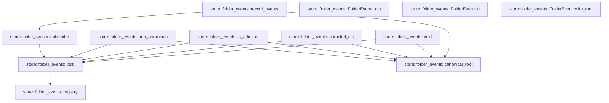

# store::folder_events

[Package atlas](index.md) · [Source](../../src/folder_events.rs)

## Declarations

Visibility is the declaration spelling; trait members and reexports require their enclosing interface. `cfg` is not evaluated.

| Symbol | Kind | Visibility | Test / cfg |
|---|---|---|---|
| [store::folder_events::Area](../../src/folder_events.rs#L14) | enum_item | `pub` |  |
| [store::folder_events::RemoveReason](../../src/folder_events.rs#L20) | enum_item | `pub` |  |
| [store::folder_events::FolderEvent](../../src/folder_events.rs#L28) | enum_item | `pub` |  |
| [store::folder_events::FolderEvent::root](../../src/folder_events.rs#L49) | function_item | `pub` |  |
| [store::folder_events::FolderEvent::id](../../src/folder_events.rs#L58) | function_item | `pub` |  |
| [store::folder_events::canonical_root](../../src/folder_events.rs#L69) | function_item | `pub` |  |
| [store::folder_events::canonical_root::MEMO](../../src/folder_events.rs#L72) | static_item | `private` |  |
| [store::folder_events::FolderEvent::with_root](../../src/folder_events.rs#L95) | function_item | `private` |  |
| [store::folder_events::Observer](../../src/folder_events.rs#L114) | type_item | `pub` |  |
| [store::folder_events::Registry](../../src/folder_events.rs#L117) | struct_item | `private` |  |
| [store::folder_events::registry](../../src/folder_events.rs#L123) | function_item | `private` |  |
| [store::folder_events::registry::REGISTRY](../../src/folder_events.rs#L124) | static_item | `private` |  |
| [store::folder_events::lock](../../src/folder_events.rs#L128) | function_item | `private` |  |
| [store::folder_events::subscribe](../../src/folder_events.rs#L135) | function_item | `pub` |  |
| [store::folder_events::arm_admission](../../src/folder_events.rs#L141) | function_item | `pub` |  |
| [store::folder_events::is_admitted](../../src/folder_events.rs#L148) | function_item | `pub` |  |
| [store::folder_events::admitted_ids](../../src/folder_events.rs#L158) | function_item | `pub` |  |
| [store::folder_events::emit](../../src/folder_events.rs#L167) | function_item | `pub(crate)` |  |
| [store::folder_events::record_events](../../src/folder_events.rs#L211) | function_item | `pub` |  |

## Imports / reexports

| Local name | Source path | Visibility |
|---|---|---|
| `HashMap` | `std::collections::HashMap` | `private` |
| `HashSet` | `std::collections::HashSet` | `private` |
| `Path` | `std::path::Path` | `private` |
| `PathBuf` | `std::path::PathBuf` | `private` |
| `Arc` | `std::sync::Arc` | `private` |
| `Mutex` | `std::sync::Mutex` | `private` |
| `OnceLock` | `std::sync::OnceLock` | `private` |

## Module declarations

| Module | Visibility | Attributes |
|---|---|---|
| `store::folder_events::tests` | `private` | #[cfg(test)] |

## Function call graphs

Edges below are syntactically resolved calls only, including private functions. Graphs partition callers into groups of 20; they are not execution order. All unresolved sites are listed below and in the JSON inventory.

Functions 1–12: 12 direct edges

## Call sites

Includes test functions (marked in declarations). Receiver-type-required sites need type analysis/manual tracing. Calls in closures are attributed to their enclosing function; their occurrence here does not mean the closure executes immediately.

| Caller | Callee expression | Source lines | Target / classification |
|---|---|---|---|
| `canonical_root` | `MEMO.get_or_init` | [73](../../src/folder_events.rs#L73) | receiver-type-required |
| `canonical_root` | `memo         .lock()         .unwrap_or_else(std::sync::PoisonError::into_inner)         .get` | [74](../../src/folder_events.rs#L74) | receiver-type-required |
| `canonical_root` | `memo         .lock()         .unwrap_or_else` | [74](../../src/folder_events.rs#L74) | receiver-type-required |
| `canonical_root` | `memo         .lock` | [74](../../src/folder_events.rs#L74) | receiver-type-required |
| `canonical_root` | `known.clone` | [79](../../src/folder_events.rs#L79) | receiver-type-required |
| `canonical_root` | `std::fs::canonicalize` | [81](../../src/folder_events.rs#L81) | external-constructor-callback-or-unresolved |
| `canonical_root` | `memo.lock()                 .unwrap_or_else(std::sync::PoisonError::into_inner)                 .insert` | [83](../../src/folder_events.rs#L83) | receiver-type-required |
| `canonical_root` | `memo.lock()                 .unwrap_or_else` | [83](../../src/folder_events.rs#L83) | receiver-type-required |
| `canonical_root` | `memo.lock` | [83](../../src/folder_events.rs#L83) | receiver-type-required |
| `canonical_root` | `root.to_path_buf` | [85](../../src/folder_events.rs#L85), [90](../../src/folder_events.rs#L90) | receiver-type-required |
| `canonical_root` | `resolved.clone` | [85](../../src/folder_events.rs#L85) | receiver-type-required |
| `MEMO` | `OnceLock::new` | [72](../../src/folder_events.rs#L72) | external-constructor-callback-or-unresolved |
| `registry` | `REGISTRY.get_or_init` | [125](../../src/folder_events.rs#L125) | receiver-type-required |
| `registry` | `Mutex::new` | [125](../../src/folder_events.rs#L125) | external-constructor-callback-or-unresolved |
| `registry` | `Registry::default` | [125](../../src/folder_events.rs#L125) | external-constructor-callback-or-unresolved |
| `REGISTRY` | `OnceLock::new` | [124](../../src/folder_events.rs#L124) | external-constructor-callback-or-unresolved |
| `lock` | `registry()         .lock()         .unwrap_or_else` | [129](../../src/folder_events.rs#L129) | receiver-type-required |
| `lock` | `registry()         .lock` | [129](../../src/folder_events.rs#L129) | receiver-type-required |
| `lock` | `registry` | [129](../../src/folder_events.rs#L129) | [store::folder_events::registry](../../src/folder_events.rs#L123) |
| `subscribe` | `lock().observers.push` | [136](../../src/folder_events.rs#L136) | receiver-type-required |
| `subscribe` | `lock` | [136](../../src/folder_events.rs#L136) | [store::folder_events::lock](../../src/folder_events.rs#L128) |
| `arm_admission` | `lock().admission.entry(canonical_root(root)).or_default` | [142](../../src/folder_events.rs#L142) | receiver-type-required |
| `arm_admission` | `lock().admission.entry` | [142](../../src/folder_events.rs#L142) | receiver-type-required |
| `arm_admission` | `lock` | [142](../../src/folder_events.rs#L142) | [store::folder_events::lock](../../src/folder_events.rs#L128) |
| `arm_admission` | `canonical_root` | [142](../../src/folder_events.rs#L142) | [store::folder_events::canonical_root](../../src/folder_events.rs#L69) |
| `is_admitted` | `canonical_root` | [149](../../src/folder_events.rs#L149) | [store::folder_events::canonical_root](../../src/folder_events.rs#L69) |
| `is_admitted` | `lock()         .admission         .get(&root)         .is_some_and` | [150](../../src/folder_events.rs#L150) | receiver-type-required |
| `is_admitted` | `lock()         .admission         .get` | [150](../../src/folder_events.rs#L150) | receiver-type-required |
| `is_admitted` | `lock` | [150](../../src/folder_events.rs#L150) | [store::folder_events::lock](../../src/folder_events.rs#L128) |
| `is_admitted` | `admitted.contains` | [153](../../src/folder_events.rs#L153) | receiver-type-required |
| `admitted_ids` | `canonical_root` | [159](../../src/folder_events.rs#L159) | [store::folder_events::canonical_root](../../src/folder_events.rs#L69) |
| `admitted_ids` | `lock()         .admission         .get(&root)         .map(&#124;admitted&#124; admitted.iter().cloned().collect())         .unwrap_or_default` | [160](../../src/folder_events.rs#L160) | receiver-type-required |
| `admitted_ids` | `lock()         .admission         .get(&root)         .map` | [160](../../src/folder_events.rs#L160) | receiver-type-required |
| `admitted_ids` | `lock()         .admission         .get` | [160](../../src/folder_events.rs#L160) | receiver-type-required |
| `admitted_ids` | `lock` | [160](../../src/folder_events.rs#L160) | [store::folder_events::lock](../../src/folder_events.rs#L128) |
| `admitted_ids` | `admitted.iter().cloned().collect` | [163](../../src/folder_events.rs#L163) | receiver-type-required |
| `admitted_ids` | `admitted.iter().cloned` | [163](../../src/folder_events.rs#L163) | receiver-type-required |
| `admitted_ids` | `admitted.iter` | [163](../../src/folder_events.rs#L163) | receiver-type-required |
| `emit` | `canonical_root` | [169](../../src/folder_events.rs#L169) | [store::folder_events::canonical_root](../../src/folder_events.rs#L69) |
| `emit` | `event.root` | [169](../../src/folder_events.rs#L169), [174](../../src/folder_events.rs#L174) | receiver-type-required |
| `emit` | `event.with_root` | [170](../../src/folder_events.rs#L170) | receiver-type-required |
| `emit` | `lock` | [173](../../src/folder_events.rs#L173), [203](../../src/folder_events.rs#L203) | [store::folder_events::lock](../../src/folder_events.rs#L128) |
| `emit` | `registry.admission.get_mut` | [174](../../src/folder_events.rs#L174) | receiver-type-required |
| `emit` | `admitted.insert` | [182](../../src/folder_events.rs#L182) | receiver-type-required |
| `emit` | `id.clone` | [182](../../src/folder_events.rs#L182) | receiver-type-required |
| `emit` | `admitted.remove` | [187](../../src/folder_events.rs#L187) | receiver-type-required |
| `emit` | `registry.observers.clone` | [194](../../src/folder_events.rs#L194) | receiver-type-required |
| `emit` | `observers         .iter()         .filter(&#124;observer&#124; !observer(&event))         .cloned()         .collect::<Vec<_>>` | [197](../../src/folder_events.rs#L197) | receiver-type-required |
| `emit` | `observers         .iter()         .filter(&#124;observer&#124; !observer(&event))         .cloned` | [197](../../src/folder_events.rs#L197) | receiver-type-required |
| `emit` | `observers         .iter()         .filter` | [197](../../src/folder_events.rs#L197) | receiver-type-required |
| `emit` | `observers         .iter` | [197](../../src/folder_events.rs#L197) | receiver-type-required |
| `emit` | `observer` | [199](../../src/folder_events.rs#L199) | external-constructor-callback-or-unresolved |
| `emit` | `gone.is_empty` | [202](../../src/folder_events.rs#L202) | receiver-type-required |
| `emit` | `lock()             .observers             .retain` | [203](../../src/folder_events.rs#L203) | receiver-type-required |
| `emit` | `gone.iter().any` | [205](../../src/folder_events.rs#L205) | receiver-type-required |
| `emit` | `gone.iter` | [205](../../src/folder_events.rs#L205) | receiver-type-required |
| `emit` | `Arc::ptr_eq` | [205](../../src/folder_events.rs#L205) | external-constructor-callback-or-unresolved |
| `record_events` | `Arc::new` | [212](../../src/folder_events.rs#L212), [215](../../src/folder_events.rs#L215) | external-constructor-callback-or-unresolved |
| `record_events` | `Mutex::new` | [212](../../src/folder_events.rs#L212) | external-constructor-callback-or-unresolved |
| `record_events` | `Vec::new` | [212](../../src/folder_events.rs#L212) | external-constructor-callback-or-unresolved |
| `record_events` | `Arc::clone` | [213](../../src/folder_events.rs#L213) | external-constructor-callback-or-unresolved |
| `record_events` | `canonical_root` | [214](../../src/folder_events.rs#L214) | [store::folder_events::canonical_root](../../src/folder_events.rs#L69) |
| `record_events` | `subscribe` | [215](../../src/folder_events.rs#L215) | [store::folder_events::subscribe](../../src/folder_events.rs#L135) |
| `record_events` | `event.root` | [216](../../src/folder_events.rs#L216) | receiver-type-required |
| `record_events` | `sink.lock()                 .unwrap_or_else(std::sync::PoisonError::into_inner)                 .push` | [217](../../src/folder_events.rs#L217) | receiver-type-required |
| `record_events` | `sink.lock()                 .unwrap_or_else` | [217](../../src/folder_events.rs#L217) | receiver-type-required |
| `record_events` | `sink.lock` | [217](../../src/folder_events.rs#L217) | receiver-type-required |
| `record_events` | `event.clone` | [219](../../src/folder_events.rs#L219) | receiver-type-required |
| `record_events` | `Arc::strong_count` | [221](../../src/folder_events.rs#L221) | external-constructor-callback-or-unresolved |
