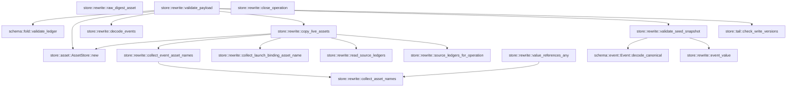

```mermaid
flowchart TD
  n0["schema::event::Event::decode_canonical"]
  n1["schema::fold::validate_ledger"]
  n2["store::atomic::AtomicPublisher::replace"]
  n3["store::management_root::session_settings_path"]
  n4["store::rewrite::verify_source_digest"]
  n5["store::rewrite::scan_redaction"]
  n6["store::rewrite::RewriteOperation::decode_canonical"]
  n7["store::rewrite::contains_bytes"]
  n8["store::rewrite::operation_bytes"]
  n9["store::rewrite::write_operation"]
  n10["store::rewrite::read_operation"]
  n11["store::rewrite::build_payload"]
  n12["store::rewrite::project_ledgers"]
  n13["store::rewrite::decode_events"]
  n14["store::rewrite::event_value"]
  n15["store::rewrite::source_thread_map"]
  n16["store::rewrite::source_parent_file"]
  n17["store::rewrite::project_file"]
  n18["store::rewrite::copy_live_assets"]
  n19["store::rewrite::validate_operation"]
  n20["store::rewrite::read_source_ledgers"]
  n21["store::rewrite::source_ledgers_for_operation"]
  n22["store::rewrite::source_prefix_ledgers"]
  n23["store::rewrite::encoded_prefix"]
  n24["store::rewrite::validate_terminal_source"]
  n25["store::rewrite::build_file_map"]
  n26["store::rewrite::mapped_child_uuid"]
  n27["store::rewrite::tree_digest"]
  n28["store::tail::check_write_versions"]
  n4 --> n20
  n4 --> n27
  n5 --> n0
  n5 --> n7
  n8 --> n19
  n9 --> n2
  n9 --> n8
  n10 --> n6
  n11 --> n3
  n11 --> n12
  n11 --> n18
  n11 --> n20
  n11 --> n21
  n11 --> n27
  n12 --> n13
  n12 --> n15
  n12 --> n16
  n12 --> n17
  n15 --> n13
  n16 --> n14
  n20 --> n1
  n20 --> n28
  n21 --> n22
  n22 --> n13
  n22 --> n14
  n22 --> n23
  n23 --> n1
  n24 --> n1
  n24 --> n13
  n24 --> n14
  n25 --> n26
```

```mermaid
flowchart TD
  n0["schema::event::Event::decode_canonical"]
  n1["schema::fold::validate_ledger"]
  n2["store::rewrite::event_value"]
  n3["store::rewrite::project_file"]
  n4["store::rewrite::build_genesis"]
  n5["store::rewrite::rewrite_origin"]
  n6["store::rewrite::materialize_input"]
  n7["store::rewrite::materialize_turn_open"]
  n8["store::rewrite::materialize_spawn"]
  n9["store::rewrite::materialize_child_result"]
  n10["store::rewrite::materialize_state"]
  n11["store::rewrite::materialize_historical_state"]
  n12["store::rewrite::event_value_ts"]
  n13["store::rewrite::materialize_settle"]
  n14["store::rewrite::materialize_meta"]
  n15["store::rewrite::materialize_epoch"]
  n16["store::rewrite::mapped_turn"]
  n17["store::rewrite::retain_payload_fields"]
  n18["store::rewrite::envelope_fields"]
  n19["store::rewrite::push_event"]
  n20["store::rewrite::value_ranges"]
  n21["store::rewrite::valid_asset_name"]
  n22["store::rewrite::collect_asset_names"]
  n23["store::rewrite::value_references_any"]
  n3 --> n1
  n3 --> n2
  n3 --> n4
  n3 --> n6
  n3 --> n7
  n3 --> n8
  n3 --> n9
  n3 --> n10
  n3 --> n11
  n3 --> n13
  n3 --> n14
  n3 --> n15
  n3 --> n16
  n3 --> n19
  n3 --> n20
  n3 --> n23
  n4 --> n2
  n4 --> n5
  n4 --> n23
  n8 --> n17
  n9 --> n17
  n10 --> n17
  n11 --> n18
  n13 --> n17
  n15 --> n17
  n19 --> n0
  n22 --> n21
  n22 --> n22
```

# store::rewrite

[Package atlas](index.md) · [Source](../../src/rewrite.rs)

## Declarations

Visibility is the declaration spelling; trait members and reexports require their enclosing interface. `cfg` is not evaluated.

| Symbol | Kind | Visibility | Test / cfg |
|---|---|---|---|
| [store::rewrite::OP_FORMAT](../../src/rewrite.rs#L15) | const_item | `private` |  |
| [store::rewrite::RewriteKind](../../src/rewrite.rs#L19) | enum_item | `pub` |  |
| [store::rewrite::RewriteKind::as_str](../../src/rewrite.rs#L25) | function_item | `private` |  |
| [store::rewrite::RewritePhase](../../src/rewrite.rs#L35) | enum_item | `pub` |  |
| [store::rewrite::RewriteEventRef](../../src/rewrite.rs#L46) | struct_item | `pub` |  |
| [store::rewrite::RewriteFileMap](../../src/rewrite.rs#L53) | struct_item | `pub` |  |
| [store::rewrite::RedactionInventory](../../src/rewrite.rs#L61) | struct_item | `pub` |  |
| [store::rewrite::RewriteOperation](../../src/rewrite.rs#L69) | struct_item | `pub` |  |
| [store::rewrite::ForkGenesisBinding](../../src/rewrite.rs#L94) | struct_item | `pub` |  |
| [store::rewrite::RewriteOperation::decode_canonical](../../src/rewrite.rs#L101) | function_item | `pub` |  |
| [store::rewrite::RewriteOperation::canonical_bytes](../../src/rewrite.rs#L121) | function_item | `pub` |  |
| [store::rewrite::RewriteProgress](../../src/rewrite.rs#L127) | struct_item | `pub` |  |
| [store::rewrite::BuiltFile](../../src/rewrite.rs#L133) | struct_item | `private` |  |
| [store::rewrite::GenesisContext](../../src/rewrite.rs#L138) | struct_item | `private` |  |
| [store::rewrite::RewriteMode](../../src/rewrite.rs#L148) | enum_item | `private` |  |
| [store::rewrite::ThreadStore::begin_fork](../../src/rewrite.rs#L154) | function_item | `pub` |  |
| [store::rewrite::ThreadStore::begin_fork_at_kernel_anchor](../../src/rewrite.rs#L173) | function_item | `pub` |  |
| [store::rewrite::ThreadStore::begin_redact](../../src/rewrite.rs#L193) | function_item | `pub` |  |
| [store::rewrite::ThreadStore::begin_rewrite](../../src/rewrite.rs#L215) | function_item | `private` |  |
| [store::rewrite::ThreadStore::advance_rewrite](../../src/rewrite.rs#L305) | function_item | `pub` |  |
| [store::rewrite::ThreadStore::recover_rewrites](../../src/rewrite.rs#L427) | function_item | `pub` |  |
| [store::rewrite::ThreadStore::recover_rewrites_for_startup](../../src/rewrite.rs#L433) | function_item | `pub` |  |
| [store::rewrite::ThreadStore::recover_rewrites_impl](../../src/rewrite.rs#L437) | function_item | `private` |  |
| [store::rewrite::ThreadStore::quarantine_unpublished_fork](../../src/rewrite.rs#L472) | function_item | `private` |  |
| [store::rewrite::ThreadStore::gc_rewrite_debris](../../src/rewrite.rs#L514) | function_item | `pub` |  |
| [store::rewrite::ThreadStore::source_has_live_rewrite](../../src/rewrite.rs#L537) | function_item | `pub(crate)` |  |
| [store::rewrite::ThreadStore::destination_has_live_rewrite](../../src/rewrite.rs#L550) | function_item | `pub(crate)` |  |
| [store::rewrite::ThreadStore::tombstone_path](../../src/rewrite.rs#L563) | function_item | `private` |  |
| [store::rewrite::progress](../../src/rewrite.rs#L570) | function_item | `private` |  |
| [store::rewrite::validate_path_id](../../src/rewrite.rs#L577) | function_item | `private` |  |
| [store::rewrite::validate_uuid](../../src/rewrite.rs#L588) | function_item | `private` |  |
| [store::rewrite::validate_operation](../../src/rewrite.rs#L599) | function_item | `private` |  |
| [store::rewrite::read_source_ledgers](../../src/rewrite.rs#L753) | function_item | `private` |  |
| [store::rewrite::source_ledgers_for_operation](../../src/rewrite.rs#L782) | function_item | `private` |  |
| [store::rewrite::source_prefix_ledgers](../../src/rewrite.rs#L795) | function_item | `private` |  |
| [store::rewrite::encoded_prefix](../../src/rewrite.rs#L853) | function_item | `private` |  |
| [store::rewrite::validate_terminal_source](../../src/rewrite.rs#L864) | function_item | `private` |  |
| [store::rewrite::build_file_map](../../src/rewrite.rs#L963) | function_item | `private` |  |
| [store::rewrite::mapped_child_uuid](../../src/rewrite.rs#L983) | function_item | `private` |  |
| [store::rewrite::tree_digest](../../src/rewrite.rs#L996) | function_item | `private` |  |
| [store::rewrite::verify_source_digest](../../src/rewrite.rs#L1007) | function_item | `private` |  |
| [store::rewrite::scan_redaction](../../src/rewrite.rs#L1018) | function_item | `private` |  |
| [store::rewrite::contains_bytes](../../src/rewrite.rs#L1067) | function_item | `private` |  |
| [store::rewrite::operation_bytes](../../src/rewrite.rs#L1073) | function_item | `private` |  |
| [store::rewrite::write_operation](../../src/rewrite.rs#L1081) | function_item | `private` |  |
| [store::rewrite::read_operation](../../src/rewrite.rs#L1085) | function_item | `private` |  |
| [store::rewrite::build_payload](../../src/rewrite.rs#L1090) | function_item | `private` |  |
| [store::rewrite::project_ledgers](../../src/rewrite.rs#L1136) | function_item | `private` |  |
| [store::rewrite::decode_events](../../src/rewrite.rs#L1187) | function_item | `private` |  |
| [store::rewrite::event_value](../../src/rewrite.rs#L1196) | function_item | `private` |  |
| [store::rewrite::source_thread_map](../../src/rewrite.rs#L1204) | function_item | `private` |  |
| [store::rewrite::source_parent_file](../../src/rewrite.rs#L1225) | function_item | `private` |  |
| [store::rewrite::project_file](../../src/rewrite.rs#L1238) | function_item | `private` |  |
| [store::rewrite::build_genesis](../../src/rewrite.rs#L1585) | function_item | `private` |  |
| [store::rewrite::rewrite_origin](../../src/rewrite.rs#L1679) | function_item | `private` |  |
| [store::rewrite::materialize_input](../../src/rewrite.rs#L1686) | function_item | `private` |  |
| [store::rewrite::materialize_turn_open](../../src/rewrite.rs#L1710) | function_item | `private` |  |
| [store::rewrite::materialize_spawn](../../src/rewrite.rs#L1745) | function_item | `private` |  |
| [store::rewrite::materialize_child_result](../../src/rewrite.rs#L1771) | function_item | `private` |  |
| [store::rewrite::materialize_state](../../src/rewrite.rs#L1800) | function_item | `private` |  |
| [store::rewrite::materialize_historical_state](../../src/rewrite.rs#L1814) | function_item | `private` |  |
| [store::rewrite::event_value_ts](../../src/rewrite.rs#L1843) | function_item | `private` |  |
| [store::rewrite::materialize_settle](../../src/rewrite.rs#L1850) | function_item | `private` |  |
| [store::rewrite::materialize_meta](../../src/rewrite.rs#L1864) | function_item | `private` |  |
| [store::rewrite::materialize_epoch](../../src/rewrite.rs#L1888) | function_item | `private` |  |
| [store::rewrite::mapped_turn](../../src/rewrite.rs#L1910) | function_item | `private` |  |
| [store::rewrite::retain_payload_fields](../../src/rewrite.rs#L1917) | function_item | `private` |  |
| [store::rewrite::envelope_fields](../../src/rewrite.rs#L1922) | function_item | `private` |  |
| [store::rewrite::push_event](../../src/rewrite.rs#L1937) | function_item | `private` |  |
| [store::rewrite::value_ranges](../../src/rewrite.rs#L1946) | function_item | `private` |  |
| [store::rewrite::valid_asset_name](../../src/rewrite.rs#L1971) | function_item | `private` |  |
| [store::rewrite::collect_asset_names](../../src/rewrite.rs#L1980) | function_item | `private` |  |
| [store::rewrite::raw_digest_asset](../../src/rewrite.rs#L1999) | function_item | `private` |  |
| [store::rewrite::collect_event_asset_names](../../src/rewrite.rs#L2012) | function_item | `private` |  |
| [store::rewrite::collect_launch_binding_asset_name](../../src/rewrite.rs#L2042) | function_item | `private` |  |
| [store::rewrite::value_references_any](../../src/rewrite.rs#L2055) | function_item | `private` |  |
| [store::rewrite::copy_live_assets](../../src/rewrite.rs#L2061) | function_item | `private` |  |
| [store::rewrite::validate_payload](../../src/rewrite.rs#L2149) | function_item | `private` |  |
| [store::rewrite::validate_seed_snapshot](../../src/rewrite.rs#L2204) | function_item | `private` |  |
| [store::rewrite::close_operation](../../src/rewrite.rs#L2278) | function_item | `private` |  |
| [store::rewrite::tests::write_canonical_events](../../src/rewrite.rs#L2290) | function_item | `private` | test; #[cfg(test)] |
| [store::rewrite::tests::origin](../../src/rewrite.rs#L2302) | function_item | `private` | test; #[cfg(test)] |
| [store::rewrite::tests::baseline_source](../../src/rewrite.rs#L2312) | function_item | `private` | test; #[cfg(test)] |
| [store::rewrite::tests::fork_is_announced_and_a_stale_discard_tombstone_does_not_block_its_id](../../src/rewrite.rs#L2323) | function_item | `private` | test; #[cfg(test)] |
| [store::rewrite::tests::concurrent_tombstone_cleanup_never_fails_a_fork_to_the_same_id](../../src/rewrite.rs#L2362) | function_item | `private` | test; #[cfg(test)] |
| [store::rewrite::tests::a_large_stale_tombstone_is_parked_and_two_deleters_of_one_tree_both_succeed](../../src/rewrite.rs#L2398) | function_item | `private` | test; #[cfg(test)] |
| [store::rewrite::tests::startup_isolates_missing_fork_carrier_without_losing_source](../../src/rewrite.rs#L2460) | function_item | `private` | test; #[cfg(test)] |
| [store::rewrite::tests::anchored_fork_uses_terminal_prefix_binding_and_empty_endpoint_journal](../../src/rewrite.rs#L2533) | function_item | `private` | test; #[cfg(test)] |
| [store::rewrite::tests::fork_preserves_runtime_identity_selection](../../src/rewrite.rs#L2676) | function_item | `private` | test; #[cfg(test)] |
| [store::rewrite::tests::fork_keeps_the_genesis_preset_and_reader_two](../../src/rewrite.rs#L2737) | function_item | `private` | test; #[cfg(test)] |
| [store::rewrite::tests::anchored_fork_remaps_complete_child_edges](../../src/rewrite.rs#L2777) | function_item | `private` | test; #[cfg(test)] |
| [store::rewrite::tests::fork_and_redact_copy_unpoisoned_launch_binding_carriers](../../src/rewrite.rs#L2905) | function_item | `private` | test; #[cfg(test)] |

## Imports / reexports

| Local name | Source path | Visibility |
|---|---|---|
| `BTreeMap` | `std::collections::BTreeMap` | `private` |
| `BTreeSet` | `std::collections::BTreeSet` | `private` |
| `fs` | `std::fs` | `private` |
| `File` | `std::fs::File` | `private` |
| `DirBuilderExt` | `std::os::unix::fs::DirBuilderExt` | `private` |
| `Path` | `std::path::Path` | `private` |
| `PathBuf` | `std::path::PathBuf` | `private` |
| `Event` | `schema::Event` | `private` |
| `EventKind` | `schema::EventKind` | `private` |
| `OriginTuple` | `schema::OriginTuple` | `private` |
| `Visibility` | `schema::Visibility` | `private` |
| `validate_ledger` | `schema::validate_ledger` | `private` |
| `Deserialize` | `serde::Deserialize` | `private` |
| `Serialize` | `serde::Serialize` | `private` |
| `Map` | `serde_json::Map` | `private` |
| `Value` | `serde_json::Value` | `private` |
| `json` | `serde_json::json` | `private` |
| `Digest` | `sha2::Digest` | `private` |
| `Sha256` | `sha2::Sha256` | `private` |
| `Uuid` | `uuid::Uuid` | `private` |
| `hex_digest` | `crate::asset::hex_digest` | `private` |
| `AssetStore` | `crate::AssetStore` | `private` |
| `AtomicPublisher` | `crate::AtomicPublisher` | `private` |
| `DirectoryLock` | `crate::DirectoryLock` | `private` |
| `NamedLock` | `crate::NamedLock` | `private` |
| `StoreError` | `crate::StoreError` | `private` |
| `ThreadStore` | `crate::ThreadStore` | `private` |
| `*` | `super::*` | `private` |

## Module declarations

| Module | Visibility | Attributes |
|---|---|---|
| `store::rewrite::tests` | `private` | #[cfg(test)] |

## Function call graphs

Edges below are syntactically resolved calls only, including private functions. Graphs partition callers into groups of 20; they are not execution order. All unresolved sites are listed below and in the JSON inventory.

```mermaid
flowchart TD
  n0["schema::event::Event::decode_canonical"]
  n1["store::folder::park_stale_tombstone"]
  n2["store::folder_events::emit"]
  n3["store::platform::NamedLock::exclusive"]
  n4["store::platform::DirectoryLock::exclusive"]
  n5["store::rewrite::verify_source_digest"]
  n6["store::rewrite::scan_redaction"]
  n7["store::rewrite::RewriteOperation::decode_canonical"]
  n8["store::rewrite::operation_bytes"]
  n9["store::rewrite::write_operation"]
  n10["store::rewrite::read_operation"]
  n11["store::rewrite::build_payload"]
  n12["store::rewrite::project_ledgers"]
  n13["store::rewrite::RewriteOperation::canonical_bytes"]
  n14["store::rewrite::ThreadStore::begin_fork"]
  n15["store::rewrite::ThreadStore::begin_fork_at_kernel_anchor"]
  n16["store::rewrite::ThreadStore::begin_redact"]
  n17["store::rewrite::valid_asset_name"]
  n18["store::rewrite::validate_payload"]
  n19["store::rewrite::ThreadStore::begin_rewrite"]
  n20["store::rewrite::close_operation"]
  n21["store::rewrite::RewriteKind::as_str"]
  n22["store::rewrite::ThreadStore::advance_rewrite"]
  n23["store::rewrite::ThreadStore::recover_rewrites"]
  n24["store::rewrite::ThreadStore::recover_rewrites_for_startup"]
  n25["store::rewrite::ThreadStore::recover_rewrites_impl"]
  n26["store::rewrite::ThreadStore::quarantine_unpublished_fork"]
  n27["store::rewrite::ThreadStore::gc_rewrite_debris"]
  n28["store::rewrite::ThreadStore::source_has_live_rewrite"]
  n29["store::rewrite::ThreadStore::destination_has_live_rewrite"]
  n30["store::rewrite::ThreadStore::tombstone_path"]
  n31["store::rewrite::progress"]
  n32["store::rewrite::validate_path_id"]
  n33["store::rewrite::validate_uuid"]
  n34["store::rewrite::validate_operation"]
  n35["store::rewrite::read_source_ledgers"]
  n36["store::rewrite::source_prefix_ledgers"]
  n37["store::rewrite::validate_terminal_source"]
  n38["store::rewrite::build_file_map"]
  n39["store::rewrite::tree_digest"]
  n7 --> n34
  n13 --> n8
  n14 --> n19
  n15 --> n19
  n16 --> n19
  n19 --> n1
  n19 --> n3
  n19 --> n4
  n19 --> n6
  n19 --> n9
  n19 --> n12
  n19 --> n28
  n19 --> n29
  n19 --> n32
  n19 --> n33
  n19 --> n34
  n19 --> n35
  n19 --> n36
  n19 --> n37
  n19 --> n38
  n19 --> n39
  n22 --> n2
  n22 --> n3
  n22 --> n4
  n22 --> n5
  n22 --> n9
  n22 --> n10
  n22 --> n11
  n22 --> n18
  n22 --> n20
  n22 --> n30
  n22 --> n31
  n22 --> n32
  n23 --> n25
  n24 --> n25
  n25 --> n22
  n25 --> n26
  n26 --> n3
  n26 --> n4
  n26 --> n5
  n26 --> n10
  n27 --> n3
  n28 --> n10
  n29 --> n10
  n34 --> n0
  n34 --> n17
  n34 --> n32
  n34 --> n33
```

Functions 1–20: 48 direct edges

Functions 21–40: 31 direct edges

Functions 41–60: 28 direct edges

Functions 61–68: 15 direct edges

## Call sites

Includes test functions (marked in declarations). Receiver-type-required sites need type analysis/manual tracing. Calls in closures are attributed to their enclosing function; their occurrence here does not mean the closure executes immediately.

| Caller | Callee expression | Source lines | Target / classification |
|---|---|---|---|
| `decode_canonical` | `bytes.strip_suffix(b"\n").ok_or_else` | [102](../../src/rewrite.rs#L102) | receiver-type-required |
| `decode_canonical` | `bytes.strip_suffix` | [102](../../src/rewrite.rs#L102) | receiver-type-required |
| `decode_canonical` | `StoreError::RewriteOperationCorrupt` | [103](../../src/rewrite.rs#L103), [106](../../src/rewrite.rs#L106), [109](../../src/rewrite.rs#L109), [112](../../src/rewrite.rs#L112), [117](../../src/rewrite.rs#L117) | external-constructor-callback-or-unresolved |
| `decode_canonical` | `"record must end in one LF".to_owned` | [103](../../src/rewrite.rs#L103) | receiver-type-required |
| `decode_canonical` | `serde_json::from_slice(canonical).map_err` | [105](../../src/rewrite.rs#L105) | receiver-type-required |
| `decode_canonical` | `serde_json::from_slice` | [105](../../src/rewrite.rs#L105) | external-constructor-callback-or-unresolved |
| `decode_canonical` | `serde_json_canonicalizer::to_vec(&operation)             .map_err` | [108](../../src/rewrite.rs#L108) | receiver-type-required |
| `decode_canonical` | `serde_json_canonicalizer::to_vec` | [108](../../src/rewrite.rs#L108) | external-constructor-callback-or-unresolved |
| `decode_canonical` | `error.to_string` | [109](../../src/rewrite.rs#L109), [117](../../src/rewrite.rs#L117) | receiver-type-required |
| `decode_canonical` | `Err` | [112](../../src/rewrite.rs#L112) | external-constructor-callback-or-unresolved |
| `decode_canonical` | `"record is not canonical".to_owned` | [113](../../src/rewrite.rs#L113) | receiver-type-required |
| `decode_canonical` | `validate_operation(&operation)             .map_err` | [116](../../src/rewrite.rs#L116) | receiver-type-required |
| `decode_canonical` | `validate_operation` | [116](../../src/rewrite.rs#L116) | [store::rewrite::validate_operation](../../src/rewrite.rs#L599) |
| `decode_canonical` | `Ok` | [118](../../src/rewrite.rs#L118) | external-constructor-callback-or-unresolved |
| `canonical_bytes` | `operation_bytes` | [122](../../src/rewrite.rs#L122) | [store::rewrite::operation_bytes](../../src/rewrite.rs#L1073) |
| `begin_fork` | `self.begin_rewrite` | [161](../../src/rewrite.rs#L161) | [store::rewrite::ThreadStore::begin_rewrite](../../src/rewrite.rs#L215) |
| `begin_fork` | `RewriteMode::Fork` | [166](../../src/rewrite.rs#L166) | external-constructor-callback-or-unresolved |
| `begin_fork_at_kernel_anchor` | `Err` | [182](../../src/rewrite.rs#L182) | external-constructor-callback-or-unresolved |
| `begin_fork_at_kernel_anchor` | `StoreError::InvalidForkAnchor` | [182](../../src/rewrite.rs#L182) | external-constructor-callback-or-unresolved |
| `begin_fork_at_kernel_anchor` | `self.begin_rewrite` | [184](../../src/rewrite.rs#L184) | [store::rewrite::ThreadStore::begin_rewrite](../../src/rewrite.rs#L215) |
| `begin_fork_at_kernel_anchor` | `RewriteMode::Fork` | [189](../../src/rewrite.rs#L189) | external-constructor-callback-or-unresolved |
| `begin_fork_at_kernel_anchor` | `Some` | [189](../../src/rewrite.rs#L189) | external-constructor-callback-or-unresolved |
| `begin_redact` | `forbidden.is_empty` | [201](../../src/rewrite.rs#L201) | receiver-type-required |
| `begin_redact` | `forbidden.iter().any` | [201](../../src/rewrite.rs#L201) | receiver-type-required |
| `begin_redact` | `forbidden.iter` | [201](../../src/rewrite.rs#L201) | receiver-type-required |
| `begin_redact` | `Err` | [202](../../src/rewrite.rs#L202) | external-constructor-callback-or-unresolved |
| `begin_redact` | `StoreError::Corruption` | [202](../../src/rewrite.rs#L202) | external-constructor-callback-or-unresolved |
| `begin_redact` | `"redact requires non-empty forbidden byte strings".to_owned` | [203](../../src/rewrite.rs#L203) | receiver-type-required |
| `begin_redact` | `self.begin_rewrite` | [206](../../src/rewrite.rs#L206) | [store::rewrite::ThreadStore::begin_rewrite](../../src/rewrite.rs#L215) |
| `begin_redact` | `RewriteMode::Redact` | [211](../../src/rewrite.rs#L211) | external-constructor-callback-or-unresolved |
| `begin_rewrite` | `NamedLock::exclusive` | [227](../../src/rewrite.rs#L227), [228](../../src/rewrite.rs#L228) | [store::platform::NamedLock::exclusive](../../src/platform.rs#L103) |
| `begin_rewrite` | `self.root().join` | [227](../../src/rewrite.rs#L227), [228](../../src/rewrite.rs#L228), [242](../../src/rewrite.rs#L242), [251](../../src/rewrite.rs#L251), [256](../../src/rewrite.rs#L256), [298](../../src/rewrite.rs#L298), [301](../../src/rewrite.rs#L301) | receiver-type-required |
| `begin_rewrite` | `self.root` | [227](../../src/rewrite.rs#L227), [228](../../src/rewrite.rs#L228), [242](../../src/rewrite.rs#L242), [250](../../src/rewrite.rs#L250), [251](../../src/rewrite.rs#L251), [256](../../src/rewrite.rs#L256), [298](../../src/rewrite.rs#L298), [301](../../src/rewrite.rs#L301) | receiver-type-required |
| `begin_rewrite` | `validate_path_id` | [229](../../src/rewrite.rs#L229) | [store::rewrite::validate_path_id](../../src/rewrite.rs#L577) |
| `begin_rewrite` | `validate_uuid` | [230](../../src/rewrite.rs#L230), [231](../../src/rewrite.rs#L231) | [store::rewrite::validate_uuid](../../src/rewrite.rs#L588) |
| `begin_rewrite` | `Err` | [233](../../src/rewrite.rs#L233), [236](../../src/rewrite.rs#L236), [239](../../src/rewrite.rs#L239), [243](../../src/rewrite.rs#L243), [254](../../src/rewrite.rs#L254), [258](../../src/rewrite.rs#L258) | external-constructor-callback-or-unresolved |
| `begin_rewrite` | `self.source_has_live_rewrite` | [235](../../src/rewrite.rs#L235) | [store::rewrite::ThreadStore::source_has_live_rewrite](../../src/rewrite.rs#L537) |
| `begin_rewrite` | `self.destination_has_live_rewrite` | [238](../../src/rewrite.rs#L238) | [store::rewrite::ThreadStore::destination_has_live_rewrite](../../src/rewrite.rs#L550) |
| `begin_rewrite` | `self.root().join(area).join(destination).exists` | [242](../../src/rewrite.rs#L242) | receiver-type-required |
| `begin_rewrite` | `self.root().join(area).join` | [242](../../src/rewrite.rs#L242) | receiver-type-required |
| `begin_rewrite` | `crate::folder::park_stale_tombstone` | [250](../../src/rewrite.rs#L250) | [store::folder::park_stale_tombstone](../../src/folder.rs#L952) |
| `begin_rewrite` | `fs::read_dir(self.root().join(".rewrite-trash"))?.any` | [251](../../src/rewrite.rs#L251) | receiver-type-required |
| `begin_rewrite` | `fs::read_dir` | [251](../../src/rewrite.rs#L251) | external-constructor-callback-or-unresolved |
| `begin_rewrite` | `entry.is_ok_and` | [252](../../src/rewrite.rs#L252) | receiver-type-required |
| `begin_rewrite` | `entry.file_name().to_string_lossy().ends_with` | [252](../../src/rewrite.rs#L252) | receiver-type-required |
| `begin_rewrite` | `entry.file_name().to_string_lossy` | [252](../../src/rewrite.rs#L252) | receiver-type-required |
| `begin_rewrite` | `entry.file_name` | [252](../../src/rewrite.rs#L252) | receiver-type-required |
| `begin_rewrite` | `self.root().join("threads").join` | [256](../../src/rewrite.rs#L256) | receiver-type-required |
| `begin_rewrite` | `source_folder.is_dir` | [257](../../src/rewrite.rs#L257) | receiver-type-required |
| `begin_rewrite` | `DirectoryLock::exclusive` | [260](../../src/rewrite.rs#L260) | [store::platform::DirectoryLock::exclusive](../../src/platform.rs#L62) |
| `begin_rewrite` | `read_source_ledgers` | [261](../../src/rewrite.rs#L261) | [store::rewrite::read_source_ledgers](../../src/rewrite.rs#L753) |
| `begin_rewrite` | `fork_anchor.as_ref` | [262](../../src/rewrite.rs#L262), [283](../../src/rewrite.rs#L283) | receiver-type-required |
| `begin_rewrite` | `source_prefix_ledgers` | [263](../../src/rewrite.rs#L263) | [store::rewrite::source_prefix_ledgers](../../src/rewrite.rs#L795) |
| `begin_rewrite` | `ledgers.clone` | [264](../../src/rewrite.rs#L264) | receiver-type-required |
| `begin_rewrite` | `validate_terminal_source` | [266](../../src/rewrite.rs#L266) | [store::rewrite::validate_terminal_source](../../src/rewrite.rs#L864) |
| `begin_rewrite` | `tree_digest` | [267](../../src/rewrite.rs#L267) | [store::rewrite::tree_digest](../../src/rewrite.rs#L996) |
| `begin_rewrite` | `build_file_map` | [268](../../src/rewrite.rs#L268) | [store::rewrite::build_file_map](../../src/rewrite.rs#L963) |
| `begin_rewrite` | `Some` | [271](../../src/rewrite.rs#L271) | external-constructor-callback-or-unresolved |
| `begin_rewrite` | `scan_redaction` | [271](../../src/rewrite.rs#L271) | [store::rewrite::scan_redaction](../../src/rewrite.rs#L1018) |
| `begin_rewrite` | `operation_id.to_owned` | [275](../../src/rewrite.rs#L275) | receiver-type-required |
| `begin_rewrite` | `source.to_owned` | [277](../../src/rewrite.rs#L277) | receiver-type-required |
| `begin_rewrite` | `destination.to_owned` | [278](../../src/rewrite.rs#L278) | receiver-type-required |
| `begin_rewrite` | `created_at.to_owned` | [279](../../src/rewrite.rs#L279) | receiver-type-required |
| `begin_rewrite` | `fork_anchor.as_ref().map` | [283](../../src/rewrite.rs#L283) | receiver-type-required |
| `begin_rewrite` | `"main.jsonl".to_owned` | [284](../../src/rewrite.rs#L284) | receiver-type-required |
| `begin_rewrite` | `fork_anchor                 .as_ref()                 .is_some_and` | [287](../../src/rewrite.rs#L287) | receiver-type-required |
| `begin_rewrite` | `fork_anchor                 .as_ref` | [287](../../src/rewrite.rs#L287) | receiver-type-required |
| `begin_rewrite` | `fork_anchor.map` | [290](../../src/rewrite.rs#L290) | receiver-type-required |
| `begin_rewrite` | `validate_operation` | [293](../../src/rewrite.rs#L293) | [store::rewrite::validate_operation](../../src/rewrite.rs#L599) |
| `begin_rewrite` | `project_ledgers` | [297](../../src/rewrite.rs#L297) | [store::rewrite::project_ledgers](../../src/rewrite.rs#L1136) |
| `begin_rewrite` | `self.root().join("staging").join` | [298](../../src/rewrite.rs#L298) | receiver-type-required |
| `begin_rewrite` | `fs::create_dir` | [299](../../src/rewrite.rs#L299) | external-constructor-callback-or-unresolved |
| `begin_rewrite` | `write_operation` | [300](../../src/rewrite.rs#L300) | [store::rewrite::write_operation](../../src/rewrite.rs#L1081) |
| `begin_rewrite` | `File::open(self.root().join("staging"))?.sync_all` | [301](../../src/rewrite.rs#L301) | receiver-type-required |
| `begin_rewrite` | `File::open` | [301](../../src/rewrite.rs#L301) | external-constructor-callback-or-unresolved |
| `begin_rewrite` | `Ok` | [302](../../src/rewrite.rs#L302) | external-constructor-callback-or-unresolved |
| `advance_rewrite` | `NamedLock::exclusive` | [306](../../src/rewrite.rs#L306), [307](../../src/rewrite.rs#L307) | [store::platform::NamedLock::exclusive](../../src/platform.rs#L103) |
| `advance_rewrite` | `self.root().join` | [306](../../src/rewrite.rs#L306), [307](../../src/rewrite.rs#L307), [309](../../src/rewrite.rs#L309), [316](../../src/rewrite.rs#L316), [344](../../src/rewrite.rs#L344), [348](../../src/rewrite.rs#L348), [379](../../src/rewrite.rs#L379), [380](../../src/rewrite.rs#L380), [403](../../src/rewrite.rs#L403) | receiver-type-required |
| `advance_rewrite` | `self.root` | [306](../../src/rewrite.rs#L306), [307](../../src/rewrite.rs#L307), [309](../../src/rewrite.rs#L309), [316](../../src/rewrite.rs#L316), [329](../../src/rewrite.rs#L329), [336](../../src/rewrite.rs#L336), [344](../../src/rewrite.rs#L344), [348](../../src/rewrite.rs#L348), [350](../../src/rewrite.rs#L350), [368](../../src/rewrite.rs#L368), [379](../../src/rewrite.rs#L379), [380](../../src/rewrite.rs#L380), [382](../../src/rewrite.rs#L382), [403](../../src/rewrite.rs#L403), [415](../../src/rewrite.rs#L415) | receiver-type-required |
| `advance_rewrite` | `validate_path_id` | [308](../../src/rewrite.rs#L308) | [store::rewrite::validate_path_id](../../src/rewrite.rs#L577) |
| `advance_rewrite` | `self.root().join("staging").join` | [309](../../src/rewrite.rs#L309) | receiver-type-required |
| `advance_rewrite` | `read_operation` | [310](../../src/rewrite.rs#L310) | [store::rewrite::read_operation](../../src/rewrite.rs#L1085) |
| `advance_rewrite` | `Err` | [312](../../src/rewrite.rs#L312), [356](../../src/rewrite.rs#L356), [389](../../src/rewrite.rs#L389), [411](../../src/rewrite.rs#L411), [421](../../src/rewrite.rs#L421) | external-constructor-callback-or-unresolved |
| `advance_rewrite` | `StoreError::Corruption` | [312](../../src/rewrite.rs#L312), [356](../../src/rewrite.rs#L356), [389](../../src/rewrite.rs#L389), [411](../../src/rewrite.rs#L411), [422](../../src/rewrite.rs#L422) | external-constructor-callback-or-unresolved |
| `advance_rewrite` | `"operation directory/id mismatch".to_owned` | [313](../../src/rewrite.rs#L313) | receiver-type-required |
| `advance_rewrite` | `self.root().join("threads").join` | [316](../../src/rewrite.rs#L316), [344](../../src/rewrite.rs#L344) | receiver-type-required |
| `advance_rewrite` | `self.tombstone_path` | [317](../../src/rewrite.rs#L317) | [store::rewrite::ThreadStore::tombstone_path](../../src/rewrite.rs#L563) |
| `advance_rewrite` | `source.is_dir` | [318](../../src/rewrite.rs#L318), [375](../../src/rewrite.rs#L375) | receiver-type-required |
| `advance_rewrite` | `Some` | [319](../../src/rewrite.rs#L319), [321](../../src/rewrite.rs#L321) | external-constructor-callback-or-unresolved |
| `advance_rewrite` | `DirectoryLock::exclusive` | [319](../../src/rewrite.rs#L319), [321](../../src/rewrite.rs#L321) | [store::platform::DirectoryLock::exclusive](../../src/platform.rs#L62) |
| `advance_rewrite` | `tombstone.is_dir` | [320](../../src/rewrite.rs#L320), [375](../../src/rewrite.rs#L375) | receiver-type-required |
| `advance_rewrite` | `verify_source_digest` | [328](../../src/rewrite.rs#L328), [335](../../src/rewrite.rs#L335), [342](../../src/rewrite.rs#L342), [367](../../src/rewrite.rs#L367), [377](../../src/rewrite.rs#L377), [394](../../src/rewrite.rs#L394), [401](../../src/rewrite.rs#L401) | [store::rewrite::verify_source_digest](../../src/rewrite.rs#L1007) |
| `advance_rewrite` | `build_payload` | [329](../../src/rewrite.rs#L329) | [store::rewrite::build_payload](../../src/rewrite.rs#L1090) |
| `advance_rewrite` | `write_operation` | [331](../../src/rewrite.rs#L331), [338](../../src/rewrite.rs#L338), [363](../../src/rewrite.rs#L363), [396](../../src/rewrite.rs#L396), [406](../../src/rewrite.rs#L406) | [store::rewrite::write_operation](../../src/rewrite.rs#L1081) |
| `advance_rewrite` | `progress` | [332](../../src/rewrite.rs#L332), [339](../../src/rewrite.rs#L339), [364](../../src/rewrite.rs#L364), [397](../../src/rewrite.rs#L397), [407](../../src/rewrite.rs#L407) | [store::rewrite::progress](../../src/rewrite.rs#L570) |
| `advance_rewrite` | `validate_payload` | [336](../../src/rewrite.rs#L336) | [store::rewrite::validate_payload](../../src/rewrite.rs#L2149) |
| `advance_rewrite` | `stage.join` | [343](../../src/rewrite.rs#L343) | receiver-type-required |
| `advance_rewrite` | `payload.is_dir` | [345](../../src/rewrite.rs#L345) | receiver-type-required |
| `advance_rewrite` | `destination.is_dir` | [345](../../src/rewrite.rs#L345) | receiver-type-required |
| `advance_rewrite` | `fs::rename` | [347](../../src/rewrite.rs#L347), [378](../../src/rewrite.rs#L378) | external-constructor-callback-or-unresolved |
| `advance_rewrite` | `File::open(self.root().join("threads"))?.sync_all` | [348](../../src/rewrite.rs#L348), [379](../../src/rewrite.rs#L379) | receiver-type-required |
| `advance_rewrite` | `File::open` | [348](../../src/rewrite.rs#L348), [379](../../src/rewrite.rs#L379), [380](../../src/rewrite.rs#L380), [403](../../src/rewrite.rs#L403) | external-constructor-callback-or-unresolved |
| `advance_rewrite` | `crate::folder_events::emit` | [349](../../src/rewrite.rs#L349), [381](../../src/rewrite.rs#L381) | [store::folder_events::emit](../../src/folder_events.rs#L167) |
| `advance_rewrite` | `self.root().to_path_buf` | [350](../../src/rewrite.rs#L350), [382](../../src/rewrite.rs#L382) | receiver-type-required |
| `advance_rewrite` | `operation.dest.clone` | [351](../../src/rewrite.rs#L351) | receiver-type-required |
| `advance_rewrite` | `"rewrite publication has ambiguous payload/destination state"                                 .to_owned` | [357](../../src/rewrite.rs#L357) | receiver-type-required |
| `advance_rewrite` | `close_operation` | [368](../../src/rewrite.rs#L368), [415](../../src/rewrite.rs#L415) | [store::rewrite::close_operation](../../src/rewrite.rs#L2278) |
| `advance_rewrite` | `Ok` | [369](../../src/rewrite.rs#L369), [416](../../src/rewrite.rs#L416) | external-constructor-callback-or-unresolved |
| `advance_rewrite` | `File::open(self.root().join(".rewrite-trash"))?.sync_all` | [380](../../src/rewrite.rs#L380), [403](../../src/rewrite.rs#L403) | receiver-type-required |
| `advance_rewrite` | `operation.source.clone` | [383](../../src/rewrite.rs#L383) | receiver-type-required |
| `advance_rewrite` | `"redact retirement has ambiguous source/tombstone state".to_owned` | [390](../../src/rewrite.rs#L390) | receiver-type-required |
| `advance_rewrite` | `tombstone.exists` | [400](../../src/rewrite.rs#L400), [410](../../src/rewrite.rs#L410) | receiver-type-required |
| `advance_rewrite` | `fs::remove_dir_all` | [402](../../src/rewrite.rs#L402) | external-constructor-callback-or-unresolved |
| `advance_rewrite` | `source.exists` | [410](../../src/rewrite.rs#L410) | receiver-type-required |
| `advance_rewrite` | `"redact source reappeared after removal".to_owned` | [412](../../src/rewrite.rs#L412) | receiver-type-required |
| `advance_rewrite` | `"fork entered a redact-only phase".to_owned` | [422](../../src/rewrite.rs#L422) | receiver-type-required |
| `recover_rewrites` | `self.recover_rewrites_impl` | [428](../../src/rewrite.rs#L428) | [store::rewrite::ThreadStore::recover_rewrites_impl](../../src/rewrite.rs#L437) |
| `recover_rewrites_for_startup` | `self.recover_rewrites_impl` | [434](../../src/rewrite.rs#L434) | [store::rewrite::ThreadStore::recover_rewrites_impl](../../src/rewrite.rs#L437) |
| `recover_rewrites_impl` | `Vec::new` | [441](../../src/rewrite.rs#L441), [449](../../src/rewrite.rs#L449) | external-constructor-callback-or-unresolved |
| `recover_rewrites_impl` | `fs::read_dir` | [442](../../src/rewrite.rs#L442) | external-constructor-callback-or-unresolved |
| `recover_rewrites_impl` | `self.root().join` | [442](../../src/rewrite.rs#L442) | receiver-type-required |
| `recover_rewrites_impl` | `self.root` | [442](../../src/rewrite.rs#L442) | receiver-type-required |
| `recover_rewrites_impl` | `entry.file_type()?.is_dir` | [444](../../src/rewrite.rs#L444) | receiver-type-required |
| `recover_rewrites_impl` | `entry.file_type` | [444](../../src/rewrite.rs#L444) | receiver-type-required |
| `recover_rewrites_impl` | `entry.path().join("op.json").is_file` | [444](../../src/rewrite.rs#L444) | receiver-type-required |
| `recover_rewrites_impl` | `entry.path().join` | [444](../../src/rewrite.rs#L444) | receiver-type-required |
| `recover_rewrites_impl` | `entry.path` | [444](../../src/rewrite.rs#L444) | receiver-type-required |
| `recover_rewrites_impl` | `ids.push` | [445](../../src/rewrite.rs#L445) | receiver-type-required |
| `recover_rewrites_impl` | `entry.file_name().to_string_lossy().into_owned` | [445](../../src/rewrite.rs#L445) | receiver-type-required |
| `recover_rewrites_impl` | `entry.file_name().to_string_lossy` | [445](../../src/rewrite.rs#L445) | receiver-type-required |
| `recover_rewrites_impl` | `entry.file_name` | [445](../../src/rewrite.rs#L445) | receiver-type-required |
| `recover_rewrites_impl` | `ids.sort` | [448](../../src/rewrite.rs#L448) | receiver-type-required |
| `recover_rewrites_impl` | `self.advance_rewrite` | [452](../../src/rewrite.rs#L452) | [store::rewrite::ThreadStore::advance_rewrite](../../src/rewrite.rs#L305) |
| `recover_rewrites_impl` | `self.quarantine_unpublished_fork` | [455](../../src/rewrite.rs#L455) | [store::rewrite::ThreadStore::quarantine_unpublished_fork](../../src/rewrite.rs#L472) |
| `recover_rewrites_impl` | `Err` | [456](../../src/rewrite.rs#L456), [460](../../src/rewrite.rs#L460) | external-constructor-callback-or-unresolved |
| `recover_rewrites_impl` | `value.phase.is_none` | [462](../../src/rewrite.rs#L462) | receiver-type-required |
| `recover_rewrites_impl` | `completed.push` | [464](../../src/rewrite.rs#L464) | receiver-type-required |
| `recover_rewrites_impl` | `Ok` | [469](../../src/rewrite.rs#L469) | external-constructor-callback-or-unresolved |
| `quarantine_unpublished_fork` | `NamedLock::exclusive` | [477](../../src/rewrite.rs#L477), [478](../../src/rewrite.rs#L478) | [store::platform::NamedLock::exclusive](../../src/platform.rs#L103) |
| `quarantine_unpublished_fork` | `self.root().join` | [477](../../src/rewrite.rs#L477), [478](../../src/rewrite.rs#L478), [479](../../src/rewrite.rs#L479), [484](../../src/rewrite.rs#L484), [488](../../src/rewrite.rs#L488), [491](../../src/rewrite.rs#L491), [506](../../src/rewrite.rs#L506) | receiver-type-required |
| `quarantine_unpublished_fork` | `self.root` | [477](../../src/rewrite.rs#L477), [478](../../src/rewrite.rs#L478), [479](../../src/rewrite.rs#L479), [484](../../src/rewrite.rs#L484), [488](../../src/rewrite.rs#L488), [491](../../src/rewrite.rs#L491), [496](../../src/rewrite.rs#L496), [506](../../src/rewrite.rs#L506) | receiver-type-required |
| `quarantine_unpublished_fork` | `self.root().join("staging").join` | [479](../../src/rewrite.rs#L479) | receiver-type-required |
| `quarantine_unpublished_fork` | `read_operation` | [480](../../src/rewrite.rs#L480) | [store::rewrite::read_operation](../../src/rewrite.rs#L1085) |
| `quarantine_unpublished_fork` | `self.root().join("threads").join(&operation.dest).exists` | [484](../../src/rewrite.rs#L484) | receiver-type-required |
| `quarantine_unpublished_fork` | `self.root().join("threads").join` | [484](../../src/rewrite.rs#L484), [488](../../src/rewrite.rs#L488) | receiver-type-required |
| `quarantine_unpublished_fork` | `Ok` | [486](../../src/rewrite.rs#L486), [499](../../src/rewrite.rs#L499), [511](../../src/rewrite.rs#L511) | external-constructor-callback-or-unresolved |
| `quarantine_unpublished_fork` | `DirectoryLock::exclusive` | [489](../../src/rewrite.rs#L489) | [store::platform::DirectoryLock::exclusive](../../src/platform.rs#L62) |
| `quarantine_unpublished_fork` | `verify_source_digest` | [490](../../src/rewrite.rs#L490) | [store::rewrite::verify_source_digest](../../src/rewrite.rs#L1007) |
| `quarantine_unpublished_fork` | `fs::DirBuilder::new()             .recursive(true)             .mode(0o700)             .create` | [492](../../src/rewrite.rs#L492) | receiver-type-required |
| `quarantine_unpublished_fork` | `fs::DirBuilder::new()             .recursive(true)             .mode` | [492](../../src/rewrite.rs#L492) | receiver-type-required |
| `quarantine_unpublished_fork` | `fs::DirBuilder::new()             .recursive` | [492](../../src/rewrite.rs#L492) | receiver-type-required |
| `quarantine_unpublished_fork` | `fs::DirBuilder::new` | [492](../../src/rewrite.rs#L492) | external-constructor-callback-or-unresolved |
| `quarantine_unpublished_fork` | `File::open(self.root())?.sync_all` | [496](../../src/rewrite.rs#L496) | receiver-type-required |
| `quarantine_unpublished_fork` | `File::open` | [496](../../src/rewrite.rs#L496), [503](../../src/rewrite.rs#L503), [505](../../src/rewrite.rs#L505), [506](../../src/rewrite.rs#L506) | external-constructor-callback-or-unresolved |
| `quarantine_unpublished_fork` | `quarantine.join` | [497](../../src/rewrite.rs#L497) | receiver-type-required |
| `quarantine_unpublished_fork` | `destination.exists` | [498](../../src/rewrite.rs#L498) | receiver-type-required |
| `quarantine_unpublished_fork` | `stage.join` | [501](../../src/rewrite.rs#L501) | receiver-type-required |
| `quarantine_unpublished_fork` | `fs::write` | [502](../../src/rewrite.rs#L502) | external-constructor-callback-or-unresolved |
| `quarantine_unpublished_fork` | `File::open(diagnostic)?.sync_all` | [503](../../src/rewrite.rs#L503) | receiver-type-required |
| `quarantine_unpublished_fork` | `fs::rename` | [504](../../src/rewrite.rs#L504) | external-constructor-callback-or-unresolved |
| `quarantine_unpublished_fork` | `File::open(quarantine)?.sync_all` | [505](../../src/rewrite.rs#L505) | receiver-type-required |
| `quarantine_unpublished_fork` | `File::open(self.root().join("staging"))?.sync_all` | [506](../../src/rewrite.rs#L506) | receiver-type-required |
| `gc_rewrite_debris` | `NamedLock::exclusive` | [515](../../src/rewrite.rs#L515) | [store::platform::NamedLock::exclusive](../../src/platform.rs#L103) |
| `gc_rewrite_debris` | `self.root().join` | [515](../../src/rewrite.rs#L515), [516](../../src/rewrite.rs#L516) | receiver-type-required |
| `gc_rewrite_debris` | `self.root` | [515](../../src/rewrite.rs#L515), [516](../../src/rewrite.rs#L516) | receiver-type-required |
| `gc_rewrite_debris` | `Vec::new` | [517](../../src/rewrite.rs#L517) | external-constructor-callback-or-unresolved |
| `gc_rewrite_debris` | `fs::read_dir` | [518](../../src/rewrite.rs#L518) | external-constructor-callback-or-unresolved |
| `gc_rewrite_debris` | `entry.path` | [520](../../src/rewrite.rs#L520) | receiver-type-required |
| `gc_rewrite_debris` | `entry.file_type()?.is_dir` | [521](../../src/rewrite.rs#L521), [524](../../src/rewrite.rs#L524) | receiver-type-required |
| `gc_rewrite_debris` | `entry.file_type` | [521](../../src/rewrite.rs#L521), [524](../../src/rewrite.rs#L524) | receiver-type-required |
| `gc_rewrite_debris` | `path.join("op.json").is_file` | [521](../../src/rewrite.rs#L521) | receiver-type-required |
| `gc_rewrite_debris` | `path.join` | [521](../../src/rewrite.rs#L521) | receiver-type-required |
| `gc_rewrite_debris` | `fs::remove_dir_all` | [525](../../src/rewrite.rs#L525) | external-constructor-callback-or-unresolved |
| `gc_rewrite_debris` | `fs::remove_file` | [527](../../src/rewrite.rs#L527) | external-constructor-callback-or-unresolved |
| `gc_rewrite_debris` | `removed.push` | [529](../../src/rewrite.rs#L529) | receiver-type-required |
| `gc_rewrite_debris` | `removed.is_empty` | [531](../../src/rewrite.rs#L531) | receiver-type-required |
| `gc_rewrite_debris` | `File::open(staging)?.sync_all` | [532](../../src/rewrite.rs#L532) | receiver-type-required |
| `gc_rewrite_debris` | `File::open` | [532](../../src/rewrite.rs#L532) | external-constructor-callback-or-unresolved |
| `gc_rewrite_debris` | `Ok` | [534](../../src/rewrite.rs#L534) | external-constructor-callback-or-unresolved |
| `source_has_live_rewrite` | `fs::read_dir` | [538](../../src/rewrite.rs#L538) | external-constructor-callback-or-unresolved |
| `source_has_live_rewrite` | `self.root().join` | [538](../../src/rewrite.rs#L538) | receiver-type-required |
| `source_has_live_rewrite` | `self.root` | [538](../../src/rewrite.rs#L538) | receiver-type-required |
| `source_has_live_rewrite` | `entry.file_type()?.is_dir` | [540](../../src/rewrite.rs#L540) | receiver-type-required |
| `source_has_live_rewrite` | `entry.file_type` | [540](../../src/rewrite.rs#L540) | receiver-type-required |
| `source_has_live_rewrite` | `entry.path().join("op.json").is_file` | [540](../../src/rewrite.rs#L540) | receiver-type-required |
| `source_has_live_rewrite` | `entry.path().join` | [540](../../src/rewrite.rs#L540) | receiver-type-required |
| `source_has_live_rewrite` | `entry.path` | [540](../../src/rewrite.rs#L540), [543](../../src/rewrite.rs#L543) | receiver-type-required |
| `source_has_live_rewrite` | `read_operation` | [543](../../src/rewrite.rs#L543) | [store::rewrite::read_operation](../../src/rewrite.rs#L1085) |
| `source_has_live_rewrite` | `Ok` | [544](../../src/rewrite.rs#L544), [547](../../src/rewrite.rs#L547) | external-constructor-callback-or-unresolved |
| `destination_has_live_rewrite` | `fs::read_dir` | [551](../../src/rewrite.rs#L551) | external-constructor-callback-or-unresolved |
| `destination_has_live_rewrite` | `self.root().join` | [551](../../src/rewrite.rs#L551) | receiver-type-required |
| `destination_has_live_rewrite` | `self.root` | [551](../../src/rewrite.rs#L551) | receiver-type-required |
| `destination_has_live_rewrite` | `entry.file_type()?.is_dir` | [553](../../src/rewrite.rs#L553) | receiver-type-required |
| `destination_has_live_rewrite` | `entry.file_type` | [553](../../src/rewrite.rs#L553) | receiver-type-required |
| `destination_has_live_rewrite` | `entry.path().join("op.json").is_file` | [553](../../src/rewrite.rs#L553) | receiver-type-required |
| `destination_has_live_rewrite` | `entry.path().join` | [553](../../src/rewrite.rs#L553) | receiver-type-required |
| `destination_has_live_rewrite` | `entry.path` | [553](../../src/rewrite.rs#L553), [556](../../src/rewrite.rs#L556) | receiver-type-required |
| `destination_has_live_rewrite` | `read_operation` | [556](../../src/rewrite.rs#L556) | [store::rewrite::read_operation](../../src/rewrite.rs#L1085) |
| `destination_has_live_rewrite` | `Ok` | [557](../../src/rewrite.rs#L557), [560](../../src/rewrite.rs#L560) | external-constructor-callback-or-unresolved |
| `tombstone_path` | `self.root()             .join(".rewrite-trash")             .join` | [564](../../src/rewrite.rs#L564) | receiver-type-required |
| `tombstone_path` | `self.root()             .join` | [564](../../src/rewrite.rs#L564) | receiver-type-required |
| `tombstone_path` | `self.root` | [564](../../src/rewrite.rs#L564) | receiver-type-required |
| `progress` | `Ok` | [571](../../src/rewrite.rs#L571) | external-constructor-callback-or-unresolved |
| `progress` | `operation.id.clone` | [572](../../src/rewrite.rs#L572) | receiver-type-required |
| `progress` | `Some` | [573](../../src/rewrite.rs#L573) | external-constructor-callback-or-unresolved |
| `validate_path_id` | `value.is_empty` | [578](../../src/rewrite.rs#L578) | receiver-type-required |
| `validate_path_id` | `value             .bytes()             .all` | [579](../../src/rewrite.rs#L579) | receiver-type-required |
| `validate_path_id` | `value             .bytes` | [579](../../src/rewrite.rs#L579) | receiver-type-required |
| `validate_path_id` | `byte.is_ascii_alphanumeric` | [581](../../src/rewrite.rs#L581) | receiver-type-required |
| `validate_path_id` | `Err` | [583](../../src/rewrite.rs#L583) | external-constructor-callback-or-unresolved |
| `validate_path_id` | `StoreError::Corruption` | [583](../../src/rewrite.rs#L583) | external-constructor-callback-or-unresolved |
| `validate_path_id` | `Ok` | [585](../../src/rewrite.rs#L585) | external-constructor-callback-or-unresolved |
| `validate_uuid` | `Uuid::parse_str(value)         .map_err` | [589](../../src/rewrite.rs#L589) | receiver-type-required |
| `validate_uuid` | `Uuid::parse_str` | [589](../../src/rewrite.rs#L589) | external-constructor-callback-or-unresolved |
| `validate_uuid` | `StoreError::Corruption` | [590](../../src/rewrite.rs#L590), [592](../../src/rewrite.rs#L592) | external-constructor-callback-or-unresolved |
| `validate_uuid` | `parsed.hyphenated().to_string` | [591](../../src/rewrite.rs#L591) | receiver-type-required |
| `validate_uuid` | `parsed.hyphenated` | [591](../../src/rewrite.rs#L591) | receiver-type-required |
| `validate_uuid` | `Err` | [592](../../src/rewrite.rs#L592) | external-constructor-callback-or-unresolved |
| `validate_uuid` | `Ok` | [596](../../src/rewrite.rs#L596) | external-constructor-callback-or-unresolved |
| `validate_operation` | `Err` | [601](../../src/rewrite.rs#L601), [626](../../src/rewrite.rs#L626), [631](../../src/rewrite.rs#L631), [655](../../src/rewrite.rs#L655), [660](../../src/rewrite.rs#L660), [666](../../src/rewrite.rs#L666), [674](../../src/rewrite.rs#L674), [683](../../src/rewrite.rs#L683), [699](../../src/rewrite.rs#L699), [709](../../src/rewrite.rs#L709), [719](../../src/rewrite.rs#L719), [731](../../src/rewrite.rs#L731), [745](../../src/rewrite.rs#L745) | external-constructor-callback-or-unresolved |
| `validate_operation` | `StoreError::Corruption` | [601](../../src/rewrite.rs#L601), [614](../../src/rewrite.rs#L614), [626](../../src/rewrite.rs#L626), [631](../../src/rewrite.rs#L631), [655](../../src/rewrite.rs#L655), [660](../../src/rewrite.rs#L660), [666](../../src/rewrite.rs#L666), [674](../../src/rewrite.rs#L674), [683](../../src/rewrite.rs#L683), [699](../../src/rewrite.rs#L699), [709](../../src/rewrite.rs#L709), [719](../../src/rewrite.rs#L719), [731](../../src/rewrite.rs#L731), [745](../../src/rewrite.rs#L745) | external-constructor-callback-or-unresolved |
| `validate_operation` | `"rewrite operation format must equal 1".to_owned` | [602](../../src/rewrite.rs#L602) | receiver-type-required |
| `validate_operation` | `validate_path_id` | [605](../../src/rewrite.rs#L605) | [store::rewrite::validate_path_id](../../src/rewrite.rs#L577) |
| `validate_operation` | `validate_uuid` | [606](../../src/rewrite.rs#L606), [607](../../src/rewrite.rs#L607), [703](../../src/rewrite.rs#L703) | [store::rewrite::validate_uuid](../../src/rewrite.rs#L588) |
| `validate_operation` | `Event::decode_canonical` | [612](../../src/rewrite.rs#L612) | [schema::event::Event::decode_canonical](../../../schema/src/event.rs#L168) |
| `validate_operation` | `serde_json_canonicalizer::to_vec(&timestamp_probe)             .map_err` | [613](../../src/rewrite.rs#L613) | receiver-type-required |
| `validate_operation` | `serde_json_canonicalizer::to_vec` | [613](../../src/rewrite.rs#L613) | external-constructor-callback-or-unresolved |
| `validate_operation` | `error.to_string` | [614](../../src/rewrite.rs#L614) | receiver-type-required |
| `validate_operation` | `operation         .source_digest         .strip_prefix("sha256-")         .is_none_or` | [616](../../src/rewrite.rs#L616) | receiver-type-required |
| `validate_operation` | `operation         .source_digest         .strip_prefix` | [616](../../src/rewrite.rs#L616) | receiver-type-required |
| `validate_operation` | `digest.len` | [620](../../src/rewrite.rs#L620) | receiver-type-required |
| `validate_operation` | `digest                     .bytes()                     .all` | [621](../../src/rewrite.rs#L621) | receiver-type-required |
| `validate_operation` | `digest                     .bytes` | [621](../../src/rewrite.rs#L621) | receiver-type-required |
| `validate_operation` | `byte.is_ascii_digit` | [623](../../src/rewrite.rs#L623) | receiver-type-required |
| `validate_operation` | `(b'a'..=b'f').contains` | [623](../../src/rewrite.rs#L623) | receiver-type-required |
| `validate_operation` | `"invalid rewrite source digest".to_owned` | [627](../../src/rewrite.rs#L627) | receiver-type-required |
| `validate_operation` | `operation.redaction.is_some` | [630](../../src/rewrite.rs#L630) | receiver-type-required |
| `validate_operation` | `"redaction inventory/type mismatch".to_owned` | [632](../../src/rewrite.rs#L632) | receiver-type-required |
| `validate_operation` | `operation.source_anchor.as_ref` | [637](../../src/rewrite.rs#L637) | receiver-type-required |
| `validate_operation` | `operation.genesis_origin.as_ref` | [638](../../src/rewrite.rs#L638) | receiver-type-required |
| `validate_operation` | `[                     origin.principal.as_str(),                     origin.client.as_str(),                     origin.target.as_str(),                     origin.op.as_str(),                     origin.key.as_str(),                 ]                 .iter()                 .all` | [645](../../src/rewrite.rs#L645) | receiver-type-required |
| `validate_operation` | `[                     origin.principal.as_str(),                     origin.client.as_str(),                     origin.target.as_str(),                     origin.op.as_str(),                     origin.key.as_str(),                 ]                 .iter` | [645](../../src/rewrite.rs#L645) | receiver-type-required |
| `validate_operation` | `origin.principal.as_str` | [646](../../src/rewrite.rs#L646) | receiver-type-required |
| `validate_operation` | `origin.client.as_str` | [647](../../src/rewrite.rs#L647) | receiver-type-required |
| `validate_operation` | `origin.target.as_str` | [648](../../src/rewrite.rs#L648) | receiver-type-required |
| `validate_operation` | `origin.op.as_str` | [649](../../src/rewrite.rs#L649) | receiver-type-required |
| `validate_operation` | `origin.key.as_str` | [650](../../src/rewrite.rs#L650) | receiver-type-required |
| `validate_operation` | `value.is_empty` | [653](../../src/rewrite.rs#L653) | receiver-type-required |
| `validate_operation` | `"invalid anchored-fork genesis binding".to_owned` | [656](../../src/rewrite.rs#L656) | receiver-type-required |
| `validate_operation` | `"fork anchor and genesis origin must appear together".to_owned` | [661](../../src/rewrite.rs#L661) | receiver-type-required |
| `validate_operation` | `"redact cannot carry a fork anchor or genesis binding".to_owned` | [667](../../src/rewrite.rs#L667) | receiver-type-required |
| `validate_operation` | `operation.genesis_origin.is_none` | [672](../../src/rewrite.rs#L672) | receiver-type-required |
| `validate_operation` | `"only an anchored fork can publish an ephemeral destination".to_owned` | [675](../../src/rewrite.rs#L675) | receiver-type-required |
| `validate_operation` | `operation.files.is_empty` | [678](../../src/rewrite.rs#L678) | receiver-type-required |
| `validate_operation` | `"rewrite file map lacks canonical main entry".to_owned` | [684](../../src/rewrite.rs#L684) | receiver-type-required |
| `validate_operation` | `BTreeSet::new` | [687](../../src/rewrite.rs#L687), [688](../../src/rewrite.rs#L688), [689](../../src/rewrite.rs#L689) | external-constructor-callback-or-unresolved |
| `validate_operation` | `source_names.insert` | [691](../../src/rewrite.rs#L691) | receiver-type-required |
| `validate_operation` | `dest_names.insert` | [692](../../src/rewrite.rs#L692) | receiver-type-required |
| `validate_operation` | `threads.insert` | [693](../../src/rewrite.rs#L693) | receiver-type-required |
| `validate_operation` | `Path::new(&file.source).file_name().and_then` | [694](../../src/rewrite.rs#L694) | receiver-type-required |
| `validate_operation` | `Path::new(&file.source).file_name` | [694](../../src/rewrite.rs#L694) | receiver-type-required |
| `validate_operation` | `Path::new` | [694](../../src/rewrite.rs#L694), [696](../../src/rewrite.rs#L696) | external-constructor-callback-or-unresolved |
| `validate_operation` | `v.to_str` | [694](../../src/rewrite.rs#L694), [696](../../src/rewrite.rs#L696) | receiver-type-required |
| `validate_operation` | `Some` | [695](../../src/rewrite.rs#L695), [697](../../src/rewrite.rs#L697) | external-constructor-callback-or-unresolved |
| `validate_operation` | `file.source.as_str` | [695](../../src/rewrite.rs#L695) | receiver-type-required |
| `validate_operation` | `Path::new(&file.dest).file_name().and_then` | [696](../../src/rewrite.rs#L696) | receiver-type-required |
| `validate_operation` | `Path::new(&file.dest).file_name` | [696](../../src/rewrite.rs#L696) | receiver-type-required |
| `validate_operation` | `file.dest.as_str` | [697](../../src/rewrite.rs#L697) | receiver-type-required |
| `validate_operation` | `"rewrite file map is not one-to-one".to_owned` | [700](../../src/rewrite.rs#L700) | receiver-type-required |
| `validate_operation` | `operation.files[1..]         .windows(2)         .any` | [705](../../src/rewrite.rs#L705) | receiver-type-required |
| `validate_operation` | `operation.files[1..]         .windows` | [705](../../src/rewrite.rs#L705) | receiver-type-required |
| `validate_operation` | `"rewrite child file map must be source-sorted".to_owned` | [710](../../src/rewrite.rs#L710) | receiver-type-required |
| `validate_operation` | `"fork operation entered a redact-only phase".to_owned` | [720](../../src/rewrite.rs#L720) | receiver-type-required |
| `validate_operation` | `redaction.events.windows(2).any` | [724](../../src/rewrite.rs#L724) | receiver-type-required |
| `validate_operation` | `redaction.events.windows` | [724](../../src/rewrite.rs#L724) | receiver-type-required |
| `validate_operation` | `redaction.assets.windows(2).any` | [725](../../src/rewrite.rs#L725) | receiver-type-required |
| `validate_operation` | `redaction.assets.windows` | [725](../../src/rewrite.rs#L725) | receiver-type-required |
| `validate_operation` | `redaction                 .fingerprints                 .windows(2)                 .any` | [726](../../src/rewrite.rs#L726) | receiver-type-required |
| `validate_operation` | `redaction                 .fingerprints                 .windows` | [726](../../src/rewrite.rs#L726) | receiver-type-required |
| `validate_operation` | `"redaction inventory must be sorted and unique".to_owned` | [732](../../src/rewrite.rs#L732) | receiver-type-required |
| `validate_operation` | `redaction.assets.iter().any` | [735](../../src/rewrite.rs#L735) | receiver-type-required |
| `validate_operation` | `redaction.assets.iter` | [735](../../src/rewrite.rs#L735) | receiver-type-required |
| `validate_operation` | `valid_asset_name` | [735](../../src/rewrite.rs#L735), [739](../../src/rewrite.rs#L739) | [store::rewrite::valid_asset_name](../../src/rewrite.rs#L1971) |
| `validate_operation` | `redaction                 .fingerprints                 .iter()                 .any` | [736](../../src/rewrite.rs#L736) | receiver-type-required |
| `validate_operation` | `redaction                 .fingerprints                 .iter` | [736](../../src/rewrite.rs#L736) | receiver-type-required |
| `validate_operation` | `redaction                 .events                 .iter()                 .any` | [740](../../src/rewrite.rs#L740) | receiver-type-required |
| `validate_operation` | `redaction                 .events                 .iter` | [740](../../src/rewrite.rs#L740) | receiver-type-required |
| `validate_operation` | `source_names.contains` | [743](../../src/rewrite.rs#L743) | receiver-type-required |
| `validate_operation` | `"redaction inventory contains an invalid carrier".to_owned` | [746](../../src/rewrite.rs#L746) | receiver-type-required |
| `validate_operation` | `Ok` | [750](../../src/rewrite.rs#L750) | external-constructor-callback-or-unresolved |
| `read_source_ledgers` | `BTreeMap::new` | [754](../../src/rewrite.rs#L754) | external-constructor-callback-or-unresolved |
| `read_source_ledgers` | `fs::read_dir` | [755](../../src/rewrite.rs#L755) | external-constructor-callback-or-unresolved |
| `read_source_ledgers` | `entry.file_type()?.is_file` | [757](../../src/rewrite.rs#L757) | receiver-type-required |
| `read_source_ledgers` | `entry.file_type` | [757](../../src/rewrite.rs#L757) | receiver-type-required |
| `read_source_ledgers` | `entry.path().extension().and_then` | [758](../../src/rewrite.rs#L758) | receiver-type-required |
| `read_source_ledgers` | `entry.path().extension` | [758](../../src/rewrite.rs#L758) | receiver-type-required |
| `read_source_ledgers` | `entry.path` | [758](../../src/rewrite.rs#L758), [766](../../src/rewrite.rs#L766) | receiver-type-required |
| `read_source_ledgers` | `value.to_str` | [758](../../src/rewrite.rs#L758) | receiver-type-required |
| `read_source_ledgers` | `Some` | [758](../../src/rewrite.rs#L758) | external-constructor-callback-or-unresolved |
| `read_source_ledgers` | `entry.file_name().to_string_lossy().into_owned` | [762](../../src/rewrite.rs#L762) | receiver-type-required |
| `read_source_ledgers` | `entry.file_name().to_string_lossy` | [762](../../src/rewrite.rs#L762) | receiver-type-required |
| `read_source_ledgers` | `entry.file_name` | [762](../../src/rewrite.rs#L762) | receiver-type-required |
| `read_source_ledgers` | `fs::read` | [766](../../src/rewrite.rs#L766) | external-constructor-callback-or-unresolved |
| `read_source_ledgers` | `validate_ledger` | [767](../../src/rewrite.rs#L767) | [schema::fold::validate_ledger](../../../schema/src/fold.rs#L1053) |
| `read_source_ledgers` | `Err` | [769](../../src/rewrite.rs#L769), [775](../../src/rewrite.rs#L775) | external-constructor-callback-or-unresolved |
| `read_source_ledgers` | `StoreError::Corruption` | [769](../../src/rewrite.rs#L769), [775](../../src/rewrite.rs#L775) | external-constructor-callback-or-unresolved |
| `read_source_ledgers` | `"empty rewrite ledger".to_owned` | [769](../../src/rewrite.rs#L769) | receiver-type-required |
| `read_source_ledgers` | `crate::tail::check_write_versions` | [771](../../src/rewrite.rs#L771) | [store::tail::check_write_versions](../../src/tail.rs#L154) |
| `read_source_ledgers` | `ledgers.insert` | [772](../../src/rewrite.rs#L772) | receiver-type-required |
| `read_source_ledgers` | `ledgers.contains_key` | [774](../../src/rewrite.rs#L774) | receiver-type-required |
| `read_source_ledgers` | `"rewrite source lacks main.jsonl".to_owned` | [776](../../src/rewrite.rs#L776) | receiver-type-required |
| `read_source_ledgers` | `Ok` | [779](../../src/rewrite.rs#L779) | external-constructor-callback-or-unresolved |
| `source_ledgers_for_operation` | `operation.source_anchor.as_ref` | [786](../../src/rewrite.rs#L786) | receiver-type-required |
| `source_ledgers_for_operation` | `source_prefix_ledgers` | [787](../../src/rewrite.rs#L787) | [store::rewrite::source_prefix_ledgers](../../src/rewrite.rs#L795) |
| `source_ledgers_for_operation` | `Err` | [788](../../src/rewrite.rs#L788) | external-constructor-callback-or-unresolved |
| `source_ledgers_for_operation` | `StoreError::Corruption` | [788](../../src/rewrite.rs#L788) | external-constructor-callback-or-unresolved |
| `source_ledgers_for_operation` | `"v1 fork anchor must name main.jsonl".to_owned` | [789](../../src/rewrite.rs#L789) | receiver-type-required |
| `source_ledgers_for_operation` | `Ok` | [791](../../src/rewrite.rs#L791) | external-constructor-callback-or-unresolved |
| `source_ledgers_for_operation` | `ledgers.clone` | [791](../../src/rewrite.rs#L791) | receiver-type-required |
| `source_prefix_ledgers` | `ledgers         .get("main.jsonl")         .ok_or_else` | [799](../../src/rewrite.rs#L799) | receiver-type-required |
| `source_prefix_ledgers` | `ledgers         .get` | [799](../../src/rewrite.rs#L799) | receiver-type-required |
| `source_prefix_ledgers` | `StoreError::Corruption` | [801](../../src/rewrite.rs#L801), [821](../../src/rewrite.rs#L821), [827](../../src/rewrite.rs#L827), [830](../../src/rewrite.rs#L830), [838](../../src/rewrite.rs#L838) | external-constructor-callback-or-unresolved |
| `source_prefix_ledgers` | `"rewrite source lacks main.jsonl".to_owned` | [801](../../src/rewrite.rs#L801) | receiver-type-required |
| `source_prefix_ledgers` | `decode_events` | [802](../../src/rewrite.rs#L802), [818](../../src/rewrite.rs#L818), [840](../../src/rewrite.rs#L840) | [store::rewrite::decode_events](../../src/rewrite.rs#L1187) |
| `source_prefix_ledgers` | `main_events.iter().any` | [803](../../src/rewrite.rs#L803) | receiver-type-required |
| `source_prefix_ledgers` | `main_events.iter` | [803](../../src/rewrite.rs#L803) | receiver-type-required |
| `source_prefix_ledgers` | `event.seq` | [803](../../src/rewrite.rs#L803), [841](../../src/rewrite.rs#L841) | receiver-type-required |
| `source_prefix_ledgers` | `Err` | [804](../../src/rewrite.rs#L804), [830](../../src/rewrite.rs#L830) | external-constructor-callback-or-unresolved |
| `source_prefix_ledgers` | `StoreError::InvalidForkAnchor` | [804](../../src/rewrite.rs#L804) | external-constructor-callback-or-unresolved |
| `source_prefix_ledgers` | `BTreeMap::new` | [806](../../src/rewrite.rs#L806) | external-constructor-callback-or-unresolved |
| `source_prefix_ledgers` | `result.insert` | [807](../../src/rewrite.rs#L807), [842](../../src/rewrite.rs#L842) | receiver-type-required |
| `source_prefix_ledgers` | `"main.jsonl".to_owned` | [808](../../src/rewrite.rs#L808) | receiver-type-required |
| `source_prefix_ledgers` | `encoded_prefix` | [809](../../src/rewrite.rs#L809) | [store::rewrite::encoded_prefix](../../src/rewrite.rs#L853) |
| `source_prefix_ledgers` | `result.contains_key` | [815](../../src/rewrite.rs#L815) | receiver-type-required |
| `source_prefix_ledgers` | `events                 .first()                 .ok_or_else` | [819](../../src/rewrite.rs#L819) | receiver-type-required |
| `source_prefix_ledgers` | `events                 .first` | [819](../../src/rewrite.rs#L819) | receiver-type-required |
| `source_prefix_ledgers` | `event_value` | [822](../../src/rewrite.rs#L822) | [store::rewrite::event_value](../../src/rewrite.rs#L1196) |
| `source_prefix_ledgers` | `genesis_value                 .get("parent")                 .and_then(Value::as_object)                 .ok_or_else` | [823](../../src/rewrite.rs#L823) | receiver-type-required |
| `source_prefix_ledgers` | `genesis_value                 .get("parent")                 .and_then` | [823](../../src/rewrite.rs#L823) | receiver-type-required |
| `source_prefix_ledgers` | `genesis_value                 .get` | [823](../../src/rewrite.rs#L823) | receiver-type-required |
| `source_prefix_ledgers` | `parent.get("file").and_then` | [829](../../src/rewrite.rs#L829) | receiver-type-required |
| `source_prefix_ledgers` | `parent.get` | [829](../../src/rewrite.rs#L829), [837](../../src/rewrite.rs#L837) | receiver-type-required |
| `source_prefix_ledgers` | `result.get` | [834](../../src/rewrite.rs#L834) | receiver-type-required |
| `source_prefix_ledgers` | `parent.get("seq").and_then(Value::as_u64).ok_or_else` | [837](../../src/rewrite.rs#L837) | receiver-type-required |
| `source_prefix_ledgers` | `parent.get("seq").and_then` | [837](../../src/rewrite.rs#L837) | receiver-type-required |
| `source_prefix_ledgers` | `parent_events.iter().any` | [841](../../src/rewrite.rs#L841) | receiver-type-required |
| `source_prefix_ledgers` | `parent_events.iter` | [841](../../src/rewrite.rs#L841) | receiver-type-required |
| `source_prefix_ledgers` | `name.clone` | [842](../../src/rewrite.rs#L842) | receiver-type-required |
| `source_prefix_ledgers` | `bytes.clone` | [842](../../src/rewrite.rs#L842) | receiver-type-required |
| `source_prefix_ledgers` | `Ok` | [850](../../src/rewrite.rs#L850) | external-constructor-callback-or-unresolved |
| `encoded_prefix` | `Vec::new` | [854](../../src/rewrite.rs#L854) | external-constructor-callback-or-unresolved |
| `encoded_prefix` | `events.iter().take_while` | [855](../../src/rewrite.rs#L855) | receiver-type-required |
| `encoded_prefix` | `events.iter` | [855](../../src/rewrite.rs#L855) | receiver-type-required |
| `encoded_prefix` | `event.seq` | [855](../../src/rewrite.rs#L855) | receiver-type-required |
| `encoded_prefix` | `bytes.extend_from_slice` | [856](../../src/rewrite.rs#L856) | receiver-type-required |
| `encoded_prefix` | `event.canonical_bytes` | [856](../../src/rewrite.rs#L856) | receiver-type-required |
| `encoded_prefix` | `bytes.push` | [857](../../src/rewrite.rs#L857) | receiver-type-required |
| `encoded_prefix` | `validate_ledger(&bytes, schema::READER_VERSION)         .map_err` | [859](../../src/rewrite.rs#L859) | receiver-type-required |
| `encoded_prefix` | `validate_ledger` | [859](../../src/rewrite.rs#L859) | [schema::fold::validate_ledger](../../../schema/src/fold.rs#L1053) |
| `encoded_prefix` | `StoreError::InvalidForkAnchor` | [860](../../src/rewrite.rs#L860) | external-constructor-callback-or-unresolved |
| `encoded_prefix` | `Ok` | [861](../../src/rewrite.rs#L861) | external-constructor-callback-or-unresolved |
| `validate_terminal_source` | `ledgers         .iter()         .map(&#124;(name, bytes)&#124; Ok((name.clone(), decode_events(bytes)?)))         .collect::<Result<BTreeMap<_, _>, StoreError>>` | [865](../../src/rewrite.rs#L865) | receiver-type-required |
| `validate_terminal_source` | `ledgers         .iter()         .map` | [865](../../src/rewrite.rs#L865) | receiver-type-required |
| `validate_terminal_source` | `ledgers         .iter` | [865](../../src/rewrite.rs#L865) | receiver-type-required |
| `validate_terminal_source` | `Ok` | [867](../../src/rewrite.rs#L867), [960](../../src/rewrite.rs#L960) | external-constructor-callback-or-unresolved |
| `validate_terminal_source` | `name.clone` | [867](../../src/rewrite.rs#L867) | receiver-type-required |
| `validate_terminal_source` | `decode_events` | [867](../../src/rewrite.rs#L867) | [store::rewrite::decode_events](../../src/rewrite.rs#L1187) |
| `validate_terminal_source` | `validate_ledger` | [870](../../src/rewrite.rs#L870) | [schema::fold::validate_ledger](../../../schema/src/fold.rs#L1053) |
| `validate_terminal_source` | `Err` | [873](../../src/rewrite.rs#L873), [880](../../src/rewrite.rs#L880), [934](../../src/rewrite.rs#L934), [955](../../src/rewrite.rs#L955) | external-constructor-callback-or-unresolved |
| `validate_terminal_source` | `StoreError::RewriteSourceNotTerminal` | [873](../../src/rewrite.rs#L873), [880](../../src/rewrite.rs#L880), [890](../../src/rewrite.rs#L890), [894](../../src/rewrite.rs#L894), [900](../../src/rewrite.rs#L900), [903](../../src/rewrite.rs#L903), [906](../../src/rewrite.rs#L906), [912](../../src/rewrite.rs#L912), [917](../../src/rewrite.rs#L917), [925](../../src/rewrite.rs#L925), [934](../../src/rewrite.rs#L934), [942](../../src/rewrite.rs#L942), [955](../../src/rewrite.rs#L955) | external-constructor-callback-or-unresolved |
| `validate_terminal_source` | `decoded         .iter()         .filter` | [885](../../src/rewrite.rs#L885) | receiver-type-required |
| `validate_terminal_source` | `decoded         .iter` | [885](../../src/rewrite.rs#L885) | receiver-type-required |
| `validate_terminal_source` | `name.as_str` | [887](../../src/rewrite.rs#L887) | receiver-type-required |
| `validate_terminal_source` | `events.first().ok_or_else` | [889](../../src/rewrite.rs#L889) | receiver-type-required |
| `validate_terminal_source` | `events.first` | [889](../../src/rewrite.rs#L889) | receiver-type-required |
| `validate_terminal_source` | `event_value` | [892](../../src/rewrite.rs#L892), [929](../../src/rewrite.rs#L929), [947](../../src/rewrite.rs#L947) | [store::rewrite::event_value](../../src/rewrite.rs#L1196) |
| `validate_terminal_source` | `genesis.string_field("thread").ok_or_else` | [893](../../src/rewrite.rs#L893) | receiver-type-required |
| `validate_terminal_source` | `genesis.string_field` | [893](../../src/rewrite.rs#L893) | receiver-type-required |
| `validate_terminal_source` | `genesis_object             .get("parent")             .and_then(Value::as_object)             .ok_or_else` | [896](../../src/rewrite.rs#L896) | receiver-type-required |
| `validate_terminal_source` | `genesis_object             .get("parent")             .and_then` | [896](../../src/rewrite.rs#L896) | receiver-type-required |
| `validate_terminal_source` | `genesis_object             .get` | [896](../../src/rewrite.rs#L896) | receiver-type-required |
| `validate_terminal_source` | `parent.get("file").and_then(Value::as_str).ok_or_else` | [902](../../src/rewrite.rs#L902) | receiver-type-required |
| `validate_terminal_source` | `parent.get("file").and_then` | [902](../../src/rewrite.rs#L902) | receiver-type-required |
| `validate_terminal_source` | `parent.get` | [902](../../src/rewrite.rs#L902), [905](../../src/rewrite.rs#L905) | receiver-type-required |
| `validate_terminal_source` | `parent.get("seq").and_then(Value::as_u64).ok_or_else` | [905](../../src/rewrite.rs#L905) | receiver-type-required |
| `validate_terminal_source` | `parent.get("seq").and_then` | [905](../../src/rewrite.rs#L905) | receiver-type-required |
| `validate_terminal_source` | `parent             .get("spawn_id")             .and_then(Value::as_str)             .ok_or_else` | [908](../../src/rewrite.rs#L908) | receiver-type-required |
| `validate_terminal_source` | `parent             .get("spawn_id")             .and_then` | [908](../../src/rewrite.rs#L908) | receiver-type-required |
| `validate_terminal_source` | `parent             .get` | [908](../../src/rewrite.rs#L908) | receiver-type-required |
| `validate_terminal_source` | `decoded.get(parent_file).ok_or_else` | [916](../../src/rewrite.rs#L916) | receiver-type-required |
| `validate_terminal_source` | `decoded.get` | [916](../../src/rewrite.rs#L916) | receiver-type-required |
| `validate_terminal_source` | `parent_events             .iter()             .find(&#124;event&#124; event.seq() == parent_seq)             .ok_or_else` | [921](../../src/rewrite.rs#L921) | receiver-type-required |
| `validate_terminal_source` | `parent_events             .iter()             .find` | [921](../../src/rewrite.rs#L921) | receiver-type-required |
| `validate_terminal_source` | `parent_events             .iter` | [921](../../src/rewrite.rs#L921), [944](../../src/rewrite.rs#L944) | receiver-type-required |
| `validate_terminal_source` | `event.seq` | [923](../../src/rewrite.rs#L923) | receiver-type-required |
| `validate_terminal_source` | `spawn_object.get("spawn_id").and_then` | [931](../../src/rewrite.rs#L931) | receiver-type-required |
| `validate_terminal_source` | `spawn_object.get` | [931](../../src/rewrite.rs#L931), [932](../../src/rewrite.rs#L932) | receiver-type-required |
| `validate_terminal_source` | `Some` | [931](../../src/rewrite.rs#L931), [932](../../src/rewrite.rs#L932), [949](../../src/rewrite.rs#L949), [950](../../src/rewrite.rs#L950), [951](../../src/rewrite.rs#L951) | external-constructor-callback-or-unresolved |
| `validate_terminal_source` | `spawn_object.get("child").and_then` | [932](../../src/rewrite.rs#L932) | receiver-type-required |
| `validate_terminal_source` | `spawn_object             .get("call")             .and_then(Value::as_str)             .ok_or_else` | [938](../../src/rewrite.rs#L938) | receiver-type-required |
| `validate_terminal_source` | `spawn_object             .get("call")             .and_then` | [938](../../src/rewrite.rs#L938) | receiver-type-required |
| `validate_terminal_source` | `spawn_object             .get` | [938](../../src/rewrite.rs#L938) | receiver-type-required |
| `validate_terminal_source` | `parent_events             .iter()             .filter(&#124;event&#124; matches!(event.kind(), EventKind::ChildResult))             .filter_map(&#124;event&#124; event_value(event).ok())             .filter(&#124;event&#124; {                 event.get("child").and_then(Value::as_str) == Some(thread)                     && event.get("spawn_id").and_then(Value::as_str) == Some(spawn_id)                     && event.get("call").and_then(Value::as_str) == Some(call)             })             .count` | [944](../../src/rewrite.rs#L944) | receiver-type-required |
| `validate_terminal_source` | `parent_events             .iter()             .filter(&#124;event&#124; matches!(event.kind(), EventKind::ChildResult))             .filter_map(&#124;event&#124; event_value(event).ok())             .filter` | [944](../../src/rewrite.rs#L944) | receiver-type-required |
| `validate_terminal_source` | `parent_events             .iter()             .filter(&#124;event&#124; matches!(event.kind(), EventKind::ChildResult))             .filter_map` | [944](../../src/rewrite.rs#L944) | receiver-type-required |
| `validate_terminal_source` | `parent_events             .iter()             .filter` | [944](../../src/rewrite.rs#L944) | receiver-type-required |
| `validate_terminal_source` | `event_value(event).ok` | [947](../../src/rewrite.rs#L947) | receiver-type-required |
| `validate_terminal_source` | `event.get("child").and_then` | [949](../../src/rewrite.rs#L949) | receiver-type-required |
| `validate_terminal_source` | `event.get` | [949](../../src/rewrite.rs#L949), [950](../../src/rewrite.rs#L950), [951](../../src/rewrite.rs#L951) | receiver-type-required |
| `validate_terminal_source` | `event.get("spawn_id").and_then` | [950](../../src/rewrite.rs#L950) | receiver-type-required |
| `validate_terminal_source` | `event.get("call").and_then` | [951](../../src/rewrite.rs#L951) | receiver-type-required |
| `build_file_map` | `ledgers.keys().filter` | [972](../../src/rewrite.rs#L972) | receiver-type-required |
| `build_file_map` | `ledgers.keys` | [972](../../src/rewrite.rs#L972) | receiver-type-required |
| `build_file_map` | `name.as_str` | [972](../../src/rewrite.rs#L972) | receiver-type-required |
| `build_file_map` | `mapped_child_uuid` | [973](../../src/rewrite.rs#L973) | [store::rewrite::mapped_child_uuid](../../src/rewrite.rs#L983) |
| `build_file_map` | `files.push` | [974](../../src/rewrite.rs#L974) | receiver-type-required |
| `build_file_map` | `name.clone` | [975](../../src/rewrite.rs#L975) | receiver-type-required |
| `build_file_map` | `Ok` | [980](../../src/rewrite.rs#L980) | external-constructor-callback-or-unresolved |
| `mapped_child_uuid` | `Uuid::parse_str(destination)         .map_err` | [984](../../src/rewrite.rs#L984) | receiver-type-required |
| `mapped_child_uuid` | `Uuid::parse_str` | [984](../../src/rewrite.rs#L984) | external-constructor-callback-or-unresolved |
| `mapped_child_uuid` | `StoreError::Corruption` | [985](../../src/rewrite.rs#L985) | external-constructor-callback-or-unresolved |
| `mapped_child_uuid` | `"invalid destination UUID".to_owned` | [985](../../src/rewrite.rs#L985) | receiver-type-required |
| `mapped_child_uuid` | `Sha256::digest` | [987](../../src/rewrite.rs#L987) | external-constructor-callback-or-unresolved |
| `mapped_child_uuid` | `[destination.as_bytes().as_slice(), source_file.as_bytes()].concat` | [987](../../src/rewrite.rs#L987) | receiver-type-required |
| `mapped_child_uuid` | `destination.as_bytes().as_slice` | [987](../../src/rewrite.rs#L987) | receiver-type-required |
| `mapped_child_uuid` | `destination.as_bytes` | [987](../../src/rewrite.rs#L987), [989](../../src/rewrite.rs#L989) | receiver-type-required |
| `mapped_child_uuid` | `source_file.as_bytes` | [987](../../src/rewrite.rs#L987) | receiver-type-required |
| `mapped_child_uuid` | `bytes[..6].copy_from_slice` | [989](../../src/rewrite.rs#L989) | receiver-type-required |
| `mapped_child_uuid` | `bytes[6..].copy_from_slice` | [990](../../src/rewrite.rs#L990) | receiver-type-required |
| `mapped_child_uuid` | `Ok` | [993](../../src/rewrite.rs#L993) | external-constructor-callback-or-unresolved |
| `mapped_child_uuid` | `Uuid::from_bytes(bytes).hyphenated().to_string` | [993](../../src/rewrite.rs#L993) | receiver-type-required |
| `mapped_child_uuid` | `Uuid::from_bytes(bytes).hyphenated` | [993](../../src/rewrite.rs#L993) | receiver-type-required |
| `mapped_child_uuid` | `Uuid::from_bytes` | [993](../../src/rewrite.rs#L993) | external-constructor-callback-or-unresolved |
| `tree_digest` | `Sha256::new` | [997](../../src/rewrite.rs#L997) | external-constructor-callback-or-unresolved |
| `tree_digest` | `digest.update` | [999](../../src/rewrite.rs#L999), [1000](../../src/rewrite.rs#L1000), [1001](../../src/rewrite.rs#L1001), [1002](../../src/rewrite.rs#L1002) | receiver-type-required |
| `tree_digest` | `name.as_bytes` | [999](../../src/rewrite.rs#L999) | receiver-type-required |
| `verify_source_digest` | `folder.is_dir` | [1008](../../src/rewrite.rs#L1008) | receiver-type-required |
| `verify_source_digest` | `Err` | [1009](../../src/rewrite.rs#L1009), [1013](../../src/rewrite.rs#L1013) | external-constructor-callback-or-unresolved |
| `verify_source_digest` | `tree_digest` | [1011](../../src/rewrite.rs#L1011) | [store::rewrite::tree_digest](../../src/rewrite.rs#L996) |
| `verify_source_digest` | `read_source_ledgers` | [1011](../../src/rewrite.rs#L1011) | [store::rewrite::read_source_ledgers](../../src/rewrite.rs#L753) |
| `verify_source_digest` | `Ok` | [1015](../../src/rewrite.rs#L1015) | external-constructor-callback-or-unresolved |
| `scan_redaction` | `BTreeSet::new` | [1023](../../src/rewrite.rs#L1023), [1038](../../src/rewrite.rs#L1038) | external-constructor-callback-or-unresolved |
| `scan_redaction` | `bytes             .split(&#124;byte&#124; *byte == b'\n')             .filter` | [1025](../../src/rewrite.rs#L1025) | receiver-type-required |
| `scan_redaction` | `bytes             .split` | [1025](../../src/rewrite.rs#L1025) | receiver-type-required |
| `scan_redaction` | `line.is_empty` | [1027](../../src/rewrite.rs#L1027) | receiver-type-required |
| `scan_redaction` | `forbidden.iter().any` | [1029](../../src/rewrite.rs#L1029) | receiver-type-required |
| `scan_redaction` | `forbidden.iter` | [1029](../../src/rewrite.rs#L1029) | receiver-type-required |
| `scan_redaction` | `contains_bytes` | [1029](../../src/rewrite.rs#L1029), [1047](../../src/rewrite.rs#L1047) | [store::rewrite::contains_bytes](../../src/rewrite.rs#L1067) |
| `scan_redaction` | `Event::decode_canonical` | [1030](../../src/rewrite.rs#L1030) | [schema::event::Event::decode_canonical](../../../schema/src/event.rs#L168) |
| `scan_redaction` | `events.insert` | [1031](../../src/rewrite.rs#L1031) | receiver-type-required |
| `scan_redaction` | `file.clone` | [1032](../../src/rewrite.rs#L1032) | receiver-type-required |
| `scan_redaction` | `event.seq` | [1033](../../src/rewrite.rs#L1033) | receiver-type-required |
| `scan_redaction` | `folder.join` | [1039](../../src/rewrite.rs#L1039) | receiver-type-required |
| `scan_redaction` | `asset_root.is_dir` | [1040](../../src/rewrite.rs#L1040) | receiver-type-required |
| `scan_redaction` | `fs::read_dir` | [1041](../../src/rewrite.rs#L1041) | external-constructor-callback-or-unresolved |
| `scan_redaction` | `entry.file_type()?.is_file` | [1043](../../src/rewrite.rs#L1043) | receiver-type-required |
| `scan_redaction` | `entry.file_type` | [1043](../../src/rewrite.rs#L1043) | receiver-type-required |
| `scan_redaction` | `fs::read` | [1044](../../src/rewrite.rs#L1044) | external-constructor-callback-or-unresolved |
| `scan_redaction` | `entry.path` | [1044](../../src/rewrite.rs#L1044) | receiver-type-required |
| `scan_redaction` | `forbidden                     .iter()                     .any` | [1045](../../src/rewrite.rs#L1045) | receiver-type-required |
| `scan_redaction` | `forbidden                     .iter` | [1045](../../src/rewrite.rs#L1045) | receiver-type-required |
| `scan_redaction` | `assets.insert` | [1049](../../src/rewrite.rs#L1049) | receiver-type-required |
| `scan_redaction` | `entry.file_name().to_string_lossy().into_owned` | [1049](../../src/rewrite.rs#L1049) | receiver-type-required |
| `scan_redaction` | `entry.file_name().to_string_lossy` | [1049](../../src/rewrite.rs#L1049) | receiver-type-required |
| `scan_redaction` | `entry.file_name` | [1049](../../src/rewrite.rs#L1049) | receiver-type-required |
| `scan_redaction` | `forbidden         .iter()         .map(&#124;needle&#124; format!("sha256-{}", hex_digest(needle)))         .collect::<BTreeSet<_>>()         .into_iter()         .collect` | [1054](../../src/rewrite.rs#L1054) | receiver-type-required |
| `scan_redaction` | `forbidden         .iter()         .map(&#124;needle&#124; format!("sha256-{}", hex_digest(needle)))         .collect::<BTreeSet<_>>()         .into_iter` | [1054](../../src/rewrite.rs#L1054) | receiver-type-required |
| `scan_redaction` | `forbidden         .iter()         .map(&#124;needle&#124; format!("sha256-{}", hex_digest(needle)))         .collect::<BTreeSet<_>>` | [1054](../../src/rewrite.rs#L1054) | receiver-type-required |
| `scan_redaction` | `forbidden         .iter()         .map` | [1054](../../src/rewrite.rs#L1054) | receiver-type-required |
| `scan_redaction` | `forbidden         .iter` | [1054](../../src/rewrite.rs#L1054) | receiver-type-required |
| `scan_redaction` | `Ok` | [1060](../../src/rewrite.rs#L1060) | external-constructor-callback-or-unresolved |
| `scan_redaction` | `events.into_iter().collect` | [1061](../../src/rewrite.rs#L1061) | receiver-type-required |
| `scan_redaction` | `events.into_iter` | [1061](../../src/rewrite.rs#L1061) | receiver-type-required |
| `scan_redaction` | `assets.into_iter().collect` | [1062](../../src/rewrite.rs#L1062) | receiver-type-required |
| `scan_redaction` | `assets.into_iter` | [1062](../../src/rewrite.rs#L1062) | receiver-type-required |
| `contains_bytes` | `haystack         .windows(needle.len())         .any` | [1068](../../src/rewrite.rs#L1068) | receiver-type-required |
| `contains_bytes` | `haystack         .windows` | [1068](../../src/rewrite.rs#L1068) | receiver-type-required |
| `contains_bytes` | `needle.len` | [1069](../../src/rewrite.rs#L1069) | receiver-type-required |
| `operation_bytes` | `validate_operation` | [1074](../../src/rewrite.rs#L1074) | [store::rewrite::validate_operation](../../src/rewrite.rs#L599) |
| `operation_bytes` | `serde_json_canonicalizer::to_vec(operation)         .map_err` | [1075](../../src/rewrite.rs#L1075) | receiver-type-required |
| `operation_bytes` | `serde_json_canonicalizer::to_vec` | [1075](../../src/rewrite.rs#L1075) | external-constructor-callback-or-unresolved |
| `operation_bytes` | `StoreError::Corruption` | [1076](../../src/rewrite.rs#L1076) | external-constructor-callback-or-unresolved |
| `operation_bytes` | `bytes.push` | [1077](../../src/rewrite.rs#L1077) | receiver-type-required |
| `operation_bytes` | `Ok` | [1078](../../src/rewrite.rs#L1078) | external-constructor-callback-or-unresolved |
| `write_operation` | `AtomicPublisher::replace` | [1082](../../src/rewrite.rs#L1082) | [store::atomic::AtomicPublisher::replace](../../src/atomic.rs#L16) |
| `write_operation` | `stage.join` | [1082](../../src/rewrite.rs#L1082) | receiver-type-required |
| `write_operation` | `operation_bytes` | [1082](../../src/rewrite.rs#L1082) | [store::rewrite::operation_bytes](../../src/rewrite.rs#L1073) |
| `read_operation` | `fs::read` | [1086](../../src/rewrite.rs#L1086) | external-constructor-callback-or-unresolved |
| `read_operation` | `stage.join` | [1086](../../src/rewrite.rs#L1086) | receiver-type-required |
| `read_operation` | `RewriteOperation::decode_canonical` | [1087](../../src/rewrite.rs#L1087) | [store::rewrite::RewriteOperation::decode_canonical](../../src/rewrite.rs#L101) |
| `build_payload` | `stage.join` | [1095](../../src/rewrite.rs#L1095) | receiver-type-required |
| `build_payload` | `payload.exists` | [1096](../../src/rewrite.rs#L1096) | receiver-type-required |
| `build_payload` | `fs::remove_dir_all` | [1097](../../src/rewrite.rs#L1097) | external-constructor-callback-or-unresolved |
| `build_payload` | `fs::create_dir` | [1099](../../src/rewrite.rs#L1099), [1100](../../src/rewrite.rs#L1100) | external-constructor-callback-or-unresolved |
| `build_payload` | `payload.join` | [1100](../../src/rewrite.rs#L1100), [1113](../../src/rewrite.rs#L1113), [1120](../../src/rewrite.rs#L1120), [1126](../../src/rewrite.rs#L1126), [1130](../../src/rewrite.rs#L1130) | receiver-type-required |
| `build_payload` | `root.join("threads").join` | [1101](../../src/rewrite.rs#L1101) | receiver-type-required |
| `build_payload` | `root.join` | [1101](../../src/rewrite.rs#L1101) | receiver-type-required |
| `build_payload` | `read_source_ledgers` | [1102](../../src/rewrite.rs#L1102) | [store::rewrite::read_source_ledgers](../../src/rewrite.rs#L753) |
| `build_payload` | `tree_digest` | [1103](../../src/rewrite.rs#L1103) | [store::rewrite::tree_digest](../../src/rewrite.rs#L996) |
| `build_payload` | `Err` | [1104](../../src/rewrite.rs#L1104) | external-constructor-callback-or-unresolved |
| `build_payload` | `source_ledgers_for_operation` | [1106](../../src/rewrite.rs#L1106) | [store::rewrite::source_ledgers_for_operation](../../src/rewrite.rs#L782) |
| `build_payload` | `project_ledgers` | [1108](../../src/rewrite.rs#L1108) | [store::rewrite::project_ledgers](../../src/rewrite.rs#L1136) |
| `build_payload` | `built.get(&file.source).ok_or_else` | [1110](../../src/rewrite.rs#L1110) | receiver-type-required |
| `build_payload` | `built.get` | [1110](../../src/rewrite.rs#L1110) | receiver-type-required |
| `build_payload` | `StoreError::Corruption` | [1111](../../src/rewrite.rs#L1111) | external-constructor-callback-or-unresolved |
| `build_payload` | `fs::write` | [1114](../../src/rewrite.rs#L1114), [1121](../../src/rewrite.rs#L1121) | external-constructor-callback-or-unresolved |
| `build_payload` | `File::open(&path)?.sync_all` | [1115](../../src/rewrite.rs#L1115) | receiver-type-required |
| `build_payload` | `File::open` | [1115](../../src/rewrite.rs#L1115), [1122](../../src/rewrite.rs#L1122), [1130](../../src/rewrite.rs#L1130), [1131](../../src/rewrite.rs#L1131), [1132](../../src/rewrite.rs#L1132) | external-constructor-callback-or-unresolved |
| `build_payload` | `copy_live_assets` | [1117](../../src/rewrite.rs#L1117) | [store::rewrite::copy_live_assets](../../src/rewrite.rs#L2061) |
| `build_payload` | `crate::session_settings_path` | [1118](../../src/rewrite.rs#L1118) | [store::management_root::session_settings_path](../../src/management_root.rs#L57) |
| `build_payload` | `session_settings.is_file` | [1119](../../src/rewrite.rs#L1119) | receiver-type-required |
| `build_payload` | `fs::read` | [1121](../../src/rewrite.rs#L1121) | external-constructor-callback-or-unresolved |
| `build_payload` | `File::open(&destination)?.sync_all` | [1122](../../src/rewrite.rs#L1122) | receiver-type-required |
| `build_payload` | `operation.source_anchor.is_some` | [1124](../../src/rewrite.rs#L1124) | receiver-type-required |
| `build_payload` | `File::create` | [1126](../../src/rewrite.rs#L1126) | external-constructor-callback-or-unresolved |
| `build_payload` | `file.sync_all` | [1127](../../src/rewrite.rs#L1127) | receiver-type-required |
| `build_payload` | `File::open(payload.join("assets"))?.sync_all` | [1130](../../src/rewrite.rs#L1130) | receiver-type-required |
| `build_payload` | `File::open(&payload)?.sync_all` | [1131](../../src/rewrite.rs#L1131) | receiver-type-required |
| `build_payload` | `File::open(stage)?.sync_all` | [1132](../../src/rewrite.rs#L1132) | receiver-type-required |
| `build_payload` | `Ok` | [1133](../../src/rewrite.rs#L1133) | external-constructor-callback-or-unresolved |
| `project_ledgers` | `operation         .files         .iter()         .map(&#124;entry&#124; (entry.source.clone(), entry.clone()))         .collect::<BTreeMap<_, _>>` | [1140](../../src/rewrite.rs#L1140) | receiver-type-required |
| `project_ledgers` | `operation         .files         .iter()         .map` | [1140](../../src/rewrite.rs#L1140), [1147](../../src/rewrite.rs#L1147) | receiver-type-required |
| `project_ledgers` | `operation         .files         .iter` | [1140](../../src/rewrite.rs#L1140), [1147](../../src/rewrite.rs#L1147) | receiver-type-required |
| `project_ledgers` | `entry.source.clone` | [1143](../../src/rewrite.rs#L1143), [1150](../../src/rewrite.rs#L1150) | receiver-type-required |
| `project_ledgers` | `entry.clone` | [1143](../../src/rewrite.rs#L1143) | receiver-type-required |
| `project_ledgers` | `source_thread_map` | [1145](../../src/rewrite.rs#L1145) | [store::rewrite::source_thread_map](../../src/rewrite.rs#L1204) |
| `project_ledgers` | `BTreeMap::<String, BuiltFile>::new` | [1146](../../src/rewrite.rs#L1146) | external-constructor-callback-or-unresolved |
| `project_ledgers` | `operation         .files         .iter()         .map(&#124;entry&#124; entry.source.clone())         .collect::<BTreeSet<_>>` | [1147](../../src/rewrite.rs#L1147) | receiver-type-required |
| `project_ledgers` | `pending.is_empty` | [1152](../../src/rewrite.rs#L1152) | receiver-type-required |
| `project_ledgers` | `pending.clone` | [1154](../../src/rewrite.rs#L1154) | receiver-type-required |
| `project_ledgers` | `ledgers.get(&name).ok_or_else` | [1155](../../src/rewrite.rs#L1155) | receiver-type-required |
| `project_ledgers` | `ledgers.get` | [1155](../../src/rewrite.rs#L1155) | receiver-type-required |
| `project_ledgers` | `StoreError::Corruption` | [1156](../../src/rewrite.rs#L1156), [1179](../../src/rewrite.rs#L1179) | external-constructor-callback-or-unresolved |
| `project_ledgers` | `decode_events` | [1158](../../src/rewrite.rs#L1158) | [store::rewrite::decode_events](../../src/rewrite.rs#L1187) |
| `project_ledgers` | `source_parent_file` | [1159](../../src/rewrite.rs#L1159) | [store::rewrite::source_parent_file](../../src/rewrite.rs#L1225) |
| `project_ledgers` | `parent_file                 .as_ref()                 .is_some_and` | [1160](../../src/rewrite.rs#L1160) | receiver-type-required |
| `project_ledgers` | `parent_file                 .as_ref` | [1160](../../src/rewrite.rs#L1160) | receiver-type-required |
| `project_ledgers` | `built.contains_key` | [1162](../../src/rewrite.rs#L1162) | receiver-type-required |
| `project_ledgers` | `project_file` | [1166](../../src/rewrite.rs#L1166) | [store::rewrite::project_file](../../src/rewrite.rs#L1238) |
| `project_ledgers` | `built.insert` | [1174](../../src/rewrite.rs#L1174) | receiver-type-required |
| `project_ledgers` | `name.clone` | [1174](../../src/rewrite.rs#L1174) | receiver-type-required |
| `project_ledgers` | `pending.remove` | [1175](../../src/rewrite.rs#L1175) | receiver-type-required |
| `project_ledgers` | `Err` | [1179](../../src/rewrite.rs#L1179) | external-constructor-callback-or-unresolved |
| `project_ledgers` | `"rewrite child parent graph is cyclic or incomplete".to_owned` | [1180](../../src/rewrite.rs#L1180) | receiver-type-required |
| `project_ledgers` | `Ok` | [1184](../../src/rewrite.rs#L1184) | external-constructor-callback-or-unresolved |
| `decode_events` | `bytes         .split(&#124;byte&#124; *byte == b'\n')         .filter(&#124;line&#124; !line.is_empty())         .map(Event::decode_canonical)         .collect::<Result<Vec<_>, _>>()         .map_err` | [1188](../../src/rewrite.rs#L1188) | receiver-type-required |
| `decode_events` | `bytes         .split(&#124;byte&#124; *byte == b'\n')         .filter(&#124;line&#124; !line.is_empty())         .map(Event::decode_canonical)         .collect::<Result<Vec<_>, _>>` | [1188](../../src/rewrite.rs#L1188) | receiver-type-required |
| `decode_events` | `bytes         .split(&#124;byte&#124; *byte == b'\n')         .filter(&#124;line&#124; !line.is_empty())         .map` | [1188](../../src/rewrite.rs#L1188) | receiver-type-required |
| `decode_events` | `bytes         .split(&#124;byte&#124; *byte == b'\n')         .filter` | [1188](../../src/rewrite.rs#L1188) | receiver-type-required |
| `decode_events` | `bytes         .split` | [1188](../../src/rewrite.rs#L1188) | receiver-type-required |
| `decode_events` | `line.is_empty` | [1190](../../src/rewrite.rs#L1190) | receiver-type-required |
| `event_value` | `serde_json::to_value(event.raw())         .map_err(&#124;error&#124; StoreError::Corruption(format!("event value encode: {error}")))?         .as_object()         .cloned()         .ok_or_else` | [1197](../../src/rewrite.rs#L1197) | receiver-type-required |
| `event_value` | `serde_json::to_value(event.raw())         .map_err(&#124;error&#124; StoreError::Corruption(format!("event value encode: {error}")))?         .as_object()         .cloned` | [1197](../../src/rewrite.rs#L1197) | receiver-type-required |
| `event_value` | `serde_json::to_value(event.raw())         .map_err(&#124;error&#124; StoreError::Corruption(format!("event value encode: {error}")))?         .as_object` | [1197](../../src/rewrite.rs#L1197) | receiver-type-required |
| `event_value` | `serde_json::to_value(event.raw())         .map_err` | [1197](../../src/rewrite.rs#L1197) | receiver-type-required |
| `event_value` | `serde_json::to_value` | [1197](../../src/rewrite.rs#L1197) | external-constructor-callback-or-unresolved |
| `event_value` | `event.raw` | [1197](../../src/rewrite.rs#L1197) | receiver-type-required |
| `event_value` | `StoreError::Corruption` | [1198](../../src/rewrite.rs#L1198), [1201](../../src/rewrite.rs#L1201) | external-constructor-callback-or-unresolved |
| `event_value` | `"event is not an object".to_owned` | [1201](../../src/rewrite.rs#L1201) | receiver-type-required |
| `source_thread_map` | `BTreeMap::new` | [1208](../../src/rewrite.rs#L1208) | external-constructor-callback-or-unresolved |
| `source_thread_map` | `decode_events` | [1210](../../src/rewrite.rs#L1210) | [store::rewrite::decode_events](../../src/rewrite.rs#L1187) |
| `source_thread_map` | `events             .first()             .ok_or_else` | [1211](../../src/rewrite.rs#L1211) | receiver-type-required |
| `source_thread_map` | `events             .first` | [1211](../../src/rewrite.rs#L1211) | receiver-type-required |
| `source_thread_map` | `StoreError::Corruption` | [1213](../../src/rewrite.rs#L1213), [1216](../../src/rewrite.rs#L1216), [1219](../../src/rewrite.rs#L1219) | external-constructor-callback-or-unresolved |
| `source_thread_map` | `genesis             .string_field("thread")             .ok_or_else` | [1214](../../src/rewrite.rs#L1214) | receiver-type-required |
| `source_thread_map` | `genesis             .string_field` | [1214](../../src/rewrite.rs#L1214) | receiver-type-required |
| `source_thread_map` | `"genesis lacks thread".to_owned` | [1216](../../src/rewrite.rs#L1216) | receiver-type-required |
| `source_thread_map` | `file_map             .get(name)             .ok_or_else` | [1217](../../src/rewrite.rs#L1217) | receiver-type-required |
| `source_thread_map` | `file_map             .get` | [1217](../../src/rewrite.rs#L1217) | receiver-type-required |
| `source_thread_map` | `result.insert` | [1220](../../src/rewrite.rs#L1220) | receiver-type-required |
| `source_thread_map` | `source_thread.to_owned` | [1220](../../src/rewrite.rs#L1220) | receiver-type-required |
| `source_thread_map` | `mapped.thread.clone` | [1220](../../src/rewrite.rs#L1220) | receiver-type-required |
| `source_thread_map` | `Ok` | [1222](../../src/rewrite.rs#L1222) | external-constructor-callback-or-unresolved |
| `source_parent_file` | `events.first` | [1226](../../src/rewrite.rs#L1226) | receiver-type-required |
| `source_parent_file` | `Ok` | [1227](../../src/rewrite.rs#L1227), [1230](../../src/rewrite.rs#L1230) | external-constructor-callback-or-unresolved |
| `source_parent_file` | `event_value` | [1229](../../src/rewrite.rs#L1229) | [store::rewrite::event_value](../../src/rewrite.rs#L1196) |
| `source_parent_file` | `object         .get("parent")         .and_then(Value::as_object)         .and_then(&#124;parent&#124; parent.get("file"))         .and_then(Value::as_str)         .map` | [1230](../../src/rewrite.rs#L1230) | receiver-type-required |
| `source_parent_file` | `object         .get("parent")         .and_then(Value::as_object)         .and_then(&#124;parent&#124; parent.get("file"))         .and_then` | [1230](../../src/rewrite.rs#L1230) | receiver-type-required |
| `source_parent_file` | `object         .get("parent")         .and_then(Value::as_object)         .and_then` | [1230](../../src/rewrite.rs#L1230) | receiver-type-required |
| `source_parent_file` | `object         .get("parent")         .and_then` | [1230](../../src/rewrite.rs#L1230) | receiver-type-required |
| `source_parent_file` | `object         .get` | [1230](../../src/rewrite.rs#L1230) | receiver-type-required |
| `source_parent_file` | `parent.get` | [1233](../../src/rewrite.rs#L1233) | receiver-type-required |
| `project_file` | `file_map         .get(source_file)         .ok_or_else` | [1246](../../src/rewrite.rs#L1246) | receiver-type-required |
| `project_file` | `file_map         .get` | [1246](../../src/rewrite.rs#L1246) | receiver-type-required |
| `project_file` | `StoreError::Corruption` | [1248](../../src/rewrite.rs#L1248) | external-constructor-callback-or-unresolved |
| `project_file` | `operation         .redaction         .as_ref()         .map(&#124;inventory&#124; {             inventory                 .events                 .iter()                 .filter(&#124;entry&#124; entry.file == source_file)                 .map(&#124;entry&#124; entry.seq)                 .collect::<BTreeSet<_>>()         })         .unwrap_or_default` | [1249](../../src/rewrite.rs#L1249) | receiver-type-required |
| `project_file` | `operation         .redaction         .as_ref()         .map` | [1249](../../src/rewrite.rs#L1249), [1261](../../src/rewrite.rs#L1261) | receiver-type-required |
| `project_file` | `operation         .redaction         .as_ref` | [1249](../../src/rewrite.rs#L1249), [1261](../../src/rewrite.rs#L1261) | receiver-type-required |
| `project_file` | `inventory                 .events                 .iter()                 .filter(&#124;entry&#124; entry.file == source_file)                 .map(&#124;entry&#124; entry.seq)                 .collect::<BTreeSet<_>>` | [1253](../../src/rewrite.rs#L1253) | receiver-type-required |
| `project_file` | `inventory                 .events                 .iter()                 .filter(&#124;entry&#124; entry.file == source_file)                 .map` | [1253](../../src/rewrite.rs#L1253) | receiver-type-required |
| `project_file` | `inventory                 .events                 .iter()                 .filter` | [1253](../../src/rewrite.rs#L1253) | receiver-type-required |
| `project_file` | `inventory                 .events                 .iter` | [1253](../../src/rewrite.rs#L1253) | receiver-type-required |
| `project_file` | `operation         .redaction         .as_ref()         .map(&#124;inventory&#124; inventory.assets.iter().cloned().collect::<BTreeSet<_>>())         .unwrap_or_default` | [1261](../../src/rewrite.rs#L1261) | receiver-type-required |
| `project_file` | `inventory.assets.iter().cloned().collect::<BTreeSet<_>>` | [1264](../../src/rewrite.rs#L1264) | receiver-type-required |
| `project_file` | `inventory.assets.iter().cloned` | [1264](../../src/rewrite.rs#L1264) | receiver-type-required |
| `project_file` | `inventory.assets.iter` | [1264](../../src/rewrite.rs#L1264) | receiver-type-required |
| `project_file` | `Vec::new` | [1267](../../src/rewrite.rs#L1267), [1359](../../src/rewrite.rs#L1359) | external-constructor-callback-or-unresolved |
| `project_file` | `event_value` | [1269](../../src/rewrite.rs#L1269), [1294](../../src/rewrite.rs#L1294), [1317](../../src/rewrite.rs#L1317), [1333](../../src/rewrite.rs#L1333), [1370](../../src/rewrite.rs#L1370), [1406](../../src/rewrite.rs#L1406) | [store::rewrite::event_value](../../src/rewrite.rs#L1196) |
| `project_file` | `value_references_any` | [1270](../../src/rewrite.rs#L1270) | [store::rewrite::value_references_any](../../src/rewrite.rs#L2055) |
| `project_file` | `Value::Object` | [1270](../../src/rewrite.rs#L1270) | external-constructor-callback-or-unresolved |
| `project_file` | `object.clone` | [1270](../../src/rewrite.rs#L1270) | receiver-type-required |
| `project_file` | `dropped.insert` | [1271](../../src/rewrite.rs#L1271), [1335](../../src/rewrite.rs#L1335), [1345](../../src/rewrite.rs#L1345) | receiver-type-required |
| `project_file` | `event.seq` | [1271](../../src/rewrite.rs#L1271), [1285](../../src/rewrite.rs#L1285), [1286](../../src/rewrite.rs#L1286), [1335](../../src/rewrite.rs#L1335), [1345](../../src/rewrite.rs#L1345), [1349](../../src/rewrite.rs#L1349), [1405](../../src/rewrite.rs#L1405) | receiver-type-required |
| `project_file` | `object.contains_key` | [1273](../../src/rewrite.rs#L1273) | receiver-type-required |
| `project_file` | `value_ranges` | [1274](../../src/rewrite.rs#L1274) | [store::rewrite::value_ranges](../../src/rewrite.rs#L1946) |
| `project_file` | `dropped.extend` | [1282](../../src/rewrite.rs#L1282), [1324](../../src/rewrite.rs#L1324) | receiver-type-required |
| `project_file` | `dropped.contains` | [1285](../../src/rewrite.rs#L1285), [1304](../../src/rewrite.rs#L1304), [1349](../../src/rewrite.rs#L1349), [1408](../../src/rewrite.rs#L1408), [1414](../../src/rewrite.rs#L1414), [1434](../../src/rewrite.rs#L1434) | receiver-type-required |
| `project_file` | `compact_summaries.push` | [1286](../../src/rewrite.rs#L1286) | receiver-type-required |
| `project_file` | `object.get("summary").cloned` | [1286](../../src/rewrite.rs#L1286) | receiver-type-required |
| `project_file` | `object.get` | [1286](../../src/rewrite.rs#L1286), [1371](../../src/rewrite.rs#L1371), [1417](../../src/rewrite.rs#L1417) | receiver-type-required |
| `project_file` | `BTreeSet::new` | [1289](../../src/rewrite.rs#L1289) | external-constructor-callback-or-unresolved |
| `project_file` | `object             .get("trigger")             .and_then(Value::as_object)             .and_then(&#124;trigger&#124; trigger.get("inputs"))             .and_then` | [1295](../../src/rewrite.rs#L1295), [1318](../../src/rewrite.rs#L1318) | receiver-type-required |
| `project_file` | `object             .get("trigger")             .and_then(Value::as_object)             .and_then` | [1295](../../src/rewrite.rs#L1295), [1318](../../src/rewrite.rs#L1318) | receiver-type-required |
| `project_file` | `object             .get("trigger")             .and_then` | [1295](../../src/rewrite.rs#L1295), [1318](../../src/rewrite.rs#L1318) | receiver-type-required |
| `project_file` | `object             .get` | [1295](../../src/rewrite.rs#L1295), [1318](../../src/rewrite.rs#L1318) | receiver-type-required |
| `project_file` | `trigger.get` | [1298](../../src/rewrite.rs#L1298), [1321](../../src/rewrite.rs#L1321) | receiver-type-required |
| `project_file` | `inputs.is_some_and` | [1300](../../src/rewrite.rs#L1300) | receiver-type-required |
| `project_file` | `inputs                 .iter()                 .filter_map(Value::as_u64)                 .any` | [1301](../../src/rewrite.rs#L1301) | receiver-type-required |
| `project_file` | `inputs                 .iter()                 .filter_map` | [1301](../../src/rewrite.rs#L1301) | receiver-type-required |
| `project_file` | `inputs                 .iter` | [1301](../../src/rewrite.rs#L1301) | receiver-type-required |
| `project_file` | `dropped_turns.insert` | [1306](../../src/rewrite.rs#L1306) | receiver-type-required |
| `project_file` | `event.turn().expect` | [1306](../../src/rewrite.rs#L1306), [1447](../../src/rewrite.rs#L1447) | receiver-type-required |
| `project_file` | `event.turn` | [1306](../../src/rewrite.rs#L1306), [1330](../../src/rewrite.rs#L1330), [1336](../../src/rewrite.rs#L1336), [1447](../../src/rewrite.rs#L1447) | receiver-type-required |
| `project_file` | `event                 .turn()                 .is_some_and` | [1311](../../src/rewrite.rs#L1311) | receiver-type-required |
| `project_file` | `event                 .turn` | [1311](../../src/rewrite.rs#L1311) | receiver-type-required |
| `project_file` | `dropped_turns.contains` | [1313](../../src/rewrite.rs#L1313), [1332](../../src/rewrite.rs#L1332), [1343](../../src/rewrite.rs#L1343) | receiver-type-required |
| `project_file` | `inputs.iter().filter_map` | [1324](../../src/rewrite.rs#L1324) | receiver-type-required |
| `project_file` | `inputs.iter` | [1324](../../src/rewrite.rs#L1324) | receiver-type-required |
| `project_file` | `active_turn.is_some_and` | [1332](../../src/rewrite.rs#L1332) | receiver-type-required |
| `project_file` | `event_value(event)?.get("steer").and_then` | [1333](../../src/rewrite.rs#L1333) | receiver-type-required |
| `project_file` | `event_value(event)?.get` | [1333](../../src/rewrite.rs#L1333) | receiver-type-required |
| `project_file` | `Some` | [1333](../../src/rewrite.rs#L1333), [1409](../../src/rewrite.rs#L1409), [1438](../../src/rewrite.rs#L1438), [1451](../../src/rewrite.rs#L1451), [1453](../../src/rewrite.rs#L1453), [1459](../../src/rewrite.rs#L1459), [1465](../../src/rewrite.rs#L1465), [1473](../../src/rewrite.rs#L1473), [1480](../../src/rewrite.rs#L1480), [1491](../../src/rewrite.rs#L1491) | external-constructor-callback-or-unresolved |
| `project_file` | `event             .turn()             .is_some_and` | [1341](../../src/rewrite.rs#L1341) | receiver-type-required |
| `project_file` | `event             .turn` | [1341](../../src/rewrite.rs#L1341) | receiver-type-required |
| `project_file` | `Err` | [1352](../../src/rewrite.rs#L1352), [1486](../../src/rewrite.rs#L1486) | external-constructor-callback-or-unresolved |
| `project_file` | `StoreError::RewriteUnsupportedVisibleFact` | [1352](../../src/rewrite.rs#L1352), [1486](../../src/rewrite.rs#L1486) | external-constructor-callback-or-unresolved |
| `project_file` | `BTreeMap::new` | [1360](../../src/rewrite.rs#L1360), [1361](../../src/rewrite.rs#L1361) | external-constructor-callback-or-unresolved |
| `project_file` | `events[0].integer_field("min_reader").unwrap_or` | [1364](../../src/rewrite.rs#L1364) | receiver-type-required |
| `project_file` | `events[0].integer_field` | [1364](../../src/rewrite.rs#L1364), [1365](../../src/rewrite.rs#L1365) | receiver-type-required |
| `project_file` | `events[0].integer_field("min_writer").unwrap_or` | [1365](../../src/rewrite.rs#L1365) | receiver-type-required |
| `project_file` | `object.get("upgrade").and_then` | [1371](../../src/rewrite.rs#L1371) | receiver-type-required |
| `project_file` | `min_reader.max` | [1372](../../src/rewrite.rs#L1372) | receiver-type-required |
| `project_file` | `upgrade                     .get("min_reader")                     .and_then(Value::as_u64)                     .unwrap_or` | [1373](../../src/rewrite.rs#L1373) | receiver-type-required |
| `project_file` | `upgrade                     .get("min_reader")                     .and_then` | [1373](../../src/rewrite.rs#L1373) | receiver-type-required |
| `project_file` | `upgrade                     .get` | [1373](../../src/rewrite.rs#L1373), [1379](../../src/rewrite.rs#L1379) | receiver-type-required |
| `project_file` | `min_writer.max` | [1378](../../src/rewrite.rs#L1378) | receiver-type-required |
| `project_file` | `upgrade                     .get("min_writer")                     .and_then(Value::as_u64)                     .unwrap_or` | [1379](../../src/rewrite.rs#L1379) | receiver-type-required |
| `project_file` | `upgrade                     .get("min_writer")                     .and_then` | [1379](../../src/rewrite.rs#L1379) | receiver-type-required |
| `project_file` | `build_genesis` | [1386](../../src/rewrite.rs#L1386) | [store::rewrite::build_genesis](../../src/rewrite.rs#L1585) |
| `project_file` | `push_event` | [1398](../../src/rewrite.rs#L1398), [1518](../../src/rewrite.rs#L1518), [1527](../../src/rewrite.rs#L1527), [1532](../../src/rewrite.rs#L1532), [1544](../../src/rewrite.rs#L1544), [1553](../../src/rewrite.rs#L1553), [1563](../../src/rewrite.rs#L1563), [1573](../../src/rewrite.rs#L1573) | [store::rewrite::push_event](../../src/rewrite.rs#L1937) |
| `project_file` | `seq_map.insert` | [1399](../../src/rewrite.rs#L1399), [1519](../../src/rewrite.rs#L1519) | receiver-type-required |
| `project_file` | `events[0].seq` | [1399](../../src/rewrite.rs#L1399) | receiver-type-required |
| `project_file` | `Map::new` | [1402](../../src/rewrite.rs#L1402) | external-constructor-callback-or-unresolved |
| `project_file` | `events.iter().skip` | [1404](../../src/rewrite.rs#L1404) | receiver-type-required |
| `project_file` | `events.iter` | [1404](../../src/rewrite.rs#L1404) | receiver-type-required |
| `project_file` | `effective_meta.insert` | [1418](../../src/rewrite.rs#L1418), [1423](../../src/rewrite.rs#L1423) | receiver-type-required |
| `project_file` | `field.to_owned` | [1418](../../src/rewrite.rs#L1418) | receiver-type-required |
| `project_file` | `value.clone` | [1418](../../src/rewrite.rs#L1418) | receiver-type-required |
| `project_file` | `"ts".to_owned` | [1424](../../src/rewrite.rs#L1424) | receiver-type-required |
| `project_file` | `object                             .get("ts")                             .cloned()                             .unwrap_or_else` | [1425](../../src/rewrite.rs#L1425) | receiver-type-required |
| `project_file` | `object                             .get("ts")                             .cloned` | [1425](../../src/rewrite.rs#L1425) | receiver-type-required |
| `project_file` | `object                             .get` | [1425](../../src/rewrite.rs#L1425) | receiver-type-required |
| `project_file` | `event.kind` | [1437](../../src/rewrite.rs#L1437) | receiver-type-required |
| `project_file` | `materialize_input` | [1438](../../src/rewrite.rs#L1438) | [store::rewrite::materialize_input](../../src/rewrite.rs#L1686) |
| `project_file` | `turn_map.insert` | [1448](../../src/rewrite.rs#L1448) | receiver-type-required |
| `project_file` | `materialize_turn_open` | [1449](../../src/rewrite.rs#L1449) | [store::rewrite::materialize_turn_open](../../src/rewrite.rs#L1710) |
| `project_file` | `materialize_spawn` | [1453](../../src/rewrite.rs#L1453) | [store::rewrite::materialize_spawn](../../src/rewrite.rs#L1745) |
| `project_file` | `mapped_turn` | [1456](../../src/rewrite.rs#L1456), [1462](../../src/rewrite.rs#L1462), [1468](../../src/rewrite.rs#L1468), [1478](../../src/rewrite.rs#L1478), [1483](../../src/rewrite.rs#L1483), [1496](../../src/rewrite.rs#L1496) | [store::rewrite::mapped_turn](../../src/rewrite.rs#L1910) |
| `project_file` | `materialize_child_result` | [1459](../../src/rewrite.rs#L1459) | [store::rewrite::materialize_child_result](../../src/rewrite.rs#L1771) |
| `project_file` | `materialize_state` | [1465](../../src/rewrite.rs#L1465) | [store::rewrite::materialize_state](../../src/rewrite.rs#L1800) |
| `project_file` | `materialize_historical_state` | [1473](../../src/rewrite.rs#L1473), [1491](../../src/rewrite.rs#L1491) | [store::rewrite::materialize_historical_state](../../src/rewrite.rs#L1814) |
| `project_file` | `materialize_settle` | [1480](../../src/rewrite.rs#L1480) | [store::rewrite::materialize_settle](../../src/rewrite.rs#L1850) |
| `project_file` | `event.effective_visibility` | [1485](../../src/rewrite.rs#L1485) | receiver-type-required |
| `project_file` | `event.has_field` | [1490](../../src/rewrite.rs#L1490) | receiver-type-required |
| `project_file` | `effective_meta.is_empty` | [1524](../../src/rewrite.rs#L1524) | receiver-type-required |
| `project_file` | `materialize_meta` | [1525](../../src/rewrite.rs#L1525) | [store::rewrite::materialize_meta](../../src/rewrite.rs#L1864) |
| `project_file` | `compact_summaries.is_empty` | [1530](../../src/rewrite.rs#L1530) | receiver-type-required |
| `project_file` | `materialize_epoch` | [1575](../../src/rewrite.rs#L1575) | [store::rewrite::materialize_epoch](../../src/rewrite.rs#L1888) |
| `project_file` | `validate_ledger` | [1578](../../src/rewrite.rs#L1578) | [schema::fold::validate_ledger](../../../schema/src/fold.rs#L1053) |
| `project_file` | `Ok` | [1579](../../src/rewrite.rs#L1579) | external-constructor-callback-or-unresolved |
| `build_genesis` | `event_value` | [1586](../../src/rewrite.rs#L1586) | [store::rewrite::event_value](../../src/rewrite.rs#L1196) |
| `build_genesis` | `(context.source_file == "main.jsonl")         .then_some(context.operation.genesis_origin.as_ref())         .flatten` | [1587](../../src/rewrite.rs#L1587) | receiver-type-required |
| `build_genesis` | `(context.source_file == "main.jsonl")         .then_some` | [1587](../../src/rewrite.rs#L1587) | receiver-type-required |
| `build_genesis` | `context.operation.genesis_origin.as_ref` | [1588](../../src/rewrite.rs#L1588) | receiver-type-required |
| `build_genesis` | `supplied_origin.map_or_else` | [1590](../../src/rewrite.rs#L1590), [1599](../../src/rewrite.rs#L1599) | receiver-type-required |
| `build_genesis` | `origin.key.clone` | [1597](../../src/rewrite.rs#L1597) | receiver-type-required |
| `build_genesis` | `rewrite_origin` | [1600](../../src/rewrite.rs#L1600) | [store::rewrite::rewrite_origin](../../src/rewrite.rs#L1679) |
| `build_genesis` | `serde_json::to_value(origin).expect` | [1601](../../src/rewrite.rs#L1601) | receiver-type-required |
| `build_genesis` | `serde_json::to_value` | [1601](../../src/rewrite.rs#L1601) | external-constructor-callback-or-unresolved |
| `build_genesis` | `genesis.as_object_mut().expect` | [1615](../../src/rewrite.rs#L1615) | receiver-type-required |
| `build_genesis` | `genesis.as_object_mut` | [1615](../../src/rewrite.rs#L1615) | receiver-type-required |
| `build_genesis` | `target.insert` | [1620](../../src/rewrite.rs#L1620), [1623](../../src/rewrite.rs#L1623), [1626](../../src/rewrite.rs#L1626), [1629](../../src/rewrite.rs#L1629), [1633](../../src/rewrite.rs#L1633), [1638](../../src/rewrite.rs#L1638), [1643](../../src/rewrite.rs#L1643), [1667](../../src/rewrite.rs#L1667) | receiver-type-required |
| `build_genesis` | `"ephemeral".to_owned` | [1620](../../src/rewrite.rs#L1620) | receiver-type-required |
| `build_genesis` | `object.get` | [1622](../../src/rewrite.rs#L1622), [1625](../../src/rewrite.rs#L1625), [1628](../../src/rewrite.rs#L1628), [1632](../../src/rewrite.rs#L1632), [1640](../../src/rewrite.rs#L1640), [1645](../../src/rewrite.rs#L1645) | receiver-type-required |
| `build_genesis` | `"instruction".to_owned` | [1623](../../src/rewrite.rs#L1623) | receiver-type-required |
| `build_genesis` | `instruction.clone` | [1623](../../src/rewrite.rs#L1623) | receiver-type-required |
| `build_genesis` | `"folder_binding".to_owned` | [1626](../../src/rewrite.rs#L1626) | receiver-type-required |
| `build_genesis` | `folder_binding.clone` | [1626](../../src/rewrite.rs#L1626) | receiver-type-required |
| `build_genesis` | `"identity_profile".to_owned` | [1629](../../src/rewrite.rs#L1629) | receiver-type-required |
| `build_genesis` | `identity.clone` | [1629](../../src/rewrite.rs#L1629) | receiver-type-required |
| `build_genesis` | `"preset".to_owned` | [1633](../../src/rewrite.rs#L1633) | receiver-type-required |
| `build_genesis` | `preset.clone` | [1633](../../src/rewrite.rs#L1633) | receiver-type-required |
| `build_genesis` | `target             .get("min_reader")             .and_then(Value::as_u64)             .unwrap_or` | [1634](../../src/rewrite.rs#L1634) | receiver-type-required |
| `build_genesis` | `target             .get("min_reader")             .and_then` | [1634](../../src/rewrite.rs#L1634) | receiver-type-required |
| `build_genesis` | `target             .get` | [1634](../../src/rewrite.rs#L1634) | receiver-type-required |
| `build_genesis` | `"min_reader".to_owned` | [1638](../../src/rewrite.rs#L1638) | receiver-type-required |
| `build_genesis` | `value_references_any` | [1641](../../src/rewrite.rs#L1641) | [store::rewrite::value_references_any](../../src/rewrite.rs#L2055) |
| `build_genesis` | `"seed".to_owned` | [1643](../../src/rewrite.rs#L1643) | receiver-type-required |
| `build_genesis` | `seed.clone` | [1643](../../src/rewrite.rs#L1643) | receiver-type-required |
| `build_genesis` | `object.get("parent").and_then` | [1645](../../src/rewrite.rs#L1645) | receiver-type-required |
| `build_genesis` | `parent             .get("file")             .and_then(Value::as_str)             .ok_or_else` | [1646](../../src/rewrite.rs#L1646) | receiver-type-required |
| `build_genesis` | `parent             .get("file")             .and_then` | [1646](../../src/rewrite.rs#L1646) | receiver-type-required |
| `build_genesis` | `parent             .get` | [1646](../../src/rewrite.rs#L1646), [1650](../../src/rewrite.rs#L1650) | receiver-type-required |
| `build_genesis` | `StoreError::Corruption` | [1649](../../src/rewrite.rs#L1649), [1653](../../src/rewrite.rs#L1653), [1655](../../src/rewrite.rs#L1655), [1663](../../src/rewrite.rs#L1663) | external-constructor-callback-or-unresolved |
| `build_genesis` | `"child parent lacks file".to_owned` | [1649](../../src/rewrite.rs#L1649) | receiver-type-required |
| `build_genesis` | `parent             .get("seq")             .and_then(Value::as_u64)             .ok_or_else` | [1650](../../src/rewrite.rs#L1650) | receiver-type-required |
| `build_genesis` | `parent             .get("seq")             .and_then` | [1650](../../src/rewrite.rs#L1650) | receiver-type-required |
| `build_genesis` | `"child parent lacks seq".to_owned` | [1653](../../src/rewrite.rs#L1653) | receiver-type-required |
| `build_genesis` | `context.file_map.get(parent_file).ok_or_else` | [1654](../../src/rewrite.rs#L1654) | receiver-type-required |
| `build_genesis` | `context.file_map.get` | [1654](../../src/rewrite.rs#L1654) | receiver-type-required |
| `build_genesis` | `context             .built_parents             .get(parent_file)             .and_then(&#124;built&#124; built.seq_map.get(&parent_seq))             .copied()             .ok_or_else` | [1657](../../src/rewrite.rs#L1657) | receiver-type-required |
| `build_genesis` | `context             .built_parents             .get(parent_file)             .and_then(&#124;built&#124; built.seq_map.get(&parent_seq))             .copied` | [1657](../../src/rewrite.rs#L1657) | receiver-type-required |
| `build_genesis` | `context             .built_parents             .get(parent_file)             .and_then` | [1657](../../src/rewrite.rs#L1657) | receiver-type-required |
| `build_genesis` | `context             .built_parents             .get` | [1657](../../src/rewrite.rs#L1657) | receiver-type-required |
| `build_genesis` | `built.seq_map.get` | [1660](../../src/rewrite.rs#L1660) | receiver-type-required |
| `build_genesis` | `"parent".to_owned` | [1668](../../src/rewrite.rs#L1668) | receiver-type-required |
| `build_genesis` | `Ok` | [1676](../../src/rewrite.rs#L1676) | external-constructor-callback-or-unresolved |
| `materialize_input` | `value.as_object_mut().expect` | [1701](../../src/rewrite.rs#L1701) | receiver-type-required |
| `materialize_input` | `value.as_object_mut` | [1701](../../src/rewrite.rs#L1701) | receiver-type-required |
| `materialize_input` | `source.get` | [1703](../../src/rewrite.rs#L1703) | receiver-type-required |
| `materialize_input` | `object.insert` | [1704](../../src/rewrite.rs#L1704) | receiver-type-required |
| `materialize_input` | `field.to_owned` | [1704](../../src/rewrite.rs#L1704) | receiver-type-required |
| `materialize_input` | `field_value.clone` | [1704](../../src/rewrite.rs#L1704) | receiver-type-required |
| `materialize_turn_open` | `source.get` | [1716](../../src/rewrite.rs#L1716) | receiver-type-required |
| `materialize_turn_open` | `trigger                 .get("inputs")                 .and_then(Value::as_array)                 .ok_or_else(&#124;&#124; StoreError::Corruption("turn trigger lacks inputs".to_owned()))?                 .iter()                 .map(&#124;value&#124; {                     value                         .as_u64()                         .and_then(&#124;old&#124; seq_map.get(&old).copied())                         .ok_or_else(&#124;&#124; {                             StoreError::Corruption(                                 "turn trigger input was dropped during rewrite".to_owned(),                             )                         })                 })                 .collect::<Result<Vec<_>, _>>` | [1719](../../src/rewrite.rs#L1719) | receiver-type-required |
| `materialize_turn_open` | `trigger                 .get("inputs")                 .and_then(Value::as_array)                 .ok_or_else(&#124;&#124; StoreError::Corruption("turn trigger lacks inputs".to_owned()))?                 .iter()                 .map` | [1719](../../src/rewrite.rs#L1719) | receiver-type-required |
| `materialize_turn_open` | `trigger                 .get("inputs")                 .and_then(Value::as_array)                 .ok_or_else(&#124;&#124; StoreError::Corruption("turn trigger lacks inputs".to_owned()))?                 .iter` | [1719](../../src/rewrite.rs#L1719) | receiver-type-required |
| `materialize_turn_open` | `trigger                 .get("inputs")                 .and_then(Value::as_array)                 .ok_or_else` | [1719](../../src/rewrite.rs#L1719) | receiver-type-required |
| `materialize_turn_open` | `trigger                 .get("inputs")                 .and_then` | [1719](../../src/rewrite.rs#L1719) | receiver-type-required |
| `materialize_turn_open` | `trigger                 .get` | [1719](../../src/rewrite.rs#L1719) | receiver-type-required |
| `materialize_turn_open` | `StoreError::Corruption` | [1722](../../src/rewrite.rs#L1722), [1729](../../src/rewrite.rs#L1729), [1737](../../src/rewrite.rs#L1737) | external-constructor-callback-or-unresolved |
| `materialize_turn_open` | `"turn trigger lacks inputs".to_owned` | [1722](../../src/rewrite.rs#L1722) | receiver-type-required |
| `materialize_turn_open` | `value                         .as_u64()                         .and_then(&#124;old&#124; seq_map.get(&old).copied())                         .ok_or_else` | [1725](../../src/rewrite.rs#L1725) | receiver-type-required |
| `materialize_turn_open` | `value                         .as_u64()                         .and_then` | [1725](../../src/rewrite.rs#L1725) | receiver-type-required |
| `materialize_turn_open` | `value                         .as_u64` | [1725](../../src/rewrite.rs#L1725) | receiver-type-required |
| `materialize_turn_open` | `seq_map.get(&old).copied` | [1727](../../src/rewrite.rs#L1727) | receiver-type-required |
| `materialize_turn_open` | `seq_map.get` | [1727](../../src/rewrite.rs#L1727) | receiver-type-required |
| `materialize_turn_open` | `"turn trigger input was dropped during rewrite".to_owned` | [1730](../../src/rewrite.rs#L1730) | receiver-type-required |
| `materialize_turn_open` | `Err` | [1737](../../src/rewrite.rs#L1737) | external-constructor-callback-or-unresolved |
| `materialize_turn_open` | `"invalid turn trigger".to_owned` | [1737](../../src/rewrite.rs#L1737) | receiver-type-required |
| `materialize_turn_open` | `Ok` | [1739](../../src/rewrite.rs#L1739) | external-constructor-callback-or-unresolved |
| `materialize_spawn` | `source         .get("ts")         .cloned()         .unwrap_or_else` | [1751](../../src/rewrite.rs#L1751) | receiver-type-required |
| `materialize_spawn` | `source         .get("ts")         .cloned` | [1751](../../src/rewrite.rs#L1751) | receiver-type-required |
| `materialize_spawn` | `source         .get` | [1751](../../src/rewrite.rs#L1751), [1755](../../src/rewrite.rs#L1755) | receiver-type-required |
| `materialize_spawn` | `source         .get("child")         .and_then(Value::as_str)         .and_then(&#124;value&#124; thread_map.get(value))         .ok_or_else(&#124;&#124; StoreError::Corruption("spawn child is not mapped".to_owned()))?         .clone` | [1755](../../src/rewrite.rs#L1755) | receiver-type-required |
| `materialize_spawn` | `source         .get("child")         .and_then(Value::as_str)         .and_then(&#124;value&#124; thread_map.get(value))         .ok_or_else` | [1755](../../src/rewrite.rs#L1755) | receiver-type-required |
| `materialize_spawn` | `source         .get("child")         .and_then(Value::as_str)         .and_then` | [1755](../../src/rewrite.rs#L1755) | receiver-type-required |
| `materialize_spawn` | `source         .get("child")         .and_then` | [1755](../../src/rewrite.rs#L1755) | receiver-type-required |
| `materialize_spawn` | `thread_map.get` | [1758](../../src/rewrite.rs#L1758) | receiver-type-required |
| `materialize_spawn` | `StoreError::Corruption` | [1759](../../src/rewrite.rs#L1759) | external-constructor-callback-or-unresolved |
| `materialize_spawn` | `"spawn child is not mapped".to_owned` | [1759](../../src/rewrite.rs#L1759) | receiver-type-required |
| `materialize_spawn` | `retain_payload_fields` | [1761](../../src/rewrite.rs#L1761) | [store::rewrite::retain_payload_fields](../../src/rewrite.rs#L1917) |
| `materialize_spawn` | `source.insert` | [1762](../../src/rewrite.rs#L1762), [1763](../../src/rewrite.rs#L1763), [1764](../../src/rewrite.rs#L1764), [1765](../../src/rewrite.rs#L1765), [1766](../../src/rewrite.rs#L1766), [1767](../../src/rewrite.rs#L1767) | receiver-type-required |
| `materialize_spawn` | `"v".to_owned` | [1762](../../src/rewrite.rs#L1762) | receiver-type-required |
| `materialize_spawn` | `"seq".to_owned` | [1763](../../src/rewrite.rs#L1763) | receiver-type-required |
| `materialize_spawn` | `"kind".to_owned` | [1764](../../src/rewrite.rs#L1764) | receiver-type-required |
| `materialize_spawn` | `"ts".to_owned` | [1765](../../src/rewrite.rs#L1765) | receiver-type-required |
| `materialize_spawn` | `"turn".to_owned` | [1766](../../src/rewrite.rs#L1766) | receiver-type-required |
| `materialize_spawn` | `"child".to_owned` | [1767](../../src/rewrite.rs#L1767) | receiver-type-required |
| `materialize_spawn` | `Ok` | [1768](../../src/rewrite.rs#L1768) | external-constructor-callback-or-unresolved |
| `materialize_spawn` | `Value::Object` | [1768](../../src/rewrite.rs#L1768) | external-constructor-callback-or-unresolved |
| `materialize_child_result` | `source         .get("ts")         .cloned()         .unwrap_or_else` | [1777](../../src/rewrite.rs#L1777) | receiver-type-required |
| `materialize_child_result` | `source         .get("ts")         .cloned` | [1777](../../src/rewrite.rs#L1777) | receiver-type-required |
| `materialize_child_result` | `source         .get` | [1777](../../src/rewrite.rs#L1777), [1781](../../src/rewrite.rs#L1781) | receiver-type-required |
| `materialize_child_result` | `source         .get("child")         .and_then(Value::as_str)         .and_then(&#124;value&#124; thread_map.get(value))         .ok_or_else(&#124;&#124; StoreError::Corruption("child_result child is not mapped".to_owned()))?         .clone` | [1781](../../src/rewrite.rs#L1781) | receiver-type-required |
| `materialize_child_result` | `source         .get("child")         .and_then(Value::as_str)         .and_then(&#124;value&#124; thread_map.get(value))         .ok_or_else` | [1781](../../src/rewrite.rs#L1781) | receiver-type-required |
| `materialize_child_result` | `source         .get("child")         .and_then(Value::as_str)         .and_then` | [1781](../../src/rewrite.rs#L1781) | receiver-type-required |
| `materialize_child_result` | `source         .get("child")         .and_then` | [1781](../../src/rewrite.rs#L1781) | receiver-type-required |
| `materialize_child_result` | `thread_map.get` | [1784](../../src/rewrite.rs#L1784) | receiver-type-required |
| `materialize_child_result` | `StoreError::Corruption` | [1785](../../src/rewrite.rs#L1785) | external-constructor-callback-or-unresolved |
| `materialize_child_result` | `"child_result child is not mapped".to_owned` | [1785](../../src/rewrite.rs#L1785) | receiver-type-required |
| `materialize_child_result` | `retain_payload_fields` | [1787](../../src/rewrite.rs#L1787) | [store::rewrite::retain_payload_fields](../../src/rewrite.rs#L1917) |
| `materialize_child_result` | `source.insert` | [1791](../../src/rewrite.rs#L1791), [1792](../../src/rewrite.rs#L1792), [1793](../../src/rewrite.rs#L1793), [1794](../../src/rewrite.rs#L1794), [1795](../../src/rewrite.rs#L1795), [1796](../../src/rewrite.rs#L1796) | receiver-type-required |
| `materialize_child_result` | `"v".to_owned` | [1791](../../src/rewrite.rs#L1791) | receiver-type-required |
| `materialize_child_result` | `"seq".to_owned` | [1792](../../src/rewrite.rs#L1792) | receiver-type-required |
| `materialize_child_result` | `"kind".to_owned` | [1793](../../src/rewrite.rs#L1793) | receiver-type-required |
| `materialize_child_result` | `"ts".to_owned` | [1794](../../src/rewrite.rs#L1794) | receiver-type-required |
| `materialize_child_result` | `"turn".to_owned` | [1795](../../src/rewrite.rs#L1795) | receiver-type-required |
| `materialize_child_result` | `"child".to_owned` | [1796](../../src/rewrite.rs#L1796) | receiver-type-required |
| `materialize_child_result` | `Ok` | [1797](../../src/rewrite.rs#L1797) | external-constructor-callback-or-unresolved |
| `materialize_child_result` | `Value::Object` | [1797](../../src/rewrite.rs#L1797) | external-constructor-callback-or-unresolved |
| `materialize_state` | `source         .get("ts")         .cloned()         .unwrap_or_else` | [1801](../../src/rewrite.rs#L1801) | receiver-type-required |
| `materialize_state` | `source         .get("ts")         .cloned` | [1801](../../src/rewrite.rs#L1801) | receiver-type-required |
| `materialize_state` | `source         .get` | [1801](../../src/rewrite.rs#L1801) | receiver-type-required |
| `materialize_state` | `retain_payload_fields` | [1805](../../src/rewrite.rs#L1805) | [store::rewrite::retain_payload_fields](../../src/rewrite.rs#L1917) |
| `materialize_state` | `source.insert` | [1806](../../src/rewrite.rs#L1806), [1807](../../src/rewrite.rs#L1807), [1808](../../src/rewrite.rs#L1808), [1809](../../src/rewrite.rs#L1809), [1810](../../src/rewrite.rs#L1810) | receiver-type-required |
| `materialize_state` | `"v".to_owned` | [1806](../../src/rewrite.rs#L1806) | receiver-type-required |
| `materialize_state` | `"seq".to_owned` | [1807](../../src/rewrite.rs#L1807) | receiver-type-required |
| `materialize_state` | `"kind".to_owned` | [1808](../../src/rewrite.rs#L1808) | receiver-type-required |
| `materialize_state` | `"ts".to_owned` | [1809](../../src/rewrite.rs#L1809) | receiver-type-required |
| `materialize_state` | `"turn".to_owned` | [1810](../../src/rewrite.rs#L1810) | receiver-type-required |
| `materialize_state` | `Value::Object` | [1811](../../src/rewrite.rs#L1811) | external-constructor-callback-or-unresolved |
| `materialize_historical_state` | `envelope_fields()             .into_iter()             .chain` | [1823](../../src/rewrite.rs#L1823) | receiver-type-required |
| `materialize_historical_state` | `envelope_fields()             .into_iter` | [1823](../../src/rewrite.rs#L1823) | receiver-type-required |
| `materialize_historical_state` | `envelope_fields` | [1823](../../src/rewrite.rs#L1823) | [store::rewrite::envelope_fields](../../src/rewrite.rs#L1922) |
| `materialize_historical_state` | `payload.remove` | [1827](../../src/rewrite.rs#L1827) | receiver-type-required |
| `materialize_historical_state` | `event.effective_visibility` | [1834](../../src/rewrite.rs#L1834) | receiver-type-required |
| `materialize_historical_state` | `value             .as_object_mut()             .expect("state object")             .insert` | [1835](../../src/rewrite.rs#L1835) | receiver-type-required |
| `materialize_historical_state` | `value             .as_object_mut()             .expect` | [1835](../../src/rewrite.rs#L1835) | receiver-type-required |
| `materialize_historical_state` | `value             .as_object_mut` | [1835](../../src/rewrite.rs#L1835) | receiver-type-required |
| `materialize_historical_state` | `"visibility".to_owned` | [1838](../../src/rewrite.rs#L1838) | receiver-type-required |
| `event_value_ts` | `serde_json::to_value(event.raw())         .ok()         .and_then(&#124;value&#124; value.get("ts").cloned())         .unwrap_or_else` | [1844](../../src/rewrite.rs#L1844) | receiver-type-required |
| `event_value_ts` | `serde_json::to_value(event.raw())         .ok()         .and_then` | [1844](../../src/rewrite.rs#L1844) | receiver-type-required |
| `event_value_ts` | `serde_json::to_value(event.raw())         .ok` | [1844](../../src/rewrite.rs#L1844) | receiver-type-required |
| `event_value_ts` | `serde_json::to_value` | [1844](../../src/rewrite.rs#L1844) | external-constructor-callback-or-unresolved |
| `event_value_ts` | `event.raw` | [1844](../../src/rewrite.rs#L1844) | receiver-type-required |
| `event_value_ts` | `value.get("ts").cloned` | [1846](../../src/rewrite.rs#L1846) | receiver-type-required |
| `event_value_ts` | `value.get` | [1846](../../src/rewrite.rs#L1846) | receiver-type-required |
| `materialize_settle` | `source         .get("ts")         .cloned()         .unwrap_or_else` | [1851](../../src/rewrite.rs#L1851) | receiver-type-required |
| `materialize_settle` | `source         .get("ts")         .cloned` | [1851](../../src/rewrite.rs#L1851) | receiver-type-required |
| `materialize_settle` | `source         .get` | [1851](../../src/rewrite.rs#L1851) | receiver-type-required |
| `materialize_settle` | `retain_payload_fields` | [1855](../../src/rewrite.rs#L1855) | [store::rewrite::retain_payload_fields](../../src/rewrite.rs#L1917) |
| `materialize_settle` | `source.insert` | [1856](../../src/rewrite.rs#L1856), [1857](../../src/rewrite.rs#L1857), [1858](../../src/rewrite.rs#L1858), [1859](../../src/rewrite.rs#L1859), [1860](../../src/rewrite.rs#L1860) | receiver-type-required |
| `materialize_settle` | `"v".to_owned` | [1856](../../src/rewrite.rs#L1856) | receiver-type-required |
| `materialize_settle` | `"seq".to_owned` | [1857](../../src/rewrite.rs#L1857) | receiver-type-required |
| `materialize_settle` | `"kind".to_owned` | [1858](../../src/rewrite.rs#L1858) | receiver-type-required |
| `materialize_settle` | `"ts".to_owned` | [1859](../../src/rewrite.rs#L1859) | receiver-type-required |
| `materialize_settle` | `"turn".to_owned` | [1860](../../src/rewrite.rs#L1860) | receiver-type-required |
| `materialize_settle` | `Value::Object` | [1861](../../src/rewrite.rs#L1861) | external-constructor-callback-or-unresolved |
| `materialize_meta` | `source         .get("ts")         .cloned()         .unwrap_or_else` | [1865](../../src/rewrite.rs#L1865) | receiver-type-required |
| `materialize_meta` | `source         .get("ts")         .cloned` | [1865](../../src/rewrite.rs#L1865) | receiver-type-required |
| `materialize_meta` | `source         .get` | [1865](../../src/rewrite.rs#L1865) | receiver-type-required |
| `materialize_meta` | `source.get("title").cloned` | [1869](../../src/rewrite.rs#L1869) | receiver-type-required |
| `materialize_meta` | `source.get` | [1869](../../src/rewrite.rs#L1869), [1870](../../src/rewrite.rs#L1870) | receiver-type-required |
| `materialize_meta` | `source.get("labels").cloned` | [1870](../../src/rewrite.rs#L1870) | receiver-type-required |
| `materialize_meta` | `title.is_none` | [1871](../../src/rewrite.rs#L1871) | receiver-type-required |
| `materialize_meta` | `labels.is_none` | [1871](../../src/rewrite.rs#L1871) | receiver-type-required |
| `materialize_meta` | `source.clear` | [1874](../../src/rewrite.rs#L1874) | receiver-type-required |
| `materialize_meta` | `source.insert` | [1875](../../src/rewrite.rs#L1875), [1876](../../src/rewrite.rs#L1876), [1877](../../src/rewrite.rs#L1877), [1878](../../src/rewrite.rs#L1878), [1880](../../src/rewrite.rs#L1880), [1883](../../src/rewrite.rs#L1883) | receiver-type-required |
| `materialize_meta` | `"v".to_owned` | [1875](../../src/rewrite.rs#L1875) | receiver-type-required |
| `materialize_meta` | `"seq".to_owned` | [1876](../../src/rewrite.rs#L1876) | receiver-type-required |
| `materialize_meta` | `"kind".to_owned` | [1877](../../src/rewrite.rs#L1877) | receiver-type-required |
| `materialize_meta` | `"ts".to_owned` | [1878](../../src/rewrite.rs#L1878) | receiver-type-required |
| `materialize_meta` | `"title".to_owned` | [1880](../../src/rewrite.rs#L1880) | receiver-type-required |
| `materialize_meta` | `"labels".to_owned` | [1883](../../src/rewrite.rs#L1883) | receiver-type-required |
| `materialize_meta` | `Some` | [1885](../../src/rewrite.rs#L1885) | external-constructor-callback-or-unresolved |
| `materialize_meta` | `Value::Object` | [1885](../../src/rewrite.rs#L1885) | external-constructor-callback-or-unresolved |
| `materialize_epoch` | `retain_payload_fields` | [1894](../../src/rewrite.rs#L1894) | [store::rewrite::retain_payload_fields](../../src/rewrite.rs#L1917) |
| `materialize_epoch` | `source.insert` | [1898](../../src/rewrite.rs#L1898), [1899](../../src/rewrite.rs#L1899), [1900](../../src/rewrite.rs#L1900), [1901](../../src/rewrite.rs#L1901), [1902](../../src/rewrite.rs#L1902), [1906](../../src/rewrite.rs#L1906) | receiver-type-required |
| `materialize_epoch` | `"v".to_owned` | [1898](../../src/rewrite.rs#L1898) | receiver-type-required |
| `materialize_epoch` | `"seq".to_owned` | [1899](../../src/rewrite.rs#L1899) | receiver-type-required |
| `materialize_epoch` | `"kind".to_owned` | [1900](../../src/rewrite.rs#L1900) | receiver-type-required |
| `materialize_epoch` | `"ts".to_owned` | [1901](../../src/rewrite.rs#L1901) | receiver-type-required |
| `materialize_epoch` | `"id".to_owned` | [1903](../../src/rewrite.rs#L1903) | receiver-type-required |
| `materialize_epoch` | `"reason".to_owned` | [1906](../../src/rewrite.rs#L1906) | receiver-type-required |
| `materialize_epoch` | `Ok` | [1907](../../src/rewrite.rs#L1907) | external-constructor-callback-or-unresolved |
| `materialize_epoch` | `Value::Object` | [1907](../../src/rewrite.rs#L1907) | external-constructor-callback-or-unresolved |
| `mapped_turn` | `event         .turn()         .and_then(&#124;turn&#124; turn_map.get(&turn).copied())         .ok_or_else` | [1911](../../src/rewrite.rs#L1911) | receiver-type-required |
| `mapped_turn` | `event         .turn()         .and_then` | [1911](../../src/rewrite.rs#L1911) | receiver-type-required |
| `mapped_turn` | `event         .turn` | [1911](../../src/rewrite.rs#L1911) | receiver-type-required |
| `mapped_turn` | `turn_map.get(&turn).copied` | [1913](../../src/rewrite.rs#L1913) | receiver-type-required |
| `mapped_turn` | `turn_map.get` | [1913](../../src/rewrite.rs#L1913) | receiver-type-required |
| `mapped_turn` | `StoreError::Corruption` | [1914](../../src/rewrite.rs#L1914) | external-constructor-callback-or-unresolved |
| `mapped_turn` | `"turn-bound fact precedes turn_open".to_owned` | [1914](../../src/rewrite.rs#L1914) | receiver-type-required |
| `retain_payload_fields` | `fields.iter().copied().collect::<BTreeSet<_>>` | [1918](../../src/rewrite.rs#L1918) | receiver-type-required |
| `retain_payload_fields` | `fields.iter().copied` | [1918](../../src/rewrite.rs#L1918) | receiver-type-required |
| `retain_payload_fields` | `fields.iter` | [1918](../../src/rewrite.rs#L1918) | receiver-type-required |
| `retain_payload_fields` | `object.retain` | [1919](../../src/rewrite.rs#L1919) | receiver-type-required |
| `retain_payload_fields` | `keep.contains` | [1919](../../src/rewrite.rs#L1919) | receiver-type-required |
| `retain_payload_fields` | `key.as_str` | [1919](../../src/rewrite.rs#L1919) | receiver-type-required |
| `push_event` | `serde_json_canonicalizer::to_vec(&value)         .map_err` | [1938](../../src/rewrite.rs#L1938) | receiver-type-required |
| `push_event` | `serde_json_canonicalizer::to_vec` | [1938](../../src/rewrite.rs#L1938) | external-constructor-callback-or-unresolved |
| `push_event` | `StoreError::Corruption` | [1939](../../src/rewrite.rs#L1939) | external-constructor-callback-or-unresolved |
| `push_event` | `Event::decode_canonical` | [1940](../../src/rewrite.rs#L1940) | [schema::event::Event::decode_canonical](../../../schema/src/event.rs#L168) |
| `push_event` | `output.extend_from_slice` | [1941](../../src/rewrite.rs#L1941) | receiver-type-required |
| `push_event` | `output.push` | [1942](../../src/rewrite.rs#L1942) | receiver-type-required |
| `push_event` | `Ok` | [1943](../../src/rewrite.rs#L1943) | external-constructor-callback-or-unresolved |
| `value_ranges` | `object.get` | [1947](../../src/rewrite.rs#L1947) | receiver-type-required |
| `value_ranges` | `Ok` | [1948](../../src/rewrite.rs#L1948), [1966](../../src/rewrite.rs#L1966) | external-constructor-callback-or-unresolved |
| `value_ranges` | `Vec::new` | [1948](../../src/rewrite.rs#L1948) | external-constructor-callback-or-unresolved |
| `value_ranges` | `values         .as_array()         .ok_or_else(&#124;&#124; StoreError::Corruption(format!("{field} is not an array")))?         .iter()         .map(&#124;value&#124; {             let range = value                 .as_object()                 .ok_or_else(&#124;&#124; StoreError::Corruption(format!("{field} range is not object")))?;             let from = range                 .get("from")                 .and_then(Value::as_u64)                 .ok_or_else(&#124;&#124; StoreError::Corruption(format!("{field} range lacks from")))?;             let to = range                 .get("to")                 .and_then(Value::as_u64)                 .ok_or_else(&#124;&#124; StoreError::Corruption(format!("{field} range lacks to")))?;             Ok((from, to))         })         .collect` | [1950](../../src/rewrite.rs#L1950) | receiver-type-required |
| `value_ranges` | `values         .as_array()         .ok_or_else(&#124;&#124; StoreError::Corruption(format!("{field} is not an array")))?         .iter()         .map` | [1950](../../src/rewrite.rs#L1950) | receiver-type-required |
| `value_ranges` | `values         .as_array()         .ok_or_else(&#124;&#124; StoreError::Corruption(format!("{field} is not an array")))?         .iter` | [1950](../../src/rewrite.rs#L1950) | receiver-type-required |
| `value_ranges` | `values         .as_array()         .ok_or_else` | [1950](../../src/rewrite.rs#L1950) | receiver-type-required |
| `value_ranges` | `values         .as_array` | [1950](../../src/rewrite.rs#L1950) | receiver-type-required |
| `value_ranges` | `StoreError::Corruption` | [1952](../../src/rewrite.rs#L1952), [1957](../../src/rewrite.rs#L1957), [1961](../../src/rewrite.rs#L1961), [1965](../../src/rewrite.rs#L1965) | external-constructor-callback-or-unresolved |
| `value_ranges` | `value                 .as_object()                 .ok_or_else` | [1955](../../src/rewrite.rs#L1955) | receiver-type-required |
| `value_ranges` | `value                 .as_object` | [1955](../../src/rewrite.rs#L1955) | receiver-type-required |
| `value_ranges` | `range                 .get("from")                 .and_then(Value::as_u64)                 .ok_or_else` | [1958](../../src/rewrite.rs#L1958) | receiver-type-required |
| `value_ranges` | `range                 .get("from")                 .and_then` | [1958](../../src/rewrite.rs#L1958) | receiver-type-required |
| `value_ranges` | `range                 .get` | [1958](../../src/rewrite.rs#L1958), [1962](../../src/rewrite.rs#L1962) | receiver-type-required |
| `value_ranges` | `range                 .get("to")                 .and_then(Value::as_u64)                 .ok_or_else` | [1962](../../src/rewrite.rs#L1962) | receiver-type-required |
| `value_ranges` | `range                 .get("to")                 .and_then` | [1962](../../src/rewrite.rs#L1962) | receiver-type-required |
| `valid_asset_name` | `value.strip_prefix("sha256-").is_some_and` | [1972](../../src/rewrite.rs#L1972) | receiver-type-required |
| `valid_asset_name` | `value.strip_prefix` | [1972](../../src/rewrite.rs#L1972) | receiver-type-required |
| `valid_asset_name` | `digest.len` | [1973](../../src/rewrite.rs#L1973) | receiver-type-required |
| `valid_asset_name` | `digest                 .bytes()                 .all` | [1974](../../src/rewrite.rs#L1974) | receiver-type-required |
| `valid_asset_name` | `digest                 .bytes` | [1974](../../src/rewrite.rs#L1974) | receiver-type-required |
| `valid_asset_name` | `byte.is_ascii_digit` | [1976](../../src/rewrite.rs#L1976) | receiver-type-required |
| `valid_asset_name` | `(b'a'..=b'f').contains` | [1976](../../src/rewrite.rs#L1976) | receiver-type-required |
| `collect_asset_names` | `valid_asset_name` | [1982](../../src/rewrite.rs#L1982) | [store::rewrite::valid_asset_name](../../src/rewrite.rs#L1971) |
| `collect_asset_names` | `output.insert` | [1983](../../src/rewrite.rs#L1983) | receiver-type-required |
| `collect_asset_names` | `value.clone` | [1983](../../src/rewrite.rs#L1983) | receiver-type-required |
| `collect_asset_names` | `collect_asset_names` | [1987](../../src/rewrite.rs#L1987), [1992](../../src/rewrite.rs#L1992) | [store::rewrite::collect_asset_names](../../src/rewrite.rs#L1980) |
| `collect_asset_names` | `values.values` | [1991](../../src/rewrite.rs#L1991) | receiver-type-required |
| `raw_digest_asset` | `value.as_str` | [2000](../../src/rewrite.rs#L2000) | receiver-type-required |
| `raw_digest_asset` | `digest.len` | [2001](../../src/rewrite.rs#L2001) | receiver-type-required |
| `raw_digest_asset` | `digest             .bytes()             .all` | [2002](../../src/rewrite.rs#L2002) | receiver-type-required |
| `raw_digest_asset` | `digest             .bytes` | [2002](../../src/rewrite.rs#L2002) | receiver-type-required |
| `raw_digest_asset` | `byte.is_ascii_digit` | [2004](../../src/rewrite.rs#L2004) | receiver-type-required |
| `raw_digest_asset` | `(b'a'..=b'f').contains` | [2004](../../src/rewrite.rs#L2004) | receiver-type-required |
| `raw_digest_asset` | `Some` | [2006](../../src/rewrite.rs#L2006) | external-constructor-callback-or-unresolved |
| `collect_event_asset_names` | `collect_asset_names` | [2013](../../src/rewrite.rs#L2013) | [store::rewrite::collect_asset_names](../../src/rewrite.rs#L1980) |
| `collect_event_asset_names` | `value.as_object` | [2014](../../src/rewrite.rs#L2014) | receiver-type-required |
| `collect_event_asset_names` | `object.get("kind").and_then` | [2017](../../src/rewrite.rs#L2017) | receiver-type-required |
| `collect_event_asset_names` | `object.get` | [2017](../../src/rewrite.rs#L2017) | receiver-type-required |
| `collect_event_asset_names` | `object                     .get(carrier)                     .and_then(Value::as_object)                     .and_then(&#124;carrier&#124; carrier.get("digest"))                     .and_then` | [2020](../../src/rewrite.rs#L2020) | receiver-type-required |
| `collect_event_asset_names` | `object                     .get(carrier)                     .and_then(Value::as_object)                     .and_then` | [2020](../../src/rewrite.rs#L2020) | receiver-type-required |
| `collect_event_asset_names` | `object                     .get(carrier)                     .and_then` | [2020](../../src/rewrite.rs#L2020) | receiver-type-required |
| `collect_event_asset_names` | `object                     .get` | [2020](../../src/rewrite.rs#L2020) | receiver-type-required |
| `collect_event_asset_names` | `carrier.get` | [2023](../../src/rewrite.rs#L2023) | receiver-type-required |
| `collect_event_asset_names` | `output.insert` | [2026](../../src/rewrite.rs#L2026), [2035](../../src/rewrite.rs#L2035) | receiver-type-required |
| `collect_event_asset_names` | `object                 .get("launch_bindings_digest")                 .and_then` | [2031](../../src/rewrite.rs#L2031) | receiver-type-required |
| `collect_event_asset_names` | `object                 .get` | [2031](../../src/rewrite.rs#L2031) | receiver-type-required |
| `collect_launch_binding_asset_name` | `value.as_object` | [2043](../../src/rewrite.rs#L2043) | receiver-type-required |
| `collect_launch_binding_asset_name` | `object.get("kind").and_then` | [2046](../../src/rewrite.rs#L2046) | receiver-type-required |
| `collect_launch_binding_asset_name` | `object.get` | [2046](../../src/rewrite.rs#L2046) | receiver-type-required |
| `collect_launch_binding_asset_name` | `Some` | [2046](../../src/rewrite.rs#L2046) | external-constructor-callback-or-unresolved |
| `collect_launch_binding_asset_name` | `object             .get("launch_bindings_digest")             .and_then` | [2047](../../src/rewrite.rs#L2047) | receiver-type-required |
| `collect_launch_binding_asset_name` | `object             .get` | [2047](../../src/rewrite.rs#L2047) | receiver-type-required |
| `collect_launch_binding_asset_name` | `output.insert` | [2051](../../src/rewrite.rs#L2051) | receiver-type-required |
| `value_references_any` | `BTreeSet::new` | [2056](../../src/rewrite.rs#L2056) | external-constructor-callback-or-unresolved |
| `value_references_any` | `collect_asset_names` | [2057](../../src/rewrite.rs#L2057) | [store::rewrite::collect_asset_names](../../src/rewrite.rs#L1980) |
| `value_references_any` | `found.iter().any` | [2058](../../src/rewrite.rs#L2058) | receiver-type-required |
| `value_references_any` | `found.iter` | [2058](../../src/rewrite.rs#L2058) | receiver-type-required |
| `value_references_any` | `assets.contains` | [2058](../../src/rewrite.rs#L2058) | receiver-type-required |
| `copy_live_assets` | `operation         .redaction         .as_ref()         .map(&#124;inventory&#124; inventory.assets.iter().cloned().collect::<BTreeSet<_>>())         .unwrap_or_default` | [2066](../../src/rewrite.rs#L2066) | receiver-type-required |
| `copy_live_assets` | `operation         .redaction         .as_ref()         .map` | [2066](../../src/rewrite.rs#L2066) | receiver-type-required |
| `copy_live_assets` | `operation         .redaction         .as_ref` | [2066](../../src/rewrite.rs#L2066) | receiver-type-required |
| `copy_live_assets` | `inventory.assets.iter().cloned().collect::<BTreeSet<_>>` | [2069](../../src/rewrite.rs#L2069) | receiver-type-required |
| `copy_live_assets` | `inventory.assets.iter().cloned` | [2069](../../src/rewrite.rs#L2069) | receiver-type-required |
| `copy_live_assets` | `inventory.assets.iter` | [2069](../../src/rewrite.rs#L2069) | receiver-type-required |
| `copy_live_assets` | `BTreeSet::new` | [2071](../../src/rewrite.rs#L2071), [2114](../../src/rewrite.rs#L2114) | external-constructor-callback-or-unresolved |
| `copy_live_assets` | `operation         .source_anchor         .as_ref()         .map(&#124;_&#124; source_ledgers_for_operation(&read_source_ledgers(source_folder)?, operation))         .transpose` | [2075](../../src/rewrite.rs#L2075) | receiver-type-required |
| `copy_live_assets` | `operation         .source_anchor         .as_ref()         .map` | [2075](../../src/rewrite.rs#L2075) | receiver-type-required |
| `copy_live_assets` | `operation         .source_anchor         .as_ref` | [2075](../../src/rewrite.rs#L2075) | receiver-type-required |
| `copy_live_assets` | `source_ledgers_for_operation` | [2078](../../src/rewrite.rs#L2078) | [store::rewrite::source_ledgers_for_operation](../../src/rewrite.rs#L782) |
| `copy_live_assets` | `read_source_ledgers` | [2078](../../src/rewrite.rs#L2078) | [store::rewrite::read_source_ledgers](../../src/rewrite.rs#L753) |
| `copy_live_assets` | `source_ledgers.as_ref` | [2081](../../src/rewrite.rs#L2081) | receiver-type-required |
| `copy_live_assets` | `ledgers.get(&file.source).cloned().ok_or_else` | [2082](../../src/rewrite.rs#L2082) | receiver-type-required |
| `copy_live_assets` | `ledgers.get(&file.source).cloned` | [2082](../../src/rewrite.rs#L2082) | receiver-type-required |
| `copy_live_assets` | `ledgers.get` | [2082](../../src/rewrite.rs#L2082) | receiver-type-required |
| `copy_live_assets` | `StoreError::Corruption` | [2083](../../src/rewrite.rs#L2083), [2095](../../src/rewrite.rs#L2095), [2107](../../src/rewrite.rs#L2107) | external-constructor-callback-or-unresolved |
| `copy_live_assets` | `fs::read` | [2088](../../src/rewrite.rs#L2088), [2101](../../src/rewrite.rs#L2101) | external-constructor-callback-or-unresolved |
| `copy_live_assets` | `source_folder.join` | [2088](../../src/rewrite.rs#L2088), [2112](../../src/rewrite.rs#L2112) | receiver-type-required |
| `copy_live_assets` | `bytes             .split(&#124;byte&#124; *byte == b'\n')             .filter` | [2090](../../src/rewrite.rs#L2090), [2102](../../src/rewrite.rs#L2102) | receiver-type-required |
| `copy_live_assets` | `bytes             .split` | [2090](../../src/rewrite.rs#L2090), [2102](../../src/rewrite.rs#L2102) | receiver-type-required |
| `copy_live_assets` | `line.is_empty` | [2092](../../src/rewrite.rs#L2092), [2104](../../src/rewrite.rs#L2104), [2138](../../src/rewrite.rs#L2138) | receiver-type-required |
| `copy_live_assets` | `serde_json::from_slice(line)                 .map_err` | [2094](../../src/rewrite.rs#L2094) | receiver-type-required |
| `copy_live_assets` | `serde_json::from_slice` | [2094](../../src/rewrite.rs#L2094), [2106](../../src/rewrite.rs#L2106) | external-constructor-callback-or-unresolved |
| `copy_live_assets` | `collect_launch_binding_asset_name` | [2096](../../src/rewrite.rs#L2096) | [store::rewrite::collect_launch_binding_asset_name](../../src/rewrite.rs#L2042) |
| `copy_live_assets` | `pending.retain` | [2099](../../src/rewrite.rs#L2099) | receiver-type-required |
| `copy_live_assets` | `poisoned.contains` | [2099](../../src/rewrite.rs#L2099), [2119](../../src/rewrite.rs#L2119) | receiver-type-required |
| `copy_live_assets` | `payload.join` | [2101](../../src/rewrite.rs#L2101), [2113](../../src/rewrite.rs#L2113) | receiver-type-required |
| `copy_live_assets` | `serde_json::from_slice(line).map_err` | [2106](../../src/rewrite.rs#L2106) | receiver-type-required |
| `copy_live_assets` | `collect_event_asset_names` | [2109](../../src/rewrite.rs#L2109), [2134](../../src/rewrite.rs#L2134), [2141](../../src/rewrite.rs#L2141) | [store::rewrite::collect_event_asset_names](../../src/rewrite.rs#L2012) |
| `copy_live_assets` | `AssetStore::new` | [2112](../../src/rewrite.rs#L2112), [2113](../../src/rewrite.rs#L2113) | [store::asset::AssetStore::new](../../src/asset.rs#L27) |
| `copy_live_assets` | `pending.pop_first` | [2115](../../src/rewrite.rs#L2115) | receiver-type-required |
| `copy_live_assets` | `copied.insert` | [2116](../../src/rewrite.rs#L2116) | receiver-type-required |
| `copy_live_assets` | `name.clone` | [2116](../../src/rewrite.rs#L2116) | receiver-type-required |
| `copy_live_assets` | `Err` | [2120](../../src/rewrite.rs#L2120), [2129](../../src/rewrite.rs#L2129) | external-constructor-callback-or-unresolved |
| `copy_live_assets` | `StoreError::RewriteCarrierCorrupt` | [2120](../../src/rewrite.rs#L2120), [2126](../../src/rewrite.rs#L2126), [2129](../../src/rewrite.rs#L2129) | external-constructor-callback-or-unresolved |
| `copy_live_assets` | `source_assets             .read_verified(&name)             .map_err` | [2124](../../src/rewrite.rs#L2124) | receiver-type-required |
| `copy_live_assets` | `source_assets             .read_verified` | [2124](../../src/rewrite.rs#L2124) | receiver-type-required |
| `copy_live_assets` | `destination_assets.publish` | [2127](../../src/rewrite.rs#L2127) | receiver-type-required |
| `copy_live_assets` | `"asset publication changed digest name".to_owned` | [2130](../../src/rewrite.rs#L2130) | receiver-type-required |
| `copy_live_assets` | `serde_json::from_slice::<Value>` | [2133](../../src/rewrite.rs#L2133), [2140](../../src/rewrite.rs#L2140) | external-constructor-callback-or-unresolved |
| `copy_live_assets` | `bytes                 .split(&#124;byte&#124; *byte == b'\n')                 .filter` | [2136](../../src/rewrite.rs#L2136) | receiver-type-required |
| `copy_live_assets` | `bytes                 .split` | [2136](../../src/rewrite.rs#L2136) | receiver-type-required |
| `copy_live_assets` | `Ok` | [2146](../../src/rewrite.rs#L2146) | external-constructor-callback-or-unresolved |
| `validate_payload` | `stage.join` | [2154](../../src/rewrite.rs#L2154) | receiver-type-required |
| `validate_payload` | `payload.is_dir` | [2155](../../src/rewrite.rs#L2155) | receiver-type-required |
| `validate_payload` | `Err` | [2156](../../src/rewrite.rs#L2156), [2168](../../src/rewrite.rs#L2168), [2174](../../src/rewrite.rs#L2174), [2183](../../src/rewrite.rs#L2183) | external-constructor-callback-or-unresolved |
| `validate_payload` | `StoreError::Corruption` | [2156](../../src/rewrite.rs#L2156), [2165](../../src/rewrite.rs#L2165), [2168](../../src/rewrite.rs#L2168), [2174](../../src/rewrite.rs#L2174), [2183](../../src/rewrite.rs#L2183) | external-constructor-callback-or-unresolved |
| `validate_payload` | `"validated rewrite lacks payload".to_owned` | [2157](../../src/rewrite.rs#L2157) | receiver-type-required |
| `validate_payload` | `fs::read` | [2161](../../src/rewrite.rs#L2161), [2195](../../src/rewrite.rs#L2195) | external-constructor-callback-or-unresolved |
| `validate_payload` | `payload.join` | [2161](../../src/rewrite.rs#L2161), [2193](../../src/rewrite.rs#L2193), [2195](../../src/rewrite.rs#L2195) | receiver-type-required |
| `validate_payload` | `validate_ledger` | [2162](../../src/rewrite.rs#L2162) | [schema::fold::validate_ledger](../../../schema/src/fold.rs#L1053) |
| `validate_payload` | `crate::tail::check_write_versions` | [2163](../../src/rewrite.rs#L2163) | [store::tail::check_write_versions](../../src/tail.rs#L154) |
| `validate_payload` | `projection.events.first().ok_or_else` | [2164](../../src/rewrite.rs#L2164) | receiver-type-required |
| `validate_payload` | `projection.events.first` | [2164](../../src/rewrite.rs#L2164) | receiver-type-required |
| `validate_payload` | `genesis.string_field` | [2167](../../src/rewrite.rs#L2167) | receiver-type-required |
| `validate_payload` | `Some` | [2167](../../src/rewrite.rs#L2167) | external-constructor-callback-or-unresolved |
| `validate_payload` | `file.thread.as_str` | [2167](../../src/rewrite.rs#L2167) | receiver-type-required |
| `validate_payload` | `projection.lifecycle.latest_turn.is_none` | [2173](../../src/rewrite.rs#L2173) | receiver-type-required |
| `validate_payload` | `bytes             .windows(b"\"sealed\"".len())             .any` | [2179](../../src/rewrite.rs#L2179) | receiver-type-required |
| `validate_payload` | `bytes             .windows` | [2179](../../src/rewrite.rs#L2179) | receiver-type-required |
| `validate_payload` | `b"\"sealed\"".len` | [2180](../../src/rewrite.rs#L2180) | receiver-type-required |
| `validate_payload` | `"rewritten ledger retained sealed carrier".to_owned` | [2184](../../src/rewrite.rs#L2184) | receiver-type-required |
| `validate_payload` | `copy_live_assets` | [2188](../../src/rewrite.rs#L2188) | [store::rewrite::copy_live_assets](../../src/rewrite.rs#L2061) |
| `validate_payload` | `root.join("threads").join` | [2189](../../src/rewrite.rs#L2189) | receiver-type-required |
| `validate_payload` | `root.join` | [2189](../../src/rewrite.rs#L2189) | receiver-type-required |
| `validate_payload` | `AssetStore::new` | [2193](../../src/rewrite.rs#L2193) | [store::asset::AssetStore::new](../../src/asset.rs#L27) |
| `validate_payload` | `decode_events` | [2196](../../src/rewrite.rs#L2196) | [store::rewrite::decode_events](../../src/rewrite.rs#L1187) |
| `validate_payload` | `events.first` | [2197](../../src/rewrite.rs#L2197) | receiver-type-required |
| `validate_payload` | `validate_seed_snapshot` | [2198](../../src/rewrite.rs#L2198) | [store::rewrite::validate_seed_snapshot](../../src/rewrite.rs#L2204) |
| `validate_payload` | `Ok` | [2201](../../src/rewrite.rs#L2201) | external-constructor-callback-or-unresolved |
| `validate_seed_snapshot` | `event_value` | [2205](../../src/rewrite.rs#L2205) | [store::rewrite::event_value](../../src/rewrite.rs#L1196) |
| `validate_seed_snapshot` | `object.get("seed").and_then` | [2206](../../src/rewrite.rs#L2206) | receiver-type-required |
| `validate_seed_snapshot` | `object.get` | [2206](../../src/rewrite.rs#L2206) | receiver-type-required |
| `validate_seed_snapshot` | `Ok` | [2207](../../src/rewrite.rs#L2207), [2275](../../src/rewrite.rs#L2275) | external-constructor-callback-or-unresolved |
| `validate_seed_snapshot` | `seed         .get("snapshot")         .and_then(Value::as_object)         .ok_or_else` | [2209](../../src/rewrite.rs#L2209) | receiver-type-required |
| `validate_seed_snapshot` | `seed         .get("snapshot")         .and_then` | [2209](../../src/rewrite.rs#L2209) | receiver-type-required |
| `validate_seed_snapshot` | `seed         .get` | [2209](../../src/rewrite.rs#L2209), [2236](../../src/rewrite.rs#L2236) | receiver-type-required |
| `validate_seed_snapshot` | `StoreError::RewriteCarrierCorrupt` | [2212](../../src/rewrite.rs#L2212), [2216](../../src/rewrite.rs#L2216), [2221](../../src/rewrite.rs#L2221), [2224](../../src/rewrite.rs#L2224), [2230](../../src/rewrite.rs#L2230), [2232](../../src/rewrite.rs#L2232), [2239](../../src/rewrite.rs#L2239), [2243](../../src/rewrite.rs#L2243), [2254](../../src/rewrite.rs#L2254), [2256](../../src/rewrite.rs#L2256), [2271](../../src/rewrite.rs#L2271) | external-constructor-callback-or-unresolved |
| `validate_seed_snapshot` | `"seed lacks snapshot".to_owned` | [2212](../../src/rewrite.rs#L2212) | receiver-type-required |
| `validate_seed_snapshot` | `snapshot         .get("asset")         .and_then(Value::as_str)         .ok_or_else` | [2213](../../src/rewrite.rs#L2213) | receiver-type-required |
| `validate_seed_snapshot` | `snapshot         .get("asset")         .and_then` | [2213](../../src/rewrite.rs#L2213) | receiver-type-required |
| `validate_seed_snapshot` | `snapshot         .get` | [2213](../../src/rewrite.rs#L2213), [2217](../../src/rewrite.rs#L2217) | receiver-type-required |
| `validate_seed_snapshot` | `"seed snapshot lacks asset".to_owned` | [2216](../../src/rewrite.rs#L2216) | receiver-type-required |
| `validate_seed_snapshot` | `snapshot         .get("digest")         .and_then(Value::as_str)         .ok_or_else` | [2217](../../src/rewrite.rs#L2217) | receiver-type-required |
| `validate_seed_snapshot` | `snapshot         .get("digest")         .and_then` | [2217](../../src/rewrite.rs#L2217) | receiver-type-required |
| `validate_seed_snapshot` | `"seed snapshot lacks digest".to_owned` | [2221](../../src/rewrite.rs#L2221) | receiver-type-required |
| `validate_seed_snapshot` | `Err` | [2224](../../src/rewrite.rs#L2224), [2232](../../src/rewrite.rs#L2232), [2256](../../src/rewrite.rs#L2256), [2271](../../src/rewrite.rs#L2271) | external-constructor-callback-or-unresolved |
| `validate_seed_snapshot` | `"seed snapshot asset/digest mismatch".to_owned` | [2225](../../src/rewrite.rs#L2225) | receiver-type-required |
| `validate_seed_snapshot` | `assets         .read_verified(asset)         .map_err` | [2228](../../src/rewrite.rs#L2228) | receiver-type-required |
| `validate_seed_snapshot` | `assets         .read_verified` | [2228](../../src/rewrite.rs#L2228) | receiver-type-required |
| `validate_seed_snapshot` | `error.to_string` | [2230](../../src/rewrite.rs#L2230), [2254](../../src/rewrite.rs#L2254) | receiver-type-required |
| `validate_seed_snapshot` | `bytes.is_empty` | [2231](../../src/rewrite.rs#L2231) | receiver-type-required |
| `validate_seed_snapshot` | `bytes.ends_with` | [2231](../../src/rewrite.rs#L2231) | receiver-type-required |
| `validate_seed_snapshot` | `"seed snapshot is not LF terminated".to_owned` | [2233](../../src/rewrite.rs#L2233) | receiver-type-required |
| `validate_seed_snapshot` | `seed         .get("kinds")         .and_then(Value::as_array)         .ok_or_else(&#124;&#124; StoreError::RewriteCarrierCorrupt("seed lacks kinds".to_owned()))?         .iter()         .map(&#124;value&#124; {             value.as_str().map(ToOwned::to_owned).ok_or_else(&#124;&#124; {                 StoreError::RewriteCarrierCorrupt("seed kind is not a string".to_owned())             })         })         .collect::<Result<Vec<_>, _>>` | [2236](../../src/rewrite.rs#L2236) | receiver-type-required |
| `validate_seed_snapshot` | `seed         .get("kinds")         .and_then(Value::as_array)         .ok_or_else(&#124;&#124; StoreError::RewriteCarrierCorrupt("seed lacks kinds".to_owned()))?         .iter()         .map` | [2236](../../src/rewrite.rs#L2236) | receiver-type-required |
| `validate_seed_snapshot` | `seed         .get("kinds")         .and_then(Value::as_array)         .ok_or_else(&#124;&#124; StoreError::RewriteCarrierCorrupt("seed lacks kinds".to_owned()))?         .iter` | [2236](../../src/rewrite.rs#L2236) | receiver-type-required |
| `validate_seed_snapshot` | `seed         .get("kinds")         .and_then(Value::as_array)         .ok_or_else` | [2236](../../src/rewrite.rs#L2236) | receiver-type-required |
| `validate_seed_snapshot` | `seed         .get("kinds")         .and_then` | [2236](../../src/rewrite.rs#L2236) | receiver-type-required |
| `validate_seed_snapshot` | `"seed lacks kinds".to_owned` | [2239](../../src/rewrite.rs#L2239) | receiver-type-required |
| `validate_seed_snapshot` | `value.as_str().map(ToOwned::to_owned).ok_or_else` | [2242](../../src/rewrite.rs#L2242) | receiver-type-required |
| `validate_seed_snapshot` | `value.as_str().map` | [2242](../../src/rewrite.rs#L2242) | receiver-type-required |
| `validate_seed_snapshot` | `value.as_str` | [2242](../../src/rewrite.rs#L2242) | receiver-type-required |
| `validate_seed_snapshot` | `"seed kind is not a string".to_owned` | [2243](../../src/rewrite.rs#L2243) | receiver-type-required |
| `validate_seed_snapshot` | `BTreeSet::new` | [2247](../../src/rewrite.rs#L2247) | external-constructor-callback-or-unresolved |
| `validate_seed_snapshot` | `bytes         .split(&#124;byte&#124; *byte == b'\n')         .filter` | [2249](../../src/rewrite.rs#L2249) | receiver-type-required |
| `validate_seed_snapshot` | `bytes         .split` | [2249](../../src/rewrite.rs#L2249) | receiver-type-required |
| `validate_seed_snapshot` | `line.is_empty` | [2251](../../src/rewrite.rs#L2251) | receiver-type-required |
| `validate_seed_snapshot` | `Event::decode_canonical(line)             .map_err` | [2253](../../src/rewrite.rs#L2253) | receiver-type-required |
| `validate_seed_snapshot` | `Event::decode_canonical` | [2253](../../src/rewrite.rs#L2253) | [schema::event::Event::decode_canonical](../../../schema/src/event.rs#L168) |
| `validate_seed_snapshot` | `event.seq` | [2255](../../src/rewrite.rs#L2255), [2260](../../src/rewrite.rs#L2260) | receiver-type-required |
| `validate_seed_snapshot` | `"seed snapshot seqs are not strictly increasing".to_owned` | [2257](../../src/rewrite.rs#L2257) | receiver-type-required |
| `validate_seed_snapshot` | `observed.insert` | [2261](../../src/rewrite.rs#L2261) | receiver-type-required |
| `validate_seed_snapshot` | `event                 .string_field("kind")                 .expect("validated event has kind")                 .to_owned` | [2262](../../src/rewrite.rs#L2262) | receiver-type-required |
| `validate_seed_snapshot` | `event                 .string_field("kind")                 .expect` | [2262](../../src/rewrite.rs#L2262) | receiver-type-required |
| `validate_seed_snapshot` | `event                 .string_field` | [2262](../../src/rewrite.rs#L2262) | receiver-type-required |
| `validate_seed_snapshot` | `declared.iter().cloned().collect::<BTreeSet<_>>` | [2268](../../src/rewrite.rs#L2268) | receiver-type-required |
| `validate_seed_snapshot` | `declared.iter().cloned` | [2268](../../src/rewrite.rs#L2268) | receiver-type-required |
| `validate_seed_snapshot` | `declared.iter` | [2268](../../src/rewrite.rs#L2268) | receiver-type-required |
| `validate_seed_snapshot` | `declared.windows(2).any` | [2269](../../src/rewrite.rs#L2269) | receiver-type-required |
| `validate_seed_snapshot` | `declared.windows` | [2269](../../src/rewrite.rs#L2269) | receiver-type-required |
| `validate_seed_snapshot` | `"seed kinds do not equal the sorted snapshot kind set".to_owned` | [2272](../../src/rewrite.rs#L2272) | receiver-type-required |
| `close_operation` | `fs::remove_file` | [2279](../../src/rewrite.rs#L2279) | external-constructor-callback-or-unresolved |
| `close_operation` | `stage.join` | [2279](../../src/rewrite.rs#L2279) | receiver-type-required |
| `close_operation` | `File::open(stage)?.sync_all` | [2280](../../src/rewrite.rs#L2280) | receiver-type-required |
| `close_operation` | `File::open` | [2280](../../src/rewrite.rs#L2280), [2282](../../src/rewrite.rs#L2282) | external-constructor-callback-or-unresolved |
| `close_operation` | `fs::remove_dir` | [2281](../../src/rewrite.rs#L2281) | external-constructor-callback-or-unresolved |
| `close_operation` | `File::open(root.join("staging"))?.sync_all` | [2282](../../src/rewrite.rs#L2282) | receiver-type-required |
| `close_operation` | `root.join` | [2282](../../src/rewrite.rs#L2282) | receiver-type-required |
| `close_operation` | `Ok` | [2283](../../src/rewrite.rs#L2283) | external-constructor-callback-or-unresolved |
| `write_canonical_events` | `Vec::new` | [2291](../../src/rewrite.rs#L2291) | external-constructor-callback-or-unresolved |
| `write_canonical_events` | `bytes.extend_from_slice` | [2293](../../src/rewrite.rs#L2293) | receiver-type-required |
| `write_canonical_events` | `serde_json_canonicalizer::to_vec(event).expect` | [2294](../../src/rewrite.rs#L2294) | receiver-type-required |
| `write_canonical_events` | `serde_json_canonicalizer::to_vec` | [2294](../../src/rewrite.rs#L2294) | external-constructor-callback-or-unresolved |
| `write_canonical_events` | `bytes.push` | [2296](../../src/rewrite.rs#L2296) | receiver-type-required |
| `write_canonical_events` | `validate_ledger(&bytes, schema::READER_VERSION).expect` | [2298](../../src/rewrite.rs#L2298) | receiver-type-required |
| `write_canonical_events` | `validate_ledger` | [2298](../../src/rewrite.rs#L2298) | external-constructor-callback-or-unresolved |
| `write_canonical_events` | `fs::write(path, bytes).expect` | [2299](../../src/rewrite.rs#L2299) | receiver-type-required |
| `write_canonical_events` | `fs::write` | [2299](../../src/rewrite.rs#L2299) | external-constructor-callback-or-unresolved |
| `origin` | `"uid:501".to_owned` | [2304](../../src/rewrite.rs#L2304) | receiver-type-required |
| `origin` | `"session-endpoint".to_owned` | [2305](../../src/rewrite.rs#L2305) | receiver-type-required |
| `origin` | `target.to_owned` | [2306](../../src/rewrite.rs#L2306) | receiver-type-required |
| `origin` | `op.to_owned` | [2307](../../src/rewrite.rs#L2307) | receiver-type-required |
| `origin` | `key.to_owned` | [2308](../../src/rewrite.rs#L2308) | receiver-type-required |
| `baseline_source` | `store.root().join("threads").join` | [2313](../../src/rewrite.rs#L2313) | receiver-type-required |
| `baseline_source` | `store.root().join` | [2313](../../src/rewrite.rs#L2313) | receiver-type-required |
| `baseline_source` | `store.root` | [2313](../../src/rewrite.rs#L2313) | receiver-type-required |
| `baseline_source` | `fs::create_dir(&source).unwrap` | [2314](../../src/rewrite.rs#L2314) | receiver-type-required |
| `baseline_source` | `fs::create_dir` | [2314](../../src/rewrite.rs#L2314) | external-constructor-callback-or-unresolved |
| `baseline_source` | `fs::write(source.join("main.jsonl"), baseline).unwrap` | [2316](../../src/rewrite.rs#L2316) | receiver-type-required |
| `baseline_source` | `fs::write` | [2316](../../src/rewrite.rs#L2316) | external-constructor-callback-or-unresolved |
| `baseline_source` | `source.join` | [2316](../../src/rewrite.rs#L2316) | receiver-type-required |
| `fork_is_announced_and_a_stale_discard_tombstone_does_not_block_its_id` | `tempfile::tempdir().unwrap` | [2324](../../src/rewrite.rs#L2324) | receiver-type-required |
| `fork_is_announced_and_a_stale_discard_tombstone_does_not_block_its_id` | `tempfile::tempdir` | [2324](../../src/rewrite.rs#L2324) | external-constructor-callback-or-unresolved |
| `fork_is_announced_and_a_stale_discard_tombstone_does_not_block_its_id` | `ThreadStore::open(directory.path()).unwrap` | [2325](../../src/rewrite.rs#L2325) | receiver-type-required |
| `fork_is_announced_and_a_stale_discard_tombstone_does_not_block_its_id` | `ThreadStore::open` | [2325](../../src/rewrite.rs#L2325) | external-constructor-callback-or-unresolved |
| `fork_is_announced_and_a_stale_discard_tombstone_does_not_block_its_id` | `directory.path` | [2325](../../src/rewrite.rs#L2325), [2326](../../src/rewrite.rs#L2326) | receiver-type-required |
| `fork_is_announced_and_a_stale_discard_tombstone_does_not_block_its_id` | `directory.path().to_path_buf` | [2326](../../src/rewrite.rs#L2326) | receiver-type-required |
| `fork_is_announced_and_a_stale_discard_tombstone_does_not_block_its_id` | `baseline_source` | [2328](../../src/rewrite.rs#L2328) | [store::rewrite::tests::baseline_source](../../src/rewrite.rs#L2312) |
| `fork_is_announced_and_a_stale_discard_tombstone_does_not_block_its_id` | `crate::folder_events::arm_admission` | [2329](../../src/rewrite.rs#L2329) | [store::folder_events::arm_admission](../../src/folder_events.rs#L141) |
| `fork_is_announced_and_a_stale_discard_tombstone_does_not_block_its_id` | `crate::folder_events::record_events` | [2330](../../src/rewrite.rs#L2330) | [store::folder_events::record_events](../../src/folder_events.rs#L211) |
| `fork_is_announced_and_a_stale_discard_tombstone_does_not_block_its_id` | `store.root().join` | [2331](../../src/rewrite.rs#L2331) | receiver-type-required |
| `fork_is_announced_and_a_stale_discard_tombstone_does_not_block_its_id` | `store.root` | [2331](../../src/rewrite.rs#L2331) | receiver-type-required |
| `fork_is_announced_and_a_stale_discard_tombstone_does_not_block_its_id` | `fs::create_dir_all(trash.join(format!("redact-op-{reserved}"))).unwrap` | [2335](../../src/rewrite.rs#L2335) | receiver-type-required |
| `fork_is_announced_and_a_stale_discard_tombstone_does_not_block_its_id` | `fs::create_dir_all` | [2335](../../src/rewrite.rs#L2335), [2343](../../src/rewrite.rs#L2343) | external-constructor-callback-or-unresolved |
| `fork_is_announced_and_a_stale_discard_tombstone_does_not_block_its_id` | `trash.join` | [2335](../../src/rewrite.rs#L2335), [2343](../../src/rewrite.rs#L2343), [2344](../../src/rewrite.rs#L2344) | receiver-type-required |
| `fork_is_announced_and_a_stale_discard_tombstone_does_not_block_its_id` | `fs::create_dir_all(trash.join(format!("discard-{reused}/assets"))).unwrap` | [2343](../../src/rewrite.rs#L2343) | receiver-type-required |
| `fork_is_announced_and_a_stale_discard_tombstone_does_not_block_its_id` | `fs::write(trash.join(format!("discard-{reused}/main.jsonl")), b"old").unwrap` | [2344](../../src/rewrite.rs#L2344) | receiver-type-required |
| `fork_is_announced_and_a_stale_discard_tombstone_does_not_block_its_id` | `fs::write` | [2344](../../src/rewrite.rs#L2344) | external-constructor-callback-or-unresolved |
| `fork_is_announced_and_a_stale_discard_tombstone_does_not_block_its_id` | `store             .begin_fork("fork-1", source_id, reused, "2026-10-04T00:00:00.000Z")             .unwrap` | [2345](../../src/rewrite.rs#L2345) | receiver-type-required |
| `fork_is_announced_and_a_stale_discard_tombstone_does_not_block_its_id` | `store             .begin_fork` | [2345](../../src/rewrite.rs#L2345) | receiver-type-required |
| `fork_is_announced_and_a_stale_discard_tombstone_does_not_block_its_id` | `store.recover_rewrites().unwrap` | [2349](../../src/rewrite.rs#L2349) | receiver-type-required |
| `fork_is_announced_and_a_stale_discard_tombstone_does_not_block_its_id` | `store.recover_rewrites` | [2349](../../src/rewrite.rs#L2349) | receiver-type-required |
| `concurrent_tombstone_cleanup_never_fails_a_fork_to_the_same_id` | `tempfile::tempdir().unwrap` | [2365](../../src/rewrite.rs#L2365) | receiver-type-required |
| `concurrent_tombstone_cleanup_never_fails_a_fork_to_the_same_id` | `tempfile::tempdir` | [2365](../../src/rewrite.rs#L2365) | external-constructor-callback-or-unresolved |
| `concurrent_tombstone_cleanup_never_fails_a_fork_to_the_same_id` | `std::sync::Arc::new` | [2366](../../src/rewrite.rs#L2366) | external-constructor-callback-or-unresolved |
| `concurrent_tombstone_cleanup_never_fails_a_fork_to_the_same_id` | `ThreadStore::open(directory.path()).unwrap` | [2366](../../src/rewrite.rs#L2366) | receiver-type-required |
| `concurrent_tombstone_cleanup_never_fails_a_fork_to_the_same_id` | `ThreadStore::open` | [2366](../../src/rewrite.rs#L2366) | external-constructor-callback-or-unresolved |
| `concurrent_tombstone_cleanup_never_fails_a_fork_to_the_same_id` | `directory.path` | [2366](../../src/rewrite.rs#L2366) | receiver-type-required |
| `concurrent_tombstone_cleanup_never_fails_a_fork_to_the_same_id` | `baseline_source` | [2367](../../src/rewrite.rs#L2367) | [store::rewrite::tests::baseline_source](../../src/rewrite.rs#L2312) |
| `concurrent_tombstone_cleanup_never_fails_a_fork_to_the_same_id` | `store                 .root()                 .join(".rewrite-trash")                 .join` | [2369](../../src/rewrite.rs#L2369) | receiver-type-required |
| `concurrent_tombstone_cleanup_never_fails_a_fork_to_the_same_id` | `store                 .root()                 .join` | [2369](../../src/rewrite.rs#L2369) | receiver-type-required |
| `concurrent_tombstone_cleanup_never_fails_a_fork_to_the_same_id` | `store                 .root` | [2369](../../src/rewrite.rs#L2369) | receiver-type-required |
| `concurrent_tombstone_cleanup_never_fails_a_fork_to_the_same_id` | `fs::create_dir_all(tombstone.join(format!("assets/{file}"))).unwrap` | [2374](../../src/rewrite.rs#L2374) | receiver-type-required |
| `concurrent_tombstone_cleanup_never_fails_a_fork_to_the_same_id` | `fs::create_dir_all` | [2374](../../src/rewrite.rs#L2374) | external-constructor-callback-or-unresolved |
| `concurrent_tombstone_cleanup_never_fails_a_fork_to_the_same_id` | `tombstone.join` | [2374](../../src/rewrite.rs#L2374), [2375](../../src/rewrite.rs#L2375) | receiver-type-required |
| `concurrent_tombstone_cleanup_never_fails_a_fork_to_the_same_id` | `fs::write(tombstone.join(format!("assets/{file}/blob")), b"x").unwrap` | [2375](../../src/rewrite.rs#L2375) | receiver-type-required |
| `concurrent_tombstone_cleanup_never_fails_a_fork_to_the_same_id` | `fs::write` | [2375](../../src/rewrite.rs#L2375) | external-constructor-callback-or-unresolved |
| `concurrent_tombstone_cleanup_never_fails_a_fork_to_the_same_id` | `std::sync::Arc::clone` | [2378](../../src/rewrite.rs#L2378) | external-constructor-callback-or-unresolved |
| `concurrent_tombstone_cleanup_never_fails_a_fork_to_the_same_id` | `std::thread::spawn` | [2379](../../src/rewrite.rs#L2379) | external-constructor-callback-or-unresolved |
| `concurrent_tombstone_cleanup_never_fails_a_fork_to_the_same_id` | `store.cleanup_discard_tombstones` | [2379](../../src/rewrite.rs#L2379) | receiver-type-required |
| `concurrent_tombstone_cleanup_never_fails_a_fork_to_the_same_id` | `store.begin_fork` | [2381](../../src/rewrite.rs#L2381) | receiver-type-required |
| `concurrent_tombstone_cleanup_never_fails_a_fork_to_the_same_id` | `cleaner.join().unwrap` | [2387](../../src/rewrite.rs#L2387) | receiver-type-required |
| `concurrent_tombstone_cleanup_never_fails_a_fork_to_the_same_id` | `cleaner.join` | [2387](../../src/rewrite.rs#L2387) | receiver-type-required |
| `a_large_stale_tombstone_is_parked_and_two_deleters_of_one_tree_both_succeed` | `tempfile::tempdir().unwrap` | [2399](../../src/rewrite.rs#L2399) | receiver-type-required |
| `a_large_stale_tombstone_is_parked_and_two_deleters_of_one_tree_both_succeed` | `tempfile::tempdir` | [2399](../../src/rewrite.rs#L2399) | external-constructor-callback-or-unresolved |
| `a_large_stale_tombstone_is_parked_and_two_deleters_of_one_tree_both_succeed` | `ThreadStore::open(directory.path()).unwrap` | [2400](../../src/rewrite.rs#L2400) | receiver-type-required |
| `a_large_stale_tombstone_is_parked_and_two_deleters_of_one_tree_both_succeed` | `ThreadStore::open` | [2400](../../src/rewrite.rs#L2400) | external-constructor-callback-or-unresolved |
| `a_large_stale_tombstone_is_parked_and_two_deleters_of_one_tree_both_succeed` | `directory.path` | [2400](../../src/rewrite.rs#L2400), [2441](../../src/rewrite.rs#L2441) | receiver-type-required |
| `a_large_stale_tombstone_is_parked_and_two_deleters_of_one_tree_both_succeed` | `baseline_source` | [2402](../../src/rewrite.rs#L2402) | [store::rewrite::tests::baseline_source](../../src/rewrite.rs#L2312) |
| `a_large_stale_tombstone_is_parked_and_two_deleters_of_one_tree_both_succeed` | `store.root().join` | [2404](../../src/rewrite.rs#L2404) | receiver-type-required |
| `a_large_stale_tombstone_is_parked_and_two_deleters_of_one_tree_both_succeed` | `store.root` | [2404](../../src/rewrite.rs#L2404) | receiver-type-required |
| `a_large_stale_tombstone_is_parked_and_two_deleters_of_one_tree_both_succeed` | `trash.join` | [2405](../../src/rewrite.rs#L2405) | receiver-type-required |
| `a_large_stale_tombstone_is_parked_and_two_deleters_of_one_tree_both_succeed` | `tombstone.join` | [2407](../../src/rewrite.rs#L2407) | receiver-type-required |
| `a_large_stale_tombstone_is_parked_and_two_deleters_of_one_tree_both_succeed` | `fs::create_dir_all(&folder).unwrap` | [2408](../../src/rewrite.rs#L2408), [2444](../../src/rewrite.rs#L2444) | receiver-type-required |
| `a_large_stale_tombstone_is_parked_and_two_deleters_of_one_tree_both_succeed` | `fs::create_dir_all` | [2408](../../src/rewrite.rs#L2408), [2444](../../src/rewrite.rs#L2444) | external-constructor-callback-or-unresolved |
| `a_large_stale_tombstone_is_parked_and_two_deleters_of_one_tree_both_succeed` | `fs::write(folder.join(format!("blob-{file}")), b"x").unwrap` | [2410](../../src/rewrite.rs#L2410) | receiver-type-required |
| `a_large_stale_tombstone_is_parked_and_two_deleters_of_one_tree_both_succeed` | `fs::write` | [2410](../../src/rewrite.rs#L2410), [2446](../../src/rewrite.rs#L2446) | external-constructor-callback-or-unresolved |
| `a_large_stale_tombstone_is_parked_and_two_deleters_of_one_tree_both_succeed` | `folder.join` | [2410](../../src/rewrite.rs#L2410), [2446](../../src/rewrite.rs#L2446) | receiver-type-required |
| `a_large_stale_tombstone_is_parked_and_two_deleters_of_one_tree_both_succeed` | `store             .begin_fork(                 "fork-big",                 source_id,                 destination,                 "2026-10-04T00:00:00.000Z",             )             .unwrap` | [2413](../../src/rewrite.rs#L2413) | receiver-type-required |
| `a_large_stale_tombstone_is_parked_and_two_deleters_of_one_tree_both_succeed` | `store             .begin_fork` | [2413](../../src/rewrite.rs#L2413) | receiver-type-required |
| `a_large_stale_tombstone_is_parked_and_two_deleters_of_one_tree_both_succeed` | `std::time::Instant::now` | [2426](../../src/rewrite.rs#L2426) | external-constructor-callback-or-unresolved |
| `a_large_stale_tombstone_is_parked_and_two_deleters_of_one_tree_both_succeed` | `std::time::Duration::from_secs` | [2426](../../src/rewrite.rs#L2426) | external-constructor-callback-or-unresolved |
| `a_large_stale_tombstone_is_parked_and_two_deleters_of_one_tree_both_succeed` | `fs::read_dir(&trash).unwrap().any` | [2427](../../src/rewrite.rs#L2427) | receiver-type-required |
| `a_large_stale_tombstone_is_parked_and_two_deleters_of_one_tree_both_succeed` | `fs::read_dir(&trash).unwrap` | [2427](../../src/rewrite.rs#L2427) | receiver-type-required |
| `a_large_stale_tombstone_is_parked_and_two_deleters_of_one_tree_both_succeed` | `fs::read_dir` | [2427](../../src/rewrite.rs#L2427) | external-constructor-callback-or-unresolved |
| `a_large_stale_tombstone_is_parked_and_two_deleters_of_one_tree_both_succeed` | `entry                 .unwrap()                 .file_name()                 .to_string_lossy()                 .starts_with` | [2428](../../src/rewrite.rs#L2428) | receiver-type-required |
| `a_large_stale_tombstone_is_parked_and_two_deleters_of_one_tree_both_succeed` | `entry                 .unwrap()                 .file_name()                 .to_string_lossy` | [2428](../../src/rewrite.rs#L2428) | receiver-type-required |
| `a_large_stale_tombstone_is_parked_and_two_deleters_of_one_tree_both_succeed` | `entry                 .unwrap()                 .file_name` | [2428](../../src/rewrite.rs#L2428) | receiver-type-required |
| `a_large_stale_tombstone_is_parked_and_two_deleters_of_one_tree_both_succeed` | `entry                 .unwrap` | [2428](../../src/rewrite.rs#L2428) | receiver-type-required |
| `a_large_stale_tombstone_is_parked_and_two_deleters_of_one_tree_both_succeed` | `std::thread::sleep` | [2438](../../src/rewrite.rs#L2438) | external-constructor-callback-or-unresolved |
| `a_large_stale_tombstone_is_parked_and_two_deleters_of_one_tree_both_succeed` | `std::time::Duration::from_millis` | [2438](../../src/rewrite.rs#L2438) | external-constructor-callback-or-unresolved |
| `a_large_stale_tombstone_is_parked_and_two_deleters_of_one_tree_both_succeed` | `directory.path().join` | [2441](../../src/rewrite.rs#L2441) | receiver-type-required |
| `a_large_stale_tombstone_is_parked_and_two_deleters_of_one_tree_both_succeed` | `shared.join` | [2443](../../src/rewrite.rs#L2443) | receiver-type-required |
| `a_large_stale_tombstone_is_parked_and_two_deleters_of_one_tree_both_succeed` | `fs::write(folder.join(format!("f{file}")), b"x").unwrap` | [2446](../../src/rewrite.rs#L2446) | receiver-type-required |
| `a_large_stale_tombstone_is_parked_and_two_deleters_of_one_tree_both_succeed` | `shared.clone` | [2450](../../src/rewrite.rs#L2450) | receiver-type-required |
| `a_large_stale_tombstone_is_parked_and_two_deleters_of_one_tree_both_succeed` | `std::thread::spawn` | [2451](../../src/rewrite.rs#L2451) | external-constructor-callback-or-unresolved |
| `a_large_stale_tombstone_is_parked_and_two_deleters_of_one_tree_both_succeed` | `crate::folder::remove_tree_if_present` | [2451](../../src/rewrite.rs#L2451), [2453](../../src/rewrite.rs#L2453) | [store::folder::remove_tree_if_present](../../src/folder.rs#L925) |
| `startup_isolates_missing_fork_carrier_without_losing_source` | `tempfile::tempdir().unwrap` | [2461](../../src/rewrite.rs#L2461) | receiver-type-required |
| `startup_isolates_missing_fork_carrier_without_losing_source` | `tempfile::tempdir` | [2461](../../src/rewrite.rs#L2461) | external-constructor-callback-or-unresolved |
| `startup_isolates_missing_fork_carrier_without_losing_source` | `ThreadStore::open(directory.path()).unwrap` | [2462](../../src/rewrite.rs#L2462) | receiver-type-required |
| `startup_isolates_missing_fork_carrier_without_losing_source` | `ThreadStore::open` | [2462](../../src/rewrite.rs#L2462) | external-constructor-callback-or-unresolved |
| `startup_isolates_missing_fork_carrier_without_losing_source` | `directory.path` | [2462](../../src/rewrite.rs#L2462) | receiver-type-required |
| `startup_isolates_missing_fork_carrier_without_losing_source` | `store.root().join("threads").join` | [2465](../../src/rewrite.rs#L2465) | receiver-type-required |
| `startup_isolates_missing_fork_carrier_without_losing_source` | `store.root().join` | [2465](../../src/rewrite.rs#L2465), [2494](../../src/rewrite.rs#L2494), [2523](../../src/rewrite.rs#L2523) | receiver-type-required |
| `startup_isolates_missing_fork_carrier_without_losing_source` | `store.root` | [2465](../../src/rewrite.rs#L2465), [2494](../../src/rewrite.rs#L2494), [2523](../../src/rewrite.rs#L2523) | receiver-type-required |
| `startup_isolates_missing_fork_carrier_without_losing_source` | `fs::create_dir(&source).unwrap` | [2466](../../src/rewrite.rs#L2466) | receiver-type-required |
| `startup_isolates_missing_fork_carrier_without_losing_source` | `fs::create_dir` | [2466](../../src/rewrite.rs#L2466) | external-constructor-callback-or-unresolved |
| `startup_isolates_missing_fork_carrier_without_losing_source` | `baseline             .split(&#124;byte&#124; *byte == b'\n')             .filter(&#124;line&#124; !line.is_empty())             .map(&#124;line&#124; serde_json::from_slice::<Value>(line).unwrap())             .collect::<Vec<_>>` | [2468](../../src/rewrite.rs#L2468) | receiver-type-required |
| `startup_isolates_missing_fork_carrier_without_losing_source` | `baseline             .split(&#124;byte&#124; *byte == b'\n')             .filter(&#124;line&#124; !line.is_empty())             .map` | [2468](../../src/rewrite.rs#L2468) | receiver-type-required |
| `startup_isolates_missing_fork_carrier_without_losing_source` | `baseline             .split(&#124;byte&#124; *byte == b'\n')             .filter` | [2468](../../src/rewrite.rs#L2468) | receiver-type-required |
| `startup_isolates_missing_fork_carrier_without_losing_source` | `baseline             .split` | [2468](../../src/rewrite.rs#L2468) | receiver-type-required |
| `startup_isolates_missing_fork_carrier_without_losing_source` | `line.is_empty` | [2470](../../src/rewrite.rs#L2470) | receiver-type-required |
| `startup_isolates_missing_fork_carrier_without_losing_source` | `serde_json::from_slice::<Value>(line).unwrap` | [2471](../../src/rewrite.rs#L2471) | receiver-type-required |
| `startup_isolates_missing_fork_carrier_without_losing_source` | `serde_json::from_slice::<Value>` | [2471](../../src/rewrite.rs#L2471) | external-constructor-callback-or-unresolved |
| `startup_isolates_missing_fork_carrier_without_losing_source` | `events             .iter_mut()             .find(&#124;event&#124; event["kind"] == "run_start")             .unwrap` | [2473](../../src/rewrite.rs#L2473) | receiver-type-required |
| `startup_isolates_missing_fork_carrier_without_losing_source` | `events             .iter_mut()             .find` | [2473](../../src/rewrite.rs#L2473) | receiver-type-required |
| `startup_isolates_missing_fork_carrier_without_losing_source` | `events             .iter_mut` | [2473](../../src/rewrite.rs#L2473) | receiver-type-required |
| `startup_isolates_missing_fork_carrier_without_losing_source` | `run.as_object_mut()             .unwrap()             .insert` | [2477](../../src/rewrite.rs#L2477) | receiver-type-required |
| `startup_isolates_missing_fork_carrier_without_losing_source` | `run.as_object_mut()             .unwrap` | [2477](../../src/rewrite.rs#L2477) | receiver-type-required |
| `startup_isolates_missing_fork_carrier_without_losing_source` | `run.as_object_mut` | [2477](../../src/rewrite.rs#L2477) | receiver-type-required |
| `startup_isolates_missing_fork_carrier_without_losing_source` | `"launch_bindings_digest".into` | [2479](../../src/rewrite.rs#L2479) | receiver-type-required |
| `startup_isolates_missing_fork_carrier_without_losing_source` | `write_canonical_events` | [2480](../../src/rewrite.rs#L2480) | [store::rewrite::tests::write_canonical_events](../../src/rewrite.rs#L2290) |
| `startup_isolates_missing_fork_carrier_without_losing_source` | `source.join` | [2480](../../src/rewrite.rs#L2480), [2481](../../src/rewrite.rs#L2481) | receiver-type-required |
| `startup_isolates_missing_fork_carrier_without_losing_source` | `fs::read(source.join("main.jsonl")).unwrap` | [2481](../../src/rewrite.rs#L2481) | receiver-type-required |
| `startup_isolates_missing_fork_carrier_without_losing_source` | `fs::read` | [2481](../../src/rewrite.rs#L2481) | external-constructor-callback-or-unresolved |
| `startup_isolates_missing_fork_carrier_without_losing_source` | `store             .begin_fork(                 "failed-fork",                 source_id,                 destination_id,                 "2026-10-04T00:00:00.000Z",             )             .unwrap` | [2482](../../src/rewrite.rs#L2482) | receiver-type-required |
| `startup_isolates_missing_fork_carrier_without_losing_source` | `store             .begin_fork` | [2482](../../src/rewrite.rs#L2482) | receiver-type-required |
| `startup_isolates_missing_fork_carrier_without_losing_source` | `read_operation(&stage).unwrap` | [2495](../../src/rewrite.rs#L2495) | receiver-type-required |
| `startup_isolates_missing_fork_carrier_without_losing_source` | `read_operation` | [2495](../../src/rewrite.rs#L2495) | external-constructor-callback-or-unresolved |
| `startup_isolates_missing_fork_carrier_without_losing_source` | `operation.clone` | [2496](../../src/rewrite.rs#L2496) | receiver-type-required |
| `startup_isolates_missing_fork_carrier_without_losing_source` | `write_operation(&stage, &protected).unwrap` | [2498](../../src/rewrite.rs#L2498), [2512](../../src/rewrite.rs#L2512) | receiver-type-required |
| `startup_isolates_missing_fork_carrier_without_losing_source` | `write_operation` | [2498](../../src/rewrite.rs#L2498), [2512](../../src/rewrite.rs#L2512), [2519](../../src/rewrite.rs#L2519) | external-constructor-callback-or-unresolved |
| `startup_isolates_missing_fork_carrier_without_losing_source` | `StoreError::RewriteCarrierCorrupt` | [2499](../../src/rewrite.rs#L2499) | external-constructor-callback-or-unresolved |
| `startup_isolates_missing_fork_carrier_without_losing_source` | `"missing asset".into` | [2499](../../src/rewrite.rs#L2499) | receiver-type-required |
| `startup_isolates_missing_fork_carrier_without_losing_source` | `Some` | [2507](../../src/rewrite.rs#L2507) | external-constructor-callback-or-unresolved |
| `startup_isolates_missing_fork_carrier_without_losing_source` | `Vec::new` | [2508](../../src/rewrite.rs#L2508), [2509](../../src/rewrite.rs#L2509), [2510](../../src/rewrite.rs#L2510) | external-constructor-callback-or-unresolved |
| `startup_isolates_missing_fork_carrier_without_losing_source` | `write_operation(&stage, &operation).unwrap` | [2519](../../src/rewrite.rs#L2519) | receiver-type-required |
| `startup_isolates_missing_fork_carrier_without_losing_source` | `store.gc_rewrite_debris().unwrap` | [2528](../../src/rewrite.rs#L2528) | receiver-type-required |
| `startup_isolates_missing_fork_carrier_without_losing_source` | `store.gc_rewrite_debris` | [2528](../../src/rewrite.rs#L2528) | receiver-type-required |
| `anchored_fork_uses_terminal_prefix_binding_and_empty_endpoint_journal` | `tempfile::tempdir().expect` | [2534](../../src/rewrite.rs#L2534) | receiver-type-required |
| `anchored_fork_uses_terminal_prefix_binding_and_empty_endpoint_journal` | `tempfile::tempdir` | [2534](../../src/rewrite.rs#L2534) | external-constructor-callback-or-unresolved |
| `anchored_fork_uses_terminal_prefix_binding_and_empty_endpoint_journal` | `ThreadStore::open(directory.path()).expect` | [2535](../../src/rewrite.rs#L2535) | receiver-type-required |
| `anchored_fork_uses_terminal_prefix_binding_and_empty_endpoint_journal` | `ThreadStore::open` | [2535](../../src/rewrite.rs#L2535) | external-constructor-callback-or-unresolved |
| `anchored_fork_uses_terminal_prefix_binding_and_empty_endpoint_journal` | `directory.path` | [2535](../../src/rewrite.rs#L2535) | receiver-type-required |
| `anchored_fork_uses_terminal_prefix_binding_and_empty_endpoint_journal` | `store.root().join("threads").join` | [2538](../../src/rewrite.rs#L2538), [2622](../../src/rewrite.rs#L2622) | receiver-type-required |
| `anchored_fork_uses_terminal_prefix_binding_and_empty_endpoint_journal` | `store.root().join` | [2538](../../src/rewrite.rs#L2538), [2622](../../src/rewrite.rs#L2622) | receiver-type-required |
| `anchored_fork_uses_terminal_prefix_binding_and_empty_endpoint_journal` | `store.root` | [2538](../../src/rewrite.rs#L2538), [2622](../../src/rewrite.rs#L2622) | receiver-type-required |
| `anchored_fork_uses_terminal_prefix_binding_and_empty_endpoint_journal` | `fs::create_dir(&source).expect` | [2539](../../src/rewrite.rs#L2539) | receiver-type-required |
| `anchored_fork_uses_terminal_prefix_binding_and_empty_endpoint_journal` | `fs::create_dir` | [2539](../../src/rewrite.rs#L2539) | external-constructor-callback-or-unresolved |
| `anchored_fork_uses_terminal_prefix_binding_and_empty_endpoint_journal` | `AssetStore::new(source.join("assets")).expect` | [2540](../../src/rewrite.rs#L2540) | receiver-type-required |
| `anchored_fork_uses_terminal_prefix_binding_and_empty_endpoint_journal` | `AssetStore::new` | [2540](../../src/rewrite.rs#L2540) | external-constructor-callback-or-unresolved |
| `anchored_fork_uses_terminal_prefix_binding_and_empty_endpoint_journal` | `source.join` | [2540](../../src/rewrite.rs#L2540), [2576](../../src/rewrite.rs#L2576), [2577](../../src/rewrite.rs#L2577), [2581](../../src/rewrite.rs#L2581) | receiver-type-required |
| `anchored_fork_uses_terminal_prefix_binding_and_empty_endpoint_journal` | `assets             .publish(b"retained launch profile")             .expect` | [2541](../../src/rewrite.rs#L2541) | receiver-type-required |
| `anchored_fork_uses_terminal_prefix_binding_and_empty_endpoint_journal` | `assets             .publish` | [2541](../../src/rewrite.rs#L2541) | receiver-type-required |
| `anchored_fork_uses_terminal_prefix_binding_and_empty_endpoint_journal` | `assets.publish(b"later launch profile").expect` | [2544](../../src/rewrite.rs#L2544) | receiver-type-required |
| `anchored_fork_uses_terminal_prefix_binding_and_empty_endpoint_journal` | `assets.publish` | [2544](../../src/rewrite.rs#L2544) | receiver-type-required |
| `anchored_fork_uses_terminal_prefix_binding_and_empty_endpoint_journal` | `baseline             .split(&#124;byte&#124; *byte == b'\n')             .filter(&#124;line&#124; !line.is_empty())             .map(&#124;line&#124; serde_json::from_slice::<Value>(line).expect("baseline event"))             .collect::<Vec<_>>` | [2547](../../src/rewrite.rs#L2547) | receiver-type-required |
| `anchored_fork_uses_terminal_prefix_binding_and_empty_endpoint_journal` | `baseline             .split(&#124;byte&#124; *byte == b'\n')             .filter(&#124;line&#124; !line.is_empty())             .map` | [2547](../../src/rewrite.rs#L2547) | receiver-type-required |
| `anchored_fork_uses_terminal_prefix_binding_and_empty_endpoint_journal` | `baseline             .split(&#124;byte&#124; *byte == b'\n')             .filter` | [2547](../../src/rewrite.rs#L2547) | receiver-type-required |
| `anchored_fork_uses_terminal_prefix_binding_and_empty_endpoint_journal` | `baseline             .split` | [2547](../../src/rewrite.rs#L2547) | receiver-type-required |
| `anchored_fork_uses_terminal_prefix_binding_and_empty_endpoint_journal` | `line.is_empty` | [2549](../../src/rewrite.rs#L2549) | receiver-type-required |
| `anchored_fork_uses_terminal_prefix_binding_and_empty_endpoint_journal` | `serde_json::from_slice::<Value>(line).expect` | [2550](../../src/rewrite.rs#L2550) | receiver-type-required |
| `anchored_fork_uses_terminal_prefix_binding_and_empty_endpoint_journal` | `serde_json::from_slice::<Value>` | [2550](../../src/rewrite.rs#L2550) | external-constructor-callback-or-unresolved |
| `anchored_fork_uses_terminal_prefix_binding_and_empty_endpoint_journal` | `events[2].as_object_mut().unwrap().insert` | [2552](../../src/rewrite.rs#L2552) | receiver-type-required |
| `anchored_fork_uses_terminal_prefix_binding_and_empty_endpoint_journal` | `events[2].as_object_mut().unwrap` | [2552](../../src/rewrite.rs#L2552) | receiver-type-required |
| `anchored_fork_uses_terminal_prefix_binding_and_empty_endpoint_journal` | `events[2].as_object_mut` | [2552](../../src/rewrite.rs#L2552) | receiver-type-required |
| `anchored_fork_uses_terminal_prefix_binding_and_empty_endpoint_journal` | `"launch_bindings_digest".to_owned` | [2553](../../src/rewrite.rs#L2553) | receiver-type-required |
| `anchored_fork_uses_terminal_prefix_binding_and_empty_endpoint_journal` | `events.push` | [2556](../../src/rewrite.rs#L2556), [2562](../../src/rewrite.rs#L2562), [2568](../../src/rewrite.rs#L2568), [2572](../../src/rewrite.rs#L2572) | receiver-type-required |
| `anchored_fork_uses_terminal_prefix_binding_and_empty_endpoint_journal` | `write_canonical_events` | [2576](../../src/rewrite.rs#L2576) | [store::rewrite::tests::write_canonical_events](../../src/rewrite.rs#L2290) |
| `anchored_fork_uses_terminal_prefix_binding_and_empty_endpoint_journal` | `fs::write(source.join("endpoint.jsonl"), b"not a semantic ledger\n")             .expect` | [2577](../../src/rewrite.rs#L2577) | receiver-type-required |
| `anchored_fork_uses_terminal_prefix_binding_and_empty_endpoint_journal` | `fs::write` | [2577](../../src/rewrite.rs#L2577), [2581](../../src/rewrite.rs#L2581) | external-constructor-callback-or-unresolved |
| `anchored_fork_uses_terminal_prefix_binding_and_empty_endpoint_journal` | `fs::write(source.join(crate::SESSION_SETTINGS_FILE), settings)             .expect` | [2581](../../src/rewrite.rs#L2581) | receiver-type-required |
| `anchored_fork_uses_terminal_prefix_binding_and_empty_endpoint_journal` | `store.begin_fork_at_kernel_anchor` | [2584](../../src/rewrite.rs#L2584) | receiver-type-required |
| `anchored_fork_uses_terminal_prefix_binding_and_empty_endpoint_journal` | `"018f0000-0000-7000-8000-000000000005".to_owned` | [2589](../../src/rewrite.rs#L2589) | receiver-type-required |
| `anchored_fork_uses_terminal_prefix_binding_and_empty_endpoint_journal` | `origin` | [2590](../../src/rewrite.rs#L2590), [2606](../../src/rewrite.rs#L2606) | [store::rewrite::tests::origin](../../src/rewrite.rs#L2302) |
| `anchored_fork_uses_terminal_prefix_binding_and_empty_endpoint_journal` | `destination_id.to_owned` | [2605](../../src/rewrite.rs#L2605) | receiver-type-required |
| `anchored_fork_uses_terminal_prefix_binding_and_empty_endpoint_journal` | `store             .begin_fork_at_kernel_anchor(                 "fork-prefix",                 source_id,                 8,                 binding.clone(),                 "2026-08-28T10:00:00.000Z",             )             .expect` | [2609](../../src/rewrite.rs#L2609) | receiver-type-required |
| `anchored_fork_uses_terminal_prefix_binding_and_empty_endpoint_journal` | `store             .begin_fork_at_kernel_anchor` | [2609](../../src/rewrite.rs#L2609) | receiver-type-required |
| `anchored_fork_uses_terminal_prefix_binding_and_empty_endpoint_journal` | `binding.clone` | [2614](../../src/rewrite.rs#L2614) | receiver-type-required |
| `anchored_fork_uses_terminal_prefix_binding_and_empty_endpoint_journal` | `store.recover_rewrites().expect` | [2620](../../src/rewrite.rs#L2620), [2664](../../src/rewrite.rs#L2664) | receiver-type-required |
| `anchored_fork_uses_terminal_prefix_binding_and_empty_endpoint_journal` | `store.recover_rewrites` | [2620](../../src/rewrite.rs#L2620), [2664](../../src/rewrite.rs#L2664) | receiver-type-required |
| `anchored_fork_uses_terminal_prefix_binding_and_empty_endpoint_journal` | `validate_ledger(             &fs::read(destination.join("main.jsonl")).expect("destination ledger"),             1,         )         .expect` | [2623](../../src/rewrite.rs#L2623) | receiver-type-required |
| `anchored_fork_uses_terminal_prefix_binding_and_empty_endpoint_journal` | `validate_ledger` | [2623](../../src/rewrite.rs#L2623) | external-constructor-callback-or-unresolved |
| `anchored_fork_uses_terminal_prefix_binding_and_empty_endpoint_journal` | `fs::read(destination.join("main.jsonl")).expect` | [2624](../../src/rewrite.rs#L2624) | receiver-type-required |
| `anchored_fork_uses_terminal_prefix_binding_and_empty_endpoint_journal` | `fs::read` | [2624](../../src/rewrite.rs#L2624) | external-constructor-callback-or-unresolved |
| `anchored_fork_uses_terminal_prefix_binding_and_empty_endpoint_journal` | `destination.join` | [2624](../../src/rewrite.rs#L2624) | receiver-type-required |
| `anchored_fork_uses_terminal_prefix_binding_and_empty_endpoint_journal` | `projected.events.first().expect` | [2628](../../src/rewrite.rs#L2628) | receiver-type-required |
| `anchored_fork_uses_terminal_prefix_binding_and_empty_endpoint_journal` | `projected.events.first` | [2628](../../src/rewrite.rs#L2628) | receiver-type-required |
| `anchored_fork_uses_terminal_prefix_binding_and_empty_endpoint_journal` | `store             .begin_fork(                 "fork-full-tail",                 source_id,                 full_destination,                 "2026-08-28T10:01:00.000Z",             )             .expect` | [2654](../../src/rewrite.rs#L2654) | receiver-type-required |
| `anchored_fork_uses_terminal_prefix_binding_and_empty_endpoint_journal` | `store             .begin_fork` | [2654](../../src/rewrite.rs#L2654) | receiver-type-required |
| `fork_preserves_runtime_identity_selection` | `tempfile::tempdir().expect` | [2677](../../src/rewrite.rs#L2677) | receiver-type-required |
| `fork_preserves_runtime_identity_selection` | `tempfile::tempdir` | [2677](../../src/rewrite.rs#L2677) | external-constructor-callback-or-unresolved |
| `fork_preserves_runtime_identity_selection` | `ThreadStore::open(directory.path()).expect` | [2678](../../src/rewrite.rs#L2678) | receiver-type-required |
| `fork_preserves_runtime_identity_selection` | `ThreadStore::open` | [2678](../../src/rewrite.rs#L2678) | external-constructor-callback-or-unresolved |
| `fork_preserves_runtime_identity_selection` | `directory.path` | [2678](../../src/rewrite.rs#L2678) | receiver-type-required |
| `fork_preserves_runtime_identity_selection` | `store.root().join("threads").join` | [2681](../../src/rewrite.rs#L2681), [2716](../../src/rewrite.rs#L2716) | receiver-type-required |
| `fork_preserves_runtime_identity_selection` | `store.root().join` | [2681](../../src/rewrite.rs#L2681), [2716](../../src/rewrite.rs#L2716) | receiver-type-required |
| `fork_preserves_runtime_identity_selection` | `store.root` | [2681](../../src/rewrite.rs#L2681), [2716](../../src/rewrite.rs#L2716) | receiver-type-required |
| `fork_preserves_runtime_identity_selection` | `fs::create_dir(&source).expect` | [2682](../../src/rewrite.rs#L2682) | receiver-type-required |
| `fork_preserves_runtime_identity_selection` | `fs::create_dir` | [2682](../../src/rewrite.rs#L2682) | external-constructor-callback-or-unresolved |
| `fork_preserves_runtime_identity_selection` | `baseline             .split(&#124;byte&#124; *byte == b'\n')             .filter(&#124;line&#124; !line.is_empty())             .map(&#124;line&#124; serde_json::from_slice::<Value>(line).expect("baseline event"))             .collect::<Vec<_>>` | [2684](../../src/rewrite.rs#L2684) | receiver-type-required |
| `fork_preserves_runtime_identity_selection` | `baseline             .split(&#124;byte&#124; *byte == b'\n')             .filter(&#124;line&#124; !line.is_empty())             .map` | [2684](../../src/rewrite.rs#L2684) | receiver-type-required |
| `fork_preserves_runtime_identity_selection` | `baseline             .split(&#124;byte&#124; *byte == b'\n')             .filter` | [2684](../../src/rewrite.rs#L2684) | receiver-type-required |
| `fork_preserves_runtime_identity_selection` | `baseline             .split` | [2684](../../src/rewrite.rs#L2684) | receiver-type-required |
| `fork_preserves_runtime_identity_selection` | `line.is_empty` | [2686](../../src/rewrite.rs#L2686) | receiver-type-required |
| `fork_preserves_runtime_identity_selection` | `serde_json::from_slice::<Value>(line).expect` | [2687](../../src/rewrite.rs#L2687) | receiver-type-required |
| `fork_preserves_runtime_identity_selection` | `serde_json::from_slice::<Value>` | [2687](../../src/rewrite.rs#L2687) | external-constructor-callback-or-unresolved |
| `fork_preserves_runtime_identity_selection` | `events[0]             .as_object_mut()             .unwrap()             .insert` | [2689](../../src/rewrite.rs#L2689) | receiver-type-required |
| `fork_preserves_runtime_identity_selection` | `events[0]             .as_object_mut()             .unwrap` | [2689](../../src/rewrite.rs#L2689) | receiver-type-required |
| `fork_preserves_runtime_identity_selection` | `events[0]             .as_object_mut` | [2689](../../src/rewrite.rs#L2689) | receiver-type-required |
| `fork_preserves_runtime_identity_selection` | `"identity_profile".to_owned` | [2692](../../src/rewrite.rs#L2692) | receiver-type-required |
| `fork_preserves_runtime_identity_selection` | `event["seq"].as_u64().unwrap` | [2694](../../src/rewrite.rs#L2694) | receiver-type-required |
| `fork_preserves_runtime_identity_selection` | `event["seq"].as_u64` | [2694](../../src/rewrite.rs#L2694) | receiver-type-required |
| `fork_preserves_runtime_identity_selection` | `event                 .as_object_mut()                 .unwrap()                 .insert` | [2695](../../src/rewrite.rs#L2695) | receiver-type-required |
| `fork_preserves_runtime_identity_selection` | `event                 .as_object_mut()                 .unwrap` | [2695](../../src/rewrite.rs#L2695) | receiver-type-required |
| `fork_preserves_runtime_identity_selection` | `event                 .as_object_mut` | [2695](../../src/rewrite.rs#L2695) | receiver-type-required |
| `fork_preserves_runtime_identity_selection` | `"seq".to_owned` | [2698](../../src/rewrite.rs#L2698) | receiver-type-required |
| `fork_preserves_runtime_identity_selection` | `events.insert` | [2700](../../src/rewrite.rs#L2700) | receiver-type-required |
| `fork_preserves_runtime_identity_selection` | `write_canonical_events` | [2706](../../src/rewrite.rs#L2706) | [store::rewrite::tests::write_canonical_events](../../src/rewrite.rs#L2290) |
| `fork_preserves_runtime_identity_selection` | `source.join` | [2706](../../src/rewrite.rs#L2706) | receiver-type-required |
| `fork_preserves_runtime_identity_selection` | `store             .begin_fork(                 "fork-identity",                 source_id,                 destination_id,                 "2026-09-27T00:00:00.000Z",             )             .expect` | [2707](../../src/rewrite.rs#L2707) | receiver-type-required |
| `fork_preserves_runtime_identity_selection` | `store             .begin_fork` | [2707](../../src/rewrite.rs#L2707) | receiver-type-required |
| `fork_preserves_runtime_identity_selection` | `store.recover_rewrites().expect` | [2715](../../src/rewrite.rs#L2715) | receiver-type-required |
| `fork_preserves_runtime_identity_selection` | `store.recover_rewrites` | [2715](../../src/rewrite.rs#L2715) | receiver-type-required |
| `fork_preserves_runtime_identity_selection` | `validate_ledger(             &fs::read(destination.join("main.jsonl")).unwrap(),             schema::READER_VERSION,         )         .expect` | [2717](../../src/rewrite.rs#L2717) | receiver-type-required |
| `fork_preserves_runtime_identity_selection` | `validate_ledger` | [2717](../../src/rewrite.rs#L2717) | external-constructor-callback-or-unresolved |
| `fork_preserves_runtime_identity_selection` | `fs::read(destination.join("main.jsonl")).unwrap` | [2718](../../src/rewrite.rs#L2718) | receiver-type-required |
| `fork_preserves_runtime_identity_selection` | `fs::read` | [2718](../../src/rewrite.rs#L2718) | external-constructor-callback-or-unresolved |
| `fork_preserves_runtime_identity_selection` | `destination.join` | [2718](../../src/rewrite.rs#L2718) | receiver-type-required |
| `fork_preserves_runtime_identity_selection` | `projected             .events             .iter()             .find(&#124;event&#124; event.string_field("subkind") == Some("identity.selected"))             .expect` | [2726](../../src/rewrite.rs#L2726) | receiver-type-required |
| `fork_preserves_runtime_identity_selection` | `projected             .events             .iter()             .find` | [2726](../../src/rewrite.rs#L2726) | receiver-type-required |
| `fork_preserves_runtime_identity_selection` | `projected             .events             .iter` | [2726](../../src/rewrite.rs#L2726) | receiver-type-required |
| `fork_preserves_runtime_identity_selection` | `event.string_field` | [2729](../../src/rewrite.rs#L2729) | receiver-type-required |
| `fork_preserves_runtime_identity_selection` | `Some` | [2729](../../src/rewrite.rs#L2729) | external-constructor-callback-or-unresolved |
| `fork_preserves_runtime_identity_selection` | `serde_json::to_value(choice.raw()).unwrap` | [2732](../../src/rewrite.rs#L2732) | receiver-type-required |
| `fork_preserves_runtime_identity_selection` | `serde_json::to_value` | [2732](../../src/rewrite.rs#L2732) | external-constructor-callback-or-unresolved |
| `fork_preserves_runtime_identity_selection` | `choice.raw` | [2732](../../src/rewrite.rs#L2732) | receiver-type-required |
| `fork_keeps_the_genesis_preset_and_reader_two` | `tempfile::tempdir().expect` | [2738](../../src/rewrite.rs#L2738) | receiver-type-required |
| `fork_keeps_the_genesis_preset_and_reader_two` | `tempfile::tempdir` | [2738](../../src/rewrite.rs#L2738) | external-constructor-callback-or-unresolved |
| `fork_keeps_the_genesis_preset_and_reader_two` | `ThreadStore::open(directory.path()).expect` | [2739](../../src/rewrite.rs#L2739) | receiver-type-required |
| `fork_keeps_the_genesis_preset_and_reader_two` | `ThreadStore::open` | [2739](../../src/rewrite.rs#L2739) | external-constructor-callback-or-unresolved |
| `fork_keeps_the_genesis_preset_and_reader_two` | `directory.path` | [2739](../../src/rewrite.rs#L2739) | receiver-type-required |
| `fork_keeps_the_genesis_preset_and_reader_two` | `store.root().join("threads").join` | [2742](../../src/rewrite.rs#L2742), [2764](../../src/rewrite.rs#L2764) | receiver-type-required |
| `fork_keeps_the_genesis_preset_and_reader_two` | `store.root().join` | [2742](../../src/rewrite.rs#L2742), [2764](../../src/rewrite.rs#L2764) | receiver-type-required |
| `fork_keeps_the_genesis_preset_and_reader_two` | `store.root` | [2742](../../src/rewrite.rs#L2742), [2764](../../src/rewrite.rs#L2764) | receiver-type-required |
| `fork_keeps_the_genesis_preset_and_reader_two` | `fs::create_dir(&source).expect` | [2743](../../src/rewrite.rs#L2743) | receiver-type-required |
| `fork_keeps_the_genesis_preset_and_reader_two` | `fs::create_dir` | [2743](../../src/rewrite.rs#L2743) | external-constructor-callback-or-unresolved |
| `fork_keeps_the_genesis_preset_and_reader_two` | `baseline             .split(&#124;byte&#124; *byte == b'\n')             .filter(&#124;line&#124; !line.is_empty())             .map(&#124;line&#124; serde_json::from_slice::<Value>(line).expect("baseline event"))             .collect::<Vec<_>>` | [2745](../../src/rewrite.rs#L2745) | receiver-type-required |
| `fork_keeps_the_genesis_preset_and_reader_two` | `baseline             .split(&#124;byte&#124; *byte == b'\n')             .filter(&#124;line&#124; !line.is_empty())             .map` | [2745](../../src/rewrite.rs#L2745) | receiver-type-required |
| `fork_keeps_the_genesis_preset_and_reader_two` | `baseline             .split(&#124;byte&#124; *byte == b'\n')             .filter` | [2745](../../src/rewrite.rs#L2745) | receiver-type-required |
| `fork_keeps_the_genesis_preset_and_reader_two` | `baseline             .split` | [2745](../../src/rewrite.rs#L2745) | receiver-type-required |
| `fork_keeps_the_genesis_preset_and_reader_two` | `line.is_empty` | [2747](../../src/rewrite.rs#L2747) | receiver-type-required |
| `fork_keeps_the_genesis_preset_and_reader_two` | `serde_json::from_slice::<Value>(line).expect` | [2748](../../src/rewrite.rs#L2748) | receiver-type-required |
| `fork_keeps_the_genesis_preset_and_reader_two` | `serde_json::from_slice::<Value>` | [2748](../../src/rewrite.rs#L2748) | external-constructor-callback-or-unresolved |
| `fork_keeps_the_genesis_preset_and_reader_two` | `events[0].as_object_mut().unwrap` | [2751](../../src/rewrite.rs#L2751) | receiver-type-required |
| `fork_keeps_the_genesis_preset_and_reader_two` | `events[0].as_object_mut` | [2751](../../src/rewrite.rs#L2751) | receiver-type-required |
| `fork_keeps_the_genesis_preset_and_reader_two` | `genesis.insert` | [2752](../../src/rewrite.rs#L2752), [2753](../../src/rewrite.rs#L2753) | receiver-type-required |
| `fork_keeps_the_genesis_preset_and_reader_two` | `"preset".to_owned` | [2752](../../src/rewrite.rs#L2752) | receiver-type-required |
| `fork_keeps_the_genesis_preset_and_reader_two` | `preset.clone` | [2752](../../src/rewrite.rs#L2752) | receiver-type-required |
| `fork_keeps_the_genesis_preset_and_reader_two` | `"min_reader".to_owned` | [2753](../../src/rewrite.rs#L2753) | receiver-type-required |
| `fork_keeps_the_genesis_preset_and_reader_two` | `write_canonical_events` | [2754](../../src/rewrite.rs#L2754) | [store::rewrite::tests::write_canonical_events](../../src/rewrite.rs#L2290) |
| `fork_keeps_the_genesis_preset_and_reader_two` | `source.join` | [2754](../../src/rewrite.rs#L2754) | receiver-type-required |
| `fork_keeps_the_genesis_preset_and_reader_two` | `store             .begin_fork(                 "fork-preset",                 source_id,                 destination_id,                 "2026-09-27T00:00:00.000Z",             )             .expect` | [2755](../../src/rewrite.rs#L2755) | receiver-type-required |
| `fork_keeps_the_genesis_preset_and_reader_two` | `store             .begin_fork` | [2755](../../src/rewrite.rs#L2755) | receiver-type-required |
| `fork_keeps_the_genesis_preset_and_reader_two` | `store.recover_rewrites().expect` | [2763](../../src/rewrite.rs#L2763) | receiver-type-required |
| `fork_keeps_the_genesis_preset_and_reader_two` | `store.recover_rewrites` | [2763](../../src/rewrite.rs#L2763) | receiver-type-required |
| `fork_keeps_the_genesis_preset_and_reader_two` | `validate_ledger(             &fs::read(destination.join("main.jsonl")).unwrap(),             schema::READER_VERSION,         )         .expect` | [2765](../../src/rewrite.rs#L2765) | receiver-type-required |
| `fork_keeps_the_genesis_preset_and_reader_two` | `validate_ledger` | [2765](../../src/rewrite.rs#L2765) | external-constructor-callback-or-unresolved |
| `fork_keeps_the_genesis_preset_and_reader_two` | `fs::read(destination.join("main.jsonl")).unwrap` | [2766](../../src/rewrite.rs#L2766) | receiver-type-required |
| `fork_keeps_the_genesis_preset_and_reader_two` | `fs::read` | [2766](../../src/rewrite.rs#L2766) | external-constructor-callback-or-unresolved |
| `fork_keeps_the_genesis_preset_and_reader_two` | `destination.join` | [2766](../../src/rewrite.rs#L2766) | receiver-type-required |
| `fork_keeps_the_genesis_preset_and_reader_two` | `serde_json::to_value(projected.events[0].raw()).unwrap` | [2770](../../src/rewrite.rs#L2770) | receiver-type-required |
| `fork_keeps_the_genesis_preset_and_reader_two` | `serde_json::to_value` | [2770](../../src/rewrite.rs#L2770) | external-constructor-callback-or-unresolved |
| `fork_keeps_the_genesis_preset_and_reader_two` | `projected.events[0].raw` | [2770](../../src/rewrite.rs#L2770) | receiver-type-required |
| `anchored_fork_remaps_complete_child_edges` | `tempfile::tempdir().expect` | [2778](../../src/rewrite.rs#L2778) | receiver-type-required |
| `anchored_fork_remaps_complete_child_edges` | `tempfile::tempdir` | [2778](../../src/rewrite.rs#L2778) | external-constructor-callback-or-unresolved |
| `anchored_fork_remaps_complete_child_edges` | `ThreadStore::open(directory.path()).expect` | [2779](../../src/rewrite.rs#L2779) | receiver-type-required |
| `anchored_fork_remaps_complete_child_edges` | `ThreadStore::open` | [2779](../../src/rewrite.rs#L2779) | external-constructor-callback-or-unresolved |
| `anchored_fork_remaps_complete_child_edges` | `directory.path` | [2779](../../src/rewrite.rs#L2779) | receiver-type-required |
| `anchored_fork_remaps_complete_child_edges` | `store.root().join("threads").join` | [2783](../../src/rewrite.rs#L2783), [2860](../../src/rewrite.rs#L2860) | receiver-type-required |
| `anchored_fork_remaps_complete_child_edges` | `store.root().join` | [2783](../../src/rewrite.rs#L2783), [2860](../../src/rewrite.rs#L2860) | receiver-type-required |
| `anchored_fork_remaps_complete_child_edges` | `store.root` | [2783](../../src/rewrite.rs#L2783), [2860](../../src/rewrite.rs#L2860) | receiver-type-required |
| `anchored_fork_remaps_complete_child_edges` | `fs::create_dir(&source).expect` | [2784](../../src/rewrite.rs#L2784) | receiver-type-required |
| `anchored_fork_remaps_complete_child_edges` | `fs::create_dir` | [2784](../../src/rewrite.rs#L2784) | external-constructor-callback-or-unresolved |
| `anchored_fork_remaps_complete_child_edges` | `write_canonical_events` | [2785](../../src/rewrite.rs#L2785), [2822](../../src/rewrite.rs#L2822) | [store::rewrite::tests::write_canonical_events](../../src/rewrite.rs#L2290) |
| `anchored_fork_remaps_complete_child_edges` | `source.join` | [2786](../../src/rewrite.rs#L2786), [2823](../../src/rewrite.rs#L2823) | receiver-type-required |
| `anchored_fork_remaps_complete_child_edges` | `store             .begin_fork_at_kernel_anchor(                 "fork-child-prefix",                 source_id,                 6,                 ForkGenesisBinding {                     thread: destination_id.to_owned(),                     origin: origin(destination_id, "fork-child", "session.fork"),                     ephemeral: false,                 },                 "2026-08-28T10:00:00.000Z",             )             .expect` | [2845](../../src/rewrite.rs#L2845) | receiver-type-required |
| `anchored_fork_remaps_complete_child_edges` | `store             .begin_fork_at_kernel_anchor` | [2845](../../src/rewrite.rs#L2845) | receiver-type-required |
| `anchored_fork_remaps_complete_child_edges` | `destination_id.to_owned` | [2851](../../src/rewrite.rs#L2851) | receiver-type-required |
| `anchored_fork_remaps_complete_child_edges` | `origin` | [2852](../../src/rewrite.rs#L2852) | [store::rewrite::tests::origin](../../src/rewrite.rs#L2302) |
| `anchored_fork_remaps_complete_child_edges` | `operation.files[1].clone` | [2858](../../src/rewrite.rs#L2858) | receiver-type-required |
| `anchored_fork_remaps_complete_child_edges` | `store.recover_rewrites().expect` | [2859](../../src/rewrite.rs#L2859) | receiver-type-required |
| `anchored_fork_remaps_complete_child_edges` | `store.recover_rewrites` | [2859](../../src/rewrite.rs#L2859) | receiver-type-required |
| `anchored_fork_remaps_complete_child_edges` | `validate_ledger(             &fs::read(destination.join("main.jsonl")).unwrap(),             schema::READER_VERSION,         )         .expect` | [2861](../../src/rewrite.rs#L2861) | receiver-type-required |
| `anchored_fork_remaps_complete_child_edges` | `validate_ledger` | [2861](../../src/rewrite.rs#L2861), [2866](../../src/rewrite.rs#L2866) | external-constructor-callback-or-unresolved |
| `anchored_fork_remaps_complete_child_edges` | `fs::read(destination.join("main.jsonl")).unwrap` | [2862](../../src/rewrite.rs#L2862) | receiver-type-required |
| `anchored_fork_remaps_complete_child_edges` | `fs::read` | [2862](../../src/rewrite.rs#L2862), [2867](../../src/rewrite.rs#L2867) | external-constructor-callback-or-unresolved |
| `anchored_fork_remaps_complete_child_edges` | `destination.join` | [2862](../../src/rewrite.rs#L2862), [2867](../../src/rewrite.rs#L2867) | receiver-type-required |
| `anchored_fork_remaps_complete_child_edges` | `validate_ledger(             &fs::read(destination.join(&mapped_child.dest)).unwrap(),             schema::READER_VERSION,         )         .expect` | [2866](../../src/rewrite.rs#L2866) | receiver-type-required |
| `anchored_fork_remaps_complete_child_edges` | `fs::read(destination.join(&mapped_child.dest)).unwrap` | [2867](../../src/rewrite.rs#L2867) | receiver-type-required |
| `anchored_fork_remaps_complete_child_edges` | `parent             .events             .iter()             .find(&#124;event&#124; matches!(event.kind(), EventKind::Spawn))             .expect` | [2871](../../src/rewrite.rs#L2871) | receiver-type-required |
| `anchored_fork_remaps_complete_child_edges` | `parent             .events             .iter()             .find` | [2871](../../src/rewrite.rs#L2871), [2876](../../src/rewrite.rs#L2876) | receiver-type-required |
| `anchored_fork_remaps_complete_child_edges` | `parent             .events             .iter` | [2871](../../src/rewrite.rs#L2871), [2876](../../src/rewrite.rs#L2876) | receiver-type-required |
| `anchored_fork_remaps_complete_child_edges` | `parent             .events             .iter()             .find(&#124;event&#124; matches!(event.kind(), EventKind::ChildResult))             .expect` | [2876](../../src/rewrite.rs#L2876) | receiver-type-required |
| `anchored_fork_remaps_complete_child_edges` | `event_value(&child.events[0]).expect` | [2889](../../src/rewrite.rs#L2889) | receiver-type-required |
| `anchored_fork_remaps_complete_child_edges` | `event_value` | [2889](../../src/rewrite.rs#L2889) | external-constructor-callback-or-unresolved |
| `anchored_fork_remaps_complete_child_edges` | `child_genesis             .get("parent")             .and_then(Value::as_object)             .expect` | [2890](../../src/rewrite.rs#L2890) | receiver-type-required |
| `anchored_fork_remaps_complete_child_edges` | `child_genesis             .get("parent")             .and_then` | [2890](../../src/rewrite.rs#L2890) | receiver-type-required |
| `anchored_fork_remaps_complete_child_edges` | `child_genesis             .get` | [2890](../../src/rewrite.rs#L2890) | receiver-type-required |
| `fork_and_redact_copy_unpoisoned_launch_binding_carriers` | `tempfile::tempdir().expect` | [2907](../../src/rewrite.rs#L2907) | receiver-type-required |
| `fork_and_redact_copy_unpoisoned_launch_binding_carriers` | `tempfile::tempdir` | [2907](../../src/rewrite.rs#L2907) | external-constructor-callback-or-unresolved |
| `fork_and_redact_copy_unpoisoned_launch_binding_carriers` | `directory.path().join` | [2908](../../src/rewrite.rs#L2908), [2909](../../src/rewrite.rs#L2909) | receiver-type-required |
| `fork_and_redact_copy_unpoisoned_launch_binding_carriers` | `directory.path` | [2908](../../src/rewrite.rs#L2908), [2909](../../src/rewrite.rs#L2909) | receiver-type-required |
| `fork_and_redact_copy_unpoisoned_launch_binding_carriers` | `fs::create_dir_all(source.join("assets")).expect` | [2910](../../src/rewrite.rs#L2910) | receiver-type-required |
| `fork_and_redact_copy_unpoisoned_launch_binding_carriers` | `fs::create_dir_all` | [2910](../../src/rewrite.rs#L2910), [2911](../../src/rewrite.rs#L2911) | external-constructor-callback-or-unresolved |
| `fork_and_redact_copy_unpoisoned_launch_binding_carriers` | `source.join` | [2910](../../src/rewrite.rs#L2910), [2912](../../src/rewrite.rs#L2912), [2921](../../src/rewrite.rs#L2921) | receiver-type-required |
| `fork_and_redact_copy_unpoisoned_launch_binding_carriers` | `fs::create_dir_all(payload.join("assets")).expect` | [2911](../../src/rewrite.rs#L2911) | receiver-type-required |
| `fork_and_redact_copy_unpoisoned_launch_binding_carriers` | `payload.join` | [2911](../../src/rewrite.rs#L2911), [2925](../../src/rewrite.rs#L2925) | receiver-type-required |
| `fork_and_redact_copy_unpoisoned_launch_binding_carriers` | `AssetStore::new(source.join("assets"))                 .expect("source store")                 .publish(b"launch bindings\n")                 .expect` | [2912](../../src/rewrite.rs#L2912) | receiver-type-required |
| `fork_and_redact_copy_unpoisoned_launch_binding_carriers` | `AssetStore::new(source.join("assets"))                 .expect("source store")                 .publish` | [2912](../../src/rewrite.rs#L2912) | receiver-type-required |
| `fork_and_redact_copy_unpoisoned_launch_binding_carriers` | `AssetStore::new(source.join("assets"))                 .expect` | [2912](../../src/rewrite.rs#L2912) | receiver-type-required |
| `fork_and_redact_copy_unpoisoned_launch_binding_carriers` | `AssetStore::new` | [2912](../../src/rewrite.rs#L2912) | external-constructor-callback-or-unresolved |
| `fork_and_redact_copy_unpoisoned_launch_binding_carriers` | `published                 .asset                 .strip_prefix("sha256-")                 .expect` | [2916](../../src/rewrite.rs#L2916) | receiver-type-required |
| `fork_and_redact_copy_unpoisoned_launch_binding_carriers` | `published                 .asset                 .strip_prefix` | [2916](../../src/rewrite.rs#L2916) | receiver-type-required |
| `fork_and_redact_copy_unpoisoned_launch_binding_carriers` | `fs::write(                 source.join("main.jsonl"),                 format!("{{\"kind\":\"run_start\",\"launch_bindings_digest\":\"{digest}\"}}\n"),             )             .expect` | [2920](../../src/rewrite.rs#L2920) | receiver-type-required |
| `fork_and_redact_copy_unpoisoned_launch_binding_carriers` | `fs::write` | [2920](../../src/rewrite.rs#L2920), [2925](../../src/rewrite.rs#L2925) | external-constructor-callback-or-unresolved |
| `fork_and_redact_copy_unpoisoned_launch_binding_carriers` | `fs::write(payload.join("main.jsonl"), b"{}\n").expect` | [2925](../../src/rewrite.rs#L2925) | receiver-type-required |
| `fork_and_redact_copy_unpoisoned_launch_binding_carriers` | `"rewrite-test".to_owned` | [2928](../../src/rewrite.rs#L2928) | receiver-type-required |
| `fork_and_redact_copy_unpoisoned_launch_binding_carriers` | `"source".to_owned` | [2930](../../src/rewrite.rs#L2930) | receiver-type-required |
| `fork_and_redact_copy_unpoisoned_launch_binding_carriers` | `"dest".to_owned` | [2931](../../src/rewrite.rs#L2931) | receiver-type-required |
| `fork_and_redact_copy_unpoisoned_launch_binding_carriers` | `"2026-08-28T00:00:00.000Z".to_owned` | [2932](../../src/rewrite.rs#L2932) | receiver-type-required |
| `fork_and_redact_copy_unpoisoned_launch_binding_carriers` | `(kind == RewriteKind::Redact).then_some` | [2943](../../src/rewrite.rs#L2943) | receiver-type-required |
| `fork_and_redact_copy_unpoisoned_launch_binding_carriers` | `Vec::new` | [2944](../../src/rewrite.rs#L2944), [2945](../../src/rewrite.rs#L2945) | external-constructor-callback-or-unresolved |
| `fork_and_redact_copy_unpoisoned_launch_binding_carriers` | `copy_live_assets(&source, &payload, &operation).expect` | [2950](../../src/rewrite.rs#L2950) | receiver-type-required |
| `fork_and_redact_copy_unpoisoned_launch_binding_carriers` | `copy_live_assets` | [2950](../../src/rewrite.rs#L2950) | external-constructor-callback-or-unresolved |
