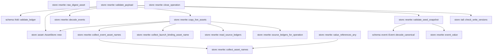

```mermaid
flowchart TD
  n0["schema::event::Event::decode_canonical"]
  n1["schema::fold::validate_ledger"]
  n2["store::atomic::AtomicPublisher::replace"]
  n3["store::management_root::session_settings_path"]
  n4["store::rewrite::mapped_child_uuid"]
  n5["store::rewrite::tree_digest"]
  n6["store::rewrite::verify_source_digest"]
  n7["store::rewrite::scan_redaction"]
  n8["store::rewrite::RewriteOperation::decode_canonical"]
  n9["store::rewrite::contains_bytes"]
  n10["store::rewrite::operation_bytes"]
  n11["store::rewrite::write_operation"]
  n12["store::rewrite::read_operation"]
  n13["store::rewrite::build_payload"]
  n14["store::rewrite::project_ledgers"]
  n15["store::rewrite::decode_events"]
  n16["store::rewrite::event_value"]
  n17["store::rewrite::source_thread_map"]
  n18["store::rewrite::source_parent_file"]
  n19["store::rewrite::project_file"]
  n20["store::rewrite::copy_live_assets"]
  n21["store::rewrite::validate_operation"]
  n22["store::rewrite::read_source_ledgers"]
  n23["store::rewrite::source_ledgers_for_operation"]
  n24["store::rewrite::source_prefix_ledgers"]
  n25["store::rewrite::encoded_prefix"]
  n26["store::rewrite::validate_terminal_source"]
  n27["store::rewrite::build_file_map"]
  n28["store::tail::check_write_versions"]
  n6 --> n5
  n6 --> n22
  n7 --> n0
  n7 --> n9
  n10 --> n21
  n11 --> n2
  n11 --> n10
  n12 --> n8
  n13 --> n3
  n13 --> n5
  n13 --> n14
  n13 --> n20
  n13 --> n22
  n13 --> n23
  n14 --> n15
  n14 --> n17
  n14 --> n18
  n14 --> n19
  n17 --> n15
  n18 --> n16
  n22 --> n1
  n22 --> n28
  n23 --> n24
  n24 --> n15
  n24 --> n16
  n24 --> n25
  n25 --> n1
  n26 --> n1
  n26 --> n15
  n26 --> n16
  n27 --> n4
```

```mermaid
flowchart TD
  n0["schema::event::Event::decode_canonical"]
  n1["schema::fold::validate_ledger"]
  n2["store::rewrite::event_value"]
  n3["store::rewrite::project_file"]
  n4["store::rewrite::build_genesis"]
  n5["store::rewrite::rewrite_origin"]
  n6["store::rewrite::materialize_input"]
  n7["store::rewrite::materialize_turn_open"]
  n8["store::rewrite::materialize_spawn"]
  n9["store::rewrite::materialize_child_result"]
  n10["store::rewrite::materialize_state"]
  n11["store::rewrite::materialize_historical_state"]
  n12["store::rewrite::event_value_ts"]
  n13["store::rewrite::materialize_settle"]
  n14["store::rewrite::materialize_meta"]
  n15["store::rewrite::materialize_epoch"]
  n16["store::rewrite::mapped_turn"]
  n17["store::rewrite::retain_payload_fields"]
  n18["store::rewrite::envelope_fields"]
  n19["store::rewrite::push_event"]
  n20["store::rewrite::value_ranges"]
  n21["store::rewrite::valid_asset_name"]
  n22["store::rewrite::collect_asset_names"]
  n23["store::rewrite::value_references_any"]
  n3 --> n1
  n3 --> n2
  n3 --> n4
  n3 --> n6
  n3 --> n7
  n3 --> n8
  n3 --> n9
  n3 --> n10
  n3 --> n11
  n3 --> n13
  n3 --> n14
  n3 --> n15
  n3 --> n16
  n3 --> n19
  n3 --> n20
  n3 --> n23
  n4 --> n2
  n4 --> n5
  n4 --> n23
  n8 --> n17
  n9 --> n17
  n10 --> n17
  n11 --> n18
  n13 --> n17
  n15 --> n17
  n19 --> n0
  n22 --> n21
  n22 --> n22
```

# store::rewrite

[Package atlas](index.md) · [Source](../../src/rewrite.rs)

## Declarations

Visibility is the declaration spelling; trait members and reexports require their enclosing interface. `cfg` is not evaluated.

| Symbol | Kind | Visibility | Test / cfg |
|---|---|---|---|
| [store::rewrite::OP_FORMAT](../../src/rewrite.rs#L15) | const_item | `private` |  |
| [store::rewrite::RewriteKind](../../src/rewrite.rs#L19) | enum_item | `pub` |  |
| [store::rewrite::RewriteKind::as_str](../../src/rewrite.rs#L25) | function_item | `private` |  |
| [store::rewrite::RewritePhase](../../src/rewrite.rs#L35) | enum_item | `pub` |  |
| [store::rewrite::RewriteEventRef](../../src/rewrite.rs#L46) | struct_item | `pub` |  |
| [store::rewrite::RewriteFileMap](../../src/rewrite.rs#L53) | struct_item | `pub` |  |
| [store::rewrite::RedactionInventory](../../src/rewrite.rs#L61) | struct_item | `pub` |  |
| [store::rewrite::RewriteOperation](../../src/rewrite.rs#L69) | struct_item | `pub` |  |
| [store::rewrite::ForkGenesisBinding](../../src/rewrite.rs#L98) | struct_item | `pub` |  |
| [store::rewrite::RewriteOperation::decode_canonical](../../src/rewrite.rs#L107) | function_item | `pub` |  |
| [store::rewrite::RewriteOperation::canonical_bytes](../../src/rewrite.rs#L127) | function_item | `pub` |  |
| [store::rewrite::RewriteProgress](../../src/rewrite.rs#L133) | struct_item | `pub` |  |
| [store::rewrite::BuiltFile](../../src/rewrite.rs#L139) | struct_item | `private` |  |
| [store::rewrite::GenesisContext](../../src/rewrite.rs#L144) | struct_item | `private` |  |
| [store::rewrite::RewriteMode](../../src/rewrite.rs#L154) | enum_item | `private` |  |
| [store::rewrite::ThreadStore::begin_fork](../../src/rewrite.rs#L160) | function_item | `pub` |  |
| [store::rewrite::ThreadStore::begin_fork_at_kernel_anchor](../../src/rewrite.rs#L179) | function_item | `pub` |  |
| [store::rewrite::ThreadStore::begin_redact](../../src/rewrite.rs#L204) | function_item | `pub` |  |
| [store::rewrite::ThreadStore::begin_rewrite](../../src/rewrite.rs#L226) | function_item | `private` |  |
| [store::rewrite::ThreadStore::advance_rewrite](../../src/rewrite.rs#L319) | function_item | `pub` |  |
| [store::rewrite::ThreadStore::recover_rewrites](../../src/rewrite.rs#L441) | function_item | `pub` |  |
| [store::rewrite::ThreadStore::recover_rewrites_for_startup](../../src/rewrite.rs#L447) | function_item | `pub` |  |
| [store::rewrite::ThreadStore::recover_rewrites_impl](../../src/rewrite.rs#L451) | function_item | `private` |  |
| [store::rewrite::ThreadStore::quarantine_unpublished_fork](../../src/rewrite.rs#L486) | function_item | `private` |  |
| [store::rewrite::ThreadStore::gc_rewrite_debris](../../src/rewrite.rs#L528) | function_item | `pub` |  |
| [store::rewrite::ThreadStore::source_has_live_rewrite](../../src/rewrite.rs#L551) | function_item | `pub(crate)` |  |
| [store::rewrite::ThreadStore::destination_has_live_rewrite](../../src/rewrite.rs#L564) | function_item | `pub(crate)` |  |
| [store::rewrite::ThreadStore::tombstone_path](../../src/rewrite.rs#L577) | function_item | `private` |  |
| [store::rewrite::progress](../../src/rewrite.rs#L584) | function_item | `private` |  |
| [store::rewrite::validate_path_id](../../src/rewrite.rs#L591) | function_item | `private` |  |
| [store::rewrite::validate_uuid](../../src/rewrite.rs#L602) | function_item | `private` |  |
| [store::rewrite::validate_operation](../../src/rewrite.rs#L613) | function_item | `private` |  |
| [store::rewrite::read_source_ledgers](../../src/rewrite.rs#L774) | function_item | `private` |  |
| [store::rewrite::source_ledgers_for_operation](../../src/rewrite.rs#L803) | function_item | `private` |  |
| [store::rewrite::source_prefix_ledgers](../../src/rewrite.rs#L816) | function_item | `private` |  |
| [store::rewrite::encoded_prefix](../../src/rewrite.rs#L874) | function_item | `private` |  |
| [store::rewrite::validate_terminal_source](../../src/rewrite.rs#L885) | function_item | `private` |  |
| [store::rewrite::build_file_map](../../src/rewrite.rs#L984) | function_item | `private` |  |
| [store::rewrite::mapped_child_uuid](../../src/rewrite.rs#L1004) | function_item | `private` |  |
| [store::rewrite::tree_digest](../../src/rewrite.rs#L1017) | function_item | `private` |  |
| [store::rewrite::verify_source_digest](../../src/rewrite.rs#L1028) | function_item | `private` |  |
| [store::rewrite::scan_redaction](../../src/rewrite.rs#L1039) | function_item | `private` |  |
| [store::rewrite::contains_bytes](../../src/rewrite.rs#L1088) | function_item | `private` |  |
| [store::rewrite::operation_bytes](../../src/rewrite.rs#L1094) | function_item | `private` |  |
| [store::rewrite::write_operation](../../src/rewrite.rs#L1102) | function_item | `private` |  |
| [store::rewrite::read_operation](../../src/rewrite.rs#L1106) | function_item | `private` |  |
| [store::rewrite::build_payload](../../src/rewrite.rs#L1111) | function_item | `private` |  |
| [store::rewrite::project_ledgers](../../src/rewrite.rs#L1157) | function_item | `private` |  |
| [store::rewrite::decode_events](../../src/rewrite.rs#L1208) | function_item | `private` |  |
| [store::rewrite::event_value](../../src/rewrite.rs#L1217) | function_item | `private` |  |
| [store::rewrite::source_thread_map](../../src/rewrite.rs#L1225) | function_item | `private` |  |
| [store::rewrite::source_parent_file](../../src/rewrite.rs#L1246) | function_item | `private` |  |
| [store::rewrite::project_file](../../src/rewrite.rs#L1259) | function_item | `private` |  |
| [store::rewrite::build_genesis](../../src/rewrite.rs#L1606) | function_item | `private` |  |
| [store::rewrite::rewrite_origin](../../src/rewrite.rs#L1708) | function_item | `private` |  |
| [store::rewrite::materialize_input](../../src/rewrite.rs#L1715) | function_item | `private` |  |
| [store::rewrite::materialize_turn_open](../../src/rewrite.rs#L1739) | function_item | `private` |  |
| [store::rewrite::materialize_spawn](../../src/rewrite.rs#L1774) | function_item | `private` |  |
| [store::rewrite::materialize_child_result](../../src/rewrite.rs#L1800) | function_item | `private` |  |
| [store::rewrite::materialize_state](../../src/rewrite.rs#L1829) | function_item | `private` |  |
| [store::rewrite::materialize_historical_state](../../src/rewrite.rs#L1843) | function_item | `private` |  |
| [store::rewrite::event_value_ts](../../src/rewrite.rs#L1872) | function_item | `private` |  |
| [store::rewrite::materialize_settle](../../src/rewrite.rs#L1879) | function_item | `private` |  |
| [store::rewrite::materialize_meta](../../src/rewrite.rs#L1893) | function_item | `private` |  |
| [store::rewrite::materialize_epoch](../../src/rewrite.rs#L1917) | function_item | `private` |  |
| [store::rewrite::mapped_turn](../../src/rewrite.rs#L1939) | function_item | `private` |  |
| [store::rewrite::retain_payload_fields](../../src/rewrite.rs#L1946) | function_item | `private` |  |
| [store::rewrite::envelope_fields](../../src/rewrite.rs#L1951) | function_item | `private` |  |
| [store::rewrite::push_event](../../src/rewrite.rs#L1966) | function_item | `private` |  |
| [store::rewrite::value_ranges](../../src/rewrite.rs#L1975) | function_item | `private` |  |
| [store::rewrite::valid_asset_name](../../src/rewrite.rs#L2000) | function_item | `private` |  |
| [store::rewrite::collect_asset_names](../../src/rewrite.rs#L2009) | function_item | `private` |  |
| [store::rewrite::raw_digest_asset](../../src/rewrite.rs#L2028) | function_item | `private` |  |
| [store::rewrite::collect_event_asset_names](../../src/rewrite.rs#L2041) | function_item | `private` |  |
| [store::rewrite::collect_launch_binding_asset_name](../../src/rewrite.rs#L2071) | function_item | `private` |  |
| [store::rewrite::value_references_any](../../src/rewrite.rs#L2084) | function_item | `private` |  |
| [store::rewrite::copy_live_assets](../../src/rewrite.rs#L2090) | function_item | `private` |  |
| [store::rewrite::validate_payload](../../src/rewrite.rs#L2178) | function_item | `private` |  |
| [store::rewrite::validate_seed_snapshot](../../src/rewrite.rs#L2233) | function_item | `private` |  |
| [store::rewrite::close_operation](../../src/rewrite.rs#L2307) | function_item | `private` |  |
| [store::rewrite::tests::write_canonical_events](../../src/rewrite.rs#L2319) | function_item | `private` | test; #[cfg(test)] |
| [store::rewrite::tests::origin](../../src/rewrite.rs#L2331) | function_item | `private` | test; #[cfg(test)] |
| [store::rewrite::tests::baseline_source](../../src/rewrite.rs#L2341) | function_item | `private` | test; #[cfg(test)] |
| [store::rewrite::tests::fork_is_announced_and_a_stale_discard_tombstone_does_not_block_its_id](../../src/rewrite.rs#L2352) | function_item | `private` | test; #[cfg(test)] |
| [store::rewrite::tests::concurrent_tombstone_cleanup_never_fails_a_fork_to_the_same_id](../../src/rewrite.rs#L2391) | function_item | `private` | test; #[cfg(test)] |
| [store::rewrite::tests::a_large_stale_tombstone_is_parked_and_two_deleters_of_one_tree_both_succeed](../../src/rewrite.rs#L2427) | function_item | `private` | test; #[cfg(test)] |
| [store::rewrite::tests::startup_isolates_missing_fork_carrier_without_losing_source](../../src/rewrite.rs#L2489) | function_item | `private` | test; #[cfg(test)] |
| [store::rewrite::tests::anchored_fork_uses_terminal_prefix_binding_and_empty_endpoint_journal](../../src/rewrite.rs#L2562) | function_item | `private` | test; #[cfg(test)] |
| [store::rewrite::tests::fork_preserves_runtime_identity_selection](../../src/rewrite.rs#L2707) | function_item | `private` | test; #[cfg(test)] |
| [store::rewrite::tests::fork_keeps_the_genesis_preset_and_reader_two](../../src/rewrite.rs#L2768) | function_item | `private` | test; #[cfg(test)] |
| [store::rewrite::tests::anchored_fork_remaps_complete_child_edges](../../src/rewrite.rs#L2808) | function_item | `private` | test; #[cfg(test)] |
| [store::rewrite::tests::fork_and_redact_copy_unpoisoned_launch_binding_carriers](../../src/rewrite.rs#L2937) | function_item | `private` | test; #[cfg(test)] |

## Imports / reexports

| Local name | Source path | Visibility |
|---|---|---|
| `BTreeMap` | `std::collections::BTreeMap` | `private` |
| `BTreeSet` | `std::collections::BTreeSet` | `private` |
| `fs` | `std::fs` | `private` |
| `File` | `std::fs::File` | `private` |
| `DirBuilderExt` | `std::os::unix::fs::DirBuilderExt` | `private` |
| `Path` | `std::path::Path` | `private` |
| `PathBuf` | `std::path::PathBuf` | `private` |
| `Event` | `schema::Event` | `private` |
| `EventKind` | `schema::EventKind` | `private` |
| `OriginTuple` | `schema::OriginTuple` | `private` |
| `Visibility` | `schema::Visibility` | `private` |
| `validate_ledger` | `schema::validate_ledger` | `private` |
| `Deserialize` | `serde::Deserialize` | `private` |
| `Serialize` | `serde::Serialize` | `private` |
| `Map` | `serde_json::Map` | `private` |
| `Value` | `serde_json::Value` | `private` |
| `json` | `serde_json::json` | `private` |
| `Digest` | `sha2::Digest` | `private` |
| `Sha256` | `sha2::Sha256` | `private` |
| `Uuid` | `uuid::Uuid` | `private` |
| `hex_digest` | `crate::asset::hex_digest` | `private` |
| `AssetStore` | `crate::AssetStore` | `private` |
| `AtomicPublisher` | `crate::AtomicPublisher` | `private` |
| `DirectoryLock` | `crate::DirectoryLock` | `private` |
| `NamedLock` | `crate::NamedLock` | `private` |
| `StoreError` | `crate::StoreError` | `private` |
| `ThreadStore` | `crate::ThreadStore` | `private` |
| `*` | `super::*` | `private` |

## Module declarations

| Module | Visibility | Attributes |
|---|---|---|
| `store::rewrite::tests` | `private` | #[cfg(test)] |

## Function call graphs

Edges below are syntactically resolved calls only, including private functions. Graphs partition callers into groups of 20; they are not execution order. All unresolved sites are listed below and in the JSON inventory.

```mermaid
flowchart TD
  n0["schema::event::Event::decode_canonical"]
  n1["store::folder::park_stale_tombstone"]
  n2["store::folder_events::emit"]
  n3["store::platform::NamedLock::exclusive"]
  n4["store::platform::DirectoryLock::exclusive"]
  n5["store::rewrite::tree_digest"]
  n6["store::rewrite::verify_source_digest"]
  n7["store::rewrite::scan_redaction"]
  n8["store::rewrite::RewriteOperation::decode_canonical"]
  n9["store::rewrite::operation_bytes"]
  n10["store::rewrite::write_operation"]
  n11["store::rewrite::read_operation"]
  n12["store::rewrite::build_payload"]
  n13["store::rewrite::project_ledgers"]
  n14["store::rewrite::RewriteOperation::canonical_bytes"]
  n15["store::rewrite::ThreadStore::begin_fork"]
  n16["store::rewrite::ThreadStore::begin_fork_at_kernel_anchor"]
  n17["store::rewrite::valid_asset_name"]
  n18["store::rewrite::ThreadStore::begin_redact"]
  n19["store::rewrite::validate_payload"]
  n20["store::rewrite::ThreadStore::begin_rewrite"]
  n21["store::rewrite::close_operation"]
  n22["store::rewrite::RewriteKind::as_str"]
  n23["store::rewrite::ThreadStore::advance_rewrite"]
  n24["store::rewrite::ThreadStore::recover_rewrites"]
  n25["store::rewrite::ThreadStore::recover_rewrites_for_startup"]
  n26["store::rewrite::ThreadStore::recover_rewrites_impl"]
  n27["store::rewrite::ThreadStore::quarantine_unpublished_fork"]
  n28["store::rewrite::ThreadStore::gc_rewrite_debris"]
  n29["store::rewrite::ThreadStore::source_has_live_rewrite"]
  n30["store::rewrite::ThreadStore::destination_has_live_rewrite"]
  n31["store::rewrite::ThreadStore::tombstone_path"]
  n32["store::rewrite::progress"]
  n33["store::rewrite::validate_path_id"]
  n34["store::rewrite::validate_uuid"]
  n35["store::rewrite::validate_operation"]
  n36["store::rewrite::read_source_ledgers"]
  n37["store::rewrite::source_prefix_ledgers"]
  n38["store::rewrite::validate_terminal_source"]
  n39["store::rewrite::build_file_map"]
  n8 --> n35
  n14 --> n9
  n15 --> n20
  n16 --> n20
  n18 --> n20
  n20 --> n1
  n20 --> n3
  n20 --> n4
  n20 --> n5
  n20 --> n7
  n20 --> n10
  n20 --> n13
  n20 --> n29
  n20 --> n30
  n20 --> n33
  n20 --> n34
  n20 --> n35
  n20 --> n36
  n20 --> n37
  n20 --> n38
  n20 --> n39
  n23 --> n2
  n23 --> n3
  n23 --> n4
  n23 --> n6
  n23 --> n10
  n23 --> n11
  n23 --> n12
  n23 --> n19
  n23 --> n21
  n23 --> n31
  n23 --> n32
  n23 --> n33
  n24 --> n26
  n25 --> n26
  n26 --> n23
  n26 --> n27
  n27 --> n3
  n27 --> n4
  n27 --> n6
  n27 --> n11
  n28 --> n3
  n29 --> n11
  n30 --> n11
  n35 --> n0
  n35 --> n17
  n35 --> n33
  n35 --> n34
```

Functions 1–20: 48 direct edges

Functions 21–40: 31 direct edges

Functions 41–60: 28 direct edges

Functions 61–68: 15 direct edges

## Call sites

Includes test functions (marked in declarations). Receiver-type-required sites need type analysis/manual tracing. Calls in closures are attributed to their enclosing function; their occurrence here does not mean the closure executes immediately.

| Caller | Callee expression | Source lines | Target / classification |
|---|---|---|---|
| `decode_canonical` | `bytes.strip_suffix(b"\n").ok_or_else` | [108](../../src/rewrite.rs#L108) | receiver-type-required |
| `decode_canonical` | `bytes.strip_suffix` | [108](../../src/rewrite.rs#L108) | receiver-type-required |
| `decode_canonical` | `StoreError::RewriteOperationCorrupt` | [109](../../src/rewrite.rs#L109), [112](../../src/rewrite.rs#L112), [115](../../src/rewrite.rs#L115), [118](../../src/rewrite.rs#L118), [123](../../src/rewrite.rs#L123) | external-constructor-callback-or-unresolved |
| `decode_canonical` | `"record must end in one LF".to_owned` | [109](../../src/rewrite.rs#L109) | receiver-type-required |
| `decode_canonical` | `serde_json::from_slice(canonical).map_err` | [111](../../src/rewrite.rs#L111) | receiver-type-required |
| `decode_canonical` | `serde_json::from_slice` | [111](../../src/rewrite.rs#L111) | external-constructor-callback-or-unresolved |
| `decode_canonical` | `serde_json_canonicalizer::to_vec(&operation)             .map_err` | [114](../../src/rewrite.rs#L114) | receiver-type-required |
| `decode_canonical` | `serde_json_canonicalizer::to_vec` | [114](../../src/rewrite.rs#L114) | external-constructor-callback-or-unresolved |
| `decode_canonical` | `error.to_string` | [115](../../src/rewrite.rs#L115), [123](../../src/rewrite.rs#L123) | receiver-type-required |
| `decode_canonical` | `Err` | [118](../../src/rewrite.rs#L118) | external-constructor-callback-or-unresolved |
| `decode_canonical` | `"record is not canonical".to_owned` | [119](../../src/rewrite.rs#L119) | receiver-type-required |
| `decode_canonical` | `validate_operation(&operation)             .map_err` | [122](../../src/rewrite.rs#L122) | receiver-type-required |
| `decode_canonical` | `validate_operation` | [122](../../src/rewrite.rs#L122) | [store::rewrite::validate_operation](../../src/rewrite.rs#L613) |
| `decode_canonical` | `Ok` | [124](../../src/rewrite.rs#L124) | external-constructor-callback-or-unresolved |
| `canonical_bytes` | `operation_bytes` | [128](../../src/rewrite.rs#L128) | [store::rewrite::operation_bytes](../../src/rewrite.rs#L1094) |
| `begin_fork` | `self.begin_rewrite` | [167](../../src/rewrite.rs#L167) | [store::rewrite::ThreadStore::begin_rewrite](../../src/rewrite.rs#L226) |
| `begin_fork` | `RewriteMode::Fork` | [172](../../src/rewrite.rs#L172) | external-constructor-callback-or-unresolved |
| `begin_fork_at_kernel_anchor` | `Err` | [188](../../src/rewrite.rs#L188) | external-constructor-callback-or-unresolved |
| `begin_fork_at_kernel_anchor` | `StoreError::InvalidForkAnchor` | [188](../../src/rewrite.rs#L188) | external-constructor-callback-or-unresolved |
| `begin_fork_at_kernel_anchor` | `self.begin_rewrite` | [190](../../src/rewrite.rs#L190) | [store::rewrite::ThreadStore::begin_rewrite](../../src/rewrite.rs#L226) |
| `begin_fork_at_kernel_anchor` | `RewriteMode::Fork` | [195](../../src/rewrite.rs#L195) | external-constructor-callback-or-unresolved |
| `begin_fork_at_kernel_anchor` | `Some` | [195](../../src/rewrite.rs#L195) | external-constructor-callback-or-unresolved |
| `begin_redact` | `forbidden.is_empty` | [212](../../src/rewrite.rs#L212) | receiver-type-required |
| `begin_redact` | `forbidden.iter().any` | [212](../../src/rewrite.rs#L212) | receiver-type-required |
| `begin_redact` | `forbidden.iter` | [212](../../src/rewrite.rs#L212) | receiver-type-required |
| `begin_redact` | `Err` | [213](../../src/rewrite.rs#L213) | external-constructor-callback-or-unresolved |
| `begin_redact` | `StoreError::Corruption` | [213](../../src/rewrite.rs#L213) | external-constructor-callback-or-unresolved |
| `begin_redact` | `"redact requires non-empty forbidden byte strings".to_owned` | [214](../../src/rewrite.rs#L214) | receiver-type-required |
| `begin_redact` | `self.begin_rewrite` | [217](../../src/rewrite.rs#L217) | [store::rewrite::ThreadStore::begin_rewrite](../../src/rewrite.rs#L226) |
| `begin_redact` | `RewriteMode::Redact` | [222](../../src/rewrite.rs#L222) | external-constructor-callback-or-unresolved |
| `begin_rewrite` | `NamedLock::exclusive` | [238](../../src/rewrite.rs#L238), [239](../../src/rewrite.rs#L239) | [store::platform::NamedLock::exclusive](../../src/platform.rs#L103) |
| `begin_rewrite` | `self.root().join` | [238](../../src/rewrite.rs#L238), [239](../../src/rewrite.rs#L239), [253](../../src/rewrite.rs#L253), [262](../../src/rewrite.rs#L262), [267](../../src/rewrite.rs#L267), [312](../../src/rewrite.rs#L312), [315](../../src/rewrite.rs#L315) | receiver-type-required |
| `begin_rewrite` | `self.root` | [238](../../src/rewrite.rs#L238), [239](../../src/rewrite.rs#L239), [253](../../src/rewrite.rs#L253), [261](../../src/rewrite.rs#L261), [262](../../src/rewrite.rs#L262), [267](../../src/rewrite.rs#L267), [312](../../src/rewrite.rs#L312), [315](../../src/rewrite.rs#L315) | receiver-type-required |
| `begin_rewrite` | `validate_path_id` | [240](../../src/rewrite.rs#L240) | [store::rewrite::validate_path_id](../../src/rewrite.rs#L591) |
| `begin_rewrite` | `validate_uuid` | [241](../../src/rewrite.rs#L241), [242](../../src/rewrite.rs#L242) | [store::rewrite::validate_uuid](../../src/rewrite.rs#L602) |
| `begin_rewrite` | `Err` | [244](../../src/rewrite.rs#L244), [247](../../src/rewrite.rs#L247), [250](../../src/rewrite.rs#L250), [254](../../src/rewrite.rs#L254), [265](../../src/rewrite.rs#L265), [269](../../src/rewrite.rs#L269) | external-constructor-callback-or-unresolved |
| `begin_rewrite` | `self.source_has_live_rewrite` | [246](../../src/rewrite.rs#L246) | [store::rewrite::ThreadStore::source_has_live_rewrite](../../src/rewrite.rs#L551) |
| `begin_rewrite` | `self.destination_has_live_rewrite` | [249](../../src/rewrite.rs#L249) | [store::rewrite::ThreadStore::destination_has_live_rewrite](../../src/rewrite.rs#L564) |
| `begin_rewrite` | `self.root().join(area).join(destination).exists` | [253](../../src/rewrite.rs#L253) | receiver-type-required |
| `begin_rewrite` | `self.root().join(area).join` | [253](../../src/rewrite.rs#L253) | receiver-type-required |
| `begin_rewrite` | `crate::folder::park_stale_tombstone` | [261](../../src/rewrite.rs#L261) | [store::folder::park_stale_tombstone](../../src/folder.rs#L952) |
| `begin_rewrite` | `fs::read_dir(self.root().join(".rewrite-trash"))?.any` | [262](../../src/rewrite.rs#L262) | receiver-type-required |
| `begin_rewrite` | `fs::read_dir` | [262](../../src/rewrite.rs#L262) | external-constructor-callback-or-unresolved |
| `begin_rewrite` | `entry.is_ok_and` | [263](../../src/rewrite.rs#L263) | receiver-type-required |
| `begin_rewrite` | `entry.file_name().to_string_lossy().ends_with` | [263](../../src/rewrite.rs#L263) | receiver-type-required |
| `begin_rewrite` | `entry.file_name().to_string_lossy` | [263](../../src/rewrite.rs#L263) | receiver-type-required |
| `begin_rewrite` | `entry.file_name` | [263](../../src/rewrite.rs#L263) | receiver-type-required |
| `begin_rewrite` | `self.root().join("threads").join` | [267](../../src/rewrite.rs#L267) | receiver-type-required |
| `begin_rewrite` | `source_folder.is_dir` | [268](../../src/rewrite.rs#L268) | receiver-type-required |
| `begin_rewrite` | `DirectoryLock::exclusive` | [271](../../src/rewrite.rs#L271) | [store::platform::DirectoryLock::exclusive](../../src/platform.rs#L62) |
| `begin_rewrite` | `read_source_ledgers` | [272](../../src/rewrite.rs#L272) | [store::rewrite::read_source_ledgers](../../src/rewrite.rs#L774) |
| `begin_rewrite` | `fork_anchor.as_ref` | [273](../../src/rewrite.rs#L273), [294](../../src/rewrite.rs#L294) | receiver-type-required |
| `begin_rewrite` | `source_prefix_ledgers` | [274](../../src/rewrite.rs#L274) | [store::rewrite::source_prefix_ledgers](../../src/rewrite.rs#L816) |
| `begin_rewrite` | `ledgers.clone` | [275](../../src/rewrite.rs#L275) | receiver-type-required |
| `begin_rewrite` | `validate_terminal_source` | [277](../../src/rewrite.rs#L277) | [store::rewrite::validate_terminal_source](../../src/rewrite.rs#L885) |
| `begin_rewrite` | `tree_digest` | [278](../../src/rewrite.rs#L278) | [store::rewrite::tree_digest](../../src/rewrite.rs#L1017) |
| `begin_rewrite` | `build_file_map` | [279](../../src/rewrite.rs#L279) | [store::rewrite::build_file_map](../../src/rewrite.rs#L984) |
| `begin_rewrite` | `Some` | [282](../../src/rewrite.rs#L282) | external-constructor-callback-or-unresolved |
| `begin_rewrite` | `scan_redaction` | [282](../../src/rewrite.rs#L282) | [store::rewrite::scan_redaction](../../src/rewrite.rs#L1039) |
| `begin_rewrite` | `operation_id.to_owned` | [286](../../src/rewrite.rs#L286) | receiver-type-required |
| `begin_rewrite` | `source.to_owned` | [288](../../src/rewrite.rs#L288) | receiver-type-required |
| `begin_rewrite` | `destination.to_owned` | [289](../../src/rewrite.rs#L289) | receiver-type-required |
| `begin_rewrite` | `created_at.to_owned` | [290](../../src/rewrite.rs#L290) | receiver-type-required |
| `begin_rewrite` | `fork_anchor.as_ref().map` | [294](../../src/rewrite.rs#L294) | receiver-type-required |
| `begin_rewrite` | `"main.jsonl".to_owned` | [295](../../src/rewrite.rs#L295) | receiver-type-required |
| `begin_rewrite` | `fork_anchor                 .as_ref()                 .is_some_and` | [298](../../src/rewrite.rs#L298) | receiver-type-required |
| `begin_rewrite` | `fork_anchor                 .as_ref` | [298](../../src/rewrite.rs#L298), [301](../../src/rewrite.rs#L301) | receiver-type-required |
| `begin_rewrite` | `fork_anchor                 .as_ref()                 .and_then` | [301](../../src/rewrite.rs#L301) | receiver-type-required |
| `begin_rewrite` | `preset.clone` | [303](../../src/rewrite.rs#L303) | receiver-type-required |
| `begin_rewrite` | `fork_anchor.map` | [304](../../src/rewrite.rs#L304) | receiver-type-required |
| `begin_rewrite` | `validate_operation` | [307](../../src/rewrite.rs#L307) | [store::rewrite::validate_operation](../../src/rewrite.rs#L613) |
| `begin_rewrite` | `project_ledgers` | [311](../../src/rewrite.rs#L311) | [store::rewrite::project_ledgers](../../src/rewrite.rs#L1157) |
| `begin_rewrite` | `self.root().join("staging").join` | [312](../../src/rewrite.rs#L312) | receiver-type-required |
| `begin_rewrite` | `fs::create_dir` | [313](../../src/rewrite.rs#L313) | external-constructor-callback-or-unresolved |
| `begin_rewrite` | `write_operation` | [314](../../src/rewrite.rs#L314) | [store::rewrite::write_operation](../../src/rewrite.rs#L1102) |
| `begin_rewrite` | `File::open(self.root().join("staging"))?.sync_all` | [315](../../src/rewrite.rs#L315) | receiver-type-required |
| `begin_rewrite` | `File::open` | [315](../../src/rewrite.rs#L315) | external-constructor-callback-or-unresolved |
| `begin_rewrite` | `Ok` | [316](../../src/rewrite.rs#L316) | external-constructor-callback-or-unresolved |
| `advance_rewrite` | `NamedLock::exclusive` | [320](../../src/rewrite.rs#L320), [321](../../src/rewrite.rs#L321) | [store::platform::NamedLock::exclusive](../../src/platform.rs#L103) |
| `advance_rewrite` | `self.root().join` | [320](../../src/rewrite.rs#L320), [321](../../src/rewrite.rs#L321), [323](../../src/rewrite.rs#L323), [330](../../src/rewrite.rs#L330), [358](../../src/rewrite.rs#L358), [362](../../src/rewrite.rs#L362), [393](../../src/rewrite.rs#L393), [394](../../src/rewrite.rs#L394), [417](../../src/rewrite.rs#L417) | receiver-type-required |
| `advance_rewrite` | `self.root` | [320](../../src/rewrite.rs#L320), [321](../../src/rewrite.rs#L321), [323](../../src/rewrite.rs#L323), [330](../../src/rewrite.rs#L330), [343](../../src/rewrite.rs#L343), [350](../../src/rewrite.rs#L350), [358](../../src/rewrite.rs#L358), [362](../../src/rewrite.rs#L362), [364](../../src/rewrite.rs#L364), [382](../../src/rewrite.rs#L382), [393](../../src/rewrite.rs#L393), [394](../../src/rewrite.rs#L394), [396](../../src/rewrite.rs#L396), [417](../../src/rewrite.rs#L417), [429](../../src/rewrite.rs#L429) | receiver-type-required |
| `advance_rewrite` | `validate_path_id` | [322](../../src/rewrite.rs#L322) | [store::rewrite::validate_path_id](../../src/rewrite.rs#L591) |
| `advance_rewrite` | `self.root().join("staging").join` | [323](../../src/rewrite.rs#L323) | receiver-type-required |
| `advance_rewrite` | `read_operation` | [324](../../src/rewrite.rs#L324) | [store::rewrite::read_operation](../../src/rewrite.rs#L1106) |
| `advance_rewrite` | `Err` | [326](../../src/rewrite.rs#L326), [370](../../src/rewrite.rs#L370), [403](../../src/rewrite.rs#L403), [425](../../src/rewrite.rs#L425), [435](../../src/rewrite.rs#L435) | external-constructor-callback-or-unresolved |
| `advance_rewrite` | `StoreError::Corruption` | [326](../../src/rewrite.rs#L326), [370](../../src/rewrite.rs#L370), [403](../../src/rewrite.rs#L403), [425](../../src/rewrite.rs#L425), [436](../../src/rewrite.rs#L436) | external-constructor-callback-or-unresolved |
| `advance_rewrite` | `"operation directory/id mismatch".to_owned` | [327](../../src/rewrite.rs#L327) | receiver-type-required |
| `advance_rewrite` | `self.root().join("threads").join` | [330](../../src/rewrite.rs#L330), [358](../../src/rewrite.rs#L358) | receiver-type-required |
| `advance_rewrite` | `self.tombstone_path` | [331](../../src/rewrite.rs#L331) | [store::rewrite::ThreadStore::tombstone_path](../../src/rewrite.rs#L577) |
| `advance_rewrite` | `source.is_dir` | [332](../../src/rewrite.rs#L332), [389](../../src/rewrite.rs#L389) | receiver-type-required |
| `advance_rewrite` | `Some` | [333](../../src/rewrite.rs#L333), [335](../../src/rewrite.rs#L335) | external-constructor-callback-or-unresolved |
| `advance_rewrite` | `DirectoryLock::exclusive` | [333](../../src/rewrite.rs#L333), [335](../../src/rewrite.rs#L335) | [store::platform::DirectoryLock::exclusive](../../src/platform.rs#L62) |
| `advance_rewrite` | `tombstone.is_dir` | [334](../../src/rewrite.rs#L334), [389](../../src/rewrite.rs#L389) | receiver-type-required |
| `advance_rewrite` | `verify_source_digest` | [342](../../src/rewrite.rs#L342), [349](../../src/rewrite.rs#L349), [356](../../src/rewrite.rs#L356), [381](../../src/rewrite.rs#L381), [391](../../src/rewrite.rs#L391), [408](../../src/rewrite.rs#L408), [415](../../src/rewrite.rs#L415) | [store::rewrite::verify_source_digest](../../src/rewrite.rs#L1028) |
| `advance_rewrite` | `build_payload` | [343](../../src/rewrite.rs#L343) | [store::rewrite::build_payload](../../src/rewrite.rs#L1111) |
| `advance_rewrite` | `write_operation` | [345](../../src/rewrite.rs#L345), [352](../../src/rewrite.rs#L352), [377](../../src/rewrite.rs#L377), [410](../../src/rewrite.rs#L410), [420](../../src/rewrite.rs#L420) | [store::rewrite::write_operation](../../src/rewrite.rs#L1102) |
| `advance_rewrite` | `progress` | [346](../../src/rewrite.rs#L346), [353](../../src/rewrite.rs#L353), [378](../../src/rewrite.rs#L378), [411](../../src/rewrite.rs#L411), [421](../../src/rewrite.rs#L421) | [store::rewrite::progress](../../src/rewrite.rs#L584) |
| `advance_rewrite` | `validate_payload` | [350](../../src/rewrite.rs#L350) | [store::rewrite::validate_payload](../../src/rewrite.rs#L2178) |
| `advance_rewrite` | `stage.join` | [357](../../src/rewrite.rs#L357) | receiver-type-required |
| `advance_rewrite` | `payload.is_dir` | [359](../../src/rewrite.rs#L359) | receiver-type-required |
| `advance_rewrite` | `destination.is_dir` | [359](../../src/rewrite.rs#L359) | receiver-type-required |
| `advance_rewrite` | `fs::rename` | [361](../../src/rewrite.rs#L361), [392](../../src/rewrite.rs#L392) | external-constructor-callback-or-unresolved |
| `advance_rewrite` | `File::open(self.root().join("threads"))?.sync_all` | [362](../../src/rewrite.rs#L362), [393](../../src/rewrite.rs#L393) | receiver-type-required |
| `advance_rewrite` | `File::open` | [362](../../src/rewrite.rs#L362), [393](../../src/rewrite.rs#L393), [394](../../src/rewrite.rs#L394), [417](../../src/rewrite.rs#L417) | external-constructor-callback-or-unresolved |
| `advance_rewrite` | `crate::folder_events::emit` | [363](../../src/rewrite.rs#L363), [395](../../src/rewrite.rs#L395) | [store::folder_events::emit](../../src/folder_events.rs#L167) |
| `advance_rewrite` | `self.root().to_path_buf` | [364](../../src/rewrite.rs#L364), [396](../../src/rewrite.rs#L396) | receiver-type-required |
| `advance_rewrite` | `operation.dest.clone` | [365](../../src/rewrite.rs#L365) | receiver-type-required |
| `advance_rewrite` | `"rewrite publication has ambiguous payload/destination state"                                 .to_owned` | [371](../../src/rewrite.rs#L371) | receiver-type-required |
| `advance_rewrite` | `close_operation` | [382](../../src/rewrite.rs#L382), [429](../../src/rewrite.rs#L429) | [store::rewrite::close_operation](../../src/rewrite.rs#L2307) |
| `advance_rewrite` | `Ok` | [383](../../src/rewrite.rs#L383), [430](../../src/rewrite.rs#L430) | external-constructor-callback-or-unresolved |
| `advance_rewrite` | `File::open(self.root().join(".rewrite-trash"))?.sync_all` | [394](../../src/rewrite.rs#L394), [417](../../src/rewrite.rs#L417) | receiver-type-required |
| `advance_rewrite` | `operation.source.clone` | [397](../../src/rewrite.rs#L397) | receiver-type-required |
| `advance_rewrite` | `"redact retirement has ambiguous source/tombstone state".to_owned` | [404](../../src/rewrite.rs#L404) | receiver-type-required |
| `advance_rewrite` | `tombstone.exists` | [414](../../src/rewrite.rs#L414), [424](../../src/rewrite.rs#L424) | receiver-type-required |
| `advance_rewrite` | `fs::remove_dir_all` | [416](../../src/rewrite.rs#L416) | external-constructor-callback-or-unresolved |
| `advance_rewrite` | `source.exists` | [424](../../src/rewrite.rs#L424) | receiver-type-required |
| `advance_rewrite` | `"redact source reappeared after removal".to_owned` | [426](../../src/rewrite.rs#L426) | receiver-type-required |
| `advance_rewrite` | `"fork entered a redact-only phase".to_owned` | [436](../../src/rewrite.rs#L436) | receiver-type-required |
| `recover_rewrites` | `self.recover_rewrites_impl` | [442](../../src/rewrite.rs#L442) | [store::rewrite::ThreadStore::recover_rewrites_impl](../../src/rewrite.rs#L451) |
| `recover_rewrites_for_startup` | `self.recover_rewrites_impl` | [448](../../src/rewrite.rs#L448) | [store::rewrite::ThreadStore::recover_rewrites_impl](../../src/rewrite.rs#L451) |
| `recover_rewrites_impl` | `Vec::new` | [455](../../src/rewrite.rs#L455), [463](../../src/rewrite.rs#L463) | external-constructor-callback-or-unresolved |
| `recover_rewrites_impl` | `fs::read_dir` | [456](../../src/rewrite.rs#L456) | external-constructor-callback-or-unresolved |
| `recover_rewrites_impl` | `self.root().join` | [456](../../src/rewrite.rs#L456) | receiver-type-required |
| `recover_rewrites_impl` | `self.root` | [456](../../src/rewrite.rs#L456) | receiver-type-required |
| `recover_rewrites_impl` | `entry.file_type()?.is_dir` | [458](../../src/rewrite.rs#L458) | receiver-type-required |
| `recover_rewrites_impl` | `entry.file_type` | [458](../../src/rewrite.rs#L458) | receiver-type-required |
| `recover_rewrites_impl` | `entry.path().join("op.json").is_file` | [458](../../src/rewrite.rs#L458) | receiver-type-required |
| `recover_rewrites_impl` | `entry.path().join` | [458](../../src/rewrite.rs#L458) | receiver-type-required |
| `recover_rewrites_impl` | `entry.path` | [458](../../src/rewrite.rs#L458) | receiver-type-required |
| `recover_rewrites_impl` | `ids.push` | [459](../../src/rewrite.rs#L459) | receiver-type-required |
| `recover_rewrites_impl` | `entry.file_name().to_string_lossy().into_owned` | [459](../../src/rewrite.rs#L459) | receiver-type-required |
| `recover_rewrites_impl` | `entry.file_name().to_string_lossy` | [459](../../src/rewrite.rs#L459) | receiver-type-required |
| `recover_rewrites_impl` | `entry.file_name` | [459](../../src/rewrite.rs#L459) | receiver-type-required |
| `recover_rewrites_impl` | `ids.sort` | [462](../../src/rewrite.rs#L462) | receiver-type-required |
| `recover_rewrites_impl` | `self.advance_rewrite` | [466](../../src/rewrite.rs#L466) | [store::rewrite::ThreadStore::advance_rewrite](../../src/rewrite.rs#L319) |
| `recover_rewrites_impl` | `self.quarantine_unpublished_fork` | [469](../../src/rewrite.rs#L469) | [store::rewrite::ThreadStore::quarantine_unpublished_fork](../../src/rewrite.rs#L486) |
| `recover_rewrites_impl` | `Err` | [470](../../src/rewrite.rs#L470), [474](../../src/rewrite.rs#L474) | external-constructor-callback-or-unresolved |
| `recover_rewrites_impl` | `value.phase.is_none` | [476](../../src/rewrite.rs#L476) | receiver-type-required |
| `recover_rewrites_impl` | `completed.push` | [478](../../src/rewrite.rs#L478) | receiver-type-required |
| `recover_rewrites_impl` | `Ok` | [483](../../src/rewrite.rs#L483) | external-constructor-callback-or-unresolved |
| `quarantine_unpublished_fork` | `NamedLock::exclusive` | [491](../../src/rewrite.rs#L491), [492](../../src/rewrite.rs#L492) | [store::platform::NamedLock::exclusive](../../src/platform.rs#L103) |
| `quarantine_unpublished_fork` | `self.root().join` | [491](../../src/rewrite.rs#L491), [492](../../src/rewrite.rs#L492), [493](../../src/rewrite.rs#L493), [498](../../src/rewrite.rs#L498), [502](../../src/rewrite.rs#L502), [505](../../src/rewrite.rs#L505), [520](../../src/rewrite.rs#L520) | receiver-type-required |
| `quarantine_unpublished_fork` | `self.root` | [491](../../src/rewrite.rs#L491), [492](../../src/rewrite.rs#L492), [493](../../src/rewrite.rs#L493), [498](../../src/rewrite.rs#L498), [502](../../src/rewrite.rs#L502), [505](../../src/rewrite.rs#L505), [510](../../src/rewrite.rs#L510), [520](../../src/rewrite.rs#L520) | receiver-type-required |
| `quarantine_unpublished_fork` | `self.root().join("staging").join` | [493](../../src/rewrite.rs#L493) | receiver-type-required |
| `quarantine_unpublished_fork` | `read_operation` | [494](../../src/rewrite.rs#L494) | [store::rewrite::read_operation](../../src/rewrite.rs#L1106) |
| `quarantine_unpublished_fork` | `self.root().join("threads").join(&operation.dest).exists` | [498](../../src/rewrite.rs#L498) | receiver-type-required |
| `quarantine_unpublished_fork` | `self.root().join("threads").join` | [498](../../src/rewrite.rs#L498), [502](../../src/rewrite.rs#L502) | receiver-type-required |
| `quarantine_unpublished_fork` | `Ok` | [500](../../src/rewrite.rs#L500), [513](../../src/rewrite.rs#L513), [525](../../src/rewrite.rs#L525) | external-constructor-callback-or-unresolved |
| `quarantine_unpublished_fork` | `DirectoryLock::exclusive` | [503](../../src/rewrite.rs#L503) | [store::platform::DirectoryLock::exclusive](../../src/platform.rs#L62) |
| `quarantine_unpublished_fork` | `verify_source_digest` | [504](../../src/rewrite.rs#L504) | [store::rewrite::verify_source_digest](../../src/rewrite.rs#L1028) |
| `quarantine_unpublished_fork` | `fs::DirBuilder::new()             .recursive(true)             .mode(0o700)             .create` | [506](../../src/rewrite.rs#L506) | receiver-type-required |
| `quarantine_unpublished_fork` | `fs::DirBuilder::new()             .recursive(true)             .mode` | [506](../../src/rewrite.rs#L506) | receiver-type-required |
| `quarantine_unpublished_fork` | `fs::DirBuilder::new()             .recursive` | [506](../../src/rewrite.rs#L506) | receiver-type-required |
| `quarantine_unpublished_fork` | `fs::DirBuilder::new` | [506](../../src/rewrite.rs#L506) | external-constructor-callback-or-unresolved |
| `quarantine_unpublished_fork` | `File::open(self.root())?.sync_all` | [510](../../src/rewrite.rs#L510) | receiver-type-required |
| `quarantine_unpublished_fork` | `File::open` | [510](../../src/rewrite.rs#L510), [517](../../src/rewrite.rs#L517), [519](../../src/rewrite.rs#L519), [520](../../src/rewrite.rs#L520) | external-constructor-callback-or-unresolved |
| `quarantine_unpublished_fork` | `quarantine.join` | [511](../../src/rewrite.rs#L511) | receiver-type-required |
| `quarantine_unpublished_fork` | `destination.exists` | [512](../../src/rewrite.rs#L512) | receiver-type-required |
| `quarantine_unpublished_fork` | `stage.join` | [515](../../src/rewrite.rs#L515) | receiver-type-required |
| `quarantine_unpublished_fork` | `fs::write` | [516](../../src/rewrite.rs#L516) | external-constructor-callback-or-unresolved |
| `quarantine_unpublished_fork` | `File::open(diagnostic)?.sync_all` | [517](../../src/rewrite.rs#L517) | receiver-type-required |
| `quarantine_unpublished_fork` | `fs::rename` | [518](../../src/rewrite.rs#L518) | external-constructor-callback-or-unresolved |
| `quarantine_unpublished_fork` | `File::open(quarantine)?.sync_all` | [519](../../src/rewrite.rs#L519) | receiver-type-required |
| `quarantine_unpublished_fork` | `File::open(self.root().join("staging"))?.sync_all` | [520](../../src/rewrite.rs#L520) | receiver-type-required |
| `gc_rewrite_debris` | `NamedLock::exclusive` | [529](../../src/rewrite.rs#L529) | [store::platform::NamedLock::exclusive](../../src/platform.rs#L103) |
| `gc_rewrite_debris` | `self.root().join` | [529](../../src/rewrite.rs#L529), [530](../../src/rewrite.rs#L530) | receiver-type-required |
| `gc_rewrite_debris` | `self.root` | [529](../../src/rewrite.rs#L529), [530](../../src/rewrite.rs#L530) | receiver-type-required |
| `gc_rewrite_debris` | `Vec::new` | [531](../../src/rewrite.rs#L531) | external-constructor-callback-or-unresolved |
| `gc_rewrite_debris` | `fs::read_dir` | [532](../../src/rewrite.rs#L532) | external-constructor-callback-or-unresolved |
| `gc_rewrite_debris` | `entry.path` | [534](../../src/rewrite.rs#L534) | receiver-type-required |
| `gc_rewrite_debris` | `entry.file_type()?.is_dir` | [535](../../src/rewrite.rs#L535), [538](../../src/rewrite.rs#L538) | receiver-type-required |
| `gc_rewrite_debris` | `entry.file_type` | [535](../../src/rewrite.rs#L535), [538](../../src/rewrite.rs#L538) | receiver-type-required |
| `gc_rewrite_debris` | `path.join("op.json").is_file` | [535](../../src/rewrite.rs#L535) | receiver-type-required |
| `gc_rewrite_debris` | `path.join` | [535](../../src/rewrite.rs#L535) | receiver-type-required |
| `gc_rewrite_debris` | `fs::remove_dir_all` | [539](../../src/rewrite.rs#L539) | external-constructor-callback-or-unresolved |
| `gc_rewrite_debris` | `fs::remove_file` | [541](../../src/rewrite.rs#L541) | external-constructor-callback-or-unresolved |
| `gc_rewrite_debris` | `removed.push` | [543](../../src/rewrite.rs#L543) | receiver-type-required |
| `gc_rewrite_debris` | `removed.is_empty` | [545](../../src/rewrite.rs#L545) | receiver-type-required |
| `gc_rewrite_debris` | `File::open(staging)?.sync_all` | [546](../../src/rewrite.rs#L546) | receiver-type-required |
| `gc_rewrite_debris` | `File::open` | [546](../../src/rewrite.rs#L546) | external-constructor-callback-or-unresolved |
| `gc_rewrite_debris` | `Ok` | [548](../../src/rewrite.rs#L548) | external-constructor-callback-or-unresolved |
| `source_has_live_rewrite` | `fs::read_dir` | [552](../../src/rewrite.rs#L552) | external-constructor-callback-or-unresolved |
| `source_has_live_rewrite` | `self.root().join` | [552](../../src/rewrite.rs#L552) | receiver-type-required |
| `source_has_live_rewrite` | `self.root` | [552](../../src/rewrite.rs#L552) | receiver-type-required |
| `source_has_live_rewrite` | `entry.file_type()?.is_dir` | [554](../../src/rewrite.rs#L554) | receiver-type-required |
| `source_has_live_rewrite` | `entry.file_type` | [554](../../src/rewrite.rs#L554) | receiver-type-required |
| `source_has_live_rewrite` | `entry.path().join("op.json").is_file` | [554](../../src/rewrite.rs#L554) | receiver-type-required |
| `source_has_live_rewrite` | `entry.path().join` | [554](../../src/rewrite.rs#L554) | receiver-type-required |
| `source_has_live_rewrite` | `entry.path` | [554](../../src/rewrite.rs#L554), [557](../../src/rewrite.rs#L557) | receiver-type-required |
| `source_has_live_rewrite` | `read_operation` | [557](../../src/rewrite.rs#L557) | [store::rewrite::read_operation](../../src/rewrite.rs#L1106) |
| `source_has_live_rewrite` | `Ok` | [558](../../src/rewrite.rs#L558), [561](../../src/rewrite.rs#L561) | external-constructor-callback-or-unresolved |
| `destination_has_live_rewrite` | `fs::read_dir` | [565](../../src/rewrite.rs#L565) | external-constructor-callback-or-unresolved |
| `destination_has_live_rewrite` | `self.root().join` | [565](../../src/rewrite.rs#L565) | receiver-type-required |
| `destination_has_live_rewrite` | `self.root` | [565](../../src/rewrite.rs#L565) | receiver-type-required |
| `destination_has_live_rewrite` | `entry.file_type()?.is_dir` | [567](../../src/rewrite.rs#L567) | receiver-type-required |
| `destination_has_live_rewrite` | `entry.file_type` | [567](../../src/rewrite.rs#L567) | receiver-type-required |
| `destination_has_live_rewrite` | `entry.path().join("op.json").is_file` | [567](../../src/rewrite.rs#L567) | receiver-type-required |
| `destination_has_live_rewrite` | `entry.path().join` | [567](../../src/rewrite.rs#L567) | receiver-type-required |
| `destination_has_live_rewrite` | `entry.path` | [567](../../src/rewrite.rs#L567), [570](../../src/rewrite.rs#L570) | receiver-type-required |
| `destination_has_live_rewrite` | `read_operation` | [570](../../src/rewrite.rs#L570) | [store::rewrite::read_operation](../../src/rewrite.rs#L1106) |
| `destination_has_live_rewrite` | `Ok` | [571](../../src/rewrite.rs#L571), [574](../../src/rewrite.rs#L574) | external-constructor-callback-or-unresolved |
| `tombstone_path` | `self.root()             .join(".rewrite-trash")             .join` | [578](../../src/rewrite.rs#L578) | receiver-type-required |
| `tombstone_path` | `self.root()             .join` | [578](../../src/rewrite.rs#L578) | receiver-type-required |
| `tombstone_path` | `self.root` | [578](../../src/rewrite.rs#L578) | receiver-type-required |
| `progress` | `Ok` | [585](../../src/rewrite.rs#L585) | external-constructor-callback-or-unresolved |
| `progress` | `operation.id.clone` | [586](../../src/rewrite.rs#L586) | receiver-type-required |
| `progress` | `Some` | [587](../../src/rewrite.rs#L587) | external-constructor-callback-or-unresolved |
| `validate_path_id` | `value.is_empty` | [592](../../src/rewrite.rs#L592) | receiver-type-required |
| `validate_path_id` | `value             .bytes()             .all` | [593](../../src/rewrite.rs#L593) | receiver-type-required |
| `validate_path_id` | `value             .bytes` | [593](../../src/rewrite.rs#L593) | receiver-type-required |
| `validate_path_id` | `byte.is_ascii_alphanumeric` | [595](../../src/rewrite.rs#L595) | receiver-type-required |
| `validate_path_id` | `Err` | [597](../../src/rewrite.rs#L597) | external-constructor-callback-or-unresolved |
| `validate_path_id` | `StoreError::Corruption` | [597](../../src/rewrite.rs#L597) | external-constructor-callback-or-unresolved |
| `validate_path_id` | `Ok` | [599](../../src/rewrite.rs#L599) | external-constructor-callback-or-unresolved |
| `validate_uuid` | `Uuid::parse_str(value)         .map_err` | [603](../../src/rewrite.rs#L603) | receiver-type-required |
| `validate_uuid` | `Uuid::parse_str` | [603](../../src/rewrite.rs#L603) | external-constructor-callback-or-unresolved |
| `validate_uuid` | `StoreError::Corruption` | [604](../../src/rewrite.rs#L604), [606](../../src/rewrite.rs#L606) | external-constructor-callback-or-unresolved |
| `validate_uuid` | `parsed.hyphenated().to_string` | [605](../../src/rewrite.rs#L605) | receiver-type-required |
| `validate_uuid` | `parsed.hyphenated` | [605](../../src/rewrite.rs#L605) | receiver-type-required |
| `validate_uuid` | `Err` | [606](../../src/rewrite.rs#L606) | external-constructor-callback-or-unresolved |
| `validate_uuid` | `Ok` | [610](../../src/rewrite.rs#L610) | external-constructor-callback-or-unresolved |
| `validate_operation` | `Err` | [615](../../src/rewrite.rs#L615), [640](../../src/rewrite.rs#L640), [645](../../src/rewrite.rs#L645), [669](../../src/rewrite.rs#L669), [674](../../src/rewrite.rs#L674), [680](../../src/rewrite.rs#L680), [688](../../src/rewrite.rs#L688), [695](../../src/rewrite.rs#L695), [704](../../src/rewrite.rs#L704), [720](../../src/rewrite.rs#L720), [730](../../src/rewrite.rs#L730), [740](../../src/rewrite.rs#L740), [752](../../src/rewrite.rs#L752), [766](../../src/rewrite.rs#L766) | external-constructor-callback-or-unresolved |
| `validate_operation` | `StoreError::Corruption` | [615](../../src/rewrite.rs#L615), [628](../../src/rewrite.rs#L628), [640](../../src/rewrite.rs#L640), [645](../../src/rewrite.rs#L645), [669](../../src/rewrite.rs#L669), [674](../../src/rewrite.rs#L674), [680](../../src/rewrite.rs#L680), [688](../../src/rewrite.rs#L688), [695](../../src/rewrite.rs#L695), [704](../../src/rewrite.rs#L704), [720](../../src/rewrite.rs#L720), [730](../../src/rewrite.rs#L730), [740](../../src/rewrite.rs#L740), [752](../../src/rewrite.rs#L752), [766](../../src/rewrite.rs#L766) | external-constructor-callback-or-unresolved |
| `validate_operation` | `"rewrite operation format must equal 1".to_owned` | [616](../../src/rewrite.rs#L616) | receiver-type-required |
| `validate_operation` | `validate_path_id` | [619](../../src/rewrite.rs#L619) | [store::rewrite::validate_path_id](../../src/rewrite.rs#L591) |
| `validate_operation` | `validate_uuid` | [620](../../src/rewrite.rs#L620), [621](../../src/rewrite.rs#L621), [724](../../src/rewrite.rs#L724) | [store::rewrite::validate_uuid](../../src/rewrite.rs#L602) |
| `validate_operation` | `Event::decode_canonical` | [626](../../src/rewrite.rs#L626) | [schema::event::Event::decode_canonical](../../../schema/src/event.rs#L168) |
| `validate_operation` | `serde_json_canonicalizer::to_vec(&timestamp_probe)             .map_err` | [627](../../src/rewrite.rs#L627) | receiver-type-required |
| `validate_operation` | `serde_json_canonicalizer::to_vec` | [627](../../src/rewrite.rs#L627) | external-constructor-callback-or-unresolved |
| `validate_operation` | `error.to_string` | [628](../../src/rewrite.rs#L628) | receiver-type-required |
| `validate_operation` | `operation         .source_digest         .strip_prefix("sha256-")         .is_none_or` | [630](../../src/rewrite.rs#L630) | receiver-type-required |
| `validate_operation` | `operation         .source_digest         .strip_prefix` | [630](../../src/rewrite.rs#L630) | receiver-type-required |
| `validate_operation` | `digest.len` | [634](../../src/rewrite.rs#L634) | receiver-type-required |
| `validate_operation` | `digest                     .bytes()                     .all` | [635](../../src/rewrite.rs#L635) | receiver-type-required |
| `validate_operation` | `digest                     .bytes` | [635](../../src/rewrite.rs#L635) | receiver-type-required |
| `validate_operation` | `byte.is_ascii_digit` | [637](../../src/rewrite.rs#L637) | receiver-type-required |
| `validate_operation` | `(b'a'..=b'f').contains` | [637](../../src/rewrite.rs#L637) | receiver-type-required |
| `validate_operation` | `"invalid rewrite source digest".to_owned` | [641](../../src/rewrite.rs#L641) | receiver-type-required |
| `validate_operation` | `operation.redaction.is_some` | [644](../../src/rewrite.rs#L644) | receiver-type-required |
| `validate_operation` | `"redaction inventory/type mismatch".to_owned` | [646](../../src/rewrite.rs#L646) | receiver-type-required |
| `validate_operation` | `operation.source_anchor.as_ref` | [651](../../src/rewrite.rs#L651) | receiver-type-required |
| `validate_operation` | `operation.genesis_origin.as_ref` | [652](../../src/rewrite.rs#L652) | receiver-type-required |
| `validate_operation` | `[                     origin.principal.as_str(),                     origin.client.as_str(),                     origin.target.as_str(),                     origin.op.as_str(),                     origin.key.as_str(),                 ]                 .iter()                 .all` | [659](../../src/rewrite.rs#L659) | receiver-type-required |
| `validate_operation` | `[                     origin.principal.as_str(),                     origin.client.as_str(),                     origin.target.as_str(),                     origin.op.as_str(),                     origin.key.as_str(),                 ]                 .iter` | [659](../../src/rewrite.rs#L659) | receiver-type-required |
| `validate_operation` | `origin.principal.as_str` | [660](../../src/rewrite.rs#L660) | receiver-type-required |
| `validate_operation` | `origin.client.as_str` | [661](../../src/rewrite.rs#L661) | receiver-type-required |
| `validate_operation` | `origin.target.as_str` | [662](../../src/rewrite.rs#L662) | receiver-type-required |
| `validate_operation` | `origin.op.as_str` | [663](../../src/rewrite.rs#L663) | receiver-type-required |
| `validate_operation` | `origin.key.as_str` | [664](../../src/rewrite.rs#L664) | receiver-type-required |
| `validate_operation` | `value.is_empty` | [667](../../src/rewrite.rs#L667) | receiver-type-required |
| `validate_operation` | `"invalid anchored-fork genesis binding".to_owned` | [670](../../src/rewrite.rs#L670) | receiver-type-required |
| `validate_operation` | `"fork anchor and genesis origin must appear together".to_owned` | [675](../../src/rewrite.rs#L675) | receiver-type-required |
| `validate_operation` | `"redact cannot carry a fork anchor or genesis binding".to_owned` | [681](../../src/rewrite.rs#L681) | receiver-type-required |
| `validate_operation` | `operation.genesis_origin.is_none` | [686](../../src/rewrite.rs#L686), [693](../../src/rewrite.rs#L693) | receiver-type-required |
| `validate_operation` | `"only an anchored fork can publish an ephemeral destination".to_owned` | [689](../../src/rewrite.rs#L689) | receiver-type-required |
| `validate_operation` | `operation.genesis_preset.is_some` | [692](../../src/rewrite.rs#L692) | receiver-type-required |
| `validate_operation` | `"only an anchored fork can replace the destination preset".to_owned` | [696](../../src/rewrite.rs#L696) | receiver-type-required |
| `validate_operation` | `operation.files.is_empty` | [699](../../src/rewrite.rs#L699) | receiver-type-required |
| `validate_operation` | `"rewrite file map lacks canonical main entry".to_owned` | [705](../../src/rewrite.rs#L705) | receiver-type-required |
| `validate_operation` | `BTreeSet::new` | [708](../../src/rewrite.rs#L708), [709](../../src/rewrite.rs#L709), [710](../../src/rewrite.rs#L710) | external-constructor-callback-or-unresolved |
| `validate_operation` | `source_names.insert` | [712](../../src/rewrite.rs#L712) | receiver-type-required |
| `validate_operation` | `dest_names.insert` | [713](../../src/rewrite.rs#L713) | receiver-type-required |
| `validate_operation` | `threads.insert` | [714](../../src/rewrite.rs#L714) | receiver-type-required |
| `validate_operation` | `Path::new(&file.source).file_name().and_then` | [715](../../src/rewrite.rs#L715) | receiver-type-required |
| `validate_operation` | `Path::new(&file.source).file_name` | [715](../../src/rewrite.rs#L715) | receiver-type-required |
| `validate_operation` | `Path::new` | [715](../../src/rewrite.rs#L715), [717](../../src/rewrite.rs#L717) | external-constructor-callback-or-unresolved |
| `validate_operation` | `v.to_str` | [715](../../src/rewrite.rs#L715), [717](../../src/rewrite.rs#L717) | receiver-type-required |
| `validate_operation` | `Some` | [716](../../src/rewrite.rs#L716), [718](../../src/rewrite.rs#L718) | external-constructor-callback-or-unresolved |
| `validate_operation` | `file.source.as_str` | [716](../../src/rewrite.rs#L716) | receiver-type-required |
| `validate_operation` | `Path::new(&file.dest).file_name().and_then` | [717](../../src/rewrite.rs#L717) | receiver-type-required |
| `validate_operation` | `Path::new(&file.dest).file_name` | [717](../../src/rewrite.rs#L717) | receiver-type-required |
| `validate_operation` | `file.dest.as_str` | [718](../../src/rewrite.rs#L718) | receiver-type-required |
| `validate_operation` | `"rewrite file map is not one-to-one".to_owned` | [721](../../src/rewrite.rs#L721) | receiver-type-required |
| `validate_operation` | `operation.files[1..]         .windows(2)         .any` | [726](../../src/rewrite.rs#L726) | receiver-type-required |
| `validate_operation` | `operation.files[1..]         .windows` | [726](../../src/rewrite.rs#L726) | receiver-type-required |
| `validate_operation` | `"rewrite child file map must be source-sorted".to_owned` | [731](../../src/rewrite.rs#L731) | receiver-type-required |
| `validate_operation` | `"fork operation entered a redact-only phase".to_owned` | [741](../../src/rewrite.rs#L741) | receiver-type-required |
| `validate_operation` | `redaction.events.windows(2).any` | [745](../../src/rewrite.rs#L745) | receiver-type-required |
| `validate_operation` | `redaction.events.windows` | [745](../../src/rewrite.rs#L745) | receiver-type-required |
| `validate_operation` | `redaction.assets.windows(2).any` | [746](../../src/rewrite.rs#L746) | receiver-type-required |
| `validate_operation` | `redaction.assets.windows` | [746](../../src/rewrite.rs#L746) | receiver-type-required |
| `validate_operation` | `redaction                 .fingerprints                 .windows(2)                 .any` | [747](../../src/rewrite.rs#L747) | receiver-type-required |
| `validate_operation` | `redaction                 .fingerprints                 .windows` | [747](../../src/rewrite.rs#L747) | receiver-type-required |
| `validate_operation` | `"redaction inventory must be sorted and unique".to_owned` | [753](../../src/rewrite.rs#L753) | receiver-type-required |
| `validate_operation` | `redaction.assets.iter().any` | [756](../../src/rewrite.rs#L756) | receiver-type-required |
| `validate_operation` | `redaction.assets.iter` | [756](../../src/rewrite.rs#L756) | receiver-type-required |
| `validate_operation` | `valid_asset_name` | [756](../../src/rewrite.rs#L756), [760](../../src/rewrite.rs#L760) | [store::rewrite::valid_asset_name](../../src/rewrite.rs#L2000) |
| `validate_operation` | `redaction                 .fingerprints                 .iter()                 .any` | [757](../../src/rewrite.rs#L757) | receiver-type-required |
| `validate_operation` | `redaction                 .fingerprints                 .iter` | [757](../../src/rewrite.rs#L757) | receiver-type-required |
| `validate_operation` | `redaction                 .events                 .iter()                 .any` | [761](../../src/rewrite.rs#L761) | receiver-type-required |
| `validate_operation` | `redaction                 .events                 .iter` | [761](../../src/rewrite.rs#L761) | receiver-type-required |
| `validate_operation` | `source_names.contains` | [764](../../src/rewrite.rs#L764) | receiver-type-required |
| `validate_operation` | `"redaction inventory contains an invalid carrier".to_owned` | [767](../../src/rewrite.rs#L767) | receiver-type-required |
| `validate_operation` | `Ok` | [771](../../src/rewrite.rs#L771) | external-constructor-callback-or-unresolved |
| `read_source_ledgers` | `BTreeMap::new` | [775](../../src/rewrite.rs#L775) | external-constructor-callback-or-unresolved |
| `read_source_ledgers` | `fs::read_dir` | [776](../../src/rewrite.rs#L776) | external-constructor-callback-or-unresolved |
| `read_source_ledgers` | `entry.file_type()?.is_file` | [778](../../src/rewrite.rs#L778) | receiver-type-required |
| `read_source_ledgers` | `entry.file_type` | [778](../../src/rewrite.rs#L778) | receiver-type-required |
| `read_source_ledgers` | `entry.path().extension().and_then` | [779](../../src/rewrite.rs#L779) | receiver-type-required |
| `read_source_ledgers` | `entry.path().extension` | [779](../../src/rewrite.rs#L779) | receiver-type-required |
| `read_source_ledgers` | `entry.path` | [779](../../src/rewrite.rs#L779), [787](../../src/rewrite.rs#L787) | receiver-type-required |
| `read_source_ledgers` | `value.to_str` | [779](../../src/rewrite.rs#L779) | receiver-type-required |
| `read_source_ledgers` | `Some` | [779](../../src/rewrite.rs#L779) | external-constructor-callback-or-unresolved |
| `read_source_ledgers` | `entry.file_name().to_string_lossy().into_owned` | [783](../../src/rewrite.rs#L783) | receiver-type-required |
| `read_source_ledgers` | `entry.file_name().to_string_lossy` | [783](../../src/rewrite.rs#L783) | receiver-type-required |
| `read_source_ledgers` | `entry.file_name` | [783](../../src/rewrite.rs#L783) | receiver-type-required |
| `read_source_ledgers` | `fs::read` | [787](../../src/rewrite.rs#L787) | external-constructor-callback-or-unresolved |
| `read_source_ledgers` | `validate_ledger` | [788](../../src/rewrite.rs#L788) | [schema::fold::validate_ledger](../../../schema/src/fold.rs#L1053) |
| `read_source_ledgers` | `Err` | [790](../../src/rewrite.rs#L790), [796](../../src/rewrite.rs#L796) | external-constructor-callback-or-unresolved |
| `read_source_ledgers` | `StoreError::Corruption` | [790](../../src/rewrite.rs#L790), [796](../../src/rewrite.rs#L796) | external-constructor-callback-or-unresolved |
| `read_source_ledgers` | `"empty rewrite ledger".to_owned` | [790](../../src/rewrite.rs#L790) | receiver-type-required |
| `read_source_ledgers` | `crate::tail::check_write_versions` | [792](../../src/rewrite.rs#L792) | [store::tail::check_write_versions](../../src/tail.rs#L154) |
| `read_source_ledgers` | `ledgers.insert` | [793](../../src/rewrite.rs#L793) | receiver-type-required |
| `read_source_ledgers` | `ledgers.contains_key` | [795](../../src/rewrite.rs#L795) | receiver-type-required |
| `read_source_ledgers` | `"rewrite source lacks main.jsonl".to_owned` | [797](../../src/rewrite.rs#L797) | receiver-type-required |
| `read_source_ledgers` | `Ok` | [800](../../src/rewrite.rs#L800) | external-constructor-callback-or-unresolved |
| `source_ledgers_for_operation` | `operation.source_anchor.as_ref` | [807](../../src/rewrite.rs#L807) | receiver-type-required |
| `source_ledgers_for_operation` | `source_prefix_ledgers` | [808](../../src/rewrite.rs#L808) | [store::rewrite::source_prefix_ledgers](../../src/rewrite.rs#L816) |
| `source_ledgers_for_operation` | `Err` | [809](../../src/rewrite.rs#L809) | external-constructor-callback-or-unresolved |
| `source_ledgers_for_operation` | `StoreError::Corruption` | [809](../../src/rewrite.rs#L809) | external-constructor-callback-or-unresolved |
| `source_ledgers_for_operation` | `"v1 fork anchor must name main.jsonl".to_owned` | [810](../../src/rewrite.rs#L810) | receiver-type-required |
| `source_ledgers_for_operation` | `Ok` | [812](../../src/rewrite.rs#L812) | external-constructor-callback-or-unresolved |
| `source_ledgers_for_operation` | `ledgers.clone` | [812](../../src/rewrite.rs#L812) | receiver-type-required |
| `source_prefix_ledgers` | `ledgers         .get("main.jsonl")         .ok_or_else` | [820](../../src/rewrite.rs#L820) | receiver-type-required |
| `source_prefix_ledgers` | `ledgers         .get` | [820](../../src/rewrite.rs#L820) | receiver-type-required |
| `source_prefix_ledgers` | `StoreError::Corruption` | [822](../../src/rewrite.rs#L822), [842](../../src/rewrite.rs#L842), [848](../../src/rewrite.rs#L848), [851](../../src/rewrite.rs#L851), [859](../../src/rewrite.rs#L859) | external-constructor-callback-or-unresolved |
| `source_prefix_ledgers` | `"rewrite source lacks main.jsonl".to_owned` | [822](../../src/rewrite.rs#L822) | receiver-type-required |
| `source_prefix_ledgers` | `decode_events` | [823](../../src/rewrite.rs#L823), [839](../../src/rewrite.rs#L839), [861](../../src/rewrite.rs#L861) | [store::rewrite::decode_events](../../src/rewrite.rs#L1208) |
| `source_prefix_ledgers` | `main_events.iter().any` | [824](../../src/rewrite.rs#L824) | receiver-type-required |
| `source_prefix_ledgers` | `main_events.iter` | [824](../../src/rewrite.rs#L824) | receiver-type-required |
| `source_prefix_ledgers` | `event.seq` | [824](../../src/rewrite.rs#L824), [862](../../src/rewrite.rs#L862) | receiver-type-required |
| `source_prefix_ledgers` | `Err` | [825](../../src/rewrite.rs#L825), [851](../../src/rewrite.rs#L851) | external-constructor-callback-or-unresolved |
| `source_prefix_ledgers` | `StoreError::InvalidForkAnchor` | [825](../../src/rewrite.rs#L825) | external-constructor-callback-or-unresolved |
| `source_prefix_ledgers` | `BTreeMap::new` | [827](../../src/rewrite.rs#L827) | external-constructor-callback-or-unresolved |
| `source_prefix_ledgers` | `result.insert` | [828](../../src/rewrite.rs#L828), [863](../../src/rewrite.rs#L863) | receiver-type-required |
| `source_prefix_ledgers` | `"main.jsonl".to_owned` | [829](../../src/rewrite.rs#L829) | receiver-type-required |
| `source_prefix_ledgers` | `encoded_prefix` | [830](../../src/rewrite.rs#L830) | [store::rewrite::encoded_prefix](../../src/rewrite.rs#L874) |
| `source_prefix_ledgers` | `result.contains_key` | [836](../../src/rewrite.rs#L836) | receiver-type-required |
| `source_prefix_ledgers` | `events                 .first()                 .ok_or_else` | [840](../../src/rewrite.rs#L840) | receiver-type-required |
| `source_prefix_ledgers` | `events                 .first` | [840](../../src/rewrite.rs#L840) | receiver-type-required |
| `source_prefix_ledgers` | `event_value` | [843](../../src/rewrite.rs#L843) | [store::rewrite::event_value](../../src/rewrite.rs#L1217) |
| `source_prefix_ledgers` | `genesis_value                 .get("parent")                 .and_then(Value::as_object)                 .ok_or_else` | [844](../../src/rewrite.rs#L844) | receiver-type-required |
| `source_prefix_ledgers` | `genesis_value                 .get("parent")                 .and_then` | [844](../../src/rewrite.rs#L844) | receiver-type-required |
| `source_prefix_ledgers` | `genesis_value                 .get` | [844](../../src/rewrite.rs#L844) | receiver-type-required |
| `source_prefix_ledgers` | `parent.get("file").and_then` | [850](../../src/rewrite.rs#L850) | receiver-type-required |
| `source_prefix_ledgers` | `parent.get` | [850](../../src/rewrite.rs#L850), [858](../../src/rewrite.rs#L858) | receiver-type-required |
| `source_prefix_ledgers` | `result.get` | [855](../../src/rewrite.rs#L855) | receiver-type-required |
| `source_prefix_ledgers` | `parent.get("seq").and_then(Value::as_u64).ok_or_else` | [858](../../src/rewrite.rs#L858) | receiver-type-required |
| `source_prefix_ledgers` | `parent.get("seq").and_then` | [858](../../src/rewrite.rs#L858) | receiver-type-required |
| `source_prefix_ledgers` | `parent_events.iter().any` | [862](../../src/rewrite.rs#L862) | receiver-type-required |
| `source_prefix_ledgers` | `parent_events.iter` | [862](../../src/rewrite.rs#L862) | receiver-type-required |
| `source_prefix_ledgers` | `name.clone` | [863](../../src/rewrite.rs#L863) | receiver-type-required |
| `source_prefix_ledgers` | `bytes.clone` | [863](../../src/rewrite.rs#L863) | receiver-type-required |
| `source_prefix_ledgers` | `Ok` | [871](../../src/rewrite.rs#L871) | external-constructor-callback-or-unresolved |
| `encoded_prefix` | `Vec::new` | [875](../../src/rewrite.rs#L875) | external-constructor-callback-or-unresolved |
| `encoded_prefix` | `events.iter().take_while` | [876](../../src/rewrite.rs#L876) | receiver-type-required |
| `encoded_prefix` | `events.iter` | [876](../../src/rewrite.rs#L876) | receiver-type-required |
| `encoded_prefix` | `event.seq` | [876](../../src/rewrite.rs#L876) | receiver-type-required |
| `encoded_prefix` | `bytes.extend_from_slice` | [877](../../src/rewrite.rs#L877) | receiver-type-required |
| `encoded_prefix` | `event.canonical_bytes` | [877](../../src/rewrite.rs#L877) | receiver-type-required |
| `encoded_prefix` | `bytes.push` | [878](../../src/rewrite.rs#L878) | receiver-type-required |
| `encoded_prefix` | `validate_ledger(&bytes, schema::READER_VERSION)         .map_err` | [880](../../src/rewrite.rs#L880) | receiver-type-required |
| `encoded_prefix` | `validate_ledger` | [880](../../src/rewrite.rs#L880) | [schema::fold::validate_ledger](../../../schema/src/fold.rs#L1053) |
| `encoded_prefix` | `StoreError::InvalidForkAnchor` | [881](../../src/rewrite.rs#L881) | external-constructor-callback-or-unresolved |
| `encoded_prefix` | `Ok` | [882](../../src/rewrite.rs#L882) | external-constructor-callback-or-unresolved |
| `validate_terminal_source` | `ledgers         .iter()         .map(&#124;(name, bytes)&#124; Ok((name.clone(), decode_events(bytes)?)))         .collect::<Result<BTreeMap<_, _>, StoreError>>` | [886](../../src/rewrite.rs#L886) | receiver-type-required |
| `validate_terminal_source` | `ledgers         .iter()         .map` | [886](../../src/rewrite.rs#L886) | receiver-type-required |
| `validate_terminal_source` | `ledgers         .iter` | [886](../../src/rewrite.rs#L886) | receiver-type-required |
| `validate_terminal_source` | `Ok` | [888](../../src/rewrite.rs#L888), [981](../../src/rewrite.rs#L981) | external-constructor-callback-or-unresolved |
| `validate_terminal_source` | `name.clone` | [888](../../src/rewrite.rs#L888) | receiver-type-required |
| `validate_terminal_source` | `decode_events` | [888](../../src/rewrite.rs#L888) | [store::rewrite::decode_events](../../src/rewrite.rs#L1208) |
| `validate_terminal_source` | `validate_ledger` | [891](../../src/rewrite.rs#L891) | [schema::fold::validate_ledger](../../../schema/src/fold.rs#L1053) |
| `validate_terminal_source` | `Err` | [894](../../src/rewrite.rs#L894), [901](../../src/rewrite.rs#L901), [955](../../src/rewrite.rs#L955), [976](../../src/rewrite.rs#L976) | external-constructor-callback-or-unresolved |
| `validate_terminal_source` | `StoreError::RewriteSourceNotTerminal` | [894](../../src/rewrite.rs#L894), [901](../../src/rewrite.rs#L901), [911](../../src/rewrite.rs#L911), [915](../../src/rewrite.rs#L915), [921](../../src/rewrite.rs#L921), [924](../../src/rewrite.rs#L924), [927](../../src/rewrite.rs#L927), [933](../../src/rewrite.rs#L933), [938](../../src/rewrite.rs#L938), [946](../../src/rewrite.rs#L946), [955](../../src/rewrite.rs#L955), [963](../../src/rewrite.rs#L963), [976](../../src/rewrite.rs#L976) | external-constructor-callback-or-unresolved |
| `validate_terminal_source` | `decoded         .iter()         .filter` | [906](../../src/rewrite.rs#L906) | receiver-type-required |
| `validate_terminal_source` | `decoded         .iter` | [906](../../src/rewrite.rs#L906) | receiver-type-required |
| `validate_terminal_source` | `name.as_str` | [908](../../src/rewrite.rs#L908) | receiver-type-required |
| `validate_terminal_source` | `events.first().ok_or_else` | [910](../../src/rewrite.rs#L910) | receiver-type-required |
| `validate_terminal_source` | `events.first` | [910](../../src/rewrite.rs#L910) | receiver-type-required |
| `validate_terminal_source` | `event_value` | [913](../../src/rewrite.rs#L913), [950](../../src/rewrite.rs#L950), [968](../../src/rewrite.rs#L968) | [store::rewrite::event_value](../../src/rewrite.rs#L1217) |
| `validate_terminal_source` | `genesis.string_field("thread").ok_or_else` | [914](../../src/rewrite.rs#L914) | receiver-type-required |
| `validate_terminal_source` | `genesis.string_field` | [914](../../src/rewrite.rs#L914) | receiver-type-required |
| `validate_terminal_source` | `genesis_object             .get("parent")             .and_then(Value::as_object)             .ok_or_else` | [917](../../src/rewrite.rs#L917) | receiver-type-required |
| `validate_terminal_source` | `genesis_object             .get("parent")             .and_then` | [917](../../src/rewrite.rs#L917) | receiver-type-required |
| `validate_terminal_source` | `genesis_object             .get` | [917](../../src/rewrite.rs#L917) | receiver-type-required |
| `validate_terminal_source` | `parent.get("file").and_then(Value::as_str).ok_or_else` | [923](../../src/rewrite.rs#L923) | receiver-type-required |
| `validate_terminal_source` | `parent.get("file").and_then` | [923](../../src/rewrite.rs#L923) | receiver-type-required |
| `validate_terminal_source` | `parent.get` | [923](../../src/rewrite.rs#L923), [926](../../src/rewrite.rs#L926) | receiver-type-required |
| `validate_terminal_source` | `parent.get("seq").and_then(Value::as_u64).ok_or_else` | [926](../../src/rewrite.rs#L926) | receiver-type-required |
| `validate_terminal_source` | `parent.get("seq").and_then` | [926](../../src/rewrite.rs#L926) | receiver-type-required |
| `validate_terminal_source` | `parent             .get("spawn_id")             .and_then(Value::as_str)             .ok_or_else` | [929](../../src/rewrite.rs#L929) | receiver-type-required |
| `validate_terminal_source` | `parent             .get("spawn_id")             .and_then` | [929](../../src/rewrite.rs#L929) | receiver-type-required |
| `validate_terminal_source` | `parent             .get` | [929](../../src/rewrite.rs#L929) | receiver-type-required |
| `validate_terminal_source` | `decoded.get(parent_file).ok_or_else` | [937](../../src/rewrite.rs#L937) | receiver-type-required |
| `validate_terminal_source` | `decoded.get` | [937](../../src/rewrite.rs#L937) | receiver-type-required |
| `validate_terminal_source` | `parent_events             .iter()             .find(&#124;event&#124; event.seq() == parent_seq)             .ok_or_else` | [942](../../src/rewrite.rs#L942) | receiver-type-required |
| `validate_terminal_source` | `parent_events             .iter()             .find` | [942](../../src/rewrite.rs#L942) | receiver-type-required |
| `validate_terminal_source` | `parent_events             .iter` | [942](../../src/rewrite.rs#L942), [965](../../src/rewrite.rs#L965) | receiver-type-required |
| `validate_terminal_source` | `event.seq` | [944](../../src/rewrite.rs#L944) | receiver-type-required |
| `validate_terminal_source` | `spawn_object.get("spawn_id").and_then` | [952](../../src/rewrite.rs#L952) | receiver-type-required |
| `validate_terminal_source` | `spawn_object.get` | [952](../../src/rewrite.rs#L952), [953](../../src/rewrite.rs#L953) | receiver-type-required |
| `validate_terminal_source` | `Some` | [952](../../src/rewrite.rs#L952), [953](../../src/rewrite.rs#L953), [970](../../src/rewrite.rs#L970), [971](../../src/rewrite.rs#L971), [972](../../src/rewrite.rs#L972) | external-constructor-callback-or-unresolved |
| `validate_terminal_source` | `spawn_object.get("child").and_then` | [953](../../src/rewrite.rs#L953) | receiver-type-required |
| `validate_terminal_source` | `spawn_object             .get("call")             .and_then(Value::as_str)             .ok_or_else` | [959](../../src/rewrite.rs#L959) | receiver-type-required |
| `validate_terminal_source` | `spawn_object             .get("call")             .and_then` | [959](../../src/rewrite.rs#L959) | receiver-type-required |
| `validate_terminal_source` | `spawn_object             .get` | [959](../../src/rewrite.rs#L959) | receiver-type-required |
| `validate_terminal_source` | `parent_events             .iter()             .filter(&#124;event&#124; matches!(event.kind(), EventKind::ChildResult))             .filter_map(&#124;event&#124; event_value(event).ok())             .filter(&#124;event&#124; {                 event.get("child").and_then(Value::as_str) == Some(thread)                     && event.get("spawn_id").and_then(Value::as_str) == Some(spawn_id)                     && event.get("call").and_then(Value::as_str) == Some(call)             })             .count` | [965](../../src/rewrite.rs#L965) | receiver-type-required |
| `validate_terminal_source` | `parent_events             .iter()             .filter(&#124;event&#124; matches!(event.kind(), EventKind::ChildResult))             .filter_map(&#124;event&#124; event_value(event).ok())             .filter` | [965](../../src/rewrite.rs#L965) | receiver-type-required |
| `validate_terminal_source` | `parent_events             .iter()             .filter(&#124;event&#124; matches!(event.kind(), EventKind::ChildResult))             .filter_map` | [965](../../src/rewrite.rs#L965) | receiver-type-required |
| `validate_terminal_source` | `parent_events             .iter()             .filter` | [965](../../src/rewrite.rs#L965) | receiver-type-required |
| `validate_terminal_source` | `event_value(event).ok` | [968](../../src/rewrite.rs#L968) | receiver-type-required |
| `validate_terminal_source` | `event.get("child").and_then` | [970](../../src/rewrite.rs#L970) | receiver-type-required |
| `validate_terminal_source` | `event.get` | [970](../../src/rewrite.rs#L970), [971](../../src/rewrite.rs#L971), [972](../../src/rewrite.rs#L972) | receiver-type-required |
| `validate_terminal_source` | `event.get("spawn_id").and_then` | [971](../../src/rewrite.rs#L971) | receiver-type-required |
| `validate_terminal_source` | `event.get("call").and_then` | [972](../../src/rewrite.rs#L972) | receiver-type-required |
| `build_file_map` | `ledgers.keys().filter` | [993](../../src/rewrite.rs#L993) | receiver-type-required |
| `build_file_map` | `ledgers.keys` | [993](../../src/rewrite.rs#L993) | receiver-type-required |
| `build_file_map` | `name.as_str` | [993](../../src/rewrite.rs#L993) | receiver-type-required |
| `build_file_map` | `mapped_child_uuid` | [994](../../src/rewrite.rs#L994) | [store::rewrite::mapped_child_uuid](../../src/rewrite.rs#L1004) |
| `build_file_map` | `files.push` | [995](../../src/rewrite.rs#L995) | receiver-type-required |
| `build_file_map` | `name.clone` | [996](../../src/rewrite.rs#L996) | receiver-type-required |
| `build_file_map` | `Ok` | [1001](../../src/rewrite.rs#L1001) | external-constructor-callback-or-unresolved |
| `mapped_child_uuid` | `Uuid::parse_str(destination)         .map_err` | [1005](../../src/rewrite.rs#L1005) | receiver-type-required |
| `mapped_child_uuid` | `Uuid::parse_str` | [1005](../../src/rewrite.rs#L1005) | external-constructor-callback-or-unresolved |
| `mapped_child_uuid` | `StoreError::Corruption` | [1006](../../src/rewrite.rs#L1006) | external-constructor-callback-or-unresolved |
| `mapped_child_uuid` | `"invalid destination UUID".to_owned` | [1006](../../src/rewrite.rs#L1006) | receiver-type-required |
| `mapped_child_uuid` | `Sha256::digest` | [1008](../../src/rewrite.rs#L1008) | external-constructor-callback-or-unresolved |
| `mapped_child_uuid` | `[destination.as_bytes().as_slice(), source_file.as_bytes()].concat` | [1008](../../src/rewrite.rs#L1008) | receiver-type-required |
| `mapped_child_uuid` | `destination.as_bytes().as_slice` | [1008](../../src/rewrite.rs#L1008) | receiver-type-required |
| `mapped_child_uuid` | `destination.as_bytes` | [1008](../../src/rewrite.rs#L1008), [1010](../../src/rewrite.rs#L1010) | receiver-type-required |
| `mapped_child_uuid` | `source_file.as_bytes` | [1008](../../src/rewrite.rs#L1008) | receiver-type-required |
| `mapped_child_uuid` | `bytes[..6].copy_from_slice` | [1010](../../src/rewrite.rs#L1010) | receiver-type-required |
| `mapped_child_uuid` | `bytes[6..].copy_from_slice` | [1011](../../src/rewrite.rs#L1011) | receiver-type-required |
| `mapped_child_uuid` | `Ok` | [1014](../../src/rewrite.rs#L1014) | external-constructor-callback-or-unresolved |
| `mapped_child_uuid` | `Uuid::from_bytes(bytes).hyphenated().to_string` | [1014](../../src/rewrite.rs#L1014) | receiver-type-required |
| `mapped_child_uuid` | `Uuid::from_bytes(bytes).hyphenated` | [1014](../../src/rewrite.rs#L1014) | receiver-type-required |
| `mapped_child_uuid` | `Uuid::from_bytes` | [1014](../../src/rewrite.rs#L1014) | external-constructor-callback-or-unresolved |
| `tree_digest` | `Sha256::new` | [1018](../../src/rewrite.rs#L1018) | external-constructor-callback-or-unresolved |
| `tree_digest` | `digest.update` | [1020](../../src/rewrite.rs#L1020), [1021](../../src/rewrite.rs#L1021), [1022](../../src/rewrite.rs#L1022), [1023](../../src/rewrite.rs#L1023) | receiver-type-required |
| `tree_digest` | `name.as_bytes` | [1020](../../src/rewrite.rs#L1020) | receiver-type-required |
| `verify_source_digest` | `folder.is_dir` | [1029](../../src/rewrite.rs#L1029) | receiver-type-required |
| `verify_source_digest` | `Err` | [1030](../../src/rewrite.rs#L1030), [1034](../../src/rewrite.rs#L1034) | external-constructor-callback-or-unresolved |
| `verify_source_digest` | `tree_digest` | [1032](../../src/rewrite.rs#L1032) | [store::rewrite::tree_digest](../../src/rewrite.rs#L1017) |
| `verify_source_digest` | `read_source_ledgers` | [1032](../../src/rewrite.rs#L1032) | [store::rewrite::read_source_ledgers](../../src/rewrite.rs#L774) |
| `verify_source_digest` | `Ok` | [1036](../../src/rewrite.rs#L1036) | external-constructor-callback-or-unresolved |
| `scan_redaction` | `BTreeSet::new` | [1044](../../src/rewrite.rs#L1044), [1059](../../src/rewrite.rs#L1059) | external-constructor-callback-or-unresolved |
| `scan_redaction` | `bytes             .split(&#124;byte&#124; *byte == b'\n')             .filter` | [1046](../../src/rewrite.rs#L1046) | receiver-type-required |
| `scan_redaction` | `bytes             .split` | [1046](../../src/rewrite.rs#L1046) | receiver-type-required |
| `scan_redaction` | `line.is_empty` | [1048](../../src/rewrite.rs#L1048) | receiver-type-required |
| `scan_redaction` | `forbidden.iter().any` | [1050](../../src/rewrite.rs#L1050) | receiver-type-required |
| `scan_redaction` | `forbidden.iter` | [1050](../../src/rewrite.rs#L1050) | receiver-type-required |
| `scan_redaction` | `contains_bytes` | [1050](../../src/rewrite.rs#L1050), [1068](../../src/rewrite.rs#L1068) | [store::rewrite::contains_bytes](../../src/rewrite.rs#L1088) |
| `scan_redaction` | `Event::decode_canonical` | [1051](../../src/rewrite.rs#L1051) | [schema::event::Event::decode_canonical](../../../schema/src/event.rs#L168) |
| `scan_redaction` | `events.insert` | [1052](../../src/rewrite.rs#L1052) | receiver-type-required |
| `scan_redaction` | `file.clone` | [1053](../../src/rewrite.rs#L1053) | receiver-type-required |
| `scan_redaction` | `event.seq` | [1054](../../src/rewrite.rs#L1054) | receiver-type-required |
| `scan_redaction` | `folder.join` | [1060](../../src/rewrite.rs#L1060) | receiver-type-required |
| `scan_redaction` | `asset_root.is_dir` | [1061](../../src/rewrite.rs#L1061) | receiver-type-required |
| `scan_redaction` | `fs::read_dir` | [1062](../../src/rewrite.rs#L1062) | external-constructor-callback-or-unresolved |
| `scan_redaction` | `entry.file_type()?.is_file` | [1064](../../src/rewrite.rs#L1064) | receiver-type-required |
| `scan_redaction` | `entry.file_type` | [1064](../../src/rewrite.rs#L1064) | receiver-type-required |
| `scan_redaction` | `fs::read` | [1065](../../src/rewrite.rs#L1065) | external-constructor-callback-or-unresolved |
| `scan_redaction` | `entry.path` | [1065](../../src/rewrite.rs#L1065) | receiver-type-required |
| `scan_redaction` | `forbidden                     .iter()                     .any` | [1066](../../src/rewrite.rs#L1066) | receiver-type-required |
| `scan_redaction` | `forbidden                     .iter` | [1066](../../src/rewrite.rs#L1066) | receiver-type-required |
| `scan_redaction` | `assets.insert` | [1070](../../src/rewrite.rs#L1070) | receiver-type-required |
| `scan_redaction` | `entry.file_name().to_string_lossy().into_owned` | [1070](../../src/rewrite.rs#L1070) | receiver-type-required |
| `scan_redaction` | `entry.file_name().to_string_lossy` | [1070](../../src/rewrite.rs#L1070) | receiver-type-required |
| `scan_redaction` | `entry.file_name` | [1070](../../src/rewrite.rs#L1070) | receiver-type-required |
| `scan_redaction` | `forbidden         .iter()         .map(&#124;needle&#124; format!("sha256-{}", hex_digest(needle)))         .collect::<BTreeSet<_>>()         .into_iter()         .collect` | [1075](../../src/rewrite.rs#L1075) | receiver-type-required |
| `scan_redaction` | `forbidden         .iter()         .map(&#124;needle&#124; format!("sha256-{}", hex_digest(needle)))         .collect::<BTreeSet<_>>()         .into_iter` | [1075](../../src/rewrite.rs#L1075) | receiver-type-required |
| `scan_redaction` | `forbidden         .iter()         .map(&#124;needle&#124; format!("sha256-{}", hex_digest(needle)))         .collect::<BTreeSet<_>>` | [1075](../../src/rewrite.rs#L1075) | receiver-type-required |
| `scan_redaction` | `forbidden         .iter()         .map` | [1075](../../src/rewrite.rs#L1075) | receiver-type-required |
| `scan_redaction` | `forbidden         .iter` | [1075](../../src/rewrite.rs#L1075) | receiver-type-required |
| `scan_redaction` | `Ok` | [1081](../../src/rewrite.rs#L1081) | external-constructor-callback-or-unresolved |
| `scan_redaction` | `events.into_iter().collect` | [1082](../../src/rewrite.rs#L1082) | receiver-type-required |
| `scan_redaction` | `events.into_iter` | [1082](../../src/rewrite.rs#L1082) | receiver-type-required |
| `scan_redaction` | `assets.into_iter().collect` | [1083](../../src/rewrite.rs#L1083) | receiver-type-required |
| `scan_redaction` | `assets.into_iter` | [1083](../../src/rewrite.rs#L1083) | receiver-type-required |
| `contains_bytes` | `haystack         .windows(needle.len())         .any` | [1089](../../src/rewrite.rs#L1089) | receiver-type-required |
| `contains_bytes` | `haystack         .windows` | [1089](../../src/rewrite.rs#L1089) | receiver-type-required |
| `contains_bytes` | `needle.len` | [1090](../../src/rewrite.rs#L1090) | receiver-type-required |
| `operation_bytes` | `validate_operation` | [1095](../../src/rewrite.rs#L1095) | [store::rewrite::validate_operation](../../src/rewrite.rs#L613) |
| `operation_bytes` | `serde_json_canonicalizer::to_vec(operation)         .map_err` | [1096](../../src/rewrite.rs#L1096) | receiver-type-required |
| `operation_bytes` | `serde_json_canonicalizer::to_vec` | [1096](../../src/rewrite.rs#L1096) | external-constructor-callback-or-unresolved |
| `operation_bytes` | `StoreError::Corruption` | [1097](../../src/rewrite.rs#L1097) | external-constructor-callback-or-unresolved |
| `operation_bytes` | `bytes.push` | [1098](../../src/rewrite.rs#L1098) | receiver-type-required |
| `operation_bytes` | `Ok` | [1099](../../src/rewrite.rs#L1099) | external-constructor-callback-or-unresolved |
| `write_operation` | `AtomicPublisher::replace` | [1103](../../src/rewrite.rs#L1103) | [store::atomic::AtomicPublisher::replace](../../src/atomic.rs#L16) |
| `write_operation` | `stage.join` | [1103](../../src/rewrite.rs#L1103) | receiver-type-required |
| `write_operation` | `operation_bytes` | [1103](../../src/rewrite.rs#L1103) | [store::rewrite::operation_bytes](../../src/rewrite.rs#L1094) |
| `read_operation` | `fs::read` | [1107](../../src/rewrite.rs#L1107) | external-constructor-callback-or-unresolved |
| `read_operation` | `stage.join` | [1107](../../src/rewrite.rs#L1107) | receiver-type-required |
| `read_operation` | `RewriteOperation::decode_canonical` | [1108](../../src/rewrite.rs#L1108) | [store::rewrite::RewriteOperation::decode_canonical](../../src/rewrite.rs#L107) |
| `build_payload` | `stage.join` | [1116](../../src/rewrite.rs#L1116) | receiver-type-required |
| `build_payload` | `payload.exists` | [1117](../../src/rewrite.rs#L1117) | receiver-type-required |
| `build_payload` | `fs::remove_dir_all` | [1118](../../src/rewrite.rs#L1118) | external-constructor-callback-or-unresolved |
| `build_payload` | `fs::create_dir` | [1120](../../src/rewrite.rs#L1120), [1121](../../src/rewrite.rs#L1121) | external-constructor-callback-or-unresolved |
| `build_payload` | `payload.join` | [1121](../../src/rewrite.rs#L1121), [1134](../../src/rewrite.rs#L1134), [1141](../../src/rewrite.rs#L1141), [1147](../../src/rewrite.rs#L1147), [1151](../../src/rewrite.rs#L1151) | receiver-type-required |
| `build_payload` | `root.join("threads").join` | [1122](../../src/rewrite.rs#L1122) | receiver-type-required |
| `build_payload` | `root.join` | [1122](../../src/rewrite.rs#L1122) | receiver-type-required |
| `build_payload` | `read_source_ledgers` | [1123](../../src/rewrite.rs#L1123) | [store::rewrite::read_source_ledgers](../../src/rewrite.rs#L774) |
| `build_payload` | `tree_digest` | [1124](../../src/rewrite.rs#L1124) | [store::rewrite::tree_digest](../../src/rewrite.rs#L1017) |
| `build_payload` | `Err` | [1125](../../src/rewrite.rs#L1125) | external-constructor-callback-or-unresolved |
| `build_payload` | `source_ledgers_for_operation` | [1127](../../src/rewrite.rs#L1127) | [store::rewrite::source_ledgers_for_operation](../../src/rewrite.rs#L803) |
| `build_payload` | `project_ledgers` | [1129](../../src/rewrite.rs#L1129) | [store::rewrite::project_ledgers](../../src/rewrite.rs#L1157) |
| `build_payload` | `built.get(&file.source).ok_or_else` | [1131](../../src/rewrite.rs#L1131) | receiver-type-required |
| `build_payload` | `built.get` | [1131](../../src/rewrite.rs#L1131) | receiver-type-required |
| `build_payload` | `StoreError::Corruption` | [1132](../../src/rewrite.rs#L1132) | external-constructor-callback-or-unresolved |
| `build_payload` | `fs::write` | [1135](../../src/rewrite.rs#L1135), [1142](../../src/rewrite.rs#L1142) | external-constructor-callback-or-unresolved |
| `build_payload` | `File::open(&path)?.sync_all` | [1136](../../src/rewrite.rs#L1136) | receiver-type-required |
| `build_payload` | `File::open` | [1136](../../src/rewrite.rs#L1136), [1143](../../src/rewrite.rs#L1143), [1151](../../src/rewrite.rs#L1151), [1152](../../src/rewrite.rs#L1152), [1153](../../src/rewrite.rs#L1153) | external-constructor-callback-or-unresolved |
| `build_payload` | `copy_live_assets` | [1138](../../src/rewrite.rs#L1138) | [store::rewrite::copy_live_assets](../../src/rewrite.rs#L2090) |
| `build_payload` | `crate::session_settings_path` | [1139](../../src/rewrite.rs#L1139) | [store::management_root::session_settings_path](../../src/management_root.rs#L57) |
| `build_payload` | `session_settings.is_file` | [1140](../../src/rewrite.rs#L1140) | receiver-type-required |
| `build_payload` | `fs::read` | [1142](../../src/rewrite.rs#L1142) | external-constructor-callback-or-unresolved |
| `build_payload` | `File::open(&destination)?.sync_all` | [1143](../../src/rewrite.rs#L1143) | receiver-type-required |
| `build_payload` | `operation.source_anchor.is_some` | [1145](../../src/rewrite.rs#L1145) | receiver-type-required |
| `build_payload` | `File::create` | [1147](../../src/rewrite.rs#L1147) | external-constructor-callback-or-unresolved |
| `build_payload` | `file.sync_all` | [1148](../../src/rewrite.rs#L1148) | receiver-type-required |
| `build_payload` | `File::open(payload.join("assets"))?.sync_all` | [1151](../../src/rewrite.rs#L1151) | receiver-type-required |
| `build_payload` | `File::open(&payload)?.sync_all` | [1152](../../src/rewrite.rs#L1152) | receiver-type-required |
| `build_payload` | `File::open(stage)?.sync_all` | [1153](../../src/rewrite.rs#L1153) | receiver-type-required |
| `build_payload` | `Ok` | [1154](../../src/rewrite.rs#L1154) | external-constructor-callback-or-unresolved |
| `project_ledgers` | `operation         .files         .iter()         .map(&#124;entry&#124; (entry.source.clone(), entry.clone()))         .collect::<BTreeMap<_, _>>` | [1161](../../src/rewrite.rs#L1161) | receiver-type-required |
| `project_ledgers` | `operation         .files         .iter()         .map` | [1161](../../src/rewrite.rs#L1161), [1168](../../src/rewrite.rs#L1168) | receiver-type-required |
| `project_ledgers` | `operation         .files         .iter` | [1161](../../src/rewrite.rs#L1161), [1168](../../src/rewrite.rs#L1168) | receiver-type-required |
| `project_ledgers` | `entry.source.clone` | [1164](../../src/rewrite.rs#L1164), [1171](../../src/rewrite.rs#L1171) | receiver-type-required |
| `project_ledgers` | `entry.clone` | [1164](../../src/rewrite.rs#L1164) | receiver-type-required |
| `project_ledgers` | `source_thread_map` | [1166](../../src/rewrite.rs#L1166) | [store::rewrite::source_thread_map](../../src/rewrite.rs#L1225) |
| `project_ledgers` | `BTreeMap::<String, BuiltFile>::new` | [1167](../../src/rewrite.rs#L1167) | external-constructor-callback-or-unresolved |
| `project_ledgers` | `operation         .files         .iter()         .map(&#124;entry&#124; entry.source.clone())         .collect::<BTreeSet<_>>` | [1168](../../src/rewrite.rs#L1168) | receiver-type-required |
| `project_ledgers` | `pending.is_empty` | [1173](../../src/rewrite.rs#L1173) | receiver-type-required |
| `project_ledgers` | `pending.clone` | [1175](../../src/rewrite.rs#L1175) | receiver-type-required |
| `project_ledgers` | `ledgers.get(&name).ok_or_else` | [1176](../../src/rewrite.rs#L1176) | receiver-type-required |
| `project_ledgers` | `ledgers.get` | [1176](../../src/rewrite.rs#L1176) | receiver-type-required |
| `project_ledgers` | `StoreError::Corruption` | [1177](../../src/rewrite.rs#L1177), [1200](../../src/rewrite.rs#L1200) | external-constructor-callback-or-unresolved |
| `project_ledgers` | `decode_events` | [1179](../../src/rewrite.rs#L1179) | [store::rewrite::decode_events](../../src/rewrite.rs#L1208) |
| `project_ledgers` | `source_parent_file` | [1180](../../src/rewrite.rs#L1180) | [store::rewrite::source_parent_file](../../src/rewrite.rs#L1246) |
| `project_ledgers` | `parent_file                 .as_ref()                 .is_some_and` | [1181](../../src/rewrite.rs#L1181) | receiver-type-required |
| `project_ledgers` | `parent_file                 .as_ref` | [1181](../../src/rewrite.rs#L1181) | receiver-type-required |
| `project_ledgers` | `built.contains_key` | [1183](../../src/rewrite.rs#L1183) | receiver-type-required |
| `project_ledgers` | `project_file` | [1187](../../src/rewrite.rs#L1187) | [store::rewrite::project_file](../../src/rewrite.rs#L1259) |
| `project_ledgers` | `built.insert` | [1195](../../src/rewrite.rs#L1195) | receiver-type-required |
| `project_ledgers` | `name.clone` | [1195](../../src/rewrite.rs#L1195) | receiver-type-required |
| `project_ledgers` | `pending.remove` | [1196](../../src/rewrite.rs#L1196) | receiver-type-required |
| `project_ledgers` | `Err` | [1200](../../src/rewrite.rs#L1200) | external-constructor-callback-or-unresolved |
| `project_ledgers` | `"rewrite child parent graph is cyclic or incomplete".to_owned` | [1201](../../src/rewrite.rs#L1201) | receiver-type-required |
| `project_ledgers` | `Ok` | [1205](../../src/rewrite.rs#L1205) | external-constructor-callback-or-unresolved |
| `decode_events` | `bytes         .split(&#124;byte&#124; *byte == b'\n')         .filter(&#124;line&#124; !line.is_empty())         .map(Event::decode_canonical)         .collect::<Result<Vec<_>, _>>()         .map_err` | [1209](../../src/rewrite.rs#L1209) | receiver-type-required |
| `decode_events` | `bytes         .split(&#124;byte&#124; *byte == b'\n')         .filter(&#124;line&#124; !line.is_empty())         .map(Event::decode_canonical)         .collect::<Result<Vec<_>, _>>` | [1209](../../src/rewrite.rs#L1209) | receiver-type-required |
| `decode_events` | `bytes         .split(&#124;byte&#124; *byte == b'\n')         .filter(&#124;line&#124; !line.is_empty())         .map` | [1209](../../src/rewrite.rs#L1209) | receiver-type-required |
| `decode_events` | `bytes         .split(&#124;byte&#124; *byte == b'\n')         .filter` | [1209](../../src/rewrite.rs#L1209) | receiver-type-required |
| `decode_events` | `bytes         .split` | [1209](../../src/rewrite.rs#L1209) | receiver-type-required |
| `decode_events` | `line.is_empty` | [1211](../../src/rewrite.rs#L1211) | receiver-type-required |
| `event_value` | `serde_json::to_value(event.raw())         .map_err(&#124;error&#124; StoreError::Corruption(format!("event value encode: {error}")))?         .as_object()         .cloned()         .ok_or_else` | [1218](../../src/rewrite.rs#L1218) | receiver-type-required |
| `event_value` | `serde_json::to_value(event.raw())         .map_err(&#124;error&#124; StoreError::Corruption(format!("event value encode: {error}")))?         .as_object()         .cloned` | [1218](../../src/rewrite.rs#L1218) | receiver-type-required |
| `event_value` | `serde_json::to_value(event.raw())         .map_err(&#124;error&#124; StoreError::Corruption(format!("event value encode: {error}")))?         .as_object` | [1218](../../src/rewrite.rs#L1218) | receiver-type-required |
| `event_value` | `serde_json::to_value(event.raw())         .map_err` | [1218](../../src/rewrite.rs#L1218) | receiver-type-required |
| `event_value` | `serde_json::to_value` | [1218](../../src/rewrite.rs#L1218) | external-constructor-callback-or-unresolved |
| `event_value` | `event.raw` | [1218](../../src/rewrite.rs#L1218) | receiver-type-required |
| `event_value` | `StoreError::Corruption` | [1219](../../src/rewrite.rs#L1219), [1222](../../src/rewrite.rs#L1222) | external-constructor-callback-or-unresolved |
| `event_value` | `"event is not an object".to_owned` | [1222](../../src/rewrite.rs#L1222) | receiver-type-required |
| `source_thread_map` | `BTreeMap::new` | [1229](../../src/rewrite.rs#L1229) | external-constructor-callback-or-unresolved |
| `source_thread_map` | `decode_events` | [1231](../../src/rewrite.rs#L1231) | [store::rewrite::decode_events](../../src/rewrite.rs#L1208) |
| `source_thread_map` | `events             .first()             .ok_or_else` | [1232](../../src/rewrite.rs#L1232) | receiver-type-required |
| `source_thread_map` | `events             .first` | [1232](../../src/rewrite.rs#L1232) | receiver-type-required |
| `source_thread_map` | `StoreError::Corruption` | [1234](../../src/rewrite.rs#L1234), [1237](../../src/rewrite.rs#L1237), [1240](../../src/rewrite.rs#L1240) | external-constructor-callback-or-unresolved |
| `source_thread_map` | `genesis             .string_field("thread")             .ok_or_else` | [1235](../../src/rewrite.rs#L1235) | receiver-type-required |
| `source_thread_map` | `genesis             .string_field` | [1235](../../src/rewrite.rs#L1235) | receiver-type-required |
| `source_thread_map` | `"genesis lacks thread".to_owned` | [1237](../../src/rewrite.rs#L1237) | receiver-type-required |
| `source_thread_map` | `file_map             .get(name)             .ok_or_else` | [1238](../../src/rewrite.rs#L1238) | receiver-type-required |
| `source_thread_map` | `file_map             .get` | [1238](../../src/rewrite.rs#L1238) | receiver-type-required |
| `source_thread_map` | `result.insert` | [1241](../../src/rewrite.rs#L1241) | receiver-type-required |
| `source_thread_map` | `source_thread.to_owned` | [1241](../../src/rewrite.rs#L1241) | receiver-type-required |
| `source_thread_map` | `mapped.thread.clone` | [1241](../../src/rewrite.rs#L1241) | receiver-type-required |
| `source_thread_map` | `Ok` | [1243](../../src/rewrite.rs#L1243) | external-constructor-callback-or-unresolved |
| `source_parent_file` | `events.first` | [1247](../../src/rewrite.rs#L1247) | receiver-type-required |
| `source_parent_file` | `Ok` | [1248](../../src/rewrite.rs#L1248), [1251](../../src/rewrite.rs#L1251) | external-constructor-callback-or-unresolved |
| `source_parent_file` | `event_value` | [1250](../../src/rewrite.rs#L1250) | [store::rewrite::event_value](../../src/rewrite.rs#L1217) |
| `source_parent_file` | `object         .get("parent")         .and_then(Value::as_object)         .and_then(&#124;parent&#124; parent.get("file"))         .and_then(Value::as_str)         .map` | [1251](../../src/rewrite.rs#L1251) | receiver-type-required |
| `source_parent_file` | `object         .get("parent")         .and_then(Value::as_object)         .and_then(&#124;parent&#124; parent.get("file"))         .and_then` | [1251](../../src/rewrite.rs#L1251) | receiver-type-required |
| `source_parent_file` | `object         .get("parent")         .and_then(Value::as_object)         .and_then` | [1251](../../src/rewrite.rs#L1251) | receiver-type-required |
| `source_parent_file` | `object         .get("parent")         .and_then` | [1251](../../src/rewrite.rs#L1251) | receiver-type-required |
| `source_parent_file` | `object         .get` | [1251](../../src/rewrite.rs#L1251) | receiver-type-required |
| `source_parent_file` | `parent.get` | [1254](../../src/rewrite.rs#L1254) | receiver-type-required |
| `project_file` | `file_map         .get(source_file)         .ok_or_else` | [1267](../../src/rewrite.rs#L1267) | receiver-type-required |
| `project_file` | `file_map         .get` | [1267](../../src/rewrite.rs#L1267) | receiver-type-required |
| `project_file` | `StoreError::Corruption` | [1269](../../src/rewrite.rs#L1269) | external-constructor-callback-or-unresolved |
| `project_file` | `operation         .redaction         .as_ref()         .map(&#124;inventory&#124; {             inventory                 .events                 .iter()                 .filter(&#124;entry&#124; entry.file == source_file)                 .map(&#124;entry&#124; entry.seq)                 .collect::<BTreeSet<_>>()         })         .unwrap_or_default` | [1270](../../src/rewrite.rs#L1270) | receiver-type-required |
| `project_file` | `operation         .redaction         .as_ref()         .map` | [1270](../../src/rewrite.rs#L1270), [1282](../../src/rewrite.rs#L1282) | receiver-type-required |
| `project_file` | `operation         .redaction         .as_ref` | [1270](../../src/rewrite.rs#L1270), [1282](../../src/rewrite.rs#L1282) | receiver-type-required |
| `project_file` | `inventory                 .events                 .iter()                 .filter(&#124;entry&#124; entry.file == source_file)                 .map(&#124;entry&#124; entry.seq)                 .collect::<BTreeSet<_>>` | [1274](../../src/rewrite.rs#L1274) | receiver-type-required |
| `project_file` | `inventory                 .events                 .iter()                 .filter(&#124;entry&#124; entry.file == source_file)                 .map` | [1274](../../src/rewrite.rs#L1274) | receiver-type-required |
| `project_file` | `inventory                 .events                 .iter()                 .filter` | [1274](../../src/rewrite.rs#L1274) | receiver-type-required |
| `project_file` | `inventory                 .events                 .iter` | [1274](../../src/rewrite.rs#L1274) | receiver-type-required |
| `project_file` | `operation         .redaction         .as_ref()         .map(&#124;inventory&#124; inventory.assets.iter().cloned().collect::<BTreeSet<_>>())         .unwrap_or_default` | [1282](../../src/rewrite.rs#L1282) | receiver-type-required |
| `project_file` | `inventory.assets.iter().cloned().collect::<BTreeSet<_>>` | [1285](../../src/rewrite.rs#L1285) | receiver-type-required |
| `project_file` | `inventory.assets.iter().cloned` | [1285](../../src/rewrite.rs#L1285) | receiver-type-required |
| `project_file` | `inventory.assets.iter` | [1285](../../src/rewrite.rs#L1285) | receiver-type-required |
| `project_file` | `Vec::new` | [1288](../../src/rewrite.rs#L1288), [1380](../../src/rewrite.rs#L1380) | external-constructor-callback-or-unresolved |
| `project_file` | `event_value` | [1290](../../src/rewrite.rs#L1290), [1315](../../src/rewrite.rs#L1315), [1338](../../src/rewrite.rs#L1338), [1354](../../src/rewrite.rs#L1354), [1391](../../src/rewrite.rs#L1391), [1427](../../src/rewrite.rs#L1427) | [store::rewrite::event_value](../../src/rewrite.rs#L1217) |
| `project_file` | `value_references_any` | [1291](../../src/rewrite.rs#L1291) | [store::rewrite::value_references_any](../../src/rewrite.rs#L2084) |
| `project_file` | `Value::Object` | [1291](../../src/rewrite.rs#L1291) | external-constructor-callback-or-unresolved |
| `project_file` | `object.clone` | [1291](../../src/rewrite.rs#L1291) | receiver-type-required |
| `project_file` | `dropped.insert` | [1292](../../src/rewrite.rs#L1292), [1356](../../src/rewrite.rs#L1356), [1366](../../src/rewrite.rs#L1366) | receiver-type-required |
| `project_file` | `event.seq` | [1292](../../src/rewrite.rs#L1292), [1306](../../src/rewrite.rs#L1306), [1307](../../src/rewrite.rs#L1307), [1356](../../src/rewrite.rs#L1356), [1366](../../src/rewrite.rs#L1366), [1370](../../src/rewrite.rs#L1370), [1426](../../src/rewrite.rs#L1426) | receiver-type-required |
| `project_file` | `object.contains_key` | [1294](../../src/rewrite.rs#L1294) | receiver-type-required |
| `project_file` | `value_ranges` | [1295](../../src/rewrite.rs#L1295) | [store::rewrite::value_ranges](../../src/rewrite.rs#L1975) |
| `project_file` | `dropped.extend` | [1303](../../src/rewrite.rs#L1303), [1345](../../src/rewrite.rs#L1345) | receiver-type-required |
| `project_file` | `dropped.contains` | [1306](../../src/rewrite.rs#L1306), [1325](../../src/rewrite.rs#L1325), [1370](../../src/rewrite.rs#L1370), [1429](../../src/rewrite.rs#L1429), [1435](../../src/rewrite.rs#L1435), [1455](../../src/rewrite.rs#L1455) | receiver-type-required |
| `project_file` | `compact_summaries.push` | [1307](../../src/rewrite.rs#L1307) | receiver-type-required |
| `project_file` | `object.get("summary").cloned` | [1307](../../src/rewrite.rs#L1307) | receiver-type-required |
| `project_file` | `object.get` | [1307](../../src/rewrite.rs#L1307), [1392](../../src/rewrite.rs#L1392), [1438](../../src/rewrite.rs#L1438) | receiver-type-required |
| `project_file` | `BTreeSet::new` | [1310](../../src/rewrite.rs#L1310) | external-constructor-callback-or-unresolved |
| `project_file` | `object             .get("trigger")             .and_then(Value::as_object)             .and_then(&#124;trigger&#124; trigger.get("inputs"))             .and_then` | [1316](../../src/rewrite.rs#L1316), [1339](../../src/rewrite.rs#L1339) | receiver-type-required |
| `project_file` | `object             .get("trigger")             .and_then(Value::as_object)             .and_then` | [1316](../../src/rewrite.rs#L1316), [1339](../../src/rewrite.rs#L1339) | receiver-type-required |
| `project_file` | `object             .get("trigger")             .and_then` | [1316](../../src/rewrite.rs#L1316), [1339](../../src/rewrite.rs#L1339) | receiver-type-required |
| `project_file` | `object             .get` | [1316](../../src/rewrite.rs#L1316), [1339](../../src/rewrite.rs#L1339) | receiver-type-required |
| `project_file` | `trigger.get` | [1319](../../src/rewrite.rs#L1319), [1342](../../src/rewrite.rs#L1342) | receiver-type-required |
| `project_file` | `inputs.is_some_and` | [1321](../../src/rewrite.rs#L1321) | receiver-type-required |
| `project_file` | `inputs                 .iter()                 .filter_map(Value::as_u64)                 .any` | [1322](../../src/rewrite.rs#L1322) | receiver-type-required |
| `project_file` | `inputs                 .iter()                 .filter_map` | [1322](../../src/rewrite.rs#L1322) | receiver-type-required |
| `project_file` | `inputs                 .iter` | [1322](../../src/rewrite.rs#L1322) | receiver-type-required |
| `project_file` | `dropped_turns.insert` | [1327](../../src/rewrite.rs#L1327) | receiver-type-required |
| `project_file` | `event.turn().expect` | [1327](../../src/rewrite.rs#L1327), [1468](../../src/rewrite.rs#L1468) | receiver-type-required |
| `project_file` | `event.turn` | [1327](../../src/rewrite.rs#L1327), [1351](../../src/rewrite.rs#L1351), [1357](../../src/rewrite.rs#L1357), [1468](../../src/rewrite.rs#L1468) | receiver-type-required |
| `project_file` | `event                 .turn()                 .is_some_and` | [1332](../../src/rewrite.rs#L1332) | receiver-type-required |
| `project_file` | `event                 .turn` | [1332](../../src/rewrite.rs#L1332) | receiver-type-required |
| `project_file` | `dropped_turns.contains` | [1334](../../src/rewrite.rs#L1334), [1353](../../src/rewrite.rs#L1353), [1364](../../src/rewrite.rs#L1364) | receiver-type-required |
| `project_file` | `inputs.iter().filter_map` | [1345](../../src/rewrite.rs#L1345) | receiver-type-required |
| `project_file` | `inputs.iter` | [1345](../../src/rewrite.rs#L1345) | receiver-type-required |
| `project_file` | `active_turn.is_some_and` | [1353](../../src/rewrite.rs#L1353) | receiver-type-required |
| `project_file` | `event_value(event)?.get("steer").and_then` | [1354](../../src/rewrite.rs#L1354) | receiver-type-required |
| `project_file` | `event_value(event)?.get` | [1354](../../src/rewrite.rs#L1354) | receiver-type-required |
| `project_file` | `Some` | [1354](../../src/rewrite.rs#L1354), [1430](../../src/rewrite.rs#L1430), [1459](../../src/rewrite.rs#L1459), [1472](../../src/rewrite.rs#L1472), [1474](../../src/rewrite.rs#L1474), [1480](../../src/rewrite.rs#L1480), [1486](../../src/rewrite.rs#L1486), [1494](../../src/rewrite.rs#L1494), [1501](../../src/rewrite.rs#L1501), [1512](../../src/rewrite.rs#L1512) | external-constructor-callback-or-unresolved |
| `project_file` | `event             .turn()             .is_some_and` | [1362](../../src/rewrite.rs#L1362) | receiver-type-required |
| `project_file` | `event             .turn` | [1362](../../src/rewrite.rs#L1362) | receiver-type-required |
| `project_file` | `Err` | [1373](../../src/rewrite.rs#L1373), [1507](../../src/rewrite.rs#L1507) | external-constructor-callback-or-unresolved |
| `project_file` | `StoreError::RewriteUnsupportedVisibleFact` | [1373](../../src/rewrite.rs#L1373), [1507](../../src/rewrite.rs#L1507) | external-constructor-callback-or-unresolved |
| `project_file` | `BTreeMap::new` | [1381](../../src/rewrite.rs#L1381), [1382](../../src/rewrite.rs#L1382) | external-constructor-callback-or-unresolved |
| `project_file` | `events[0].integer_field("min_reader").unwrap_or` | [1385](../../src/rewrite.rs#L1385) | receiver-type-required |
| `project_file` | `events[0].integer_field` | [1385](../../src/rewrite.rs#L1385), [1386](../../src/rewrite.rs#L1386) | receiver-type-required |
| `project_file` | `events[0].integer_field("min_writer").unwrap_or` | [1386](../../src/rewrite.rs#L1386) | receiver-type-required |
| `project_file` | `object.get("upgrade").and_then` | [1392](../../src/rewrite.rs#L1392) | receiver-type-required |
| `project_file` | `min_reader.max` | [1393](../../src/rewrite.rs#L1393) | receiver-type-required |
| `project_file` | `upgrade                     .get("min_reader")                     .and_then(Value::as_u64)                     .unwrap_or` | [1394](../../src/rewrite.rs#L1394) | receiver-type-required |
| `project_file` | `upgrade                     .get("min_reader")                     .and_then` | [1394](../../src/rewrite.rs#L1394) | receiver-type-required |
| `project_file` | `upgrade                     .get` | [1394](../../src/rewrite.rs#L1394), [1400](../../src/rewrite.rs#L1400) | receiver-type-required |
| `project_file` | `min_writer.max` | [1399](../../src/rewrite.rs#L1399) | receiver-type-required |
| `project_file` | `upgrade                     .get("min_writer")                     .and_then(Value::as_u64)                     .unwrap_or` | [1400](../../src/rewrite.rs#L1400) | receiver-type-required |
| `project_file` | `upgrade                     .get("min_writer")                     .and_then` | [1400](../../src/rewrite.rs#L1400) | receiver-type-required |
| `project_file` | `build_genesis` | [1407](../../src/rewrite.rs#L1407) | [store::rewrite::build_genesis](../../src/rewrite.rs#L1606) |
| `project_file` | `push_event` | [1419](../../src/rewrite.rs#L1419), [1539](../../src/rewrite.rs#L1539), [1548](../../src/rewrite.rs#L1548), [1553](../../src/rewrite.rs#L1553), [1565](../../src/rewrite.rs#L1565), [1574](../../src/rewrite.rs#L1574), [1584](../../src/rewrite.rs#L1584), [1594](../../src/rewrite.rs#L1594) | [store::rewrite::push_event](../../src/rewrite.rs#L1966) |
| `project_file` | `seq_map.insert` | [1420](../../src/rewrite.rs#L1420), [1540](../../src/rewrite.rs#L1540) | receiver-type-required |
| `project_file` | `events[0].seq` | [1420](../../src/rewrite.rs#L1420) | receiver-type-required |
| `project_file` | `Map::new` | [1423](../../src/rewrite.rs#L1423) | external-constructor-callback-or-unresolved |
| `project_file` | `events.iter().skip` | [1425](../../src/rewrite.rs#L1425) | receiver-type-required |
| `project_file` | `events.iter` | [1425](../../src/rewrite.rs#L1425) | receiver-type-required |
| `project_file` | `effective_meta.insert` | [1439](../../src/rewrite.rs#L1439), [1444](../../src/rewrite.rs#L1444) | receiver-type-required |
| `project_file` | `field.to_owned` | [1439](../../src/rewrite.rs#L1439) | receiver-type-required |
| `project_file` | `value.clone` | [1439](../../src/rewrite.rs#L1439) | receiver-type-required |
| `project_file` | `"ts".to_owned` | [1445](../../src/rewrite.rs#L1445) | receiver-type-required |
| `project_file` | `object                             .get("ts")                             .cloned()                             .unwrap_or_else` | [1446](../../src/rewrite.rs#L1446) | receiver-type-required |
| `project_file` | `object                             .get("ts")                             .cloned` | [1446](../../src/rewrite.rs#L1446) | receiver-type-required |
| `project_file` | `object                             .get` | [1446](../../src/rewrite.rs#L1446) | receiver-type-required |
| `project_file` | `event.kind` | [1458](../../src/rewrite.rs#L1458) | receiver-type-required |
| `project_file` | `materialize_input` | [1459](../../src/rewrite.rs#L1459) | [store::rewrite::materialize_input](../../src/rewrite.rs#L1715) |
| `project_file` | `turn_map.insert` | [1469](../../src/rewrite.rs#L1469) | receiver-type-required |
| `project_file` | `materialize_turn_open` | [1470](../../src/rewrite.rs#L1470) | [store::rewrite::materialize_turn_open](../../src/rewrite.rs#L1739) |
| `project_file` | `materialize_spawn` | [1474](../../src/rewrite.rs#L1474) | [store::rewrite::materialize_spawn](../../src/rewrite.rs#L1774) |
| `project_file` | `mapped_turn` | [1477](../../src/rewrite.rs#L1477), [1483](../../src/rewrite.rs#L1483), [1489](../../src/rewrite.rs#L1489), [1499](../../src/rewrite.rs#L1499), [1504](../../src/rewrite.rs#L1504), [1517](../../src/rewrite.rs#L1517) | [store::rewrite::mapped_turn](../../src/rewrite.rs#L1939) |
| `project_file` | `materialize_child_result` | [1480](../../src/rewrite.rs#L1480) | [store::rewrite::materialize_child_result](../../src/rewrite.rs#L1800) |
| `project_file` | `materialize_state` | [1486](../../src/rewrite.rs#L1486) | [store::rewrite::materialize_state](../../src/rewrite.rs#L1829) |
| `project_file` | `materialize_historical_state` | [1494](../../src/rewrite.rs#L1494), [1512](../../src/rewrite.rs#L1512) | [store::rewrite::materialize_historical_state](../../src/rewrite.rs#L1843) |
| `project_file` | `materialize_settle` | [1501](../../src/rewrite.rs#L1501) | [store::rewrite::materialize_settle](../../src/rewrite.rs#L1879) |
| `project_file` | `event.effective_visibility` | [1506](../../src/rewrite.rs#L1506) | receiver-type-required |
| `project_file` | `event.has_field` | [1511](../../src/rewrite.rs#L1511) | receiver-type-required |
| `project_file` | `effective_meta.is_empty` | [1545](../../src/rewrite.rs#L1545) | receiver-type-required |
| `project_file` | `materialize_meta` | [1546](../../src/rewrite.rs#L1546) | [store::rewrite::materialize_meta](../../src/rewrite.rs#L1893) |
| `project_file` | `compact_summaries.is_empty` | [1551](../../src/rewrite.rs#L1551) | receiver-type-required |
| `project_file` | `materialize_epoch` | [1596](../../src/rewrite.rs#L1596) | [store::rewrite::materialize_epoch](../../src/rewrite.rs#L1917) |
| `project_file` | `validate_ledger` | [1599](../../src/rewrite.rs#L1599) | [schema::fold::validate_ledger](../../../schema/src/fold.rs#L1053) |
| `project_file` | `Ok` | [1600](../../src/rewrite.rs#L1600) | external-constructor-callback-or-unresolved |
| `build_genesis` | `event_value` | [1607](../../src/rewrite.rs#L1607) | [store::rewrite::event_value](../../src/rewrite.rs#L1217) |
| `build_genesis` | `(context.source_file == "main.jsonl")         .then_some(context.operation.genesis_origin.as_ref())         .flatten` | [1608](../../src/rewrite.rs#L1608) | receiver-type-required |
| `build_genesis` | `(context.source_file == "main.jsonl")         .then_some` | [1608](../../src/rewrite.rs#L1608) | receiver-type-required |
| `build_genesis` | `context.operation.genesis_origin.as_ref` | [1609](../../src/rewrite.rs#L1609) | receiver-type-required |
| `build_genesis` | `supplied_origin.map_or_else` | [1611](../../src/rewrite.rs#L1611), [1620](../../src/rewrite.rs#L1620) | receiver-type-required |
| `build_genesis` | `origin.key.clone` | [1618](../../src/rewrite.rs#L1618) | receiver-type-required |
| `build_genesis` | `rewrite_origin` | [1621](../../src/rewrite.rs#L1621) | [store::rewrite::rewrite_origin](../../src/rewrite.rs#L1708) |
| `build_genesis` | `serde_json::to_value(origin).expect` | [1622](../../src/rewrite.rs#L1622) | receiver-type-required |
| `build_genesis` | `serde_json::to_value` | [1622](../../src/rewrite.rs#L1622) | external-constructor-callback-or-unresolved |
| `build_genesis` | `genesis.as_object_mut().expect` | [1636](../../src/rewrite.rs#L1636) | receiver-type-required |
| `build_genesis` | `genesis.as_object_mut` | [1636](../../src/rewrite.rs#L1636) | receiver-type-required |
| `build_genesis` | `target.insert` | [1641](../../src/rewrite.rs#L1641), [1644](../../src/rewrite.rs#L1644), [1647](../../src/rewrite.rs#L1647), [1650](../../src/rewrite.rs#L1650), [1662](../../src/rewrite.rs#L1662), [1667](../../src/rewrite.rs#L1667), [1672](../../src/rewrite.rs#L1672), [1696](../../src/rewrite.rs#L1696) | receiver-type-required |
| `build_genesis` | `"ephemeral".to_owned` | [1641](../../src/rewrite.rs#L1641) | receiver-type-required |
| `build_genesis` | `object.get` | [1643](../../src/rewrite.rs#L1643), [1646](../../src/rewrite.rs#L1646), [1649](../../src/rewrite.rs#L1649), [1659](../../src/rewrite.rs#L1659), [1669](../../src/rewrite.rs#L1669), [1674](../../src/rewrite.rs#L1674) | receiver-type-required |
| `build_genesis` | `"instruction".to_owned` | [1644](../../src/rewrite.rs#L1644) | receiver-type-required |
| `build_genesis` | `instruction.clone` | [1644](../../src/rewrite.rs#L1644) | receiver-type-required |
| `build_genesis` | `"folder_binding".to_owned` | [1647](../../src/rewrite.rs#L1647) | receiver-type-required |
| `build_genesis` | `folder_binding.clone` | [1647](../../src/rewrite.rs#L1647) | receiver-type-required |
| `build_genesis` | `"identity_profile".to_owned` | [1650](../../src/rewrite.rs#L1650) | receiver-type-required |
| `build_genesis` | `identity.clone` | [1650](../../src/rewrite.rs#L1650) | receiver-type-required |
| `build_genesis` | `target.remove` | [1656](../../src/rewrite.rs#L1656) | receiver-type-required |
| `build_genesis` | `Some` | [1657](../../src/rewrite.rs#L1657) | external-constructor-callback-or-unresolved |
| `build_genesis` | `"preset".to_owned` | [1662](../../src/rewrite.rs#L1662) | receiver-type-required |
| `build_genesis` | `preset.clone` | [1662](../../src/rewrite.rs#L1662) | receiver-type-required |
| `build_genesis` | `target             .get("min_reader")             .and_then(Value::as_u64)             .unwrap_or` | [1663](../../src/rewrite.rs#L1663) | receiver-type-required |
| `build_genesis` | `target             .get("min_reader")             .and_then` | [1663](../../src/rewrite.rs#L1663) | receiver-type-required |
| `build_genesis` | `target             .get` | [1663](../../src/rewrite.rs#L1663) | receiver-type-required |
| `build_genesis` | `"min_reader".to_owned` | [1667](../../src/rewrite.rs#L1667) | receiver-type-required |
| `build_genesis` | `value_references_any` | [1670](../../src/rewrite.rs#L1670) | [store::rewrite::value_references_any](../../src/rewrite.rs#L2084) |
| `build_genesis` | `"seed".to_owned` | [1672](../../src/rewrite.rs#L1672) | receiver-type-required |
| `build_genesis` | `seed.clone` | [1672](../../src/rewrite.rs#L1672) | receiver-type-required |
| `build_genesis` | `object.get("parent").and_then` | [1674](../../src/rewrite.rs#L1674) | receiver-type-required |
| `build_genesis` | `parent             .get("file")             .and_then(Value::as_str)             .ok_or_else` | [1675](../../src/rewrite.rs#L1675) | receiver-type-required |
| `build_genesis` | `parent             .get("file")             .and_then` | [1675](../../src/rewrite.rs#L1675) | receiver-type-required |
| `build_genesis` | `parent             .get` | [1675](../../src/rewrite.rs#L1675), [1679](../../src/rewrite.rs#L1679) | receiver-type-required |
| `build_genesis` | `StoreError::Corruption` | [1678](../../src/rewrite.rs#L1678), [1682](../../src/rewrite.rs#L1682), [1684](../../src/rewrite.rs#L1684), [1692](../../src/rewrite.rs#L1692) | external-constructor-callback-or-unresolved |
| `build_genesis` | `"child parent lacks file".to_owned` | [1678](../../src/rewrite.rs#L1678) | receiver-type-required |
| `build_genesis` | `parent             .get("seq")             .and_then(Value::as_u64)             .ok_or_else` | [1679](../../src/rewrite.rs#L1679) | receiver-type-required |
| `build_genesis` | `parent             .get("seq")             .and_then` | [1679](../../src/rewrite.rs#L1679) | receiver-type-required |
| `build_genesis` | `"child parent lacks seq".to_owned` | [1682](../../src/rewrite.rs#L1682) | receiver-type-required |
| `build_genesis` | `context.file_map.get(parent_file).ok_or_else` | [1683](../../src/rewrite.rs#L1683) | receiver-type-required |
| `build_genesis` | `context.file_map.get` | [1683](../../src/rewrite.rs#L1683) | receiver-type-required |
| `build_genesis` | `context             .built_parents             .get(parent_file)             .and_then(&#124;built&#124; built.seq_map.get(&parent_seq))             .copied()             .ok_or_else` | [1686](../../src/rewrite.rs#L1686) | receiver-type-required |
| `build_genesis` | `context             .built_parents             .get(parent_file)             .and_then(&#124;built&#124; built.seq_map.get(&parent_seq))             .copied` | [1686](../../src/rewrite.rs#L1686) | receiver-type-required |
| `build_genesis` | `context             .built_parents             .get(parent_file)             .and_then` | [1686](../../src/rewrite.rs#L1686) | receiver-type-required |
| `build_genesis` | `context             .built_parents             .get` | [1686](../../src/rewrite.rs#L1686) | receiver-type-required |
| `build_genesis` | `built.seq_map.get` | [1689](../../src/rewrite.rs#L1689) | receiver-type-required |
| `build_genesis` | `"parent".to_owned` | [1697](../../src/rewrite.rs#L1697) | receiver-type-required |
| `build_genesis` | `Ok` | [1705](../../src/rewrite.rs#L1705) | external-constructor-callback-or-unresolved |
| `materialize_input` | `value.as_object_mut().expect` | [1730](../../src/rewrite.rs#L1730) | receiver-type-required |
| `materialize_input` | `value.as_object_mut` | [1730](../../src/rewrite.rs#L1730) | receiver-type-required |
| `materialize_input` | `source.get` | [1732](../../src/rewrite.rs#L1732) | receiver-type-required |
| `materialize_input` | `object.insert` | [1733](../../src/rewrite.rs#L1733) | receiver-type-required |
| `materialize_input` | `field.to_owned` | [1733](../../src/rewrite.rs#L1733) | receiver-type-required |
| `materialize_input` | `field_value.clone` | [1733](../../src/rewrite.rs#L1733) | receiver-type-required |
| `materialize_turn_open` | `source.get` | [1745](../../src/rewrite.rs#L1745) | receiver-type-required |
| `materialize_turn_open` | `trigger                 .get("inputs")                 .and_then(Value::as_array)                 .ok_or_else(&#124;&#124; StoreError::Corruption("turn trigger lacks inputs".to_owned()))?                 .iter()                 .map(&#124;value&#124; {                     value                         .as_u64()                         .and_then(&#124;old&#124; seq_map.get(&old).copied())                         .ok_or_else(&#124;&#124; {                             StoreError::Corruption(                                 "turn trigger input was dropped during rewrite".to_owned(),                             )                         })                 })                 .collect::<Result<Vec<_>, _>>` | [1748](../../src/rewrite.rs#L1748) | receiver-type-required |
| `materialize_turn_open` | `trigger                 .get("inputs")                 .and_then(Value::as_array)                 .ok_or_else(&#124;&#124; StoreError::Corruption("turn trigger lacks inputs".to_owned()))?                 .iter()                 .map` | [1748](../../src/rewrite.rs#L1748) | receiver-type-required |
| `materialize_turn_open` | `trigger                 .get("inputs")                 .and_then(Value::as_array)                 .ok_or_else(&#124;&#124; StoreError::Corruption("turn trigger lacks inputs".to_owned()))?                 .iter` | [1748](../../src/rewrite.rs#L1748) | receiver-type-required |
| `materialize_turn_open` | `trigger                 .get("inputs")                 .and_then(Value::as_array)                 .ok_or_else` | [1748](../../src/rewrite.rs#L1748) | receiver-type-required |
| `materialize_turn_open` | `trigger                 .get("inputs")                 .and_then` | [1748](../../src/rewrite.rs#L1748) | receiver-type-required |
| `materialize_turn_open` | `trigger                 .get` | [1748](../../src/rewrite.rs#L1748) | receiver-type-required |
| `materialize_turn_open` | `StoreError::Corruption` | [1751](../../src/rewrite.rs#L1751), [1758](../../src/rewrite.rs#L1758), [1766](../../src/rewrite.rs#L1766) | external-constructor-callback-or-unresolved |
| `materialize_turn_open` | `"turn trigger lacks inputs".to_owned` | [1751](../../src/rewrite.rs#L1751) | receiver-type-required |
| `materialize_turn_open` | `value                         .as_u64()                         .and_then(&#124;old&#124; seq_map.get(&old).copied())                         .ok_or_else` | [1754](../../src/rewrite.rs#L1754) | receiver-type-required |
| `materialize_turn_open` | `value                         .as_u64()                         .and_then` | [1754](../../src/rewrite.rs#L1754) | receiver-type-required |
| `materialize_turn_open` | `value                         .as_u64` | [1754](../../src/rewrite.rs#L1754) | receiver-type-required |
| `materialize_turn_open` | `seq_map.get(&old).copied` | [1756](../../src/rewrite.rs#L1756) | receiver-type-required |
| `materialize_turn_open` | `seq_map.get` | [1756](../../src/rewrite.rs#L1756) | receiver-type-required |
| `materialize_turn_open` | `"turn trigger input was dropped during rewrite".to_owned` | [1759](../../src/rewrite.rs#L1759) | receiver-type-required |
| `materialize_turn_open` | `Err` | [1766](../../src/rewrite.rs#L1766) | external-constructor-callback-or-unresolved |
| `materialize_turn_open` | `"invalid turn trigger".to_owned` | [1766](../../src/rewrite.rs#L1766) | receiver-type-required |
| `materialize_turn_open` | `Ok` | [1768](../../src/rewrite.rs#L1768) | external-constructor-callback-or-unresolved |
| `materialize_spawn` | `source         .get("ts")         .cloned()         .unwrap_or_else` | [1780](../../src/rewrite.rs#L1780) | receiver-type-required |
| `materialize_spawn` | `source         .get("ts")         .cloned` | [1780](../../src/rewrite.rs#L1780) | receiver-type-required |
| `materialize_spawn` | `source         .get` | [1780](../../src/rewrite.rs#L1780), [1784](../../src/rewrite.rs#L1784) | receiver-type-required |
| `materialize_spawn` | `source         .get("child")         .and_then(Value::as_str)         .and_then(&#124;value&#124; thread_map.get(value))         .ok_or_else(&#124;&#124; StoreError::Corruption("spawn child is not mapped".to_owned()))?         .clone` | [1784](../../src/rewrite.rs#L1784) | receiver-type-required |
| `materialize_spawn` | `source         .get("child")         .and_then(Value::as_str)         .and_then(&#124;value&#124; thread_map.get(value))         .ok_or_else` | [1784](../../src/rewrite.rs#L1784) | receiver-type-required |
| `materialize_spawn` | `source         .get("child")         .and_then(Value::as_str)         .and_then` | [1784](../../src/rewrite.rs#L1784) | receiver-type-required |
| `materialize_spawn` | `source         .get("child")         .and_then` | [1784](../../src/rewrite.rs#L1784) | receiver-type-required |
| `materialize_spawn` | `thread_map.get` | [1787](../../src/rewrite.rs#L1787) | receiver-type-required |
| `materialize_spawn` | `StoreError::Corruption` | [1788](../../src/rewrite.rs#L1788) | external-constructor-callback-or-unresolved |
| `materialize_spawn` | `"spawn child is not mapped".to_owned` | [1788](../../src/rewrite.rs#L1788) | receiver-type-required |
| `materialize_spawn` | `retain_payload_fields` | [1790](../../src/rewrite.rs#L1790) | [store::rewrite::retain_payload_fields](../../src/rewrite.rs#L1946) |
| `materialize_spawn` | `source.insert` | [1791](../../src/rewrite.rs#L1791), [1792](../../src/rewrite.rs#L1792), [1793](../../src/rewrite.rs#L1793), [1794](../../src/rewrite.rs#L1794), [1795](../../src/rewrite.rs#L1795), [1796](../../src/rewrite.rs#L1796) | receiver-type-required |
| `materialize_spawn` | `"v".to_owned` | [1791](../../src/rewrite.rs#L1791) | receiver-type-required |
| `materialize_spawn` | `"seq".to_owned` | [1792](../../src/rewrite.rs#L1792) | receiver-type-required |
| `materialize_spawn` | `"kind".to_owned` | [1793](../../src/rewrite.rs#L1793) | receiver-type-required |
| `materialize_spawn` | `"ts".to_owned` | [1794](../../src/rewrite.rs#L1794) | receiver-type-required |
| `materialize_spawn` | `"turn".to_owned` | [1795](../../src/rewrite.rs#L1795) | receiver-type-required |
| `materialize_spawn` | `"child".to_owned` | [1796](../../src/rewrite.rs#L1796) | receiver-type-required |
| `materialize_spawn` | `Ok` | [1797](../../src/rewrite.rs#L1797) | external-constructor-callback-or-unresolved |
| `materialize_spawn` | `Value::Object` | [1797](../../src/rewrite.rs#L1797) | external-constructor-callback-or-unresolved |
| `materialize_child_result` | `source         .get("ts")         .cloned()         .unwrap_or_else` | [1806](../../src/rewrite.rs#L1806) | receiver-type-required |
| `materialize_child_result` | `source         .get("ts")         .cloned` | [1806](../../src/rewrite.rs#L1806) | receiver-type-required |
| `materialize_child_result` | `source         .get` | [1806](../../src/rewrite.rs#L1806), [1810](../../src/rewrite.rs#L1810) | receiver-type-required |
| `materialize_child_result` | `source         .get("child")         .and_then(Value::as_str)         .and_then(&#124;value&#124; thread_map.get(value))         .ok_or_else(&#124;&#124; StoreError::Corruption("child_result child is not mapped".to_owned()))?         .clone` | [1810](../../src/rewrite.rs#L1810) | receiver-type-required |
| `materialize_child_result` | `source         .get("child")         .and_then(Value::as_str)         .and_then(&#124;value&#124; thread_map.get(value))         .ok_or_else` | [1810](../../src/rewrite.rs#L1810) | receiver-type-required |
| `materialize_child_result` | `source         .get("child")         .and_then(Value::as_str)         .and_then` | [1810](../../src/rewrite.rs#L1810) | receiver-type-required |
| `materialize_child_result` | `source         .get("child")         .and_then` | [1810](../../src/rewrite.rs#L1810) | receiver-type-required |
| `materialize_child_result` | `thread_map.get` | [1813](../../src/rewrite.rs#L1813) | receiver-type-required |
| `materialize_child_result` | `StoreError::Corruption` | [1814](../../src/rewrite.rs#L1814) | external-constructor-callback-or-unresolved |
| `materialize_child_result` | `"child_result child is not mapped".to_owned` | [1814](../../src/rewrite.rs#L1814) | receiver-type-required |
| `materialize_child_result` | `retain_payload_fields` | [1816](../../src/rewrite.rs#L1816) | [store::rewrite::retain_payload_fields](../../src/rewrite.rs#L1946) |
| `materialize_child_result` | `source.insert` | [1820](../../src/rewrite.rs#L1820), [1821](../../src/rewrite.rs#L1821), [1822](../../src/rewrite.rs#L1822), [1823](../../src/rewrite.rs#L1823), [1824](../../src/rewrite.rs#L1824), [1825](../../src/rewrite.rs#L1825) | receiver-type-required |
| `materialize_child_result` | `"v".to_owned` | [1820](../../src/rewrite.rs#L1820) | receiver-type-required |
| `materialize_child_result` | `"seq".to_owned` | [1821](../../src/rewrite.rs#L1821) | receiver-type-required |
| `materialize_child_result` | `"kind".to_owned` | [1822](../../src/rewrite.rs#L1822) | receiver-type-required |
| `materialize_child_result` | `"ts".to_owned` | [1823](../../src/rewrite.rs#L1823) | receiver-type-required |
| `materialize_child_result` | `"turn".to_owned` | [1824](../../src/rewrite.rs#L1824) | receiver-type-required |
| `materialize_child_result` | `"child".to_owned` | [1825](../../src/rewrite.rs#L1825) | receiver-type-required |
| `materialize_child_result` | `Ok` | [1826](../../src/rewrite.rs#L1826) | external-constructor-callback-or-unresolved |
| `materialize_child_result` | `Value::Object` | [1826](../../src/rewrite.rs#L1826) | external-constructor-callback-or-unresolved |
| `materialize_state` | `source         .get("ts")         .cloned()         .unwrap_or_else` | [1830](../../src/rewrite.rs#L1830) | receiver-type-required |
| `materialize_state` | `source         .get("ts")         .cloned` | [1830](../../src/rewrite.rs#L1830) | receiver-type-required |
| `materialize_state` | `source         .get` | [1830](../../src/rewrite.rs#L1830) | receiver-type-required |
| `materialize_state` | `retain_payload_fields` | [1834](../../src/rewrite.rs#L1834) | [store::rewrite::retain_payload_fields](../../src/rewrite.rs#L1946) |
| `materialize_state` | `source.insert` | [1835](../../src/rewrite.rs#L1835), [1836](../../src/rewrite.rs#L1836), [1837](../../src/rewrite.rs#L1837), [1838](../../src/rewrite.rs#L1838), [1839](../../src/rewrite.rs#L1839) | receiver-type-required |
| `materialize_state` | `"v".to_owned` | [1835](../../src/rewrite.rs#L1835) | receiver-type-required |
| `materialize_state` | `"seq".to_owned` | [1836](../../src/rewrite.rs#L1836) | receiver-type-required |
| `materialize_state` | `"kind".to_owned` | [1837](../../src/rewrite.rs#L1837) | receiver-type-required |
| `materialize_state` | `"ts".to_owned` | [1838](../../src/rewrite.rs#L1838) | receiver-type-required |
| `materialize_state` | `"turn".to_owned` | [1839](../../src/rewrite.rs#L1839) | receiver-type-required |
| `materialize_state` | `Value::Object` | [1840](../../src/rewrite.rs#L1840) | external-constructor-callback-or-unresolved |
| `materialize_historical_state` | `envelope_fields()             .into_iter()             .chain` | [1852](../../src/rewrite.rs#L1852) | receiver-type-required |
| `materialize_historical_state` | `envelope_fields()             .into_iter` | [1852](../../src/rewrite.rs#L1852) | receiver-type-required |
| `materialize_historical_state` | `envelope_fields` | [1852](../../src/rewrite.rs#L1852) | [store::rewrite::envelope_fields](../../src/rewrite.rs#L1951) |
| `materialize_historical_state` | `payload.remove` | [1856](../../src/rewrite.rs#L1856) | receiver-type-required |
| `materialize_historical_state` | `event.effective_visibility` | [1863](../../src/rewrite.rs#L1863) | receiver-type-required |
| `materialize_historical_state` | `value             .as_object_mut()             .expect("state object")             .insert` | [1864](../../src/rewrite.rs#L1864) | receiver-type-required |
| `materialize_historical_state` | `value             .as_object_mut()             .expect` | [1864](../../src/rewrite.rs#L1864) | receiver-type-required |
| `materialize_historical_state` | `value             .as_object_mut` | [1864](../../src/rewrite.rs#L1864) | receiver-type-required |
| `materialize_historical_state` | `"visibility".to_owned` | [1867](../../src/rewrite.rs#L1867) | receiver-type-required |
| `event_value_ts` | `serde_json::to_value(event.raw())         .ok()         .and_then(&#124;value&#124; value.get("ts").cloned())         .unwrap_or_else` | [1873](../../src/rewrite.rs#L1873) | receiver-type-required |
| `event_value_ts` | `serde_json::to_value(event.raw())         .ok()         .and_then` | [1873](../../src/rewrite.rs#L1873) | receiver-type-required |
| `event_value_ts` | `serde_json::to_value(event.raw())         .ok` | [1873](../../src/rewrite.rs#L1873) | receiver-type-required |
| `event_value_ts` | `serde_json::to_value` | [1873](../../src/rewrite.rs#L1873) | external-constructor-callback-or-unresolved |
| `event_value_ts` | `event.raw` | [1873](../../src/rewrite.rs#L1873) | receiver-type-required |
| `event_value_ts` | `value.get("ts").cloned` | [1875](../../src/rewrite.rs#L1875) | receiver-type-required |
| `event_value_ts` | `value.get` | [1875](../../src/rewrite.rs#L1875) | receiver-type-required |
| `materialize_settle` | `source         .get("ts")         .cloned()         .unwrap_or_else` | [1880](../../src/rewrite.rs#L1880) | receiver-type-required |
| `materialize_settle` | `source         .get("ts")         .cloned` | [1880](../../src/rewrite.rs#L1880) | receiver-type-required |
| `materialize_settle` | `source         .get` | [1880](../../src/rewrite.rs#L1880) | receiver-type-required |
| `materialize_settle` | `retain_payload_fields` | [1884](../../src/rewrite.rs#L1884) | [store::rewrite::retain_payload_fields](../../src/rewrite.rs#L1946) |
| `materialize_settle` | `source.insert` | [1885](../../src/rewrite.rs#L1885), [1886](../../src/rewrite.rs#L1886), [1887](../../src/rewrite.rs#L1887), [1888](../../src/rewrite.rs#L1888), [1889](../../src/rewrite.rs#L1889) | receiver-type-required |
| `materialize_settle` | `"v".to_owned` | [1885](../../src/rewrite.rs#L1885) | receiver-type-required |
| `materialize_settle` | `"seq".to_owned` | [1886](../../src/rewrite.rs#L1886) | receiver-type-required |
| `materialize_settle` | `"kind".to_owned` | [1887](../../src/rewrite.rs#L1887) | receiver-type-required |
| `materialize_settle` | `"ts".to_owned` | [1888](../../src/rewrite.rs#L1888) | receiver-type-required |
| `materialize_settle` | `"turn".to_owned` | [1889](../../src/rewrite.rs#L1889) | receiver-type-required |
| `materialize_settle` | `Value::Object` | [1890](../../src/rewrite.rs#L1890) | external-constructor-callback-or-unresolved |
| `materialize_meta` | `source         .get("ts")         .cloned()         .unwrap_or_else` | [1894](../../src/rewrite.rs#L1894) | receiver-type-required |
| `materialize_meta` | `source         .get("ts")         .cloned` | [1894](../../src/rewrite.rs#L1894) | receiver-type-required |
| `materialize_meta` | `source         .get` | [1894](../../src/rewrite.rs#L1894) | receiver-type-required |
| `materialize_meta` | `source.get("title").cloned` | [1898](../../src/rewrite.rs#L1898) | receiver-type-required |
| `materialize_meta` | `source.get` | [1898](../../src/rewrite.rs#L1898), [1899](../../src/rewrite.rs#L1899) | receiver-type-required |
| `materialize_meta` | `source.get("labels").cloned` | [1899](../../src/rewrite.rs#L1899) | receiver-type-required |
| `materialize_meta` | `title.is_none` | [1900](../../src/rewrite.rs#L1900) | receiver-type-required |
| `materialize_meta` | `labels.is_none` | [1900](../../src/rewrite.rs#L1900) | receiver-type-required |
| `materialize_meta` | `source.clear` | [1903](../../src/rewrite.rs#L1903) | receiver-type-required |
| `materialize_meta` | `source.insert` | [1904](../../src/rewrite.rs#L1904), [1905](../../src/rewrite.rs#L1905), [1906](../../src/rewrite.rs#L1906), [1907](../../src/rewrite.rs#L1907), [1909](../../src/rewrite.rs#L1909), [1912](../../src/rewrite.rs#L1912) | receiver-type-required |
| `materialize_meta` | `"v".to_owned` | [1904](../../src/rewrite.rs#L1904) | receiver-type-required |
| `materialize_meta` | `"seq".to_owned` | [1905](../../src/rewrite.rs#L1905) | receiver-type-required |
| `materialize_meta` | `"kind".to_owned` | [1906](../../src/rewrite.rs#L1906) | receiver-type-required |
| `materialize_meta` | `"ts".to_owned` | [1907](../../src/rewrite.rs#L1907) | receiver-type-required |
| `materialize_meta` | `"title".to_owned` | [1909](../../src/rewrite.rs#L1909) | receiver-type-required |
| `materialize_meta` | `"labels".to_owned` | [1912](../../src/rewrite.rs#L1912) | receiver-type-required |
| `materialize_meta` | `Some` | [1914](../../src/rewrite.rs#L1914) | external-constructor-callback-or-unresolved |
| `materialize_meta` | `Value::Object` | [1914](../../src/rewrite.rs#L1914) | external-constructor-callback-or-unresolved |
| `materialize_epoch` | `retain_payload_fields` | [1923](../../src/rewrite.rs#L1923) | [store::rewrite::retain_payload_fields](../../src/rewrite.rs#L1946) |
| `materialize_epoch` | `source.insert` | [1927](../../src/rewrite.rs#L1927), [1928](../../src/rewrite.rs#L1928), [1929](../../src/rewrite.rs#L1929), [1930](../../src/rewrite.rs#L1930), [1931](../../src/rewrite.rs#L1931), [1935](../../src/rewrite.rs#L1935) | receiver-type-required |
| `materialize_epoch` | `"v".to_owned` | [1927](../../src/rewrite.rs#L1927) | receiver-type-required |
| `materialize_epoch` | `"seq".to_owned` | [1928](../../src/rewrite.rs#L1928) | receiver-type-required |
| `materialize_epoch` | `"kind".to_owned` | [1929](../../src/rewrite.rs#L1929) | receiver-type-required |
| `materialize_epoch` | `"ts".to_owned` | [1930](../../src/rewrite.rs#L1930) | receiver-type-required |
| `materialize_epoch` | `"id".to_owned` | [1932](../../src/rewrite.rs#L1932) | receiver-type-required |
| `materialize_epoch` | `"reason".to_owned` | [1935](../../src/rewrite.rs#L1935) | receiver-type-required |
| `materialize_epoch` | `Ok` | [1936](../../src/rewrite.rs#L1936) | external-constructor-callback-or-unresolved |
| `materialize_epoch` | `Value::Object` | [1936](../../src/rewrite.rs#L1936) | external-constructor-callback-or-unresolved |
| `mapped_turn` | `event         .turn()         .and_then(&#124;turn&#124; turn_map.get(&turn).copied())         .ok_or_else` | [1940](../../src/rewrite.rs#L1940) | receiver-type-required |
| `mapped_turn` | `event         .turn()         .and_then` | [1940](../../src/rewrite.rs#L1940) | receiver-type-required |
| `mapped_turn` | `event         .turn` | [1940](../../src/rewrite.rs#L1940) | receiver-type-required |
| `mapped_turn` | `turn_map.get(&turn).copied` | [1942](../../src/rewrite.rs#L1942) | receiver-type-required |
| `mapped_turn` | `turn_map.get` | [1942](../../src/rewrite.rs#L1942) | receiver-type-required |
| `mapped_turn` | `StoreError::Corruption` | [1943](../../src/rewrite.rs#L1943) | external-constructor-callback-or-unresolved |
| `mapped_turn` | `"turn-bound fact precedes turn_open".to_owned` | [1943](../../src/rewrite.rs#L1943) | receiver-type-required |
| `retain_payload_fields` | `fields.iter().copied().collect::<BTreeSet<_>>` | [1947](../../src/rewrite.rs#L1947) | receiver-type-required |
| `retain_payload_fields` | `fields.iter().copied` | [1947](../../src/rewrite.rs#L1947) | receiver-type-required |
| `retain_payload_fields` | `fields.iter` | [1947](../../src/rewrite.rs#L1947) | receiver-type-required |
| `retain_payload_fields` | `object.retain` | [1948](../../src/rewrite.rs#L1948) | receiver-type-required |
| `retain_payload_fields` | `keep.contains` | [1948](../../src/rewrite.rs#L1948) | receiver-type-required |
| `retain_payload_fields` | `key.as_str` | [1948](../../src/rewrite.rs#L1948) | receiver-type-required |
| `push_event` | `serde_json_canonicalizer::to_vec(&value)         .map_err` | [1967](../../src/rewrite.rs#L1967) | receiver-type-required |
| `push_event` | `serde_json_canonicalizer::to_vec` | [1967](../../src/rewrite.rs#L1967) | external-constructor-callback-or-unresolved |
| `push_event` | `StoreError::Corruption` | [1968](../../src/rewrite.rs#L1968) | external-constructor-callback-or-unresolved |
| `push_event` | `Event::decode_canonical` | [1969](../../src/rewrite.rs#L1969) | [schema::event::Event::decode_canonical](../../../schema/src/event.rs#L168) |
| `push_event` | `output.extend_from_slice` | [1970](../../src/rewrite.rs#L1970) | receiver-type-required |
| `push_event` | `output.push` | [1971](../../src/rewrite.rs#L1971) | receiver-type-required |
| `push_event` | `Ok` | [1972](../../src/rewrite.rs#L1972) | external-constructor-callback-or-unresolved |
| `value_ranges` | `object.get` | [1976](../../src/rewrite.rs#L1976) | receiver-type-required |
| `value_ranges` | `Ok` | [1977](../../src/rewrite.rs#L1977), [1995](../../src/rewrite.rs#L1995) | external-constructor-callback-or-unresolved |
| `value_ranges` | `Vec::new` | [1977](../../src/rewrite.rs#L1977) | external-constructor-callback-or-unresolved |
| `value_ranges` | `values         .as_array()         .ok_or_else(&#124;&#124; StoreError::Corruption(format!("{field} is not an array")))?         .iter()         .map(&#124;value&#124; {             let range = value                 .as_object()                 .ok_or_else(&#124;&#124; StoreError::Corruption(format!("{field} range is not object")))?;             let from = range                 .get("from")                 .and_then(Value::as_u64)                 .ok_or_else(&#124;&#124; StoreError::Corruption(format!("{field} range lacks from")))?;             let to = range                 .get("to")                 .and_then(Value::as_u64)                 .ok_or_else(&#124;&#124; StoreError::Corruption(format!("{field} range lacks to")))?;             Ok((from, to))         })         .collect` | [1979](../../src/rewrite.rs#L1979) | receiver-type-required |
| `value_ranges` | `values         .as_array()         .ok_or_else(&#124;&#124; StoreError::Corruption(format!("{field} is not an array")))?         .iter()         .map` | [1979](../../src/rewrite.rs#L1979) | receiver-type-required |
| `value_ranges` | `values         .as_array()         .ok_or_else(&#124;&#124; StoreError::Corruption(format!("{field} is not an array")))?         .iter` | [1979](../../src/rewrite.rs#L1979) | receiver-type-required |
| `value_ranges` | `values         .as_array()         .ok_or_else` | [1979](../../src/rewrite.rs#L1979) | receiver-type-required |
| `value_ranges` | `values         .as_array` | [1979](../../src/rewrite.rs#L1979) | receiver-type-required |
| `value_ranges` | `StoreError::Corruption` | [1981](../../src/rewrite.rs#L1981), [1986](../../src/rewrite.rs#L1986), [1990](../../src/rewrite.rs#L1990), [1994](../../src/rewrite.rs#L1994) | external-constructor-callback-or-unresolved |
| `value_ranges` | `value                 .as_object()                 .ok_or_else` | [1984](../../src/rewrite.rs#L1984) | receiver-type-required |
| `value_ranges` | `value                 .as_object` | [1984](../../src/rewrite.rs#L1984) | receiver-type-required |
| `value_ranges` | `range                 .get("from")                 .and_then(Value::as_u64)                 .ok_or_else` | [1987](../../src/rewrite.rs#L1987) | receiver-type-required |
| `value_ranges` | `range                 .get("from")                 .and_then` | [1987](../../src/rewrite.rs#L1987) | receiver-type-required |
| `value_ranges` | `range                 .get` | [1987](../../src/rewrite.rs#L1987), [1991](../../src/rewrite.rs#L1991) | receiver-type-required |
| `value_ranges` | `range                 .get("to")                 .and_then(Value::as_u64)                 .ok_or_else` | [1991](../../src/rewrite.rs#L1991) | receiver-type-required |
| `value_ranges` | `range                 .get("to")                 .and_then` | [1991](../../src/rewrite.rs#L1991) | receiver-type-required |
| `valid_asset_name` | `value.strip_prefix("sha256-").is_some_and` | [2001](../../src/rewrite.rs#L2001) | receiver-type-required |
| `valid_asset_name` | `value.strip_prefix` | [2001](../../src/rewrite.rs#L2001) | receiver-type-required |
| `valid_asset_name` | `digest.len` | [2002](../../src/rewrite.rs#L2002) | receiver-type-required |
| `valid_asset_name` | `digest                 .bytes()                 .all` | [2003](../../src/rewrite.rs#L2003) | receiver-type-required |
| `valid_asset_name` | `digest                 .bytes` | [2003](../../src/rewrite.rs#L2003) | receiver-type-required |
| `valid_asset_name` | `byte.is_ascii_digit` | [2005](../../src/rewrite.rs#L2005) | receiver-type-required |
| `valid_asset_name` | `(b'a'..=b'f').contains` | [2005](../../src/rewrite.rs#L2005) | receiver-type-required |
| `collect_asset_names` | `valid_asset_name` | [2011](../../src/rewrite.rs#L2011) | [store::rewrite::valid_asset_name](../../src/rewrite.rs#L2000) |
| `collect_asset_names` | `output.insert` | [2012](../../src/rewrite.rs#L2012) | receiver-type-required |
| `collect_asset_names` | `value.clone` | [2012](../../src/rewrite.rs#L2012) | receiver-type-required |
| `collect_asset_names` | `collect_asset_names` | [2016](../../src/rewrite.rs#L2016), [2021](../../src/rewrite.rs#L2021) | [store::rewrite::collect_asset_names](../../src/rewrite.rs#L2009) |
| `collect_asset_names` | `values.values` | [2020](../../src/rewrite.rs#L2020) | receiver-type-required |
| `raw_digest_asset` | `value.as_str` | [2029](../../src/rewrite.rs#L2029) | receiver-type-required |
| `raw_digest_asset` | `digest.len` | [2030](../../src/rewrite.rs#L2030) | receiver-type-required |
| `raw_digest_asset` | `digest             .bytes()             .all` | [2031](../../src/rewrite.rs#L2031) | receiver-type-required |
| `raw_digest_asset` | `digest             .bytes` | [2031](../../src/rewrite.rs#L2031) | receiver-type-required |
| `raw_digest_asset` | `byte.is_ascii_digit` | [2033](../../src/rewrite.rs#L2033) | receiver-type-required |
| `raw_digest_asset` | `(b'a'..=b'f').contains` | [2033](../../src/rewrite.rs#L2033) | receiver-type-required |
| `raw_digest_asset` | `Some` | [2035](../../src/rewrite.rs#L2035) | external-constructor-callback-or-unresolved |
| `collect_event_asset_names` | `collect_asset_names` | [2042](../../src/rewrite.rs#L2042) | [store::rewrite::collect_asset_names](../../src/rewrite.rs#L2009) |
| `collect_event_asset_names` | `value.as_object` | [2043](../../src/rewrite.rs#L2043) | receiver-type-required |
| `collect_event_asset_names` | `object.get("kind").and_then` | [2046](../../src/rewrite.rs#L2046) | receiver-type-required |
| `collect_event_asset_names` | `object.get` | [2046](../../src/rewrite.rs#L2046) | receiver-type-required |
| `collect_event_asset_names` | `object                     .get(carrier)                     .and_then(Value::as_object)                     .and_then(&#124;carrier&#124; carrier.get("digest"))                     .and_then` | [2049](../../src/rewrite.rs#L2049) | receiver-type-required |
| `collect_event_asset_names` | `object                     .get(carrier)                     .and_then(Value::as_object)                     .and_then` | [2049](../../src/rewrite.rs#L2049) | receiver-type-required |
| `collect_event_asset_names` | `object                     .get(carrier)                     .and_then` | [2049](../../src/rewrite.rs#L2049) | receiver-type-required |
| `collect_event_asset_names` | `object                     .get` | [2049](../../src/rewrite.rs#L2049) | receiver-type-required |
| `collect_event_asset_names` | `carrier.get` | [2052](../../src/rewrite.rs#L2052) | receiver-type-required |
| `collect_event_asset_names` | `output.insert` | [2055](../../src/rewrite.rs#L2055), [2064](../../src/rewrite.rs#L2064) | receiver-type-required |
| `collect_event_asset_names` | `object                 .get("launch_bindings_digest")                 .and_then` | [2060](../../src/rewrite.rs#L2060) | receiver-type-required |
| `collect_event_asset_names` | `object                 .get` | [2060](../../src/rewrite.rs#L2060) | receiver-type-required |
| `collect_launch_binding_asset_name` | `value.as_object` | [2072](../../src/rewrite.rs#L2072) | receiver-type-required |
| `collect_launch_binding_asset_name` | `object.get("kind").and_then` | [2075](../../src/rewrite.rs#L2075) | receiver-type-required |
| `collect_launch_binding_asset_name` | `object.get` | [2075](../../src/rewrite.rs#L2075) | receiver-type-required |
| `collect_launch_binding_asset_name` | `Some` | [2075](../../src/rewrite.rs#L2075) | external-constructor-callback-or-unresolved |
| `collect_launch_binding_asset_name` | `object             .get("launch_bindings_digest")             .and_then` | [2076](../../src/rewrite.rs#L2076) | receiver-type-required |
| `collect_launch_binding_asset_name` | `object             .get` | [2076](../../src/rewrite.rs#L2076) | receiver-type-required |
| `collect_launch_binding_asset_name` | `output.insert` | [2080](../../src/rewrite.rs#L2080) | receiver-type-required |
| `value_references_any` | `BTreeSet::new` | [2085](../../src/rewrite.rs#L2085) | external-constructor-callback-or-unresolved |
| `value_references_any` | `collect_asset_names` | [2086](../../src/rewrite.rs#L2086) | [store::rewrite::collect_asset_names](../../src/rewrite.rs#L2009) |
| `value_references_any` | `found.iter().any` | [2087](../../src/rewrite.rs#L2087) | receiver-type-required |
| `value_references_any` | `found.iter` | [2087](../../src/rewrite.rs#L2087) | receiver-type-required |
| `value_references_any` | `assets.contains` | [2087](../../src/rewrite.rs#L2087) | receiver-type-required |
| `copy_live_assets` | `operation         .redaction         .as_ref()         .map(&#124;inventory&#124; inventory.assets.iter().cloned().collect::<BTreeSet<_>>())         .unwrap_or_default` | [2095](../../src/rewrite.rs#L2095) | receiver-type-required |
| `copy_live_assets` | `operation         .redaction         .as_ref()         .map` | [2095](../../src/rewrite.rs#L2095) | receiver-type-required |
| `copy_live_assets` | `operation         .redaction         .as_ref` | [2095](../../src/rewrite.rs#L2095) | receiver-type-required |
| `copy_live_assets` | `inventory.assets.iter().cloned().collect::<BTreeSet<_>>` | [2098](../../src/rewrite.rs#L2098) | receiver-type-required |
| `copy_live_assets` | `inventory.assets.iter().cloned` | [2098](../../src/rewrite.rs#L2098) | receiver-type-required |
| `copy_live_assets` | `inventory.assets.iter` | [2098](../../src/rewrite.rs#L2098) | receiver-type-required |
| `copy_live_assets` | `BTreeSet::new` | [2100](../../src/rewrite.rs#L2100), [2143](../../src/rewrite.rs#L2143) | external-constructor-callback-or-unresolved |
| `copy_live_assets` | `operation         .source_anchor         .as_ref()         .map(&#124;_&#124; source_ledgers_for_operation(&read_source_ledgers(source_folder)?, operation))         .transpose` | [2104](../../src/rewrite.rs#L2104) | receiver-type-required |
| `copy_live_assets` | `operation         .source_anchor         .as_ref()         .map` | [2104](../../src/rewrite.rs#L2104) | receiver-type-required |
| `copy_live_assets` | `operation         .source_anchor         .as_ref` | [2104](../../src/rewrite.rs#L2104) | receiver-type-required |
| `copy_live_assets` | `source_ledgers_for_operation` | [2107](../../src/rewrite.rs#L2107) | [store::rewrite::source_ledgers_for_operation](../../src/rewrite.rs#L803) |
| `copy_live_assets` | `read_source_ledgers` | [2107](../../src/rewrite.rs#L2107) | [store::rewrite::read_source_ledgers](../../src/rewrite.rs#L774) |
| `copy_live_assets` | `source_ledgers.as_ref` | [2110](../../src/rewrite.rs#L2110) | receiver-type-required |
| `copy_live_assets` | `ledgers.get(&file.source).cloned().ok_or_else` | [2111](../../src/rewrite.rs#L2111) | receiver-type-required |
| `copy_live_assets` | `ledgers.get(&file.source).cloned` | [2111](../../src/rewrite.rs#L2111) | receiver-type-required |
| `copy_live_assets` | `ledgers.get` | [2111](../../src/rewrite.rs#L2111) | receiver-type-required |
| `copy_live_assets` | `StoreError::Corruption` | [2112](../../src/rewrite.rs#L2112), [2124](../../src/rewrite.rs#L2124), [2136](../../src/rewrite.rs#L2136) | external-constructor-callback-or-unresolved |
| `copy_live_assets` | `fs::read` | [2117](../../src/rewrite.rs#L2117), [2130](../../src/rewrite.rs#L2130) | external-constructor-callback-or-unresolved |
| `copy_live_assets` | `source_folder.join` | [2117](../../src/rewrite.rs#L2117), [2141](../../src/rewrite.rs#L2141) | receiver-type-required |
| `copy_live_assets` | `bytes             .split(&#124;byte&#124; *byte == b'\n')             .filter` | [2119](../../src/rewrite.rs#L2119), [2131](../../src/rewrite.rs#L2131) | receiver-type-required |
| `copy_live_assets` | `bytes             .split` | [2119](../../src/rewrite.rs#L2119), [2131](../../src/rewrite.rs#L2131) | receiver-type-required |
| `copy_live_assets` | `line.is_empty` | [2121](../../src/rewrite.rs#L2121), [2133](../../src/rewrite.rs#L2133), [2167](../../src/rewrite.rs#L2167) | receiver-type-required |
| `copy_live_assets` | `serde_json::from_slice(line)                 .map_err` | [2123](../../src/rewrite.rs#L2123) | receiver-type-required |
| `copy_live_assets` | `serde_json::from_slice` | [2123](../../src/rewrite.rs#L2123), [2135](../../src/rewrite.rs#L2135) | external-constructor-callback-or-unresolved |
| `copy_live_assets` | `collect_launch_binding_asset_name` | [2125](../../src/rewrite.rs#L2125) | [store::rewrite::collect_launch_binding_asset_name](../../src/rewrite.rs#L2071) |
| `copy_live_assets` | `pending.retain` | [2128](../../src/rewrite.rs#L2128) | receiver-type-required |
| `copy_live_assets` | `poisoned.contains` | [2128](../../src/rewrite.rs#L2128), [2148](../../src/rewrite.rs#L2148) | receiver-type-required |
| `copy_live_assets` | `payload.join` | [2130](../../src/rewrite.rs#L2130), [2142](../../src/rewrite.rs#L2142) | receiver-type-required |
| `copy_live_assets` | `serde_json::from_slice(line).map_err` | [2135](../../src/rewrite.rs#L2135) | receiver-type-required |
| `copy_live_assets` | `collect_event_asset_names` | [2138](../../src/rewrite.rs#L2138), [2163](../../src/rewrite.rs#L2163), [2170](../../src/rewrite.rs#L2170) | [store::rewrite::collect_event_asset_names](../../src/rewrite.rs#L2041) |
| `copy_live_assets` | `AssetStore::new` | [2141](../../src/rewrite.rs#L2141), [2142](../../src/rewrite.rs#L2142) | [store::asset::AssetStore::new](../../src/asset.rs#L27) |
| `copy_live_assets` | `pending.pop_first` | [2144](../../src/rewrite.rs#L2144) | receiver-type-required |
| `copy_live_assets` | `copied.insert` | [2145](../../src/rewrite.rs#L2145) | receiver-type-required |
| `copy_live_assets` | `name.clone` | [2145](../../src/rewrite.rs#L2145) | receiver-type-required |
| `copy_live_assets` | `Err` | [2149](../../src/rewrite.rs#L2149), [2158](../../src/rewrite.rs#L2158) | external-constructor-callback-or-unresolved |
| `copy_live_assets` | `StoreError::RewriteCarrierCorrupt` | [2149](../../src/rewrite.rs#L2149), [2155](../../src/rewrite.rs#L2155), [2158](../../src/rewrite.rs#L2158) | external-constructor-callback-or-unresolved |
| `copy_live_assets` | `source_assets             .read_verified(&name)             .map_err` | [2153](../../src/rewrite.rs#L2153) | receiver-type-required |
| `copy_live_assets` | `source_assets             .read_verified` | [2153](../../src/rewrite.rs#L2153) | receiver-type-required |
| `copy_live_assets` | `destination_assets.publish` | [2156](../../src/rewrite.rs#L2156) | receiver-type-required |
| `copy_live_assets` | `"asset publication changed digest name".to_owned` | [2159](../../src/rewrite.rs#L2159) | receiver-type-required |
| `copy_live_assets` | `serde_json::from_slice::<Value>` | [2162](../../src/rewrite.rs#L2162), [2169](../../src/rewrite.rs#L2169) | external-constructor-callback-or-unresolved |
| `copy_live_assets` | `bytes                 .split(&#124;byte&#124; *byte == b'\n')                 .filter` | [2165](../../src/rewrite.rs#L2165) | receiver-type-required |
| `copy_live_assets` | `bytes                 .split` | [2165](../../src/rewrite.rs#L2165) | receiver-type-required |
| `copy_live_assets` | `Ok` | [2175](../../src/rewrite.rs#L2175) | external-constructor-callback-or-unresolved |
| `validate_payload` | `stage.join` | [2183](../../src/rewrite.rs#L2183) | receiver-type-required |
| `validate_payload` | `payload.is_dir` | [2184](../../src/rewrite.rs#L2184) | receiver-type-required |
| `validate_payload` | `Err` | [2185](../../src/rewrite.rs#L2185), [2197](../../src/rewrite.rs#L2197), [2203](../../src/rewrite.rs#L2203), [2212](../../src/rewrite.rs#L2212) | external-constructor-callback-or-unresolved |
| `validate_payload` | `StoreError::Corruption` | [2185](../../src/rewrite.rs#L2185), [2194](../../src/rewrite.rs#L2194), [2197](../../src/rewrite.rs#L2197), [2203](../../src/rewrite.rs#L2203), [2212](../../src/rewrite.rs#L2212) | external-constructor-callback-or-unresolved |
| `validate_payload` | `"validated rewrite lacks payload".to_owned` | [2186](../../src/rewrite.rs#L2186) | receiver-type-required |
| `validate_payload` | `fs::read` | [2190](../../src/rewrite.rs#L2190), [2224](../../src/rewrite.rs#L2224) | external-constructor-callback-or-unresolved |
| `validate_payload` | `payload.join` | [2190](../../src/rewrite.rs#L2190), [2222](../../src/rewrite.rs#L2222), [2224](../../src/rewrite.rs#L2224) | receiver-type-required |
| `validate_payload` | `validate_ledger` | [2191](../../src/rewrite.rs#L2191) | [schema::fold::validate_ledger](../../../schema/src/fold.rs#L1053) |
| `validate_payload` | `crate::tail::check_write_versions` | [2192](../../src/rewrite.rs#L2192) | [store::tail::check_write_versions](../../src/tail.rs#L154) |
| `validate_payload` | `projection.events.first().ok_or_else` | [2193](../../src/rewrite.rs#L2193) | receiver-type-required |
| `validate_payload` | `projection.events.first` | [2193](../../src/rewrite.rs#L2193) | receiver-type-required |
| `validate_payload` | `genesis.string_field` | [2196](../../src/rewrite.rs#L2196) | receiver-type-required |
| `validate_payload` | `Some` | [2196](../../src/rewrite.rs#L2196) | external-constructor-callback-or-unresolved |
| `validate_payload` | `file.thread.as_str` | [2196](../../src/rewrite.rs#L2196) | receiver-type-required |
| `validate_payload` | `projection.lifecycle.latest_turn.is_none` | [2202](../../src/rewrite.rs#L2202) | receiver-type-required |
| `validate_payload` | `bytes             .windows(b"\"sealed\"".len())             .any` | [2208](../../src/rewrite.rs#L2208) | receiver-type-required |
| `validate_payload` | `bytes             .windows` | [2208](../../src/rewrite.rs#L2208) | receiver-type-required |
| `validate_payload` | `b"\"sealed\"".len` | [2209](../../src/rewrite.rs#L2209) | receiver-type-required |
| `validate_payload` | `"rewritten ledger retained sealed carrier".to_owned` | [2213](../../src/rewrite.rs#L2213) | receiver-type-required |
| `validate_payload` | `copy_live_assets` | [2217](../../src/rewrite.rs#L2217) | [store::rewrite::copy_live_assets](../../src/rewrite.rs#L2090) |
| `validate_payload` | `root.join("threads").join` | [2218](../../src/rewrite.rs#L2218) | receiver-type-required |
| `validate_payload` | `root.join` | [2218](../../src/rewrite.rs#L2218) | receiver-type-required |
| `validate_payload` | `AssetStore::new` | [2222](../../src/rewrite.rs#L2222) | [store::asset::AssetStore::new](../../src/asset.rs#L27) |
| `validate_payload` | `decode_events` | [2225](../../src/rewrite.rs#L2225) | [store::rewrite::decode_events](../../src/rewrite.rs#L1208) |
| `validate_payload` | `events.first` | [2226](../../src/rewrite.rs#L2226) | receiver-type-required |
| `validate_payload` | `validate_seed_snapshot` | [2227](../../src/rewrite.rs#L2227) | [store::rewrite::validate_seed_snapshot](../../src/rewrite.rs#L2233) |
| `validate_payload` | `Ok` | [2230](../../src/rewrite.rs#L2230) | external-constructor-callback-or-unresolved |
| `validate_seed_snapshot` | `event_value` | [2234](../../src/rewrite.rs#L2234) | [store::rewrite::event_value](../../src/rewrite.rs#L1217) |
| `validate_seed_snapshot` | `object.get("seed").and_then` | [2235](../../src/rewrite.rs#L2235) | receiver-type-required |
| `validate_seed_snapshot` | `object.get` | [2235](../../src/rewrite.rs#L2235) | receiver-type-required |
| `validate_seed_snapshot` | `Ok` | [2236](../../src/rewrite.rs#L2236), [2304](../../src/rewrite.rs#L2304) | external-constructor-callback-or-unresolved |
| `validate_seed_snapshot` | `seed         .get("snapshot")         .and_then(Value::as_object)         .ok_or_else` | [2238](../../src/rewrite.rs#L2238) | receiver-type-required |
| `validate_seed_snapshot` | `seed         .get("snapshot")         .and_then` | [2238](../../src/rewrite.rs#L2238) | receiver-type-required |
| `validate_seed_snapshot` | `seed         .get` | [2238](../../src/rewrite.rs#L2238), [2265](../../src/rewrite.rs#L2265) | receiver-type-required |
| `validate_seed_snapshot` | `StoreError::RewriteCarrierCorrupt` | [2241](../../src/rewrite.rs#L2241), [2245](../../src/rewrite.rs#L2245), [2250](../../src/rewrite.rs#L2250), [2253](../../src/rewrite.rs#L2253), [2259](../../src/rewrite.rs#L2259), [2261](../../src/rewrite.rs#L2261), [2268](../../src/rewrite.rs#L2268), [2272](../../src/rewrite.rs#L2272), [2283](../../src/rewrite.rs#L2283), [2285](../../src/rewrite.rs#L2285), [2300](../../src/rewrite.rs#L2300) | external-constructor-callback-or-unresolved |
| `validate_seed_snapshot` | `"seed lacks snapshot".to_owned` | [2241](../../src/rewrite.rs#L2241) | receiver-type-required |
| `validate_seed_snapshot` | `snapshot         .get("asset")         .and_then(Value::as_str)         .ok_or_else` | [2242](../../src/rewrite.rs#L2242) | receiver-type-required |
| `validate_seed_snapshot` | `snapshot         .get("asset")         .and_then` | [2242](../../src/rewrite.rs#L2242) | receiver-type-required |
| `validate_seed_snapshot` | `snapshot         .get` | [2242](../../src/rewrite.rs#L2242), [2246](../../src/rewrite.rs#L2246) | receiver-type-required |
| `validate_seed_snapshot` | `"seed snapshot lacks asset".to_owned` | [2245](../../src/rewrite.rs#L2245) | receiver-type-required |
| `validate_seed_snapshot` | `snapshot         .get("digest")         .and_then(Value::as_str)         .ok_or_else` | [2246](../../src/rewrite.rs#L2246) | receiver-type-required |
| `validate_seed_snapshot` | `snapshot         .get("digest")         .and_then` | [2246](../../src/rewrite.rs#L2246) | receiver-type-required |
| `validate_seed_snapshot` | `"seed snapshot lacks digest".to_owned` | [2250](../../src/rewrite.rs#L2250) | receiver-type-required |
| `validate_seed_snapshot` | `Err` | [2253](../../src/rewrite.rs#L2253), [2261](../../src/rewrite.rs#L2261), [2285](../../src/rewrite.rs#L2285), [2300](../../src/rewrite.rs#L2300) | external-constructor-callback-or-unresolved |
| `validate_seed_snapshot` | `"seed snapshot asset/digest mismatch".to_owned` | [2254](../../src/rewrite.rs#L2254) | receiver-type-required |
| `validate_seed_snapshot` | `assets         .read_verified(asset)         .map_err` | [2257](../../src/rewrite.rs#L2257) | receiver-type-required |
| `validate_seed_snapshot` | `assets         .read_verified` | [2257](../../src/rewrite.rs#L2257) | receiver-type-required |
| `validate_seed_snapshot` | `error.to_string` | [2259](../../src/rewrite.rs#L2259), [2283](../../src/rewrite.rs#L2283) | receiver-type-required |
| `validate_seed_snapshot` | `bytes.is_empty` | [2260](../../src/rewrite.rs#L2260) | receiver-type-required |
| `validate_seed_snapshot` | `bytes.ends_with` | [2260](../../src/rewrite.rs#L2260) | receiver-type-required |
| `validate_seed_snapshot` | `"seed snapshot is not LF terminated".to_owned` | [2262](../../src/rewrite.rs#L2262) | receiver-type-required |
| `validate_seed_snapshot` | `seed         .get("kinds")         .and_then(Value::as_array)         .ok_or_else(&#124;&#124; StoreError::RewriteCarrierCorrupt("seed lacks kinds".to_owned()))?         .iter()         .map(&#124;value&#124; {             value.as_str().map(ToOwned::to_owned).ok_or_else(&#124;&#124; {                 StoreError::RewriteCarrierCorrupt("seed kind is not a string".to_owned())             })         })         .collect::<Result<Vec<_>, _>>` | [2265](../../src/rewrite.rs#L2265) | receiver-type-required |
| `validate_seed_snapshot` | `seed         .get("kinds")         .and_then(Value::as_array)         .ok_or_else(&#124;&#124; StoreError::RewriteCarrierCorrupt("seed lacks kinds".to_owned()))?         .iter()         .map` | [2265](../../src/rewrite.rs#L2265) | receiver-type-required |
| `validate_seed_snapshot` | `seed         .get("kinds")         .and_then(Value::as_array)         .ok_or_else(&#124;&#124; StoreError::RewriteCarrierCorrupt("seed lacks kinds".to_owned()))?         .iter` | [2265](../../src/rewrite.rs#L2265) | receiver-type-required |
| `validate_seed_snapshot` | `seed         .get("kinds")         .and_then(Value::as_array)         .ok_or_else` | [2265](../../src/rewrite.rs#L2265) | receiver-type-required |
| `validate_seed_snapshot` | `seed         .get("kinds")         .and_then` | [2265](../../src/rewrite.rs#L2265) | receiver-type-required |
| `validate_seed_snapshot` | `"seed lacks kinds".to_owned` | [2268](../../src/rewrite.rs#L2268) | receiver-type-required |
| `validate_seed_snapshot` | `value.as_str().map(ToOwned::to_owned).ok_or_else` | [2271](../../src/rewrite.rs#L2271) | receiver-type-required |
| `validate_seed_snapshot` | `value.as_str().map` | [2271](../../src/rewrite.rs#L2271) | receiver-type-required |
| `validate_seed_snapshot` | `value.as_str` | [2271](../../src/rewrite.rs#L2271) | receiver-type-required |
| `validate_seed_snapshot` | `"seed kind is not a string".to_owned` | [2272](../../src/rewrite.rs#L2272) | receiver-type-required |
| `validate_seed_snapshot` | `BTreeSet::new` | [2276](../../src/rewrite.rs#L2276) | external-constructor-callback-or-unresolved |
| `validate_seed_snapshot` | `bytes         .split(&#124;byte&#124; *byte == b'\n')         .filter` | [2278](../../src/rewrite.rs#L2278) | receiver-type-required |
| `validate_seed_snapshot` | `bytes         .split` | [2278](../../src/rewrite.rs#L2278) | receiver-type-required |
| `validate_seed_snapshot` | `line.is_empty` | [2280](../../src/rewrite.rs#L2280) | receiver-type-required |
| `validate_seed_snapshot` | `Event::decode_canonical(line)             .map_err` | [2282](../../src/rewrite.rs#L2282) | receiver-type-required |
| `validate_seed_snapshot` | `Event::decode_canonical` | [2282](../../src/rewrite.rs#L2282) | [schema::event::Event::decode_canonical](../../../schema/src/event.rs#L168) |
| `validate_seed_snapshot` | `event.seq` | [2284](../../src/rewrite.rs#L2284), [2289](../../src/rewrite.rs#L2289) | receiver-type-required |
| `validate_seed_snapshot` | `"seed snapshot seqs are not strictly increasing".to_owned` | [2286](../../src/rewrite.rs#L2286) | receiver-type-required |
| `validate_seed_snapshot` | `observed.insert` | [2290](../../src/rewrite.rs#L2290) | receiver-type-required |
| `validate_seed_snapshot` | `event                 .string_field("kind")                 .expect("validated event has kind")                 .to_owned` | [2291](../../src/rewrite.rs#L2291) | receiver-type-required |
| `validate_seed_snapshot` | `event                 .string_field("kind")                 .expect` | [2291](../../src/rewrite.rs#L2291) | receiver-type-required |
| `validate_seed_snapshot` | `event                 .string_field` | [2291](../../src/rewrite.rs#L2291) | receiver-type-required |
| `validate_seed_snapshot` | `declared.iter().cloned().collect::<BTreeSet<_>>` | [2297](../../src/rewrite.rs#L2297) | receiver-type-required |
| `validate_seed_snapshot` | `declared.iter().cloned` | [2297](../../src/rewrite.rs#L2297) | receiver-type-required |
| `validate_seed_snapshot` | `declared.iter` | [2297](../../src/rewrite.rs#L2297) | receiver-type-required |
| `validate_seed_snapshot` | `declared.windows(2).any` | [2298](../../src/rewrite.rs#L2298) | receiver-type-required |
| `validate_seed_snapshot` | `declared.windows` | [2298](../../src/rewrite.rs#L2298) | receiver-type-required |
| `validate_seed_snapshot` | `"seed kinds do not equal the sorted snapshot kind set".to_owned` | [2301](../../src/rewrite.rs#L2301) | receiver-type-required |
| `close_operation` | `fs::remove_file` | [2308](../../src/rewrite.rs#L2308) | external-constructor-callback-or-unresolved |
| `close_operation` | `stage.join` | [2308](../../src/rewrite.rs#L2308) | receiver-type-required |
| `close_operation` | `File::open(stage)?.sync_all` | [2309](../../src/rewrite.rs#L2309) | receiver-type-required |
| `close_operation` | `File::open` | [2309](../../src/rewrite.rs#L2309), [2311](../../src/rewrite.rs#L2311) | external-constructor-callback-or-unresolved |
| `close_operation` | `fs::remove_dir` | [2310](../../src/rewrite.rs#L2310) | external-constructor-callback-or-unresolved |
| `close_operation` | `File::open(root.join("staging"))?.sync_all` | [2311](../../src/rewrite.rs#L2311) | receiver-type-required |
| `close_operation` | `root.join` | [2311](../../src/rewrite.rs#L2311) | receiver-type-required |
| `close_operation` | `Ok` | [2312](../../src/rewrite.rs#L2312) | external-constructor-callback-or-unresolved |
| `write_canonical_events` | `Vec::new` | [2320](../../src/rewrite.rs#L2320) | external-constructor-callback-or-unresolved |
| `write_canonical_events` | `bytes.extend_from_slice` | [2322](../../src/rewrite.rs#L2322) | receiver-type-required |
| `write_canonical_events` | `serde_json_canonicalizer::to_vec(event).expect` | [2323](../../src/rewrite.rs#L2323) | receiver-type-required |
| `write_canonical_events` | `serde_json_canonicalizer::to_vec` | [2323](../../src/rewrite.rs#L2323) | external-constructor-callback-or-unresolved |
| `write_canonical_events` | `bytes.push` | [2325](../../src/rewrite.rs#L2325) | receiver-type-required |
| `write_canonical_events` | `validate_ledger(&bytes, schema::READER_VERSION).expect` | [2327](../../src/rewrite.rs#L2327) | receiver-type-required |
| `write_canonical_events` | `validate_ledger` | [2327](../../src/rewrite.rs#L2327) | external-constructor-callback-or-unresolved |
| `write_canonical_events` | `fs::write(path, bytes).expect` | [2328](../../src/rewrite.rs#L2328) | receiver-type-required |
| `write_canonical_events` | `fs::write` | [2328](../../src/rewrite.rs#L2328) | external-constructor-callback-or-unresolved |
| `origin` | `"uid:501".to_owned` | [2333](../../src/rewrite.rs#L2333) | receiver-type-required |
| `origin` | `"session-endpoint".to_owned` | [2334](../../src/rewrite.rs#L2334) | receiver-type-required |
| `origin` | `target.to_owned` | [2335](../../src/rewrite.rs#L2335) | receiver-type-required |
| `origin` | `op.to_owned` | [2336](../../src/rewrite.rs#L2336) | receiver-type-required |
| `origin` | `key.to_owned` | [2337](../../src/rewrite.rs#L2337) | receiver-type-required |
| `baseline_source` | `store.root().join("threads").join` | [2342](../../src/rewrite.rs#L2342) | receiver-type-required |
| `baseline_source` | `store.root().join` | [2342](../../src/rewrite.rs#L2342) | receiver-type-required |
| `baseline_source` | `store.root` | [2342](../../src/rewrite.rs#L2342) | receiver-type-required |
| `baseline_source` | `fs::create_dir(&source).unwrap` | [2343](../../src/rewrite.rs#L2343) | receiver-type-required |
| `baseline_source` | `fs::create_dir` | [2343](../../src/rewrite.rs#L2343) | external-constructor-callback-or-unresolved |
| `baseline_source` | `fs::write(source.join("main.jsonl"), baseline).unwrap` | [2345](../../src/rewrite.rs#L2345) | receiver-type-required |
| `baseline_source` | `fs::write` | [2345](../../src/rewrite.rs#L2345) | external-constructor-callback-or-unresolved |
| `baseline_source` | `source.join` | [2345](../../src/rewrite.rs#L2345) | receiver-type-required |
| `fork_is_announced_and_a_stale_discard_tombstone_does_not_block_its_id` | `tempfile::tempdir().unwrap` | [2353](../../src/rewrite.rs#L2353) | receiver-type-required |
| `fork_is_announced_and_a_stale_discard_tombstone_does_not_block_its_id` | `tempfile::tempdir` | [2353](../../src/rewrite.rs#L2353) | external-constructor-callback-or-unresolved |
| `fork_is_announced_and_a_stale_discard_tombstone_does_not_block_its_id` | `ThreadStore::open(directory.path()).unwrap` | [2354](../../src/rewrite.rs#L2354) | receiver-type-required |
| `fork_is_announced_and_a_stale_discard_tombstone_does_not_block_its_id` | `ThreadStore::open` | [2354](../../src/rewrite.rs#L2354) | external-constructor-callback-or-unresolved |
| `fork_is_announced_and_a_stale_discard_tombstone_does_not_block_its_id` | `directory.path` | [2354](../../src/rewrite.rs#L2354), [2355](../../src/rewrite.rs#L2355) | receiver-type-required |
| `fork_is_announced_and_a_stale_discard_tombstone_does_not_block_its_id` | `directory.path().to_path_buf` | [2355](../../src/rewrite.rs#L2355) | receiver-type-required |
| `fork_is_announced_and_a_stale_discard_tombstone_does_not_block_its_id` | `baseline_source` | [2357](../../src/rewrite.rs#L2357) | [store::rewrite::tests::baseline_source](../../src/rewrite.rs#L2341) |
| `fork_is_announced_and_a_stale_discard_tombstone_does_not_block_its_id` | `crate::folder_events::arm_admission` | [2358](../../src/rewrite.rs#L2358) | [store::folder_events::arm_admission](../../src/folder_events.rs#L141) |
| `fork_is_announced_and_a_stale_discard_tombstone_does_not_block_its_id` | `crate::folder_events::record_events` | [2359](../../src/rewrite.rs#L2359) | [store::folder_events::record_events](../../src/folder_events.rs#L211) |
| `fork_is_announced_and_a_stale_discard_tombstone_does_not_block_its_id` | `store.root().join` | [2360](../../src/rewrite.rs#L2360) | receiver-type-required |
| `fork_is_announced_and_a_stale_discard_tombstone_does_not_block_its_id` | `store.root` | [2360](../../src/rewrite.rs#L2360) | receiver-type-required |
| `fork_is_announced_and_a_stale_discard_tombstone_does_not_block_its_id` | `fs::create_dir_all(trash.join(format!("redact-op-{reserved}"))).unwrap` | [2364](../../src/rewrite.rs#L2364) | receiver-type-required |
| `fork_is_announced_and_a_stale_discard_tombstone_does_not_block_its_id` | `fs::create_dir_all` | [2364](../../src/rewrite.rs#L2364), [2372](../../src/rewrite.rs#L2372) | external-constructor-callback-or-unresolved |
| `fork_is_announced_and_a_stale_discard_tombstone_does_not_block_its_id` | `trash.join` | [2364](../../src/rewrite.rs#L2364), [2372](../../src/rewrite.rs#L2372), [2373](../../src/rewrite.rs#L2373) | receiver-type-required |
| `fork_is_announced_and_a_stale_discard_tombstone_does_not_block_its_id` | `fs::create_dir_all(trash.join(format!("discard-{reused}/assets"))).unwrap` | [2372](../../src/rewrite.rs#L2372) | receiver-type-required |
| `fork_is_announced_and_a_stale_discard_tombstone_does_not_block_its_id` | `fs::write(trash.join(format!("discard-{reused}/main.jsonl")), b"old").unwrap` | [2373](../../src/rewrite.rs#L2373) | receiver-type-required |
| `fork_is_announced_and_a_stale_discard_tombstone_does_not_block_its_id` | `fs::write` | [2373](../../src/rewrite.rs#L2373) | external-constructor-callback-or-unresolved |
| `fork_is_announced_and_a_stale_discard_tombstone_does_not_block_its_id` | `store             .begin_fork("fork-1", source_id, reused, "2026-10-04T00:00:00.000Z")             .unwrap` | [2374](../../src/rewrite.rs#L2374) | receiver-type-required |
| `fork_is_announced_and_a_stale_discard_tombstone_does_not_block_its_id` | `store             .begin_fork` | [2374](../../src/rewrite.rs#L2374) | receiver-type-required |
| `fork_is_announced_and_a_stale_discard_tombstone_does_not_block_its_id` | `store.recover_rewrites().unwrap` | [2378](../../src/rewrite.rs#L2378) | receiver-type-required |
| `fork_is_announced_and_a_stale_discard_tombstone_does_not_block_its_id` | `store.recover_rewrites` | [2378](../../src/rewrite.rs#L2378) | receiver-type-required |
| `concurrent_tombstone_cleanup_never_fails_a_fork_to_the_same_id` | `tempfile::tempdir().unwrap` | [2394](../../src/rewrite.rs#L2394) | receiver-type-required |
| `concurrent_tombstone_cleanup_never_fails_a_fork_to_the_same_id` | `tempfile::tempdir` | [2394](../../src/rewrite.rs#L2394) | external-constructor-callback-or-unresolved |
| `concurrent_tombstone_cleanup_never_fails_a_fork_to_the_same_id` | `std::sync::Arc::new` | [2395](../../src/rewrite.rs#L2395) | external-constructor-callback-or-unresolved |
| `concurrent_tombstone_cleanup_never_fails_a_fork_to_the_same_id` | `ThreadStore::open(directory.path()).unwrap` | [2395](../../src/rewrite.rs#L2395) | receiver-type-required |
| `concurrent_tombstone_cleanup_never_fails_a_fork_to_the_same_id` | `ThreadStore::open` | [2395](../../src/rewrite.rs#L2395) | external-constructor-callback-or-unresolved |
| `concurrent_tombstone_cleanup_never_fails_a_fork_to_the_same_id` | `directory.path` | [2395](../../src/rewrite.rs#L2395) | receiver-type-required |
| `concurrent_tombstone_cleanup_never_fails_a_fork_to_the_same_id` | `baseline_source` | [2396](../../src/rewrite.rs#L2396) | [store::rewrite::tests::baseline_source](../../src/rewrite.rs#L2341) |
| `concurrent_tombstone_cleanup_never_fails_a_fork_to_the_same_id` | `store                 .root()                 .join(".rewrite-trash")                 .join` | [2398](../../src/rewrite.rs#L2398) | receiver-type-required |
| `concurrent_tombstone_cleanup_never_fails_a_fork_to_the_same_id` | `store                 .root()                 .join` | [2398](../../src/rewrite.rs#L2398) | receiver-type-required |
| `concurrent_tombstone_cleanup_never_fails_a_fork_to_the_same_id` | `store                 .root` | [2398](../../src/rewrite.rs#L2398) | receiver-type-required |
| `concurrent_tombstone_cleanup_never_fails_a_fork_to_the_same_id` | `fs::create_dir_all(tombstone.join(format!("assets/{file}"))).unwrap` | [2403](../../src/rewrite.rs#L2403) | receiver-type-required |
| `concurrent_tombstone_cleanup_never_fails_a_fork_to_the_same_id` | `fs::create_dir_all` | [2403](../../src/rewrite.rs#L2403) | external-constructor-callback-or-unresolved |
| `concurrent_tombstone_cleanup_never_fails_a_fork_to_the_same_id` | `tombstone.join` | [2403](../../src/rewrite.rs#L2403), [2404](../../src/rewrite.rs#L2404) | receiver-type-required |
| `concurrent_tombstone_cleanup_never_fails_a_fork_to_the_same_id` | `fs::write(tombstone.join(format!("assets/{file}/blob")), b"x").unwrap` | [2404](../../src/rewrite.rs#L2404) | receiver-type-required |
| `concurrent_tombstone_cleanup_never_fails_a_fork_to_the_same_id` | `fs::write` | [2404](../../src/rewrite.rs#L2404) | external-constructor-callback-or-unresolved |
| `concurrent_tombstone_cleanup_never_fails_a_fork_to_the_same_id` | `std::sync::Arc::clone` | [2407](../../src/rewrite.rs#L2407) | external-constructor-callback-or-unresolved |
| `concurrent_tombstone_cleanup_never_fails_a_fork_to_the_same_id` | `std::thread::spawn` | [2408](../../src/rewrite.rs#L2408) | external-constructor-callback-or-unresolved |
| `concurrent_tombstone_cleanup_never_fails_a_fork_to_the_same_id` | `store.cleanup_discard_tombstones` | [2408](../../src/rewrite.rs#L2408) | receiver-type-required |
| `concurrent_tombstone_cleanup_never_fails_a_fork_to_the_same_id` | `store.begin_fork` | [2410](../../src/rewrite.rs#L2410) | receiver-type-required |
| `concurrent_tombstone_cleanup_never_fails_a_fork_to_the_same_id` | `cleaner.join().unwrap` | [2416](../../src/rewrite.rs#L2416) | receiver-type-required |
| `concurrent_tombstone_cleanup_never_fails_a_fork_to_the_same_id` | `cleaner.join` | [2416](../../src/rewrite.rs#L2416) | receiver-type-required |
| `a_large_stale_tombstone_is_parked_and_two_deleters_of_one_tree_both_succeed` | `tempfile::tempdir().unwrap` | [2428](../../src/rewrite.rs#L2428) | receiver-type-required |
| `a_large_stale_tombstone_is_parked_and_two_deleters_of_one_tree_both_succeed` | `tempfile::tempdir` | [2428](../../src/rewrite.rs#L2428) | external-constructor-callback-or-unresolved |
| `a_large_stale_tombstone_is_parked_and_two_deleters_of_one_tree_both_succeed` | `ThreadStore::open(directory.path()).unwrap` | [2429](../../src/rewrite.rs#L2429) | receiver-type-required |
| `a_large_stale_tombstone_is_parked_and_two_deleters_of_one_tree_both_succeed` | `ThreadStore::open` | [2429](../../src/rewrite.rs#L2429) | external-constructor-callback-or-unresolved |
| `a_large_stale_tombstone_is_parked_and_two_deleters_of_one_tree_both_succeed` | `directory.path` | [2429](../../src/rewrite.rs#L2429), [2470](../../src/rewrite.rs#L2470) | receiver-type-required |
| `a_large_stale_tombstone_is_parked_and_two_deleters_of_one_tree_both_succeed` | `baseline_source` | [2431](../../src/rewrite.rs#L2431) | [store::rewrite::tests::baseline_source](../../src/rewrite.rs#L2341) |
| `a_large_stale_tombstone_is_parked_and_two_deleters_of_one_tree_both_succeed` | `store.root().join` | [2433](../../src/rewrite.rs#L2433) | receiver-type-required |
| `a_large_stale_tombstone_is_parked_and_two_deleters_of_one_tree_both_succeed` | `store.root` | [2433](../../src/rewrite.rs#L2433) | receiver-type-required |
| `a_large_stale_tombstone_is_parked_and_two_deleters_of_one_tree_both_succeed` | `trash.join` | [2434](../../src/rewrite.rs#L2434) | receiver-type-required |
| `a_large_stale_tombstone_is_parked_and_two_deleters_of_one_tree_both_succeed` | `tombstone.join` | [2436](../../src/rewrite.rs#L2436) | receiver-type-required |
| `a_large_stale_tombstone_is_parked_and_two_deleters_of_one_tree_both_succeed` | `fs::create_dir_all(&folder).unwrap` | [2437](../../src/rewrite.rs#L2437), [2473](../../src/rewrite.rs#L2473) | receiver-type-required |
| `a_large_stale_tombstone_is_parked_and_two_deleters_of_one_tree_both_succeed` | `fs::create_dir_all` | [2437](../../src/rewrite.rs#L2437), [2473](../../src/rewrite.rs#L2473) | external-constructor-callback-or-unresolved |
| `a_large_stale_tombstone_is_parked_and_two_deleters_of_one_tree_both_succeed` | `fs::write(folder.join(format!("blob-{file}")), b"x").unwrap` | [2439](../../src/rewrite.rs#L2439) | receiver-type-required |
| `a_large_stale_tombstone_is_parked_and_two_deleters_of_one_tree_both_succeed` | `fs::write` | [2439](../../src/rewrite.rs#L2439), [2475](../../src/rewrite.rs#L2475) | external-constructor-callback-or-unresolved |
| `a_large_stale_tombstone_is_parked_and_two_deleters_of_one_tree_both_succeed` | `folder.join` | [2439](../../src/rewrite.rs#L2439), [2475](../../src/rewrite.rs#L2475) | receiver-type-required |
| `a_large_stale_tombstone_is_parked_and_two_deleters_of_one_tree_both_succeed` | `store             .begin_fork(                 "fork-big",                 source_id,                 destination,                 "2026-10-04T00:00:00.000Z",             )             .unwrap` | [2442](../../src/rewrite.rs#L2442) | receiver-type-required |
| `a_large_stale_tombstone_is_parked_and_two_deleters_of_one_tree_both_succeed` | `store             .begin_fork` | [2442](../../src/rewrite.rs#L2442) | receiver-type-required |
| `a_large_stale_tombstone_is_parked_and_two_deleters_of_one_tree_both_succeed` | `std::time::Instant::now` | [2455](../../src/rewrite.rs#L2455) | external-constructor-callback-or-unresolved |
| `a_large_stale_tombstone_is_parked_and_two_deleters_of_one_tree_both_succeed` | `std::time::Duration::from_secs` | [2455](../../src/rewrite.rs#L2455) | external-constructor-callback-or-unresolved |
| `a_large_stale_tombstone_is_parked_and_two_deleters_of_one_tree_both_succeed` | `fs::read_dir(&trash).unwrap().any` | [2456](../../src/rewrite.rs#L2456) | receiver-type-required |
| `a_large_stale_tombstone_is_parked_and_two_deleters_of_one_tree_both_succeed` | `fs::read_dir(&trash).unwrap` | [2456](../../src/rewrite.rs#L2456) | receiver-type-required |
| `a_large_stale_tombstone_is_parked_and_two_deleters_of_one_tree_both_succeed` | `fs::read_dir` | [2456](../../src/rewrite.rs#L2456) | external-constructor-callback-or-unresolved |
| `a_large_stale_tombstone_is_parked_and_two_deleters_of_one_tree_both_succeed` | `entry                 .unwrap()                 .file_name()                 .to_string_lossy()                 .starts_with` | [2457](../../src/rewrite.rs#L2457) | receiver-type-required |
| `a_large_stale_tombstone_is_parked_and_two_deleters_of_one_tree_both_succeed` | `entry                 .unwrap()                 .file_name()                 .to_string_lossy` | [2457](../../src/rewrite.rs#L2457) | receiver-type-required |
| `a_large_stale_tombstone_is_parked_and_two_deleters_of_one_tree_both_succeed` | `entry                 .unwrap()                 .file_name` | [2457](../../src/rewrite.rs#L2457) | receiver-type-required |
| `a_large_stale_tombstone_is_parked_and_two_deleters_of_one_tree_both_succeed` | `entry                 .unwrap` | [2457](../../src/rewrite.rs#L2457) | receiver-type-required |
| `a_large_stale_tombstone_is_parked_and_two_deleters_of_one_tree_both_succeed` | `std::thread::sleep` | [2467](../../src/rewrite.rs#L2467) | external-constructor-callback-or-unresolved |
| `a_large_stale_tombstone_is_parked_and_two_deleters_of_one_tree_both_succeed` | `std::time::Duration::from_millis` | [2467](../../src/rewrite.rs#L2467) | external-constructor-callback-or-unresolved |
| `a_large_stale_tombstone_is_parked_and_two_deleters_of_one_tree_both_succeed` | `directory.path().join` | [2470](../../src/rewrite.rs#L2470) | receiver-type-required |
| `a_large_stale_tombstone_is_parked_and_two_deleters_of_one_tree_both_succeed` | `shared.join` | [2472](../../src/rewrite.rs#L2472) | receiver-type-required |
| `a_large_stale_tombstone_is_parked_and_two_deleters_of_one_tree_both_succeed` | `fs::write(folder.join(format!("f{file}")), b"x").unwrap` | [2475](../../src/rewrite.rs#L2475) | receiver-type-required |
| `a_large_stale_tombstone_is_parked_and_two_deleters_of_one_tree_both_succeed` | `shared.clone` | [2479](../../src/rewrite.rs#L2479) | receiver-type-required |
| `a_large_stale_tombstone_is_parked_and_two_deleters_of_one_tree_both_succeed` | `std::thread::spawn` | [2480](../../src/rewrite.rs#L2480) | external-constructor-callback-or-unresolved |
| `a_large_stale_tombstone_is_parked_and_two_deleters_of_one_tree_both_succeed` | `crate::folder::remove_tree_if_present` | [2480](../../src/rewrite.rs#L2480), [2482](../../src/rewrite.rs#L2482) | [store::folder::remove_tree_if_present](../../src/folder.rs#L925) |
| `startup_isolates_missing_fork_carrier_without_losing_source` | `tempfile::tempdir().unwrap` | [2490](../../src/rewrite.rs#L2490) | receiver-type-required |
| `startup_isolates_missing_fork_carrier_without_losing_source` | `tempfile::tempdir` | [2490](../../src/rewrite.rs#L2490) | external-constructor-callback-or-unresolved |
| `startup_isolates_missing_fork_carrier_without_losing_source` | `ThreadStore::open(directory.path()).unwrap` | [2491](../../src/rewrite.rs#L2491) | receiver-type-required |
| `startup_isolates_missing_fork_carrier_without_losing_source` | `ThreadStore::open` | [2491](../../src/rewrite.rs#L2491) | external-constructor-callback-or-unresolved |
| `startup_isolates_missing_fork_carrier_without_losing_source` | `directory.path` | [2491](../../src/rewrite.rs#L2491) | receiver-type-required |
| `startup_isolates_missing_fork_carrier_without_losing_source` | `store.root().join("threads").join` | [2494](../../src/rewrite.rs#L2494) | receiver-type-required |
| `startup_isolates_missing_fork_carrier_without_losing_source` | `store.root().join` | [2494](../../src/rewrite.rs#L2494), [2523](../../src/rewrite.rs#L2523), [2552](../../src/rewrite.rs#L2552) | receiver-type-required |
| `startup_isolates_missing_fork_carrier_without_losing_source` | `store.root` | [2494](../../src/rewrite.rs#L2494), [2523](../../src/rewrite.rs#L2523), [2552](../../src/rewrite.rs#L2552) | receiver-type-required |
| `startup_isolates_missing_fork_carrier_without_losing_source` | `fs::create_dir(&source).unwrap` | [2495](../../src/rewrite.rs#L2495) | receiver-type-required |
| `startup_isolates_missing_fork_carrier_without_losing_source` | `fs::create_dir` | [2495](../../src/rewrite.rs#L2495) | external-constructor-callback-or-unresolved |
| `startup_isolates_missing_fork_carrier_without_losing_source` | `baseline             .split(&#124;byte&#124; *byte == b'\n')             .filter(&#124;line&#124; !line.is_empty())             .map(&#124;line&#124; serde_json::from_slice::<Value>(line).unwrap())             .collect::<Vec<_>>` | [2497](../../src/rewrite.rs#L2497) | receiver-type-required |
| `startup_isolates_missing_fork_carrier_without_losing_source` | `baseline             .split(&#124;byte&#124; *byte == b'\n')             .filter(&#124;line&#124; !line.is_empty())             .map` | [2497](../../src/rewrite.rs#L2497) | receiver-type-required |
| `startup_isolates_missing_fork_carrier_without_losing_source` | `baseline             .split(&#124;byte&#124; *byte == b'\n')             .filter` | [2497](../../src/rewrite.rs#L2497) | receiver-type-required |
| `startup_isolates_missing_fork_carrier_without_losing_source` | `baseline             .split` | [2497](../../src/rewrite.rs#L2497) | receiver-type-required |
| `startup_isolates_missing_fork_carrier_without_losing_source` | `line.is_empty` | [2499](../../src/rewrite.rs#L2499) | receiver-type-required |
| `startup_isolates_missing_fork_carrier_without_losing_source` | `serde_json::from_slice::<Value>(line).unwrap` | [2500](../../src/rewrite.rs#L2500) | receiver-type-required |
| `startup_isolates_missing_fork_carrier_without_losing_source` | `serde_json::from_slice::<Value>` | [2500](../../src/rewrite.rs#L2500) | external-constructor-callback-or-unresolved |
| `startup_isolates_missing_fork_carrier_without_losing_source` | `events             .iter_mut()             .find(&#124;event&#124; event["kind"] == "run_start")             .unwrap` | [2502](../../src/rewrite.rs#L2502) | receiver-type-required |
| `startup_isolates_missing_fork_carrier_without_losing_source` | `events             .iter_mut()             .find` | [2502](../../src/rewrite.rs#L2502) | receiver-type-required |
| `startup_isolates_missing_fork_carrier_without_losing_source` | `events             .iter_mut` | [2502](../../src/rewrite.rs#L2502) | receiver-type-required |
| `startup_isolates_missing_fork_carrier_without_losing_source` | `run.as_object_mut()             .unwrap()             .insert` | [2506](../../src/rewrite.rs#L2506) | receiver-type-required |
| `startup_isolates_missing_fork_carrier_without_losing_source` | `run.as_object_mut()             .unwrap` | [2506](../../src/rewrite.rs#L2506) | receiver-type-required |
| `startup_isolates_missing_fork_carrier_without_losing_source` | `run.as_object_mut` | [2506](../../src/rewrite.rs#L2506) | receiver-type-required |
| `startup_isolates_missing_fork_carrier_without_losing_source` | `"launch_bindings_digest".into` | [2508](../../src/rewrite.rs#L2508) | receiver-type-required |
| `startup_isolates_missing_fork_carrier_without_losing_source` | `write_canonical_events` | [2509](../../src/rewrite.rs#L2509) | [store::rewrite::tests::write_canonical_events](../../src/rewrite.rs#L2319) |
| `startup_isolates_missing_fork_carrier_without_losing_source` | `source.join` | [2509](../../src/rewrite.rs#L2509), [2510](../../src/rewrite.rs#L2510) | receiver-type-required |
| `startup_isolates_missing_fork_carrier_without_losing_source` | `fs::read(source.join("main.jsonl")).unwrap` | [2510](../../src/rewrite.rs#L2510) | receiver-type-required |
| `startup_isolates_missing_fork_carrier_without_losing_source` | `fs::read` | [2510](../../src/rewrite.rs#L2510) | external-constructor-callback-or-unresolved |
| `startup_isolates_missing_fork_carrier_without_losing_source` | `store             .begin_fork(                 "failed-fork",                 source_id,                 destination_id,                 "2026-10-04T00:00:00.000Z",             )             .unwrap` | [2511](../../src/rewrite.rs#L2511) | receiver-type-required |
| `startup_isolates_missing_fork_carrier_without_losing_source` | `store             .begin_fork` | [2511](../../src/rewrite.rs#L2511) | receiver-type-required |
| `startup_isolates_missing_fork_carrier_without_losing_source` | `read_operation(&stage).unwrap` | [2524](../../src/rewrite.rs#L2524) | receiver-type-required |
| `startup_isolates_missing_fork_carrier_without_losing_source` | `read_operation` | [2524](../../src/rewrite.rs#L2524) | external-constructor-callback-or-unresolved |
| `startup_isolates_missing_fork_carrier_without_losing_source` | `operation.clone` | [2525](../../src/rewrite.rs#L2525) | receiver-type-required |
| `startup_isolates_missing_fork_carrier_without_losing_source` | `write_operation(&stage, &protected).unwrap` | [2527](../../src/rewrite.rs#L2527), [2541](../../src/rewrite.rs#L2541) | receiver-type-required |
| `startup_isolates_missing_fork_carrier_without_losing_source` | `write_operation` | [2527](../../src/rewrite.rs#L2527), [2541](../../src/rewrite.rs#L2541), [2548](../../src/rewrite.rs#L2548) | external-constructor-callback-or-unresolved |
| `startup_isolates_missing_fork_carrier_without_losing_source` | `StoreError::RewriteCarrierCorrupt` | [2528](../../src/rewrite.rs#L2528) | external-constructor-callback-or-unresolved |
| `startup_isolates_missing_fork_carrier_without_losing_source` | `"missing asset".into` | [2528](../../src/rewrite.rs#L2528) | receiver-type-required |
| `startup_isolates_missing_fork_carrier_without_losing_source` | `Some` | [2536](../../src/rewrite.rs#L2536) | external-constructor-callback-or-unresolved |
| `startup_isolates_missing_fork_carrier_without_losing_source` | `Vec::new` | [2537](../../src/rewrite.rs#L2537), [2538](../../src/rewrite.rs#L2538), [2539](../../src/rewrite.rs#L2539) | external-constructor-callback-or-unresolved |
| `startup_isolates_missing_fork_carrier_without_losing_source` | `write_operation(&stage, &operation).unwrap` | [2548](../../src/rewrite.rs#L2548) | receiver-type-required |
| `startup_isolates_missing_fork_carrier_without_losing_source` | `store.gc_rewrite_debris().unwrap` | [2557](../../src/rewrite.rs#L2557) | receiver-type-required |
| `startup_isolates_missing_fork_carrier_without_losing_source` | `store.gc_rewrite_debris` | [2557](../../src/rewrite.rs#L2557) | receiver-type-required |
| `anchored_fork_uses_terminal_prefix_binding_and_empty_endpoint_journal` | `tempfile::tempdir().expect` | [2563](../../src/rewrite.rs#L2563) | receiver-type-required |
| `anchored_fork_uses_terminal_prefix_binding_and_empty_endpoint_journal` | `tempfile::tempdir` | [2563](../../src/rewrite.rs#L2563) | external-constructor-callback-or-unresolved |
| `anchored_fork_uses_terminal_prefix_binding_and_empty_endpoint_journal` | `ThreadStore::open(directory.path()).expect` | [2564](../../src/rewrite.rs#L2564) | receiver-type-required |
| `anchored_fork_uses_terminal_prefix_binding_and_empty_endpoint_journal` | `ThreadStore::open` | [2564](../../src/rewrite.rs#L2564) | external-constructor-callback-or-unresolved |
| `anchored_fork_uses_terminal_prefix_binding_and_empty_endpoint_journal` | `directory.path` | [2564](../../src/rewrite.rs#L2564) | receiver-type-required |
| `anchored_fork_uses_terminal_prefix_binding_and_empty_endpoint_journal` | `store.root().join("threads").join` | [2567](../../src/rewrite.rs#L2567), [2653](../../src/rewrite.rs#L2653) | receiver-type-required |
| `anchored_fork_uses_terminal_prefix_binding_and_empty_endpoint_journal` | `store.root().join` | [2567](../../src/rewrite.rs#L2567), [2653](../../src/rewrite.rs#L2653) | receiver-type-required |
| `anchored_fork_uses_terminal_prefix_binding_and_empty_endpoint_journal` | `store.root` | [2567](../../src/rewrite.rs#L2567), [2653](../../src/rewrite.rs#L2653) | receiver-type-required |
| `anchored_fork_uses_terminal_prefix_binding_and_empty_endpoint_journal` | `fs::create_dir(&source).expect` | [2568](../../src/rewrite.rs#L2568) | receiver-type-required |
| `anchored_fork_uses_terminal_prefix_binding_and_empty_endpoint_journal` | `fs::create_dir` | [2568](../../src/rewrite.rs#L2568) | external-constructor-callback-or-unresolved |
| `anchored_fork_uses_terminal_prefix_binding_and_empty_endpoint_journal` | `AssetStore::new(source.join("assets")).expect` | [2569](../../src/rewrite.rs#L2569) | receiver-type-required |
| `anchored_fork_uses_terminal_prefix_binding_and_empty_endpoint_journal` | `AssetStore::new` | [2569](../../src/rewrite.rs#L2569) | external-constructor-callback-or-unresolved |
| `anchored_fork_uses_terminal_prefix_binding_and_empty_endpoint_journal` | `source.join` | [2569](../../src/rewrite.rs#L2569), [2605](../../src/rewrite.rs#L2605), [2606](../../src/rewrite.rs#L2606), [2610](../../src/rewrite.rs#L2610) | receiver-type-required |
| `anchored_fork_uses_terminal_prefix_binding_and_empty_endpoint_journal` | `assets             .publish(b"retained launch profile")             .expect` | [2570](../../src/rewrite.rs#L2570) | receiver-type-required |
| `anchored_fork_uses_terminal_prefix_binding_and_empty_endpoint_journal` | `assets             .publish` | [2570](../../src/rewrite.rs#L2570) | receiver-type-required |
| `anchored_fork_uses_terminal_prefix_binding_and_empty_endpoint_journal` | `assets.publish(b"later launch profile").expect` | [2573](../../src/rewrite.rs#L2573) | receiver-type-required |
| `anchored_fork_uses_terminal_prefix_binding_and_empty_endpoint_journal` | `assets.publish` | [2573](../../src/rewrite.rs#L2573) | receiver-type-required |
| `anchored_fork_uses_terminal_prefix_binding_and_empty_endpoint_journal` | `baseline             .split(&#124;byte&#124; *byte == b'\n')             .filter(&#124;line&#124; !line.is_empty())             .map(&#124;line&#124; serde_json::from_slice::<Value>(line).expect("baseline event"))             .collect::<Vec<_>>` | [2576](../../src/rewrite.rs#L2576) | receiver-type-required |
| `anchored_fork_uses_terminal_prefix_binding_and_empty_endpoint_journal` | `baseline             .split(&#124;byte&#124; *byte == b'\n')             .filter(&#124;line&#124; !line.is_empty())             .map` | [2576](../../src/rewrite.rs#L2576) | receiver-type-required |
| `anchored_fork_uses_terminal_prefix_binding_and_empty_endpoint_journal` | `baseline             .split(&#124;byte&#124; *byte == b'\n')             .filter` | [2576](../../src/rewrite.rs#L2576) | receiver-type-required |
| `anchored_fork_uses_terminal_prefix_binding_and_empty_endpoint_journal` | `baseline             .split` | [2576](../../src/rewrite.rs#L2576) | receiver-type-required |
| `anchored_fork_uses_terminal_prefix_binding_and_empty_endpoint_journal` | `line.is_empty` | [2578](../../src/rewrite.rs#L2578) | receiver-type-required |
| `anchored_fork_uses_terminal_prefix_binding_and_empty_endpoint_journal` | `serde_json::from_slice::<Value>(line).expect` | [2579](../../src/rewrite.rs#L2579) | receiver-type-required |
| `anchored_fork_uses_terminal_prefix_binding_and_empty_endpoint_journal` | `serde_json::from_slice::<Value>` | [2579](../../src/rewrite.rs#L2579) | external-constructor-callback-or-unresolved |
| `anchored_fork_uses_terminal_prefix_binding_and_empty_endpoint_journal` | `events[2].as_object_mut().unwrap().insert` | [2581](../../src/rewrite.rs#L2581) | receiver-type-required |
| `anchored_fork_uses_terminal_prefix_binding_and_empty_endpoint_journal` | `events[2].as_object_mut().unwrap` | [2581](../../src/rewrite.rs#L2581) | receiver-type-required |
| `anchored_fork_uses_terminal_prefix_binding_and_empty_endpoint_journal` | `events[2].as_object_mut` | [2581](../../src/rewrite.rs#L2581) | receiver-type-required |
| `anchored_fork_uses_terminal_prefix_binding_and_empty_endpoint_journal` | `"launch_bindings_digest".to_owned` | [2582](../../src/rewrite.rs#L2582) | receiver-type-required |
| `anchored_fork_uses_terminal_prefix_binding_and_empty_endpoint_journal` | `events.push` | [2585](../../src/rewrite.rs#L2585), [2591](../../src/rewrite.rs#L2591), [2597](../../src/rewrite.rs#L2597), [2601](../../src/rewrite.rs#L2601) | receiver-type-required |
| `anchored_fork_uses_terminal_prefix_binding_and_empty_endpoint_journal` | `write_canonical_events` | [2605](../../src/rewrite.rs#L2605) | [store::rewrite::tests::write_canonical_events](../../src/rewrite.rs#L2319) |
| `anchored_fork_uses_terminal_prefix_binding_and_empty_endpoint_journal` | `fs::write(source.join("endpoint.jsonl"), b"not a semantic ledger\n")             .expect` | [2606](../../src/rewrite.rs#L2606) | receiver-type-required |
| `anchored_fork_uses_terminal_prefix_binding_and_empty_endpoint_journal` | `fs::write` | [2606](../../src/rewrite.rs#L2606), [2610](../../src/rewrite.rs#L2610) | external-constructor-callback-or-unresolved |
| `anchored_fork_uses_terminal_prefix_binding_and_empty_endpoint_journal` | `fs::write(source.join(crate::SESSION_SETTINGS_FILE), settings)             .expect` | [2610](../../src/rewrite.rs#L2610) | receiver-type-required |
| `anchored_fork_uses_terminal_prefix_binding_and_empty_endpoint_journal` | `store.begin_fork_at_kernel_anchor` | [2613](../../src/rewrite.rs#L2613) | receiver-type-required |
| `anchored_fork_uses_terminal_prefix_binding_and_empty_endpoint_journal` | `"018f0000-0000-7000-8000-000000000005".to_owned` | [2618](../../src/rewrite.rs#L2618) | receiver-type-required |
| `anchored_fork_uses_terminal_prefix_binding_and_empty_endpoint_journal` | `origin` | [2619](../../src/rewrite.rs#L2619), [2636](../../src/rewrite.rs#L2636) | [store::rewrite::tests::origin](../../src/rewrite.rs#L2331) |
| `anchored_fork_uses_terminal_prefix_binding_and_empty_endpoint_journal` | `destination_id.to_owned` | [2635](../../src/rewrite.rs#L2635) | receiver-type-required |
| `anchored_fork_uses_terminal_prefix_binding_and_empty_endpoint_journal` | `store             .begin_fork_at_kernel_anchor(                 "fork-prefix",                 source_id,                 8,                 binding.clone(),                 "2026-08-28T10:00:00.000Z",             )             .expect` | [2640](../../src/rewrite.rs#L2640) | receiver-type-required |
| `anchored_fork_uses_terminal_prefix_binding_and_empty_endpoint_journal` | `store             .begin_fork_at_kernel_anchor` | [2640](../../src/rewrite.rs#L2640) | receiver-type-required |
| `anchored_fork_uses_terminal_prefix_binding_and_empty_endpoint_journal` | `binding.clone` | [2645](../../src/rewrite.rs#L2645) | receiver-type-required |
| `anchored_fork_uses_terminal_prefix_binding_and_empty_endpoint_journal` | `store.recover_rewrites().expect` | [2651](../../src/rewrite.rs#L2651), [2695](../../src/rewrite.rs#L2695) | receiver-type-required |
| `anchored_fork_uses_terminal_prefix_binding_and_empty_endpoint_journal` | `store.recover_rewrites` | [2651](../../src/rewrite.rs#L2651), [2695](../../src/rewrite.rs#L2695) | receiver-type-required |
| `anchored_fork_uses_terminal_prefix_binding_and_empty_endpoint_journal` | `validate_ledger(             &fs::read(destination.join("main.jsonl")).expect("destination ledger"),             1,         )         .expect` | [2654](../../src/rewrite.rs#L2654) | receiver-type-required |
| `anchored_fork_uses_terminal_prefix_binding_and_empty_endpoint_journal` | `validate_ledger` | [2654](../../src/rewrite.rs#L2654) | external-constructor-callback-or-unresolved |
| `anchored_fork_uses_terminal_prefix_binding_and_empty_endpoint_journal` | `fs::read(destination.join("main.jsonl")).expect` | [2655](../../src/rewrite.rs#L2655) | receiver-type-required |
| `anchored_fork_uses_terminal_prefix_binding_and_empty_endpoint_journal` | `fs::read` | [2655](../../src/rewrite.rs#L2655) | external-constructor-callback-or-unresolved |
| `anchored_fork_uses_terminal_prefix_binding_and_empty_endpoint_journal` | `destination.join` | [2655](../../src/rewrite.rs#L2655) | receiver-type-required |
| `anchored_fork_uses_terminal_prefix_binding_and_empty_endpoint_journal` | `projected.events.first().expect` | [2659](../../src/rewrite.rs#L2659) | receiver-type-required |
| `anchored_fork_uses_terminal_prefix_binding_and_empty_endpoint_journal` | `projected.events.first` | [2659](../../src/rewrite.rs#L2659) | receiver-type-required |
| `anchored_fork_uses_terminal_prefix_binding_and_empty_endpoint_journal` | `store             .begin_fork(                 "fork-full-tail",                 source_id,                 full_destination,                 "2026-08-28T10:01:00.000Z",             )             .expect` | [2685](../../src/rewrite.rs#L2685) | receiver-type-required |
| `anchored_fork_uses_terminal_prefix_binding_and_empty_endpoint_journal` | `store             .begin_fork` | [2685](../../src/rewrite.rs#L2685) | receiver-type-required |
| `fork_preserves_runtime_identity_selection` | `tempfile::tempdir().expect` | [2708](../../src/rewrite.rs#L2708) | receiver-type-required |
| `fork_preserves_runtime_identity_selection` | `tempfile::tempdir` | [2708](../../src/rewrite.rs#L2708) | external-constructor-callback-or-unresolved |
| `fork_preserves_runtime_identity_selection` | `ThreadStore::open(directory.path()).expect` | [2709](../../src/rewrite.rs#L2709) | receiver-type-required |
| `fork_preserves_runtime_identity_selection` | `ThreadStore::open` | [2709](../../src/rewrite.rs#L2709) | external-constructor-callback-or-unresolved |
| `fork_preserves_runtime_identity_selection` | `directory.path` | [2709](../../src/rewrite.rs#L2709) | receiver-type-required |
| `fork_preserves_runtime_identity_selection` | `store.root().join("threads").join` | [2712](../../src/rewrite.rs#L2712), [2747](../../src/rewrite.rs#L2747) | receiver-type-required |
| `fork_preserves_runtime_identity_selection` | `store.root().join` | [2712](../../src/rewrite.rs#L2712), [2747](../../src/rewrite.rs#L2747) | receiver-type-required |
| `fork_preserves_runtime_identity_selection` | `store.root` | [2712](../../src/rewrite.rs#L2712), [2747](../../src/rewrite.rs#L2747) | receiver-type-required |
| `fork_preserves_runtime_identity_selection` | `fs::create_dir(&source).expect` | [2713](../../src/rewrite.rs#L2713) | receiver-type-required |
| `fork_preserves_runtime_identity_selection` | `fs::create_dir` | [2713](../../src/rewrite.rs#L2713) | external-constructor-callback-or-unresolved |
| `fork_preserves_runtime_identity_selection` | `baseline             .split(&#124;byte&#124; *byte == b'\n')             .filter(&#124;line&#124; !line.is_empty())             .map(&#124;line&#124; serde_json::from_slice::<Value>(line).expect("baseline event"))             .collect::<Vec<_>>` | [2715](../../src/rewrite.rs#L2715) | receiver-type-required |
| `fork_preserves_runtime_identity_selection` | `baseline             .split(&#124;byte&#124; *byte == b'\n')             .filter(&#124;line&#124; !line.is_empty())             .map` | [2715](../../src/rewrite.rs#L2715) | receiver-type-required |
| `fork_preserves_runtime_identity_selection` | `baseline             .split(&#124;byte&#124; *byte == b'\n')             .filter` | [2715](../../src/rewrite.rs#L2715) | receiver-type-required |
| `fork_preserves_runtime_identity_selection` | `baseline             .split` | [2715](../../src/rewrite.rs#L2715) | receiver-type-required |
| `fork_preserves_runtime_identity_selection` | `line.is_empty` | [2717](../../src/rewrite.rs#L2717) | receiver-type-required |
| `fork_preserves_runtime_identity_selection` | `serde_json::from_slice::<Value>(line).expect` | [2718](../../src/rewrite.rs#L2718) | receiver-type-required |
| `fork_preserves_runtime_identity_selection` | `serde_json::from_slice::<Value>` | [2718](../../src/rewrite.rs#L2718) | external-constructor-callback-or-unresolved |
| `fork_preserves_runtime_identity_selection` | `events[0]             .as_object_mut()             .unwrap()             .insert` | [2720](../../src/rewrite.rs#L2720) | receiver-type-required |
| `fork_preserves_runtime_identity_selection` | `events[0]             .as_object_mut()             .unwrap` | [2720](../../src/rewrite.rs#L2720) | receiver-type-required |
| `fork_preserves_runtime_identity_selection` | `events[0]             .as_object_mut` | [2720](../../src/rewrite.rs#L2720) | receiver-type-required |
| `fork_preserves_runtime_identity_selection` | `"identity_profile".to_owned` | [2723](../../src/rewrite.rs#L2723) | receiver-type-required |
| `fork_preserves_runtime_identity_selection` | `event["seq"].as_u64().unwrap` | [2725](../../src/rewrite.rs#L2725) | receiver-type-required |
| `fork_preserves_runtime_identity_selection` | `event["seq"].as_u64` | [2725](../../src/rewrite.rs#L2725) | receiver-type-required |
| `fork_preserves_runtime_identity_selection` | `event                 .as_object_mut()                 .unwrap()                 .insert` | [2726](../../src/rewrite.rs#L2726) | receiver-type-required |
| `fork_preserves_runtime_identity_selection` | `event                 .as_object_mut()                 .unwrap` | [2726](../../src/rewrite.rs#L2726) | receiver-type-required |
| `fork_preserves_runtime_identity_selection` | `event                 .as_object_mut` | [2726](../../src/rewrite.rs#L2726) | receiver-type-required |
| `fork_preserves_runtime_identity_selection` | `"seq".to_owned` | [2729](../../src/rewrite.rs#L2729) | receiver-type-required |
| `fork_preserves_runtime_identity_selection` | `events.insert` | [2731](../../src/rewrite.rs#L2731) | receiver-type-required |
| `fork_preserves_runtime_identity_selection` | `write_canonical_events` | [2737](../../src/rewrite.rs#L2737) | [store::rewrite::tests::write_canonical_events](../../src/rewrite.rs#L2319) |
| `fork_preserves_runtime_identity_selection` | `source.join` | [2737](../../src/rewrite.rs#L2737) | receiver-type-required |
| `fork_preserves_runtime_identity_selection` | `store             .begin_fork(                 "fork-identity",                 source_id,                 destination_id,                 "2026-09-27T00:00:00.000Z",             )             .expect` | [2738](../../src/rewrite.rs#L2738) | receiver-type-required |
| `fork_preserves_runtime_identity_selection` | `store             .begin_fork` | [2738](../../src/rewrite.rs#L2738) | receiver-type-required |
| `fork_preserves_runtime_identity_selection` | `store.recover_rewrites().expect` | [2746](../../src/rewrite.rs#L2746) | receiver-type-required |
| `fork_preserves_runtime_identity_selection` | `store.recover_rewrites` | [2746](../../src/rewrite.rs#L2746) | receiver-type-required |
| `fork_preserves_runtime_identity_selection` | `validate_ledger(             &fs::read(destination.join("main.jsonl")).unwrap(),             schema::READER_VERSION,         )         .expect` | [2748](../../src/rewrite.rs#L2748) | receiver-type-required |
| `fork_preserves_runtime_identity_selection` | `validate_ledger` | [2748](../../src/rewrite.rs#L2748) | external-constructor-callback-or-unresolved |
| `fork_preserves_runtime_identity_selection` | `fs::read(destination.join("main.jsonl")).unwrap` | [2749](../../src/rewrite.rs#L2749) | receiver-type-required |
| `fork_preserves_runtime_identity_selection` | `fs::read` | [2749](../../src/rewrite.rs#L2749) | external-constructor-callback-or-unresolved |
| `fork_preserves_runtime_identity_selection` | `destination.join` | [2749](../../src/rewrite.rs#L2749) | receiver-type-required |
| `fork_preserves_runtime_identity_selection` | `projected             .events             .iter()             .find(&#124;event&#124; event.string_field("subkind") == Some("identity.selected"))             .expect` | [2757](../../src/rewrite.rs#L2757) | receiver-type-required |
| `fork_preserves_runtime_identity_selection` | `projected             .events             .iter()             .find` | [2757](../../src/rewrite.rs#L2757) | receiver-type-required |
| `fork_preserves_runtime_identity_selection` | `projected             .events             .iter` | [2757](../../src/rewrite.rs#L2757) | receiver-type-required |
| `fork_preserves_runtime_identity_selection` | `event.string_field` | [2760](../../src/rewrite.rs#L2760) | receiver-type-required |
| `fork_preserves_runtime_identity_selection` | `Some` | [2760](../../src/rewrite.rs#L2760) | external-constructor-callback-or-unresolved |
| `fork_preserves_runtime_identity_selection` | `serde_json::to_value(choice.raw()).unwrap` | [2763](../../src/rewrite.rs#L2763) | receiver-type-required |
| `fork_preserves_runtime_identity_selection` | `serde_json::to_value` | [2763](../../src/rewrite.rs#L2763) | external-constructor-callback-or-unresolved |
| `fork_preserves_runtime_identity_selection` | `choice.raw` | [2763](../../src/rewrite.rs#L2763) | receiver-type-required |
| `fork_keeps_the_genesis_preset_and_reader_two` | `tempfile::tempdir().expect` | [2769](../../src/rewrite.rs#L2769) | receiver-type-required |
| `fork_keeps_the_genesis_preset_and_reader_two` | `tempfile::tempdir` | [2769](../../src/rewrite.rs#L2769) | external-constructor-callback-or-unresolved |
| `fork_keeps_the_genesis_preset_and_reader_two` | `ThreadStore::open(directory.path()).expect` | [2770](../../src/rewrite.rs#L2770) | receiver-type-required |
| `fork_keeps_the_genesis_preset_and_reader_two` | `ThreadStore::open` | [2770](../../src/rewrite.rs#L2770) | external-constructor-callback-or-unresolved |
| `fork_keeps_the_genesis_preset_and_reader_two` | `directory.path` | [2770](../../src/rewrite.rs#L2770) | receiver-type-required |
| `fork_keeps_the_genesis_preset_and_reader_two` | `store.root().join("threads").join` | [2773](../../src/rewrite.rs#L2773), [2795](../../src/rewrite.rs#L2795) | receiver-type-required |
| `fork_keeps_the_genesis_preset_and_reader_two` | `store.root().join` | [2773](../../src/rewrite.rs#L2773), [2795](../../src/rewrite.rs#L2795) | receiver-type-required |
| `fork_keeps_the_genesis_preset_and_reader_two` | `store.root` | [2773](../../src/rewrite.rs#L2773), [2795](../../src/rewrite.rs#L2795) | receiver-type-required |
| `fork_keeps_the_genesis_preset_and_reader_two` | `fs::create_dir(&source).expect` | [2774](../../src/rewrite.rs#L2774) | receiver-type-required |
| `fork_keeps_the_genesis_preset_and_reader_two` | `fs::create_dir` | [2774](../../src/rewrite.rs#L2774) | external-constructor-callback-or-unresolved |
| `fork_keeps_the_genesis_preset_and_reader_two` | `baseline             .split(&#124;byte&#124; *byte == b'\n')             .filter(&#124;line&#124; !line.is_empty())             .map(&#124;line&#124; serde_json::from_slice::<Value>(line).expect("baseline event"))             .collect::<Vec<_>>` | [2776](../../src/rewrite.rs#L2776) | receiver-type-required |
| `fork_keeps_the_genesis_preset_and_reader_two` | `baseline             .split(&#124;byte&#124; *byte == b'\n')             .filter(&#124;line&#124; !line.is_empty())             .map` | [2776](../../src/rewrite.rs#L2776) | receiver-type-required |
| `fork_keeps_the_genesis_preset_and_reader_two` | `baseline             .split(&#124;byte&#124; *byte == b'\n')             .filter` | [2776](../../src/rewrite.rs#L2776) | receiver-type-required |
| `fork_keeps_the_genesis_preset_and_reader_two` | `baseline             .split` | [2776](../../src/rewrite.rs#L2776) | receiver-type-required |
| `fork_keeps_the_genesis_preset_and_reader_two` | `line.is_empty` | [2778](../../src/rewrite.rs#L2778) | receiver-type-required |
| `fork_keeps_the_genesis_preset_and_reader_two` | `serde_json::from_slice::<Value>(line).expect` | [2779](../../src/rewrite.rs#L2779) | receiver-type-required |
| `fork_keeps_the_genesis_preset_and_reader_two` | `serde_json::from_slice::<Value>` | [2779](../../src/rewrite.rs#L2779) | external-constructor-callback-or-unresolved |
| `fork_keeps_the_genesis_preset_and_reader_two` | `events[0].as_object_mut().unwrap` | [2782](../../src/rewrite.rs#L2782) | receiver-type-required |
| `fork_keeps_the_genesis_preset_and_reader_two` | `events[0].as_object_mut` | [2782](../../src/rewrite.rs#L2782) | receiver-type-required |
| `fork_keeps_the_genesis_preset_and_reader_two` | `genesis.insert` | [2783](../../src/rewrite.rs#L2783), [2784](../../src/rewrite.rs#L2784) | receiver-type-required |
| `fork_keeps_the_genesis_preset_and_reader_two` | `"preset".to_owned` | [2783](../../src/rewrite.rs#L2783) | receiver-type-required |
| `fork_keeps_the_genesis_preset_and_reader_two` | `preset.clone` | [2783](../../src/rewrite.rs#L2783) | receiver-type-required |
| `fork_keeps_the_genesis_preset_and_reader_two` | `"min_reader".to_owned` | [2784](../../src/rewrite.rs#L2784) | receiver-type-required |
| `fork_keeps_the_genesis_preset_and_reader_two` | `write_canonical_events` | [2785](../../src/rewrite.rs#L2785) | [store::rewrite::tests::write_canonical_events](../../src/rewrite.rs#L2319) |
| `fork_keeps_the_genesis_preset_and_reader_two` | `source.join` | [2785](../../src/rewrite.rs#L2785) | receiver-type-required |
| `fork_keeps_the_genesis_preset_and_reader_two` | `store             .begin_fork(                 "fork-preset",                 source_id,                 destination_id,                 "2026-09-27T00:00:00.000Z",             )             .expect` | [2786](../../src/rewrite.rs#L2786) | receiver-type-required |
| `fork_keeps_the_genesis_preset_and_reader_two` | `store             .begin_fork` | [2786](../../src/rewrite.rs#L2786) | receiver-type-required |
| `fork_keeps_the_genesis_preset_and_reader_two` | `store.recover_rewrites().expect` | [2794](../../src/rewrite.rs#L2794) | receiver-type-required |
| `fork_keeps_the_genesis_preset_and_reader_two` | `store.recover_rewrites` | [2794](../../src/rewrite.rs#L2794) | receiver-type-required |
| `fork_keeps_the_genesis_preset_and_reader_two` | `validate_ledger(             &fs::read(destination.join("main.jsonl")).unwrap(),             schema::READER_VERSION,         )         .expect` | [2796](../../src/rewrite.rs#L2796) | receiver-type-required |
| `fork_keeps_the_genesis_preset_and_reader_two` | `validate_ledger` | [2796](../../src/rewrite.rs#L2796) | external-constructor-callback-or-unresolved |
| `fork_keeps_the_genesis_preset_and_reader_two` | `fs::read(destination.join("main.jsonl")).unwrap` | [2797](../../src/rewrite.rs#L2797) | receiver-type-required |
| `fork_keeps_the_genesis_preset_and_reader_two` | `fs::read` | [2797](../../src/rewrite.rs#L2797) | external-constructor-callback-or-unresolved |
| `fork_keeps_the_genesis_preset_and_reader_two` | `destination.join` | [2797](../../src/rewrite.rs#L2797) | receiver-type-required |
| `fork_keeps_the_genesis_preset_and_reader_two` | `serde_json::to_value(projected.events[0].raw()).unwrap` | [2801](../../src/rewrite.rs#L2801) | receiver-type-required |
| `fork_keeps_the_genesis_preset_and_reader_two` | `serde_json::to_value` | [2801](../../src/rewrite.rs#L2801) | external-constructor-callback-or-unresolved |
| `fork_keeps_the_genesis_preset_and_reader_two` | `projected.events[0].raw` | [2801](../../src/rewrite.rs#L2801) | receiver-type-required |
| `anchored_fork_remaps_complete_child_edges` | `tempfile::tempdir().expect` | [2809](../../src/rewrite.rs#L2809) | receiver-type-required |
| `anchored_fork_remaps_complete_child_edges` | `tempfile::tempdir` | [2809](../../src/rewrite.rs#L2809) | external-constructor-callback-or-unresolved |
| `anchored_fork_remaps_complete_child_edges` | `ThreadStore::open(directory.path()).expect` | [2810](../../src/rewrite.rs#L2810) | receiver-type-required |
| `anchored_fork_remaps_complete_child_edges` | `ThreadStore::open` | [2810](../../src/rewrite.rs#L2810) | external-constructor-callback-or-unresolved |
| `anchored_fork_remaps_complete_child_edges` | `directory.path` | [2810](../../src/rewrite.rs#L2810) | receiver-type-required |
| `anchored_fork_remaps_complete_child_edges` | `store.root().join("threads").join` | [2814](../../src/rewrite.rs#L2814), [2892](../../src/rewrite.rs#L2892) | receiver-type-required |
| `anchored_fork_remaps_complete_child_edges` | `store.root().join` | [2814](../../src/rewrite.rs#L2814), [2892](../../src/rewrite.rs#L2892) | receiver-type-required |
| `anchored_fork_remaps_complete_child_edges` | `store.root` | [2814](../../src/rewrite.rs#L2814), [2892](../../src/rewrite.rs#L2892) | receiver-type-required |
| `anchored_fork_remaps_complete_child_edges` | `fs::create_dir(&source).expect` | [2815](../../src/rewrite.rs#L2815) | receiver-type-required |
| `anchored_fork_remaps_complete_child_edges` | `fs::create_dir` | [2815](../../src/rewrite.rs#L2815) | external-constructor-callback-or-unresolved |
| `anchored_fork_remaps_complete_child_edges` | `write_canonical_events` | [2816](../../src/rewrite.rs#L2816), [2853](../../src/rewrite.rs#L2853) | [store::rewrite::tests::write_canonical_events](../../src/rewrite.rs#L2319) |
| `anchored_fork_remaps_complete_child_edges` | `source.join` | [2817](../../src/rewrite.rs#L2817), [2854](../../src/rewrite.rs#L2854) | receiver-type-required |
| `anchored_fork_remaps_complete_child_edges` | `store             .begin_fork_at_kernel_anchor(                 "fork-child-prefix",                 source_id,                 6,                 ForkGenesisBinding {                     thread: destination_id.to_owned(),                     origin: origin(destination_id, "fork-child", "session.fork"),                     ephemeral: false,                     preset: None,                 },                 "2026-08-28T10:00:00.000Z",             )             .expect` | [2876](../../src/rewrite.rs#L2876) | receiver-type-required |
| `anchored_fork_remaps_complete_child_edges` | `store             .begin_fork_at_kernel_anchor` | [2876](../../src/rewrite.rs#L2876) | receiver-type-required |
| `anchored_fork_remaps_complete_child_edges` | `destination_id.to_owned` | [2882](../../src/rewrite.rs#L2882) | receiver-type-required |
| `anchored_fork_remaps_complete_child_edges` | `origin` | [2883](../../src/rewrite.rs#L2883) | [store::rewrite::tests::origin](../../src/rewrite.rs#L2331) |
| `anchored_fork_remaps_complete_child_edges` | `operation.files[1].clone` | [2890](../../src/rewrite.rs#L2890) | receiver-type-required |
| `anchored_fork_remaps_complete_child_edges` | `store.recover_rewrites().expect` | [2891](../../src/rewrite.rs#L2891) | receiver-type-required |
| `anchored_fork_remaps_complete_child_edges` | `store.recover_rewrites` | [2891](../../src/rewrite.rs#L2891) | receiver-type-required |
| `anchored_fork_remaps_complete_child_edges` | `validate_ledger(             &fs::read(destination.join("main.jsonl")).unwrap(),             schema::READER_VERSION,         )         .expect` | [2893](../../src/rewrite.rs#L2893) | receiver-type-required |
| `anchored_fork_remaps_complete_child_edges` | `validate_ledger` | [2893](../../src/rewrite.rs#L2893), [2898](../../src/rewrite.rs#L2898) | external-constructor-callback-or-unresolved |
| `anchored_fork_remaps_complete_child_edges` | `fs::read(destination.join("main.jsonl")).unwrap` | [2894](../../src/rewrite.rs#L2894) | receiver-type-required |
| `anchored_fork_remaps_complete_child_edges` | `fs::read` | [2894](../../src/rewrite.rs#L2894), [2899](../../src/rewrite.rs#L2899) | external-constructor-callback-or-unresolved |
| `anchored_fork_remaps_complete_child_edges` | `destination.join` | [2894](../../src/rewrite.rs#L2894), [2899](../../src/rewrite.rs#L2899) | receiver-type-required |
| `anchored_fork_remaps_complete_child_edges` | `validate_ledger(             &fs::read(destination.join(&mapped_child.dest)).unwrap(),             schema::READER_VERSION,         )         .expect` | [2898](../../src/rewrite.rs#L2898) | receiver-type-required |
| `anchored_fork_remaps_complete_child_edges` | `fs::read(destination.join(&mapped_child.dest)).unwrap` | [2899](../../src/rewrite.rs#L2899) | receiver-type-required |
| `anchored_fork_remaps_complete_child_edges` | `parent             .events             .iter()             .find(&#124;event&#124; matches!(event.kind(), EventKind::Spawn))             .expect` | [2903](../../src/rewrite.rs#L2903) | receiver-type-required |
| `anchored_fork_remaps_complete_child_edges` | `parent             .events             .iter()             .find` | [2903](../../src/rewrite.rs#L2903), [2908](../../src/rewrite.rs#L2908) | receiver-type-required |
| `anchored_fork_remaps_complete_child_edges` | `parent             .events             .iter` | [2903](../../src/rewrite.rs#L2903), [2908](../../src/rewrite.rs#L2908) | receiver-type-required |
| `anchored_fork_remaps_complete_child_edges` | `parent             .events             .iter()             .find(&#124;event&#124; matches!(event.kind(), EventKind::ChildResult))             .expect` | [2908](../../src/rewrite.rs#L2908) | receiver-type-required |
| `anchored_fork_remaps_complete_child_edges` | `event_value(&child.events[0]).expect` | [2921](../../src/rewrite.rs#L2921) | receiver-type-required |
| `anchored_fork_remaps_complete_child_edges` | `event_value` | [2921](../../src/rewrite.rs#L2921) | external-constructor-callback-or-unresolved |
| `anchored_fork_remaps_complete_child_edges` | `child_genesis             .get("parent")             .and_then(Value::as_object)             .expect` | [2922](../../src/rewrite.rs#L2922) | receiver-type-required |
| `anchored_fork_remaps_complete_child_edges` | `child_genesis             .get("parent")             .and_then` | [2922](../../src/rewrite.rs#L2922) | receiver-type-required |
| `anchored_fork_remaps_complete_child_edges` | `child_genesis             .get` | [2922](../../src/rewrite.rs#L2922) | receiver-type-required |
| `fork_and_redact_copy_unpoisoned_launch_binding_carriers` | `tempfile::tempdir().expect` | [2939](../../src/rewrite.rs#L2939) | receiver-type-required |
| `fork_and_redact_copy_unpoisoned_launch_binding_carriers` | `tempfile::tempdir` | [2939](../../src/rewrite.rs#L2939) | external-constructor-callback-or-unresolved |
| `fork_and_redact_copy_unpoisoned_launch_binding_carriers` | `directory.path().join` | [2940](../../src/rewrite.rs#L2940), [2941](../../src/rewrite.rs#L2941) | receiver-type-required |
| `fork_and_redact_copy_unpoisoned_launch_binding_carriers` | `directory.path` | [2940](../../src/rewrite.rs#L2940), [2941](../../src/rewrite.rs#L2941) | receiver-type-required |
| `fork_and_redact_copy_unpoisoned_launch_binding_carriers` | `fs::create_dir_all(source.join("assets")).expect` | [2942](../../src/rewrite.rs#L2942) | receiver-type-required |
| `fork_and_redact_copy_unpoisoned_launch_binding_carriers` | `fs::create_dir_all` | [2942](../../src/rewrite.rs#L2942), [2943](../../src/rewrite.rs#L2943) | external-constructor-callback-or-unresolved |
| `fork_and_redact_copy_unpoisoned_launch_binding_carriers` | `source.join` | [2942](../../src/rewrite.rs#L2942), [2944](../../src/rewrite.rs#L2944), [2953](../../src/rewrite.rs#L2953) | receiver-type-required |
| `fork_and_redact_copy_unpoisoned_launch_binding_carriers` | `fs::create_dir_all(payload.join("assets")).expect` | [2943](../../src/rewrite.rs#L2943) | receiver-type-required |
| `fork_and_redact_copy_unpoisoned_launch_binding_carriers` | `payload.join` | [2943](../../src/rewrite.rs#L2943), [2957](../../src/rewrite.rs#L2957) | receiver-type-required |
| `fork_and_redact_copy_unpoisoned_launch_binding_carriers` | `AssetStore::new(source.join("assets"))                 .expect("source store")                 .publish(b"launch bindings\n")                 .expect` | [2944](../../src/rewrite.rs#L2944) | receiver-type-required |
| `fork_and_redact_copy_unpoisoned_launch_binding_carriers` | `AssetStore::new(source.join("assets"))                 .expect("source store")                 .publish` | [2944](../../src/rewrite.rs#L2944) | receiver-type-required |
| `fork_and_redact_copy_unpoisoned_launch_binding_carriers` | `AssetStore::new(source.join("assets"))                 .expect` | [2944](../../src/rewrite.rs#L2944) | receiver-type-required |
| `fork_and_redact_copy_unpoisoned_launch_binding_carriers` | `AssetStore::new` | [2944](../../src/rewrite.rs#L2944) | external-constructor-callback-or-unresolved |
| `fork_and_redact_copy_unpoisoned_launch_binding_carriers` | `published                 .asset                 .strip_prefix("sha256-")                 .expect` | [2948](../../src/rewrite.rs#L2948) | receiver-type-required |
| `fork_and_redact_copy_unpoisoned_launch_binding_carriers` | `published                 .asset                 .strip_prefix` | [2948](../../src/rewrite.rs#L2948) | receiver-type-required |
| `fork_and_redact_copy_unpoisoned_launch_binding_carriers` | `fs::write(                 source.join("main.jsonl"),                 format!("{{\"kind\":\"run_start\",\"launch_bindings_digest\":\"{digest}\"}}\n"),             )             .expect` | [2952](../../src/rewrite.rs#L2952) | receiver-type-required |
| `fork_and_redact_copy_unpoisoned_launch_binding_carriers` | `fs::write` | [2952](../../src/rewrite.rs#L2952), [2957](../../src/rewrite.rs#L2957) | external-constructor-callback-or-unresolved |
| `fork_and_redact_copy_unpoisoned_launch_binding_carriers` | `fs::write(payload.join("main.jsonl"), b"{}\n").expect` | [2957](../../src/rewrite.rs#L2957) | receiver-type-required |
| `fork_and_redact_copy_unpoisoned_launch_binding_carriers` | `"rewrite-test".to_owned` | [2960](../../src/rewrite.rs#L2960) | receiver-type-required |
| `fork_and_redact_copy_unpoisoned_launch_binding_carriers` | `"source".to_owned` | [2962](../../src/rewrite.rs#L2962) | receiver-type-required |
| `fork_and_redact_copy_unpoisoned_launch_binding_carriers` | `"dest".to_owned` | [2963](../../src/rewrite.rs#L2963) | receiver-type-required |
| `fork_and_redact_copy_unpoisoned_launch_binding_carriers` | `"2026-08-28T00:00:00.000Z".to_owned` | [2964](../../src/rewrite.rs#L2964) | receiver-type-required |
| `fork_and_redact_copy_unpoisoned_launch_binding_carriers` | `(kind == RewriteKind::Redact).then_some` | [2976](../../src/rewrite.rs#L2976) | receiver-type-required |
| `fork_and_redact_copy_unpoisoned_launch_binding_carriers` | `Vec::new` | [2977](../../src/rewrite.rs#L2977), [2978](../../src/rewrite.rs#L2978) | external-constructor-callback-or-unresolved |
| `fork_and_redact_copy_unpoisoned_launch_binding_carriers` | `copy_live_assets(&source, &payload, &operation).expect` | [2983](../../src/rewrite.rs#L2983) | receiver-type-required |
| `fork_and_redact_copy_unpoisoned_launch_binding_carriers` | `copy_live_assets` | [2983](../../src/rewrite.rs#L2983) | external-constructor-callback-or-unresolved |
