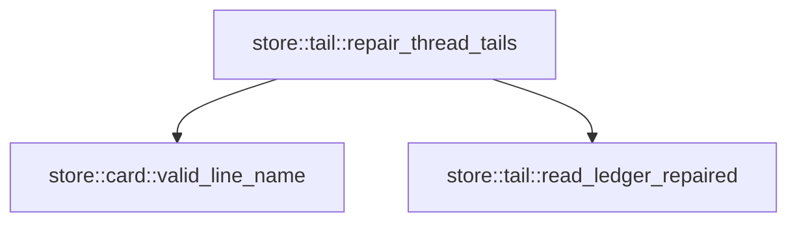

# store::tail

[Package atlas](index.md) · [Source](../../src/tail.rs)

## Declarations

Visibility is the declaration spelling; trait members and reexports require their enclosing interface. `cfg` is not evaluated.

| Symbol | Kind | Visibility | Test / cfg |
|---|---|---|---|
| [store::tail::TailScan](../../src/tail.rs#L14) | struct_item | `pub` |  |
| [store::tail::TailScan::needs_repair](../../src/tail.rs#L24) | function_item | `pub` |  |
| [store::tail::TailScan::last_seq](../../src/tail.rs#L29) | function_item | `pub` |  |
| [store::tail::scan_valid_prefix](../../src/tail.rs#L37) | function_item | `pub` |  |
| [store::tail::MAX_GENESIS_LINE_BYTES](../../src/tail.rs#L78) | const_item | `private` |  |
| [store::tail::read_genesis](../../src/tail.rs#L86) | function_item | `pub` |  |
| [store::tail::frame_events](../../src/tail.rs#L110) | function_item | `private` |  |
| [store::tail::LockedLedger](../../src/tail.rs#L133) | struct_item | `pub` |  |
| [store::tail::WRITER_VERSION](../../src/tail.rs#L146) | const_item | `private` |  |
| [store::tail::check_ledger_write_versions](../../src/tail.rs#L148) | function_item | `pub(crate)` |  |
| [store::tail::check_write_versions](../../src/tail.rs#L155) | function_item | `pub(crate)` |  |
| [store::tail::LockedLedger::open](../../src/tail.rs#L187) | function_item | `pub` |  |
| [store::tail::LockedLedger::open_with_sync](../../src/tail.rs#L191) | function_item | `pub` |  |
| [store::tail::LockedLedger::path](../../src/tail.rs#L238) | function_item | `pub` |  |
| [store::tail::LockedLedger::projection](../../src/tail.rs#L243) | function_item | `pub` |  |
| [store::tail::LockedLedger::next_seq](../../src/tail.rs#L248) | function_item | `pub` |  |
| [store::tail::LockedLedger::sync_prefix](../../src/tail.rs#L256) | function_item | `pub` |  |
| [store::tail::LockedLedger::ensure_synced_through](../../src/tail.rs#L273) | function_item | `pub` |  |
| [store::tail::LockedLedger::create_checkpoint](../../src/tail.rs#L288) | function_item | `pub` |  |
| [store::tail::LockedLedger::append](../../src/tail.rs#L312) | function_item | `pub` |  |
| [store::tail::LockedLedger::append_contract](../../src/tail.rs#L345) | function_item | `pub` |  |
| [store::tail::LockedLedger::drop](../../src/tail.rs#L356) | function_item | `private` |  |
| [store::tail::revalidate_inode](../../src/tail.rs#L361) | function_item | `private` |  |
| [store::tail::version_gate_tests::event](../../src/tail.rs#L375) | function_item | `private` | test; #[cfg(test)] |
| [store::tail::version_gate_tests::genesis](../../src/tail.rs#L382) | function_item | `private` | test; #[cfg(test)] |
| [store::tail::version_gate_tests::bytes](../../src/tail.rs#L392) | function_item | `private` | test; #[cfg(test)] |
| [store::tail::version_gate_tests::downgrade_open_preserves_gated_prefix_and_unrecognized_suffix](../../src/tail.rs#L404) | function_item | `private` | test; #[cfg(test)] |
| [store::tail::version_gate_tests::reader_selection_cannot_claim_new_writer_support](../../src/tail.rs#L442) | function_item | `private` | test; #[cfg(test)] |
| [store::tail::version_gate_tests::creation_and_rewrite_cannot_bypass_writer_gate](../../src/tail.rs#L459) | function_item | `private` | test; #[cfg(test)] |
| [store::tail::version_gate_tests::append_rejects_unsupported_upgrade_without_changing_fold_or_bytes](../../src/tail.rs#L538) | function_item | `private` | test; #[cfg(test)] |
| [store::tail::read_genesis_tests::event](../../src/tail.rs#L579) | function_item | `private` | test; #[cfg(test)] |
| [store::tail::read_genesis_tests::genesis](../../src/tail.rs#L586) | function_item | `private` | test; #[cfg(test)] |
| [store::tail::read_genesis_tests::line](../../src/tail.rs#L596) | function_item | `private` | test; #[cfg(test)] |
| [store::tail::read_genesis_tests::first_event_by_scan](../../src/tail.rs#L602) | function_item | `private` | test; #[cfg(test)] |
| [store::tail::read_genesis_tests::matches_the_full_scan_for_every_shape_of_file](../../src/tail.rs#L609) | function_item | `private` | test; #[cfg(test)] |
| [store::tail::read_genesis_tests::missing_file_is_an_io_error_and_reads_only_the_first_line](../../src/tail.rs#L643) | function_item | `private` | test; #[cfg(test)] |
| [store::tail::TailRepair](../../src/tail.rs#L663) | struct_item | `pub` |  |
| [store::tail::read_ledger_repaired](../../src/tail.rs#L676) | function_item | `pub` |  |
| [store::tail::repair_thread_tails](../../src/tail.rs#L701) | function_item | `pub` |  |
| [store::tail::repair_tests::event](../../src/tail.rs#L747) | function_item | `private` | test; #[cfg(test)] |
| [store::tail::repair_tests::ledger](../../src/tail.rs#L754) | function_item | `private` | test; #[cfg(test)] |
| [store::tail::repair_tests::empty_legacy_endpoint_sidecars_are_ignored_but_empty_semantic_ledgers_fail_closed](../../src/tail.rs#L777) | function_item | `private` | test; #[cfg(test)] |
| [store::tail::repair_tests::partial_tails_are_repaired_complete_invalid_records_are_corruption_and_busy_is_left](../../src/tail.rs#L817) | function_item | `private` | test; #[cfg(test)] |

## Imports / reexports

| Local name | Source path | Visibility |
|---|---|---|
| `File` | `std::fs::File` | `private` |
| `OpenOptions` | `std::fs::OpenOptions` | `private` |
| `Read` | `std::io::Read` | `private` |
| `Seek` | `std::io::Seek` | `private` |
| `SeekFrom` | `std::io::SeekFrom` | `private` |
| `Write` | `std::io::Write` | `private` |
| `MetadataExt` | `std::os::unix::fs::MetadataExt` | `private` |
| `OpenOptionsExt` | `std::os::unix::fs::OpenOptionsExt` | `private` |
| `Path` | `std::path::Path` | `private` |
| `PathBuf` | `std::path::PathBuf` | `private` |
| `Arc` | `std::sync::Arc` | `private` |
| `Event` | `schema::Event` | `private` |
| `EventKind` | `schema::EventKind` | `private` |
| `LedgerProjection` | `schema::LedgerProjection` | `private` |
| `LedgerValidator` | `schema::LedgerValidator` | `private` |
| `json` | `serde_json::json` | `private` |
| `SyncPolicy` | `crate::platform::SyncPolicy` | `private` |
| `SystemSync` | `crate::platform::SystemSync` | `private` |
| `try_lock_exclusive` | `crate::platform::try_lock_exclusive` | `private` |
| `unlock` | `crate::platform::unlock` | `private` |
| `BarrierContext` | `crate::BarrierContext` | `private` |
| `StoreError` | `crate::StoreError` | `private` |
| `requires_barrier` | `crate::requires_barrier` | `private` |
| `*` | `super::*` | `private` |
| `Value` | `serde_json::Value` | `private` |
| `*` | `super::*` | `private` |
| `Value` | `serde_json::Value` | `private` |
| `*` | `super::*` | `private` |
| `Value` | `serde_json::Value` | `private` |
| `json` | `serde_json::json` | `private` |

## Module declarations

| Module | Visibility | Attributes |
|---|---|---|
| `store::tail::version_gate_tests` | `private` | #[cfg(test)] |
| `store::tail::read_genesis_tests` | `private` | #[cfg(test)] |
| `store::tail::repair_tests` | `private` | #[cfg(test)] |

## Function call graphs

Edges below are syntactically resolved calls only, including private functions. Graphs partition callers into groups of 20; they are not execution order. All unresolved sites are listed below and in the JSON inventory.

```mermaid
flowchart TD
  n0["schema::event::Event::decode_canonical"]
  n1["schema::fold::LedgerValidator::new"]
  n2["store::requires_barrier"]
  n3["store::platform::try_lock_exclusive"]
  n4["store::platform::unlock"]
  n5["store::tail::frame_events"]
  n6["store::tail::check_ledger_write_versions"]
  n7["store::tail::check_write_versions"]
  n8["store::tail::LockedLedger::open"]
  n9["store::tail::LockedLedger::open_with_sync"]
  n10["store::tail::LockedLedger::path"]
  n11["store::tail::LockedLedger::projection"]
  n12["store::tail::LockedLedger::next_seq"]
  n13["store::tail::TailScan::needs_repair"]
  n14["store::tail::LockedLedger::sync_prefix"]
  n15["store::tail::LockedLedger::ensure_synced_through"]
  n16["store::tail::LockedLedger::create_checkpoint"]
  n17["store::tail::TailScan::last_seq"]
  n18["store::tail::LockedLedger::append"]
  n19["store::tail::LockedLedger::append_contract"]
  n20["store::tail::LockedLedger::drop"]
  n21["store::tail::revalidate_inode"]
  n22["store::tail::scan_valid_prefix"]
  n23["store::tail::read_ledger_repaired"]
  n24["store::tail::read_genesis"]
  n5 --> n0
  n6 --> n5
  n6 --> n7
  n8 --> n9
  n9 --> n1
  n9 --> n3
  n9 --> n6
  n9 --> n21
  n9 --> n22
  n15 --> n14
  n16 --> n0
  n16 --> n12
  n16 --> n19
  n18 --> n7
  n19 --> n2
  n19 --> n18
  n20 --> n4
  n22 --> n0
  n22 --> n1
  n23 --> n8
  n23 --> n22
  n24 --> n0
  n24 --> n1
```

Functions 1–20: 23 direct edges

Functions 21–21: 2 direct edges

## Call sites

Includes test functions (marked in declarations). Receiver-type-required sites need type analysis/manual tracing. Calls in closures are attributed to their enclosing function; their occurrence here does not mean the closure executes immediately.

| Caller | Callee expression | Source lines | Target / classification |
|---|---|---|---|
| `last_seq` | `self.projection.as_ref().map_or` | [30](../../src/tail.rs#L30) | receiver-type-required |
| `last_seq` | `self.projection.as_ref` | [30](../../src/tail.rs#L30) | receiver-type-required |
| `scan_valid_prefix` | `LedgerValidator::new` | [38](../../src/tail.rs#L38) | [schema::fold::LedgerValidator::new](../../../schema/src/fold.rs#L152) |
| `scan_valid_prefix` | `bytes.len` | [42](../../src/tail.rs#L42), [69](../../src/tail.rs#L69) | receiver-type-required |
| `scan_valid_prefix` | `rest.iter().position` | [44](../../src/tail.rs#L44) | receiver-type-required |
| `scan_valid_prefix` | `rest.iter` | [44](../../src/tail.rs#L44) | receiver-type-required |
| `scan_valid_prefix` | `Some` | [45](../../src/tail.rs#L45), [50](../../src/tail.rs#L50), [58](../../src/tail.rs#L58), [72](../../src/tail.rs#L72) | external-constructor-callback-or-unresolved |
| `scan_valid_prefix` | `Event::decode_canonical(&bytes[cursor..line_end])             .and_then` | [53](../../src/tail.rs#L53) | receiver-type-required |
| `scan_valid_prefix` | `Event::decode_canonical` | [53](../../src/tail.rs#L53) | [schema::event::Event::decode_canonical](../../../schema/src/event.rs#L171) |
| `scan_valid_prefix` | `validator.push` | [54](../../src/tail.rs#L54) | receiver-type-required |
| `scan_valid_prefix` | `(cursor != 0)         .then(&#124;&#124; validator.clone().finish().ok())         .flatten` | [64](../../src/tail.rs#L64) | receiver-type-required |
| `scan_valid_prefix` | `(cursor != 0)         .then` | [64](../../src/tail.rs#L64) | receiver-type-required |
| `scan_valid_prefix` | `validator.clone().finish().ok` | [65](../../src/tail.rs#L65) | receiver-type-required |
| `scan_valid_prefix` | `validator.clone().finish` | [65](../../src/tail.rs#L65) | receiver-type-required |
| `scan_valid_prefix` | `validator.clone` | [65](../../src/tail.rs#L65) | receiver-type-required |
| `read_genesis` | `File::open` | [88](../../src/tail.rs#L88) | external-constructor-callback-or-unresolved |
| `read_genesis` | `path.as_ref` | [88](../../src/tail.rs#L88) | receiver-type-required |
| `read_genesis` | `std::io::BufReader::new` | [89](../../src/tail.rs#L89) | external-constructor-callback-or-unresolved |
| `read_genesis` | `file.take` | [89](../../src/tail.rs#L89) | receiver-type-required |
| `read_genesis` | `Vec::new` | [90](../../src/tail.rs#L90) | external-constructor-callback-or-unresolved |
| `read_genesis` | `reader.read_until` | [91](../../src/tail.rs#L91) | receiver-type-required |
| `read_genesis` | `line.last` | [92](../../src/tail.rs#L92) | receiver-type-required |
| `read_genesis` | `Some` | [92](../../src/tail.rs#L92), [106](../../src/tail.rs#L106) | external-constructor-callback-or-unresolved |
| `read_genesis` | `Ok` | [93](../../src/tail.rs#L93), [97](../../src/tail.rs#L97), [100](../../src/tail.rs#L100), [104](../../src/tail.rs#L104), [106](../../src/tail.rs#L106) | external-constructor-callback-or-unresolved |
| `read_genesis` | `line.pop` | [95](../../src/tail.rs#L95) | receiver-type-required |
| `read_genesis` | `line.is_empty` | [96](../../src/tail.rs#L96) | receiver-type-required |
| `read_genesis` | `Event::decode_canonical` | [99](../../src/tail.rs#L99) | [schema::event::Event::decode_canonical](../../../schema/src/event.rs#L171) |
| `read_genesis` | `LedgerValidator::new` | [102](../../src/tail.rs#L102) | [schema::fold::LedgerValidator::new](../../../schema/src/fold.rs#L152) |
| `read_genesis` | `validator.push(event.clone()).is_err` | [103](../../src/tail.rs#L103) | receiver-type-required |
| `read_genesis` | `validator.push` | [103](../../src/tail.rs#L103) | receiver-type-required |
| `read_genesis` | `event.clone` | [103](../../src/tail.rs#L103) | receiver-type-required |
| `frame_events` | `Vec::new` | [111](../../src/tail.rs#L111) | external-constructor-callback-or-unresolved |
| `frame_events` | `bytes.len` | [113](../../src/tail.rs#L113) | receiver-type-required |
| `frame_events` | `rest.iter().position` | [115](../../src/tail.rs#L115) | receiver-type-required |
| `frame_events` | `rest.iter` | [115](../../src/tail.rs#L115) | receiver-type-required |
| `frame_events` | `Event::decode_canonical` | [122](../../src/tail.rs#L122) | [schema::event::Event::decode_canonical](../../../schema/src/event.rs#L171) |
| `frame_events` | `events.push` | [124](../../src/tail.rs#L124) | receiver-type-required |
| `check_ledger_write_versions` | `check_write_versions` | [152](../../src/tail.rs#L152) | [store::tail::check_write_versions](../../src/tail.rs#L155) |
| `check_ledger_write_versions` | `frame_events` | [152](../../src/tail.rs#L152) | [store::tail::frame_events](../../src/tail.rs#L110) |
| `check_write_versions` | `required_reader.max` | [162](../../src/tail.rs#L162), [170](../../src/tail.rs#L170) | receiver-type-required |
| `check_write_versions` | `event.min_reader().unwrap_or` | [162](../../src/tail.rs#L162) | receiver-type-required |
| `check_write_versions` | `event.min_reader` | [162](../../src/tail.rs#L162) | receiver-type-required |
| `check_write_versions` | `required_writer.max` | [164](../../src/tail.rs#L164), [171](../../src/tail.rs#L171) | receiver-type-required |
| `check_write_versions` | `event.integer_field("min_writer").unwrap_or` | [164](../../src/tail.rs#L164) | receiver-type-required |
| `check_write_versions` | `event.integer_field` | [164](../../src/tail.rs#L164) | receiver-type-required |
| `check_write_versions` | `serde_json::to_value(event.raw())                 .map_err` | [167](../../src/tail.rs#L167) | receiver-type-required |
| `check_write_versions` | `serde_json::to_value` | [167](../../src/tail.rs#L167) | external-constructor-callback-or-unresolved |
| `check_write_versions` | `event.raw` | [167](../../src/tail.rs#L167) | receiver-type-required |
| `check_write_versions` | `StoreError::Corruption` | [168](../../src/tail.rs#L168) | external-constructor-callback-or-unresolved |
| `check_write_versions` | `error.to_string` | [168](../../src/tail.rs#L168) | receiver-type-required |
| `check_write_versions` | `value.get` | [169](../../src/tail.rs#L169) | receiver-type-required |
| `check_write_versions` | `upgrade["min_reader"].as_u64().unwrap_or` | [170](../../src/tail.rs#L170) | receiver-type-required |
| `check_write_versions` | `upgrade["min_reader"].as_u64` | [170](../../src/tail.rs#L170) | receiver-type-required |
| `check_write_versions` | `upgrade["min_writer"].as_u64().unwrap_or` | [171](../../src/tail.rs#L171) | receiver-type-required |
| `check_write_versions` | `upgrade["min_writer"].as_u64` | [171](../../src/tail.rs#L171) | receiver-type-required |
| `check_write_versions` | `Err` | [176](../../src/tail.rs#L176) | external-constructor-callback-or-unresolved |
| `check_write_versions` | `Ok` | [183](../../src/tail.rs#L183) | external-constructor-callback-or-unresolved |
| `open` | `Self::open_with_sync` | [188](../../src/tail.rs#L188) | [store::tail::LockedLedger::open_with_sync](../../src/tail.rs#L191) |
| `open` | `Arc::new` | [188](../../src/tail.rs#L188) | external-constructor-callback-or-unresolved |
| `open_with_sync` | `path.as_ref().to_path_buf` | [196](../../src/tail.rs#L196) | receiver-type-required |
| `open_with_sync` | `path.as_ref` | [196](../../src/tail.rs#L196) | receiver-type-required |
| `open_with_sync` | `OpenOptions::new()             .read(true)             .append(true)             .custom_flags(libc::O_CLOEXEC &#124; libc::O_NOFOLLOW)             .open` | [197](../../src/tail.rs#L197) | receiver-type-required |
| `open_with_sync` | `OpenOptions::new()             .read(true)             .append(true)             .custom_flags` | [197](../../src/tail.rs#L197) | receiver-type-required |
| `open_with_sync` | `OpenOptions::new()             .read(true)             .append` | [197](../../src/tail.rs#L197) | receiver-type-required |
| `open_with_sync` | `OpenOptions::new()             .read` | [197](../../src/tail.rs#L197) | receiver-type-required |
| `open_with_sync` | `OpenOptions::new` | [197](../../src/tail.rs#L197) | external-constructor-callback-or-unresolved |
| `open_with_sync` | `try_lock_exclusive` | [202](../../src/tail.rs#L202) | [store::platform::try_lock_exclusive](../../src/platform.rs#L166) |
| `open_with_sync` | `revalidate_inode` | [203](../../src/tail.rs#L203) | [store::tail::revalidate_inode](../../src/tail.rs#L361) |
| `open_with_sync` | `file.seek` | [205](../../src/tail.rs#L205) | receiver-type-required |
| `open_with_sync` | `SeekFrom::Start` | [205](../../src/tail.rs#L205) | external-constructor-callback-or-unresolved |
| `open_with_sync` | `Vec::new` | [206](../../src/tail.rs#L206) | external-constructor-callback-or-unresolved |
| `open_with_sync` | `file.read_to_end` | [207](../../src/tail.rs#L207) | receiver-type-required |
| `open_with_sync` | `check_ledger_write_versions` | [210](../../src/tail.rs#L210) | [store::tail::check_ledger_write_versions](../../src/tail.rs#L148) |
| `open_with_sync` | `scan_valid_prefix` | [211](../../src/tail.rs#L211) | [store::tail::scan_valid_prefix](../../src/tail.rs#L37) |
| `open_with_sync` | `scan.needs_repair` | [212](../../src/tail.rs#L212) | receiver-type-required |
| `open_with_sync` | `file.set_len` | [213](../../src/tail.rs#L213) | receiver-type-required |
| `open_with_sync` | `sync.full_sync` | [214](../../src/tail.rs#L214) | receiver-type-required |
| `open_with_sync` | `scan.last_seq` | [215](../../src/tail.rs#L215) | receiver-type-required |
| `open_with_sync` | `scan             .validator             .clone()             .unwrap_or_else` | [220](../../src/tail.rs#L220) | receiver-type-required |
| `open_with_sync` | `scan             .validator             .clone` | [220](../../src/tail.rs#L220) | receiver-type-required |
| `open_with_sync` | `LedgerValidator::new` | [223](../../src/tail.rs#L223) | [schema::fold::LedgerValidator::new](../../../schema/src/fold.rs#L152) |
| `open_with_sync` | `Ok` | [225](../../src/tail.rs#L225) | external-constructor-callback-or-unresolved |
| `projection` | `self.projection.as_ref` | [244](../../src/tail.rs#L244) | receiver-type-required |
| `next_seq` | `self.projection             .as_ref()             .map_or` | [249](../../src/tail.rs#L249) | receiver-type-required |
| `next_seq` | `self.projection             .as_ref` | [249](../../src/tail.rs#L249) | receiver-type-required |
| `sync_prefix` | `Err` | [258](../../src/tail.rs#L258), [264](../../src/tail.rs#L264) | external-constructor-callback-or-unresolved |
| `sync_prefix` | `StoreError::Corruption` | [258](../../src/tail.rs#L258) | external-constructor-callback-or-unresolved |
| `sync_prefix` | `"writer is poisoned by an earlier append/sync failure".to_owned` | [259](../../src/tail.rs#L259) | receiver-type-required |
| `sync_prefix` | `self.sync.full_sync` | [262](../../src/tail.rs#L262) | receiver-type-required |
| `sync_prefix` | `StoreError::Io` | [264](../../src/tail.rs#L264) | external-constructor-callback-or-unresolved |
| `sync_prefix` | `self.projection.as_ref().map_or` | [266](../../src/tail.rs#L266) | receiver-type-required |
| `sync_prefix` | `self.projection.as_ref` | [266](../../src/tail.rs#L266) | receiver-type-required |
| `sync_prefix` | `self.synced_through_seq.max` | [267](../../src/tail.rs#L267) | receiver-type-required |
| `sync_prefix` | `Ok` | [268](../../src/tail.rs#L268) | external-constructor-callback-or-unresolved |
| `ensure_synced_through` | `Err` | [275](../../src/tail.rs#L275) | external-constructor-callback-or-unresolved |
| `ensure_synced_through` | `StoreError::Corruption` | [275](../../src/tail.rs#L275) | external-constructor-callback-or-unresolved |
| `ensure_synced_through` | `"writer is poisoned by an earlier append/sync failure".to_owned` | [276](../../src/tail.rs#L276) | receiver-type-required |
| `ensure_synced_through` | `self.sync_prefix` | [280](../../src/tail.rs#L280) | [store::tail::LockedLedger::sync_prefix](../../src/tail.rs#L256) |
| `ensure_synced_through` | `Ok` | [282](../../src/tail.rs#L282) | external-constructor-callback-or-unresolved |
| `create_checkpoint` | `Err` | [290](../../src/tail.rs#L290) | external-constructor-callback-or-unresolved |
| `create_checkpoint` | `StoreError::Corruption` | [290](../../src/tail.rs#L290), [303](../../src/tail.rs#L303) | external-constructor-callback-or-unresolved |
| `create_checkpoint` | `"writer is poisoned by an earlier append/sync failure".to_owned` | [291](../../src/tail.rs#L291) | receiver-type-required |
| `create_checkpoint` | `self.next_seq` | [294](../../src/tail.rs#L294) | [store::tail::LockedLedger::next_seq](../../src/tail.rs#L248) |
| `create_checkpoint` | `serde_json_canonicalizer::to_vec(&json!({             "v": 1,             "seq": seq,             "kind": "checkpoint",             "ts": timestamp,             "covers": seq - 1,             "summary": summary         }))         .map_err` | [295](../../src/tail.rs#L295) | receiver-type-required |
| `create_checkpoint` | `serde_json_canonicalizer::to_vec` | [295](../../src/tail.rs#L295) | external-constructor-callback-or-unresolved |
| `create_checkpoint` | `error.to_string` | [303](../../src/tail.rs#L303) | receiver-type-required |
| `create_checkpoint` | `Event::decode_canonical` | [304](../../src/tail.rs#L304) | [schema::event::Event::decode_canonical](../../../schema/src/event.rs#L171) |
| `create_checkpoint` | `self.append_contract` | [305](../../src/tail.rs#L305) | [store::tail::LockedLedger::append_contract](../../src/tail.rs#L345) |
| `create_checkpoint` | `BarrierContext::default` | [305](../../src/tail.rs#L305) | external-constructor-callback-or-unresolved |
| `create_checkpoint` | `Ok` | [306](../../src/tail.rs#L306) | external-constructor-callback-or-unresolved |
| `append` | `Err` | [314](../../src/tail.rs#L314), [327](../../src/tail.rs#L327), [332](../../src/tail.rs#L332), [337](../../src/tail.rs#L337) | external-constructor-callback-or-unresolved |
| `append` | `StoreError::Corruption` | [314](../../src/tail.rs#L314) | external-constructor-callback-or-unresolved |
| `append` | `"writer is poisoned by an earlier append/sync failure".to_owned` | [315](../../src/tail.rs#L315) | receiver-type-required |
| `append` | `check_write_versions` | [318](../../src/tail.rs#L318) | [store::tail::check_write_versions](../../src/tail.rs#L155) |
| `append` | `std::iter::once` | [318](../../src/tail.rs#L318) | external-constructor-callback-or-unresolved |
| `append` | `event.seq` | [319](../../src/tail.rs#L319) | receiver-type-required |
| `append` | `self.validator.clone` | [320](../../src/tail.rs#L320), [341](../../src/tail.rs#L341) | receiver-type-required |
| `append` | `next.push` | [321](../../src/tail.rs#L321) | receiver-type-required |
| `append` | `event.clone` | [321](../../src/tail.rs#L321) | receiver-type-required |
| `append` | `event.canonical_bytes` | [322](../../src/tail.rs#L322) | receiver-type-required |
| `append` | `bytes.push` | [323](../../src/tail.rs#L323) | receiver-type-required |
| `append` | `self.file.write_all` | [325](../../src/tail.rs#L325) | receiver-type-required |
| `append` | `StoreError::Io` | [327](../../src/tail.rs#L327), [332](../../src/tail.rs#L332), [337](../../src/tail.rs#L337) | external-constructor-callback-or-unresolved |
| `append` | `self.sync.full_sync` | [330](../../src/tail.rs#L330) | receiver-type-required |
| `append` | `self.synced_through_seq.max` | [334](../../src/tail.rs#L334) | receiver-type-required |
| `append` | `self.file.flush` | [335](../../src/tail.rs#L335) | receiver-type-required |
| `append` | `Some` | [341](../../src/tail.rs#L341) | external-constructor-callback-or-unresolved |
| `append` | `self.validator.clone().finish` | [341](../../src/tail.rs#L341) | receiver-type-required |
| `append` | `Ok` | [342](../../src/tail.rs#L342) | external-constructor-callback-or-unresolved |
| `append_contract` | `requires_barrier` | [350](../../src/tail.rs#L350) | [store::requires_barrier](../../src/lib.rs#L45) |
| `append_contract` | `self.append` | [351](../../src/tail.rs#L351) | [store::tail::LockedLedger::append](../../src/tail.rs#L312) |
| `drop` | `unlock` | [357](../../src/tail.rs#L357) | [store::platform::unlock](../../src/platform.rs#L327) |
| `revalidate_inode` | `file.metadata` | [362](../../src/tail.rs#L362) | receiver-type-required |
| `revalidate_inode` | `path.metadata` | [363](../../src/tail.rs#L363) | receiver-type-required |
| `revalidate_inode` | `held.dev` | [364](../../src/tail.rs#L364) | receiver-type-required |
| `revalidate_inode` | `current.dev` | [364](../../src/tail.rs#L364) | receiver-type-required |
| `revalidate_inode` | `held.ino` | [364](../../src/tail.rs#L364) | receiver-type-required |
| `revalidate_inode` | `current.ino` | [364](../../src/tail.rs#L364) | receiver-type-required |
| `revalidate_inode` | `Err` | [365](../../src/tail.rs#L365) | external-constructor-callback-or-unresolved |
| `revalidate_inode` | `Ok` | [367](../../src/tail.rs#L367) | external-constructor-callback-or-unresolved |
| `event` | `Event::decode_canonical(&serde_json_canonicalizer::to_vec(&value).unwrap()).unwrap` | [379](../../src/tail.rs#L379) | receiver-type-required |
| `event` | `Event::decode_canonical` | [379](../../src/tail.rs#L379) | external-constructor-callback-or-unresolved |
| `event` | `serde_json_canonicalizer::to_vec(&value).unwrap` | [379](../../src/tail.rs#L379) | receiver-type-required |
| `event` | `serde_json_canonicalizer::to_vec` | [379](../../src/tail.rs#L379) | external-constructor-callback-or-unresolved |
| `genesis` | `event` | [383](../../src/tail.rs#L383) | [store::tail::version_gate_tests::event](../../src/tail.rs#L375) |
| `bytes` | `events             .iter()             .flat_map(&#124;event&#124; {                 let mut bytes = event.canonical_bytes().unwrap();                 bytes.push(b'\n');                 bytes             })             .collect` | [393](../../src/tail.rs#L393) | receiver-type-required |
| `bytes` | `events             .iter()             .flat_map` | [393](../../src/tail.rs#L393) | receiver-type-required |
| `bytes` | `events             .iter` | [393](../../src/tail.rs#L393) | receiver-type-required |
| `bytes` | `event.canonical_bytes().unwrap` | [396](../../src/tail.rs#L396) | receiver-type-required |
| `bytes` | `event.canonical_bytes` | [396](../../src/tail.rs#L396) | receiver-type-required |
| `bytes` | `bytes.push` | [397](../../src/tail.rs#L397) | receiver-type-required |
| `downgrade_open_preserves_gated_prefix_and_unrecognized_suffix` | `tempfile::tempdir().unwrap` | [424](../../src/tail.rs#L424) | receiver-type-required |
| `downgrade_open_preserves_gated_prefix_and_unrecognized_suffix` | `tempfile::tempdir` | [424](../../src/tail.rs#L424) | external-constructor-callback-or-unresolved |
| `downgrade_open_preserves_gated_prefix_and_unrecognized_suffix` | `dir.path().join` | [425](../../src/tail.rs#L425) | receiver-type-required |
| `downgrade_open_preserves_gated_prefix_and_unrecognized_suffix` | `dir.path` | [425](../../src/tail.rs#L425) | receiver-type-required |
| `downgrade_open_preserves_gated_prefix_and_unrecognized_suffix` | `bytes` | [426](../../src/tail.rs#L426) | [store::tail::version_gate_tests::bytes](../../src/tail.rs#L392) |
| `downgrade_open_preserves_gated_prefix_and_unrecognized_suffix` | `original.extend_from_slice` | [427](../../src/tail.rs#L427) | receiver-type-required |
| `downgrade_open_preserves_gated_prefix_and_unrecognized_suffix` | `std::fs::write(&path, &original).unwrap` | [428](../../src/tail.rs#L428) | receiver-type-required |
| `downgrade_open_preserves_gated_prefix_and_unrecognized_suffix` | `std::fs::write` | [428](../../src/tail.rs#L428) | external-constructor-callback-or-unresolved |
| `reader_selection_cannot_claim_new_writer_support` | `tempfile::tempdir().unwrap` | [443](../../src/tail.rs#L443) | receiver-type-required |
| `reader_selection_cannot_claim_new_writer_support` | `tempfile::tempdir` | [443](../../src/tail.rs#L443) | external-constructor-callback-or-unresolved |
| `reader_selection_cannot_claim_new_writer_support` | `dir.path().join` | [444](../../src/tail.rs#L444) | receiver-type-required |
| `reader_selection_cannot_claim_new_writer_support` | `dir.path` | [444](../../src/tail.rs#L444) | receiver-type-required |
| `reader_selection_cannot_claim_new_writer_support` | `bytes` | [445](../../src/tail.rs#L445) | [store::tail::version_gate_tests::bytes](../../src/tail.rs#L392) |
| `reader_selection_cannot_claim_new_writer_support` | `genesis` | [445](../../src/tail.rs#L445) | [store::tail::version_gate_tests::genesis](../../src/tail.rs#L382) |
| `reader_selection_cannot_claim_new_writer_support` | `std::fs::write(&path, &original).unwrap` | [446](../../src/tail.rs#L446) | receiver-type-required |
| `reader_selection_cannot_claim_new_writer_support` | `std::fs::write` | [446](../../src/tail.rs#L446) | external-constructor-callback-or-unresolved |
| `creation_and_rewrite_cannot_bypass_writer_gate` | `tempfile::tempdir().unwrap` | [463](../../src/tail.rs#L463) | receiver-type-required |
| `creation_and_rewrite_cannot_bypass_writer_gate` | `tempfile::tempdir` | [463](../../src/tail.rs#L463) | external-constructor-callback-or-unresolved |
| `creation_and_rewrite_cannot_bypass_writer_gate` | `crate::ThreadStore::open(dir.path()).unwrap` | [464](../../src/tail.rs#L464) | receiver-type-required |
| `creation_and_rewrite_cannot_bypass_writer_gate` | `crate::ThreadStore::open` | [464](../../src/tail.rs#L464) | [store::folder::ThreadStore::open](../../src/folder.rs#L48) |
| `creation_and_rewrite_cannot_bypass_writer_gate` | `dir.path` | [464](../../src/tail.rs#L464), [484](../../src/tail.rs#L484) | receiver-type-required |
| `creation_and_rewrite_cannot_bypass_writer_gate` | `genesis` | [465](../../src/tail.rs#L465) | [store::tail::version_gate_tests::genesis](../../src/tail.rs#L382) |
| `creation_and_rewrite_cannot_bypass_writer_gate` | `dir.path().join("threads").join` | [484](../../src/tail.rs#L484) | receiver-type-required |
| `creation_and_rewrite_cannot_bypass_writer_gate` | `dir.path().join` | [484](../../src/tail.rs#L484) | receiver-type-required |
| `creation_and_rewrite_cannot_bypass_writer_gate` | `std::fs::create_dir(&folder).unwrap` | [485](../../src/tail.rs#L485) | receiver-type-required |
| `creation_and_rewrite_cannot_bypass_writer_gate` | `std::fs::create_dir` | [485](../../src/tail.rs#L485) | external-constructor-callback-or-unresolved |
| `creation_and_rewrite_cannot_bypass_writer_gate` | `bytes` | [486](../../src/tail.rs#L486) | [store::tail::version_gate_tests::bytes](../../src/tail.rs#L392) |
| `creation_and_rewrite_cannot_bypass_writer_gate` | `std::fs::write(folder.join("main.jsonl"), &original).unwrap` | [487](../../src/tail.rs#L487) | receiver-type-required |
| `creation_and_rewrite_cannot_bypass_writer_gate` | `std::fs::write` | [487](../../src/tail.rs#L487) | external-constructor-callback-or-unresolved |
| `creation_and_rewrite_cannot_bypass_writer_gate` | `folder.join` | [487](../../src/tail.rs#L487) | receiver-type-required |
| `append_rejects_unsupported_upgrade_without_changing_fold_or_bytes` | `tempfile::tempdir().unwrap` | [539](../../src/tail.rs#L539) | receiver-type-required |
| `append_rejects_unsupported_upgrade_without_changing_fold_or_bytes` | `tempfile::tempdir` | [539](../../src/tail.rs#L539) | external-constructor-callback-or-unresolved |
| `append_rejects_unsupported_upgrade_without_changing_fold_or_bytes` | `dir.path().join` | [540](../../src/tail.rs#L540) | receiver-type-required |
| `append_rejects_unsupported_upgrade_without_changing_fold_or_bytes` | `dir.path` | [540](../../src/tail.rs#L540) | receiver-type-required |
| `append_rejects_unsupported_upgrade_without_changing_fold_or_bytes` | `bytes` | [541](../../src/tail.rs#L541) | [store::tail::version_gate_tests::bytes](../../src/tail.rs#L392) |
| `append_rejects_unsupported_upgrade_without_changing_fold_or_bytes` | `genesis` | [541](../../src/tail.rs#L541) | [store::tail::version_gate_tests::genesis](../../src/tail.rs#L382) |
| `append_rejects_unsupported_upgrade_without_changing_fold_or_bytes` | `std::fs::write(&path, &original).unwrap` | [542](../../src/tail.rs#L542) | receiver-type-required |
| `append_rejects_unsupported_upgrade_without_changing_fold_or_bytes` | `std::fs::write` | [542](../../src/tail.rs#L542) | external-constructor-callback-or-unresolved |
| `append_rejects_unsupported_upgrade_without_changing_fold_or_bytes` | `LockedLedger::open(&path, 1).unwrap` | [543](../../src/tail.rs#L543), [569](../../src/tail.rs#L569) | receiver-type-required |
| `append_rejects_unsupported_upgrade_without_changing_fold_or_bytes` | `LockedLedger::open` | [543](../../src/tail.rs#L543), [569](../../src/tail.rs#L569) | external-constructor-callback-or-unresolved |
| `append_rejects_unsupported_upgrade_without_changing_fold_or_bytes` | `ledger             .append(                 event(                     json!({"kind":"meta","upgrade":{"min_reader":1,"min_writer":1}}),                     2,                 ),                 false,             )             .unwrap` | [555](../../src/tail.rs#L555) | receiver-type-required |
| `append_rejects_unsupported_upgrade_without_changing_fold_or_bytes` | `ledger             .append` | [555](../../src/tail.rs#L555) | receiver-type-required |
| `append_rejects_unsupported_upgrade_without_changing_fold_or_bytes` | `event` | [557](../../src/tail.rs#L557) | [store::tail::version_gate_tests::event](../../src/tail.rs#L375) |
| `append_rejects_unsupported_upgrade_without_changing_fold_or_bytes` | `ledger             .create_checkpoint("2026-09-04T00:00:00.000Z", "version gate regression")             .unwrap` | [565](../../src/tail.rs#L565) | receiver-type-required |
| `append_rejects_unsupported_upgrade_without_changing_fold_or_bytes` | `ledger             .create_checkpoint` | [565](../../src/tail.rs#L565) | receiver-type-required |
| `append_rejects_unsupported_upgrade_without_changing_fold_or_bytes` | `drop` | [568](../../src/tail.rs#L568) | external-constructor-callback-or-unresolved |
| `event` | `Event::decode_canonical(&serde_json_canonicalizer::to_vec(&value).unwrap()).unwrap` | [583](../../src/tail.rs#L583) | receiver-type-required |
| `event` | `Event::decode_canonical` | [583](../../src/tail.rs#L583) | external-constructor-callback-or-unresolved |
| `event` | `serde_json_canonicalizer::to_vec(&value).unwrap` | [583](../../src/tail.rs#L583) | receiver-type-required |
| `event` | `serde_json_canonicalizer::to_vec` | [583](../../src/tail.rs#L583) | external-constructor-callback-or-unresolved |
| `genesis` | `event` | [587](../../src/tail.rs#L587) | [store::tail::read_genesis_tests::event](../../src/tail.rs#L579) |
| `line` | `event.canonical_bytes().unwrap` | [597](../../src/tail.rs#L597) | receiver-type-required |
| `line` | `event.canonical_bytes` | [597](../../src/tail.rs#L597) | receiver-type-required |
| `line` | `bytes.push` | [598](../../src/tail.rs#L598) | receiver-type-required |
| `first_event_by_scan` | `scan_valid_prefix(bytes, 1)             .projection             .and_then` | [603](../../src/tail.rs#L603) | receiver-type-required |
| `first_event_by_scan` | `scan_valid_prefix` | [603](../../src/tail.rs#L603) | external-constructor-callback-or-unresolved |
| `first_event_by_scan` | `projection.events.first().cloned` | [605](../../src/tail.rs#L605) | receiver-type-required |
| `first_event_by_scan` | `projection.events.first` | [605](../../src/tail.rs#L605) | receiver-type-required |
| `matches_the_full_scan_for_every_shape_of_file` | `line` | [610](../../src/tail.rs#L610), [611](../../src/tail.rs#L611) | [store::tail::read_genesis_tests::line](../../src/tail.rs#L596) |
| `matches_the_full_scan_for_every_shape_of_file` | `genesis` | [610](../../src/tail.rs#L610) | [store::tail::read_genesis_tests::genesis](../../src/tail.rs#L586) |
| `matches_the_full_scan_for_every_shape_of_file` | `event` | [611](../../src/tail.rs#L611) | [store::tail::read_genesis_tests::event](../../src/tail.rs#L579) |
| `matches_the_full_scan_for_every_shape_of_file` | `cases.push` | [627](../../src/tail.rs#L627) | receiver-type-required |
| `matches_the_full_scan_for_every_shape_of_file` | `[meta.clone(), good.clone()].concat` | [627](../../src/tail.rs#L627) | receiver-type-required |
| `matches_the_full_scan_for_every_shape_of_file` | `meta.clone` | [627](../../src/tail.rs#L627) | receiver-type-required |
| `matches_the_full_scan_for_every_shape_of_file` | `good.clone` | [627](../../src/tail.rs#L627) | receiver-type-required |
| `matches_the_full_scan_for_every_shape_of_file` | `cases.iter().enumerate` | [628](../../src/tail.rs#L628) | receiver-type-required |
| `matches_the_full_scan_for_every_shape_of_file` | `cases.iter` | [628](../../src/tail.rs#L628) | receiver-type-required |
| `matches_the_full_scan_for_every_shape_of_file` | `tempfile::tempdir().unwrap` | [629](../../src/tail.rs#L629) | receiver-type-required |
| `matches_the_full_scan_for_every_shape_of_file` | `tempfile::tempdir` | [629](../../src/tail.rs#L629) | external-constructor-callback-or-unresolved |
| `matches_the_full_scan_for_every_shape_of_file` | `dir.path().join` | [630](../../src/tail.rs#L630) | receiver-type-required |
| `matches_the_full_scan_for_every_shape_of_file` | `dir.path` | [630](../../src/tail.rs#L630) | receiver-type-required |
| `matches_the_full_scan_for_every_shape_of_file` | `std::fs::write(&path, bytes).unwrap` | [631](../../src/tail.rs#L631) | receiver-type-required |
| `matches_the_full_scan_for_every_shape_of_file` | `std::fs::write` | [631](../../src/tail.rs#L631) | external-constructor-callback-or-unresolved |
| `matches_the_full_scan_for_every_shape_of_file` | `read_genesis(&path).unwrap` | [632](../../src/tail.rs#L632) | receiver-type-required |
| `matches_the_full_scan_for_every_shape_of_file` | `read_genesis` | [632](../../src/tail.rs#L632) | external-constructor-callback-or-unresolved |
| `matches_the_full_scan_for_every_shape_of_file` | `first_event_by_scan` | [633](../../src/tail.rs#L633) | [store::tail::read_genesis_tests::first_event_by_scan](../../src/tail.rs#L602) |
| `missing_file_is_an_io_error_and_reads_only_the_first_line` | `tempfile::tempdir().unwrap` | [644](../../src/tail.rs#L644) | receiver-type-required |
| `missing_file_is_an_io_error_and_reads_only_the_first_line` | `tempfile::tempdir` | [644](../../src/tail.rs#L644) | external-constructor-callback-or-unresolved |
| `missing_file_is_an_io_error_and_reads_only_the_first_line` | `dir.path().join` | [650](../../src/tail.rs#L650) | receiver-type-required |
| `missing_file_is_an_io_error_and_reads_only_the_first_line` | `dir.path` | [650](../../src/tail.rs#L650) | receiver-type-required |
| `missing_file_is_an_io_error_and_reads_only_the_first_line` | `line` | [651](../../src/tail.rs#L651) | [store::tail::read_genesis_tests::line](../../src/tail.rs#L596) |
| `missing_file_is_an_io_error_and_reads_only_the_first_line` | `genesis` | [651](../../src/tail.rs#L651) | external-constructor-callback-or-unresolved |
| `missing_file_is_an_io_error_and_reads_only_the_first_line` | `bytes.extend` | [652](../../src/tail.rs#L652) | receiver-type-required |
| `missing_file_is_an_io_error_and_reads_only_the_first_line` | `std::iter::repeat_n` | [652](../../src/tail.rs#L652) | external-constructor-callback-or-unresolved |
| `missing_file_is_an_io_error_and_reads_only_the_first_line` | `std::fs::write(&path, &bytes).unwrap` | [653](../../src/tail.rs#L653) | receiver-type-required |
| `missing_file_is_an_io_error_and_reads_only_the_first_line` | `std::fs::write` | [653](../../src/tail.rs#L653) | external-constructor-callback-or-unresolved |
| `missing_file_is_an_io_error_and_reads_only_the_first_line` | `read_genesis(&path).unwrap().unwrap` | [656](../../src/tail.rs#L656) | receiver-type-required |
| `missing_file_is_an_io_error_and_reads_only_the_first_line` | `read_genesis(&path).unwrap` | [656](../../src/tail.rs#L656) | receiver-type-required |
| `missing_file_is_an_io_error_and_reads_only_the_first_line` | `read_genesis` | [656](../../src/tail.rs#L656) | external-constructor-callback-or-unresolved |
| `read_ledger_repaired` | `path.as_ref` | [677](../../src/tail.rs#L677) | receiver-type-required |
| `read_ledger_repaired` | `std::fs::read` | [678](../../src/tail.rs#L678), [692](../../src/tail.rs#L692) | external-constructor-callback-or-unresolved |
| `read_ledger_repaired` | `scan_valid_prefix` | [679](../../src/tail.rs#L679), [693](../../src/tail.rs#L693) | [store::tail::scan_valid_prefix](../../src/tail.rs#L37) |
| `read_ledger_repaired` | `scan.needs_repair` | [680](../../src/tail.rs#L680) | receiver-type-required |
| `read_ledger_repaired` | `scan.projection.is_none` | [680](../../src/tail.rs#L680) | receiver-type-required |
| `read_ledger_repaired` | `Ok` | [681](../../src/tail.rs#L681), [685](../../src/tail.rs#L685), [689](../../src/tail.rs#L689), [694](../../src/tail.rs#L694) | external-constructor-callback-or-unresolved |
| `read_ledger_repaired` | `usize::try_from(scan.valid_bytes).unwrap_or` | [683](../../src/tail.rs#L683) | receiver-type-required |
| `read_ledger_repaired` | `usize::try_from` | [683](../../src/tail.rs#L683) | external-constructor-callback-or-unresolved |
| `read_ledger_repaired` | `suffix.contains` | [684](../../src/tail.rs#L684) | receiver-type-required |
| `read_ledger_repaired` | `LockedLedger::open` | [687](../../src/tail.rs#L687) | [store::tail::LockedLedger::open](../../src/tail.rs#L187) |
| `read_ledger_repaired` | `drop` | [688](../../src/tail.rs#L688) | external-constructor-callback-or-unresolved |
| `read_ledger_repaired` | `Err` | [690](../../src/tail.rs#L690) | external-constructor-callback-or-unresolved |
| `repair_thread_tails` | `TailRepair::default` | [703](../../src/tail.rs#L703) | external-constructor-callback-or-unresolved |
| `repair_thread_tails` | `std::fs::read_dir` | [704](../../src/tail.rs#L704) | external-constructor-callback-or-unresolved |
| `repair_thread_tails` | `entry.file_name().to_string_lossy().into_owned` | [706](../../src/tail.rs#L706) | receiver-type-required |
| `repair_thread_tails` | `entry.file_name().to_string_lossy` | [706](../../src/tail.rs#L706) | receiver-type-required |
| `repair_thread_tails` | `entry.file_name` | [706](../../src/tail.rs#L706) | receiver-type-required |
| `repair_thread_tails` | `crate::card::valid_line_name` | [707](../../src/tail.rs#L707) | [store::card::valid_line_name](../../src/card.rs#L256) |
| `repair_thread_tails` | `entry.file_type()?.is_file` | [707](../../src/tail.rs#L707) | receiver-type-required |
| `repair_thread_tails` | `entry.file_type` | [707](../../src/tail.rs#L707) | receiver-type-required |
| `repair_thread_tails` | `File::open` | [710](../../src/tail.rs#L710) | external-constructor-callback-or-unresolved |
| `repair_thread_tails` | `entry.path` | [710](../../src/tail.rs#L710), [721](../../src/tail.rs#L721) | receiver-type-required |
| `repair_thread_tails` | `file.metadata()?.len` | [711](../../src/tail.rs#L711) | receiver-type-required |
| `repair_thread_tails` | `file.metadata` | [711](../../src/tail.rs#L711) | receiver-type-required |
| `repair_thread_tails` | `report.corrupt.push` | [713](../../src/tail.rs#L713) | receiver-type-required |
| `repair_thread_tails` | `"ledger is empty".to_owned` | [713](../../src/tail.rs#L713) | receiver-type-required |
| `repair_thread_tails` | `file.read_exact_at` | [717](../../src/tail.rs#L717) | receiver-type-required |
| `repair_thread_tails` | `read_ledger_repaired` | [721](../../src/tail.rs#L721) | [store::tail::read_ledger_repaired](../../src/tail.rs#L676) |
| `repair_thread_tails` | `scan.projection.is_none` | [722](../../src/tail.rs#L722) | receiver-type-required |
| `repair_thread_tails` | `report                 .corrupt                 .push` | [723](../../src/tail.rs#L723) | receiver-type-required |
| `repair_thread_tails` | `"no valid genesis prefix".to_owned` | [725](../../src/tail.rs#L725) | receiver-type-required |
| `repair_thread_tails` | `scan.needs_repair` | [726](../../src/tail.rs#L726) | receiver-type-required |
| `repair_thread_tails` | `usize::try_from(scan.valid_bytes).unwrap_or` | [727](../../src/tail.rs#L727) | receiver-type-required |
| `repair_thread_tails` | `usize::try_from` | [727](../../src/tail.rs#L727) | external-constructor-callback-or-unresolved |
| `repair_thread_tails` | `suffix.contains` | [728](../../src/tail.rs#L728) | receiver-type-required |
| `repair_thread_tails` | `report                     .corrupt                     .push` | [729](../../src/tail.rs#L729) | receiver-type-required |
| `repair_thread_tails` | `"complete invalid record".to_owned` | [731](../../src/tail.rs#L731) | receiver-type-required |
| `repair_thread_tails` | `report.busy.push` | [733](../../src/tail.rs#L733) | receiver-type-required |
| `repair_thread_tails` | `len.saturating_sub` | [736](../../src/tail.rs#L736) | receiver-type-required |
| `repair_thread_tails` | `bytes.len` | [736](../../src/tail.rs#L736) | receiver-type-required |
| `repair_thread_tails` | `Ok` | [739](../../src/tail.rs#L739) | external-constructor-callback-or-unresolved |
| `event` | `Event::decode_canonical(&serde_json_canonicalizer::to_vec(&value).unwrap()).unwrap` | [751](../../src/tail.rs#L751) | receiver-type-required |
| `event` | `Event::decode_canonical` | [751](../../src/tail.rs#L751) | external-constructor-callback-or-unresolved |
| `event` | `serde_json_canonicalizer::to_vec(&value).unwrap` | [751](../../src/tail.rs#L751) | receiver-type-required |
| `event` | `serde_json_canonicalizer::to_vec` | [751](../../src/tail.rs#L751) | external-constructor-callback-or-unresolved |
| `ledger` | `Vec::new` | [755](../../src/tail.rs#L755) | external-constructor-callback-or-unresolved |
| `ledger` | `event` | [756](../../src/tail.rs#L756), [767](../../src/tail.rs#L767) | [store::tail::repair_tests::event](../../src/tail.rs#L747) |
| `ledger` | `bytes.extend` | [763](../../src/tail.rs#L763), [766](../../src/tail.rs#L766) | receiver-type-required |
| `ledger` | `genesis.canonical_bytes().unwrap` | [763](../../src/tail.rs#L763) | receiver-type-required |
| `ledger` | `genesis.canonical_bytes` | [763](../../src/tail.rs#L763) | receiver-type-required |
| `ledger` | `bytes.push` | [764](../../src/tail.rs#L764), [771](../../src/tail.rs#L771) | receiver-type-required |
| `ledger` | `event(json!({"kind":"meta","title":"t"}), seq)                     .canonical_bytes()                     .unwrap` | [767](../../src/tail.rs#L767) | receiver-type-required |
| `ledger` | `event(json!({"kind":"meta","title":"t"}), seq)                     .canonical_bytes` | [767](../../src/tail.rs#L767) | receiver-type-required |
| `empty_legacy_endpoint_sidecars_are_ignored_but_empty_semantic_ledgers_fail_closed` | `tempfile::tempdir().unwrap` | [778](../../src/tail.rs#L778) | receiver-type-required |
| `empty_legacy_endpoint_sidecars_are_ignored_but_empty_semantic_ledgers_fail_closed` | `tempfile::tempdir` | [778](../../src/tail.rs#L778) | external-constructor-callback-or-unresolved |
| `empty_legacy_endpoint_sidecars_are_ignored_but_empty_semantic_ledgers_fail_closed` | `dir.path` | [779](../../src/tail.rs#L779) | receiver-type-required |
| `empty_legacy_endpoint_sidecars_are_ignored_but_empty_semantic_ledgers_fail_closed` | `folder.join` | [780](../../src/tail.rs#L780), [781](../../src/tail.rs#L781), [782](../../src/tail.rs#L782) | receiver-type-required |
| `empty_legacy_endpoint_sidecars_are_ignored_but_empty_semantic_ledgers_fail_closed` | `std::fs::write(&empty_projection, b"").unwrap` | [783](../../src/tail.rs#L783) | receiver-type-required |
| `empty_legacy_endpoint_sidecars_are_ignored_but_empty_semantic_ledgers_fail_closed` | `std::fs::write` | [783](../../src/tail.rs#L783), [784](../../src/tail.rs#L784), [786](../../src/tail.rs#L786), [802](../../src/tail.rs#L802) | external-constructor-callback-or-unresolved |
| `empty_legacy_endpoint_sidecars_are_ignored_but_empty_semantic_ledgers_fail_closed` | `std::fs::write(&empty_request_cache, b"").unwrap` | [784](../../src/tail.rs#L784) | receiver-type-required |
| `empty_legacy_endpoint_sidecars_are_ignored_but_empty_semantic_ledgers_fail_closed` | `std::fs::write(&empty_semantic, b"").unwrap` | [786](../../src/tail.rs#L786) | receiver-type-required |
| `empty_legacy_endpoint_sidecars_are_ignored_but_empty_semantic_ledgers_fail_closed` | `repair_thread_tails(folder).unwrap` | [788](../../src/tail.rs#L788), [803](../../src/tail.rs#L803) | receiver-type-required |
| `empty_legacy_endpoint_sidecars_are_ignored_but_empty_semantic_ledgers_fail_closed` | `repair_thread_tails` | [788](../../src/tail.rs#L788), [803](../../src/tail.rs#L803) | external-constructor-callback-or-unresolved |
| `empty_legacy_endpoint_sidecars_are_ignored_but_empty_semantic_ledgers_fail_closed` | `std::fs::write(&empty_projection, retained_projection).unwrap` | [802](../../src/tail.rs#L802) | receiver-type-required |
| `partial_tails_are_repaired_complete_invalid_records_are_corruption_and_busy_is_left` | `tempfile::tempdir().unwrap` | [818](../../src/tail.rs#L818) | receiver-type-required |
| `partial_tails_are_repaired_complete_invalid_records_are_corruption_and_busy_is_left` | `tempfile::tempdir` | [818](../../src/tail.rs#L818) | external-constructor-callback-or-unresolved |
| `partial_tails_are_repaired_complete_invalid_records_are_corruption_and_busy_is_left` | `dir.path` | [819](../../src/tail.rs#L819) | receiver-type-required |
| `partial_tails_are_repaired_complete_invalid_records_are_corruption_and_busy_is_left` | `ledger` | [820](../../src/tail.rs#L820) | [store::tail::repair_tests::ledger](../../src/tail.rs#L754) |
| `partial_tails_are_repaired_complete_invalid_records_are_corruption_and_busy_is_left` | `good.clone` | [822](../../src/tail.rs#L822), [826](../../src/tail.rs#L826) | receiver-type-required |
| `partial_tails_are_repaired_complete_invalid_records_are_corruption_and_busy_is_left` | `torn.extend_from_slice` | [823](../../src/tail.rs#L823) | receiver-type-required |
| `partial_tails_are_repaired_complete_invalid_records_are_corruption_and_busy_is_left` | `std::fs::write(folder.join("main.jsonl"), &torn).unwrap` | [824](../../src/tail.rs#L824) | receiver-type-required |
| `partial_tails_are_repaired_complete_invalid_records_are_corruption_and_busy_is_left` | `std::fs::write` | [824](../../src/tail.rs#L824), [829](../../src/tail.rs#L829), [832](../../src/tail.rs#L832), [835](../../src/tail.rs#L835), [837](../../src/tail.rs#L837) | external-constructor-callback-or-unresolved |
| `partial_tails_are_repaired_complete_invalid_records_are_corruption_and_busy_is_left` | `folder.join` | [824](../../src/tail.rs#L824), [829](../../src/tail.rs#L829), [832](../../src/tail.rs#L832), [833](../../src/tail.rs#L833), [835](../../src/tail.rs#L835), [838](../../src/tail.rs#L838), [853](../../src/tail.rs#L853), [856](../../src/tail.rs#L856) | receiver-type-required |
| `partial_tails_are_repaired_complete_invalid_records_are_corruption_and_busy_is_left` | `invalid.extend_from_slice` | [827](../../src/tail.rs#L827) | receiver-type-required |
| `partial_tails_are_repaired_complete_invalid_records_are_corruption_and_busy_is_left` | `std::fs::write(folder.join(child_a), &invalid).unwrap` | [829](../../src/tail.rs#L829) | receiver-type-required |
| `partial_tails_are_repaired_complete_invalid_records_are_corruption_and_busy_is_left` | `std::fs::write(folder.join(child_b), &torn).unwrap` | [832](../../src/tail.rs#L832), [835](../../src/tail.rs#L835) | receiver-type-required |
| `partial_tails_are_repaired_complete_invalid_records_are_corruption_and_busy_is_left` | `LockedLedger::open(folder.join(child_b), 1).unwrap` | [833](../../src/tail.rs#L833) | receiver-type-required |
| `partial_tails_are_repaired_complete_invalid_records_are_corruption_and_busy_is_left` | `LockedLedger::open` | [833](../../src/tail.rs#L833) | external-constructor-callback-or-unresolved |
| `partial_tails_are_repaired_complete_invalid_records_are_corruption_and_busy_is_left` | `std::fs::write(             folder.join("018f0000-0000-7000-8000-00000000000c.jsonl"),             &good,         )         .unwrap` | [837](../../src/tail.rs#L837) | receiver-type-required |
| `partial_tails_are_repaired_complete_invalid_records_are_corruption_and_busy_is_left` | `repair_thread_tails(folder).unwrap` | [843](../../src/tail.rs#L843) | receiver-type-required |
| `partial_tails_are_repaired_complete_invalid_records_are_corruption_and_busy_is_left` | `repair_thread_tails` | [843](../../src/tail.rs#L843) | external-constructor-callback-or-unresolved |
| `partial_tails_are_repaired_complete_invalid_records_are_corruption_and_busy_is_left` | `drop` | [851](../../src/tail.rs#L851) | external-constructor-callback-or-unresolved |
| `partial_tails_are_repaired_complete_invalid_records_are_corruption_and_busy_is_left` | `read_ledger_repaired(folder.join(child_b)).unwrap` | [853](../../src/tail.rs#L853) | receiver-type-required |
| `partial_tails_are_repaired_complete_invalid_records_are_corruption_and_busy_is_left` | `read_ledger_repaired` | [853](../../src/tail.rs#L853), [856](../../src/tail.rs#L856) | external-constructor-callback-or-unresolved |
| `partial_tails_are_repaired_complete_invalid_records_are_corruption_and_busy_is_left` | `read_ledger_repaired(folder.join(child_a)).unwrap` | [856](../../src/tail.rs#L856) | receiver-type-required |
