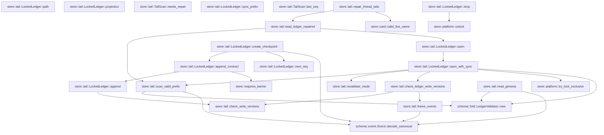

# store::tail

[Package atlas](index.md) · [Source](../../src/tail.rs)

## Declarations

Visibility is the declaration spelling; trait members and reexports require their enclosing interface. `cfg` is not evaluated.

| Symbol | Kind | Visibility | Test / cfg |
|---|---|---|---|
| [store::tail::TailScan](../../src/tail.rs#L14) | struct_item | `pub` |  |
| [store::tail::TailScan::needs_repair](../../src/tail.rs#L24) | function_item | `pub` |  |
| [store::tail::TailScan::last_seq](../../src/tail.rs#L29) | function_item | `pub` |  |
| [store::tail::scan_valid_prefix](../../src/tail.rs#L37) | function_item | `pub` |  |
| [store::tail::MAX_GENESIS_LINE_BYTES](../../src/tail.rs#L78) | const_item | `private` |  |
| [store::tail::read_genesis](../../src/tail.rs#L86) | function_item | `pub` |  |
| [store::tail::frame_events](../../src/tail.rs#L110) | function_item | `private` |  |
| [store::tail::LockedLedger](../../src/tail.rs#L133) | struct_item | `pub` |  |
| [store::tail::WRITER_VERSION](../../src/tail.rs#L145) | const_item | `private` |  |
| [store::tail::check_ledger_write_versions](../../src/tail.rs#L147) | function_item | `pub(crate)` |  |
| [store::tail::check_write_versions](../../src/tail.rs#L154) | function_item | `pub(crate)` |  |
| [store::tail::LockedLedger::open](../../src/tail.rs#L186) | function_item | `pub` |  |
| [store::tail::LockedLedger::open_with_sync](../../src/tail.rs#L190) | function_item | `pub` |  |
| [store::tail::LockedLedger::path](../../src/tail.rs#L233) | function_item | `pub` |  |
| [store::tail::LockedLedger::projection](../../src/tail.rs#L238) | function_item | `pub` |  |
| [store::tail::LockedLedger::next_seq](../../src/tail.rs#L243) | function_item | `pub` |  |
| [store::tail::LockedLedger::sync_prefix](../../src/tail.rs#L251) | function_item | `pub` |  |
| [store::tail::LockedLedger::create_checkpoint](../../src/tail.rs#L265) | function_item | `pub` |  |
| [store::tail::LockedLedger::append](../../src/tail.rs#L289) | function_item | `pub` |  |
| [store::tail::LockedLedger::append_contract](../../src/tail.rs#L320) | function_item | `pub` |  |
| [store::tail::LockedLedger::drop](../../src/tail.rs#L331) | function_item | `private` |  |
| [store::tail::revalidate_inode](../../src/tail.rs#L336) | function_item | `private` |  |
| [store::tail::version_gate_tests::event](../../src/tail.rs#L350) | function_item | `private` | test; #[cfg(test)] |
| [store::tail::version_gate_tests::genesis](../../src/tail.rs#L357) | function_item | `private` | test; #[cfg(test)] |
| [store::tail::version_gate_tests::bytes](../../src/tail.rs#L367) | function_item | `private` | test; #[cfg(test)] |
| [store::tail::version_gate_tests::downgrade_open_preserves_gated_prefix_and_unrecognized_suffix](../../src/tail.rs#L379) | function_item | `private` | test; #[cfg(test)] |
| [store::tail::version_gate_tests::reader_selection_cannot_claim_new_writer_support](../../src/tail.rs#L417) | function_item | `private` | test; #[cfg(test)] |
| [store::tail::version_gate_tests::creation_and_rewrite_cannot_bypass_writer_gate](../../src/tail.rs#L434) | function_item | `private` | test; #[cfg(test)] |
| [store::tail::version_gate_tests::append_rejects_unsupported_upgrade_without_changing_fold_or_bytes](../../src/tail.rs#L513) | function_item | `private` | test; #[cfg(test)] |
| [store::tail::read_genesis_tests::event](../../src/tail.rs#L554) | function_item | `private` | test; #[cfg(test)] |
| [store::tail::read_genesis_tests::genesis](../../src/tail.rs#L561) | function_item | `private` | test; #[cfg(test)] |
| [store::tail::read_genesis_tests::line](../../src/tail.rs#L571) | function_item | `private` | test; #[cfg(test)] |
| [store::tail::read_genesis_tests::first_event_by_scan](../../src/tail.rs#L577) | function_item | `private` | test; #[cfg(test)] |
| [store::tail::read_genesis_tests::matches_the_full_scan_for_every_shape_of_file](../../src/tail.rs#L584) | function_item | `private` | test; #[cfg(test)] |
| [store::tail::read_genesis_tests::missing_file_is_an_io_error_and_reads_only_the_first_line](../../src/tail.rs#L618) | function_item | `private` | test; #[cfg(test)] |
| [store::tail::TailRepair](../../src/tail.rs#L638) | struct_item | `pub` |  |
| [store::tail::read_ledger_repaired](../../src/tail.rs#L651) | function_item | `pub` |  |
| [store::tail::repair_thread_tails](../../src/tail.rs#L676) | function_item | `pub` |  |
| [store::tail::repair_tests::event](../../src/tail.rs#L722) | function_item | `private` | test; #[cfg(test)] |
| [store::tail::repair_tests::ledger](../../src/tail.rs#L729) | function_item | `private` | test; #[cfg(test)] |
| [store::tail::repair_tests::empty_legacy_endpoint_sidecars_are_ignored_but_empty_semantic_ledgers_fail_closed](../../src/tail.rs#L752) | function_item | `private` | test; #[cfg(test)] |
| [store::tail::repair_tests::partial_tails_are_repaired_complete_invalid_records_are_corruption_and_busy_is_left](../../src/tail.rs#L792) | function_item | `private` | test; #[cfg(test)] |

## Imports / reexports

| Local name | Source path | Visibility |
|---|---|---|
| `File` | `std::fs::File` | `private` |
| `OpenOptions` | `std::fs::OpenOptions` | `private` |
| `Read` | `std::io::Read` | `private` |
| `Seek` | `std::io::Seek` | `private` |
| `SeekFrom` | `std::io::SeekFrom` | `private` |
| `Write` | `std::io::Write` | `private` |
| `MetadataExt` | `std::os::unix::fs::MetadataExt` | `private` |
| `OpenOptionsExt` | `std::os::unix::fs::OpenOptionsExt` | `private` |
| `Path` | `std::path::Path` | `private` |
| `PathBuf` | `std::path::PathBuf` | `private` |
| `Arc` | `std::sync::Arc` | `private` |
| `Event` | `schema::Event` | `private` |
| `EventKind` | `schema::EventKind` | `private` |
| `LedgerProjection` | `schema::LedgerProjection` | `private` |
| `LedgerValidator` | `schema::LedgerValidator` | `private` |
| `json` | `serde_json::json` | `private` |
| `SyncPolicy` | `crate::platform::SyncPolicy` | `private` |
| `SystemSync` | `crate::platform::SystemSync` | `private` |
| `try_lock_exclusive` | `crate::platform::try_lock_exclusive` | `private` |
| `unlock` | `crate::platform::unlock` | `private` |
| `BarrierContext` | `crate::BarrierContext` | `private` |
| `StoreError` | `crate::StoreError` | `private` |
| `requires_barrier` | `crate::requires_barrier` | `private` |
| `*` | `super::*` | `private` |
| `Value` | `serde_json::Value` | `private` |
| `*` | `super::*` | `private` |
| `Value` | `serde_json::Value` | `private` |
| `*` | `super::*` | `private` |
| `Value` | `serde_json::Value` | `private` |
| `json` | `serde_json::json` | `private` |

## Module declarations

| Module | Visibility | Attributes |
|---|---|---|
| `store::tail::version_gate_tests` | `private` | #[cfg(test)] |
| `store::tail::read_genesis_tests` | `private` | #[cfg(test)] |
| `store::tail::repair_tests` | `private` | #[cfg(test)] |

## Function call graphs

Edges below are syntactically resolved calls only, including private functions. Graphs partition callers into groups of 20; they are not execution order. All unresolved sites are listed below and in the JSON inventory.

Functions 1–20: 24 direct edges

## Call sites

Includes test functions (marked in declarations). Receiver-type-required sites need type analysis/manual tracing. Calls in closures are attributed to their enclosing function; their occurrence here does not mean the closure executes immediately.

| Caller | Callee expression | Source lines | Target / classification |
|---|---|---|---|
| `last_seq` | `self.projection.as_ref().map_or` | [30](../../src/tail.rs#L30) | receiver-type-required |
| `last_seq` | `self.projection.as_ref` | [30](../../src/tail.rs#L30) | receiver-type-required |
| `scan_valid_prefix` | `LedgerValidator::new` | [38](../../src/tail.rs#L38) | [schema::fold::LedgerValidator::new](../../../schema/src/fold.rs#L147) |
| `scan_valid_prefix` | `bytes.len` | [42](../../src/tail.rs#L42), [69](../../src/tail.rs#L69) | receiver-type-required |
| `scan_valid_prefix` | `rest.iter().position` | [44](../../src/tail.rs#L44) | receiver-type-required |
| `scan_valid_prefix` | `rest.iter` | [44](../../src/tail.rs#L44) | receiver-type-required |
| `scan_valid_prefix` | `Some` | [45](../../src/tail.rs#L45), [50](../../src/tail.rs#L50), [58](../../src/tail.rs#L58), [72](../../src/tail.rs#L72) | external-constructor-callback-or-unresolved |
| `scan_valid_prefix` | `Event::decode_canonical(&bytes[cursor..line_end])             .and_then` | [53](../../src/tail.rs#L53) | receiver-type-required |
| `scan_valid_prefix` | `Event::decode_canonical` | [53](../../src/tail.rs#L53) | [schema::event::Event::decode_canonical](../../../schema/src/event.rs#L171) |
| `scan_valid_prefix` | `validator.push` | [54](../../src/tail.rs#L54) | receiver-type-required |
| `scan_valid_prefix` | `(cursor != 0)         .then(&#124;&#124; validator.clone().finish().ok())         .flatten` | [64](../../src/tail.rs#L64) | receiver-type-required |
| `scan_valid_prefix` | `(cursor != 0)         .then` | [64](../../src/tail.rs#L64) | receiver-type-required |
| `scan_valid_prefix` | `validator.clone().finish().ok` | [65](../../src/tail.rs#L65) | receiver-type-required |
| `scan_valid_prefix` | `validator.clone().finish` | [65](../../src/tail.rs#L65) | receiver-type-required |
| `scan_valid_prefix` | `validator.clone` | [65](../../src/tail.rs#L65) | receiver-type-required |
| `read_genesis` | `File::open` | [88](../../src/tail.rs#L88) | external-constructor-callback-or-unresolved |
| `read_genesis` | `path.as_ref` | [88](../../src/tail.rs#L88) | receiver-type-required |
| `read_genesis` | `std::io::BufReader::new` | [89](../../src/tail.rs#L89) | external-constructor-callback-or-unresolved |
| `read_genesis` | `file.take` | [89](../../src/tail.rs#L89) | receiver-type-required |
| `read_genesis` | `Vec::new` | [90](../../src/tail.rs#L90) | external-constructor-callback-or-unresolved |
| `read_genesis` | `reader.read_until` | [91](../../src/tail.rs#L91) | receiver-type-required |
| `read_genesis` | `line.last` | [92](../../src/tail.rs#L92) | receiver-type-required |
| `read_genesis` | `Some` | [92](../../src/tail.rs#L92), [106](../../src/tail.rs#L106) | external-constructor-callback-or-unresolved |
| `read_genesis` | `Ok` | [93](../../src/tail.rs#L93), [97](../../src/tail.rs#L97), [100](../../src/tail.rs#L100), [104](../../src/tail.rs#L104), [106](../../src/tail.rs#L106) | external-constructor-callback-or-unresolved |
| `read_genesis` | `line.pop` | [95](../../src/tail.rs#L95) | receiver-type-required |
| `read_genesis` | `line.is_empty` | [96](../../src/tail.rs#L96) | receiver-type-required |
| `read_genesis` | `Event::decode_canonical` | [99](../../src/tail.rs#L99) | [schema::event::Event::decode_canonical](../../../schema/src/event.rs#L171) |
| `read_genesis` | `LedgerValidator::new` | [102](../../src/tail.rs#L102) | [schema::fold::LedgerValidator::new](../../../schema/src/fold.rs#L147) |
| `read_genesis` | `validator.push(event.clone()).is_err` | [103](../../src/tail.rs#L103) | receiver-type-required |
| `read_genesis` | `validator.push` | [103](../../src/tail.rs#L103) | receiver-type-required |
| `read_genesis` | `event.clone` | [103](../../src/tail.rs#L103) | receiver-type-required |
| `frame_events` | `Vec::new` | [111](../../src/tail.rs#L111) | external-constructor-callback-or-unresolved |
| `frame_events` | `bytes.len` | [113](../../src/tail.rs#L113) | receiver-type-required |
| `frame_events` | `rest.iter().position` | [115](../../src/tail.rs#L115) | receiver-type-required |
| `frame_events` | `rest.iter` | [115](../../src/tail.rs#L115) | receiver-type-required |
| `frame_events` | `Event::decode_canonical` | [122](../../src/tail.rs#L122) | [schema::event::Event::decode_canonical](../../../schema/src/event.rs#L171) |
| `frame_events` | `events.push` | [124](../../src/tail.rs#L124) | receiver-type-required |
| `check_ledger_write_versions` | `check_write_versions` | [151](../../src/tail.rs#L151) | [store::tail::check_write_versions](../../src/tail.rs#L154) |
| `check_ledger_write_versions` | `frame_events` | [151](../../src/tail.rs#L151) | [store::tail::frame_events](../../src/tail.rs#L110) |
| `check_write_versions` | `required_reader.max` | [161](../../src/tail.rs#L161), [169](../../src/tail.rs#L169) | receiver-type-required |
| `check_write_versions` | `event.min_reader().unwrap_or` | [161](../../src/tail.rs#L161) | receiver-type-required |
| `check_write_versions` | `event.min_reader` | [161](../../src/tail.rs#L161) | receiver-type-required |
| `check_write_versions` | `required_writer.max` | [163](../../src/tail.rs#L163), [170](../../src/tail.rs#L170) | receiver-type-required |
| `check_write_versions` | `event.integer_field("min_writer").unwrap_or` | [163](../../src/tail.rs#L163) | receiver-type-required |
| `check_write_versions` | `event.integer_field` | [163](../../src/tail.rs#L163) | receiver-type-required |
| `check_write_versions` | `serde_json::to_value(event.raw())                 .map_err` | [166](../../src/tail.rs#L166) | receiver-type-required |
| `check_write_versions` | `serde_json::to_value` | [166](../../src/tail.rs#L166) | external-constructor-callback-or-unresolved |
| `check_write_versions` | `event.raw` | [166](../../src/tail.rs#L166) | receiver-type-required |
| `check_write_versions` | `StoreError::Corruption` | [167](../../src/tail.rs#L167) | external-constructor-callback-or-unresolved |
| `check_write_versions` | `error.to_string` | [167](../../src/tail.rs#L167) | receiver-type-required |
| `check_write_versions` | `value.get` | [168](../../src/tail.rs#L168) | receiver-type-required |
| `check_write_versions` | `upgrade["min_reader"].as_u64().unwrap_or` | [169](../../src/tail.rs#L169) | receiver-type-required |
| `check_write_versions` | `upgrade["min_reader"].as_u64` | [169](../../src/tail.rs#L169) | receiver-type-required |
| `check_write_versions` | `upgrade["min_writer"].as_u64().unwrap_or` | [170](../../src/tail.rs#L170) | receiver-type-required |
| `check_write_versions` | `upgrade["min_writer"].as_u64` | [170](../../src/tail.rs#L170) | receiver-type-required |
| `check_write_versions` | `Err` | [175](../../src/tail.rs#L175) | external-constructor-callback-or-unresolved |
| `check_write_versions` | `Ok` | [182](../../src/tail.rs#L182) | external-constructor-callback-or-unresolved |
| `open` | `Self::open_with_sync` | [187](../../src/tail.rs#L187) | [store::tail::LockedLedger::open_with_sync](../../src/tail.rs#L190) |
| `open` | `Arc::new` | [187](../../src/tail.rs#L187) | external-constructor-callback-or-unresolved |
| `open_with_sync` | `path.as_ref().to_path_buf` | [195](../../src/tail.rs#L195) | receiver-type-required |
| `open_with_sync` | `path.as_ref` | [195](../../src/tail.rs#L195) | receiver-type-required |
| `open_with_sync` | `OpenOptions::new()             .read(true)             .append(true)             .custom_flags(libc::O_CLOEXEC &#124; libc::O_NOFOLLOW)             .open` | [196](../../src/tail.rs#L196) | receiver-type-required |
| `open_with_sync` | `OpenOptions::new()             .read(true)             .append(true)             .custom_flags` | [196](../../src/tail.rs#L196) | receiver-type-required |
| `open_with_sync` | `OpenOptions::new()             .read(true)             .append` | [196](../../src/tail.rs#L196) | receiver-type-required |
| `open_with_sync` | `OpenOptions::new()             .read` | [196](../../src/tail.rs#L196) | receiver-type-required |
| `open_with_sync` | `OpenOptions::new` | [196](../../src/tail.rs#L196) | external-constructor-callback-or-unresolved |
| `open_with_sync` | `try_lock_exclusive` | [201](../../src/tail.rs#L201) | [store::platform::try_lock_exclusive](../../src/platform.rs#L166) |
| `open_with_sync` | `revalidate_inode` | [202](../../src/tail.rs#L202) | [store::tail::revalidate_inode](../../src/tail.rs#L336) |
| `open_with_sync` | `file.seek` | [204](../../src/tail.rs#L204) | receiver-type-required |
| `open_with_sync` | `SeekFrom::Start` | [204](../../src/tail.rs#L204) | external-constructor-callback-or-unresolved |
| `open_with_sync` | `Vec::new` | [205](../../src/tail.rs#L205) | external-constructor-callback-or-unresolved |
| `open_with_sync` | `file.read_to_end` | [206](../../src/tail.rs#L206) | receiver-type-required |
| `open_with_sync` | `check_ledger_write_versions` | [209](../../src/tail.rs#L209) | [store::tail::check_ledger_write_versions](../../src/tail.rs#L147) |
| `open_with_sync` | `scan_valid_prefix` | [210](../../src/tail.rs#L210) | [store::tail::scan_valid_prefix](../../src/tail.rs#L37) |
| `open_with_sync` | `scan.needs_repair` | [211](../../src/tail.rs#L211) | receiver-type-required |
| `open_with_sync` | `file.set_len` | [212](../../src/tail.rs#L212) | receiver-type-required |
| `open_with_sync` | `sync.full_sync` | [213](../../src/tail.rs#L213) | receiver-type-required |
| `open_with_sync` | `scan             .validator             .clone()             .unwrap_or_else` | [216](../../src/tail.rs#L216) | receiver-type-required |
| `open_with_sync` | `scan             .validator             .clone` | [216](../../src/tail.rs#L216) | receiver-type-required |
| `open_with_sync` | `LedgerValidator::new` | [219](../../src/tail.rs#L219) | [schema::fold::LedgerValidator::new](../../../schema/src/fold.rs#L147) |
| `open_with_sync` | `Ok` | [221](../../src/tail.rs#L221) | external-constructor-callback-or-unresolved |
| `projection` | `self.projection.as_ref` | [239](../../src/tail.rs#L239) | receiver-type-required |
| `next_seq` | `self.projection             .as_ref()             .map_or` | [244](../../src/tail.rs#L244) | receiver-type-required |
| `next_seq` | `self.projection             .as_ref` | [244](../../src/tail.rs#L244) | receiver-type-required |
| `sync_prefix` | `Err` | [253](../../src/tail.rs#L253), [257](../../src/tail.rs#L257) | external-constructor-callback-or-unresolved |
| `sync_prefix` | `StoreError::Corruption` | [253](../../src/tail.rs#L253) | external-constructor-callback-or-unresolved |
| `sync_prefix` | `"writer is poisoned".to_owned` | [253](../../src/tail.rs#L253) | receiver-type-required |
| `sync_prefix` | `self.sync.full_sync` | [255](../../src/tail.rs#L255) | receiver-type-required |
| `sync_prefix` | `StoreError::Io` | [257](../../src/tail.rs#L257) | external-constructor-callback-or-unresolved |
| `sync_prefix` | `Ok` | [259](../../src/tail.rs#L259) | external-constructor-callback-or-unresolved |
| `create_checkpoint` | `Err` | [267](../../src/tail.rs#L267) | external-constructor-callback-or-unresolved |
| `create_checkpoint` | `StoreError::Corruption` | [267](../../src/tail.rs#L267), [280](../../src/tail.rs#L280) | external-constructor-callback-or-unresolved |
| `create_checkpoint` | `"writer is poisoned by an earlier append/sync failure".to_owned` | [268](../../src/tail.rs#L268) | receiver-type-required |
| `create_checkpoint` | `self.next_seq` | [271](../../src/tail.rs#L271) | [store::tail::LockedLedger::next_seq](../../src/tail.rs#L243) |
| `create_checkpoint` | `serde_json_canonicalizer::to_vec(&json!({             "v": 1,             "seq": seq,             "kind": "checkpoint",             "ts": timestamp,             "covers": seq - 1,             "summary": summary         }))         .map_err` | [272](../../src/tail.rs#L272) | receiver-type-required |
| `create_checkpoint` | `serde_json_canonicalizer::to_vec` | [272](../../src/tail.rs#L272) | external-constructor-callback-or-unresolved |
| `create_checkpoint` | `error.to_string` | [280](../../src/tail.rs#L280) | receiver-type-required |
| `create_checkpoint` | `Event::decode_canonical` | [281](../../src/tail.rs#L281) | [schema::event::Event::decode_canonical](../../../schema/src/event.rs#L171) |
| `create_checkpoint` | `self.append_contract` | [282](../../src/tail.rs#L282) | [store::tail::LockedLedger::append_contract](../../src/tail.rs#L320) |
| `create_checkpoint` | `BarrierContext::default` | [282](../../src/tail.rs#L282) | external-constructor-callback-or-unresolved |
| `create_checkpoint` | `Ok` | [283](../../src/tail.rs#L283) | external-constructor-callback-or-unresolved |
| `append` | `Err` | [291](../../src/tail.rs#L291), [303](../../src/tail.rs#L303), [308](../../src/tail.rs#L308), [312](../../src/tail.rs#L312) | external-constructor-callback-or-unresolved |
| `append` | `StoreError::Corruption` | [291](../../src/tail.rs#L291) | external-constructor-callback-or-unresolved |
| `append` | `"writer is poisoned by an earlier append/sync failure".to_owned` | [292](../../src/tail.rs#L292) | receiver-type-required |
| `append` | `check_write_versions` | [295](../../src/tail.rs#L295) | [store::tail::check_write_versions](../../src/tail.rs#L154) |
| `append` | `std::iter::once` | [295](../../src/tail.rs#L295) | external-constructor-callback-or-unresolved |
| `append` | `self.validator.clone` | [296](../../src/tail.rs#L296), [316](../../src/tail.rs#L316) | receiver-type-required |
| `append` | `next.push` | [297](../../src/tail.rs#L297) | receiver-type-required |
| `append` | `event.clone` | [297](../../src/tail.rs#L297) | receiver-type-required |
| `append` | `event.canonical_bytes` | [298](../../src/tail.rs#L298) | receiver-type-required |
| `append` | `bytes.push` | [299](../../src/tail.rs#L299) | receiver-type-required |
| `append` | `self.file.write_all` | [301](../../src/tail.rs#L301) | receiver-type-required |
| `append` | `StoreError::Io` | [303](../../src/tail.rs#L303), [308](../../src/tail.rs#L308), [312](../../src/tail.rs#L312) | external-constructor-callback-or-unresolved |
| `append` | `self.sync.full_sync` | [306](../../src/tail.rs#L306) | receiver-type-required |
| `append` | `self.file.flush` | [310](../../src/tail.rs#L310) | receiver-type-required |
| `append` | `Some` | [316](../../src/tail.rs#L316) | external-constructor-callback-or-unresolved |
| `append` | `self.validator.clone().finish` | [316](../../src/tail.rs#L316) | receiver-type-required |
| `append` | `Ok` | [317](../../src/tail.rs#L317) | external-constructor-callback-or-unresolved |
| `append_contract` | `requires_barrier` | [325](../../src/tail.rs#L325) | [store::requires_barrier](../../src/lib.rs#L45) |
| `append_contract` | `self.append` | [326](../../src/tail.rs#L326) | [store::tail::LockedLedger::append](../../src/tail.rs#L289) |
| `drop` | `unlock` | [332](../../src/tail.rs#L332) | [store::platform::unlock](../../src/platform.rs#L327) |
| `revalidate_inode` | `file.metadata` | [337](../../src/tail.rs#L337) | receiver-type-required |
| `revalidate_inode` | `path.metadata` | [338](../../src/tail.rs#L338) | receiver-type-required |
| `revalidate_inode` | `held.dev` | [339](../../src/tail.rs#L339) | receiver-type-required |
| `revalidate_inode` | `current.dev` | [339](../../src/tail.rs#L339) | receiver-type-required |
| `revalidate_inode` | `held.ino` | [339](../../src/tail.rs#L339) | receiver-type-required |
| `revalidate_inode` | `current.ino` | [339](../../src/tail.rs#L339) | receiver-type-required |
| `revalidate_inode` | `Err` | [340](../../src/tail.rs#L340) | external-constructor-callback-or-unresolved |
| `revalidate_inode` | `Ok` | [342](../../src/tail.rs#L342) | external-constructor-callback-or-unresolved |
| `event` | `Event::decode_canonical(&serde_json_canonicalizer::to_vec(&value).unwrap()).unwrap` | [354](../../src/tail.rs#L354) | receiver-type-required |
| `event` | `Event::decode_canonical` | [354](../../src/tail.rs#L354) | external-constructor-callback-or-unresolved |
| `event` | `serde_json_canonicalizer::to_vec(&value).unwrap` | [354](../../src/tail.rs#L354) | receiver-type-required |
| `event` | `serde_json_canonicalizer::to_vec` | [354](../../src/tail.rs#L354) | external-constructor-callback-or-unresolved |
| `genesis` | `event` | [358](../../src/tail.rs#L358) | [store::tail::version_gate_tests::event](../../src/tail.rs#L350) |
| `bytes` | `events             .iter()             .flat_map(&#124;event&#124; {                 let mut bytes = event.canonical_bytes().unwrap();                 bytes.push(b'\n');                 bytes             })             .collect` | [368](../../src/tail.rs#L368) | receiver-type-required |
| `bytes` | `events             .iter()             .flat_map` | [368](../../src/tail.rs#L368) | receiver-type-required |
| `bytes` | `events             .iter` | [368](../../src/tail.rs#L368) | receiver-type-required |
| `bytes` | `event.canonical_bytes().unwrap` | [371](../../src/tail.rs#L371) | receiver-type-required |
| `bytes` | `event.canonical_bytes` | [371](../../src/tail.rs#L371) | receiver-type-required |
| `bytes` | `bytes.push` | [372](../../src/tail.rs#L372) | receiver-type-required |
| `downgrade_open_preserves_gated_prefix_and_unrecognized_suffix` | `tempfile::tempdir().unwrap` | [399](../../src/tail.rs#L399) | receiver-type-required |
| `downgrade_open_preserves_gated_prefix_and_unrecognized_suffix` | `tempfile::tempdir` | [399](../../src/tail.rs#L399) | external-constructor-callback-or-unresolved |
| `downgrade_open_preserves_gated_prefix_and_unrecognized_suffix` | `dir.path().join` | [400](../../src/tail.rs#L400) | receiver-type-required |
| `downgrade_open_preserves_gated_prefix_and_unrecognized_suffix` | `dir.path` | [400](../../src/tail.rs#L400) | receiver-type-required |
| `downgrade_open_preserves_gated_prefix_and_unrecognized_suffix` | `bytes` | [401](../../src/tail.rs#L401) | [store::tail::version_gate_tests::bytes](../../src/tail.rs#L367) |
| `downgrade_open_preserves_gated_prefix_and_unrecognized_suffix` | `original.extend_from_slice` | [402](../../src/tail.rs#L402) | receiver-type-required |
| `downgrade_open_preserves_gated_prefix_and_unrecognized_suffix` | `std::fs::write(&path, &original).unwrap` | [403](../../src/tail.rs#L403) | receiver-type-required |
| `downgrade_open_preserves_gated_prefix_and_unrecognized_suffix` | `std::fs::write` | [403](../../src/tail.rs#L403) | external-constructor-callback-or-unresolved |
| `reader_selection_cannot_claim_new_writer_support` | `tempfile::tempdir().unwrap` | [418](../../src/tail.rs#L418) | receiver-type-required |
| `reader_selection_cannot_claim_new_writer_support` | `tempfile::tempdir` | [418](../../src/tail.rs#L418) | external-constructor-callback-or-unresolved |
| `reader_selection_cannot_claim_new_writer_support` | `dir.path().join` | [419](../../src/tail.rs#L419) | receiver-type-required |
| `reader_selection_cannot_claim_new_writer_support` | `dir.path` | [419](../../src/tail.rs#L419) | receiver-type-required |
| `reader_selection_cannot_claim_new_writer_support` | `bytes` | [420](../../src/tail.rs#L420) | [store::tail::version_gate_tests::bytes](../../src/tail.rs#L367) |
| `reader_selection_cannot_claim_new_writer_support` | `genesis` | [420](../../src/tail.rs#L420) | [store::tail::version_gate_tests::genesis](../../src/tail.rs#L357) |
| `reader_selection_cannot_claim_new_writer_support` | `std::fs::write(&path, &original).unwrap` | [421](../../src/tail.rs#L421) | receiver-type-required |
| `reader_selection_cannot_claim_new_writer_support` | `std::fs::write` | [421](../../src/tail.rs#L421) | external-constructor-callback-or-unresolved |
| `creation_and_rewrite_cannot_bypass_writer_gate` | `tempfile::tempdir().unwrap` | [438](../../src/tail.rs#L438) | receiver-type-required |
| `creation_and_rewrite_cannot_bypass_writer_gate` | `tempfile::tempdir` | [438](../../src/tail.rs#L438) | external-constructor-callback-or-unresolved |
| `creation_and_rewrite_cannot_bypass_writer_gate` | `crate::ThreadStore::open(dir.path()).unwrap` | [439](../../src/tail.rs#L439) | receiver-type-required |
| `creation_and_rewrite_cannot_bypass_writer_gate` | `crate::ThreadStore::open` | [439](../../src/tail.rs#L439) | [store::folder::ThreadStore::open](../../src/folder.rs#L36) |
| `creation_and_rewrite_cannot_bypass_writer_gate` | `dir.path` | [439](../../src/tail.rs#L439), [459](../../src/tail.rs#L459) | receiver-type-required |
| `creation_and_rewrite_cannot_bypass_writer_gate` | `genesis` | [440](../../src/tail.rs#L440) | [store::tail::version_gate_tests::genesis](../../src/tail.rs#L357) |
| `creation_and_rewrite_cannot_bypass_writer_gate` | `dir.path().join("threads").join` | [459](../../src/tail.rs#L459) | receiver-type-required |
| `creation_and_rewrite_cannot_bypass_writer_gate` | `dir.path().join` | [459](../../src/tail.rs#L459) | receiver-type-required |
| `creation_and_rewrite_cannot_bypass_writer_gate` | `std::fs::create_dir(&folder).unwrap` | [460](../../src/tail.rs#L460) | receiver-type-required |
| `creation_and_rewrite_cannot_bypass_writer_gate` | `std::fs::create_dir` | [460](../../src/tail.rs#L460) | external-constructor-callback-or-unresolved |
| `creation_and_rewrite_cannot_bypass_writer_gate` | `bytes` | [461](../../src/tail.rs#L461) | [store::tail::version_gate_tests::bytes](../../src/tail.rs#L367) |
| `creation_and_rewrite_cannot_bypass_writer_gate` | `std::fs::write(folder.join("main.jsonl"), &original).unwrap` | [462](../../src/tail.rs#L462) | receiver-type-required |
| `creation_and_rewrite_cannot_bypass_writer_gate` | `std::fs::write` | [462](../../src/tail.rs#L462) | external-constructor-callback-or-unresolved |
| `creation_and_rewrite_cannot_bypass_writer_gate` | `folder.join` | [462](../../src/tail.rs#L462) | receiver-type-required |
| `append_rejects_unsupported_upgrade_without_changing_fold_or_bytes` | `tempfile::tempdir().unwrap` | [514](../../src/tail.rs#L514) | receiver-type-required |
| `append_rejects_unsupported_upgrade_without_changing_fold_or_bytes` | `tempfile::tempdir` | [514](../../src/tail.rs#L514) | external-constructor-callback-or-unresolved |
| `append_rejects_unsupported_upgrade_without_changing_fold_or_bytes` | `dir.path().join` | [515](../../src/tail.rs#L515) | receiver-type-required |
| `append_rejects_unsupported_upgrade_without_changing_fold_or_bytes` | `dir.path` | [515](../../src/tail.rs#L515) | receiver-type-required |
| `append_rejects_unsupported_upgrade_without_changing_fold_or_bytes` | `bytes` | [516](../../src/tail.rs#L516) | [store::tail::version_gate_tests::bytes](../../src/tail.rs#L367) |
| `append_rejects_unsupported_upgrade_without_changing_fold_or_bytes` | `genesis` | [516](../../src/tail.rs#L516) | [store::tail::version_gate_tests::genesis](../../src/tail.rs#L357) |
| `append_rejects_unsupported_upgrade_without_changing_fold_or_bytes` | `std::fs::write(&path, &original).unwrap` | [517](../../src/tail.rs#L517) | receiver-type-required |
| `append_rejects_unsupported_upgrade_without_changing_fold_or_bytes` | `std::fs::write` | [517](../../src/tail.rs#L517) | external-constructor-callback-or-unresolved |
| `append_rejects_unsupported_upgrade_without_changing_fold_or_bytes` | `LockedLedger::open(&path, 1).unwrap` | [518](../../src/tail.rs#L518), [544](../../src/tail.rs#L544) | receiver-type-required |
| `append_rejects_unsupported_upgrade_without_changing_fold_or_bytes` | `LockedLedger::open` | [518](../../src/tail.rs#L518), [544](../../src/tail.rs#L544) | external-constructor-callback-or-unresolved |
| `append_rejects_unsupported_upgrade_without_changing_fold_or_bytes` | `ledger             .append(                 event(                     json!({"kind":"meta","upgrade":{"min_reader":1,"min_writer":1}}),                     2,                 ),                 false,             )             .unwrap` | [530](../../src/tail.rs#L530) | receiver-type-required |
| `append_rejects_unsupported_upgrade_without_changing_fold_or_bytes` | `ledger             .append` | [530](../../src/tail.rs#L530) | receiver-type-required |
| `append_rejects_unsupported_upgrade_without_changing_fold_or_bytes` | `event` | [532](../../src/tail.rs#L532) | [store::tail::version_gate_tests::event](../../src/tail.rs#L350) |
| `append_rejects_unsupported_upgrade_without_changing_fold_or_bytes` | `ledger             .create_checkpoint("2026-09-04T00:00:00.000Z", "version gate regression")             .unwrap` | [540](../../src/tail.rs#L540) | receiver-type-required |
| `append_rejects_unsupported_upgrade_without_changing_fold_or_bytes` | `ledger             .create_checkpoint` | [540](../../src/tail.rs#L540) | receiver-type-required |
| `append_rejects_unsupported_upgrade_without_changing_fold_or_bytes` | `drop` | [543](../../src/tail.rs#L543) | external-constructor-callback-or-unresolved |
| `event` | `Event::decode_canonical(&serde_json_canonicalizer::to_vec(&value).unwrap()).unwrap` | [558](../../src/tail.rs#L558) | receiver-type-required |
| `event` | `Event::decode_canonical` | [558](../../src/tail.rs#L558) | external-constructor-callback-or-unresolved |
| `event` | `serde_json_canonicalizer::to_vec(&value).unwrap` | [558](../../src/tail.rs#L558) | receiver-type-required |
| `event` | `serde_json_canonicalizer::to_vec` | [558](../../src/tail.rs#L558) | external-constructor-callback-or-unresolved |
| `genesis` | `event` | [562](../../src/tail.rs#L562) | [store::tail::read_genesis_tests::event](../../src/tail.rs#L554) |
| `line` | `event.canonical_bytes().unwrap` | [572](../../src/tail.rs#L572) | receiver-type-required |
| `line` | `event.canonical_bytes` | [572](../../src/tail.rs#L572) | receiver-type-required |
| `line` | `bytes.push` | [573](../../src/tail.rs#L573) | receiver-type-required |
| `first_event_by_scan` | `scan_valid_prefix(bytes, 1)             .projection             .and_then` | [578](../../src/tail.rs#L578) | receiver-type-required |
| `first_event_by_scan` | `scan_valid_prefix` | [578](../../src/tail.rs#L578) | external-constructor-callback-or-unresolved |
| `first_event_by_scan` | `projection.events.first().cloned` | [580](../../src/tail.rs#L580) | receiver-type-required |
| `first_event_by_scan` | `projection.events.first` | [580](../../src/tail.rs#L580) | receiver-type-required |
| `matches_the_full_scan_for_every_shape_of_file` | `line` | [585](../../src/tail.rs#L585), [586](../../src/tail.rs#L586) | [store::tail::read_genesis_tests::line](../../src/tail.rs#L571) |
| `matches_the_full_scan_for_every_shape_of_file` | `genesis` | [585](../../src/tail.rs#L585) | [store::tail::read_genesis_tests::genesis](../../src/tail.rs#L561) |
| `matches_the_full_scan_for_every_shape_of_file` | `event` | [586](../../src/tail.rs#L586) | [store::tail::read_genesis_tests::event](../../src/tail.rs#L554) |
| `matches_the_full_scan_for_every_shape_of_file` | `cases.push` | [602](../../src/tail.rs#L602) | receiver-type-required |
| `matches_the_full_scan_for_every_shape_of_file` | `[meta.clone(), good.clone()].concat` | [602](../../src/tail.rs#L602) | receiver-type-required |
| `matches_the_full_scan_for_every_shape_of_file` | `meta.clone` | [602](../../src/tail.rs#L602) | receiver-type-required |
| `matches_the_full_scan_for_every_shape_of_file` | `good.clone` | [602](../../src/tail.rs#L602) | receiver-type-required |
| `matches_the_full_scan_for_every_shape_of_file` | `cases.iter().enumerate` | [603](../../src/tail.rs#L603) | receiver-type-required |
| `matches_the_full_scan_for_every_shape_of_file` | `cases.iter` | [603](../../src/tail.rs#L603) | receiver-type-required |
| `matches_the_full_scan_for_every_shape_of_file` | `tempfile::tempdir().unwrap` | [604](../../src/tail.rs#L604) | receiver-type-required |
| `matches_the_full_scan_for_every_shape_of_file` | `tempfile::tempdir` | [604](../../src/tail.rs#L604) | external-constructor-callback-or-unresolved |
| `matches_the_full_scan_for_every_shape_of_file` | `dir.path().join` | [605](../../src/tail.rs#L605) | receiver-type-required |
| `matches_the_full_scan_for_every_shape_of_file` | `dir.path` | [605](../../src/tail.rs#L605) | receiver-type-required |
| `matches_the_full_scan_for_every_shape_of_file` | `std::fs::write(&path, bytes).unwrap` | [606](../../src/tail.rs#L606) | receiver-type-required |
| `matches_the_full_scan_for_every_shape_of_file` | `std::fs::write` | [606](../../src/tail.rs#L606) | external-constructor-callback-or-unresolved |
| `matches_the_full_scan_for_every_shape_of_file` | `read_genesis(&path).unwrap` | [607](../../src/tail.rs#L607) | receiver-type-required |
| `matches_the_full_scan_for_every_shape_of_file` | `read_genesis` | [607](../../src/tail.rs#L607) | external-constructor-callback-or-unresolved |
| `matches_the_full_scan_for_every_shape_of_file` | `first_event_by_scan` | [608](../../src/tail.rs#L608) | [store::tail::read_genesis_tests::first_event_by_scan](../../src/tail.rs#L577) |
| `missing_file_is_an_io_error_and_reads_only_the_first_line` | `tempfile::tempdir().unwrap` | [619](../../src/tail.rs#L619) | receiver-type-required |
| `missing_file_is_an_io_error_and_reads_only_the_first_line` | `tempfile::tempdir` | [619](../../src/tail.rs#L619) | external-constructor-callback-or-unresolved |
| `missing_file_is_an_io_error_and_reads_only_the_first_line` | `dir.path().join` | [625](../../src/tail.rs#L625) | receiver-type-required |
| `missing_file_is_an_io_error_and_reads_only_the_first_line` | `dir.path` | [625](../../src/tail.rs#L625) | receiver-type-required |
| `missing_file_is_an_io_error_and_reads_only_the_first_line` | `line` | [626](../../src/tail.rs#L626) | [store::tail::read_genesis_tests::line](../../src/tail.rs#L571) |
| `missing_file_is_an_io_error_and_reads_only_the_first_line` | `genesis` | [626](../../src/tail.rs#L626) | external-constructor-callback-or-unresolved |
| `missing_file_is_an_io_error_and_reads_only_the_first_line` | `bytes.extend` | [627](../../src/tail.rs#L627) | receiver-type-required |
| `missing_file_is_an_io_error_and_reads_only_the_first_line` | `std::iter::repeat_n` | [627](../../src/tail.rs#L627) | external-constructor-callback-or-unresolved |
| `missing_file_is_an_io_error_and_reads_only_the_first_line` | `std::fs::write(&path, &bytes).unwrap` | [628](../../src/tail.rs#L628) | receiver-type-required |
| `missing_file_is_an_io_error_and_reads_only_the_first_line` | `std::fs::write` | [628](../../src/tail.rs#L628) | external-constructor-callback-or-unresolved |
| `missing_file_is_an_io_error_and_reads_only_the_first_line` | `read_genesis(&path).unwrap().unwrap` | [631](../../src/tail.rs#L631) | receiver-type-required |
| `missing_file_is_an_io_error_and_reads_only_the_first_line` | `read_genesis(&path).unwrap` | [631](../../src/tail.rs#L631) | receiver-type-required |
| `missing_file_is_an_io_error_and_reads_only_the_first_line` | `read_genesis` | [631](../../src/tail.rs#L631) | external-constructor-callback-or-unresolved |
| `read_ledger_repaired` | `path.as_ref` | [652](../../src/tail.rs#L652) | receiver-type-required |
| `read_ledger_repaired` | `std::fs::read` | [653](../../src/tail.rs#L653), [667](../../src/tail.rs#L667) | external-constructor-callback-or-unresolved |
| `read_ledger_repaired` | `scan_valid_prefix` | [654](../../src/tail.rs#L654), [668](../../src/tail.rs#L668) | [store::tail::scan_valid_prefix](../../src/tail.rs#L37) |
| `read_ledger_repaired` | `scan.needs_repair` | [655](../../src/tail.rs#L655) | receiver-type-required |
| `read_ledger_repaired` | `scan.projection.is_none` | [655](../../src/tail.rs#L655) | receiver-type-required |
| `read_ledger_repaired` | `Ok` | [656](../../src/tail.rs#L656), [660](../../src/tail.rs#L660), [664](../../src/tail.rs#L664), [669](../../src/tail.rs#L669) | external-constructor-callback-or-unresolved |
| `read_ledger_repaired` | `usize::try_from(scan.valid_bytes).unwrap_or` | [658](../../src/tail.rs#L658) | receiver-type-required |
| `read_ledger_repaired` | `usize::try_from` | [658](../../src/tail.rs#L658) | external-constructor-callback-or-unresolved |
| `read_ledger_repaired` | `suffix.contains` | [659](../../src/tail.rs#L659) | receiver-type-required |
| `read_ledger_repaired` | `LockedLedger::open` | [662](../../src/tail.rs#L662) | [store::tail::LockedLedger::open](../../src/tail.rs#L186) |
| `read_ledger_repaired` | `drop` | [663](../../src/tail.rs#L663) | external-constructor-callback-or-unresolved |
| `read_ledger_repaired` | `Err` | [665](../../src/tail.rs#L665) | external-constructor-callback-or-unresolved |
| `repair_thread_tails` | `TailRepair::default` | [678](../../src/tail.rs#L678) | external-constructor-callback-or-unresolved |
| `repair_thread_tails` | `std::fs::read_dir` | [679](../../src/tail.rs#L679) | external-constructor-callback-or-unresolved |
| `repair_thread_tails` | `entry.file_name().to_string_lossy().into_owned` | [681](../../src/tail.rs#L681) | receiver-type-required |
| `repair_thread_tails` | `entry.file_name().to_string_lossy` | [681](../../src/tail.rs#L681) | receiver-type-required |
| `repair_thread_tails` | `entry.file_name` | [681](../../src/tail.rs#L681) | receiver-type-required |
| `repair_thread_tails` | `crate::card::valid_line_name` | [682](../../src/tail.rs#L682) | [store::card::valid_line_name](../../src/card.rs#L256) |
| `repair_thread_tails` | `entry.file_type()?.is_file` | [682](../../src/tail.rs#L682) | receiver-type-required |
| `repair_thread_tails` | `entry.file_type` | [682](../../src/tail.rs#L682) | receiver-type-required |
| `repair_thread_tails` | `File::open` | [685](../../src/tail.rs#L685) | external-constructor-callback-or-unresolved |
| `repair_thread_tails` | `entry.path` | [685](../../src/tail.rs#L685), [696](../../src/tail.rs#L696) | receiver-type-required |
| `repair_thread_tails` | `file.metadata()?.len` | [686](../../src/tail.rs#L686) | receiver-type-required |
| `repair_thread_tails` | `file.metadata` | [686](../../src/tail.rs#L686) | receiver-type-required |
| `repair_thread_tails` | `report.corrupt.push` | [688](../../src/tail.rs#L688) | receiver-type-required |
| `repair_thread_tails` | `"ledger is empty".to_owned` | [688](../../src/tail.rs#L688) | receiver-type-required |
| `repair_thread_tails` | `file.read_exact_at` | [692](../../src/tail.rs#L692) | receiver-type-required |
| `repair_thread_tails` | `read_ledger_repaired` | [696](../../src/tail.rs#L696) | [store::tail::read_ledger_repaired](../../src/tail.rs#L651) |
| `repair_thread_tails` | `scan.projection.is_none` | [697](../../src/tail.rs#L697) | receiver-type-required |
| `repair_thread_tails` | `report                 .corrupt                 .push` | [698](../../src/tail.rs#L698) | receiver-type-required |
| `repair_thread_tails` | `"no valid genesis prefix".to_owned` | [700](../../src/tail.rs#L700) | receiver-type-required |
| `repair_thread_tails` | `scan.needs_repair` | [701](../../src/tail.rs#L701) | receiver-type-required |
| `repair_thread_tails` | `usize::try_from(scan.valid_bytes).unwrap_or` | [702](../../src/tail.rs#L702) | receiver-type-required |
| `repair_thread_tails` | `usize::try_from` | [702](../../src/tail.rs#L702) | external-constructor-callback-or-unresolved |
| `repair_thread_tails` | `suffix.contains` | [703](../../src/tail.rs#L703) | receiver-type-required |
| `repair_thread_tails` | `report                     .corrupt                     .push` | [704](../../src/tail.rs#L704) | receiver-type-required |
| `repair_thread_tails` | `"complete invalid record".to_owned` | [706](../../src/tail.rs#L706) | receiver-type-required |
| `repair_thread_tails` | `report.busy.push` | [708](../../src/tail.rs#L708) | receiver-type-required |
| `repair_thread_tails` | `len.saturating_sub` | [711](../../src/tail.rs#L711) | receiver-type-required |
| `repair_thread_tails` | `bytes.len` | [711](../../src/tail.rs#L711) | receiver-type-required |
| `repair_thread_tails` | `Ok` | [714](../../src/tail.rs#L714) | external-constructor-callback-or-unresolved |
| `event` | `Event::decode_canonical(&serde_json_canonicalizer::to_vec(&value).unwrap()).unwrap` | [726](../../src/tail.rs#L726) | receiver-type-required |
| `event` | `Event::decode_canonical` | [726](../../src/tail.rs#L726) | external-constructor-callback-or-unresolved |
| `event` | `serde_json_canonicalizer::to_vec(&value).unwrap` | [726](../../src/tail.rs#L726) | receiver-type-required |
| `event` | `serde_json_canonicalizer::to_vec` | [726](../../src/tail.rs#L726) | external-constructor-callback-or-unresolved |
| `ledger` | `Vec::new` | [730](../../src/tail.rs#L730) | external-constructor-callback-or-unresolved |
| `ledger` | `event` | [731](../../src/tail.rs#L731), [742](../../src/tail.rs#L742) | [store::tail::repair_tests::event](../../src/tail.rs#L722) |
| `ledger` | `bytes.extend` | [738](../../src/tail.rs#L738), [741](../../src/tail.rs#L741) | receiver-type-required |
| `ledger` | `genesis.canonical_bytes().unwrap` | [738](../../src/tail.rs#L738) | receiver-type-required |
| `ledger` | `genesis.canonical_bytes` | [738](../../src/tail.rs#L738) | receiver-type-required |
| `ledger` | `bytes.push` | [739](../../src/tail.rs#L739), [746](../../src/tail.rs#L746) | receiver-type-required |
| `ledger` | `event(json!({"kind":"meta","title":"t"}), seq)                     .canonical_bytes()                     .unwrap` | [742](../../src/tail.rs#L742) | receiver-type-required |
| `ledger` | `event(json!({"kind":"meta","title":"t"}), seq)                     .canonical_bytes` | [742](../../src/tail.rs#L742) | receiver-type-required |
| `empty_legacy_endpoint_sidecars_are_ignored_but_empty_semantic_ledgers_fail_closed` | `tempfile::tempdir().unwrap` | [753](../../src/tail.rs#L753) | receiver-type-required |
| `empty_legacy_endpoint_sidecars_are_ignored_but_empty_semantic_ledgers_fail_closed` | `tempfile::tempdir` | [753](../../src/tail.rs#L753) | external-constructor-callback-or-unresolved |
| `empty_legacy_endpoint_sidecars_are_ignored_but_empty_semantic_ledgers_fail_closed` | `dir.path` | [754](../../src/tail.rs#L754) | receiver-type-required |
| `empty_legacy_endpoint_sidecars_are_ignored_but_empty_semantic_ledgers_fail_closed` | `folder.join` | [755](../../src/tail.rs#L755), [756](../../src/tail.rs#L756), [757](../../src/tail.rs#L757) | receiver-type-required |
| `empty_legacy_endpoint_sidecars_are_ignored_but_empty_semantic_ledgers_fail_closed` | `std::fs::write(&empty_projection, b"").unwrap` | [758](../../src/tail.rs#L758) | receiver-type-required |
| `empty_legacy_endpoint_sidecars_are_ignored_but_empty_semantic_ledgers_fail_closed` | `std::fs::write` | [758](../../src/tail.rs#L758), [759](../../src/tail.rs#L759), [761](../../src/tail.rs#L761), [777](../../src/tail.rs#L777) | external-constructor-callback-or-unresolved |
| `empty_legacy_endpoint_sidecars_are_ignored_but_empty_semantic_ledgers_fail_closed` | `std::fs::write(&empty_request_cache, b"").unwrap` | [759](../../src/tail.rs#L759) | receiver-type-required |
| `empty_legacy_endpoint_sidecars_are_ignored_but_empty_semantic_ledgers_fail_closed` | `std::fs::write(&empty_semantic, b"").unwrap` | [761](../../src/tail.rs#L761) | receiver-type-required |
| `empty_legacy_endpoint_sidecars_are_ignored_but_empty_semantic_ledgers_fail_closed` | `repair_thread_tails(folder).unwrap` | [763](../../src/tail.rs#L763), [778](../../src/tail.rs#L778) | receiver-type-required |
| `empty_legacy_endpoint_sidecars_are_ignored_but_empty_semantic_ledgers_fail_closed` | `repair_thread_tails` | [763](../../src/tail.rs#L763), [778](../../src/tail.rs#L778) | external-constructor-callback-or-unresolved |
| `empty_legacy_endpoint_sidecars_are_ignored_but_empty_semantic_ledgers_fail_closed` | `std::fs::write(&empty_projection, retained_projection).unwrap` | [777](../../src/tail.rs#L777) | receiver-type-required |
| `partial_tails_are_repaired_complete_invalid_records_are_corruption_and_busy_is_left` | `tempfile::tempdir().unwrap` | [793](../../src/tail.rs#L793) | receiver-type-required |
| `partial_tails_are_repaired_complete_invalid_records_are_corruption_and_busy_is_left` | `tempfile::tempdir` | [793](../../src/tail.rs#L793) | external-constructor-callback-or-unresolved |
| `partial_tails_are_repaired_complete_invalid_records_are_corruption_and_busy_is_left` | `dir.path` | [794](../../src/tail.rs#L794) | receiver-type-required |
| `partial_tails_are_repaired_complete_invalid_records_are_corruption_and_busy_is_left` | `ledger` | [795](../../src/tail.rs#L795) | [store::tail::repair_tests::ledger](../../src/tail.rs#L729) |
| `partial_tails_are_repaired_complete_invalid_records_are_corruption_and_busy_is_left` | `good.clone` | [797](../../src/tail.rs#L797), [801](../../src/tail.rs#L801) | receiver-type-required |
| `partial_tails_are_repaired_complete_invalid_records_are_corruption_and_busy_is_left` | `torn.extend_from_slice` | [798](../../src/tail.rs#L798) | receiver-type-required |
| `partial_tails_are_repaired_complete_invalid_records_are_corruption_and_busy_is_left` | `std::fs::write(folder.join("main.jsonl"), &torn).unwrap` | [799](../../src/tail.rs#L799) | receiver-type-required |
| `partial_tails_are_repaired_complete_invalid_records_are_corruption_and_busy_is_left` | `std::fs::write` | [799](../../src/tail.rs#L799), [804](../../src/tail.rs#L804), [807](../../src/tail.rs#L807), [810](../../src/tail.rs#L810), [812](../../src/tail.rs#L812) | external-constructor-callback-or-unresolved |
| `partial_tails_are_repaired_complete_invalid_records_are_corruption_and_busy_is_left` | `folder.join` | [799](../../src/tail.rs#L799), [804](../../src/tail.rs#L804), [807](../../src/tail.rs#L807), [808](../../src/tail.rs#L808), [810](../../src/tail.rs#L810), [813](../../src/tail.rs#L813), [828](../../src/tail.rs#L828), [831](../../src/tail.rs#L831) | receiver-type-required |
| `partial_tails_are_repaired_complete_invalid_records_are_corruption_and_busy_is_left` | `invalid.extend_from_slice` | [802](../../src/tail.rs#L802) | receiver-type-required |
| `partial_tails_are_repaired_complete_invalid_records_are_corruption_and_busy_is_left` | `std::fs::write(folder.join(child_a), &invalid).unwrap` | [804](../../src/tail.rs#L804) | receiver-type-required |
| `partial_tails_are_repaired_complete_invalid_records_are_corruption_and_busy_is_left` | `std::fs::write(folder.join(child_b), &torn).unwrap` | [807](../../src/tail.rs#L807), [810](../../src/tail.rs#L810) | receiver-type-required |
| `partial_tails_are_repaired_complete_invalid_records_are_corruption_and_busy_is_left` | `LockedLedger::open(folder.join(child_b), 1).unwrap` | [808](../../src/tail.rs#L808) | receiver-type-required |
| `partial_tails_are_repaired_complete_invalid_records_are_corruption_and_busy_is_left` | `LockedLedger::open` | [808](../../src/tail.rs#L808) | external-constructor-callback-or-unresolved |
| `partial_tails_are_repaired_complete_invalid_records_are_corruption_and_busy_is_left` | `std::fs::write(             folder.join("018f0000-0000-7000-8000-00000000000c.jsonl"),             &good,         )         .unwrap` | [812](../../src/tail.rs#L812) | receiver-type-required |
| `partial_tails_are_repaired_complete_invalid_records_are_corruption_and_busy_is_left` | `repair_thread_tails(folder).unwrap` | [818](../../src/tail.rs#L818) | receiver-type-required |
| `partial_tails_are_repaired_complete_invalid_records_are_corruption_and_busy_is_left` | `repair_thread_tails` | [818](../../src/tail.rs#L818) | external-constructor-callback-or-unresolved |
| `partial_tails_are_repaired_complete_invalid_records_are_corruption_and_busy_is_left` | `drop` | [826](../../src/tail.rs#L826) | external-constructor-callback-or-unresolved |
| `partial_tails_are_repaired_complete_invalid_records_are_corruption_and_busy_is_left` | `read_ledger_repaired(folder.join(child_b)).unwrap` | [828](../../src/tail.rs#L828) | receiver-type-required |
| `partial_tails_are_repaired_complete_invalid_records_are_corruption_and_busy_is_left` | `read_ledger_repaired` | [828](../../src/tail.rs#L828), [831](../../src/tail.rs#L831) | external-constructor-callback-or-unresolved |
| `partial_tails_are_repaired_complete_invalid_records_are_corruption_and_busy_is_left` | `read_ledger_repaired(folder.join(child_a)).unwrap` | [831](../../src/tail.rs#L831) | receiver-type-required |
