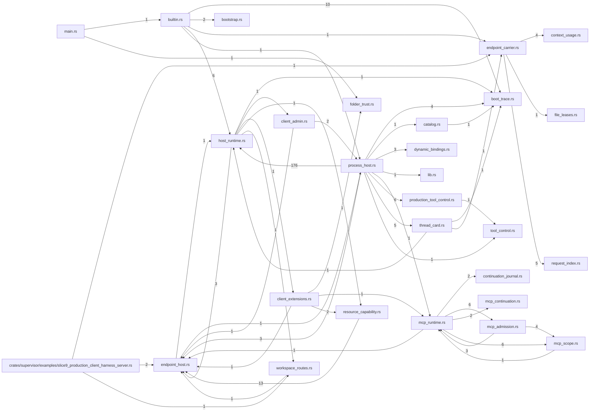

# tekes-supervisor — generated atlas

[All packages](../../../../docs/architecture/generated/index.md) · [Maintained explanation](../README.md)

## Cargo targets

| Target | Kind | Entry |
|---|---|---|
| `tekes_supervisor` | lib | [crates/supervisor/src/lib.rs](../../src/lib.rs) |
| `tekes-supervisor` | bin | [crates/supervisor/src/main.rs](../../src/main.rs) |
| `slice9_production_client_harness_server` | example | [crates/supervisor/examples/slice9_production_client_harness_server.rs](../../examples/slice9_production_client_harness_server.rs) |
| `folder_authorization` | test | [crates/supervisor/tests/folder_authorization.rs](../../tests/folder_authorization.rs) |
| `live_oauth` | test | [crates/supervisor/tests/live_oauth.rs](../../tests/live_oauth.rs) |
| `ready_reads_no_thread` | test | [crates/supervisor/tests/ready_reads_no_thread.rs](../../tests/ready_reads_no_thread.rs) |
| `s4_lazy_boot_streams` | test | [crates/supervisor/tests/s4_lazy_boot_streams.rs](../../tests/s4_lazy_boot_streams.rs) |
| `secret_store` | test | [crates/supervisor/tests/secret_store.rs](../../tests/secret_store.rs) |
| `shell` | test | [crates/supervisor/tests/shell.rs](../../tests/shell.rs) |
| `slice13_management` | test | [crates/supervisor/tests/slice13_management.rs](../../tests/slice13_management.rs) |
| `slice14a_reference_package` | test | [crates/supervisor/tests/slice14a_reference_package.rs](../../tests/slice14a_reference_package.rs) |
| `slice14f_common_routes` | test | [crates/supervisor/tests/slice14f_common_routes.rs](../../tests/slice14f_common_routes.rs) |
| `slice8_tool_control` | test | [crates/supervisor/tests/slice8_tool_control.rs](../../tests/slice8_tool_control.rs) |
| `slice9_endpoint_carrier` | test | [crates/supervisor/tests/slice9_endpoint_carrier.rs](../../tests/slice9_endpoint_carrier.rs) |
| `slice9_endpoint_host` | test | [crates/supervisor/tests/slice9_endpoint_host.rs](../../tests/slice9_endpoint_host.rs) |
| `workspace_routes` | test | [crates/supervisor/tests/workspace_routes.rs](../../tests/workspace_routes.rs) |

## Direct workspace dependencies

| Dependency | Kind | Target cfg |
|---|---|---|
| `endpoint` | normal | all |
| `engine` | normal | all |
| `host-files` | normal | all |
| `mcp` | normal | all |
| `plugins` | normal | all |
| `profile` | normal | all |
| `provider` | normal | all |
| `schedule` | normal | all |
| `schema` | normal | all |
| `session-controls` | normal | all |
| `store` | normal | all |
| `thread-search` | normal | all |
| `tools` | normal | all |
| `transport` | normal | all |
| `user-documents` | normal | all |
| `worker-control` | normal | all |
| `workspace-service` | normal | all |

[Public/restricted API and direct callers](api.md)

## Source files / lexical modules

`src` files have full symbol/call tables and partitioned function graphs. Integration tests and examples remain in the JSON inventory.
File-derived paths below are lexical navigation, not a compiler-resolved module tree; inline module declarations are listed separately.

| File | Symbols | Call sites | Detail |
|---|---:|---:|---|
| [crates/supervisor/examples/slice9_production_client_harness_server.rs](../../examples/slice9_production_client_harness_server.rs) | 18 | 117 | `inventory.json` |
| [crates/supervisor/src/boot_trace.rs](../../src/boot_trace.rs) | 10 | 25 | [Symbols and calls](src--boot_trace.md) |
| [crates/supervisor/src/bootstrap.rs](../../src/bootstrap.rs) | 25 | 144 | [Symbols and calls](src--bootstrap.md) |
| [crates/supervisor/src/builtin.rs](../../src/builtin.rs) | 3 | 160 | [Symbols and calls](src--builtin.md) |
| [crates/supervisor/src/catalog.rs](../../src/catalog.rs) | 25 | 166 | [Symbols and calls](src--catalog.md) |
| [crates/supervisor/src/client_admin.rs](../../src/client_admin.rs) | 100 | 1071 | [Symbols and calls](src--client_admin.md) |
| [crates/supervisor/src/client_extensions.rs](../../src/client_extensions.rs) | 140 | 1747 | [Symbols and calls](src--client_extensions.md) |
| [crates/supervisor/src/context_usage.rs](../../src/context_usage.rs) | 26 | 352 | [Symbols and calls](src--context_usage.md) |
| [crates/supervisor/src/continuation_journal.rs](../../src/continuation_journal.rs) | 20 | 287 | [Symbols and calls](src--continuation_journal.md) |
| [crates/supervisor/src/dynamic_bindings.rs](../../src/dynamic_bindings.rs) | 8 | 48 | [Symbols and calls](src--dynamic_bindings.md) |
| [crates/supervisor/src/endpoint_carrier.rs](../../src/endpoint_carrier.rs) | 164 | 1555 | [Symbols and calls](src--endpoint_carrier.md) |
| [crates/supervisor/src/endpoint_host.rs](../../src/endpoint_host.rs) | 156 | 1054 | [Symbols and calls](src--endpoint_host.md) |
| [crates/supervisor/src/file_leases.rs](../../src/file_leases.rs) | 20 | 150 | [Symbols and calls](src--file_leases.md) |
| [crates/supervisor/src/file_observation.rs](../../src/file_observation.rs) | 12 | 79 | [Symbols and calls](src--file_observation.md) |
| [crates/supervisor/src/folder_trust.rs](../../src/folder_trust.rs) | 12 | 86 | [Symbols and calls](src--folder_trust.md) |
| [crates/supervisor/src/host_runtime.rs](../../src/host_runtime.rs) | 42 | 344 | [Symbols and calls](src--host_runtime.md) |
| [crates/supervisor/src/lib.rs](../../src/lib.rs) | 27 | 191 | [Symbols and calls](src--lib.md) |
| [crates/supervisor/src/main.rs](../../src/main.rs) | 1 | 48 | [Symbols and calls](src--main.md) |
| [crates/supervisor/src/mcp_admission.rs](../../src/mcp_admission.rs) | 40 | 97 | [Symbols and calls](src--mcp_admission.md) |
| [crates/supervisor/src/mcp_continuation.rs](../../src/mcp_continuation.rs) | 8 | 175 | [Symbols and calls](src--mcp_continuation.md) |
| [crates/supervisor/src/mcp_runtime.rs](../../src/mcp_runtime.rs) | 209 | 2390 | [Symbols and calls](src--mcp_runtime.md) |
| [crates/supervisor/src/mcp_scope.rs](../../src/mcp_scope.rs) | 9 | 129 | [Symbols and calls](src--mcp_scope.md) |
| [crates/supervisor/src/phase5_tests.rs](../../src/phase5_tests.rs) | 9 | 282 | [Symbols and calls](src--phase5_tests.md) |
| [crates/supervisor/src/process_host.rs](../../src/process_host.rs) | 376 | 6633 | [Symbols and calls](src--process_host.md) |
| [crates/supervisor/src/process_live_tests.rs](../../src/process_live_tests.rs) | 16 | 1866 | [Symbols and calls](src--process_live_tests.md) |
| [crates/supervisor/src/process_tool_visibility_tests.rs](../../src/process_tool_visibility_tests.rs) | 13 | 227 | [Symbols and calls](src--process_tool_visibility_tests.md) |
| [crates/supervisor/src/production_tool_control.rs](../../src/production_tool_control.rs) | 85 | 866 | [Symbols and calls](src--production_tool_control.md) |
| [crates/supervisor/src/request_index.rs](../../src/request_index.rs) | 30 | 169 | [Symbols and calls](src--request_index.md) |
| [crates/supervisor/src/resource_capability.rs](../../src/resource_capability.rs) | 71 | 438 | [Symbols and calls](src--resource_capability.md) |
| [crates/supervisor/src/thread_card/tests.rs](../../src/thread_card/tests.rs) | 13 | 162 | [Symbols and calls](src--thread_card--tests.md) |
| [crates/supervisor/src/thread_card.rs](../../src/thread_card.rs) | 46 | 270 | [Symbols and calls](src--thread_card.md) |
| [crates/supervisor/src/tool_control.rs](../../src/tool_control.rs) | 45 | 304 | [Symbols and calls](src--tool_control.md) |
| [crates/supervisor/src/workspace_routes.rs](../../src/workspace_routes.rs) | 13 | 201 | [Symbols and calls](src--workspace_routes.md) |
| [crates/supervisor/tests/folder_authorization.rs](../../tests/folder_authorization.rs) | 1 | 37 | `inventory.json` |
| [crates/supervisor/tests/live_oauth.rs](../../tests/live_oauth.rs) | 3 | 106 | `inventory.json` |
| [crates/supervisor/tests/ready_reads_no_thread.rs](../../tests/ready_reads_no_thread.rs) | 6 | 139 | `inventory.json` |
| [crates/supervisor/tests/s4_lazy_boot_streams.rs](../../tests/s4_lazy_boot_streams.rs) | 65 | 905 | `inventory.json` |
| [crates/supervisor/tests/secret_store.rs](../../tests/secret_store.rs) | 9 | 60 | `inventory.json` |
| [crates/supervisor/tests/shell.rs](../../tests/shell.rs) | 41 | 411 | `inventory.json` |
| [crates/supervisor/tests/slice13_management.rs](../../tests/slice13_management.rs) | 7 | 310 | `inventory.json` |
| [crates/supervisor/tests/slice14a_reference_package.rs](../../tests/slice14a_reference_package.rs) | 32 | 246 | `inventory.json` |
| [crates/supervisor/tests/slice14f_common_routes.rs](../../tests/slice14f_common_routes.rs) | 6 | 120 | `inventory.json` |
| [crates/supervisor/tests/slice8_tool_control.rs](../../tests/slice8_tool_control.rs) | 7 | 106 | `inventory.json` |
| [crates/supervisor/tests/slice9_endpoint_carrier.rs](../../tests/slice9_endpoint_carrier.rs) | 40 | 712 | `inventory.json` |
| [crates/supervisor/tests/slice9_endpoint_host.rs](../../tests/slice9_endpoint_host.rs) | 50 | 1074 | `inventory.json` |
| [crates/supervisor/tests/workspace_routes.rs](../../tests/workspace_routes.rs) | 3 | 51 | `inventory.json` |

## Cross-file direct calls

Source files stand in for out-of-line modules; see declarations for inline modules. Counts are syntactic call sites, not runtime frequency.

