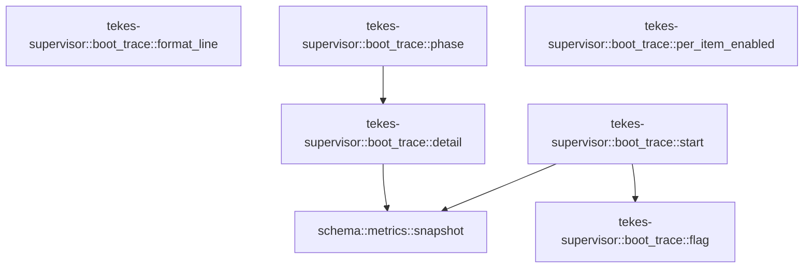

# tekes-supervisor::boot_trace

[Package atlas](index.md) · [Source](../../src/boot_trace.rs)

## Declarations

Visibility is the declaration spelling; trait members and reexports require their enclosing interface. `cfg` is not evaluated.

| Symbol | Kind | Visibility | Test / cfg |
|---|---|---|---|
| [tekes-supervisor::boot_trace::Trace](../../src/boot_trace.rs#L14) | struct_item | `private` |  |
| [tekes-supervisor::boot_trace::TRACE](../../src/boot_trace.rs#L21) | static_item | `private` |  |
| [tekes-supervisor::boot_trace::flag](../../src/boot_trace.rs#L23) | function_item | `private` |  |
| [tekes-supervisor::boot_trace::start](../../src/boot_trace.rs#L28) | function_item | `pub` |  |
| [tekes-supervisor::boot_trace::format_line](../../src/boot_trace.rs#L39) | function_item | `pub` |  |
| [tekes-supervisor::boot_trace::phase](../../src/boot_trace.rs#L60) | function_item | `pub` |  |
| [tekes-supervisor::boot_trace::detail](../../src/boot_trace.rs#L65) | function_item | `pub` |  |
| [tekes-supervisor::boot_trace::per_item_enabled](../../src/boot_trace.rs#L93) | function_item | `pub` |  |
| [tekes-supervisor::boot_trace::tests::line_names_phase_time_and_work](../../src/boot_trace.rs#L102) | function_item | `private` | test; #[cfg(test)] |
| [tekes-supervisor::boot_trace::tests::phase_without_start_is_a_no_op](../../src/boot_trace.rs#L117) | function_item | `private` | test; #[cfg(test)] |

## Imports / reexports

| Local name | Source path | Visibility |
|---|---|---|
| `Write` | `std::io::Write` | `private` |
| `OnceLock` | `std::sync::OnceLock` | `private` |
| `Instant` | `std::time::Instant` | `private` |
| `*` | `super::*` | `private` |

## Module declarations

| Module | Visibility | Attributes |
|---|---|---|
| `tekes-supervisor::boot_trace::tests` | `private` | #[cfg(test)] |

## Function call graphs

Edges below are syntactically resolved calls only, including private functions. Graphs partition callers into groups of 20; they are not execution order. All unresolved sites are listed below and in the JSON inventory.

Functions 1–6: 4 direct edges

## Call sites

Includes test functions (marked in declarations). Receiver-type-required sites need type analysis/manual tracing. Calls in closures are attributed to their enclosing function; their occurrence here does not mean the closure executes immediately.

| Caller | Callee expression | Source lines | Target / classification |
|---|---|---|---|
| `TRACE` | `OnceLock::new` | [21](../../src/boot_trace.rs#L21) | external-constructor-callback-or-unresolved |
| `flag` | `std::env::var_os(name).is_some_and` | [24](../../src/boot_trace.rs#L24) | receiver-type-required |
| `flag` | `std::env::var_os` | [24](../../src/boot_trace.rs#L24) | external-constructor-callback-or-unresolved |
| `start` | `TRACE.set` | [29](../../src/boot_trace.rs#L29) | receiver-type-required |
| `start` | `Instant::now` | [30](../../src/boot_trace.rs#L30) | external-constructor-callback-or-unresolved |
| `start` | `schema::metrics::snapshot` | [31](../../src/boot_trace.rs#L31) | [schema::metrics::snapshot](../../../schema/src/metrics.rs#L41) |
| `start` | `flag` | [32](../../src/boot_trace.rs#L32), [33](../../src/boot_trace.rs#L33) | [tekes-supervisor::boot_trace::flag](../../src/boot_trace.rs#L23) |
| `format_line` | `detail.is_empty` | [52](../../src/boot_trace.rs#L52) | receiver-type-required |
| `format_line` | `line.push` | [53](../../src/boot_trace.rs#L53) | receiver-type-required |
| `format_line` | `line.push_str` | [54](../../src/boot_trace.rs#L54) | receiver-type-required |
| `phase` | `detail` | [61](../../src/boot_trace.rs#L61) | [tekes-supervisor::boot_trace::detail](../../src/boot_trace.rs#L65) |
| `detail` | `TRACE.get` | [66](../../src/boot_trace.rs#L66) | receiver-type-required |
| `detail` | `trace.started.elapsed().as_millis` | [72](../../src/boot_trace.rs#L72) | receiver-type-required |
| `detail` | `trace.started.elapsed` | [72](../../src/boot_trace.rs#L72) | receiver-type-required |
| `detail` | `schema::metrics::snapshot().since` | [73](../../src/boot_trace.rs#L73) | receiver-type-required |
| `detail` | `schema::metrics::snapshot` | [73](../../src/boot_trace.rs#L73) | [schema::metrics::snapshot](../../../schema/src/metrics.rs#L41) |
| `detail` | `std::io::stdout().lock` | [85](../../src/boot_trace.rs#L85) | receiver-type-required |
| `detail` | `std::io::stdout` | [85](../../src/boot_trace.rs#L85) | external-constructor-callback-or-unresolved |
| `detail` | `out.flush` | [87](../../src/boot_trace.rs#L87) | receiver-type-required |
| `per_item_enabled` | `TRACE.get().is_some_and` | [94](../../src/boot_trace.rs#L94) | receiver-type-required |
| `per_item_enabled` | `TRACE.get` | [94](../../src/boot_trace.rs#L94) | receiver-type-required |
| `line_names_phase_time_and_work` | `format_line` | [109](../../src/boot_trace.rs#L109) | external-constructor-callback-or-unresolved |
| `phase_without_start_is_a_no_op` | `phase` | [119](../../src/boot_trace.rs#L119) | external-constructor-callback-or-unresolved |
| `phase_without_start_is_a_no_op` | `detail` | [120](../../src/boot_trace.rs#L120) | external-constructor-callback-or-unresolved |
