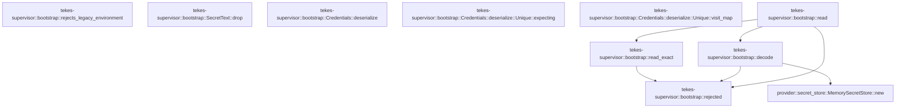

# tekes-supervisor::bootstrap

[Package atlas](index.md) · [Source](../../src/bootstrap.rs)

## Declarations

Visibility is the declaration spelling; trait members and reexports require their enclosing interface. `cfg` is not evaluated.

| Symbol | Kind | Visibility | Test / cfg |
|---|---|---|---|
| [tekes-supervisor::bootstrap::VERSION](../../src/bootstrap.rs#L12) | const_item | `pub` |  |
| [tekes-supervisor::bootstrap::MAGIC](../../src/bootstrap.rs#L13) | const_item | `pub` |  |
| [tekes-supervisor::bootstrap::MAX_FRAME_BYTES](../../src/bootstrap.rs#L14) | const_item | `pub` |  |
| [tekes-supervisor::bootstrap::DEADLINE](../../src/bootstrap.rs#L15) | const_item | `pub` |  |
| [tekes-supervisor::bootstrap::SecretText](../../src/bootstrap.rs#L18) | struct_item | `private` |  |
| [tekes-supervisor::bootstrap::SecretText::drop](../../src/bootstrap.rs#L21) | function_item | `private` |  |
| [tekes-supervisor::bootstrap::Credentials](../../src/bootstrap.rs#L27) | struct_item | `private` |  |
| [tekes-supervisor::bootstrap::Credentials::deserialize](../../src/bootstrap.rs#L30) | function_item | `private` |  |
| [tekes-supervisor::bootstrap::Credentials::deserialize::Unique](../../src/bootstrap.rs#L31) | struct_item | `private` |  |
| [tekes-supervisor::bootstrap::Credentials::deserialize::Value](../../src/bootstrap.rs#L33) | type_item | `private` |  |
| [tekes-supervisor::bootstrap::Credentials::deserialize::Unique::expecting](../../src/bootstrap.rs#L34) | function_item | `private` |  |
| [tekes-supervisor::bootstrap::Credentials::deserialize::Unique::visit_map](../../src/bootstrap.rs#L37) | function_item | `private` |  |
| [tekes-supervisor::bootstrap::Frame](../../src/bootstrap.rs#L54) | struct_item | `private` |  |
| [tekes-supervisor::bootstrap::LaunchSecrets](../../src/bootstrap.rs#L59) | struct_item | `pub` |  |
| [tekes-supervisor::bootstrap::rejected](../../src/bootstrap.rs#L64) | function_item | `private` |  |
| [tekes-supervisor::bootstrap::read](../../src/bootstrap.rs#L70) | function_item | `pub` |  |
| [tekes-supervisor::bootstrap::read_exact](../../src/bootstrap.rs#L103) | function_item | `private` |  |
| [tekes-supervisor::bootstrap::decode](../../src/bootstrap.rs#L136) | function_item | `private` |  |
| [tekes-supervisor::bootstrap::rejects_legacy_environment](../../src/bootstrap.rs#L166) | function_item | `pub` |  |
| [tekes-supervisor::bootstrap::tests::body](../../src/bootstrap.rs#L186) | function_item | `private` | test; #[cfg(test)] |
| [tekes-supervisor::bootstrap::tests::bindings](../../src/bootstrap.rs#L193) | function_item | `private` | test; #[cfg(test)] |
| [tekes-supervisor::bootstrap::tests::framed](../../src/bootstrap.rs#L197) | function_item | `private` | test; #[cfg(test)] |
| [tekes-supervisor::bootstrap::tests::short_reads_keep_the_exact_frame_and_leave_lifetime_bytes_unconsumed](../../src/bootstrap.rs#L202) | function_item | `private` | test; #[cfg(test)] |
| [tekes-supervisor::bootstrap::tests::malformed_duplicate_and_nonclosed_secret_frames_have_fixed_errors](../../src/bootstrap.rs#L227) | function_item | `private` | test; #[cfg(test)] |
| [tekes-supervisor::bootstrap::tests::total_deadline_eof_and_size_limits_fail_without_reading_unbounded_payloads](../../src/bootstrap.rs#L243) | function_item | `private` | test; #[cfg(test)] |

## Imports / reexports

| Local name | Source path | Visibility |
|---|---|---|
| `BTreeMap` | `std::collections::BTreeMap` | `private` |
| `BTreeSet` | `std::collections::BTreeSet` | `private` |
| `io` | `std::io` | `private` |
| `RawFd` | `std::os::fd::RawFd` | `private` |
| `Duration` | `std::time::Duration` | `private` |
| `Instant` | `std::time::Instant` | `private` |
| `MapAccess` | `serde::de::MapAccess` | `private` |
| `Visitor` | `serde::de::Visitor` | `private` |
| `Deserialize` | `serde::Deserialize` | `private` |
| `Deserializer` | `serde::Deserializer` | `private` |
| `Zeroize` | `zeroize::Zeroize` | `private` |
| `Zeroizing` | `zeroize::Zeroizing` | `private` |
| `*` | `super::*` | `private` |
| `SecretStore` | `provider::SecretStore` | `private` |
| `Read` | `std::io::Read` | `private` |
| `Write` | `std::io::Write` | `private` |
| `AsRawFd` | `std::os::fd::AsRawFd` | `private` |
| `UnixStream` | `std::os::unix::net::UnixStream` | `private` |

## Module declarations

| Module | Visibility | Attributes |
|---|---|---|
| `tekes-supervisor::bootstrap::tests` | `private` | #[cfg(test)] |

## Function call graphs

Edges below are syntactically resolved calls only, including private functions. Graphs partition callers into groups of 20; they are not execution order. All unresolved sites are listed below and in the JSON inventory.

Functions 1–9: 6 direct edges

## Call sites

Includes test functions (marked in declarations). Receiver-type-required sites need type analysis/manual tracing. Calls in closures are attributed to their enclosing function; their occurrence here does not mean the closure executes immediately.

| Caller | Callee expression | Source lines | Target / classification |
|---|---|---|---|
| `DEADLINE` | `Duration::from_secs` | [15](../../src/bootstrap.rs#L15) | external-constructor-callback-or-unresolved |
| `drop` | `self.0.zeroize` | [22](../../src/bootstrap.rs#L22) | receiver-type-required |
| `deserialize` | `deserializer.deserialize_map` | [48](../../src/bootstrap.rs#L48) | receiver-type-required |
| `expecting` | `f.write_str` | [35](../../src/bootstrap.rs#L35) | receiver-type-required |
| `visit_map` | `Credentials::default` | [38](../../src/bootstrap.rs#L38) | external-constructor-callback-or-unresolved |
| `visit_map` | `map.next_entry::<String, SecretText>` | [39](../../src/bootstrap.rs#L39) | receiver-type-required |
| `visit_map` | `result.0.contains_key` | [40](../../src/bootstrap.rs#L40) | receiver-type-required |
| `visit_map` | `Err` | [41](../../src/bootstrap.rs#L41) | external-constructor-callback-or-unresolved |
| `visit_map` | `serde::de::Error::custom` | [41](../../src/bootstrap.rs#L41) | external-constructor-callback-or-unresolved |
| `visit_map` | `result.0.insert` | [43](../../src/bootstrap.rs#L43) | receiver-type-required |
| `visit_map` | `Ok` | [45](../../src/bootstrap.rs#L45) | external-constructor-callback-or-unresolved |
| `rejected` | `io::Error::new` | [65](../../src/bootstrap.rs#L65) | external-constructor-callback-or-unresolved |
| `read` | `std::mem::MaybeUninit::<libc::stat>::uninit` | [76](../../src/bootstrap.rs#L76) | external-constructor-callback-or-unresolved |
| `read` | `libc::fstat` | [78](../../src/bootstrap.rs#L78) | external-constructor-callback-or-unresolved |
| `read` | `stat.as_mut_ptr` | [78](../../src/bootstrap.rs#L78) | receiver-type-required |
| `read` | `Err` | [79](../../src/bootstrap.rs#L79), [84](../../src/bootstrap.rs#L84), [90](../../src/bootstrap.rs#L90), [96](../../src/bootstrap.rs#L96) | external-constructor-callback-or-unresolved |
| `read` | `rejected` | [79](../../src/bootstrap.rs#L79), [84](../../src/bootstrap.rs#L84), [90](../../src/bootstrap.rs#L90), [96](../../src/bootstrap.rs#L96) | [tekes-supervisor::bootstrap::rejected](../../src/bootstrap.rs#L64) |
| `read` | `stat.assume_init` | [82](../../src/bootstrap.rs#L82) | receiver-type-required |
| `read` | `Instant::now().checked_add(timeout).ok_or_else` | [86](../../src/bootstrap.rs#L86) | receiver-type-required |
| `read` | `Instant::now().checked_add` | [86](../../src/bootstrap.rs#L86) | receiver-type-required |
| `read` | `Instant::now` | [86](../../src/bootstrap.rs#L86) | external-constructor-callback-or-unresolved |
| `read` | `MAGIC.len` | [87](../../src/bootstrap.rs#L87) | receiver-type-required |
| `read` | `read_exact` | [88](../../src/bootstrap.rs#L88), [93](../../src/bootstrap.rs#L93), [99](../../src/bootstrap.rs#L99) | [tekes-supervisor::bootstrap::read_exact](../../src/bootstrap.rs#L103) |
| `read` | `u32::from_be_bytes` | [94](../../src/bootstrap.rs#L94) | external-constructor-callback-or-unresolved |
| `read` | `Zeroizing::new` | [98](../../src/bootstrap.rs#L98) | external-constructor-callback-or-unresolved |
| `read` | `decode` | [100](../../src/bootstrap.rs#L100) | [tekes-supervisor::bootstrap::decode](../../src/bootstrap.rs#L136) |
| `read_exact` | `target.is_empty` | [104](../../src/bootstrap.rs#L104) | receiver-type-required |
| `read_exact` | `deadline             .checked_duration_since(Instant::now())             .ok_or_else` | [105](../../src/bootstrap.rs#L105) | receiver-type-required |
| `read_exact` | `deadline             .checked_duration_since` | [105](../../src/bootstrap.rs#L105) | receiver-type-required |
| `read_exact` | `Instant::now` | [106](../../src/bootstrap.rs#L106) | external-constructor-callback-or-unresolved |
| `read_exact` | `remaining.as_millis().max(1).min` | [108](../../src/bootstrap.rs#L108) | receiver-type-required |
| `read_exact` | `remaining.as_millis().max` | [108](../../src/bootstrap.rs#L108) | receiver-type-required |
| `read_exact` | `remaining.as_millis` | [108](../../src/bootstrap.rs#L108) | receiver-type-required |
| `read_exact` | `libc::poll` | [115](../../src/bootstrap.rs#L115) | external-constructor-callback-or-unresolved |
| `read_exact` | `io::Error::last_os_error().kind` | [116](../../src/bootstrap.rs#L116), [125](../../src/bootstrap.rs#L125) | receiver-type-required |
| `read_exact` | `io::Error::last_os_error` | [116](../../src/bootstrap.rs#L116), [125](../../src/bootstrap.rs#L125) | external-constructor-callback-or-unresolved |
| `read_exact` | `Err` | [120](../../src/bootstrap.rs#L120), [129](../../src/bootstrap.rs#L129) | external-constructor-callback-or-unresolved |
| `read_exact` | `rejected` | [120](../../src/bootstrap.rs#L120), [129](../../src/bootstrap.rs#L129) | [tekes-supervisor::bootstrap::rejected](../../src/bootstrap.rs#L64) |
| `read_exact` | `libc::read` | [124](../../src/bootstrap.rs#L124) | external-constructor-callback-or-unresolved |
| `read_exact` | `target.as_mut_ptr().cast` | [124](../../src/bootstrap.rs#L124) | receiver-type-required |
| `read_exact` | `target.as_mut_ptr` | [124](../../src/bootstrap.rs#L124) | receiver-type-required |
| `read_exact` | `target.len` | [124](../../src/bootstrap.rs#L124) | receiver-type-required |
| `read_exact` | `Ok` | [133](../../src/bootstrap.rs#L133) | external-constructor-callback-or-unresolved |
| `decode` | `serde_json::from_slice(bytes).map_err` | [137](../../src/bootstrap.rs#L137) | receiver-type-required |
| `decode` | `serde_json::from_slice` | [137](../../src/bootstrap.rs#L137) | external-constructor-callback-or-unresolved |
| `decode` | `rejected` | [137](../../src/bootstrap.rs#L137), [139](../../src/bootstrap.rs#L139), [143](../../src/bootstrap.rs#L143), [147](../../src/bootstrap.rs#L147), [148](../../src/bootstrap.rs#L148), [160](../../src/bootstrap.rs#L160) | [tekes-supervisor::bootstrap::rejected](../../src/bootstrap.rs#L64) |
| `decode` | `frame.credentials.0.keys().collect::<BTreeSet<_>>` | [138](../../src/bootstrap.rs#L138) | receiver-type-required |
| `decode` | `frame.credentials.0.keys` | [138](../../src/bootstrap.rs#L138) | receiver-type-required |
| `decode` | `bindings.keys().collect` | [138](../../src/bootstrap.rs#L138) | receiver-type-required |
| `decode` | `bindings.keys` | [138](../../src/bootstrap.rs#L138) | receiver-type-required |
| `decode` | `Err` | [139](../../src/bootstrap.rs#L139), [143](../../src/bootstrap.rs#L143) | external-constructor-callback-or-unresolved |
| `decode` | `frame.endpoint_token.0.as_bytes` | [141](../../src/bootstrap.rs#L141) | receiver-type-required |
| `decode` | `hex.len` | [142](../../src/bootstrap.rs#L142) | receiver-type-required |
| `decode` | `hex.iter().all` | [142](../../src/bootstrap.rs#L142) | receiver-type-required |
| `decode` | `hex.iter` | [142](../../src/bootstrap.rs#L142) | receiver-type-required |
| `decode` | `Zeroizing::new` | [145](../../src/bootstrap.rs#L145) | external-constructor-callback-or-unresolved |
| `decode` | `hex.chunks_exact(2).enumerate` | [146](../../src/bootstrap.rs#L146) | receiver-type-required |
| `decode` | `hex.chunks_exact` | [146](../../src/bootstrap.rs#L146) | receiver-type-required |
| `decode` | `u8::from_str_radix(std::str::from_utf8(pair).map_err(&#124;_&#124; rejected())?, 16)             .map_err` | [147](../../src/bootstrap.rs#L147) | receiver-type-required |
| `decode` | `u8::from_str_radix` | [147](../../src/bootstrap.rs#L147) | external-constructor-callback-or-unresolved |
| `decode` | `std::str::from_utf8(pair).map_err` | [147](../../src/bootstrap.rs#L147) | receiver-type-required |
| `decode` | `std::str::from_utf8` | [147](../../src/bootstrap.rs#L147) | external-constructor-callback-or-unresolved |
| `decode` | `provider::MemorySecretStore::new` | [150](../../src/bootstrap.rs#L150) | [provider::secret_store::MemorySecretStore::new](../../../provider/src/secret_store.rs#L179) |
| `decode` | `store             .publish(                 &id,                 provider::SecretRecord::Active {                     generation: 1,                     material: std::mem::take(&mut material.0),                 },             )             .map_err` | [152](../../src/bootstrap.rs#L152) | receiver-type-required |
| `decode` | `store             .publish` | [152](../../src/bootstrap.rs#L152) | receiver-type-required |
| `decode` | `std::mem::take` | [157](../../src/bootstrap.rs#L157) | external-constructor-callback-or-unresolved |
| `decode` | `Ok` | [162](../../src/bootstrap.rs#L162) | external-constructor-callback-or-unresolved |
| `rejects_legacy_environment` | `std::iter::once("TEKES_KERNEL_ENDPOINT_TOKEN")         .chain(bindings.values().map(String::as_str))         .any` | [167](../../src/bootstrap.rs#L167) | receiver-type-required |
| `rejects_legacy_environment` | `std::iter::once("TEKES_KERNEL_ENDPOINT_TOKEN")         .chain` | [167](../../src/bootstrap.rs#L167) | receiver-type-required |
| `rejects_legacy_environment` | `std::iter::once` | [167](../../src/bootstrap.rs#L167) | external-constructor-callback-or-unresolved |
| `rejects_legacy_environment` | `bindings.values().map` | [168](../../src/bootstrap.rs#L168) | receiver-type-required |
| `rejects_legacy_environment` | `bindings.values` | [168](../../src/bootstrap.rs#L168) | receiver-type-required |
| `rejects_legacy_environment` | `std::env::var_os` | [169](../../src/bootstrap.rs#L169) | external-constructor-callback-or-unresolved |
| `rejects_legacy_environment` | `Zeroizing::new` | [171](../../src/bootstrap.rs#L171) | external-constructor-callback-or-unresolved |
| `rejects_legacy_environment` | `value.into_encoded_bytes` | [171](../../src/bootstrap.rs#L171) | receiver-type-required |
| `body` | `serde_json::to_vec(&serde_json::json!({             "endpointToken":"ab".repeat(32),"credentials":{"provider-key":"synthetic-key"}         }))         .unwrap` | [187](../../src/bootstrap.rs#L187) | receiver-type-required |
| `body` | `serde_json::to_vec` | [187](../../src/bootstrap.rs#L187) | external-constructor-callback-or-unresolved |
| `bindings` | `[("provider-key".into(), "OLD_SELECTED_ENV".into())].into` | [194](../../src/bootstrap.rs#L194) | receiver-type-required |
| `bindings` | `"provider-key".into` | [194](../../src/bootstrap.rs#L194) | receiver-type-required |
| `bindings` | `"OLD_SELECTED_ENV".into` | [194](../../src/bootstrap.rs#L194) | receiver-type-required |
| `framed` | `[MAGIC, &(body.len() as u32).to_be_bytes(), body].concat` | [198](../../src/bootstrap.rs#L198) | receiver-type-required |
| `framed` | `(body.len() as u32).to_be_bytes` | [198](../../src/bootstrap.rs#L198) | receiver-type-required |
| `framed` | `body.len` | [198](../../src/bootstrap.rs#L198) | receiver-type-required |
| `short_reads_keep_the_exact_frame_and_leave_lifetime_bytes_unconsumed` | `UnixStream::pair().unwrap` | [203](../../src/bootstrap.rs#L203) | receiver-type-required |
| `short_reads_keep_the_exact_frame_and_leave_lifetime_bytes_unconsumed` | `UnixStream::pair` | [203](../../src/bootstrap.rs#L203) | external-constructor-callback-or-unresolved |
| `short_reads_keep_the_exact_frame_and_leave_lifetime_bytes_unconsumed` | `framed` | [204](../../src/bootstrap.rs#L204) | [tekes-supervisor::bootstrap::tests::framed](../../src/bootstrap.rs#L197) |
| `short_reads_keep_the_exact_frame_and_leave_lifetime_bytes_unconsumed` | `body` | [204](../../src/bootstrap.rs#L204) | [tekes-supervisor::bootstrap::tests::body](../../src/bootstrap.rs#L186) |
| `short_reads_keep_the_exact_frame_and_leave_lifetime_bytes_unconsumed` | `std::thread::spawn` | [205](../../src/bootstrap.rs#L205) | external-constructor-callback-or-unresolved |
| `short_reads_keep_the_exact_frame_and_leave_lifetime_bytes_unconsumed` | `bytes.chunks` | [206](../../src/bootstrap.rs#L206) | receiver-type-required |
| `short_reads_keep_the_exact_frame_and_leave_lifetime_bytes_unconsumed` | `launcher.write_all(part).unwrap` | [207](../../src/bootstrap.rs#L207) | receiver-type-required |
| `short_reads_keep_the_exact_frame_and_leave_lifetime_bytes_unconsumed` | `launcher.write_all` | [207](../../src/bootstrap.rs#L207), [209](../../src/bootstrap.rs#L209) | receiver-type-required |
| `short_reads_keep_the_exact_frame_and_leave_lifetime_bytes_unconsumed` | `launcher.write_all(b"lifetime").unwrap` | [209](../../src/bootstrap.rs#L209) | receiver-type-required |
| `short_reads_keep_the_exact_frame_and_leave_lifetime_bytes_unconsumed` | `read(host.as_raw_fd(), &bindings(), Duration::from_secs(2)).unwrap` | [211](../../src/bootstrap.rs#L211) | receiver-type-required |
| `short_reads_keep_the_exact_frame_and_leave_lifetime_bytes_unconsumed` | `read` | [211](../../src/bootstrap.rs#L211) | external-constructor-callback-or-unresolved |
| `short_reads_keep_the_exact_frame_and_leave_lifetime_bytes_unconsumed` | `host.as_raw_fd` | [211](../../src/bootstrap.rs#L211) | receiver-type-required |
| `short_reads_keep_the_exact_frame_and_leave_lifetime_bytes_unconsumed` | `bindings` | [211](../../src/bootstrap.rs#L211) | [tekes-supervisor::bootstrap::tests::bindings](../../src/bootstrap.rs#L193) |
| `short_reads_keep_the_exact_frame_and_leave_lifetime_bytes_unconsumed` | `Duration::from_secs` | [211](../../src/bootstrap.rs#L211) | external-constructor-callback-or-unresolved |
| `short_reads_keep_the_exact_frame_and_leave_lifetime_bytes_unconsumed` | `Vec::new` | [220](../../src/bootstrap.rs#L220) | external-constructor-callback-or-unresolved |
| `short_reads_keep_the_exact_frame_and_leave_lifetime_bytes_unconsumed` | `host.read_to_end(&mut rest).unwrap` | [221](../../src/bootstrap.rs#L221) | receiver-type-required |
| `short_reads_keep_the_exact_frame_and_leave_lifetime_bytes_unconsumed` | `host.read_to_end` | [221](../../src/bootstrap.rs#L221) | receiver-type-required |
| `short_reads_keep_the_exact_frame_and_leave_lifetime_bytes_unconsumed` | `writer.join().unwrap` | [222](../../src/bootstrap.rs#L222) | receiver-type-required |
| `short_reads_keep_the_exact_frame_and_leave_lifetime_bytes_unconsumed` | `writer.join` | [222](../../src/bootstrap.rs#L222) | receiver-type-required |
| `malformed_duplicate_and_nonclosed_secret_frames_have_fixed_errors` | `"ab".repeat` | [228](../../src/bootstrap.rs#L228) | receiver-type-required |
| `malformed_duplicate_and_nonclosed_secret_frames_have_fixed_errors` | `b"not-json".to_vec` | [230](../../src/bootstrap.rs#L230) | receiver-type-required |
| `malformed_duplicate_and_nonclosed_secret_frames_have_fixed_errors` | `format!(r#"{{"endpointToken":"{hex}","credentials":{{"provider-key":"one","provider-key":"two"}}}}"#).into_bytes` | [231](../../src/bootstrap.rs#L231) | receiver-type-required |
| `malformed_duplicate_and_nonclosed_secret_frames_have_fixed_errors` | `format!(r#"{{"endpointToken":"{hex}","endpointToken":"{hex}","credentials":{{"provider-key":"synthetic"}}}}"#).into_bytes` | [232](../../src/bootstrap.rs#L232) | receiver-type-required |
| `malformed_duplicate_and_nonclosed_secret_frames_have_fixed_errors` | `format!(r#"{{"endpointToken":"{hex}","credentials":{{}}}}"#).into_bytes` | [233](../../src/bootstrap.rs#L233) | receiver-type-required |
| `malformed_duplicate_and_nonclosed_secret_frames_have_fixed_errors` | `format!(r#"{{"endpointToken":"{hex}","credentials":{{"provider-key":"synthetic","extra":"unselected"}}}}"#).into_bytes` | [234](../../src/bootstrap.rs#L234) | receiver-type-required |
| `malformed_duplicate_and_nonclosed_secret_frames_have_fixed_errors` | `format!(r#"{{"endpointToken":"{hex}","credentials":{{"provider-key":"synthetic"}},"unknown":"do-not-echo"}}"#).into_bytes` | [235](../../src/bootstrap.rs#L235) | receiver-type-required |
| `malformed_duplicate_and_nonclosed_secret_frames_have_fixed_errors` | `br#"{"endpointToken":"bad-token","credentials":{"provider-key":"synthetic"}}"#.to_vec` | [236](../../src/bootstrap.rs#L236) | receiver-type-required |
| `total_deadline_eof_and_size_limits_fail_without_reading_unbounded_payloads` | `UnixStream::pair().unwrap` | [244](../../src/bootstrap.rs#L244), [252](../../src/bootstrap.rs#L252) | receiver-type-required |
| `total_deadline_eof_and_size_limits_fail_without_reading_unbounded_payloads` | `UnixStream::pair` | [244](../../src/bootstrap.rs#L244), [252](../../src/bootstrap.rs#L252) | external-constructor-callback-or-unresolved |
| `total_deadline_eof_and_size_limits_fail_without_reading_unbounded_payloads` | `launcher.write_all(&MAGIC[..3]).unwrap` | [245](../../src/bootstrap.rs#L245) | receiver-type-required |
| `total_deadline_eof_and_size_limits_fail_without_reading_unbounded_payloads` | `launcher.write_all` | [245](../../src/bootstrap.rs#L245), [253](../../src/bootstrap.rs#L253), [254](../../src/bootstrap.rs#L254) | receiver-type-required |
| `total_deadline_eof_and_size_limits_fail_without_reading_unbounded_payloads` | `Instant::now` | [246](../../src/bootstrap.rs#L246) | external-constructor-callback-or-unresolved |
| `total_deadline_eof_and_size_limits_fail_without_reading_unbounded_payloads` | `drop` | [249](../../src/bootstrap.rs#L249) | external-constructor-callback-or-unresolved |
| `total_deadline_eof_and_size_limits_fail_without_reading_unbounded_payloads` | `launcher.write_all(MAGIC).unwrap` | [253](../../src/bootstrap.rs#L253) | receiver-type-required |
| `total_deadline_eof_and_size_limits_fail_without_reading_unbounded_payloads` | `launcher.write_all(&size.to_be_bytes()).unwrap` | [254](../../src/bootstrap.rs#L254) | receiver-type-required |
| `total_deadline_eof_and_size_limits_fail_without_reading_unbounded_payloads` | `size.to_be_bytes` | [254](../../src/bootstrap.rs#L254) | receiver-type-required |
| `total_deadline_eof_and_size_limits_fail_without_reading_unbounded_payloads` | `tempfile::tempfile().unwrap` | [257](../../src/bootstrap.rs#L257) | receiver-type-required |
| `total_deadline_eof_and_size_limits_fail_without_reading_unbounded_payloads` | `tempfile::tempfile` | [257](../../src/bootstrap.rs#L257) | external-constructor-callback-or-unresolved |
