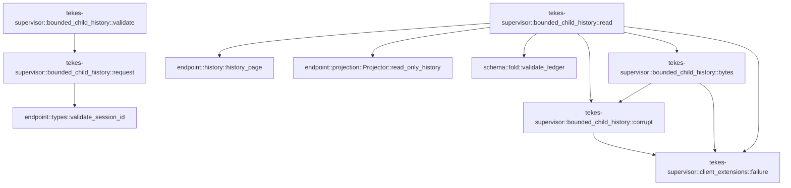

# tekes-supervisor::bounded_child_history

[Package atlas](index.md) · [Source](../../src/bounded_child_history.rs)

## Declarations

Visibility is the declaration spelling; trait members and reexports require their enclosing interface. `cfg` is not evaluated.

| Symbol | Kind | Visibility | Test / cfg |
|---|---|---|---|
| [tekes-supervisor::bounded_child_history::MAX_LEDGER](../../src/bounded_child_history.rs#L8) | const_item | `private` |  |
| [tekes-supervisor::bounded_child_history::Request](../../src/bounded_child_history.rs#L11) | struct_item | `private` |  |
| [tekes-supervisor::bounded_child_history::request](../../src/bounded_child_history.rs#L19) | function_item | `private` |  |
| [tekes-supervisor::bounded_child_history::validate](../../src/bounded_child_history.rs#L38) | function_item | `pub(crate)` |  |
| [tekes-supervisor::bounded_child_history::corrupt](../../src/bounded_child_history.rs#L41) | function_item | `private` |  |
| [tekes-supervisor::bounded_child_history::bytes](../../src/bounded_child_history.rs#L48) | function_item | `private` |  |
| [tekes-supervisor::bounded_child_history::read](../../src/bounded_child_history.rs#L80) | function_item | `pub(crate)` |  |
| [tekes-supervisor::bounded_child_history::tests::PARENT](../../src/bounded_child_history.rs#L239) | const_item | `private` | test; #[cfg(test)] |
| [tekes-supervisor::bounded_child_history::tests::CHILD](../../src/bounded_child_history.rs#L240) | const_item | `private` | test; #[cfg(test)] |
| [tekes-supervisor::bounded_child_history::tests::fixture](../../src/bounded_child_history.rs#L241) | function_item | `private` | test; #[cfg(test)] |
| [tekes-supervisor::bounded_child_history::tests::owned_child_read_is_frozen_and_creates_no_files](../../src/bounded_child_history.rs#L275) | function_item | `private` | test; #[cfg(test)] |
| [tekes-supervisor::bounded_child_history::tests::ownership_binding_partial_tails_and_symlinks_fail_closed](../../src/bounded_child_history.rs#L310) | function_item | `private` | test; #[cfg(test)] |

## Imports / reexports

| Local name | Source path | Visibility |
|---|---|---|
| `failure` | `crate::client_extensions::failure` | `private` |
| `ProductionRouteFailure` | `crate::endpoint_host::ProductionRouteFailure` | `private` |
| `Deserialize` | `serde::Deserialize` | `private` |
| `Value` | `serde_json::Value` | `private` |
| `json` | `serde_json::json` | `private` |
| `Digest` | `sha2::Digest` | `private` |
| `Sha256` | `sha2::Sha256` | `private` |
| `fs` | `std::fs` | `private` |
| `Read` | `std::io::Read` | `private` |
| `Path` | `std::path::Path` | `private` |
| `*` | `super::*` | `private` |

## Module declarations

| Module | Visibility | Attributes |
|---|---|---|
| `tekes-supervisor::bounded_child_history::tests` | `private` | #[cfg(test)] |

## Function call graphs

Edges below are syntactically resolved calls only, including private functions. Graphs partition callers into groups of 20; they are not execution order. All unresolved sites are listed below and in the JSON inventory.

Functions 1–5: 11 direct edges

## Call sites

Includes test functions (marked in declarations). Receiver-type-required sites need type analysis/manual tracing. Calls in closures are attributed to their enclosing function; their occurrence here does not mean the closure executes immediately.

| Caller | Callee expression | Source lines | Target / classification |
|---|---|---|---|
| `request` | `serde_json::from_value(value.clone())         .map_err` | [20](../../src/bounded_child_history.rs#L20) | receiver-type-required |
| `request` | `serde_json::from_value` | [20](../../src/bounded_child_history.rs#L20) | external-constructor-callback-or-unresolved |
| `request` | `value.clone` | [20](../../src/bounded_child_history.rs#L20) | receiver-type-required |
| `request` | `"invalid child history request".to_owned` | [21](../../src/bounded_child_history.rs#L21) | receiver-type-required |
| `request` | `endpoint::validate_session_id(&request.parent_session_id)         .map_err` | [22](../../src/bounded_child_history.rs#L22) | receiver-type-required |
| `request` | `endpoint::validate_session_id` | [22](../../src/bounded_child_history.rs#L22), [24](../../src/bounded_child_history.rs#L24) | [endpoint::types::validate_session_id](../../../endpoint/src/types.rs#L130) |
| `request` | `endpoint::validate_session_id(&request.child_session_id)         .map_err` | [24](../../src/bounded_child_history.rs#L24) | receiver-type-required |
| `request` | `request.through_sequence.is_some_and` | [29](../../src/bounded_child_history.rs#L29) | receiver-type-required |
| `request` | `request.before_sequence.is_some_and` | [30](../../src/bounded_child_history.rs#L30) | receiver-type-required |
| `request` | `request.before_sequence.is_some` | [31](../../src/bounded_child_history.rs#L31) | receiver-type-required |
| `request` | `request.through_sequence.is_none` | [31](../../src/bounded_child_history.rs#L31), [32](../../src/bounded_child_history.rs#L32) | receiver-type-required |
| `request` | `request.history_revision.is_some` | [32](../../src/bounded_child_history.rs#L32) | receiver-type-required |
| `request` | `Err` | [34](../../src/bounded_child_history.rs#L34) | external-constructor-callback-or-unresolved |
| `request` | `"invalid child history range".into` | [34](../../src/bounded_child_history.rs#L34) | receiver-type-required |
| `request` | `Ok` | [36](../../src/bounded_child_history.rs#L36) | external-constructor-callback-or-unresolved |
| `validate` | `request(value).map` | [39](../../src/bounded_child_history.rs#L39) | receiver-type-required |
| `validate` | `request` | [39](../../src/bounded_child_history.rs#L39) | [tekes-supervisor::bounded_child_history::request](../../src/bounded_child_history.rs#L19) |
| `corrupt` | `failure` | [42](../../src/bounded_child_history.rs#L42) | [tekes-supervisor::client_extensions::failure](../../src/client_extensions.rs#L1864) |
| `bytes` | `fs::symlink_metadata(path).map_err` | [49](../../src/bounded_child_history.rs#L49) | receiver-type-required |
| `bytes` | `fs::symlink_metadata` | [49](../../src/bounded_child_history.rs#L49) | external-constructor-callback-or-unresolved |
| `bytes` | `corrupt` | [49](../../src/bounded_child_history.rs#L49), [63](../../src/bounded_child_history.rs#L63), [67](../../src/bounded_child_history.rs#L67) | [tekes-supervisor::bounded_child_history::corrupt](../../src/bounded_child_history.rs#L41) |
| `bytes` | `metadata.is_file` | [50](../../src/bounded_child_history.rs#L50) | receiver-type-required |
| `bytes` | `metadata.file_type().is_symlink` | [50](../../src/bounded_child_history.rs#L50) | receiver-type-required |
| `bytes` | `metadata.file_type` | [50](../../src/bounded_child_history.rs#L50) | receiver-type-required |
| `bytes` | `metadata.len` | [50](../../src/bounded_child_history.rs#L50) | receiver-type-required |
| `bytes` | `Err` | [51](../../src/bounded_child_history.rs#L51), [69](../../src/bounded_child_history.rs#L69) | external-constructor-callback-or-unresolved |
| `bytes` | `failure` | [51](../../src/bounded_child_history.rs#L51), [69](../../src/bounded_child_history.rs#L69) | [tekes-supervisor::client_extensions::failure](../../src/client_extensions.rs#L1864) |
| `bytes` | `fs::OpenOptions::new()         .read(true)         .custom_flags(libc::O_NOFOLLOW)         .open(path)         .map_err` | [59](../../src/bounded_child_history.rs#L59) | receiver-type-required |
| `bytes` | `fs::OpenOptions::new()         .read(true)         .custom_flags(libc::O_NOFOLLOW)         .open` | [59](../../src/bounded_child_history.rs#L59) | receiver-type-required |
| `bytes` | `fs::OpenOptions::new()         .read(true)         .custom_flags` | [59](../../src/bounded_child_history.rs#L59) | receiver-type-required |
| `bytes` | `fs::OpenOptions::new()         .read` | [59](../../src/bounded_child_history.rs#L59) | receiver-type-required |
| `bytes` | `fs::OpenOptions::new` | [59](../../src/bounded_child_history.rs#L59) | external-constructor-callback-or-unresolved |
| `bytes` | `Vec::new` | [64](../../src/bounded_child_history.rs#L64) | external-constructor-callback-or-unresolved |
| `bytes` | `file.take(MAX_LEDGER + 1)         .read_to_end(&mut bytes)         .map_err` | [65](../../src/bounded_child_history.rs#L65) | receiver-type-required |
| `bytes` | `file.take(MAX_LEDGER + 1)         .read_to_end` | [65](../../src/bounded_child_history.rs#L65) | receiver-type-required |
| `bytes` | `file.take` | [65](../../src/bounded_child_history.rs#L65) | receiver-type-required |
| `bytes` | `bytes.len` | [68](../../src/bounded_child_history.rs#L68) | receiver-type-required |
| `bytes` | `bytes.iter().rposition(&#124;b&#124; *b == b'\n').map_or` | [76](../../src/bounded_child_history.rs#L76) | receiver-type-required |
| `bytes` | `bytes.iter().rposition` | [76](../../src/bounded_child_history.rs#L76) | receiver-type-required |
| `bytes` | `bytes.iter` | [76](../../src/bounded_child_history.rs#L76) | receiver-type-required |
| `bytes` | `bytes.truncate` | [77](../../src/bounded_child_history.rs#L77) | receiver-type-required |
| `bytes` | `Ok` | [78](../../src/bounded_child_history.rs#L78) | external-constructor-callback-or-unresolved |
| `read` | `request(payload).map_err` | [82](../../src/bounded_child_history.rs#L82) | receiver-type-required |
| `read` | `request` | [82](../../src/bounded_child_history.rs#L82) | external-constructor-callback-or-unresolved |
| `read` | `failure` | [82](../../src/bounded_child_history.rs#L82), [107](../../src/bounded_child_history.rs#L107), [125](../../src/bounded_child_history.rs#L125), [140](../../src/bounded_child_history.rs#L140), [152](../../src/bounded_child_history.rs#L152), [180](../../src/bounded_child_history.rs#L180), [227](../../src/bounded_child_history.rs#L227) | [tekes-supervisor::client_extensions::failure](../../src/client_extensions.rs#L1864) |
| `read` | `fs::symlink_metadata(folder)         .map_err(&#124;_&#124; corrupt("session folder unavailable"))?         .file_type()         .is_symlink` | [83](../../src/bounded_child_history.rs#L83) | receiver-type-required |
| `read` | `fs::symlink_metadata(folder)         .map_err(&#124;_&#124; corrupt("session folder unavailable"))?         .file_type` | [83](../../src/bounded_child_history.rs#L83) | receiver-type-required |
| `read` | `fs::symlink_metadata(folder)         .map_err` | [83](../../src/bounded_child_history.rs#L83) | receiver-type-required |
| `read` | `fs::symlink_metadata` | [83](../../src/bounded_child_history.rs#L83) | external-constructor-callback-or-unresolved |
| `read` | `corrupt` | [84](../../src/bounded_child_history.rs#L84), [88](../../src/bounded_child_history.rs#L88), [92](../../src/bounded_child_history.rs#L92), [96](../../src/bounded_child_history.rs#L96), [114](../../src/bounded_child_history.rs#L114), [118](../../src/bounded_child_history.rs#L118), [119](../../src/bounded_child_history.rs#L119), [132](../../src/bounded_child_history.rs#L132), [166](../../src/bounded_child_history.rs#L166), [171](../../src/bounded_child_history.rs#L171), [191](../../src/bounded_child_history.rs#L191), [223](../../src/bounded_child_history.rs#L223) | [tekes-supervisor::bounded_child_history::corrupt](../../src/bounded_child_history.rs#L41) |
| `read` | `Err` | [88](../../src/bounded_child_history.rs#L88), [96](../../src/bounded_child_history.rs#L96), [125](../../src/bounded_child_history.rs#L125), [140](../../src/bounded_child_history.rs#L140), [152](../../src/bounded_child_history.rs#L152), [180](../../src/bounded_child_history.rs#L180), [227](../../src/bounded_child_history.rs#L227) | external-constructor-callback-or-unresolved |
| `read` | `schema::validate_ledger(&bytes(&folder.join("main.jsonl"))?, schema::READER_VERSION)             .map_err` | [91](../../src/bounded_child_history.rs#L91) | receiver-type-required |
| `read` | `schema::validate_ledger` | [91](../../src/bounded_child_history.rs#L91), [113](../../src/bounded_child_history.rs#L113) | [schema::fold::validate_ledger](../../../schema/src/fold.rs#L1092) |
| `read` | `bytes` | [91](../../src/bounded_child_history.rs#L91), [113](../../src/bounded_child_history.rs#L113) | [tekes-supervisor::bounded_child_history::bytes](../../src/bounded_child_history.rs#L48) |
| `read` | `folder.join` | [91](../../src/bounded_child_history.rs#L91), [113](../../src/bounded_child_history.rs#L113) | receiver-type-required |
| `read` | `parent.events.first().and_then` | [93](../../src/bounded_child_history.rs#L93) | receiver-type-required |
| `read` | `parent.events.first` | [93](../../src/bounded_child_history.rs#L93) | receiver-type-required |
| `read` | `e.string_field` | [93](../../src/bounded_child_history.rs#L93), [104](../../src/bounded_child_history.rs#L104), [207](../../src/bounded_child_history.rs#L207), [218](../../src/bounded_child_history.rs#L218) | receiver-type-required |
| `read` | `Some` | [94](../../src/bounded_child_history.rs#L94), [104](../../src/bounded_child_history.rs#L104), [120](../../src/bounded_child_history.rs#L120), [122](../../src/bounded_child_history.rs#L122), [189](../../src/bounded_child_history.rs#L189), [207](../../src/bounded_child_history.rs#L207) | external-constructor-callback-or-unresolved |
| `read` | `parent         .events         .iter()         .find(&#124;e&#124; {             *e.kind() == schema::EventKind::Spawn                 && e.string_field("child") == Some(child_file.as_str())         })         .ok_or_else` | [99](../../src/bounded_child_history.rs#L99) | receiver-type-required |
| `read` | `parent         .events         .iter()         .find` | [99](../../src/bounded_child_history.rs#L99), [204](../../src/bounded_child_history.rs#L204) | receiver-type-required |
| `read` | `parent         .events         .iter` | [99](../../src/bounded_child_history.rs#L99), [204](../../src/bounded_child_history.rs#L204), [209](../../src/bounded_child_history.rs#L209) | receiver-type-required |
| `read` | `e.kind` | [103](../../src/bounded_child_history.rs#L103), [207](../../src/bounded_child_history.rs#L207) | receiver-type-required |
| `read` | `child_file.as_str` | [104](../../src/bounded_child_history.rs#L104) | receiver-type-required |
| `read` | `schema::validate_ledger(&bytes(&folder.join(&child_file))?, schema::READER_VERSION)         .map_err` | [113](../../src/bounded_child_history.rs#L113) | receiver-type-required |
| `read` | `child         .events         .first()         .ok_or_else` | [115](../../src/bounded_child_history.rs#L115) | receiver-type-required |
| `read` | `child         .events         .first` | [115](../../src/bounded_child_history.rs#L115) | receiver-type-required |
| `read` | `serde_json::to_value(genesis.raw()).map_err` | [119](../../src/bounded_child_history.rs#L119) | receiver-type-required |
| `read` | `serde_json::to_value` | [119](../../src/bounded_child_history.rs#L119), [208](../../src/bounded_child_history.rs#L208), [212](../../src/bounded_child_history.rs#L212) | external-constructor-callback-or-unresolved |
| `read` | `genesis.raw` | [119](../../src/bounded_child_history.rs#L119) | receiver-type-required |
| `read` | `genesis.string_field` | [120](../../src/bounded_child_history.rs#L120) | receiver-type-required |
| `read` | `request.child_session_id.as_str` | [120](../../src/bounded_child_history.rs#L120) | receiver-type-required |
| `read` | `raw["parent"]["seq"].as_u64` | [122](../../src/bounded_child_history.rs#L122) | receiver-type-required |
| `read` | `spawn.seq` | [122](../../src/bounded_child_history.rs#L122) | receiver-type-required |
| `read` | `raw["parent"]["spawn_id"].as_str` | [123](../../src/bounded_child_history.rs#L123) | receiver-type-required |
| `read` | `spawn.string_field` | [123](../../src/bounded_child_history.rs#L123), [203](../../src/bounded_child_history.rs#L203) | receiver-type-required |
| `read` | `endpoint::Projector::read_only_history(&child.events, folder)         .map_err` | [131](../../src/bounded_child_history.rs#L131) | receiver-type-required |
| `read` | `endpoint::Projector::read_only_history` | [131](../../src/bounded_child_history.rs#L131) | [endpoint::projection::Projector::read_only_history](../../../endpoint/src/projection.rs#L135) |
| `read` | `records.last().map_or` | [133](../../src/bounded_child_history.rs#L133) | receiver-type-required |
| `read` | `records.last` | [133](../../src/bounded_child_history.rs#L133) | receiver-type-required |
| `read` | `request.through_sequence.unwrap_or` | [134](../../src/bounded_child_history.rs#L134) | receiver-type-required |
| `read` | `request             .before_sequence             .is_some_and` | [136](../../src/bounded_child_history.rs#L136) | receiver-type-required |
| `read` | `cut.saturating_add` | [138](../../src/bounded_child_history.rs#L138) | receiver-type-required |
| `read` | `records             .get(cut as usize)             .zip(records.get(cut as usize + 1))             .is_some_and` | [147](../../src/bounded_child_history.rs#L147) | receiver-type-required |
| `read` | `records             .get(cut as usize)             .zip` | [147](../../src/bounded_child_history.rs#L147) | receiver-type-required |
| `read` | `records             .get` | [147](../../src/bounded_child_history.rs#L147) | receiver-type-required |
| `read` | `records.get` | [149](../../src/bounded_child_history.rs#L149) | receiver-type-required |
| `read` | `a.kernel_seqs.iter().any` | [150](../../src/bounded_child_history.rs#L150) | receiver-type-required |
| `read` | `a.kernel_seqs.iter` | [150](../../src/bounded_child_history.rs#L150) | receiver-type-required |
| `read` | `b.kernel_seqs.contains` | [150](../../src/bounded_child_history.rs#L150) | receiver-type-required |
| `read` | `records         .into_iter()         .filter(&#124;r&#124; r.event.seq as i64 <= cut)         .collect` | [158](../../src/bounded_child_history.rs#L158) | receiver-type-required |
| `read` | `records         .into_iter()         .filter` | [158](../../src/bounded_child_history.rs#L158) | receiver-type-required |
| `read` | `records         .into_iter` | [158](../../src/bounded_child_history.rs#L158) | receiver-type-required |
| `read` | `Sha256::new` | [162](../../src/bounded_child_history.rs#L162) | external-constructor-callback-or-unresolved |
| `read` | `hasher.update` | [163](../../src/bounded_child_history.rs#L163), [169](../../src/bounded_child_history.rs#L169) | receiver-type-required |
| `read` | `genesis             .canonical_bytes()             .map_err` | [164](../../src/bounded_child_history.rs#L164) | receiver-type-required |
| `read` | `genesis             .canonical_bytes` | [164](../../src/bounded_child_history.rs#L164) | receiver-type-required |
| `read` | `row.canonical_bytes()                 .map_err` | [170](../../src/bounded_child_history.rs#L170) | receiver-type-required |
| `read` | `row.canonical_bytes` | [170](../../src/bounded_child_history.rs#L170) | receiver-type-required |
| `read` | `request         .history_revision         .as_ref()         .is_some_and` | [175](../../src/bounded_child_history.rs#L175) | receiver-type-required |
| `read` | `request         .history_revision         .as_ref` | [175](../../src/bounded_child_history.rs#L175) | receiver-type-required |
| `read` | `endpoint::history_page(         &prefix,         request.before_sequence.map(&#124;s&#124; s as u64),         Some(request.max_messages),     )     .map_err` | [186](../../src/bounded_child_history.rs#L186) | receiver-type-required |
| `read` | `endpoint::history_page` | [186](../../src/bounded_child_history.rs#L186) | [endpoint::history::history_page](../../../endpoint/src/history.rs#L13) |
| `read` | `request.before_sequence.map` | [188](../../src/bounded_child_history.rs#L188) | receiver-type-required |
| `read` | `child         .events         .iter()         .any` | [192](../../src/bounded_child_history.rs#L192) | receiver-type-required |
| `read` | `child         .events         .iter` | [192](../../src/bounded_child_history.rs#L192) | receiver-type-required |
| `read` | `row.event.event_type.as_str` | [197](../../src/bounded_child_history.rs#L197) | receiver-type-required |
| `read` | `spawn.string_field("call").unwrap_or_default` | [203](../../src/bounded_child_history.rs#L203) | receiver-type-required |
| `read` | `parent         .events         .iter()         .find(&#124;e&#124; *e.kind() == schema::EventKind::ToolCall && e.string_field("call") == Some(call))         .map` | [204](../../src/bounded_child_history.rs#L204) | receiver-type-required |
| `read` | `serde_json::to_value(e.raw()).unwrap_or` | [208](../../src/bounded_child_history.rs#L208) | receiver-type-required |
| `read` | `e.raw` | [208](../../src/bounded_child_history.rs#L208), [212](../../src/bounded_child_history.rs#L212) | receiver-type-required |
| `read` | `parent         .events         .iter()         .filter_map(&#124;e&#124; serde_json::to_value(e.raw()).ok())         .find` | [209](../../src/bounded_child_history.rs#L209) | receiver-type-required |
| `read` | `parent         .events         .iter()         .filter_map` | [209](../../src/bounded_child_history.rs#L209) | receiver-type-required |
| `read` | `serde_json::to_value(e.raw()).ok` | [212](../../src/bounded_child_history.rs#L212) | receiver-type-required |
| `read` | `source.map` | [216](../../src/bounded_child_history.rs#L216) | receiver-type-required |
| `read` | `effective.as_ref().map_or` | [217](../../src/bounded_child_history.rs#L217) | receiver-type-required |
| `read` | `effective.as_ref` | [217](../../src/bounded_child_history.rs#L217) | receiver-type-required |
| `read` | `child.events.iter().rev().find(&#124;e&#124; matches!(e.kind(),schema::EventKind::Settle)).and_then` | [218](../../src/bounded_child_history.rs#L218) | receiver-type-required |
| `read` | `child.events.iter().rev().find` | [218](../../src/bounded_child_history.rs#L218) | receiver-type-required |
| `read` | `child.events.iter().rev` | [218](../../src/bounded_child_history.rs#L218) | receiver-type-required |
| `read` | `child.events.iter` | [218](../../src/bounded_child_history.rs#L218) | receiver-type-required |
| `read` | `serde_json::to_vec(&value)         .map_err(&#124;_&#124; corrupt("child response invalid"))?         .len` | [222](../../src/bounded_child_history.rs#L222) | receiver-type-required |
| `read` | `serde_json::to_vec(&value)         .map_err` | [222](../../src/bounded_child_history.rs#L222) | receiver-type-required |
| `read` | `serde_json::to_vec` | [222](../../src/bounded_child_history.rs#L222) | external-constructor-callback-or-unresolved |
| `read` | `Ok` | [233](../../src/bounded_child_history.rs#L233) | external-constructor-callback-or-unresolved |
| `fixture` | `tempfile::tempdir().unwrap` | [242](../../src/bounded_child_history.rs#L242) | receiver-type-required |
| `fixture` | `tempfile::tempdir` | [242](../../src/bounded_child_history.rs#L242) | external-constructor-callback-or-unresolved |
| `fixture` | `test_support::FixtureRoot::discover().unwrap` | [243](../../src/bounded_child_history.rs#L243) | receiver-type-required |
| `fixture` | `test_support::FixtureRoot::discover` | [243](../../src/bounded_child_history.rs#L243) | [test-support::FixtureRoot::discover](../../../test-support/src/lib.rs#L36) |
| `fixture` | `fs::read_to_string(corpus.join("endpoint/projection-source.jsonl")).unwrap` | [244](../../src/bounded_child_history.rs#L244) | receiver-type-required |
| `fixture` | `fs::read_to_string` | [244](../../src/bounded_child_history.rs#L244), [260](../../src/bounded_child_history.rs#L260) | external-constructor-callback-or-unresolved |
| `fixture` | `corpus.join` | [244](../../src/bounded_child_history.rs#L244), [260](../../src/bounded_child_history.rs#L260) | receiver-type-required |
| `fixture` | `parent             .lines()             .take(6)             .map(&#124;s&#124; serde_json::from_str(s).unwrap())             .collect` | [245](../../src/bounded_child_history.rs#L245) | receiver-type-required |
| `fixture` | `parent             .lines()             .take(6)             .map` | [245](../../src/bounded_child_history.rs#L245) | receiver-type-required |
| `fixture` | `parent             .lines()             .take` | [245](../../src/bounded_child_history.rs#L245) | receiver-type-required |
| `fixture` | `parent             .lines` | [245](../../src/bounded_child_history.rs#L245) | receiver-type-required |
| `fixture` | `serde_json::from_str(s).unwrap` | [248](../../src/bounded_child_history.rs#L248), [263](../../src/bounded_child_history.rs#L263) | receiver-type-required |
| `fixture` | `serde_json::from_str` | [248](../../src/bounded_child_history.rs#L248), [263](../../src/bounded_child_history.rs#L263) | external-constructor-callback-or-unresolved |
| `fixture` | `events[0]["ts"].clone` | [250](../../src/bounded_child_history.rs#L250) | receiver-type-required |
| `fixture` | `events.push` | [251](../../src/bounded_child_history.rs#L251), [252](../../src/bounded_child_history.rs#L252), [253](../../src/bounded_child_history.rs#L253) | receiver-type-required |
| `fixture` | `events             .into_iter()             .map(&#124;v&#124; v.to_string() + "\n")             .collect::<String>` | [254](../../src/bounded_child_history.rs#L254) | receiver-type-required |
| `fixture` | `events             .into_iter()             .map` | [254](../../src/bounded_child_history.rs#L254) | receiver-type-required |
| `fixture` | `events             .into_iter` | [254](../../src/bounded_child_history.rs#L254) | receiver-type-required |
| `fixture` | `v.to_string` | [256](../../src/bounded_child_history.rs#L256), [268](../../src/bounded_child_history.rs#L268) | receiver-type-required |
| `fixture` | `schema::validate_ledger(text.as_bytes(), schema::READER_VERSION).unwrap` | [258](../../src/bounded_child_history.rs#L258), [270](../../src/bounded_child_history.rs#L270) | receiver-type-required |
| `fixture` | `schema::validate_ledger` | [258](../../src/bounded_child_history.rs#L258), [270](../../src/bounded_child_history.rs#L270) | [schema::fold::validate_ledger](../../../schema/src/fold.rs#L1092) |
| `fixture` | `text.as_bytes` | [258](../../src/bounded_child_history.rs#L258), [270](../../src/bounded_child_history.rs#L270) | receiver-type-required |
| `fixture` | `fs::write(root.path().join("main.jsonl"), text).unwrap` | [259](../../src/bounded_child_history.rs#L259) | receiver-type-required |
| `fixture` | `fs::write` | [259](../../src/bounded_child_history.rs#L259), [271](../../src/bounded_child_history.rs#L271) | external-constructor-callback-or-unresolved |
| `fixture` | `root.path().join` | [259](../../src/bounded_child_history.rs#L259), [271](../../src/bounded_child_history.rs#L271) | receiver-type-required |
| `fixture` | `root.path` | [259](../../src/bounded_child_history.rs#L259), [271](../../src/bounded_child_history.rs#L271) | receiver-type-required |
| `fixture` | `fs::read_to_string(corpus.join("replay/cancel-before-start.jsonl")).unwrap` | [260](../../src/bounded_child_history.rs#L260) | receiver-type-required |
| `fixture` | `child             .lines()             .map(&#124;s&#124; serde_json::from_str(s).unwrap())             .collect` | [261](../../src/bounded_child_history.rs#L261) | receiver-type-required |
| `fixture` | `child             .lines()             .map` | [261](../../src/bounded_child_history.rs#L261) | receiver-type-required |
| `fixture` | `child             .lines` | [261](../../src/bounded_child_history.rs#L261) | receiver-type-required |
| `fixture` | `child             .into_iter()             .map(&#124;v&#124; v.to_string() + "\n")             .collect::<String>` | [266](../../src/bounded_child_history.rs#L266) | receiver-type-required |
| `fixture` | `child             .into_iter()             .map` | [266](../../src/bounded_child_history.rs#L266) | receiver-type-required |
| `fixture` | `child             .into_iter` | [266](../../src/bounded_child_history.rs#L266) | receiver-type-required |
| `fixture` | `fs::write(root.path().join(format!("{CHILD}.jsonl")), text).unwrap` | [271](../../src/bounded_child_history.rs#L271) | receiver-type-required |
| `owned_child_read_is_frozen_and_creates_no_files` | `fixture` | [276](../../src/bounded_child_history.rs#L276) | [tekes-supervisor::bounded_child_history::tests::fixture](../../src/bounded_child_history.rs#L241) |
| `owned_child_read_is_frozen_and_creates_no_files` | `fs::read_dir(root.path()).unwrap().count` | [277](../../src/bounded_child_history.rs#L277) | receiver-type-required |
| `owned_child_read_is_frozen_and_creates_no_files` | `fs::read_dir(root.path()).unwrap` | [277](../../src/bounded_child_history.rs#L277) | receiver-type-required |
| `owned_child_read_is_frozen_and_creates_no_files` | `fs::read_dir` | [277](../../src/bounded_child_history.rs#L277) | external-constructor-callback-or-unresolved |
| `owned_child_read_is_frozen_and_creates_no_files` | `root.path` | [277](../../src/bounded_child_history.rs#L277), [279](../../src/bounded_child_history.rs#L279) | receiver-type-required |
| `owned_child_read_is_frozen_and_creates_no_files` | `read(root.path(), &request).unwrap` | [279](../../src/bounded_child_history.rs#L279) | receiver-type-required |
| `owned_child_read_is_frozen_and_creates_no_files` | `read` | [279](../../src/bounded_child_history.rs#L279) | external-constructor-callback-or-unresolved |
| `owned_child_read_is_frozen_and_creates_no_files` | `request.clone` | [293](../../src/bounded_child_history.rs#L293) | receiver-type-required |
| `owned_child_read_is_frozen_and_creates_no_files` | `page["throughSequence"].clone` | [294](../../src/bounded_child_history.rs#L294) | receiver-type-required |
| `owned_child_read_is_frozen_and_creates_no_files` | `page["historyRevision"].clone` | [295](../../src/bounded_child_history.rs#L295), [302](../../src/bounded_child_history.rs#L302) | receiver-type-required |
| `ownership_binding_partial_tails_and_symlinks_fail_closed` | `fixture` | [311](../../src/bounded_child_history.rs#L311) | [tekes-supervisor::bounded_child_history::tests::fixture](../../src/bounded_child_history.rs#L241) |
| `ownership_binding_partial_tails_and_symlinks_fail_closed` | `read(root.path(), &request).unwrap` | [313](../../src/bounded_child_history.rs#L313) | receiver-type-required |
| `ownership_binding_partial_tails_and_symlinks_fail_closed` | `read` | [313](../../src/bounded_child_history.rs#L313) | external-constructor-callback-or-unresolved |
| `ownership_binding_partial_tails_and_symlinks_fail_closed` | `root.path` | [313](../../src/bounded_child_history.rs#L313), [314](../../src/bounded_child_history.rs#L314) | receiver-type-required |
| `ownership_binding_partial_tails_and_symlinks_fail_closed` | `root.path().join` | [314](../../src/bounded_child_history.rs#L314) | receiver-type-required |
| `ownership_binding_partial_tails_and_symlinks_fail_closed` | `fs::read(&file).unwrap` | [315](../../src/bounded_child_history.rs#L315) | receiver-type-required |
| `ownership_binding_partial_tails_and_symlinks_fail_closed` | `fs::read` | [315](../../src/bounded_child_history.rs#L315) | external-constructor-callback-or-unresolved |
| `ownership_binding_partial_tails_and_symlinks_fail_closed` | `original.clone` | [316](../../src/bounded_child_history.rs#L316) | receiver-type-required |
| `ownership_binding_partial_tails_and_symlinks_fail_closed` | `torn.extend` | [317](../../src/bounded_child_history.rs#L317) | receiver-type-required |
| `ownership_binding_partial_tails_and_symlinks_fail_closed` | `fs::write(&file, &torn).unwrap` | [318](../../src/bounded_child_history.rs#L318) | receiver-type-required |
| `ownership_binding_partial_tails_and_symlinks_fail_closed` | `fs::write` | [318](../../src/bounded_child_history.rs#L318), [323](../../src/bounded_child_history.rs#L323), [330](../../src/bounded_child_history.rs#L330) | external-constructor-callback-or-unresolved |
| `ownership_binding_partial_tails_and_symlinks_fail_closed` | `fs::write(&file, &original).unwrap` | [323](../../src/bounded_child_history.rs#L323) | receiver-type-required |
| `ownership_binding_partial_tails_and_symlinks_fail_closed` | `String::from_utf8(original)             .unwrap()             .lines()             .map(&#124;s&#124; serde_json::from_str(s).unwrap())             .collect` | [324](../../src/bounded_child_history.rs#L324) | receiver-type-required |
| `ownership_binding_partial_tails_and_symlinks_fail_closed` | `String::from_utf8(original)             .unwrap()             .lines()             .map` | [324](../../src/bounded_child_history.rs#L324) | receiver-type-required |
| `ownership_binding_partial_tails_and_symlinks_fail_closed` | `String::from_utf8(original)             .unwrap()             .lines` | [324](../../src/bounded_child_history.rs#L324) | receiver-type-required |
| `ownership_binding_partial_tails_and_symlinks_fail_closed` | `String::from_utf8(original)             .unwrap` | [324](../../src/bounded_child_history.rs#L324) | receiver-type-required |
| `ownership_binding_partial_tails_and_symlinks_fail_closed` | `String::from_utf8` | [324](../../src/bounded_child_history.rs#L324) | external-constructor-callback-or-unresolved |
| `ownership_binding_partial_tails_and_symlinks_fail_closed` | `serde_json::from_str(s).unwrap` | [327](../../src/bounded_child_history.rs#L327) | receiver-type-required |
| `ownership_binding_partial_tails_and_symlinks_fail_closed` | `serde_json::from_str` | [327](../../src/bounded_child_history.rs#L327) | external-constructor-callback-or-unresolved |
| `ownership_binding_partial_tails_and_symlinks_fail_closed` | `fs::write(             &file,             lines                 .into_iter()                 .map(&#124;v&#124; v.to_string() + "\n")                 .collect::<String>(),         )         .unwrap` | [330](../../src/bounded_child_history.rs#L330) | receiver-type-required |
| `ownership_binding_partial_tails_and_symlinks_fail_closed` | `lines                 .into_iter()                 .map(&#124;v&#124; v.to_string() + "\n")                 .collect::<String>` | [332](../../src/bounded_child_history.rs#L332) | receiver-type-required |
| `ownership_binding_partial_tails_and_symlinks_fail_closed` | `lines                 .into_iter()                 .map` | [332](../../src/bounded_child_history.rs#L332) | receiver-type-required |
| `ownership_binding_partial_tails_and_symlinks_fail_closed` | `lines                 .into_iter` | [332](../../src/bounded_child_history.rs#L332) | receiver-type-required |
| `ownership_binding_partial_tails_and_symlinks_fail_closed` | `v.to_string` | [334](../../src/bounded_child_history.rs#L334) | receiver-type-required |
| `ownership_binding_partial_tails_and_symlinks_fail_closed` | `fs::remove_file(&file).unwrap` | [342](../../src/bounded_child_history.rs#L342) | receiver-type-required |
| `ownership_binding_partial_tails_and_symlinks_fail_closed` | `fs::remove_file` | [342](../../src/bounded_child_history.rs#L342) | external-constructor-callback-or-unresolved |
| `ownership_binding_partial_tails_and_symlinks_fail_closed` | `std::os::unix::fs::symlink("main.jsonl", &file).unwrap` | [343](../../src/bounded_child_history.rs#L343) | receiver-type-required |
| `ownership_binding_partial_tails_and_symlinks_fail_closed` | `std::os::unix::fs::symlink` | [343](../../src/bounded_child_history.rs#L343) | external-constructor-callback-or-unresolved |
