# tekes-supervisor::builtin

[Package atlas](index.md) · [Source](../../src/builtin.rs)

## Declarations

Visibility is the declaration spelling; trait members and reexports require their enclosing interface. `cfg` is not evaluated.

| Symbol | Kind | Visibility | Test / cfg |
|---|---|---|---|
| [tekes-supervisor::builtin::Result](../../src/builtin.rs#L16) | type_item | `private` |  |
| [tekes-supervisor::builtin::BuiltInLaunch](../../src/builtin.rs#L20) | struct_item | `pub` |  |
| [tekes-supervisor::builtin::LaunchProviders](../../src/builtin.rs#L41) | enum_item | `pub` |  |
| [tekes-supervisor::builtin::LaunchProviders::deserialize](../../src/builtin.rs#L48) | function_item | `private` |  |
| [tekes-supervisor::builtin::ConfigurationMode](../../src/builtin.rs#L58) | enum_item | `pub` |  |
| [tekes-supervisor::builtin::configured_providers](../../src/builtin.rs#L64) | function_item | `private` |  |
| [tekes-supervisor::builtin::read_existing_configuration](../../src/builtin.rs#L81) | function_item | `private` |  |
| [tekes-supervisor::builtin::validate_credential_bindings](../../src/builtin.rs#L134) | function_item | `private` |  |
| [tekes-supervisor::builtin::run](../../src/builtin.rs#L166) | function_item | `pub` |  |
| [tekes-supervisor::builtin::tests::provider](../../src/builtin.rs#L382) | function_item | `private` | test; #[cfg(test)] |
| [tekes-supervisor::builtin::tests::eight_provider_config](../../src/builtin.rs#L403) | function_item | `private` | test; #[cfg(test)] |
| [tekes-supervisor::builtin::tests::base_launch](../../src/builtin.rs#L424) | function_item | `private` | test; #[cfg(test)] |
| [tekes-supervisor::builtin::tests::existing_mode_reads_eight_providers_without_changing_config_bytes_or_revisions](../../src/builtin.rs#L440) | function_item | `private` | test; #[cfg(test)] |
| [tekes-supervisor::builtin::tests::existing_mode_allows_missing_secret_bindings_but_rejects_unknown_ones](../../src/builtin.rs#L479) | function_item | `private` | test; #[cfg(test)] |
| [tekes-supervisor::builtin::tests::existing_mode_fails_missing_or_malformed_config_before_writing_root_state](../../src/builtin.rs#L495) | function_item | `private` | test; #[cfg(test)] |
| [tekes-supervisor::builtin::tests::legacy_launch_defaults_to_provided_and_existing_mode_rejects_mixed_input](../../src/builtin.rs#L528) | function_item | `private` | test; #[cfg(test)] |

## Imports / reexports

| Local name | Source path | Visibility |
|---|---|---|
| `ProductionCarrierAssembly` | `crate::endpoint_carrier::ProductionCarrierAssembly` | `private` |
| `host_runtime` | `crate::host_runtime` | `private` |
| `ProductionProcessHost` | `crate::process_host::ProductionProcessHost` | `private` |
| `Deserialize` | `serde::Deserialize` | `private` |
| `Deserializer` | `serde::Deserializer` | `private` |
| `DirBuilderExt` | `std::os::unix::fs::DirBuilderExt` | `private` |
| `OpenOptionsExt` | `std::os::unix::fs::OpenOptionsExt` | `private` |
| `BTreeMap` | `std::collections::BTreeMap` | `private` |
| `io` | `std::io` | `private` |
| `Write` | `std::io::Write` | `private` |
| `SocketAddr` | `std::net::SocketAddr` | `private` |
| `PathBuf` | `std::path::PathBuf` | `private` |
| `Arc` | `std::sync::Arc` | `private` |
| `*` | `super::*` | `private` |
| `Model` | `profile::Model` | `private` |
| `Provider` | `profile::Provider` | `private` |
| `ProvidersConfig` | `profile::ProvidersConfig` | `private` |
| `SettingsConfig` | `profile::SettingsConfig` | `private` |
| `fs` | `std::fs` | `private` |

## Module declarations

| Module | Visibility | Attributes |
|---|---|---|
| `tekes-supervisor::builtin::tests` | `private` | #[cfg(test)] |

## Function call graphs

Edges below are syntactically resolved calls only, including private functions. Graphs partition callers into groups of 20; they are not execution order. All unresolved sites are listed below and in the JSON inventory.

```mermaid
flowchart TD
  n0["profile::config::ConfigRepository::open"]
  n1["tekes-supervisor::boot_trace::start"]
  n2["tekes-supervisor::boot_trace::phase"]
  n3["tekes-supervisor::bootstrap::rejects_legacy_environment"]
  n4["tekes-supervisor::bootstrap::read"]
  n5["tekes-supervisor::builtin::validate_credential_bindings"]
  n6["tekes-supervisor::builtin::run"]
  n7["tekes-supervisor::builtin::LaunchProviders::deserialize"]
  n8["tekes-supervisor::builtin::configured_providers"]
  n9["tekes-supervisor::builtin::read_existing_configuration"]
  n10["tekes-supervisor::endpoint_carrier::ProductionCarrierAssembly::assemble"]
  n11["tekes-supervisor::host_runtime::preflight_storage"]
  n12["tekes-supervisor::host_runtime::assemble_application_endpoint_host"]
  n13["tekes-supervisor::host_runtime::wait_for_launcher_shutdown"]
  n14["tekes-supervisor::host_runtime::install_termination_handler"]
  n15["tekes-supervisor::host_runtime::system_timestamp"]
  n16["tekes-supervisor::host_runtime::ProductionRootLock::acquire"]
  n17["tekes-supervisor::process_host::ProductionProcessHost::open_with_secret_store"]
  n18["transport::auth::BearerToken::new"]
  n19["transport::server::TransportConfig::loopback"]
  n20["transport::server::WebClientConfig::loopback"]
  n6 --> n0
  n6 --> n1
  n6 --> n2
  n6 --> n3
  n6 --> n4
  n6 --> n5
  n6 --> n8
  n6 --> n10
  n6 --> n11
  n6 --> n12
  n6 --> n13
  n6 --> n14
  n6 --> n15
  n6 --> n16
  n6 --> n17
  n6 --> n18
  n6 --> n19
  n6 --> n20
  n8 --> n9
  n9 --> n0
```

Functions 1–5: 20 direct edges

## Call sites

Includes test functions (marked in declarations). Receiver-type-required sites need type analysis/manual tracing. Calls in closures are attributed to their enclosing function; their occurrence here does not mean the closure executes immediately.

| Caller | Callee expression | Source lines | Target / classification |
|---|---|---|---|
| `deserialize` | `profile::ProvidersConfig::deserialize(deserializer).map` | [52](../../src/builtin.rs#L52) | receiver-type-required |
| `deserialize` | `profile::ProvidersConfig::deserialize` | [52](../../src/builtin.rs#L52) | external-constructor-callback-or-unresolved |
| `configured_providers` | `Ok` | [67](../../src/builtin.rs#L67) | external-constructor-callback-or-unresolved |
| `configured_providers` | `providers.clone` | [67](../../src/builtin.rs#L67) | receiver-type-required |
| `configured_providers` | `Err` | [70](../../src/builtin.rs#L70), [73](../../src/builtin.rs#L73) | external-constructor-callback-or-unresolved |
| `configured_providers` | `io::Error::other("provided configuration mode requires providers").into` | [70](../../src/builtin.rs#L70) | receiver-type-required |
| `configured_providers` | `io::Error::other` | [70](../../src/builtin.rs#L70), [73](../../src/builtin.rs#L73) | external-constructor-callback-or-unresolved |
| `configured_providers` | `io::Error::other("existing configuration mode forbids launch providers").into` | [73](../../src/builtin.rs#L73) | receiver-type-required |
| `configured_providers` | `read_existing_configuration` | [76](../../src/builtin.rs#L76) | [tekes-supervisor::builtin::read_existing_configuration](../../src/builtin.rs#L81) |
| `read_existing_configuration` | `root.join("config").join` | [86](../../src/builtin.rs#L86) | receiver-type-required |
| `read_existing_configuration` | `root.join` | [86](../../src/builtin.rs#L86), [98](../../src/builtin.rs#L98), [100](../../src/builtin.rs#L100) | receiver-type-required |
| `read_existing_configuration` | `path.is_file` | [87](../../src/builtin.rs#L87) | receiver-type-required |
| `read_existing_configuration` | `Err` | [88](../../src/builtin.rs#L88), [108](../../src/builtin.rs#L108), [125](../../src/builtin.rs#L125) | external-constructor-callback-or-unresolved |
| `read_existing_configuration` | `io::Error::other(format!(                 "existing configuration requires {}",                 path.display()             ))             .into` | [88](../../src/builtin.rs#L88) | receiver-type-required |
| `read_existing_configuration` | `io::Error::other` | [88](../../src/builtin.rs#L88), [109](../../src/builtin.rs#L109), [118](../../src/builtin.rs#L118), [126](../../src/builtin.rs#L126) | external-constructor-callback-or-unresolved |
| `read_existing_configuration` | `serde_json::from_slice` | [98](../../src/builtin.rs#L98), [100](../../src/builtin.rs#L100) | external-constructor-callback-or-unresolved |
| `read_existing_configuration` | `std::fs::read` | [98](../../src/builtin.rs#L98), [100](../../src/builtin.rs#L100) | external-constructor-callback-or-unresolved |
| `read_existing_configuration` | `profile::ConfigRepository::open` | [101](../../src/builtin.rs#L101) | [profile::config::ConfigRepository::open](../../../profile/src/config.rs#L543) |
| `read_existing_configuration` | `repository.providers` | [102](../../src/builtin.rs#L102) | receiver-type-required |
| `read_existing_configuration` | `repository.settings` | [105](../../src/builtin.rs#L105) | receiver-type-required |
| `read_existing_configuration` | `settings.default_provider.as_deref` | [106](../../src/builtin.rs#L106) | receiver-type-required |
| `read_existing_configuration` | `settings.default_model.is_some` | [107](../../src/builtin.rs#L107) | receiver-type-required |
| `read_existing_configuration` | `io::Error::other("existing settings select a model without a provider").into` | [109](../../src/builtin.rs#L109) | receiver-type-required |
| `read_existing_configuration` | `providers                 .providers                 .iter()                 .find(&#124;provider&#124; provider.id == provider_id)                 .ok_or_else` | [114](../../src/builtin.rs#L114) | receiver-type-required |
| `read_existing_configuration` | `providers                 .providers                 .iter()                 .find` | [114](../../src/builtin.rs#L114) | receiver-type-required |
| `read_existing_configuration` | `providers                 .providers                 .iter` | [114](../../src/builtin.rs#L114) | receiver-type-required |
| `read_existing_configuration` | `settings.default_model.as_deref().is_some_and` | [119](../../src/builtin.rs#L119) | receiver-type-required |
| `read_existing_configuration` | `settings.default_model.as_deref` | [119](../../src/builtin.rs#L119) | receiver-type-required |
| `read_existing_configuration` | `provider                     .models                     .iter()                     .any` | [120](../../src/builtin.rs#L120) | receiver-type-required |
| `read_existing_configuration` | `provider                     .models                     .iter` | [120](../../src/builtin.rs#L120) | receiver-type-required |
| `read_existing_configuration` | `io::Error::other("existing settings select an unavailable model").into` | [126](../../src/builtin.rs#L126) | receiver-type-required |
| `read_existing_configuration` | `Ok` | [131](../../src/builtin.rs#L131) | external-constructor-callback-or-unresolved |
| `validate_credential_bindings` | `providers         .providers         .iter()         .filter_map(&#124;provider&#124; provider.credential_key.as_deref())         .chain(             providers                 .web_search                 .iter()                 .map(&#124;search&#124; search.credential_key.as_str()),         )         .collect` | [138](../../src/builtin.rs#L138) | receiver-type-required |
| `validate_credential_bindings` | `providers         .providers         .iter()         .filter_map(&#124;provider&#124; provider.credential_key.as_deref())         .chain` | [138](../../src/builtin.rs#L138) | receiver-type-required |
| `validate_credential_bindings` | `providers         .providers         .iter()         .filter_map` | [138](../../src/builtin.rs#L138) | receiver-type-required |
| `validate_credential_bindings` | `providers         .providers         .iter` | [138](../../src/builtin.rs#L138) | receiver-type-required |
| `validate_credential_bindings` | `provider.credential_key.as_deref` | [141](../../src/builtin.rs#L141) | receiver-type-required |
| `validate_credential_bindings` | `providers                 .web_search                 .iter()                 .map` | [143](../../src/builtin.rs#L143) | receiver-type-required |
| `validate_credential_bindings` | `providers                 .web_search                 .iter` | [143](../../src/builtin.rs#L143) | receiver-type-required |
| `validate_credential_bindings` | `search.credential_key.as_str` | [146](../../src/builtin.rs#L146) | receiver-type-required |
| `validate_credential_bindings` | `launch         .credential_bindings         .keys()         .map(String::as_str)         .collect` | [149](../../src/builtin.rs#L149) | receiver-type-required |
| `validate_credential_bindings` | `launch         .credential_bindings         .keys()         .map` | [149](../../src/builtin.rs#L149) | receiver-type-required |
| `validate_credential_bindings` | `launch         .credential_bindings         .keys` | [149](../../src/builtin.rs#L149) | receiver-type-required |
| `validate_credential_bindings` | `configured.is_subset` | [155](../../src/builtin.rs#L155) | receiver-type-required |
| `validate_credential_bindings` | `Err` | [155](../../src/builtin.rs#L155), [160](../../src/builtin.rs#L160) | external-constructor-callback-or-unresolved |
| `validate_credential_bindings` | `io::Error::other(             "launch credentials must include every configured provider binding",         )         .into` | [155](../../src/builtin.rs#L155) | receiver-type-required |
| `validate_credential_bindings` | `io::Error::other` | [155](../../src/builtin.rs#L155), [160](../../src/builtin.rs#L160) | external-constructor-callback-or-unresolved |
| `validate_credential_bindings` | `supplied.is_subset` | [159](../../src/builtin.rs#L159) | receiver-type-required |
| `validate_credential_bindings` | `io::Error::other("existing configuration has unknown credential bindings").into` | [160](../../src/builtin.rs#L160) | receiver-type-required |
| `validate_credential_bindings` | `Ok` | [162](../../src/builtin.rs#L162) | external-constructor-callback-or-unresolved |
| `run` | `serde_json::from_slice` | [167](../../src/builtin.rs#L167) | external-constructor-callback-or-unresolved |
| `run` | `std::fs::read` | [167](../../src/builtin.rs#L167) | external-constructor-callback-or-unresolved |
| `run` | `launch.root.is_absolute` | [170](../../src/builtin.rs#L170) | receiver-type-required |
| `run` | `launch.worker.is_absolute` | [171](../../src/builtin.rs#L171) | receiver-type-required |
| `run` | `launch.listen.ip().is_loopback` | [172](../../src/builtin.rs#L172) | receiver-type-required |
| `run` | `launch.listen.ip` | [172](../../src/builtin.rs#L172) | receiver-type-required |
| `run` | `launch             .web_listen             .is_some_and` | [173](../../src/builtin.rs#L173) | receiver-type-required |
| `run` | `address.ip().is_loopback` | [175](../../src/builtin.rs#L175) | receiver-type-required |
| `run` | `address.ip` | [175](../../src/builtin.rs#L175) | receiver-type-required |
| `run` | `Err` | [177](../../src/builtin.rs#L177), [182](../../src/builtin.rs#L182), [193](../../src/builtin.rs#L193), [196](../../src/builtin.rs#L196) | external-constructor-callback-or-unresolved |
| `run` | `io::Error::other("invalid built-in launch configuration").into` | [177](../../src/builtin.rs#L177) | receiver-type-required |
| `run` | `io::Error::other` | [177](../../src/builtin.rs#L177), [182](../../src/builtin.rs#L182), [193](../../src/builtin.rs#L193), [196](../../src/builtin.rs#L196), [228](../../src/builtin.rs#L228), [252](../../src/builtin.rs#L252), [262](../../src/builtin.rs#L262) | external-constructor-callback-or-unresolved |
| `run` | `launch.web_listen.is_some` | [181](../../src/builtin.rs#L181) | receiver-type-required |
| `run` | `io::Error::other("unauthenticated-web-client-disabled").into` | [182](../../src/builtin.rs#L182) | receiver-type-required |
| `run` | `configured_providers` | [186](../../src/builtin.rs#L186) | [tekes-supervisor::builtin::configured_providers](../../src/builtin.rs#L64) |
| `run` | `launch.credential_bindings.values().any` | [187](../../src/builtin.rs#L187) | receiver-type-required |
| `run` | `launch.credential_bindings.values` | [187](../../src/builtin.rs#L187) | receiver-type-required |
| `run` | `name.is_empty` | [188](../../src/builtin.rs#L188) | receiver-type-required |
| `run` | `name.bytes().enumerate().all` | [189](../../src/builtin.rs#L189) | receiver-type-required |
| `run` | `name.bytes().enumerate` | [189](../../src/builtin.rs#L189) | receiver-type-required |
| `run` | `name.bytes` | [189](../../src/builtin.rs#L189) | receiver-type-required |
| `run` | `byte.is_ascii_alphabetic` | [190](../../src/builtin.rs#L190) | receiver-type-required |
| `run` | `byte.is_ascii_digit` | [190](../../src/builtin.rs#L190) | receiver-type-required |
| `run` | `io::Error::other("invalid-launch-credential-bindings").into` | [193](../../src/builtin.rs#L193) | receiver-type-required |
| `run` | `crate::bootstrap::rejects_legacy_environment` | [195](../../src/builtin.rs#L195) | [tekes-supervisor::bootstrap::rejects_legacy_environment](../../src/bootstrap.rs#L166) |
| `run` | `io::Error::other("legacy-secret-environment-rejected").into` | [196](../../src/builtin.rs#L196) | receiver-type-required |
| `run` | `validate_credential_bindings` | [198](../../src/builtin.rs#L198) | [tekes-supervisor::builtin::validate_credential_bindings](../../src/builtin.rs#L134) |
| `run` | `crate::bootstrap::read` | [200](../../src/builtin.rs#L200) | [tekes-supervisor::bootstrap::read](../../src/bootstrap.rs#L70) |
| `run` | `transport::BearerToken::new` | [201](../../src/builtin.rs#L201) | [transport::auth::BearerToken::new](../../../transport/src/auth.rs#L36) |
| `run` | `drop` | [202](../../src/builtin.rs#L202) | external-constructor-callback-or-unresolved |
| `run` | `Arc::new` | [203](../../src/builtin.rs#L203), [274](../../src/builtin.rs#L274), [291](../../src/builtin.rs#L291) | external-constructor-callback-or-unresolved |
| `run` | `crate::boot_trace::start` | [204](../../src/builtin.rs#L204) | [tekes-supervisor::boot_trace::start](../../src/boot_trace.rs#L28) |
| `run` | `launch.root.join` | [205](../../src/builtin.rs#L205) | receiver-type-required |
| `run` | `std::fs::DirBuilder::new()         .recursive(true)         .mode(0o700)         .create` | [206](../../src/builtin.rs#L206) | receiver-type-required |
| `run` | `std::fs::DirBuilder::new()         .recursive(true)         .mode` | [206](../../src/builtin.rs#L206) | receiver-type-required |
| `run` | `std::fs::DirBuilder::new()         .recursive` | [206](../../src/builtin.rs#L206) | receiver-type-required |
| `run` | `std::fs::DirBuilder::new` | [206](../../src/builtin.rs#L206) | external-constructor-callback-or-unresolved |
| `run` | `std::fs::OpenOptions::new()         .write(true)         .create(true)         .truncate(false)         .mode(0o600)         .custom_flags(libc::O_NOFOLLOW)         .open` | [210](../../src/builtin.rs#L210) | receiver-type-required |
| `run` | `std::fs::OpenOptions::new()         .write(true)         .create(true)         .truncate(false)         .mode(0o600)         .custom_flags` | [210](../../src/builtin.rs#L210) | receiver-type-required |
| `run` | `std::fs::OpenOptions::new()         .write(true)         .create(true)         .truncate(false)         .mode` | [210](../../src/builtin.rs#L210) | receiver-type-required |
| `run` | `std::fs::OpenOptions::new()         .write(true)         .create(true)         .truncate` | [210](../../src/builtin.rs#L210) | receiver-type-required |
| `run` | `std::fs::OpenOptions::new()         .write(true)         .create` | [210](../../src/builtin.rs#L210) | receiver-type-required |
| `run` | `std::fs::OpenOptions::new()         .write` | [210](../../src/builtin.rs#L210) | receiver-type-required |
| `run` | `std::fs::OpenOptions::new` | [210](../../src/builtin.rs#L210) | external-constructor-callback-or-unresolved |
| `run` | `storage.join` | [216](../../src/builtin.rs#L216) | receiver-type-required |
| `run` | `host_runtime::ProductionRootLock::acquire` | [217](../../src/builtin.rs#L217) | [tekes-supervisor::host_runtime::ProductionRootLock::acquire](../../src/host_runtime.rs#L70) |
| `run` | `crate::boot_trace::phase` | [218](../../src/builtin.rs#L218), [220](../../src/builtin.rs#L220), [259](../../src/builtin.rs#L259), [277](../../src/builtin.rs#L277), [279](../../src/builtin.rs#L279), [298](../../src/builtin.rs#L298), [309](../../src/builtin.rs#L309), [316](../../src/builtin.rs#L316), [334](../../src/builtin.rs#L334) | [tekes-supervisor::boot_trace::phase](../../src/boot_trace.rs#L60) |
| `run` | `host_runtime::preflight_storage` | [219](../../src/builtin.rs#L219) | [tekes-supervisor::host_runtime::preflight_storage](../../src/host_runtime.rs#L210) |
| `run` | `profile::ConfigRepository::open` | [222](../../src/builtin.rs#L222) | [profile::config::ConfigRepository::open](../../../profile/src/config.rs#L543) |
| `run` | `repository.providers` | [223](../../src/builtin.rs#L223) | receiver-type-required |
| `run` | `providers.clone` | [224](../../src/builtin.rs#L224) | receiver-type-required |
| `run` | `current             .revision             .checked_add(1)             .ok_or_else` | [225](../../src/builtin.rs#L225) | receiver-type-required |
| `run` | `current             .revision             .checked_add` | [225](../../src/builtin.rs#L225) | receiver-type-required |
| `run` | `repository.publish_providers` | [229](../../src/builtin.rs#L229) | receiver-type-required |
| `run` | `repository.settings` | [232](../../src/builtin.rs#L232) | receiver-type-required |
| `run` | `provided.providers.iter().any` | [233](../../src/builtin.rs#L233) | receiver-type-required |
| `run` | `provided.providers.iter` | [233](../../src/builtin.rs#L233), [240](../../src/builtin.rs#L240) | receiver-type-required |
| `run` | `settings.default_provider.as_deref` | [234](../../src/builtin.rs#L234) | receiver-type-required |
| `run` | `Some` | [234](../../src/builtin.rs#L234), [236](../../src/builtin.rs#L236), [247](../../src/builtin.rs#L247), [302](../../src/builtin.rs#L302), [326](../../src/builtin.rs#L326) | external-constructor-callback-or-unresolved |
| `run` | `provider.id.as_str` | [234](../../src/builtin.rs#L234) | receiver-type-required |
| `run` | `provider.models.iter().any` | [235](../../src/builtin.rs#L235) | receiver-type-required |
| `run` | `provider.models.iter` | [235](../../src/builtin.rs#L235) | receiver-type-required |
| `run` | `settings.default_model.as_deref` | [236](../../src/builtin.rs#L236) | receiver-type-required |
| `run` | `model.id.as_str` | [236](../../src/builtin.rs#L236) | receiver-type-required |
| `run` | `provided.providers.iter().find_map` | [240](../../src/builtin.rs#L240) | receiver-type-required |
| `run` | `provider                     .models                     .iter()                     .find(&#124;model&#124; model.enabled)                     .map` | [241](../../src/builtin.rs#L241) | receiver-type-required |
| `run` | `provider                     .models                     .iter()                     .find` | [241](../../src/builtin.rs#L241) | receiver-type-required |
| `run` | `provider                     .models                     .iter` | [241](../../src/builtin.rs#L241) | receiver-type-required |
| `run` | `provider.id.clone` | [245](../../src/builtin.rs#L245) | receiver-type-required |
| `run` | `model.id.clone` | [245](../../src/builtin.rs#L245) | receiver-type-required |
| `run` | `selected.map_or` | [247](../../src/builtin.rs#L247) | receiver-type-required |
| `run` | `revision                     .checked_add(1)                     .ok_or_else` | [250](../../src/builtin.rs#L250) | receiver-type-required |
| `run` | `revision                     .checked_add` | [250](../../src/builtin.rs#L250) | receiver-type-required |
| `run` | `repository.publish_settings` | [255](../../src/builtin.rs#L255) | receiver-type-required |
| `run` | `std::env::var_os("HOME")         .map(PathBuf::from)         .ok_or_else(&#124;&#124; io::Error::other("HOME is required for shared user skills"))?         .join` | [260](../../src/builtin.rs#L260) | receiver-type-required |
| `run` | `std::env::var_os("HOME")         .map(PathBuf::from)         .ok_or_else` | [260](../../src/builtin.rs#L260) | receiver-type-required |
| `run` | `std::env::var_os("HOME")         .map` | [260](../../src/builtin.rs#L260) | receiver-type-required |
| `run` | `std::env::var_os` | [260](../../src/builtin.rs#L260) | external-constructor-callback-or-unresolved |
| `run` | `option_env!("TEKES_SELECTED_BUILD").unwrap_or` | [264](../../src/builtin.rs#L264) | receiver-type-required |
| `run` | `ProductionProcessHost::open_with_secret_store` | [265](../../src/builtin.rs#L265) | [tekes-supervisor::process_host::ProductionProcessHost::open_with_secret_store](../../src/process_host.rs#L802) |
| `run` | `process         .mcp_runtime()         .set_stdio_connector` | [272](../../src/builtin.rs#L272) | receiver-type-required |
| `run` | `process         .mcp_runtime` | [272](../../src/builtin.rs#L272) | receiver-type-required |
| `run` | `crate::stdio_channels::UnixStdioChannels` | [274](../../src/builtin.rs#L274) | external-constructor-callback-or-unresolved |
| `run` | `process.preflight_mandatory_authorities` | [278](../../src/builtin.rs#L278) | receiver-type-required |
| `run` | `host_runtime::assemble_application_endpoint_host` | [280](../../src/builtin.rs#L280) | [tekes-supervisor::host_runtime::assemble_application_endpoint_host](../../src/host_runtime.rs#L283) |
| `run` | `build.into` | [283](../../src/builtin.rs#L283) | receiver-type-required |
| `run` | `launch.root.to_string_lossy().into` | [284](../../src/builtin.rs#L284), [288](../../src/builtin.rs#L288) | receiver-type-required |
| `run` | `launch.root.to_string_lossy` | [284](../../src/builtin.rs#L284), [288](../../src/builtin.rs#L288) | receiver-type-required |
| `run` | `host_runtime::system_timestamp()                 .map_err` | [292](../../src/builtin.rs#L292) | receiver-type-required |
| `run` | `host_runtime::system_timestamp` | [292](../../src/builtin.rs#L292) | [tekes-supervisor::host_runtime::system_timestamp](../../src/host_runtime.rs#L406) |
| `run` | `Arc::clone` | [296](../../src/builtin.rs#L296) | external-constructor-callback-or-unresolved |
| `run` | `tokio::net::TcpListener::bind` | [299](../../src/builtin.rs#L299), [302](../../src/builtin.rs#L302) | external-constructor-callback-or-unresolved |
| `run` | `listener.local_addr` | [300](../../src/builtin.rs#L300), [324](../../src/builtin.rs#L324) | receiver-type-required |
| `run` | `transport::TransportConfig::loopback` | [305](../../src/builtin.rs#L305) | [transport::server::TransportConfig::loopback](../../../transport/src/server.rs#L108) |
| `run` | `ProductionCarrierAssembly::assemble(&launch.root, unary, process.clone(), config)?             .with_file_changes` | [307](../../src/builtin.rs#L307) | receiver-type-required |
| `run` | `ProductionCarrierAssembly::assemble` | [307](../../src/builtin.rs#L307) | [tekes-supervisor::endpoint_carrier::ProductionCarrierAssembly::assemble](../../src/endpoint_carrier.rs#L2827) |
| `run` | `process.clone` | [307](../../src/builtin.rs#L307), [308](../../src/builtin.rs#L308) | receiver-type-required |
| `run` | `process.attach_streams` | [310](../../src/builtin.rs#L310) | receiver-type-required |
| `run` | `assembly.streams().clone` | [310](../../src/builtin.rs#L310) | receiver-type-required |
| `run` | `assembly.streams` | [310](../../src/builtin.rs#L310) | receiver-type-required |
| `run` | `process.arm_admission` | [313](../../src/builtin.rs#L313) | receiver-type-required |
| `run` | `assembly.mark_ready` | [314](../../src/builtin.rs#L314) | receiver-type-required |
| `run` | `process.start_periodic_sweep` | [315](../../src/builtin.rs#L315) | receiver-type-required |
| `run` | `host_runtime::install_termination_handler` | [317](../../src/builtin.rs#L317) | [tekes-supervisor::host_runtime::install_termination_handler](../../src/host_runtime.rs#L375) |
| `run` | `assembly.into_server` | [318](../../src/builtin.rs#L318) | receiver-type-required |
| `run` | `server.handle` | [319](../../src/builtin.rs#L319) | receiver-type-required |
| `run` | `server.web_client` | [325](../../src/builtin.rs#L325) | receiver-type-required |
| `run` | `transport::WebClientConfig::loopback` | [325](../../src/builtin.rs#L325) | [transport::server::WebClientConfig::loopback](../../../transport/src/server.rs#L269) |
| `run` | `format!("http://{bound}/").into` | [332](../../src/builtin.rs#L332) | receiver-type-required |
| `run` | `io::stdout().flush` | [336](../../src/builtin.rs#L336) | receiver-type-required |
| `run` | `io::stdout` | [336](../../src/builtin.rs#L336) | external-constructor-callback-or-unresolved |
| `run` | `process.run_post_ready` | [338](../../src/builtin.rs#L338) | receiver-type-required |
| `run` | `server.serve` | [339](../../src/builtin.rs#L339) | receiver-type-required |
| `run` | `service.serve` | [343](../../src/builtin.rs#L343) | receiver-type-required |
| `run` | `std::future::pending` | [344](../../src/builtin.rs#L344) | external-constructor-callback-or-unresolved |
| `run` | `tokio::sync::oneshot::channel` | [351](../../src/builtin.rs#L351) | external-constructor-callback-or-unresolved |
| `run` | `std::thread::Builder::new()         .name("launcher-lifetime".into())         .spawn` | [352](../../src/builtin.rs#L352) | receiver-type-required |
| `run` | `std::thread::Builder::new()         .name` | [352](../../src/builtin.rs#L352) | receiver-type-required |
| `run` | `std::thread::Builder::new` | [352](../../src/builtin.rs#L352) | external-constructor-callback-or-unresolved |
| `run` | `"launcher-lifetime".into` | [353](../../src/builtin.rs#L353) | receiver-type-required |
| `run` | `lifetime_sender.send` | [355](../../src/builtin.rs#L355) | receiver-type-required |
| `run` | `host_runtime::wait_for_launcher_shutdown` | [355](../../src/builtin.rs#L355) | [tekes-supervisor::host_runtime::wait_for_launcher_shutdown](../../src/host_runtime.rs#L366) |
| `run` | `Ok` | [373](../../src/builtin.rs#L373) | external-constructor-callback-or-unresolved |
| `provider` | `id.into` | [384](../../src/builtin.rs#L384) | receiver-type-required |
| `provider` | `"openai_compatible".into` | [386](../../src/builtin.rs#L386) | receiver-type-required |
| `provider` | `"openai_chat_completions".into` | [387](../../src/builtin.rs#L387) | receiver-type-required |
| `provider` | `"user".into` | [388](../../src/builtin.rs#L388) | receiver-type-required |
| `provider` | `"none".into` | [389](../../src/builtin.rs#L389) | receiver-type-required |
| `provider` | `"v1".into` | [390](../../src/builtin.rs#L390) | receiver-type-required |
| `provider` | `Some` | [392](../../src/builtin.rs#L392) | external-constructor-callback-or-unresolved |
| `eight_provider_config` | `[                 "openai",                 "anthropic",                 "google",                 "deepseek",                 "glm",                 "qwen",                 "moonshot",                 "minimax",             ]             .into_iter()             .map(provider)             .collect` | [407](../../src/builtin.rs#L407) | receiver-type-required |
| `eight_provider_config` | `[                 "openai",                 "anthropic",                 "google",                 "deepseek",                 "glm",                 "qwen",                 "moonshot",                 "minimax",             ]             .into_iter()             .map` | [407](../../src/builtin.rs#L407) | receiver-type-required |
| `eight_provider_config` | `[                 "openai",                 "anthropic",                 "google",                 "deepseek",                 "glm",                 "qwen",                 "moonshot",                 "minimax",             ]             .into_iter` | [407](../../src/builtin.rs#L407) | receiver-type-required |
| `base_launch` | `PathBuf::from` | [429](../../src/builtin.rs#L429) | external-constructor-callback-or-unresolved |
| `base_launch` | `"127.0.0.1:0".parse().unwrap` | [430](../../src/builtin.rs#L430) | receiver-type-required |
| `base_launch` | `"127.0.0.1:0".parse` | [430](../../src/builtin.rs#L430) | receiver-type-required |
| `base_launch` | `BTreeMap::new` | [433](../../src/builtin.rs#L433), [434](../../src/builtin.rs#L434) | external-constructor-callback-or-unresolved |
| `existing_mode_reads_eight_providers_without_changing_config_bytes_or_revisions` | `tempfile::tempdir().unwrap` | [441](../../src/builtin.rs#L441) | receiver-type-required |
| `existing_mode_reads_eight_providers_without_changing_config_bytes_or_revisions` | `tempfile::tempdir` | [441](../../src/builtin.rs#L441) | external-constructor-callback-or-unresolved |
| `existing_mode_reads_eight_providers_without_changing_config_bytes_or_revisions` | `profile::ConfigRepository::open(root.path()).unwrap` | [442](../../src/builtin.rs#L442) | receiver-type-required |
| `existing_mode_reads_eight_providers_without_changing_config_bytes_or_revisions` | `profile::ConfigRepository::open` | [442](../../src/builtin.rs#L442) | [profile::config::ConfigRepository::open](../../../profile/src/config.rs#L543) |
| `existing_mode_reads_eight_providers_without_changing_config_bytes_or_revisions` | `root.path` | [442](../../src/builtin.rs#L442), [445](../../src/builtin.rs#L445), [457](../../src/builtin.rs#L457), [461](../../src/builtin.rs#L461), [462](../../src/builtin.rs#L462), [466](../../src/builtin.rs#L466) | receiver-type-required |
| `existing_mode_reads_eight_providers_without_changing_config_bytes_or_revisions` | `eight_provider_config` | [443](../../src/builtin.rs#L443) | [tekes-supervisor::builtin::tests::eight_provider_config](../../src/builtin.rs#L403) |
| `existing_mode_reads_eight_providers_without_changing_config_bytes_or_revisions` | `fs::write(             root.path().join("config/providers.json"),             providers.canonical_bytes().unwrap(),         )         .unwrap` | [444](../../src/builtin.rs#L444) | receiver-type-required |
| `existing_mode_reads_eight_providers_without_changing_config_bytes_or_revisions` | `fs::write` | [444](../../src/builtin.rs#L444), [456](../../src/builtin.rs#L456) | external-constructor-callback-or-unresolved |
| `existing_mode_reads_eight_providers_without_changing_config_bytes_or_revisions` | `root.path().join` | [445](../../src/builtin.rs#L445), [457](../../src/builtin.rs#L457), [461](../../src/builtin.rs#L461), [462](../../src/builtin.rs#L462) | receiver-type-required |
| `existing_mode_reads_eight_providers_without_changing_config_bytes_or_revisions` | `providers.canonical_bytes().unwrap` | [446](../../src/builtin.rs#L446) | receiver-type-required |
| `existing_mode_reads_eight_providers_without_changing_config_bytes_or_revisions` | `providers.canonical_bytes` | [446](../../src/builtin.rs#L446) | receiver-type-required |
| `existing_mode_reads_eight_providers_without_changing_config_bytes_or_revisions` | `Some` | [452](../../src/builtin.rs#L452), [453](../../src/builtin.rs#L453) | external-constructor-callback-or-unresolved |
| `existing_mode_reads_eight_providers_without_changing_config_bytes_or_revisions` | `"glm".into` | [452](../../src/builtin.rs#L452) | receiver-type-required |
| `existing_mode_reads_eight_providers_without_changing_config_bytes_or_revisions` | `"glm-model".into` | [453](../../src/builtin.rs#L453) | receiver-type-required |
| `existing_mode_reads_eight_providers_without_changing_config_bytes_or_revisions` | `fs::write(             root.path().join("config/settings.json"),             settings.canonical_bytes().unwrap(),         )         .unwrap` | [456](../../src/builtin.rs#L456) | receiver-type-required |
| `existing_mode_reads_eight_providers_without_changing_config_bytes_or_revisions` | `settings.canonical_bytes().unwrap` | [458](../../src/builtin.rs#L458) | receiver-type-required |
| `existing_mode_reads_eight_providers_without_changing_config_bytes_or_revisions` | `settings.canonical_bytes` | [458](../../src/builtin.rs#L458) | receiver-type-required |
| `existing_mode_reads_eight_providers_without_changing_config_bytes_or_revisions` | `fs::read(&providers_path).unwrap` | [463](../../src/builtin.rs#L463) | receiver-type-required |
| `existing_mode_reads_eight_providers_without_changing_config_bytes_or_revisions` | `fs::read` | [463](../../src/builtin.rs#L463), [464](../../src/builtin.rs#L464) | external-constructor-callback-or-unresolved |
| `existing_mode_reads_eight_providers_without_changing_config_bytes_or_revisions` | `fs::read(&settings_path).unwrap` | [464](../../src/builtin.rs#L464) | receiver-type-required |
| `existing_mode_reads_eight_providers_without_changing_config_bytes_or_revisions` | `base_launch` | [466](../../src/builtin.rs#L466) | [tekes-supervisor::builtin::tests::base_launch](../../src/builtin.rs#L424) |
| `existing_mode_reads_eight_providers_without_changing_config_bytes_or_revisions` | `root.path().to_path_buf` | [466](../../src/builtin.rs#L466) | receiver-type-required |
| `existing_mode_reads_eight_providers_without_changing_config_bytes_or_revisions` | `configured_providers(&launch).unwrap` | [467](../../src/builtin.rs#L467) | receiver-type-required |
| `existing_mode_reads_eight_providers_without_changing_config_bytes_or_revisions` | `configured_providers` | [467](../../src/builtin.rs#L467) | external-constructor-callback-or-unresolved |
| `existing_mode_allows_missing_secret_bindings_but_rejects_unknown_ones` | `tempfile::tempdir().unwrap` | [480](../../src/builtin.rs#L480) | receiver-type-required |
| `existing_mode_allows_missing_secret_bindings_but_rejects_unknown_ones` | `tempfile::tempdir` | [480](../../src/builtin.rs#L480) | external-constructor-callback-or-unresolved |
| `existing_mode_allows_missing_secret_bindings_but_rejects_unknown_ones` | `base_launch` | [481](../../src/builtin.rs#L481) | [tekes-supervisor::builtin::tests::base_launch](../../src/builtin.rs#L424) |
| `existing_mode_allows_missing_secret_bindings_but_rejects_unknown_ones` | `root.path().to_path_buf` | [481](../../src/builtin.rs#L481) | receiver-type-required |
| `existing_mode_allows_missing_secret_bindings_but_rejects_unknown_ones` | `root.path` | [481](../../src/builtin.rs#L481) | receiver-type-required |
| `existing_mode_allows_missing_secret_bindings_but_rejects_unknown_ones` | `eight_provider_config` | [482](../../src/builtin.rs#L482) | [tekes-supervisor::builtin::tests::eight_provider_config](../../src/builtin.rs#L403) |
| `existing_mode_allows_missing_secret_bindings_but_rejects_unknown_ones` | `launch             .credential_bindings             .insert` | [488](../../src/builtin.rs#L488) | receiver-type-required |
| `existing_mode_allows_missing_secret_bindings_but_rejects_unknown_ones` | `"not-configured".into` | [490](../../src/builtin.rs#L490) | receiver-type-required |
| `existing_mode_allows_missing_secret_bindings_but_rejects_unknown_ones` | `"TEKES_UNUSED".into` | [490](../../src/builtin.rs#L490) | receiver-type-required |
| `existing_mode_fails_missing_or_malformed_config_before_writing_root_state` | `tempfile::tempdir().unwrap` | [496](../../src/builtin.rs#L496) | receiver-type-required |
| `existing_mode_fails_missing_or_malformed_config_before_writing_root_state` | `tempfile::tempdir` | [496](../../src/builtin.rs#L496) | external-constructor-callback-or-unresolved |
| `existing_mode_fails_missing_or_malformed_config_before_writing_root_state` | `base_launch` | [497](../../src/builtin.rs#L497) | [tekes-supervisor::builtin::tests::base_launch](../../src/builtin.rs#L424) |
| `existing_mode_fails_missing_or_malformed_config_before_writing_root_state` | `root.path().to_path_buf` | [497](../../src/builtin.rs#L497) | receiver-type-required |
| `existing_mode_fails_missing_or_malformed_config_before_writing_root_state` | `root.path` | [497](../../src/builtin.rs#L497), [501](../../src/builtin.rs#L501), [502](../../src/builtin.rs#L502), [503](../../src/builtin.rs#L503), [504](../../src/builtin.rs#L504), [514](../../src/builtin.rs#L514) | receiver-type-required |
| `existing_mode_fails_missing_or_malformed_config_before_writing_root_state` | `fs::create_dir(root.path().join("config")).unwrap` | [501](../../src/builtin.rs#L501) | receiver-type-required |
| `existing_mode_fails_missing_or_malformed_config_before_writing_root_state` | `fs::create_dir` | [501](../../src/builtin.rs#L501) | external-constructor-callback-or-unresolved |
| `existing_mode_fails_missing_or_malformed_config_before_writing_root_state` | `root.path().join` | [501](../../src/builtin.rs#L501), [502](../../src/builtin.rs#L502), [503](../../src/builtin.rs#L503), [504](../../src/builtin.rs#L504), [514](../../src/builtin.rs#L514) | receiver-type-required |
| `existing_mode_fails_missing_or_malformed_config_before_writing_root_state` | `fs::write(root.path().join("config/providers.json"), b"not-json").unwrap` | [502](../../src/builtin.rs#L502) | receiver-type-required |
| `existing_mode_fails_missing_or_malformed_config_before_writing_root_state` | `fs::write` | [502](../../src/builtin.rs#L502), [503](../../src/builtin.rs#L503) | external-constructor-callback-or-unresolved |
| `existing_mode_fails_missing_or_malformed_config_before_writing_root_state` | `fs::write(root.path().join("config/settings.json"), b"{}\n").unwrap` | [503](../../src/builtin.rs#L503) | receiver-type-required |
| `existing_mode_fails_missing_or_malformed_config_before_writing_root_state` | `fs::read_dir(root.path().join("config"))             .unwrap()             .map(&#124;entry&#124; {                 (                     entry.as_ref().unwrap().file_name(),                     fs::read(entry.unwrap().path()).unwrap(),                 )             })             .collect` | [504](../../src/builtin.rs#L504), [514](../../src/builtin.rs#L514) | receiver-type-required |
| `existing_mode_fails_missing_or_malformed_config_before_writing_root_state` | `fs::read_dir(root.path().join("config"))             .unwrap()             .map` | [504](../../src/builtin.rs#L504), [514](../../src/builtin.rs#L514) | receiver-type-required |
| `existing_mode_fails_missing_or_malformed_config_before_writing_root_state` | `fs::read_dir(root.path().join("config"))             .unwrap` | [504](../../src/builtin.rs#L504), [514](../../src/builtin.rs#L514) | receiver-type-required |
| `existing_mode_fails_missing_or_malformed_config_before_writing_root_state` | `fs::read_dir` | [504](../../src/builtin.rs#L504), [514](../../src/builtin.rs#L514) | external-constructor-callback-or-unresolved |
| `existing_mode_fails_missing_or_malformed_config_before_writing_root_state` | `entry.as_ref().unwrap().file_name` | [508](../../src/builtin.rs#L508), [518](../../src/builtin.rs#L518) | receiver-type-required |
| `existing_mode_fails_missing_or_malformed_config_before_writing_root_state` | `entry.as_ref().unwrap` | [508](../../src/builtin.rs#L508), [518](../../src/builtin.rs#L518) | receiver-type-required |
| `existing_mode_fails_missing_or_malformed_config_before_writing_root_state` | `entry.as_ref` | [508](../../src/builtin.rs#L508), [518](../../src/builtin.rs#L518) | receiver-type-required |
| `existing_mode_fails_missing_or_malformed_config_before_writing_root_state` | `fs::read(entry.unwrap().path()).unwrap` | [509](../../src/builtin.rs#L509), [519](../../src/builtin.rs#L519) | receiver-type-required |
| `existing_mode_fails_missing_or_malformed_config_before_writing_root_state` | `fs::read` | [509](../../src/builtin.rs#L509), [519](../../src/builtin.rs#L519) | external-constructor-callback-or-unresolved |
| `existing_mode_fails_missing_or_malformed_config_before_writing_root_state` | `entry.unwrap().path` | [509](../../src/builtin.rs#L509), [519](../../src/builtin.rs#L519) | receiver-type-required |
| `existing_mode_fails_missing_or_malformed_config_before_writing_root_state` | `entry.unwrap` | [509](../../src/builtin.rs#L509), [519](../../src/builtin.rs#L519) | receiver-type-required |
| `legacy_launch_defaults_to_provided_and_existing_mode_rejects_mixed_input` | `serde_json::to_value(eight_provider_config()).unwrap` | [529](../../src/builtin.rs#L529) | receiver-type-required |
| `legacy_launch_defaults_to_provided_and_existing_mode_rejects_mixed_input` | `serde_json::to_value` | [529](../../src/builtin.rs#L529) | external-constructor-callback-or-unresolved |
| `legacy_launch_defaults_to_provided_and_existing_mode_rejects_mixed_input` | `eight_provider_config` | [529](../../src/builtin.rs#L529) | [tekes-supervisor::builtin::tests::eight_provider_config](../../src/builtin.rs#L403) |
| `legacy_launch_defaults_to_provided_and_existing_mode_rejects_mixed_input` | `serde_json::from_value(legacy.clone()).unwrap` | [539](../../src/builtin.rs#L539) | receiver-type-required |
| `legacy_launch_defaults_to_provided_and_existing_mode_rejects_mixed_input` | `serde_json::from_value` | [539](../../src/builtin.rs#L539), [544](../../src/builtin.rs#L544) | external-constructor-callback-or-unresolved |
| `legacy_launch_defaults_to_provided_and_existing_mode_rejects_mixed_input` | `legacy.clone` | [539](../../src/builtin.rs#L539) | receiver-type-required |
| `legacy_launch_defaults_to_provided_and_existing_mode_rejects_mixed_input` | `"existing".into` | [543](../../src/builtin.rs#L543) | receiver-type-required |
| `legacy_launch_defaults_to_provided_and_existing_mode_rejects_mixed_input` | `serde_json::from_value(mixed).unwrap` | [544](../../src/builtin.rs#L544) | receiver-type-required |
