# tekes-supervisor::builtin

[Package atlas](index.md) · [Source](../../src/builtin.rs)

## Declarations

Visibility is the declaration spelling; trait members and reexports require their enclosing interface. `cfg` is not evaluated.

| Symbol | Kind | Visibility | Test / cfg |
|---|---|---|---|
| [tekes-supervisor::builtin::Result](../../src/builtin.rs#L16) | type_item | `private` |  |
| [tekes-supervisor::builtin::BuiltInLaunch](../../src/builtin.rs#L20) | struct_item | `pub` |  |
| [tekes-supervisor::builtin::LaunchProviders](../../src/builtin.rs#L43) | enum_item | `pub` |  |
| [tekes-supervisor::builtin::LaunchProviders::deserialize](../../src/builtin.rs#L50) | function_item | `private` |  |
| [tekes-supervisor::builtin::ConfigurationMode](../../src/builtin.rs#L60) | enum_item | `pub` |  |
| [tekes-supervisor::builtin::configured_providers](../../src/builtin.rs#L66) | function_item | `private` |  |
| [tekes-supervisor::builtin::read_existing_configuration](../../src/builtin.rs#L83) | function_item | `private` |  |
| [tekes-supervisor::builtin::validate_credential_bindings](../../src/builtin.rs#L136) | function_item | `private` |  |
| [tekes-supervisor::builtin::validate_launch_automatic_title](../../src/builtin.rs#L168) | function_item | `private` |  |
| [tekes-supervisor::builtin::run](../../src/builtin.rs#L178) | function_item | `pub` |  |
| [tekes-supervisor::builtin::tests::provider](../../src/builtin.rs#L403) | function_item | `private` | test; #[cfg(test)] |
| [tekes-supervisor::builtin::tests::eight_provider_config](../../src/builtin.rs#L424) | function_item | `private` | test; #[cfg(test)] |
| [tekes-supervisor::builtin::tests::base_launch](../../src/builtin.rs#L445) | function_item | `private` | test; #[cfg(test)] |
| [tekes-supervisor::builtin::tests::existing_mode_reads_eight_providers_without_changing_config_bytes_or_revisions](../../src/builtin.rs#L462) | function_item | `private` | test; #[cfg(test)] |
| [tekes-supervisor::builtin::tests::existing_mode_allows_missing_secret_bindings_but_rejects_unknown_ones](../../src/builtin.rs#L502) | function_item | `private` | test; #[cfg(test)] |
| [tekes-supervisor::builtin::tests::existing_mode_fails_missing_or_malformed_config_before_writing_root_state](../../src/builtin.rs#L518) | function_item | `private` | test; #[cfg(test)] |
| [tekes-supervisor::builtin::tests::legacy_launch_defaults_to_provided_and_existing_mode_rejects_mixed_input](../../src/builtin.rs#L551) | function_item | `private` | test; #[cfg(test)] |
| [tekes-supervisor::builtin::tests::launch_automatic_title_is_allowed_in_provided_mode_and_rejected_in_existing_mode](../../src/builtin.rs#L572) | function_item | `private` | test; #[cfg(test)] |

## Imports / reexports

| Local name | Source path | Visibility |
|---|---|---|
| `ProductionCarrierAssembly` | `crate::endpoint_carrier::ProductionCarrierAssembly` | `private` |
| `host_runtime` | `crate::host_runtime` | `private` |
| `ProductionProcessHost` | `crate::process_host::ProductionProcessHost` | `private` |
| `Deserialize` | `serde::Deserialize` | `private` |
| `Deserializer` | `serde::Deserializer` | `private` |
| `DirBuilderExt` | `std::os::unix::fs::DirBuilderExt` | `private` |
| `OpenOptionsExt` | `std::os::unix::fs::OpenOptionsExt` | `private` |
| `BTreeMap` | `std::collections::BTreeMap` | `private` |
| `io` | `std::io` | `private` |
| `Write` | `std::io::Write` | `private` |
| `SocketAddr` | `std::net::SocketAddr` | `private` |
| `PathBuf` | `std::path::PathBuf` | `private` |
| `Arc` | `std::sync::Arc` | `private` |
| `*` | `super::*` | `private` |
| `Model` | `profile::Model` | `private` |
| `Provider` | `profile::Provider` | `private` |
| `ProvidersConfig` | `profile::ProvidersConfig` | `private` |
| `SettingsConfig` | `profile::SettingsConfig` | `private` |
| `fs` | `std::fs` | `private` |

## Module declarations

| Module | Visibility | Attributes |
|---|---|---|
| `tekes-supervisor::builtin::tests` | `private` | #[cfg(test)] |

## Function call graphs

Edges below are syntactically resolved calls only, including private functions. Graphs partition callers into groups of 20; they are not execution order. All unresolved sites are listed below and in the JSON inventory.

```mermaid
flowchart TD
  n0["profile::config::ConfigRepository::open"]
  n1["tekes-supervisor::boot_trace::start"]
  n2["tekes-supervisor::boot_trace::phase"]
  n3["tekes-supervisor::bootstrap::rejects_legacy_environment"]
  n4["tekes-supervisor::bootstrap::read"]
  n5["tekes-supervisor::builtin::validate_credential_bindings"]
  n6["tekes-supervisor::builtin::validate_launch_automatic_title"]
  n7["tekes-supervisor::builtin::run"]
  n8["tekes-supervisor::builtin::LaunchProviders::deserialize"]
  n9["tekes-supervisor::builtin::configured_providers"]
  n10["tekes-supervisor::builtin::read_existing_configuration"]
  n11["tekes-supervisor::endpoint_carrier::ProductionCarrierAssembly::assemble"]
  n12["tekes-supervisor::host_runtime::preflight_storage"]
  n13["tekes-supervisor::host_runtime::assemble_application_endpoint_host"]
  n14["tekes-supervisor::host_runtime::wait_for_launcher_shutdown"]
  n15["tekes-supervisor::host_runtime::install_termination_handler"]
  n16["tekes-supervisor::host_runtime::system_timestamp"]
  n17["tekes-supervisor::host_runtime::ProductionRootLock::acquire"]
  n18["tekes-supervisor::process_host::ProductionProcessHost::open_with_secret_store"]
  n19["transport::auth::BearerToken::new"]
  n20["transport::server::TransportConfig::loopback"]
  n21["transport::server::WebClientConfig::loopback"]
  n7 --> n0
  n7 --> n1
  n7 --> n2
  n7 --> n3
  n7 --> n4
  n7 --> n5
  n7 --> n6
  n7 --> n9
  n7 --> n11
  n7 --> n12
  n7 --> n13
  n7 --> n14
  n7 --> n15
  n7 --> n16
  n7 --> n17
  n7 --> n18
  n7 --> n19
  n7 --> n20
  n7 --> n21
  n9 --> n10
  n10 --> n0
```

Functions 1–6: 21 direct edges

## Call sites

Includes test functions (marked in declarations). Receiver-type-required sites need type analysis/manual tracing. Calls in closures are attributed to their enclosing function; their occurrence here does not mean the closure executes immediately.

| Caller | Callee expression | Source lines | Target / classification |
|---|---|---|---|
| `deserialize` | `profile::ProvidersConfig::deserialize(deserializer).map` | [54](../../src/builtin.rs#L54) | receiver-type-required |
| `deserialize` | `profile::ProvidersConfig::deserialize` | [54](../../src/builtin.rs#L54) | external-constructor-callback-or-unresolved |
| `configured_providers` | `Ok` | [69](../../src/builtin.rs#L69) | external-constructor-callback-or-unresolved |
| `configured_providers` | `providers.clone` | [69](../../src/builtin.rs#L69) | receiver-type-required |
| `configured_providers` | `Err` | [72](../../src/builtin.rs#L72), [75](../../src/builtin.rs#L75) | external-constructor-callback-or-unresolved |
| `configured_providers` | `io::Error::other("provided configuration mode requires providers").into` | [72](../../src/builtin.rs#L72) | receiver-type-required |
| `configured_providers` | `io::Error::other` | [72](../../src/builtin.rs#L72), [75](../../src/builtin.rs#L75) | external-constructor-callback-or-unresolved |
| `configured_providers` | `io::Error::other("existing configuration mode forbids launch providers").into` | [75](../../src/builtin.rs#L75) | receiver-type-required |
| `configured_providers` | `read_existing_configuration` | [78](../../src/builtin.rs#L78) | [tekes-supervisor::builtin::read_existing_configuration](../../src/builtin.rs#L83) |
| `read_existing_configuration` | `root.join("config").join` | [88](../../src/builtin.rs#L88) | receiver-type-required |
| `read_existing_configuration` | `root.join` | [88](../../src/builtin.rs#L88), [100](../../src/builtin.rs#L100), [102](../../src/builtin.rs#L102) | receiver-type-required |
| `read_existing_configuration` | `path.is_file` | [89](../../src/builtin.rs#L89) | receiver-type-required |
| `read_existing_configuration` | `Err` | [90](../../src/builtin.rs#L90), [110](../../src/builtin.rs#L110), [127](../../src/builtin.rs#L127) | external-constructor-callback-or-unresolved |
| `read_existing_configuration` | `io::Error::other(format!(                 "existing configuration requires {}",                 path.display()             ))             .into` | [90](../../src/builtin.rs#L90) | receiver-type-required |
| `read_existing_configuration` | `io::Error::other` | [90](../../src/builtin.rs#L90), [111](../../src/builtin.rs#L111), [120](../../src/builtin.rs#L120), [128](../../src/builtin.rs#L128) | external-constructor-callback-or-unresolved |
| `read_existing_configuration` | `serde_json::from_slice` | [100](../../src/builtin.rs#L100), [102](../../src/builtin.rs#L102) | external-constructor-callback-or-unresolved |
| `read_existing_configuration` | `std::fs::read` | [100](../../src/builtin.rs#L100), [102](../../src/builtin.rs#L102) | external-constructor-callback-or-unresolved |
| `read_existing_configuration` | `profile::ConfigRepository::open` | [103](../../src/builtin.rs#L103) | [profile::config::ConfigRepository::open](../../../profile/src/config.rs#L568) |
| `read_existing_configuration` | `repository.providers` | [104](../../src/builtin.rs#L104) | receiver-type-required |
| `read_existing_configuration` | `repository.settings` | [107](../../src/builtin.rs#L107) | receiver-type-required |
| `read_existing_configuration` | `settings.default_provider.as_deref` | [108](../../src/builtin.rs#L108) | receiver-type-required |
| `read_existing_configuration` | `settings.default_model.is_some` | [109](../../src/builtin.rs#L109) | receiver-type-required |
| `read_existing_configuration` | `io::Error::other("existing settings select a model without a provider").into` | [111](../../src/builtin.rs#L111) | receiver-type-required |
| `read_existing_configuration` | `providers                 .providers                 .iter()                 .find(&#124;provider&#124; provider.id == provider_id)                 .ok_or_else` | [116](../../src/builtin.rs#L116) | receiver-type-required |
| `read_existing_configuration` | `providers                 .providers                 .iter()                 .find` | [116](../../src/builtin.rs#L116) | receiver-type-required |
| `read_existing_configuration` | `providers                 .providers                 .iter` | [116](../../src/builtin.rs#L116) | receiver-type-required |
| `read_existing_configuration` | `settings.default_model.as_deref().is_some_and` | [121](../../src/builtin.rs#L121) | receiver-type-required |
| `read_existing_configuration` | `settings.default_model.as_deref` | [121](../../src/builtin.rs#L121) | receiver-type-required |
| `read_existing_configuration` | `provider                     .models                     .iter()                     .any` | [122](../../src/builtin.rs#L122) | receiver-type-required |
| `read_existing_configuration` | `provider                     .models                     .iter` | [122](../../src/builtin.rs#L122) | receiver-type-required |
| `read_existing_configuration` | `io::Error::other("existing settings select an unavailable model").into` | [128](../../src/builtin.rs#L128) | receiver-type-required |
| `read_existing_configuration` | `Ok` | [133](../../src/builtin.rs#L133) | external-constructor-callback-or-unresolved |
| `validate_credential_bindings` | `providers         .providers         .iter()         .filter_map(&#124;provider&#124; provider.credential_key.as_deref())         .chain(             providers                 .web_search                 .iter()                 .map(&#124;search&#124; search.credential_key.as_str()),         )         .collect` | [140](../../src/builtin.rs#L140) | receiver-type-required |
| `validate_credential_bindings` | `providers         .providers         .iter()         .filter_map(&#124;provider&#124; provider.credential_key.as_deref())         .chain` | [140](../../src/builtin.rs#L140) | receiver-type-required |
| `validate_credential_bindings` | `providers         .providers         .iter()         .filter_map` | [140](../../src/builtin.rs#L140) | receiver-type-required |
| `validate_credential_bindings` | `providers         .providers         .iter` | [140](../../src/builtin.rs#L140) | receiver-type-required |
| `validate_credential_bindings` | `provider.credential_key.as_deref` | [143](../../src/builtin.rs#L143) | receiver-type-required |
| `validate_credential_bindings` | `providers                 .web_search                 .iter()                 .map` | [145](../../src/builtin.rs#L145) | receiver-type-required |
| `validate_credential_bindings` | `providers                 .web_search                 .iter` | [145](../../src/builtin.rs#L145) | receiver-type-required |
| `validate_credential_bindings` | `search.credential_key.as_str` | [148](../../src/builtin.rs#L148) | receiver-type-required |
| `validate_credential_bindings` | `launch         .credential_bindings         .keys()         .map(String::as_str)         .collect` | [151](../../src/builtin.rs#L151) | receiver-type-required |
| `validate_credential_bindings` | `launch         .credential_bindings         .keys()         .map` | [151](../../src/builtin.rs#L151) | receiver-type-required |
| `validate_credential_bindings` | `launch         .credential_bindings         .keys` | [151](../../src/builtin.rs#L151) | receiver-type-required |
| `validate_credential_bindings` | `configured.is_subset` | [157](../../src/builtin.rs#L157) | receiver-type-required |
| `validate_credential_bindings` | `Err` | [157](../../src/builtin.rs#L157), [162](../../src/builtin.rs#L162) | external-constructor-callback-or-unresolved |
| `validate_credential_bindings` | `io::Error::other(             "launch credentials must include every configured provider binding",         )         .into` | [157](../../src/builtin.rs#L157) | receiver-type-required |
| `validate_credential_bindings` | `io::Error::other` | [157](../../src/builtin.rs#L157), [162](../../src/builtin.rs#L162) | external-constructor-callback-or-unresolved |
| `validate_credential_bindings` | `supplied.is_subset` | [161](../../src/builtin.rs#L161) | receiver-type-required |
| `validate_credential_bindings` | `io::Error::other("existing configuration has unknown credential bindings").into` | [162](../../src/builtin.rs#L162) | receiver-type-required |
| `validate_credential_bindings` | `Ok` | [164](../../src/builtin.rs#L164) | external-constructor-callback-or-unresolved |
| `validate_launch_automatic_title` | `launch.automatic_title.is_some` | [169](../../src/builtin.rs#L169) | receiver-type-required |
| `validate_launch_automatic_title` | `Err` | [171](../../src/builtin.rs#L171) | external-constructor-callback-or-unresolved |
| `validate_launch_automatic_title` | `io::Error::other("existing configuration mode forbids launch automatic_title").into` | [172](../../src/builtin.rs#L172) | receiver-type-required |
| `validate_launch_automatic_title` | `io::Error::other` | [172](../../src/builtin.rs#L172) | external-constructor-callback-or-unresolved |
| `validate_launch_automatic_title` | `Ok` | [175](../../src/builtin.rs#L175) | external-constructor-callback-or-unresolved |
| `run` | `serde_json::from_slice` | [179](../../src/builtin.rs#L179) | external-constructor-callback-or-unresolved |
| `run` | `std::fs::read` | [179](../../src/builtin.rs#L179) | external-constructor-callback-or-unresolved |
| `run` | `launch.root.is_absolute` | [182](../../src/builtin.rs#L182) | receiver-type-required |
| `run` | `launch.worker.is_absolute` | [183](../../src/builtin.rs#L183) | receiver-type-required |
| `run` | `launch.listen.ip().is_loopback` | [184](../../src/builtin.rs#L184) | receiver-type-required |
| `run` | `launch.listen.ip` | [184](../../src/builtin.rs#L184) | receiver-type-required |
| `run` | `launch             .web_listen             .is_some_and` | [185](../../src/builtin.rs#L185) | receiver-type-required |
| `run` | `address.ip().is_loopback` | [187](../../src/builtin.rs#L187) | receiver-type-required |
| `run` | `address.ip` | [187](../../src/builtin.rs#L187) | receiver-type-required |
| `run` | `Err` | [189](../../src/builtin.rs#L189), [194](../../src/builtin.rs#L194), [206](../../src/builtin.rs#L206), [209](../../src/builtin.rs#L209) | external-constructor-callback-or-unresolved |
| `run` | `io::Error::other("invalid built-in launch configuration").into` | [189](../../src/builtin.rs#L189) | receiver-type-required |
| `run` | `io::Error::other` | [189](../../src/builtin.rs#L189), [194](../../src/builtin.rs#L194), [206](../../src/builtin.rs#L206), [209](../../src/builtin.rs#L209), [241](../../src/builtin.rs#L241), [276](../../src/builtin.rs#L276), [283](../../src/builtin.rs#L283) | external-constructor-callback-or-unresolved |
| `run` | `launch.web_listen.is_some` | [193](../../src/builtin.rs#L193) | receiver-type-required |
| `run` | `io::Error::other("unauthenticated-web-client-disabled").into` | [194](../../src/builtin.rs#L194) | receiver-type-required |
| `run` | `validate_launch_automatic_title` | [198](../../src/builtin.rs#L198) | [tekes-supervisor::builtin::validate_launch_automatic_title](../../src/builtin.rs#L168) |
| `run` | `configured_providers` | [199](../../src/builtin.rs#L199) | [tekes-supervisor::builtin::configured_providers](../../src/builtin.rs#L66) |
| `run` | `launch.credential_bindings.values().any` | [200](../../src/builtin.rs#L200) | receiver-type-required |
| `run` | `launch.credential_bindings.values` | [200](../../src/builtin.rs#L200) | receiver-type-required |
| `run` | `name.is_empty` | [201](../../src/builtin.rs#L201) | receiver-type-required |
| `run` | `name.bytes().enumerate().all` | [202](../../src/builtin.rs#L202) | receiver-type-required |
| `run` | `name.bytes().enumerate` | [202](../../src/builtin.rs#L202) | receiver-type-required |
| `run` | `name.bytes` | [202](../../src/builtin.rs#L202) | receiver-type-required |
| `run` | `byte.is_ascii_alphabetic` | [203](../../src/builtin.rs#L203) | receiver-type-required |
| `run` | `byte.is_ascii_digit` | [203](../../src/builtin.rs#L203) | receiver-type-required |
| `run` | `io::Error::other("invalid-launch-credential-bindings").into` | [206](../../src/builtin.rs#L206) | receiver-type-required |
| `run` | `crate::bootstrap::rejects_legacy_environment` | [208](../../src/builtin.rs#L208) | [tekes-supervisor::bootstrap::rejects_legacy_environment](../../src/bootstrap.rs#L166) |
| `run` | `io::Error::other("legacy-secret-environment-rejected").into` | [209](../../src/builtin.rs#L209) | receiver-type-required |
| `run` | `validate_credential_bindings` | [211](../../src/builtin.rs#L211) | [tekes-supervisor::builtin::validate_credential_bindings](../../src/builtin.rs#L136) |
| `run` | `crate::bootstrap::read` | [213](../../src/builtin.rs#L213) | [tekes-supervisor::bootstrap::read](../../src/bootstrap.rs#L70) |
| `run` | `transport::BearerToken::new` | [214](../../src/builtin.rs#L214) | [transport::auth::BearerToken::new](../../../transport/src/auth.rs#L36) |
| `run` | `drop` | [215](../../src/builtin.rs#L215) | external-constructor-callback-or-unresolved |
| `run` | `Arc::new` | [216](../../src/builtin.rs#L216), [295](../../src/builtin.rs#L295), [312](../../src/builtin.rs#L312) | external-constructor-callback-or-unresolved |
| `run` | `crate::boot_trace::start` | [217](../../src/builtin.rs#L217) | [tekes-supervisor::boot_trace::start](../../src/boot_trace.rs#L28) |
| `run` | `launch.root.join` | [218](../../src/builtin.rs#L218) | receiver-type-required |
| `run` | `std::fs::DirBuilder::new()         .recursive(true)         .mode(0o700)         .create` | [219](../../src/builtin.rs#L219) | receiver-type-required |
| `run` | `std::fs::DirBuilder::new()         .recursive(true)         .mode` | [219](../../src/builtin.rs#L219) | receiver-type-required |
| `run` | `std::fs::DirBuilder::new()         .recursive` | [219](../../src/builtin.rs#L219) | receiver-type-required |
| `run` | `std::fs::DirBuilder::new` | [219](../../src/builtin.rs#L219) | external-constructor-callback-or-unresolved |
| `run` | `std::fs::OpenOptions::new()         .write(true)         .create(true)         .truncate(false)         .mode(0o600)         .custom_flags(libc::O_NOFOLLOW)         .open` | [223](../../src/builtin.rs#L223) | receiver-type-required |
| `run` | `std::fs::OpenOptions::new()         .write(true)         .create(true)         .truncate(false)         .mode(0o600)         .custom_flags` | [223](../../src/builtin.rs#L223) | receiver-type-required |
| `run` | `std::fs::OpenOptions::new()         .write(true)         .create(true)         .truncate(false)         .mode` | [223](../../src/builtin.rs#L223) | receiver-type-required |
| `run` | `std::fs::OpenOptions::new()         .write(true)         .create(true)         .truncate` | [223](../../src/builtin.rs#L223) | receiver-type-required |
| `run` | `std::fs::OpenOptions::new()         .write(true)         .create` | [223](../../src/builtin.rs#L223) | receiver-type-required |
| `run` | `std::fs::OpenOptions::new()         .write` | [223](../../src/builtin.rs#L223) | receiver-type-required |
| `run` | `std::fs::OpenOptions::new` | [223](../../src/builtin.rs#L223) | external-constructor-callback-or-unresolved |
| `run` | `storage.join` | [229](../../src/builtin.rs#L229) | receiver-type-required |
| `run` | `host_runtime::ProductionRootLock::acquire` | [230](../../src/builtin.rs#L230) | [tekes-supervisor::host_runtime::ProductionRootLock::acquire](../../src/host_runtime.rs#L70) |
| `run` | `crate::boot_trace::phase` | [231](../../src/builtin.rs#L231), [233](../../src/builtin.rs#L233), [280](../../src/builtin.rs#L280), [298](../../src/builtin.rs#L298), [300](../../src/builtin.rs#L300), [319](../../src/builtin.rs#L319), [330](../../src/builtin.rs#L330), [337](../../src/builtin.rs#L337), [355](../../src/builtin.rs#L355) | [tekes-supervisor::boot_trace::phase](../../src/boot_trace.rs#L60) |
| `run` | `host_runtime::preflight_storage` | [232](../../src/builtin.rs#L232) | [tekes-supervisor::host_runtime::preflight_storage](../../src/host_runtime.rs#L210) |
| `run` | `profile::ConfigRepository::open` | [235](../../src/builtin.rs#L235) | [profile::config::ConfigRepository::open](../../../profile/src/config.rs#L568) |
| `run` | `repository.providers` | [236](../../src/builtin.rs#L236) | receiver-type-required |
| `run` | `providers.clone` | [237](../../src/builtin.rs#L237) | receiver-type-required |
| `run` | `current             .revision             .checked_add(1)             .ok_or_else` | [238](../../src/builtin.rs#L238) | receiver-type-required |
| `run` | `current             .revision             .checked_add` | [238](../../src/builtin.rs#L238) | receiver-type-required |
| `run` | `repository.publish_providers` | [242](../../src/builtin.rs#L242) | receiver-type-required |
| `run` | `repository.settings` | [245](../../src/builtin.rs#L245) | receiver-type-required |
| `run` | `provided.providers.iter().any` | [248](../../src/builtin.rs#L248) | receiver-type-required |
| `run` | `provided.providers.iter` | [248](../../src/builtin.rs#L248), [255](../../src/builtin.rs#L255) | receiver-type-required |
| `run` | `settings.default_provider.as_deref` | [249](../../src/builtin.rs#L249) | receiver-type-required |
| `run` | `Some` | [249](../../src/builtin.rs#L249), [251](../../src/builtin.rs#L251), [262](../../src/builtin.rs#L262), [323](../../src/builtin.rs#L323), [347](../../src/builtin.rs#L347) | external-constructor-callback-or-unresolved |
| `run` | `provider.id.as_str` | [249](../../src/builtin.rs#L249) | receiver-type-required |
| `run` | `provider.models.iter().any` | [250](../../src/builtin.rs#L250) | receiver-type-required |
| `run` | `provider.models.iter` | [250](../../src/builtin.rs#L250) | receiver-type-required |
| `run` | `settings.default_model.as_deref` | [251](../../src/builtin.rs#L251) | receiver-type-required |
| `run` | `model.id.as_str` | [251](../../src/builtin.rs#L251) | receiver-type-required |
| `run` | `provided.providers.iter().find_map` | [255](../../src/builtin.rs#L255) | receiver-type-required |
| `run` | `provider                     .models                     .iter()                     .find(&#124;model&#124; model.enabled)                     .map` | [256](../../src/builtin.rs#L256) | receiver-type-required |
| `run` | `provider                     .models                     .iter()                     .find` | [256](../../src/builtin.rs#L256) | receiver-type-required |
| `run` | `provider                     .models                     .iter` | [256](../../src/builtin.rs#L256) | receiver-type-required |
| `run` | `provider.id.clone` | [260](../../src/builtin.rs#L260) | receiver-type-required |
| `run` | `model.id.clone` | [260](../../src/builtin.rs#L260) | receiver-type-required |
| `run` | `selected.map_or` | [262](../../src/builtin.rs#L262) | receiver-type-required |
| `run` | `launch.automatic_title.clone` | [270](../../src/builtin.rs#L270) | receiver-type-required |
| `run` | `initial_revision                 .checked_add(1)                 .ok_or_else` | [274](../../src/builtin.rs#L274) | receiver-type-required |
| `run` | `initial_revision                 .checked_add` | [274](../../src/builtin.rs#L274) | receiver-type-required |
| `run` | `repository.publish_settings` | [277](../../src/builtin.rs#L277) | receiver-type-required |
| `run` | `std::env::var_os("HOME")         .map(PathBuf::from)         .ok_or_else(&#124;&#124; io::Error::other("HOME is required for shared user skills"))?         .join` | [281](../../src/builtin.rs#L281) | receiver-type-required |
| `run` | `std::env::var_os("HOME")         .map(PathBuf::from)         .ok_or_else` | [281](../../src/builtin.rs#L281) | receiver-type-required |
| `run` | `std::env::var_os("HOME")         .map` | [281](../../src/builtin.rs#L281) | receiver-type-required |
| `run` | `std::env::var_os` | [281](../../src/builtin.rs#L281) | external-constructor-callback-or-unresolved |
| `run` | `option_env!("TEKES_SELECTED_BUILD").unwrap_or` | [285](../../src/builtin.rs#L285) | receiver-type-required |
| `run` | `ProductionProcessHost::open_with_secret_store` | [286](../../src/builtin.rs#L286) | [tekes-supervisor::process_host::ProductionProcessHost::open_with_secret_store](../../src/process_host.rs#L1012) |
| `run` | `process         .mcp_runtime()         .set_stdio_connector` | [293](../../src/builtin.rs#L293) | receiver-type-required |
| `run` | `process         .mcp_runtime` | [293](../../src/builtin.rs#L293) | receiver-type-required |
| `run` | `crate::stdio_channels::UnixStdioChannels` | [295](../../src/builtin.rs#L295) | external-constructor-callback-or-unresolved |
| `run` | `process.preflight_mandatory_authorities` | [299](../../src/builtin.rs#L299) | receiver-type-required |
| `run` | `host_runtime::assemble_application_endpoint_host` | [301](../../src/builtin.rs#L301) | [tekes-supervisor::host_runtime::assemble_application_endpoint_host](../../src/host_runtime.rs#L283) |
| `run` | `build.into` | [304](../../src/builtin.rs#L304) | receiver-type-required |
| `run` | `launch.root.to_string_lossy().into` | [305](../../src/builtin.rs#L305), [309](../../src/builtin.rs#L309) | receiver-type-required |
| `run` | `launch.root.to_string_lossy` | [305](../../src/builtin.rs#L305), [309](../../src/builtin.rs#L309) | receiver-type-required |
| `run` | `host_runtime::system_timestamp()                 .map_err` | [313](../../src/builtin.rs#L313) | receiver-type-required |
| `run` | `host_runtime::system_timestamp` | [313](../../src/builtin.rs#L313) | [tekes-supervisor::host_runtime::system_timestamp](../../src/host_runtime.rs#L406) |
| `run` | `Arc::clone` | [317](../../src/builtin.rs#L317) | external-constructor-callback-or-unresolved |
| `run` | `tokio::net::TcpListener::bind` | [320](../../src/builtin.rs#L320), [323](../../src/builtin.rs#L323) | external-constructor-callback-or-unresolved |
| `run` | `listener.local_addr` | [321](../../src/builtin.rs#L321), [345](../../src/builtin.rs#L345) | receiver-type-required |
| `run` | `transport::TransportConfig::loopback` | [326](../../src/builtin.rs#L326) | [transport::server::TransportConfig::loopback](../../../transport/src/server.rs#L108) |
| `run` | `ProductionCarrierAssembly::assemble(&launch.root, unary, process.clone(), config)?             .with_file_changes` | [328](../../src/builtin.rs#L328) | receiver-type-required |
| `run` | `ProductionCarrierAssembly::assemble` | [328](../../src/builtin.rs#L328) | [tekes-supervisor::endpoint_carrier::ProductionCarrierAssembly::assemble](../../src/endpoint_carrier.rs#L3091) |
| `run` | `process.clone` | [328](../../src/builtin.rs#L328), [329](../../src/builtin.rs#L329) | receiver-type-required |
| `run` | `process.attach_streams` | [331](../../src/builtin.rs#L331) | receiver-type-required |
| `run` | `assembly.streams().clone` | [331](../../src/builtin.rs#L331) | receiver-type-required |
| `run` | `assembly.streams` | [331](../../src/builtin.rs#L331) | receiver-type-required |
| `run` | `process.arm_admission` | [334](../../src/builtin.rs#L334) | receiver-type-required |
| `run` | `assembly.mark_ready` | [335](../../src/builtin.rs#L335) | receiver-type-required |
| `run` | `process.start_periodic_sweep` | [336](../../src/builtin.rs#L336) | receiver-type-required |
| `run` | `host_runtime::install_termination_handler` | [338](../../src/builtin.rs#L338) | [tekes-supervisor::host_runtime::install_termination_handler](../../src/host_runtime.rs#L375) |
| `run` | `assembly.into_server` | [339](../../src/builtin.rs#L339) | receiver-type-required |
| `run` | `server.handle` | [340](../../src/builtin.rs#L340) | receiver-type-required |
| `run` | `server.web_client` | [346](../../src/builtin.rs#L346) | receiver-type-required |
| `run` | `transport::WebClientConfig::loopback` | [346](../../src/builtin.rs#L346) | [transport::server::WebClientConfig::loopback](../../../transport/src/server.rs#L269) |
| `run` | `format!("http://{bound}/").into` | [353](../../src/builtin.rs#L353) | receiver-type-required |
| `run` | `io::stdout().flush` | [357](../../src/builtin.rs#L357) | receiver-type-required |
| `run` | `io::stdout` | [357](../../src/builtin.rs#L357) | external-constructor-callback-or-unresolved |
| `run` | `process.run_post_ready` | [359](../../src/builtin.rs#L359) | receiver-type-required |
| `run` | `server.serve` | [360](../../src/builtin.rs#L360) | receiver-type-required |
| `run` | `service.serve` | [364](../../src/builtin.rs#L364) | receiver-type-required |
| `run` | `std::future::pending` | [365](../../src/builtin.rs#L365) | external-constructor-callback-or-unresolved |
| `run` | `tokio::sync::oneshot::channel` | [372](../../src/builtin.rs#L372) | external-constructor-callback-or-unresolved |
| `run` | `std::thread::Builder::new()         .name("launcher-lifetime".into())         .spawn` | [373](../../src/builtin.rs#L373) | receiver-type-required |
| `run` | `std::thread::Builder::new()         .name` | [373](../../src/builtin.rs#L373) | receiver-type-required |
| `run` | `std::thread::Builder::new` | [373](../../src/builtin.rs#L373) | external-constructor-callback-or-unresolved |
| `run` | `"launcher-lifetime".into` | [374](../../src/builtin.rs#L374) | receiver-type-required |
| `run` | `lifetime_sender.send` | [376](../../src/builtin.rs#L376) | receiver-type-required |
| `run` | `host_runtime::wait_for_launcher_shutdown` | [376](../../src/builtin.rs#L376) | [tekes-supervisor::host_runtime::wait_for_launcher_shutdown](../../src/host_runtime.rs#L366) |
| `run` | `Ok` | [394](../../src/builtin.rs#L394) | external-constructor-callback-or-unresolved |
| `provider` | `id.into` | [405](../../src/builtin.rs#L405) | receiver-type-required |
| `provider` | `"openai_compatible".into` | [407](../../src/builtin.rs#L407) | receiver-type-required |
| `provider` | `"openai_chat_completions".into` | [408](../../src/builtin.rs#L408) | receiver-type-required |
| `provider` | `"user".into` | [409](../../src/builtin.rs#L409) | receiver-type-required |
| `provider` | `"none".into` | [410](../../src/builtin.rs#L410) | receiver-type-required |
| `provider` | `"v1".into` | [411](../../src/builtin.rs#L411) | receiver-type-required |
| `provider` | `Some` | [413](../../src/builtin.rs#L413) | external-constructor-callback-or-unresolved |
| `eight_provider_config` | `[                 "openai",                 "anthropic",                 "google",                 "deepseek",                 "glm",                 "qwen",                 "moonshot",                 "minimax",             ]             .into_iter()             .map(provider)             .collect` | [428](../../src/builtin.rs#L428) | receiver-type-required |
| `eight_provider_config` | `[                 "openai",                 "anthropic",                 "google",                 "deepseek",                 "glm",                 "qwen",                 "moonshot",                 "minimax",             ]             .into_iter()             .map` | [428](../../src/builtin.rs#L428) | receiver-type-required |
| `eight_provider_config` | `[                 "openai",                 "anthropic",                 "google",                 "deepseek",                 "glm",                 "qwen",                 "moonshot",                 "minimax",             ]             .into_iter` | [428](../../src/builtin.rs#L428) | receiver-type-required |
| `base_launch` | `PathBuf::from` | [450](../../src/builtin.rs#L450) | external-constructor-callback-or-unresolved |
| `base_launch` | `"127.0.0.1:0".parse().unwrap` | [451](../../src/builtin.rs#L451) | receiver-type-required |
| `base_launch` | `"127.0.0.1:0".parse` | [451](../../src/builtin.rs#L451) | receiver-type-required |
| `base_launch` | `BTreeMap::new` | [455](../../src/builtin.rs#L455), [456](../../src/builtin.rs#L456) | external-constructor-callback-or-unresolved |
| `existing_mode_reads_eight_providers_without_changing_config_bytes_or_revisions` | `tempfile::tempdir().unwrap` | [463](../../src/builtin.rs#L463) | receiver-type-required |
| `existing_mode_reads_eight_providers_without_changing_config_bytes_or_revisions` | `tempfile::tempdir` | [463](../../src/builtin.rs#L463) | external-constructor-callback-or-unresolved |
| `existing_mode_reads_eight_providers_without_changing_config_bytes_or_revisions` | `profile::ConfigRepository::open(root.path()).unwrap` | [464](../../src/builtin.rs#L464) | receiver-type-required |
| `existing_mode_reads_eight_providers_without_changing_config_bytes_or_revisions` | `profile::ConfigRepository::open` | [464](../../src/builtin.rs#L464) | [profile::config::ConfigRepository::open](../../../profile/src/config.rs#L568) |
| `existing_mode_reads_eight_providers_without_changing_config_bytes_or_revisions` | `root.path` | [464](../../src/builtin.rs#L464), [467](../../src/builtin.rs#L467), [480](../../src/builtin.rs#L480), [484](../../src/builtin.rs#L484), [485](../../src/builtin.rs#L485), [489](../../src/builtin.rs#L489) | receiver-type-required |
| `existing_mode_reads_eight_providers_without_changing_config_bytes_or_revisions` | `eight_provider_config` | [465](../../src/builtin.rs#L465) | [tekes-supervisor::builtin::tests::eight_provider_config](../../src/builtin.rs#L424) |
| `existing_mode_reads_eight_providers_without_changing_config_bytes_or_revisions` | `fs::write(             root.path().join("config/providers.json"),             providers.canonical_bytes().unwrap(),         )         .unwrap` | [466](../../src/builtin.rs#L466) | receiver-type-required |
| `existing_mode_reads_eight_providers_without_changing_config_bytes_or_revisions` | `fs::write` | [466](../../src/builtin.rs#L466), [479](../../src/builtin.rs#L479) | external-constructor-callback-or-unresolved |
| `existing_mode_reads_eight_providers_without_changing_config_bytes_or_revisions` | `root.path().join` | [467](../../src/builtin.rs#L467), [480](../../src/builtin.rs#L480), [484](../../src/builtin.rs#L484), [485](../../src/builtin.rs#L485) | receiver-type-required |
| `existing_mode_reads_eight_providers_without_changing_config_bytes_or_revisions` | `providers.canonical_bytes().unwrap` | [468](../../src/builtin.rs#L468) | receiver-type-required |
| `existing_mode_reads_eight_providers_without_changing_config_bytes_or_revisions` | `providers.canonical_bytes` | [468](../../src/builtin.rs#L468) | receiver-type-required |
| `existing_mode_reads_eight_providers_without_changing_config_bytes_or_revisions` | `Some` | [474](../../src/builtin.rs#L474), [475](../../src/builtin.rs#L475) | external-constructor-callback-or-unresolved |
| `existing_mode_reads_eight_providers_without_changing_config_bytes_or_revisions` | `"glm".into` | [474](../../src/builtin.rs#L474) | receiver-type-required |
| `existing_mode_reads_eight_providers_without_changing_config_bytes_or_revisions` | `"glm-model".into` | [475](../../src/builtin.rs#L475) | receiver-type-required |
| `existing_mode_reads_eight_providers_without_changing_config_bytes_or_revisions` | `fs::write(             root.path().join("config/settings.json"),             settings.canonical_bytes().unwrap(),         )         .unwrap` | [479](../../src/builtin.rs#L479) | receiver-type-required |
| `existing_mode_reads_eight_providers_without_changing_config_bytes_or_revisions` | `settings.canonical_bytes().unwrap` | [481](../../src/builtin.rs#L481) | receiver-type-required |
| `existing_mode_reads_eight_providers_without_changing_config_bytes_or_revisions` | `settings.canonical_bytes` | [481](../../src/builtin.rs#L481) | receiver-type-required |
| `existing_mode_reads_eight_providers_without_changing_config_bytes_or_revisions` | `fs::read(&providers_path).unwrap` | [486](../../src/builtin.rs#L486) | receiver-type-required |
| `existing_mode_reads_eight_providers_without_changing_config_bytes_or_revisions` | `fs::read` | [486](../../src/builtin.rs#L486), [487](../../src/builtin.rs#L487) | external-constructor-callback-or-unresolved |
| `existing_mode_reads_eight_providers_without_changing_config_bytes_or_revisions` | `fs::read(&settings_path).unwrap` | [487](../../src/builtin.rs#L487) | receiver-type-required |
| `existing_mode_reads_eight_providers_without_changing_config_bytes_or_revisions` | `base_launch` | [489](../../src/builtin.rs#L489) | [tekes-supervisor::builtin::tests::base_launch](../../src/builtin.rs#L445) |
| `existing_mode_reads_eight_providers_without_changing_config_bytes_or_revisions` | `root.path().to_path_buf` | [489](../../src/builtin.rs#L489) | receiver-type-required |
| `existing_mode_reads_eight_providers_without_changing_config_bytes_or_revisions` | `configured_providers(&launch).unwrap` | [490](../../src/builtin.rs#L490) | receiver-type-required |
| `existing_mode_reads_eight_providers_without_changing_config_bytes_or_revisions` | `configured_providers` | [490](../../src/builtin.rs#L490) | external-constructor-callback-or-unresolved |
| `existing_mode_allows_missing_secret_bindings_but_rejects_unknown_ones` | `tempfile::tempdir().unwrap` | [503](../../src/builtin.rs#L503) | receiver-type-required |
| `existing_mode_allows_missing_secret_bindings_but_rejects_unknown_ones` | `tempfile::tempdir` | [503](../../src/builtin.rs#L503) | external-constructor-callback-or-unresolved |
| `existing_mode_allows_missing_secret_bindings_but_rejects_unknown_ones` | `base_launch` | [504](../../src/builtin.rs#L504) | [tekes-supervisor::builtin::tests::base_launch](../../src/builtin.rs#L445) |
| `existing_mode_allows_missing_secret_bindings_but_rejects_unknown_ones` | `root.path().to_path_buf` | [504](../../src/builtin.rs#L504) | receiver-type-required |
| `existing_mode_allows_missing_secret_bindings_but_rejects_unknown_ones` | `root.path` | [504](../../src/builtin.rs#L504) | receiver-type-required |
| `existing_mode_allows_missing_secret_bindings_but_rejects_unknown_ones` | `eight_provider_config` | [505](../../src/builtin.rs#L505) | [tekes-supervisor::builtin::tests::eight_provider_config](../../src/builtin.rs#L424) |
| `existing_mode_allows_missing_secret_bindings_but_rejects_unknown_ones` | `launch             .credential_bindings             .insert` | [511](../../src/builtin.rs#L511) | receiver-type-required |
| `existing_mode_allows_missing_secret_bindings_but_rejects_unknown_ones` | `"not-configured".into` | [513](../../src/builtin.rs#L513) | receiver-type-required |
| `existing_mode_allows_missing_secret_bindings_but_rejects_unknown_ones` | `"TEKES_UNUSED".into` | [513](../../src/builtin.rs#L513) | receiver-type-required |
| `existing_mode_fails_missing_or_malformed_config_before_writing_root_state` | `tempfile::tempdir().unwrap` | [519](../../src/builtin.rs#L519) | receiver-type-required |
| `existing_mode_fails_missing_or_malformed_config_before_writing_root_state` | `tempfile::tempdir` | [519](../../src/builtin.rs#L519) | external-constructor-callback-or-unresolved |
| `existing_mode_fails_missing_or_malformed_config_before_writing_root_state` | `base_launch` | [520](../../src/builtin.rs#L520) | [tekes-supervisor::builtin::tests::base_launch](../../src/builtin.rs#L445) |
| `existing_mode_fails_missing_or_malformed_config_before_writing_root_state` | `root.path().to_path_buf` | [520](../../src/builtin.rs#L520) | receiver-type-required |
| `existing_mode_fails_missing_or_malformed_config_before_writing_root_state` | `root.path` | [520](../../src/builtin.rs#L520), [524](../../src/builtin.rs#L524), [525](../../src/builtin.rs#L525), [526](../../src/builtin.rs#L526), [527](../../src/builtin.rs#L527), [537](../../src/builtin.rs#L537) | receiver-type-required |
| `existing_mode_fails_missing_or_malformed_config_before_writing_root_state` | `fs::create_dir(root.path().join("config")).unwrap` | [524](../../src/builtin.rs#L524) | receiver-type-required |
| `existing_mode_fails_missing_or_malformed_config_before_writing_root_state` | `fs::create_dir` | [524](../../src/builtin.rs#L524) | external-constructor-callback-or-unresolved |
| `existing_mode_fails_missing_or_malformed_config_before_writing_root_state` | `root.path().join` | [524](../../src/builtin.rs#L524), [525](../../src/builtin.rs#L525), [526](../../src/builtin.rs#L526), [527](../../src/builtin.rs#L527), [537](../../src/builtin.rs#L537) | receiver-type-required |
| `existing_mode_fails_missing_or_malformed_config_before_writing_root_state` | `fs::write(root.path().join("config/providers.json"), b"not-json").unwrap` | [525](../../src/builtin.rs#L525) | receiver-type-required |
| `existing_mode_fails_missing_or_malformed_config_before_writing_root_state` | `fs::write` | [525](../../src/builtin.rs#L525), [526](../../src/builtin.rs#L526) | external-constructor-callback-or-unresolved |
| `existing_mode_fails_missing_or_malformed_config_before_writing_root_state` | `fs::write(root.path().join("config/settings.json"), b"{}\n").unwrap` | [526](../../src/builtin.rs#L526) | receiver-type-required |
| `existing_mode_fails_missing_or_malformed_config_before_writing_root_state` | `fs::read_dir(root.path().join("config"))             .unwrap()             .map(&#124;entry&#124; {                 (                     entry.as_ref().unwrap().file_name(),                     fs::read(entry.unwrap().path()).unwrap(),                 )             })             .collect` | [527](../../src/builtin.rs#L527), [537](../../src/builtin.rs#L537) | receiver-type-required |
| `existing_mode_fails_missing_or_malformed_config_before_writing_root_state` | `fs::read_dir(root.path().join("config"))             .unwrap()             .map` | [527](../../src/builtin.rs#L527), [537](../../src/builtin.rs#L537) | receiver-type-required |
| `existing_mode_fails_missing_or_malformed_config_before_writing_root_state` | `fs::read_dir(root.path().join("config"))             .unwrap` | [527](../../src/builtin.rs#L527), [537](../../src/builtin.rs#L537) | receiver-type-required |
| `existing_mode_fails_missing_or_malformed_config_before_writing_root_state` | `fs::read_dir` | [527](../../src/builtin.rs#L527), [537](../../src/builtin.rs#L537) | external-constructor-callback-or-unresolved |
| `existing_mode_fails_missing_or_malformed_config_before_writing_root_state` | `entry.as_ref().unwrap().file_name` | [531](../../src/builtin.rs#L531), [541](../../src/builtin.rs#L541) | receiver-type-required |
| `existing_mode_fails_missing_or_malformed_config_before_writing_root_state` | `entry.as_ref().unwrap` | [531](../../src/builtin.rs#L531), [541](../../src/builtin.rs#L541) | receiver-type-required |
| `existing_mode_fails_missing_or_malformed_config_before_writing_root_state` | `entry.as_ref` | [531](../../src/builtin.rs#L531), [541](../../src/builtin.rs#L541) | receiver-type-required |
| `existing_mode_fails_missing_or_malformed_config_before_writing_root_state` | `fs::read(entry.unwrap().path()).unwrap` | [532](../../src/builtin.rs#L532), [542](../../src/builtin.rs#L542) | receiver-type-required |
| `existing_mode_fails_missing_or_malformed_config_before_writing_root_state` | `fs::read` | [532](../../src/builtin.rs#L532), [542](../../src/builtin.rs#L542) | external-constructor-callback-or-unresolved |
| `existing_mode_fails_missing_or_malformed_config_before_writing_root_state` | `entry.unwrap().path` | [532](../../src/builtin.rs#L532), [542](../../src/builtin.rs#L542) | receiver-type-required |
| `existing_mode_fails_missing_or_malformed_config_before_writing_root_state` | `entry.unwrap` | [532](../../src/builtin.rs#L532), [542](../../src/builtin.rs#L542) | receiver-type-required |
| `legacy_launch_defaults_to_provided_and_existing_mode_rejects_mixed_input` | `serde_json::to_value(eight_provider_config()).unwrap` | [552](../../src/builtin.rs#L552) | receiver-type-required |
| `legacy_launch_defaults_to_provided_and_existing_mode_rejects_mixed_input` | `serde_json::to_value` | [552](../../src/builtin.rs#L552) | external-constructor-callback-or-unresolved |
| `legacy_launch_defaults_to_provided_and_existing_mode_rejects_mixed_input` | `eight_provider_config` | [552](../../src/builtin.rs#L552) | [tekes-supervisor::builtin::tests::eight_provider_config](../../src/builtin.rs#L424) |
| `legacy_launch_defaults_to_provided_and_existing_mode_rejects_mixed_input` | `serde_json::from_value(legacy.clone()).unwrap` | [562](../../src/builtin.rs#L562) | receiver-type-required |
| `legacy_launch_defaults_to_provided_and_existing_mode_rejects_mixed_input` | `serde_json::from_value` | [562](../../src/builtin.rs#L562), [567](../../src/builtin.rs#L567) | external-constructor-callback-or-unresolved |
| `legacy_launch_defaults_to_provided_and_existing_mode_rejects_mixed_input` | `legacy.clone` | [562](../../src/builtin.rs#L562) | receiver-type-required |
| `legacy_launch_defaults_to_provided_and_existing_mode_rejects_mixed_input` | `"existing".into` | [566](../../src/builtin.rs#L566) | receiver-type-required |
| `legacy_launch_defaults_to_provided_and_existing_mode_rejects_mixed_input` | `serde_json::from_value(mixed).unwrap` | [567](../../src/builtin.rs#L567) | receiver-type-required |
| `launch_automatic_title_is_allowed_in_provided_mode_and_rejected_in_existing_mode` | `serde_json::to_value(eight_provider_config()).unwrap` | [573](../../src/builtin.rs#L573) | receiver-type-required |
| `launch_automatic_title_is_allowed_in_provided_mode_and_rejected_in_existing_mode` | `serde_json::to_value` | [573](../../src/builtin.rs#L573) | external-constructor-callback-or-unresolved |
| `launch_automatic_title_is_allowed_in_provided_mode_and_rejected_in_existing_mode` | `eight_provider_config` | [573](../../src/builtin.rs#L573) | [tekes-supervisor::builtin::tests::eight_provider_config](../../src/builtin.rs#L424) |
| `launch_automatic_title_is_allowed_in_provided_mode_and_rejected_in_existing_mode` | `serde_json::from_value(serde_json::json!({             "format": 1,             "bootstrap_version": crate::bootstrap::VERSION,             "root": "/tmp/root",             "worker": "/tmp/worker",             "listen": "127.0.0.1:0",             "providers": providers,             "automatic_title": {                 "mode": "model",                 "provider": "openai",                 "model": "openai-model",                 "max_input_chars": 250             },             "credential_bindings": {}         }))         .unwrap` | [574](../../src/builtin.rs#L574) | receiver-type-required |
| `launch_automatic_title_is_allowed_in_provided_mode_and_rejected_in_existing_mode` | `serde_json::from_value` | [574](../../src/builtin.rs#L574), [592](../../src/builtin.rs#L592) | external-constructor-callback-or-unresolved |
| `launch_automatic_title_is_allowed_in_provided_mode_and_rejected_in_existing_mode` | `serde_json::from_value(serde_json::json!({             "format": 1,             "bootstrap_version": crate::bootstrap::VERSION,             "root": "/tmp/root",             "worker": "/tmp/worker",             "listen": "127.0.0.1:0",             "configuration_mode": "existing",             "automatic_title": { "mode": "local" },             "credential_bindings": {}         }))         .unwrap` | [592](../../src/builtin.rs#L592) | receiver-type-required |
