# tekes-supervisor::catalog

[Package atlas](index.md) · [Source](../../src/catalog.rs)

## Declarations

Visibility is the declaration spelling; trait members and reexports require their enclosing interface. `cfg` is not evaluated.

| Symbol | Kind | Visibility | Test / cfg |
|---|---|---|---|
| [tekes-supervisor::catalog::Trust](../../src/catalog.rs#L20) | enum_item | `pub(crate)` |  |
| [tekes-supervisor::catalog::LineView](../../src/catalog.rs#L30) | struct_item | `pub(crate)` |  |
| [tekes-supervisor::catalog::EntryView](../../src/catalog.rs#L42) | struct_item | `pub(crate)` |  |
| [tekes-supervisor::catalog::EntryView::main](../../src/catalog.rs#L50) | function_item | `pub(crate)` |  |
| [tekes-supervisor::catalog::EntryView::stop_active](../../src/catalog.rs#L54) | function_item | `pub(crate)` |  |
| [tekes-supervisor::catalog::Entry](../../src/catalog.rs#L60) | struct_item | `pub(crate)` |  |
| [tekes-supervisor::catalog::Entry::cold](../../src/catalog.rs#L69) | function_item | `private` |  |
| [tekes-supervisor::catalog::Entry::unread](../../src/catalog.rs#L77) | function_item | `private` |  |
| [tekes-supervisor::catalog::Load](../../src/catalog.rs#L87) | enum_item | `private` |  |
| [tekes-supervisor::catalog::Catalog](../../src/catalog.rs#L93) | struct_item | `pub(crate)` |  |
| [tekes-supervisor::catalog::Catalog::new](../../src/catalog.rs#L101) | function_item | `pub(crate)` |  |
| [tekes-supervisor::catalog::Catalog::folder](../../src/catalog.rs#L110) | function_item | `private` |  |
| [tekes-supervisor::catalog::Catalog::read_entry](../../src/catalog.rs#L115) | function_item | `private` |  |
| [tekes-supervisor::catalog::Catalog::get](../../src/catalog.rs#L140) | function_item | `pub(crate)` |  |
| [tekes-supervisor::catalog::Catalog::note_present](../../src/catalog.rs#L168) | function_item | `pub(crate)` |  |
| [tekes-supervisor::catalog::Catalog::ensure_loaded](../../src/catalog.rs#L176) | function_item | `pub(crate)` |  |
| [tekes-supervisor::catalog::Catalog::is_loaded](../../src/catalog.rs#L238) | function_item | `pub(crate)` |  |
| [tekes-supervisor::catalog::Catalog::entries_now](../../src/catalog.rs#L247) | function_item | `pub(crate)` |  |
| [tekes-supervisor::catalog::Catalog::set_fresh_main](../../src/catalog.rs#L261) | function_item | `pub(crate)` |  |
| [tekes-supervisor::catalog::Catalog::refresh_light](../../src/catalog.rs#L297) | function_item | `pub(crate)` |  |
| [tekes-supervisor::catalog::Catalog::mark_corrupt](../../src/catalog.rs#L345) | function_item | `pub(crate)` |  |
| [tekes-supervisor::catalog::Catalog::forget](../../src/catalog.rs#L362) | function_item | `pub(crate)` |  |
| [tekes-supervisor::catalog::Catalog::unverified](../../src/catalog.rs#L370) | function_item | `pub(crate)` |  |
| [tekes-supervisor::catalog::view_of_card](../../src/catalog.rs#L388) | function_item | `private` |  |

## Imports / reexports

| Local name | Source path | Visibility |
|---|---|---|
| `BTreeMap` | `std::collections::BTreeMap` | `private` |
| `Path` | `std::path::Path` | `private` |
| `PathBuf` | `std::path::PathBuf` | `private` |
| `Arc` | `std::sync::Arc` | `private` |
| `Condvar` | `std::sync::Condvar` | `private` |
| `Mutex` | `std::sync::Mutex` | `private` |
| `RwLock` | `std::sync::RwLock` | `private` |
| `LifecycleFacts` | `schema::LifecycleFacts` | `private` |
| `CardSummary` | `store::card::CardSummary` | `private` |
| `Freshness` | `store::card::Freshness` | `private` |
| `Hold` | `store::card::Hold` | `private` |
| `JournalInput` | `store::card::JournalInput` | `private` |

## Module declarations

| Module | Visibility | Attributes |
|---|---|---|

## Function call graphs

Edges below are syntactically resolved calls only, including private functions. Graphs partition callers into groups of 20; they are not execution order. All unresolved sites are listed below and in the JSON inventory.

```mermaid
flowchart TD
  n0["endpoint::service::card_updated_ms"]
  n1["endpoint::types::validate_session_id"]
  n2["store::card::read_card"]
  n3["store::card::classify"]
  n4["tekes-supervisor::boot_trace::per_item_enabled"]
  n5["tekes-supervisor::catalog::Catalog::new"]
  n6["tekes-supervisor::catalog::Catalog::folder"]
  n7["tekes-supervisor::catalog::Catalog::read_entry"]
  n8["tekes-supervisor::catalog::Catalog::get"]
  n9["tekes-supervisor::catalog::Catalog::note_present"]
  n10["tekes-supervisor::catalog::Catalog::ensure_loaded"]
  n11["tekes-supervisor::catalog::Catalog::is_loaded"]
  n12["tekes-supervisor::catalog::Catalog::entries_now"]
  n13["tekes-supervisor::catalog::Catalog::set_fresh_main"]
  n14["tekes-supervisor::catalog::Catalog::refresh_light"]
  n15["tekes-supervisor::catalog::Catalog::mark_corrupt"]
  n16["tekes-supervisor::catalog::Catalog::forget"]
  n17["tekes-supervisor::catalog::Catalog::unverified"]
  n18["tekes-supervisor::catalog::view_of_card"]
  n19["tekes-supervisor::catalog::EntryView::main"]
  n20["tekes-supervisor::catalog::EntryView::stop_active"]
  n21["tekes-supervisor::catalog::Entry::cold"]
  n22["tekes-supervisor::catalog::Entry::unread"]
  n7 --> n2
  n7 --> n3
  n7 --> n6
  n7 --> n18
  n7 --> n21
  n8 --> n7
  n9 --> n22
  n10 --> n1
  n10 --> n4
  n10 --> n8
  n14 --> n0
  n17 --> n6
  n17 --> n12
```

Functions 1–18: 13 direct edges

## Call sites

Includes test functions (marked in declarations). Receiver-type-required sites need type analysis/manual tracing. Calls in closures are attributed to their enclosing function; their occurrence here does not mean the closure executes immediately.

| Caller | Callee expression | Source lines | Target / classification |
|---|---|---|---|
| `main` | `self.lines.first` | [51](../../src/catalog.rs#L51) | receiver-type-required |
| `stop_active` | `self.lines.iter().any` | [55](../../src/catalog.rs#L55) | receiver-type-required |
| `stop_active` | `self.lines.iter` | [55](../../src/catalog.rs#L55) | receiver-type-required |
| `new` | `root.to_path_buf` | [103](../../src/catalog.rs#L103) | receiver-type-required |
| `new` | `RwLock::new` | [104](../../src/catalog.rs#L104) | external-constructor-callback-or-unresolved |
| `new` | `BTreeMap::new` | [104](../../src/catalog.rs#L104) | external-constructor-callback-or-unresolved |
| `new` | `Mutex::new` | [105](../../src/catalog.rs#L105) | external-constructor-callback-or-unresolved |
| `new` | `Condvar::new` | [106](../../src/catalog.rs#L106) | external-constructor-callback-or-unresolved |
| `folder` | `self.root.join("threads").join` | [111](../../src/catalog.rs#L111) | receiver-type-required |
| `folder` | `self.root.join` | [111](../../src/catalog.rs#L111) | receiver-type-required |
| `read_entry` | `self.folder` | [116](../../src/catalog.rs#L116) | [tekes-supervisor::catalog::Catalog::folder](../../src/catalog.rs#L110) |
| `read_entry` | `folder.is_dir` | [117](../../src/catalog.rs#L117) | receiver-type-required |
| `read_entry` | `store::card::read_card` | [120](../../src/catalog.rs#L120) | [store::card::read_card](../../../store/src/card.rs#L172) |
| `read_entry` | `Some` | [121](../../src/catalog.rs#L121), [124](../../src/catalog.rs#L124), [129](../../src/catalog.rs#L129), [131](../../src/catalog.rs#L131), [133](../../src/catalog.rs#L133) | external-constructor-callback-or-unresolved |
| `read_entry` | `Entry::cold` | [121](../../src/catalog.rs#L121), [124](../../src/catalog.rs#L124), [129](../../src/catalog.rs#L129) | [tekes-supervisor::catalog::Entry::cold](../../src/catalog.rs#L69) |
| `read_entry` | `store::card::classify` | [123](../../src/catalog.rs#L123) | [store::card::classify](../../../store/src/card.rs#L387) |
| `read_entry` | `classified.freshness` | [126](../../src/catalog.rs#L126) | receiver-type-required |
| `read_entry` | `Arc::new` | [133](../../src/catalog.rs#L133) | external-constructor-callback-or-unresolved |
| `read_entry` | `view_of_card` | [133](../../src/catalog.rs#L133) | [tekes-supervisor::catalog::view_of_card](../../src/catalog.rs#L388) |
| `get` | `self             .entries             .read()             .unwrap_or_else(std::sync::PoisonError::into_inner)             .get(id)             .filter` | [141](../../src/catalog.rs#L141) | receiver-type-required |
| `get` | `self             .entries             .read()             .unwrap_or_else(std::sync::PoisonError::into_inner)             .get` | [141](../../src/catalog.rs#L141) | receiver-type-required |
| `get` | `self             .entries             .read()             .unwrap_or_else` | [141](../../src/catalog.rs#L141) | receiver-type-required |
| `get` | `self             .entries             .read` | [141](../../src/catalog.rs#L141) | receiver-type-required |
| `get` | `Some` | [148](../../src/catalog.rs#L148), [157](../../src/catalog.rs#L157), [160](../../src/catalog.rs#L160) | external-constructor-callback-or-unresolved |
| `get` | `entry.clone` | [148](../../src/catalog.rs#L148), [159](../../src/catalog.rs#L159) | receiver-type-required |
| `get` | `self.read_entry` | [150](../../src/catalog.rs#L150) | [tekes-supervisor::catalog::Catalog::read_entry](../../src/catalog.rs#L115) |
| `get` | `self             .entries             .write()             .unwrap_or_else` | [151](../../src/catalog.rs#L151) | receiver-type-required |
| `get` | `self             .entries             .write` | [151](../../src/catalog.rs#L151) | receiver-type-required |
| `get` | `entries.get` | [155](../../src/catalog.rs#L155) | receiver-type-required |
| `get` | `existing.clone` | [157](../../src/catalog.rs#L157) | receiver-type-required |
| `get` | `entries.insert` | [159](../../src/catalog.rs#L159) | receiver-type-required |
| `get` | `id.to_owned` | [159](../../src/catalog.rs#L159) | receiver-type-required |
| `note_present` | `self.entries             .write()             .unwrap_or_else(std::sync::PoisonError::into_inner)             .insert` | [169](../../src/catalog.rs#L169) | receiver-type-required |
| `note_present` | `self.entries             .write()             .unwrap_or_else` | [169](../../src/catalog.rs#L169) | receiver-type-required |
| `note_present` | `self.entries             .write` | [169](../../src/catalog.rs#L169) | receiver-type-required |
| `note_present` | `id.to_owned` | [172](../../src/catalog.rs#L172) | receiver-type-required |
| `note_present` | `Entry::unread` | [172](../../src/catalog.rs#L172) | [tekes-supervisor::catalog::Entry::unread](../../src/catalog.rs#L77) |
| `ensure_loaded` | `self             .load             .lock()             .unwrap_or_else` | [177](../../src/catalog.rs#L177), [231](../../src/catalog.rs#L231) | receiver-type-required |
| `ensure_loaded` | `self             .load             .lock` | [177](../../src/catalog.rs#L177), [231](../../src/catalog.rs#L231) | receiver-type-required |
| `ensure_loaded` | `self                         .loaded                         .wait(state)                         .unwrap_or_else` | [185](../../src/catalog.rs#L185) | receiver-type-required |
| `ensure_loaded` | `self                         .loaded                         .wait` | [185](../../src/catalog.rs#L185) | receiver-type-required |
| `ensure_loaded` | `drop` | [196](../../src/catalog.rs#L196) | external-constructor-callback-or-unresolved |
| `ensure_loaded` | `std::time::Instant::now` | [197](../../src/catalog.rs#L197) | external-constructor-callback-or-unresolved |
| `ensure_loaded` | `Vec::new` | [198](../../src/catalog.rs#L198) | external-constructor-callback-or-unresolved |
| `ensure_loaded` | `std::fs::read_dir` | [199](../../src/catalog.rs#L199) | external-constructor-callback-or-unresolved |
| `ensure_loaded` | `self.root.join` | [199](../../src/catalog.rs#L199) | receiver-type-required |
| `ensure_loaded` | `entries.flatten` | [200](../../src/catalog.rs#L200) | receiver-type-required |
| `ensure_loaded` | `entry.file_name().to_string_lossy().into_owned` | [201](../../src/catalog.rs#L201) | receiver-type-required |
| `ensure_loaded` | `entry.file_name().to_string_lossy` | [201](../../src/catalog.rs#L201) | receiver-type-required |
| `ensure_loaded` | `entry.file_name` | [201](../../src/catalog.rs#L201) | receiver-type-required |
| `ensure_loaded` | `endpoint::validate_session_id(&name).is_ok` | [202](../../src/catalog.rs#L202) | receiver-type-required |
| `ensure_loaded` | `endpoint::validate_session_id` | [202](../../src/catalog.rs#L202) | [endpoint::types::validate_session_id](../../../endpoint/src/types.rs#L130) |
| `ensure_loaded` | `entry.file_type().is_ok_and` | [203](../../src/catalog.rs#L203) | receiver-type-required |
| `ensure_loaded` | `entry.file_type` | [203](../../src/catalog.rs#L203) | receiver-type-required |
| `ensure_loaded` | `kind.is_dir` | [203](../../src/catalog.rs#L203) | receiver-type-required |
| `ensure_loaded` | `ids.push` | [205](../../src/catalog.rs#L205) | receiver-type-required |
| `ensure_loaded` | `ids.sort` | [209](../../src/catalog.rs#L209) | receiver-type-required |
| `ensure_loaded` | `self.get` | [211](../../src/catalog.rs#L211) | [tekes-supervisor::catalog::Catalog::get](../../src/catalog.rs#L140) |
| `ensure_loaded` | `crate::boot_trace::per_item_enabled` | [213](../../src/catalog.rs#L213) | [tekes-supervisor::boot_trace::per_item_enabled](../../src/boot_trace.rs#L93) |
| `ensure_loaded` | `self                 .entries                 .read()                 .unwrap_or_else` | [214](../../src/catalog.rs#L214) | receiver-type-required |
| `ensure_loaded` | `self                 .entries                 .read` | [214](../../src/catalog.rs#L214) | receiver-type-required |
| `ensure_loaded` | `entries.values().filter(&#124;entry&#124; trust(&entry.trust)).count` | [219](../../src/catalog.rs#L219) | receiver-type-required |
| `ensure_loaded` | `entries.values().filter` | [219](../../src/catalog.rs#L219) | receiver-type-required |
| `ensure_loaded` | `entries.values` | [219](../../src/catalog.rs#L219) | receiver-type-required |
| `ensure_loaded` | `trust` | [219](../../src/catalog.rs#L219) | external-constructor-callback-or-unresolved |
| `ensure_loaded` | `self.loaded.notify_all` | [235](../../src/catalog.rs#L235) | receiver-type-required |
| `is_loaded` | `self             .load             .lock()             .unwrap_or_else` | [239](../../src/catalog.rs#L239) | receiver-type-required |
| `is_loaded` | `self             .load             .lock` | [239](../../src/catalog.rs#L239) | receiver-type-required |
| `entries_now` | `self.entries             .read()             .unwrap_or_else(std::sync::PoisonError::into_inner)             .iter()             .map(&#124;(id, entry)&#124; (id.clone(), entry.clone()))             .collect` | [248](../../src/catalog.rs#L248) | receiver-type-required |
| `entries_now` | `self.entries             .read()             .unwrap_or_else(std::sync::PoisonError::into_inner)             .iter()             .map` | [248](../../src/catalog.rs#L248) | receiver-type-required |
| `entries_now` | `self.entries             .read()             .unwrap_or_else(std::sync::PoisonError::into_inner)             .iter` | [248](../../src/catalog.rs#L248) | receiver-type-required |
| `entries_now` | `self.entries             .read()             .unwrap_or_else` | [248](../../src/catalog.rs#L248) | receiver-type-required |
| `entries_now` | `self.entries             .read` | [248](../../src/catalog.rs#L248) | receiver-type-required |
| `entries_now` | `id.clone` | [252](../../src/catalog.rs#L252) | receiver-type-required |
| `entries_now` | `entry.clone` | [252](../../src/catalog.rs#L252) | receiver-type-required |
| `set_fresh_main` | `self             .entries             .write()             .unwrap_or_else` | [262](../../src/catalog.rs#L262) | receiver-type-required |
| `set_fresh_main` | `self             .entries             .write` | [262](../../src/catalog.rs#L262) | receiver-type-required |
| `set_fresh_main` | `entries.get` | [266](../../src/catalog.rs#L266) | receiver-type-required |
| `set_fresh_main` | `previous_view.main().map_or` | [271](../../src/catalog.rs#L271) | receiver-type-required |
| `set_fresh_main` | `previous_view.main` | [271](../../src/catalog.rs#L271) | receiver-type-required |
| `set_fresh_main` | `view.main().map_or` | [272](../../src/catalog.rs#L272) | receiver-type-required |
| `set_fresh_main` | `view.main` | [272](../../src/catalog.rs#L272) | receiver-type-required |
| `set_fresh_main` | `view.lines                     .extend` | [276](../../src/catalog.rs#L276) | receiver-type-required |
| `set_fresh_main` | `previous_view.lines.iter().skip(1).cloned` | [277](../../src/catalog.rs#L277) | receiver-type-required |
| `set_fresh_main` | `previous_view.lines.iter().skip` | [277](../../src/catalog.rs#L277) | receiver-type-required |
| `set_fresh_main` | `previous_view.lines.iter` | [277](../../src/catalog.rs#L277) | receiver-type-required |
| `set_fresh_main` | `entries.insert` | [280](../../src/catalog.rs#L280) | receiver-type-required |
| `set_fresh_main` | `id.to_owned` | [281](../../src/catalog.rs#L281) | receiver-type-required |
| `set_fresh_main` | `Some` | [284](../../src/catalog.rs#L284) | external-constructor-callback-or-unresolved |
| `set_fresh_main` | `Arc::new` | [284](../../src/catalog.rs#L284) | external-constructor-callback-or-unresolved |
| `refresh_light` | `self             .entries             .write()             .unwrap_or_else` | [298](../../src/catalog.rs#L298) | receiver-type-required |
| `refresh_light` | `self             .entries             .write` | [298](../../src/catalog.rs#L298) | receiver-type-required |
| `refresh_light` | `entries.get_mut` | [302](../../src/catalog.rs#L302) | receiver-type-required |
| `refresh_light` | `view.main` | [308](../../src/catalog.rs#L308) | receiver-type-required |
| `refresh_light` | `usize::try_from(main.last_seq).unwrap_or` | [315](../../src/catalog.rs#L315) | receiver-type-required |
| `refresh_light` | `usize::try_from` | [315](../../src/catalog.rs#L315) | external-constructor-callback-or-unresolved |
| `refresh_light` | `projection.events.get` | [316](../../src/catalog.rs#L316) | receiver-type-required |
| `refresh_light` | `new_events.iter().any` | [319](../../src/catalog.rs#L319) | receiver-type-required |
| `refresh_light` | `new_events.iter` | [319](../../src/catalog.rs#L319) | receiver-type-required |
| `refresh_light` | `event.string_field("title").is_some` | [320](../../src/catalog.rs#L320) | receiver-type-required |
| `refresh_light` | `event.string_field` | [320](../../src/catalog.rs#L320) | receiver-type-required |
| `refresh_light` | `endpoint::card_updated_ms` | [331](../../src/catalog.rs#L331) | [endpoint::service::card_updated_ms](../../../endpoint/src/service.rs#L148) |
| `refresh_light` | `(**view).clone` | [334](../../src/catalog.rs#L334) | receiver-type-required |
| `refresh_light` | `projection.lifecycle.latest_turn.is_none` | [336](../../src/catalog.rs#L336) | receiver-type-required |
| `refresh_light` | `next.lines.first_mut` | [337](../../src/catalog.rs#L337) | receiver-type-required |
| `refresh_light` | `projection.lifecycle.clone` | [339](../../src/catalog.rs#L339) | receiver-type-required |
| `refresh_light` | `Some` | [341](../../src/catalog.rs#L341) | external-constructor-callback-or-unresolved |
| `refresh_light` | `Arc::new` | [341](../../src/catalog.rs#L341) | external-constructor-callback-or-unresolved |
| `mark_corrupt` | `self             .entries             .write()             .unwrap_or_else` | [346](../../src/catalog.rs#L346) | receiver-type-required |
| `mark_corrupt` | `self             .entries             .write` | [346](../../src/catalog.rs#L346) | receiver-type-required |
| `mark_corrupt` | `entries.get(id).and_then` | [350](../../src/catalog.rs#L350) | receiver-type-required |
| `mark_corrupt` | `entries.get` | [350](../../src/catalog.rs#L350) | receiver-type-required |
| `mark_corrupt` | `entry.view.clone` | [350](../../src/catalog.rs#L350) | receiver-type-required |
| `mark_corrupt` | `entries.insert` | [351](../../src/catalog.rs#L351) | receiver-type-required |
| `mark_corrupt` | `id.to_owned` | [352](../../src/catalog.rs#L352) | receiver-type-required |
| `mark_corrupt` | `Trust::Corrupt` | [354](../../src/catalog.rs#L354) | external-constructor-callback-or-unresolved |
| `mark_corrupt` | `reason.to_owned` | [354](../../src/catalog.rs#L354) | receiver-type-required |
| `forget` | `self.entries             .write()             .unwrap_or_else(std::sync::PoisonError::into_inner)             .remove` | [363](../../src/catalog.rs#L363) | receiver-type-required |
| `forget` | `self.entries             .write()             .unwrap_or_else` | [363](../../src/catalog.rs#L363) | receiver-type-required |
| `forget` | `self.entries             .write` | [363](../../src/catalog.rs#L363) | receiver-type-required |
| `unverified` | `self             .entries_now()             .into_iter()             .filter(&#124;(_, entry)&#124; matches!(entry.trust, Trust::Cold &#124; Trust::Ahead))             .map(&#124;(id, _)&#124; id)             .collect::<Vec<_>>` | [371](../../src/catalog.rs#L371) | receiver-type-required |
| `unverified` | `self             .entries_now()             .into_iter()             .filter(&#124;(_, entry)&#124; matches!(entry.trust, Trust::Cold &#124; Trust::Ahead))             .map` | [371](../../src/catalog.rs#L371) | receiver-type-required |
| `unverified` | `self             .entries_now()             .into_iter()             .filter` | [371](../../src/catalog.rs#L371) | receiver-type-required |
| `unverified` | `self             .entries_now()             .into_iter` | [371](../../src/catalog.rs#L371) | receiver-type-required |
| `unverified` | `self             .entries_now` | [371](../../src/catalog.rs#L371) | [tekes-supervisor::catalog::Catalog::entries_now](../../src/catalog.rs#L247) |
| `unverified` | `ids.sort_by_key` | [377](../../src/catalog.rs#L377) | receiver-type-required |
| `unverified` | `std::cmp::Reverse` | [378](../../src/catalog.rs#L378) | external-constructor-callback-or-unresolved |
| `unverified` | `std::fs::metadata(self.folder(id).join("main.jsonl"))                     .and_then(&#124;metadata&#124; metadata.modified())                     .ok` | [379](../../src/catalog.rs#L379) | receiver-type-required |
| `unverified` | `std::fs::metadata(self.folder(id).join("main.jsonl"))                     .and_then` | [379](../../src/catalog.rs#L379) | receiver-type-required |
| `unverified` | `std::fs::metadata` | [379](../../src/catalog.rs#L379) | external-constructor-callback-or-unresolved |
| `unverified` | `self.folder(id).join` | [379](../../src/catalog.rs#L379) | receiver-type-required |
| `unverified` | `self.folder` | [379](../../src/catalog.rs#L379) | [tekes-supervisor::catalog::Catalog::folder](../../src/catalog.rs#L110) |
| `unverified` | `metadata.modified` | [380](../../src/catalog.rs#L380) | receiver-type-required |
| `view_of_card` | `card.summary.clone` | [390](../../src/catalog.rs#L390) | receiver-type-required |
| `view_of_card` | `card             .lines             .iter()             .map(&#124;line&#124; LineView {                 file: line.file.clone(),                 last_seq: line.last_seq,                 line: line.line.clone(),                 parent_file: line.parent_file.clone(),                 facts: line.facts.clone(),                 holds: line.holds.clone(),             })             .collect` | [391](../../src/catalog.rs#L391) | receiver-type-required |
| `view_of_card` | `card             .lines             .iter()             .map` | [391](../../src/catalog.rs#L391) | receiver-type-required |
| `view_of_card` | `card             .lines             .iter` | [391](../../src/catalog.rs#L391) | receiver-type-required |
| `view_of_card` | `line.file.clone` | [395](../../src/catalog.rs#L395) | receiver-type-required |
| `view_of_card` | `line.line.clone` | [397](../../src/catalog.rs#L397) | receiver-type-required |
| `view_of_card` | `line.parent_file.clone` | [398](../../src/catalog.rs#L398) | receiver-type-required |
| `view_of_card` | `line.facts.clone` | [399](../../src/catalog.rs#L399) | receiver-type-required |
| `view_of_card` | `line.holds.clone` | [400](../../src/catalog.rs#L400) | receiver-type-required |
| `view_of_card` | `card.journal.as_ref().map` | [403](../../src/catalog.rs#L403) | receiver-type-required |
| `view_of_card` | `card.journal.as_ref` | [403](../../src/catalog.rs#L403) | receiver-type-required |
