# tekes-supervisor::client_admin::session_folders

[Package atlas](index.md) · [Source](../../src/client_admin/session_folders.rs)

## Declarations

Visibility is the declaration spelling; trait members and reexports require their enclosing interface. `cfg` is not evaluated.

| Symbol | Kind | Visibility | Test / cfg |
|---|---|---|---|
| [tekes-supervisor::client_admin::session_folders::SESSION_FOLDER_METHODS](../../src/client_admin/session_folders.rs#L6) | const_item | `pub` |  |
| [tekes-supervisor::client_admin::session_folders::SessionFoldersGet](../../src/client_admin/session_folders.rs#L14) | struct_item | `pub(super)` |  |
| [tekes-supervisor::client_admin::session_folders::SessionFolderChange](../../src/client_admin/session_folders.rs#L20) | struct_item | `pub(super)` |  |
| [tekes-supervisor::client_admin::session_folders::revision](../../src/client_admin/session_folders.rs#L26) | function_item | `private` |  |
| [tekes-supervisor::client_admin::session_folders::ClientAdminRoutes::session_folders](../../src/client_admin/session_folders.rs#L40) | function_item | `pub(super)` |  |
| [tekes-supervisor::client_admin::session_folders::ClientAdminRoutes::change_session_folder](../../src/client_admin/session_folders.rs#L67) | function_item | `pub(super)` |  |
| [tekes-supervisor::client_admin::session_folders::ClientAdminRoutes::complete_session_folder_change](../../src/client_admin/session_folders.rs#L212) | function_item | `private` |  |
| [tekes-supervisor::client_admin::session_folders::tests::request](../../src/client_admin/session_folders.rs#L245) | function_item | `private` | test; #[cfg(test)] |
| [tekes-supervisor::client_admin::session_folders::tests::create](../../src/client_admin/session_folders.rs#L254) | function_item | `private` | test; #[cfg(test)] |
| [tekes-supervisor::client_admin::session_folders::tests::json](../../src/client_admin/session_folders.rs#L274) | function_item | `private` | test; #[cfg(test)] |
| [tekes-supervisor::client_admin::session_folders::tests::phase7_session_scope_survives_workspace_changes_and_folder_edits_are_local_durable_and_inherited](../../src/client_admin/session_folders.rs#L279) | function_item | `private` | test; #[cfg(test)] |
| [tekes-supervisor::client_admin::session_folders::tests::phase7_folder_guards_and_catalog_only_relocation_keep_identity_and_do_not_grant_trust](../../src/client_admin/session_folders.rs#L502) | function_item | `private` | test; #[cfg(test)] |

## Imports / reexports

| Local name | Source path | Visibility |
|---|---|---|
| `*` | `super::*` | `private` |
| `SupervisorSessionAuthority` | `crate::endpoint_carrier::SupervisorSessionAuthority` | `private` |
| `*` | `super::*` | `private` |
| `DurableHandoffSignal` | `endpoint::DurableHandoffSignal` | `private` |

## Module declarations

| Module | Visibility | Attributes |
|---|---|---|
| `tekes-supervisor::client_admin::session_folders::tests` | `private` | #[cfg(test)] |

## Function call graphs

Edges below are syntactically resolved calls only, including private functions. Graphs partition callers into groups of 20; they are not execution order. All unresolved sites are listed below and in the JSON inventory.

```mermaid
flowchart TD
  n0["endpoint::types::validate_session_id"]
  n1["profile::folder_catalog::FolderCatalog::new"]
  n2["profile::scope::SessionScope::locate"]
  n3["profile::scope::SessionScope::from_genesis_value"]
  n4["schema::event::Event::from_value"]
  n5["schema::effective_session_genesis"]
  n6["store::folder::ThreadStore::open"]
  n7["store::tail::scan_valid_prefix"]
  n8["tekes-supervisor::client_admin::session_folders::ClientAdminRoutes::complete_session_folder_change"]
  n9["tekes-supervisor::client_admin::session_folders::revision"]
  n10["tekes-supervisor::client_admin::session_folders::ClientAdminRoutes::session_folders"]
  n11["tekes-supervisor::client_admin::session_folders::ClientAdminRoutes::change_session_folder"]
  n12["tekes-supervisor::process_host::workspace_quiescence_lock_path"]
  n13["tools::sandbox::kernel_protected_roots"]
  n14["tools::sandbox::protected_root_containing"]
  n10 --> n0
  n10 --> n2
  n10 --> n3
  n10 --> n5
  n10 --> n7
  n11 --> n0
  n11 --> n1
  n11 --> n2
  n11 --> n3
  n11 --> n4
  n11 --> n5
  n11 --> n6
  n11 --> n7
  n11 --> n8
  n11 --> n9
  n11 --> n12
  n11 --> n13
  n11 --> n14
```

Functions 1–4: 18 direct edges

## Call sites

Includes test functions (marked in declarations). Receiver-type-required sites need type analysis/manual tracing. Calls in closures are attributed to their enclosing function; their occurrence here does not mean the closure executes immediately.

| Caller | Callee expression | Source lines | Target / classification |
|---|---|---|---|
| `revision` | `events         .iter()         .rev()         .find(&#124;event&#124; {             event.kind() == &schema::EventKind::Meta                 && serde_json::to_value(event.raw())                     .ok()                     .is_some_and(&#124;raw&#124; raw.get("scope_change").is_some())         })         .map_or` | [27](../../src/client_admin/session_folders.rs#L27) | receiver-type-required |
| `revision` | `events         .iter()         .rev()         .find` | [27](../../src/client_admin/session_folders.rs#L27) | receiver-type-required |
| `revision` | `events         .iter()         .rev` | [27](../../src/client_admin/session_folders.rs#L27) | receiver-type-required |
| `revision` | `events         .iter` | [27](../../src/client_admin/session_folders.rs#L27) | receiver-type-required |
| `revision` | `event.kind` | [31](../../src/client_admin/session_folders.rs#L31) | receiver-type-required |
| `revision` | `serde_json::to_value(event.raw())                     .ok()                     .is_some_and` | [32](../../src/client_admin/session_folders.rs#L32) | receiver-type-required |
| `revision` | `serde_json::to_value(event.raw())                     .ok` | [32](../../src/client_admin/session_folders.rs#L32) | receiver-type-required |
| `revision` | `serde_json::to_value` | [32](../../src/client_admin/session_folders.rs#L32) | external-constructor-callback-or-unresolved |
| `revision` | `event.raw` | [32](../../src/client_admin/session_folders.rs#L32) | receiver-type-required |
| `revision` | `raw.get("scope_change").is_some` | [34](../../src/client_admin/session_folders.rs#L34) | receiver-type-required |
| `revision` | `raw.get` | [34](../../src/client_admin/session_folders.rs#L34) | receiver-type-required |
| `session_folders` | `endpoint::validate_session_id(&input.session_id)             .map_err` | [44](../../src/client_admin/session_folders.rs#L44) | receiver-type-required |
| `session_folders` | `endpoint::validate_session_id` | [44](../../src/client_admin/session_folders.rs#L44) | [endpoint::types::validate_session_id](../../../endpoint/src/types.rs#L130) |
| `session_folders` | `internal` | [45](../../src/client_admin/session_folders.rs#L45), [51](../../src/client_admin/session_folders.rs#L51), [53](../../src/client_admin/session_folders.rs#L53) | external-constructor-callback-or-unresolved |
| `session_folders` | `error.to_string` | [45](../../src/client_admin/session_folders.rs#L45), [53](../../src/client_admin/session_folders.rs#L53) | receiver-type-required |
| `session_folders` | `profile::SessionScope::locate(&self.root, &input.session_id)             .map_err` | [46](../../src/client_admin/session_folders.rs#L46) | receiver-type-required |
| `session_folders` | `profile::SessionScope::locate` | [46](../../src/client_admin/session_folders.rs#L46) | [profile::scope::SessionScope::locate](../../../profile/src/scope.rs#L34) |
| `session_folders` | `fs::read(scope.session_folder().join("main.jsonl")).map_err` | [48](../../src/client_admin/session_folders.rs#L48) | receiver-type-required |
| `session_folders` | `fs::read` | [48](../../src/client_admin/session_folders.rs#L48) | external-constructor-callback-or-unresolved |
| `session_folders` | `scope.session_folder().join` | [48](../../src/client_admin/session_folders.rs#L48) | receiver-type-required |
| `session_folders` | `scope.session_folder` | [48](../../src/client_admin/session_folders.rs#L48), [55](../../src/client_admin/session_folders.rs#L55) | receiver-type-required |
| `session_folders` | `store::scan_valid_prefix(&bytes, schema::READER_VERSION)             .projection             .ok_or_else` | [49](../../src/client_admin/session_folders.rs#L49) | receiver-type-required |
| `session_folders` | `store::scan_valid_prefix` | [49](../../src/client_admin/session_folders.rs#L49) | [store::tail::scan_valid_prefix](../../../store/src/tail.rs#L37) |
| `session_folders` | `schema::effective_session_genesis(&projection.events)             .map_err(&#124;error&#124; internal(error.to_string()))?             .expect` | [52](../../src/client_admin/session_folders.rs#L52) | receiver-type-required |
| `session_folders` | `schema::effective_session_genesis(&projection.events)             .map_err` | [52](../../src/client_admin/session_folders.rs#L52) | receiver-type-required |
| `session_folders` | `schema::effective_session_genesis` | [52](../../src/client_admin/session_folders.rs#L52) | [schema::effective_session_genesis](../../../schema/src/lib.rs#L48) |
| `session_folders` | `profile::SessionScope::from_genesis_value(scope.session_folder(), &raw)             .map_err` | [55](../../src/client_admin/session_folders.rs#L55) | receiver-type-required |
| `session_folders` | `profile::SessionScope::from_genesis_value` | [55](../../src/client_admin/session_folders.rs#L55) | [profile::scope::SessionScope::from_genesis_value](../../../profile/src/scope.rs#L87) |
| `session_folders` | `scope.folders(&self.repository).map_err` | [57](../../src/client_admin/session_folders.rs#L57) | receiver-type-required |
| `session_folders` | `scope.folders` | [57](../../src/client_admin/session_folders.rs#L57) | receiver-type-required |
| `session_folders` | `to_ijson` | [58](../../src/client_admin/session_folders.rs#L58) | external-constructor-callback-or-unresolved |
| `change_session_folder` | `endpoint::validate_session_id(&input.session_id)             .map_err` | [74](../../src/client_admin/session_folders.rs#L74) | receiver-type-required |
| `change_session_folder` | `endpoint::validate_session_id` | [74](../../src/client_admin/session_folders.rs#L74) | [endpoint::types::validate_session_id](../../../endpoint/src/types.rs#L130) |
| `change_session_folder` | `internal` | [75](../../src/client_admin/session_folders.rs#L75), [79](../../src/client_admin/session_folders.rs#L79), [97](../../src/client_admin/session_folders.rs#L97), [131](../../src/client_admin/session_folders.rs#L131), [132](../../src/client_admin/session_folders.rs#L132), [179](../../src/client_admin/session_folders.rs#L179), [201](../../src/client_admin/session_folders.rs#L201) | external-constructor-callback-or-unresolved |
| `change_session_folder` | `error.to_string` | [75](../../src/client_admin/session_folders.rs#L75), [131](../../src/client_admin/session_folders.rs#L131), [179](../../src/client_admin/session_folders.rs#L179) | receiver-type-required |
| `change_session_folder` | `self             .mutation_gate             .lock()             .map_err` | [76](../../src/client_admin/session_folders.rs#L76) | receiver-type-required |
| `change_session_folder` | `self             .mutation_gate             .lock` | [76](../../src/client_admin/session_folders.rs#L76) | receiver-type-required |
| `change_session_folder` | `management_request_hash` | [80](../../src/client_admin/session_folders.rs#L80) | external-constructor-callback-or-unresolved |
| `change_session_folder` | `store::ThreadStore::open(&self.root).map_err` | [81](../../src/client_admin/session_folders.rs#L81) | receiver-type-required |
| `change_session_folder` | `store::ThreadStore::open` | [81](../../src/client_admin/session_folders.rs#L81) | [store::folder::ThreadStore::open](../../../store/src/folder.rs#L36) |
| `change_session_folder` | `principal.to_owned` | [83](../../src/client_admin/session_folders.rs#L83) | receiver-type-required |
| `change_session_folder` | `"session-folders".to_owned` | [84](../../src/client_admin/session_folders.rs#L84) | receiver-type-required |
| `change_session_folder` | `input.session_id.clone` | [85](../../src/client_admin/session_folders.rs#L85) | receiver-type-required |
| `change_session_folder` | `request.operation.clone` | [86](../../src/client_admin/session_folders.rs#L86) | receiver-type-required |
| `change_session_folder` | `request.rpc_id.clone` | [87](../../src/client_admin/session_folders.rs#L87) | receiver-type-required |
| `change_session_folder` | `profile::SessionScope::locate(&self.root, &input.session_id)             .map_err` | [91](../../src/client_admin/session_folders.rs#L91) | receiver-type-required |
| `change_session_folder` | `profile::SessionScope::locate` | [91](../../src/client_admin/session_folders.rs#L91) | [profile::scope::SessionScope::locate](../../../profile/src/scope.rs#L34) |
| `change_session_folder` | `fs::read(old_scope.session_folder().join("main.jsonl")).map_err` | [94](../../src/client_admin/session_folders.rs#L94) | receiver-type-required |
| `change_session_folder` | `fs::read` | [94](../../src/client_admin/session_folders.rs#L94) | external-constructor-callback-or-unresolved |
| `change_session_folder` | `old_scope.session_folder().join` | [94](../../src/client_admin/session_folders.rs#L94) | receiver-type-required |
| `change_session_folder` | `old_scope.session_folder` | [94](../../src/client_admin/session_folders.rs#L94) | receiver-type-required |
| `change_session_folder` | `store::scan_valid_prefix(&prefix, schema::READER_VERSION)             .projection             .ok_or_else` | [95](../../src/client_admin/session_folders.rs#L95) | receiver-type-required |
| `change_session_folder` | `store::scan_valid_prefix` | [95](../../src/client_admin/session_folders.rs#L95) | [store::tail::scan_valid_prefix](../../../store/src/tail.rs#L37) |
| `change_session_folder` | `projection.origin_tuples.get` | [98](../../src/client_admin/session_folders.rs#L98) | receiver-type-required |
| `change_session_folder` | `projection                 .events                 .iter()                 .find(&#124;event&#124; event.seq() == *seq)                 .expect` | [99](../../src/client_admin/session_folders.rs#L99) | receiver-type-required |
| `change_session_folder` | `projection                 .events                 .iter()                 .find` | [99](../../src/client_admin/session_folders.rs#L99) | receiver-type-required |
| `change_session_folder` | `projection                 .events                 .iter` | [99](../../src/client_admin/session_folders.rs#L99) | receiver-type-required |
| `change_session_folder` | `event.seq` | [102](../../src/client_admin/session_folders.rs#L102), [200](../../src/client_admin/session_folders.rs#L200) | receiver-type-required |
| `change_session_folder` | `event.string_field` | [104](../../src/client_admin/session_folders.rs#L104), [202](../../src/client_admin/session_folders.rs#L202) | receiver-type-required |
| `change_session_folder` | `Some` | [104](../../src/client_admin/session_folders.rs#L104), [141](../../src/client_admin/session_folders.rs#L141), [174](../../src/client_admin/session_folders.rs#L174), [181](../../src/client_admin/session_folders.rs#L181), [202](../../src/client_admin/session_folders.rs#L202) | external-constructor-callback-or-unresolved |
| `change_session_folder` | `Err` | [105](../../src/client_admin/session_folders.rs#L105), [130](../../src/client_admin/session_folders.rs#L130), [151](../../src/client_admin/session_folders.rs#L151), [157](../../src/client_admin/session_folders.rs#L157), [165](../../src/client_admin/session_folders.rs#L165), [184](../../src/client_admin/session_folders.rs#L184), [203](../../src/client_admin/session_folders.rs#L203) | external-constructor-callback-or-unresolved |
| `change_session_folder` | `failure` | [105](../../src/client_admin/session_folders.rs#L105), [119](../../src/client_admin/session_folders.rs#L119), [149](../../src/client_admin/session_folders.rs#L149), [151](../../src/client_admin/session_folders.rs#L151), [157](../../src/client_admin/session_folders.rs#L157), [165](../../src/client_admin/session_folders.rs#L165), [187](../../src/client_admin/session_folders.rs#L187), [203](../../src/client_admin/session_folders.rs#L203) | external-constructor-callback-or-unresolved |
| `change_session_folder` | `self.complete_session_folder_change` | [111](../../src/client_admin/session_folders.rs#L111), [209](../../src/client_admin/session_folders.rs#L209) | [tekes-supervisor::client_admin::session_folders::ClientAdminRoutes::complete_session_folder_change](../../src/client_admin/session_folders.rs#L212) |
| `change_session_folder` | `NamedLock::try_exclusive(crate::process_host::workspace_quiescence_lock_path(                 &self.root,                 &format!("session:{}", input.session_id),             ))             .map_err` | [114](../../src/client_admin/session_folders.rs#L114) | receiver-type-required |
| `change_session_folder` | `NamedLock::try_exclusive` | [114](../../src/client_admin/session_folders.rs#L114) | external-constructor-callback-or-unresolved |
| `change_session_folder` | `crate::process_host::workspace_quiescence_lock_path` | [114](../../src/client_admin/session_folders.rs#L114) | [tekes-supervisor::process_host::workspace_quiescence_lock_path](../../src/process_host.rs#L6541) |
| `change_session_folder` | `internal_store` | [124](../../src/client_admin/session_folders.rs#L124), [192](../../src/client_admin/session_folders.rs#L192) | external-constructor-callback-or-unresolved |
| `change_session_folder` | `store.append_keyed_with_projection` | [127](../../src/client_admin/session_folders.rs#L127) | receiver-type-required |
| `change_session_folder` | `revision` | [129](../../src/client_admin/session_folders.rs#L129) | [tekes-supervisor::client_admin::session_folders::revision](../../src/client_admin/session_folders.rs#L26) |
| `change_session_folder` | `stale` | [130](../../src/client_admin/session_folders.rs#L130) | external-constructor-callback-or-unresolved |
| `change_session_folder` | `schema::effective_session_genesis(&projection.events).map_err(&#124;error&#124; internal(error.to_string()))?                     .ok_or_else` | [131](../../src/client_admin/session_folders.rs#L131) | receiver-type-required |
| `change_session_folder` | `schema::effective_session_genesis(&projection.events).map_err` | [131](../../src/client_admin/session_folders.rs#L131) | receiver-type-required |
| `change_session_folder` | `schema::effective_session_genesis` | [131](../../src/client_admin/session_folders.rs#L131) | [schema::effective_session_genesis](../../../schema/src/lib.rs#L48) |
| `change_session_folder` | `profile::SessionScope::from_genesis_value(self.root.join("threads").join(&input.session_id), &raw).map_err` | [133](../../src/client_admin/session_folders.rs#L133) | receiver-type-required |
| `change_session_folder` | `profile::SessionScope::from_genesis_value` | [133](../../src/client_admin/session_folders.rs#L133) | [profile::scope::SessionScope::from_genesis_value](../../../profile/src/scope.rs#L87) |
| `change_session_folder` | `self.root.join("threads").join` | [133](../../src/client_admin/session_folders.rs#L133) | receiver-type-required |
| `change_session_folder` | `self.root.join` | [133](../../src/client_admin/session_folders.rs#L133) | receiver-type-required |
| `change_session_folder` | `profile::FolderCatalog::new` | [134](../../src/client_admin/session_folders.rs#L134) | [profile::folder_catalog::FolderCatalog::new](../../../profile/src/folder_catalog.rs#L68) |
| `change_session_folder` | `scope.session_config` | [135](../../src/client_admin/session_folders.rs#L135), [172](../../src/client_admin/session_folders.rs#L172) | receiver-type-required |
| `change_session_folder` | `catalog.resolve(config).map_err` | [136](../../src/client_admin/session_folders.rs#L136) | receiver-type-required |
| `change_session_folder` | `catalog.resolve` | [136](../../src/client_admin/session_folders.rs#L136) | receiver-type-required |
| `change_session_folder` | `scope.workspace_config(&self.repository).map_err` | [139](../../src/client_admin/session_folders.rs#L139) | receiver-type-required |
| `change_session_folder` | `scope.workspace_config` | [139](../../src/client_admin/session_folders.rs#L139) | receiver-type-required |
| `change_session_folder` | `scope.workspace_id().to_owned` | [140](../../src/client_admin/session_folders.rs#L140) | receiver-type-required |
| `change_session_folder` | `scope.workspace_id` | [140](../../src/client_admin/session_folders.rs#L140) | receiver-type-required |
| `change_session_folder` | `Vec::new` | [141](../../src/client_admin/session_folders.rs#L141) | external-constructor-callback-or-unresolved |
| `change_session_folder` | `scope.folders(&self.repository).map_err(internal_profile)?.into_iter().map(&#124;folder&#124; profile::WorkspaceFolder{id:folder.id,path:folder.path}).collect` | [141](../../src/client_admin/session_folders.rs#L141) | receiver-type-required |
| `change_session_folder` | `scope.folders(&self.repository).map_err(internal_profile)?.into_iter().map` | [141](../../src/client_admin/session_folders.rs#L141) | receiver-type-required |
| `change_session_folder` | `scope.folders(&self.repository).map_err(internal_profile)?.into_iter` | [141](../../src/client_admin/session_folders.rs#L141) | receiver-type-required |
| `change_session_folder` | `scope.folders(&self.repository).map_err` | [141](../../src/client_admin/session_folders.rs#L141) | receiver-type-required |
| `change_session_folder` | `scope.folders` | [141](../../src/client_admin/session_folders.rs#L141) | receiver-type-required |
| `change_session_folder` | `seed.folders.is_empty` | [144](../../src/client_admin/session_folders.rs#L144) | receiver-type-required |
| `change_session_folder` | `seed.folder_ids().into_iter().zip(seed.folder_paths()).map(&#124;(id,path)&#124; profile::WorkspaceFolder {id,path:path.to_owned()}).collect` | [145](../../src/client_admin/session_folders.rs#L145) | receiver-type-required |
| `change_session_folder` | `seed.folder_ids().into_iter().zip(seed.folder_paths()).map` | [145](../../src/client_admin/session_folders.rs#L145) | receiver-type-required |
| `change_session_folder` | `seed.folder_ids().into_iter().zip` | [145](../../src/client_admin/session_folders.rs#L145) | receiver-type-required |
| `change_session_folder` | `seed.folder_ids().into_iter` | [145](../../src/client_admin/session_folders.rs#L145) | receiver-type-required |
| `change_session_folder` | `seed.folder_ids` | [145](../../src/client_admin/session_folders.rs#L145), [173](../../src/client_admin/session_folders.rs#L173) | receiver-type-required |
| `change_session_folder` | `seed.folder_paths` | [145](../../src/client_admin/session_folders.rs#L145) | receiver-type-required |
| `change_session_folder` | `path.to_owned` | [145](../../src/client_admin/session_folders.rs#L145) | receiver-type-required |
| `change_session_folder` | `seed.cwd.clear` | [146](../../src/client_admin/session_folders.rs#L146) | receiver-type-required |
| `change_session_folder` | `Path::new(&input.path).canonicalize().map_err` | [149](../../src/client_admin/session_folders.rs#L149) | receiver-type-required |
| `change_session_folder` | `Path::new(&input.path).canonicalize` | [149](../../src/client_admin/session_folders.rs#L149) | receiver-type-required |
| `change_session_folder` | `Path::new` | [149](../../src/client_admin/session_folders.rs#L149), [168](../../src/client_admin/session_folders.rs#L168) | external-constructor-callback-or-unresolved |
| `change_session_folder` | `canonical.is_dir` | [150](../../src/client_admin/session_folders.rs#L150) | receiver-type-required |
| `change_session_folder` | `canonical.parent().is_none` | [150](../../src/client_admin/session_folders.rs#L150) | receiver-type-required |
| `change_session_folder` | `canonical.parent` | [150](../../src/client_admin/session_folders.rs#L150) | receiver-type-required |
| `change_session_folder` | `tools::protected_root_containing(&tools::kernel_protected_roots(&self.root), &canonical).is_some` | [150](../../src/client_admin/session_folders.rs#L150) | receiver-type-required |
| `change_session_folder` | `tools::protected_root_containing` | [150](../../src/client_admin/session_folders.rs#L150) | [tools::sandbox::protected_root_containing](../../../tools/src/sandbox.rs#L213) |
| `change_session_folder` | `tools::kernel_protected_roots` | [150](../../src/client_admin/session_folders.rs#L150) | [tools::sandbox::kernel_protected_roots](../../../tools/src/sandbox.rs#L151) |
| `change_session_folder` | `canonical.to_string_lossy().into_owned` | [153](../../src/client_admin/session_folders.rs#L153) | receiver-type-required |
| `change_session_folder` | `canonical.to_string_lossy` | [153](../../src/client_admin/session_folders.rs#L153) | receiver-type-required |
| `change_session_folder` | `input.path.clone` | [154](../../src/client_admin/session_folders.rs#L154) | receiver-type-required |
| `change_session_folder` | `seed.folders.iter().any` | [155](../../src/client_admin/session_folders.rs#L155), [167](../../src/client_admin/session_folders.rs#L167), [168](../../src/client_admin/session_folders.rs#L168) | receiver-type-required |
| `change_session_folder` | `seed.folders.iter` | [155](../../src/client_admin/session_folders.rs#L155), [167](../../src/client_admin/session_folders.rs#L167), [168](../../src/client_admin/session_folders.rs#L168) | receiver-type-required |
| `change_session_folder` | `scope.folder_binding().map(str::to_owned).unwrap_or_else` | [159](../../src/client_admin/session_folders.rs#L159) | receiver-type-required |
| `change_session_folder` | `scope.folder_binding().map` | [159](../../src/client_admin/session_folders.rs#L159) | receiver-type-required |
| `change_session_folder` | `scope.folder_binding` | [159](../../src/client_admin/session_folders.rs#L159) | receiver-type-required |
| `change_session_folder` | `seed.folders[0].id.clone` | [159](../../src/client_admin/session_folders.rs#L159), [167](../../src/client_admin/session_folders.rs#L167) | receiver-type-required |
| `change_session_folder` | `seed.folders.push` | [162](../../src/client_admin/session_folders.rs#L162) | receiver-type-required |
| `change_session_folder` | `path.clone` | [162](../../src/client_admin/session_folders.rs#L162) | receiver-type-required |
| `change_session_folder` | `seed.policy.get_or_insert_with(profile::WorkspacePolicy::default).writable_roots.push` | [163](../../src/client_admin/session_folders.rs#L163) | receiver-type-required |
| `change_session_folder` | `seed.policy.get_or_insert_with` | [163](../../src/client_admin/session_folders.rs#L163) | receiver-type-required |
| `change_session_folder` | `seed.folders.len` | [165](../../src/client_admin/session_folders.rs#L165) | receiver-type-required |
| `change_session_folder` | `seed.folders.retain` | [166](../../src/client_admin/session_folders.rs#L166) | receiver-type-required |
| `change_session_folder` | `policy.writable_roots.retain` | [168](../../src/client_admin/session_folders.rs#L168) | receiver-type-required |
| `change_session_folder` | `Path::new(root).starts_with` | [168](../../src/client_admin/session_folders.rs#L168) | receiver-type-required |
| `change_session_folder` | `catalog.capture(&seed).map_err` | [171](../../src/client_admin/session_folders.rs#L171) | receiver-type-required |
| `change_session_folder` | `catalog.capture` | [171](../../src/client_admin/session_folders.rs#L171) | receiver-type-required |
| `change_session_folder` | `scope.session_config().is_none_or` | [172](../../src/client_admin/session_folders.rs#L172) | receiver-type-required |
| `change_session_folder` | `self.repository.resolve_session_seed(&seed, Some(scope.session_folder()), Some(&binding), profile::ScopeSelection { environment:scope.environment(),folders:Some(&folders) }).map_err` | [174](../../src/client_admin/session_folders.rs#L174) | receiver-type-required |
| `change_session_folder` | `self.repository.resolve_session_seed` | [174](../../src/client_admin/session_folders.rs#L174) | receiver-type-required |
| `change_session_folder` | `scope.session_folder` | [174](../../src/client_admin/session_folders.rs#L174) | receiver-type-required |
| `change_session_folder` | `scope.environment` | [174](../../src/client_admin/session_folders.rs#L174) | receiver-type-required |
| `change_session_folder` | `chrono::Utc::now().to_rfc3339_opts` | [175](../../src/client_admin/session_folders.rs#L175) | receiver-type-required |
| `change_session_folder` | `chrono::Utc::now` | [175](../../src/client_admin/session_folders.rs#L175) | external-constructor-callback-or-unresolved |
| `change_session_folder` | `schema::Event::from_value(to_ijson(&value)?).map_err` | [179](../../src/client_admin/session_folders.rs#L179) | receiver-type-required |
| `change_session_folder` | `schema::Event::from_value` | [179](../../src/client_admin/session_folders.rs#L179) | [schema::event::Event::from_value](../../../schema/src/event.rs#L179) |
| `change_session_folder` | `to_ijson` | [179](../../src/client_admin/session_folders.rs#L179) | external-constructor-callback-or-unresolved |
| `change_session_folder` | `build().map_err` | [181](../../src/client_admin/session_folders.rs#L181) | receiver-type-required |
| `change_session_folder` | `build` | [181](../../src/client_admin/session_folders.rs#L181) | external-constructor-callback-or-unresolved |
| `change_session_folder` | `store::StoreError::Corruption` | [181](../../src/client_admin/session_folders.rs#L181) | external-constructor-callback-or-unresolved |
| `change_session_folder` | `"session folder change rejected".to_owned` | [181](../../src/client_admin/session_folders.rs#L181) | receiver-type-required |
| `change_session_folder` | `appended.map_err` | [186](../../src/client_admin/session_folders.rs#L186) | receiver-type-required |
| `change_session_folder` | `store             .validated_line_projection(&input.session_id, "main.jsonl")             .map_err` | [194](../../src/client_admin/session_folders.rs#L194) | receiver-type-required |
| `change_session_folder` | `store             .validated_line_projection` | [194](../../src/client_admin/session_folders.rs#L194) | receiver-type-required |
| `change_session_folder` | `projection             .events             .iter()             .find(&#124;event&#124; event.seq() == outcome.seq)             .ok_or_else` | [197](../../src/client_admin/session_folders.rs#L197) | receiver-type-required |
| `change_session_folder` | `projection             .events             .iter()             .find` | [197](../../src/client_admin/session_folders.rs#L197) | receiver-type-required |
| `change_session_folder` | `projection             .events             .iter` | [197](../../src/client_admin/session_folders.rs#L197) | receiver-type-required |
| `complete_session_folder_change` | `request             .handoff             .mark_handed_off(DurableHandoffProof {                 delivery: request.rpc_id.clone(),                 durable_identity: Some(RpcDurableIdentity {                     kind: "ledger".to_owned(),                     id: session.to_owned(),                     seq: Some(seq),                 }),             })             .map_err` | [218](../../src/client_admin/session_folders.rs#L218) | receiver-type-required |
| `complete_session_folder_change` | `request             .handoff             .mark_handed_off` | [218](../../src/client_admin/session_folders.rs#L218) | receiver-type-required |
| `complete_session_folder_change` | `request.rpc_id.clone` | [221](../../src/client_admin/session_folders.rs#L221) | receiver-type-required |
| `complete_session_folder_change` | `Some` | [222](../../src/client_admin/session_folders.rs#L222), [225](../../src/client_admin/session_folders.rs#L225) | external-constructor-callback-or-unresolved |
| `complete_session_folder_change` | `"ledger".to_owned` | [223](../../src/client_admin/session_folders.rs#L223) | receiver-type-required |
| `complete_session_folder_change` | `session.to_owned` | [224](../../src/client_admin/session_folders.rs#L224) | receiver-type-required |
| `complete_session_folder_change` | `internal` | [228](../../src/client_admin/session_folders.rs#L228) | external-constructor-callback-or-unresolved |
| `complete_session_folder_change` | `error.to_string` | [228](../../src/client_admin/session_folders.rs#L228) | receiver-type-required |
| `complete_session_folder_change` | `self.process_host             .reconcile_projection(session)             .map_err` | [229](../../src/client_admin/session_folders.rs#L229) | receiver-type-required |
| `complete_session_folder_change` | `self.process_host             .reconcile_projection` | [229](../../src/client_admin/session_folders.rs#L229) | receiver-type-required |
| `complete_session_folder_change` | `crate::endpoint_host::SessionDeliveryAuthority::session_metadata_changed` | [232](../../src/client_admin/session_folders.rs#L232) | external-constructor-callback-or-unresolved |
| `complete_session_folder_change` | `self.process_host.as_ref` | [233](../../src/client_admin/session_folders.rs#L233) | receiver-type-required |
| `complete_session_folder_change` | `to_ijson` | [236](../../src/client_admin/session_folders.rs#L236) | external-constructor-callback-or-unresolved |
| `request` | `id.into` | [247](../../src/client_admin/session_folders.rs#L247) | receiver-type-required |
| `request` | `method.into` | [248](../../src/client_admin/session_folders.rs#L248) | receiver-type-required |
| `request` | `to_ijson(&payload).unwrap` | [249](../../src/client_admin/session_folders.rs#L249) | receiver-type-required |
| `request` | `to_ijson` | [249](../../src/client_admin/session_folders.rs#L249) | external-constructor-callback-or-unresolved |
| `request` | `DurableHandoffSignal::new` | [251](../../src/client_admin/session_folders.rs#L251) | [endpoint::host::DurableHandoffSignal::new](../../../endpoint/src/host.rs#L202) |
| `create` | `endpoint::ManagementStore::open_light(root)             .unwrap()             .create_session(endpoint::SessionCreateOperation {                 rpc_id: key,                 request_sha256: &"a".repeat(64),                 requested_session_id: None,                 workspace_id: None,                 cwd: Some(&path.to_string_lossy()),                 environment: None,                 identity_profile: None,                 preset: None,                 preset_mcp: None,                 preset_models: None,                 user_agent_dir: agents,                 started_at: "2026-10-16T00:00:00.000Z",                 principal: "test",             })             .unwrap` | [255](../../src/client_admin/session_folders.rs#L255) | receiver-type-required |
| `create` | `endpoint::ManagementStore::open_light(root)             .unwrap()             .create_session` | [255](../../src/client_admin/session_folders.rs#L255) | receiver-type-required |
| `create` | `endpoint::ManagementStore::open_light(root)             .unwrap` | [255](../../src/client_admin/session_folders.rs#L255) | receiver-type-required |
| `create` | `endpoint::ManagementStore::open_light` | [255](../../src/client_admin/session_folders.rs#L255) | [endpoint::management::ManagementStore::open_light](../../../endpoint/src/management.rs#L536) |
| `create` | `"a".repeat` | [259](../../src/client_admin/session_folders.rs#L259) | receiver-type-required |
| `create` | `Some` | [262](../../src/client_admin/session_folders.rs#L262) | external-constructor-callback-or-unresolved |
| `create` | `path.to_string_lossy` | [262](../../src/client_admin/session_folders.rs#L262) | receiver-type-required |
| `json` | `serde_json::to_value(value).unwrap` | [275](../../src/client_admin/session_folders.rs#L275) | receiver-type-required |
| `json` | `serde_json::to_value` | [275](../../src/client_admin/session_folders.rs#L275) | external-constructor-callback-or-unresolved |
| `phase7_session_scope_survives_workspace_changes_and_folder_edits_are_local_durable_and_inherited` | `tempfile::tempdir().unwrap` | [281](../../src/client_admin/session_folders.rs#L281) | receiver-type-required |
| `phase7_session_scope_survives_workspace_changes_and_folder_edits_are_local_durable_and_inherited` | `tempfile::tempdir` | [281](../../src/client_admin/session_folders.rs#L281) | external-constructor-callback-or-unresolved |
| `phase7_session_scope_survives_workspace_changes_and_folder_edits_are_local_durable_and_inherited` | `temp.path().join` | [282](../../src/client_admin/session_folders.rs#L282), [283](../../src/client_admin/session_folders.rs#L283), [284](../../src/client_admin/session_folders.rs#L284), [285](../../src/client_admin/session_folders.rs#L285) | receiver-type-required |
| `phase7_session_scope_survives_workspace_changes_and_folder_edits_are_local_durable_and_inherited` | `temp.path` | [282](../../src/client_admin/session_folders.rs#L282), [283](../../src/client_admin/session_folders.rs#L283), [284](../../src/client_admin/session_folders.rs#L284), [285](../../src/client_admin/session_folders.rs#L285) | receiver-type-required |
| `phase7_session_scope_survives_workspace_changes_and_folder_edits_are_local_durable_and_inherited` | `fs::create_dir_all(path).unwrap` | [287](../../src/client_admin/session_folders.rs#L287) | receiver-type-required |
| `phase7_session_scope_survives_workspace_changes_and_folder_edits_are_local_durable_and_inherited` | `fs::create_dir_all` | [287](../../src/client_admin/session_folders.rs#L287) | external-constructor-callback-or-unresolved |
| `phase7_session_scope_survives_workspace_changes_and_folder_edits_are_local_durable_and_inherited` | `a.canonicalize().unwrap` | [289](../../src/client_admin/session_folders.rs#L289) | receiver-type-required |
| `phase7_session_scope_survives_workspace_changes_and_folder_edits_are_local_durable_and_inherited` | `a.canonicalize` | [289](../../src/client_admin/session_folders.rs#L289) | receiver-type-required |
| `phase7_session_scope_survives_workspace_changes_and_folder_edits_are_local_durable_and_inherited` | `b.canonicalize().unwrap` | [290](../../src/client_admin/session_folders.rs#L290) | receiver-type-required |
| `phase7_session_scope_survives_workspace_changes_and_folder_edits_are_local_durable_and_inherited` | `b.canonicalize` | [290](../../src/client_admin/session_folders.rs#L290) | receiver-type-required |
| `phase7_session_scope_survives_workspace_changes_and_folder_edits_are_local_durable_and_inherited` | `ProductionProcessHost::open(&root, "/usr/bin/true", "phase7", &agents).unwrap` | [291](../../src/client_admin/session_folders.rs#L291) | receiver-type-required |
| `phase7_session_scope_survives_workspace_changes_and_folder_edits_are_local_durable_and_inherited` | `ProductionProcessHost::open` | [291](../../src/client_admin/session_folders.rs#L291) | external-constructor-callback-or-unresolved |
| `phase7_session_scope_survives_workspace_changes_and_folder_edits_are_local_durable_and_inherited` | `ClientAdminRoutes::new(&root, host).unwrap` | [292](../../src/client_admin/session_folders.rs#L292) | receiver-type-required |
| `phase7_session_scope_survives_workspace_changes_and_folder_edits_are_local_durable_and_inherited` | `ClientAdminRoutes::new` | [292](../../src/client_admin/session_folders.rs#L292) | external-constructor-callback-or-unresolved |
| `phase7_session_scope_survives_workspace_changes_and_folder_edits_are_local_durable_and_inherited` | `create` | [293](../../src/client_admin/session_folders.rs#L293), [294](../../src/client_admin/session_folders.rs#L294) | [tekes-supervisor::client_admin::session_folders::tests::create](../../src/client_admin/session_folders.rs#L254) |
| `phase7_session_scope_survives_workspace_changes_and_folder_edits_are_local_durable_and_inherited` | `profile::SessionScope::locate(&root, &first).unwrap` | [295](../../src/client_admin/session_folders.rs#L295) | receiver-type-required |
| `phase7_session_scope_survives_workspace_changes_and_folder_edits_are_local_durable_and_inherited` | `profile::SessionScope::locate` | [295](../../src/client_admin/session_folders.rs#L295), [454](../../src/client_admin/session_folders.rs#L454) | [profile::scope::SessionScope::locate](../../../profile/src/scope.rs#L34) |
| `phase7_session_scope_survives_workspace_changes_and_folder_edits_are_local_durable_and_inherited` | `scope.workspace_id().to_owned` | [297](../../src/client_admin/session_folders.rs#L297) | receiver-type-required |
| `phase7_session_scope_survives_workspace_changes_and_folder_edits_are_local_durable_and_inherited` | `scope.workspace_id` | [297](../../src/client_admin/session_folders.rs#L297) | receiver-type-required |
| `phase7_session_scope_survives_workspace_changes_and_folder_edits_are_local_durable_and_inherited` | `routes.repository.workspace(&workspace).unwrap` | [298](../../src/client_admin/session_folders.rs#L298) | receiver-type-required |
| `phase7_session_scope_survives_workspace_changes_and_folder_edits_are_local_durable_and_inherited` | `routes.repository.workspace` | [298](../../src/client_admin/session_folders.rs#L298) | receiver-type-required |
| `phase7_session_scope_survives_workspace_changes_and_folder_edits_are_local_durable_and_inherited` | `compatibility.policy.as_mut().unwrap` | [300](../../src/client_admin/session_folders.rs#L300) | receiver-type-required |
| `phase7_session_scope_survives_workspace_changes_and_folder_edits_are_local_durable_and_inherited` | `compatibility.policy.as_mut` | [300](../../src/client_admin/session_folders.rs#L300) | receiver-type-required |
| `phase7_session_scope_survives_workspace_changes_and_folder_edits_are_local_durable_and_inherited` | `compatibility.folders.push` | [301](../../src/client_admin/session_folders.rs#L301) | receiver-type-required |
| `phase7_session_scope_survives_workspace_changes_and_folder_edits_are_local_durable_and_inherited` | `"other".into` | [302](../../src/client_admin/session_folders.rs#L302) | receiver-type-required |
| `phase7_session_scope_survives_workspace_changes_and_folder_edits_are_local_durable_and_inherited` | `b.to_string_lossy().into_owned` | [303](../../src/client_admin/session_folders.rs#L303) | receiver-type-required |
| `phase7_session_scope_survives_workspace_changes_and_folder_edits_are_local_durable_and_inherited` | `b.to_string_lossy` | [303](../../src/client_admin/session_folders.rs#L303) | receiver-type-required |
| `phase7_session_scope_survives_workspace_changes_and_folder_edits_are_local_durable_and_inherited` | `routes             .repository             .publish_workspace(compatibility.revision - 1, &compatibility)             .unwrap` | [305](../../src/client_admin/session_folders.rs#L305) | receiver-type-required |
| `phase7_session_scope_survives_workspace_changes_and_folder_edits_are_local_durable_and_inherited` | `routes             .repository             .publish_workspace` | [305](../../src/client_admin/session_folders.rs#L305) | receiver-type-required |
| `phase7_session_scope_survives_workspace_changes_and_folder_edits_are_local_durable_and_inherited` | `scope.config(&routes.repository).unwrap` | [309](../../src/client_admin/session_folders.rs#L309) | receiver-type-required |
| `phase7_session_scope_survives_workspace_changes_and_folder_edits_are_local_durable_and_inherited` | `scope.config` | [309](../../src/client_admin/session_folders.rs#L309) | receiver-type-required |
| `phase7_session_scope_survives_workspace_changes_and_folder_edits_are_local_durable_and_inherited` | `fs::remove_dir_all(root.join("workspaces").join(&workspace)).unwrap` | [312](../../src/client_admin/session_folders.rs#L312) | receiver-type-required |
| `phase7_session_scope_survives_workspace_changes_and_folder_edits_are_local_durable_and_inherited` | `fs::remove_dir_all` | [312](../../src/client_admin/session_folders.rs#L312) | external-constructor-callback-or-unresolved |
| `phase7_session_scope_survives_workspace_changes_and_folder_edits_are_local_durable_and_inherited` | `root.join("workspaces").join` | [312](../../src/client_admin/session_folders.rs#L312) | receiver-type-required |
| `phase7_session_scope_survives_workspace_changes_and_folder_edits_are_local_durable_and_inherited` | `root.join` | [312](../../src/client_admin/session_folders.rs#L312), [425](../../src/client_admin/session_folders.rs#L425) | receiver-type-required |
| `phase7_session_scope_survives_workspace_changes_and_folder_edits_are_local_durable_and_inherited` | `request` | [314](../../src/client_admin/session_folders.rs#L314), [326](../../src/client_admin/session_folders.rs#L326), [360](../../src/client_admin/session_folders.rs#L360), [377](../../src/client_admin/session_folders.rs#L377), [393](../../src/client_admin/session_folders.rs#L393), [442](../../src/client_admin/session_folders.rs#L442), [479](../../src/client_admin/session_folders.rs#L479) | [tekes-supervisor::client_admin::session_folders::tests::request](../../src/client_admin/session_folders.rs#L245) |
| `phase7_session_scope_survives_workspace_changes_and_folder_edits_are_local_durable_and_inherited` | `json` | [319](../../src/client_admin/session_folders.rs#L319), [470](../../src/client_admin/session_folders.rs#L470) | [tekes-supervisor::client_admin::session_folders::tests::json](../../src/client_admin/session_folders.rs#L274) |
| `phase7_session_scope_survives_workspace_changes_and_folder_edits_are_local_durable_and_inherited` | `routes                 .execute(&add, &serde_json::to_value(&add.payload).unwrap(), "test")                 .unwrap` | [320](../../src/client_admin/session_folders.rs#L320) | receiver-type-required |
| `phase7_session_scope_survives_workspace_changes_and_folder_edits_are_local_durable_and_inherited` | `routes                 .execute` | [320](../../src/client_admin/session_folders.rs#L320) | receiver-type-required |
| `phase7_session_scope_survives_workspace_changes_and_folder_edits_are_local_durable_and_inherited` | `serde_json::to_value(&add.payload).unwrap` | [321](../../src/client_admin/session_folders.rs#L321) | receiver-type-required |
| `phase7_session_scope_survives_workspace_changes_and_folder_edits_are_local_durable_and_inherited` | `serde_json::to_value` | [321](../../src/client_admin/session_folders.rs#L321), [450](../../src/client_admin/session_folders.rs#L450) | external-constructor-callback-or-unresolved |
| `phase7_session_scope_survives_workspace_changes_and_folder_edits_are_local_durable_and_inherited` | `NamedLock::shared(crate::process_host::workspace_quiescence_lock_path(             &root,             &format!("session:{first}"),         ))         .unwrap` | [343](../../src/client_admin/session_folders.rs#L343) | receiver-type-required |
| `phase7_session_scope_survives_workspace_changes_and_folder_edits_are_local_durable_and_inherited` | `NamedLock::shared` | [343](../../src/client_admin/session_folders.rs#L343) | external-constructor-callback-or-unresolved |
| `phase7_session_scope_survives_workspace_changes_and_folder_edits_are_local_durable_and_inherited` | `crate::process_host::workspace_quiescence_lock_path` | [343](../../src/client_admin/session_folders.rs#L343) | [tekes-supervisor::process_host::workspace_quiescence_lock_path](../../src/process_host.rs#L6541) |
| `phase7_session_scope_survives_workspace_changes_and_folder_edits_are_local_durable_and_inherited` | `drop` | [376](../../src/client_admin/session_folders.rs#L376) | external-constructor-callback-or-unresolved |
| `phase7_session_scope_survives_workspace_changes_and_folder_edits_are_local_durable_and_inherited` | `fs::read(root.join("threads").join(&first).join("main.jsonl")).unwrap` | [425](../../src/client_admin/session_folders.rs#L425) | receiver-type-required |
| `phase7_session_scope_survives_workspace_changes_and_folder_edits_are_local_durable_and_inherited` | `fs::read` | [425](../../src/client_admin/session_folders.rs#L425) | external-constructor-callback-or-unresolved |
| `phase7_session_scope_survives_workspace_changes_and_folder_edits_are_local_durable_and_inherited` | `root.join("threads").join(&first).join` | [425](../../src/client_admin/session_folders.rs#L425) | receiver-type-required |
| `phase7_session_scope_survives_workspace_changes_and_folder_edits_are_local_durable_and_inherited` | `root.join("threads").join` | [425](../../src/client_admin/session_folders.rs#L425) | receiver-type-required |
| `phase7_session_scope_survives_workspace_changes_and_folder_edits_are_local_durable_and_inherited` | `store::ThreadStore::open(&root).unwrap` | [428](../../src/client_admin/session_folders.rs#L428) | receiver-type-required |
| `phase7_session_scope_survives_workspace_changes_and_folder_edits_are_local_durable_and_inherited` | `store::ThreadStore::open` | [428](../../src/client_admin/session_folders.rs#L428) | [store::folder::ThreadStore::open](../../../store/src/folder.rs#L36) |
| `phase7_session_scope_survives_workspace_changes_and_folder_edits_are_local_durable_and_inherited` | `store             .begin_fork("phase7-fork", &first, fork, "2026-10-16T01:00:00.000Z")             .unwrap` | [430](../../src/client_admin/session_folders.rs#L430) | receiver-type-required |
| `phase7_session_scope_survives_workspace_changes_and_folder_edits_are_local_durable_and_inherited` | `store             .begin_fork` | [430](../../src/client_admin/session_folders.rs#L430) | receiver-type-required |
| `phase7_session_scope_survives_workspace_changes_and_folder_edits_are_local_durable_and_inherited` | `store.recover_rewrites().unwrap` | [433](../../src/client_admin/session_folders.rs#L433) | receiver-type-required |
| `phase7_session_scope_survives_workspace_changes_and_folder_edits_are_local_durable_and_inherited` | `store.recover_rewrites` | [433](../../src/client_admin/session_folders.rs#L433) | receiver-type-required |
| `phase7_session_scope_survives_workspace_changes_and_folder_edits_are_local_durable_and_inherited` | `routes             .execute(                 &remove,                 &serde_json::to_value(&remove.payload).unwrap(),                 "test",             )             .unwrap` | [447](../../src/client_admin/session_folders.rs#L447) | receiver-type-required |
| `phase7_session_scope_survives_workspace_changes_and_folder_edits_are_local_durable_and_inherited` | `routes             .execute` | [447](../../src/client_admin/session_folders.rs#L447) | receiver-type-required |
| `phase7_session_scope_survives_workspace_changes_and_folder_edits_are_local_durable_and_inherited` | `serde_json::to_value(&remove.payload).unwrap` | [450](../../src/client_admin/session_folders.rs#L450) | receiver-type-required |
| `phase7_session_scope_survives_workspace_changes_and_folder_edits_are_local_durable_and_inherited` | `profile::SessionScope::locate(&root, &first)             .unwrap()             .config(&routes.repository)             .unwrap` | [454](../../src/client_admin/session_folders.rs#L454) | receiver-type-required |
| `phase7_session_scope_survives_workspace_changes_and_folder_edits_are_local_durable_and_inherited` | `profile::SessionScope::locate(&root, &first)             .unwrap()             .config` | [454](../../src/client_admin/session_folders.rs#L454) | receiver-type-required |
| `phase7_session_scope_survives_workspace_changes_and_folder_edits_are_local_durable_and_inherited` | `profile::SessionScope::locate(&root, &first)             .unwrap` | [454](../../src/client_admin/session_folders.rs#L454) | receiver-type-required |
| `phase7_session_scope_survives_workspace_changes_and_folder_edits_are_local_durable_and_inherited` | `routes.process_host.inventory_items(true).unwrap().unwrap` | [463](../../src/client_admin/session_folders.rs#L463) | receiver-type-required |
| `phase7_session_scope_survives_workspace_changes_and_folder_edits_are_local_durable_and_inherited` | `routes.process_host.inventory_items(true).unwrap` | [463](../../src/client_admin/session_folders.rs#L463) | receiver-type-required |
| `phase7_session_scope_survives_workspace_changes_and_folder_edits_are_local_durable_and_inherited` | `routes.process_host.inventory_items` | [463](../../src/client_admin/session_folders.rs#L463) | receiver-type-required |
| `phase7_session_scope_survives_workspace_changes_and_folder_edits_are_local_durable_and_inherited` | `inventory             .iter()             .find(&#124;row&#124; row.session_id == first)             .unwrap` | [464](../../src/client_admin/session_folders.rs#L464) | receiver-type-required |
| `phase7_session_scope_survives_workspace_changes_and_folder_edits_are_local_durable_and_inherited` | `inventory             .iter()             .find` | [464](../../src/client_admin/session_folders.rs#L464) | receiver-type-required |
| `phase7_session_scope_survives_workspace_changes_and_folder_edits_are_local_durable_and_inherited` | `inventory             .iter` | [464](../../src/client_admin/session_folders.rs#L464) | receiver-type-required |
| `phase7_session_scope_survives_workspace_changes_and_folder_edits_are_local_durable_and_inherited` | `routes.management().unwrap().folder_paths().unwrap` | [468](../../src/client_admin/session_folders.rs#L468) | receiver-type-required |
| `phase7_session_scope_survives_workspace_changes_and_folder_edits_are_local_durable_and_inherited` | `routes.management().unwrap().folder_paths` | [468](../../src/client_admin/session_folders.rs#L468) | receiver-type-required |
| `phase7_session_scope_survives_workspace_changes_and_folder_edits_are_local_durable_and_inherited` | `routes.management().unwrap` | [468](../../src/client_admin/session_folders.rs#L468) | receiver-type-required |
| `phase7_session_scope_survives_workspace_changes_and_folder_edits_are_local_durable_and_inherited` | `routes.management` | [468](../../src/client_admin/session_folders.rs#L468) | receiver-type-required |
| `phase7_session_scope_survives_workspace_changes_and_folder_edits_are_local_durable_and_inherited` | `json(             routes                 .session_folders(SessionFoldersGet {                     session_id: first.clone(),                 })                 .unwrap(),         )["revision"]             .as_u64()             .unwrap` | [470](../../src/client_admin/session_folders.rs#L470) | receiver-type-required |
| `phase7_session_scope_survives_workspace_changes_and_folder_edits_are_local_durable_and_inherited` | `json(             routes                 .session_folders(SessionFoldersGet {                     session_id: first.clone(),                 })                 .unwrap(),         )["revision"]             .as_u64` | [470](../../src/client_admin/session_folders.rs#L470) | receiver-type-required |
| `phase7_session_scope_survives_workspace_changes_and_folder_edits_are_local_durable_and_inherited` | `routes                 .session_folders(SessionFoldersGet {                     session_id: first.clone(),                 })                 .unwrap` | [471](../../src/client_admin/session_folders.rs#L471) | receiver-type-required |
| `phase7_session_scope_survives_workspace_changes_and_folder_edits_are_local_durable_and_inherited` | `routes                 .session_folders` | [471](../../src/client_admin/session_folders.rs#L471) | receiver-type-required |
| `phase7_session_scope_survives_workspace_changes_and_folder_edits_are_local_durable_and_inherited` | `first.clone` | [473](../../src/client_admin/session_folders.rs#L473) | receiver-type-required |
| `phase7_folder_guards_and_catalog_only_relocation_keep_identity_and_do_not_grant_trust` | `tempfile::tempdir().unwrap` | [503](../../src/client_admin/session_folders.rs#L503) | receiver-type-required |
| `phase7_folder_guards_and_catalog_only_relocation_keep_identity_and_do_not_grant_trust` | `tempfile::tempdir` | [503](../../src/client_admin/session_folders.rs#L503) | external-constructor-callback-or-unresolved |
| `phase7_folder_guards_and_catalog_only_relocation_keep_identity_and_do_not_grant_trust` | `temp.path().join` | [504](../../src/client_admin/session_folders.rs#L504), [505](../../src/client_admin/session_folders.rs#L505), [506](../../src/client_admin/session_folders.rs#L506), [507](../../src/client_admin/session_folders.rs#L507), [508](../../src/client_admin/session_folders.rs#L508) | receiver-type-required |
| `phase7_folder_guards_and_catalog_only_relocation_keep_identity_and_do_not_grant_trust` | `temp.path` | [504](../../src/client_admin/session_folders.rs#L504), [505](../../src/client_admin/session_folders.rs#L505), [506](../../src/client_admin/session_folders.rs#L506), [507](../../src/client_admin/session_folders.rs#L507), [508](../../src/client_admin/session_folders.rs#L508) | receiver-type-required |
| `phase7_folder_guards_and_catalog_only_relocation_keep_identity_and_do_not_grant_trust` | `fs::create_dir_all(path).unwrap` | [510](../../src/client_admin/session_folders.rs#L510) | receiver-type-required |
| `phase7_folder_guards_and_catalog_only_relocation_keep_identity_and_do_not_grant_trust` | `fs::create_dir_all` | [510](../../src/client_admin/session_folders.rs#L510) | external-constructor-callback-or-unresolved |
| `phase7_folder_guards_and_catalog_only_relocation_keep_identity_and_do_not_grant_trust` | `ProductionProcessHost::open(&root, "/usr/bin/true", "phase7", &agents).unwrap` | [512](../../src/client_admin/session_folders.rs#L512) | receiver-type-required |
| `phase7_folder_guards_and_catalog_only_relocation_keep_identity_and_do_not_grant_trust` | `ProductionProcessHost::open` | [512](../../src/client_admin/session_folders.rs#L512) | external-constructor-callback-or-unresolved |
| `phase7_folder_guards_and_catalog_only_relocation_keep_identity_and_do_not_grant_trust` | `ClientAdminRoutes::new(&root, host).unwrap` | [513](../../src/client_admin/session_folders.rs#L513) | receiver-type-required |
| `phase7_folder_guards_and_catalog_only_relocation_keep_identity_and_do_not_grant_trust` | `ClientAdminRoutes::new` | [513](../../src/client_admin/session_folders.rs#L513) | external-constructor-callback-or-unresolved |
| `phase7_folder_guards_and_catalog_only_relocation_keep_identity_and_do_not_grant_trust` | `create` | [514](../../src/client_admin/session_folders.rs#L514) | [tekes-supervisor::client_admin::session_folders::tests::create](../../src/client_admin/session_folders.rs#L254) |
| `phase7_folder_guards_and_catalog_only_relocation_keep_identity_and_do_not_grant_trust` | `[Path::new("/"), root.as_path()].into_iter().enumerate` | [515](../../src/client_admin/session_folders.rs#L515) | receiver-type-required |
| `phase7_folder_guards_and_catalog_only_relocation_keep_identity_and_do_not_grant_trust` | `[Path::new("/"), root.as_path()].into_iter` | [515](../../src/client_admin/session_folders.rs#L515) | receiver-type-required |
| `phase7_folder_guards_and_catalog_only_relocation_keep_identity_and_do_not_grant_trust` | `Path::new` | [515](../../src/client_admin/session_folders.rs#L515) | external-constructor-callback-or-unresolved |
| `phase7_folder_guards_and_catalog_only_relocation_keep_identity_and_do_not_grant_trust` | `root.as_path` | [515](../../src/client_admin/session_folders.rs#L515) | receiver-type-required |
| `phase7_folder_guards_and_catalog_only_relocation_keep_identity_and_do_not_grant_trust` | `request` | [516](../../src/client_admin/session_folders.rs#L516), [530](../../src/client_admin/session_folders.rs#L530), [545](../../src/client_admin/session_folders.rs#L545) | [tekes-supervisor::client_admin::session_folders::tests::request](../../src/client_admin/session_folders.rs#L245) |
| `phase7_folder_guards_and_catalog_only_relocation_keep_identity_and_do_not_grant_trust` | `routes             .execute(&add, &serde_json::to_value(&add.payload).unwrap(), "test")             .unwrap` | [535](../../src/client_admin/session_folders.rs#L535) | receiver-type-required |
| `phase7_folder_guards_and_catalog_only_relocation_keep_identity_and_do_not_grant_trust` | `routes             .execute` | [535](../../src/client_admin/session_folders.rs#L535), [550](../../src/client_admin/session_folders.rs#L550), [557](../../src/client_admin/session_folders.rs#L557) | receiver-type-required |
| `phase7_folder_guards_and_catalog_only_relocation_keep_identity_and_do_not_grant_trust` | `serde_json::to_value(&add.payload).unwrap` | [536](../../src/client_admin/session_folders.rs#L536) | receiver-type-required |
| `phase7_folder_guards_and_catalog_only_relocation_keep_identity_and_do_not_grant_trust` | `serde_json::to_value` | [536](../../src/client_admin/session_folders.rs#L536), [553](../../src/client_admin/session_folders.rs#L553), [560](../../src/client_admin/session_folders.rs#L560) | external-constructor-callback-or-unresolved |
| `phase7_folder_guards_and_catalog_only_relocation_keep_identity_and_do_not_grant_trust` | `profile::FolderCatalog::new` | [538](../../src/client_admin/session_folders.rs#L538) | [profile::folder_catalog::FolderCatalog::new](../../../profile/src/folder_catalog.rs#L68) |
| `phase7_folder_guards_and_catalog_only_relocation_keep_identity_and_do_not_grant_trust` | `catalog             .folders()             .unwrap()             .into_iter()             .find(&#124;folder&#124; folder.path == b.canonicalize().unwrap().to_string_lossy())             .unwrap` | [539](../../src/client_admin/session_folders.rs#L539) | receiver-type-required |
| `phase7_folder_guards_and_catalog_only_relocation_keep_identity_and_do_not_grant_trust` | `catalog             .folders()             .unwrap()             .into_iter()             .find` | [539](../../src/client_admin/session_folders.rs#L539), [564](../../src/client_admin/session_folders.rs#L564) | receiver-type-required |
| `phase7_folder_guards_and_catalog_only_relocation_keep_identity_and_do_not_grant_trust` | `catalog             .folders()             .unwrap()             .into_iter` | [539](../../src/client_admin/session_folders.rs#L539), [564](../../src/client_admin/session_folders.rs#L564) | receiver-type-required |
| `phase7_folder_guards_and_catalog_only_relocation_keep_identity_and_do_not_grant_trust` | `catalog             .folders()             .unwrap` | [539](../../src/client_admin/session_folders.rs#L539), [564](../../src/client_admin/session_folders.rs#L564) | receiver-type-required |
| `phase7_folder_guards_and_catalog_only_relocation_keep_identity_and_do_not_grant_trust` | `catalog             .folders` | [539](../../src/client_admin/session_folders.rs#L539), [564](../../src/client_admin/session_folders.rs#L564) | receiver-type-required |
| `phase7_folder_guards_and_catalog_only_relocation_keep_identity_and_do_not_grant_trust` | `b.canonicalize().unwrap().to_string_lossy` | [543](../../src/client_admin/session_folders.rs#L543) | receiver-type-required |
| `phase7_folder_guards_and_catalog_only_relocation_keep_identity_and_do_not_grant_trust` | `b.canonicalize().unwrap` | [543](../../src/client_admin/session_folders.rs#L543) | receiver-type-required |
| `phase7_folder_guards_and_catalog_only_relocation_keep_identity_and_do_not_grant_trust` | `b.canonicalize` | [543](../../src/client_admin/session_folders.rs#L543) | receiver-type-required |
| `phase7_folder_guards_and_catalog_only_relocation_keep_identity_and_do_not_grant_trust` | `routes             .execute(                 &relocate,                 &serde_json::to_value(&relocate.payload).unwrap(),                 "test",             )             .unwrap` | [550](../../src/client_admin/session_folders.rs#L550), [557](../../src/client_admin/session_folders.rs#L557) | receiver-type-required |
| `phase7_folder_guards_and_catalog_only_relocation_keep_identity_and_do_not_grant_trust` | `serde_json::to_value(&relocate.payload).unwrap` | [553](../../src/client_admin/session_folders.rs#L553), [560](../../src/client_admin/session_folders.rs#L560) | receiver-type-required |
| `phase7_folder_guards_and_catalog_only_relocation_keep_identity_and_do_not_grant_trust` | `catalog             .folders()             .unwrap()             .into_iter()             .find(&#124;folder&#124; folder.id == before.id)             .unwrap` | [564](../../src/client_admin/session_folders.rs#L564) | receiver-type-required |
| `phase7_folder_guards_and_catalog_only_relocation_keep_identity_and_do_not_grant_trust` | `profile::SessionScope::locate(&root, &session)             .unwrap()             .config(&routes.repository)             .unwrap` | [577](../../src/client_admin/session_folders.rs#L577) | receiver-type-required |
| `phase7_folder_guards_and_catalog_only_relocation_keep_identity_and_do_not_grant_trust` | `profile::SessionScope::locate(&root, &session)             .unwrap()             .config` | [577](../../src/client_admin/session_folders.rs#L577) | receiver-type-required |
| `phase7_folder_guards_and_catalog_only_relocation_keep_identity_and_do_not_grant_trust` | `profile::SessionScope::locate(&root, &session)             .unwrap` | [577](../../src/client_admin/session_folders.rs#L577) | receiver-type-required |
| `phase7_folder_guards_and_catalog_only_relocation_keep_identity_and_do_not_grant_trust` | `profile::SessionScope::locate` | [577](../../src/client_admin/session_folders.rs#L577) | [profile::scope::SessionScope::locate](../../../profile/src/scope.rs#L34) |
