```mermaid
flowchart TD
  n0["schema::ijson::IJsonValue::parse"]
  n1["schema::ijson::IJsonValue::parse_str"]
  n2["store::atomic::AtomicPublisher::replace"]
  n3["store::management_root::retire_legacy_name"]
  n4["tekes-supervisor::client_admin::ClientAdminRoutes::validate_extension_payload"]
  n5["tekes-supervisor::client_admin::ClientAdminRoutes::extension_failure_is_exact"]
  n6["tekes-supervisor::client_admin::ClientAdminRoutes::execute"]
  n7["tekes-supervisor::client_admin::EnvironmentView::from"]
  n8["tekes-supervisor::client_admin::profile::Environment::from"]
  n9["tekes-supervisor::client_admin::parse_environment_save"]
  n10["tekes-supervisor::client_admin::map_environment"]
  n11["tekes-supervisor::client_admin::parse"]
  n12["tekes-supervisor::client_admin::to_ijson"]
  n13["tekes-supervisor::client_admin::failure"]
  n14["tekes-supervisor::client_admin::internal"]
  n15["tekes-supervisor::client_admin::internal_profile"]
  n16["tekes-supervisor::client_admin::internal_daemon"]
  n17["tekes-supervisor::client_admin::stale"]
  n18["tekes-supervisor::client_admin::next_revision"]
  n19["tekes-supervisor::client_admin::map_workspace"]
  n20["tekes-supervisor::client_admin::map_policy"]
  n21["tekes-supervisor::client_admin::policy_candidate_failure"]
  n22["tekes-supervisor::client_admin::policy_result"]
  n23["tekes-supervisor::client_admin::AdminMutationJournal::open"]
  n24["tekes-supervisor::endpoint_host::ProductionRouteFailure::new"]
  n4 --> n9
  n4 --> n11
  n4 --> n13
  n6 --> n9
  n6 --> n11
  n6 --> n13
  n9 --> n11
  n9 --> n13
  n10 --> n13
  n10 --> n15
  n10 --> n17
  n11 --> n13
  n12 --> n0
  n12 --> n14
  n13 --> n1
  n13 --> n12
  n13 --> n24
  n14 --> n13
  n15 --> n14
  n16 --> n14
  n17 --> n13
  n18 --> n13
  n19 --> n13
  n19 --> n15
  n20 --> n13
  n20 --> n17
  n21 --> n13
  n22 --> n12
  n23 --> n2
  n23 --> n3
```

# tekes-supervisor::client_admin

[Package atlas](index.md) · [Source](../../src/client_admin.rs)

## Declarations

Visibility is the declaration spelling; trait members and reexports require their enclosing interface. `cfg` is not evaluated.

| Symbol | Kind | Visibility | Test / cfg |
|---|---|---|---|
| [tekes-supervisor::client_admin::ENVIRONMENT_METHODS](../../src/client_admin.rs#L21) | const_item | `pub` |  |
| [tekes-supervisor::client_admin::WORKSPACE_POLICY_METHODS](../../src/client_admin.rs#L26) | const_item | `pub` |  |
| [tekes-supervisor::client_admin::WORKSPACE_FOLDER_METHODS](../../src/client_admin.rs#L31) | const_item | `pub` |  |
| [tekes-supervisor::client_admin::ClientAdminRoutes](../../src/client_admin.rs#L37) | struct_item | `pub` |  |
| [tekes-supervisor::client_admin::ClientAdminRoutes::new](../../src/client_admin.rs#L46) | function_item | `pub` |  |
| [tekes-supervisor::client_admin::ClientAdminRoutes::routes](../../src/client_admin.rs#L64) | function_item | `pub` |  |
| [tekes-supervisor::client_admin::ClientAdminRoutes::recover_pending_intents](../../src/client_admin.rs#L84) | function_item | `private` |  |
| [tekes-supervisor::client_admin::ClientAdminRoutes::list_environments](../../src/client_admin.rs#L154) | function_item | `private` |  |
| [tekes-supervisor::client_admin::ClientAdminRoutes::save_environment](../../src/client_admin.rs#L169) | function_item | `private` |  |
| [tekes-supervisor::client_admin::ClientAdminRoutes::get_policy](../../src/client_admin.rs#L220) | function_item | `private` |  |
| [tekes-supervisor::client_admin::ClientAdminRoutes::set_policy](../../src/client_admin.rs#L229) | function_item | `private` |  |
| [tekes-supervisor::client_admin::ClientAdminRoutes::list_folders](../../src/client_admin.rs#L306) | function_item | `private` |  |
| [tekes-supervisor::client_admin::ClientAdminRoutes::change_folders](../../src/client_admin.rs#L324) | function_item | `private` |  |
| [tekes-supervisor::client_admin::ClientAdminRoutes::lock_management](../../src/client_admin.rs#L389) | function_item | `private` |  |
| [tekes-supervisor::client_admin::ClientAdminRoutes::management](../../src/client_admin.rs#L394) | function_item | `private` |  |
| [tekes-supervisor::client_admin::AdminCapabilityRoutes](../../src/client_admin.rs#L400) | struct_item | `private` |  |
| [tekes-supervisor::client_admin::AdminCapabilityRoutes::new](../../src/client_admin.rs#L407) | function_item | `private` |  |
| [tekes-supervisor::client_admin::AdminCapabilityRoutes::class](../../src/client_admin.rs#L419) | function_item | `private` |  |
| [tekes-supervisor::client_admin::AdminCapabilityRoutes::capabilities](../../src/client_admin.rs#L427) | function_item | `private` |  |
| [tekes-supervisor::client_admin::AdminCapabilityRoutes::extension_method_class](../../src/client_admin.rs#L434) | function_item | `private` |  |
| [tekes-supervisor::client_admin::AdminCapabilityRoutes::validate_extension_payload](../../src/client_admin.rs#L438) | function_item | `private` |  |
| [tekes-supervisor::client_admin::AdminCapabilityRoutes::extension_failure_is_exact](../../src/client_admin.rs#L454) | function_item | `private` |  |
| [tekes-supervisor::client_admin::AdminCapabilityRoutes::execute](../../src/client_admin.rs#L465) | function_item | `private` |  |
| [tekes-supervisor::client_admin::ClientAdminRoutes::capabilities](../../src/client_admin.rs#L483) | function_item | `private` |  |
| [tekes-supervisor::client_admin::ClientAdminRoutes::extension_method_class](../../src/client_admin.rs#L492) | function_item | `private` |  |
| [tekes-supervisor::client_admin::ClientAdminRoutes::validate_extension_payload](../../src/client_admin.rs#L500) | function_item | `private` |  |
| [tekes-supervisor::client_admin::ClientAdminRoutes::extension_failure_is_exact](../../src/client_admin.rs#L522) | function_item | `private` |  |
| [tekes-supervisor::client_admin::ClientAdminRoutes::execute](../../src/client_admin.rs#L577) | function_item | `private` |  |
| [tekes-supervisor::client_admin::EnvironmentsListRequest](../../src/client_admin.rs#L605) | struct_item | `private` |  |
| [tekes-supervisor::client_admin::EnvironmentView](../../src/client_admin.rs#L609) | struct_item | `private` |  |
| [tekes-supervisor::client_admin::EnvironmentView::from](../../src/client_admin.rs#L618) | function_item | `private` |  |
| [tekes-supervisor::client_admin::profile::Environment::from](../../src/client_admin.rs#L628) | function_item | `private` |  |
| [tekes-supervisor::client_admin::EnvironmentSaveRequest](../../src/client_admin.rs#L640) | struct_item | `private` |  |
| [tekes-supervisor::client_admin::parse_environment_save](../../src/client_admin.rs#L645) | function_item | `private` |  |
| [tekes-supervisor::client_admin::map_environment](../../src/client_admin.rs#L662) | function_item | `private` |  |
| [tekes-supervisor::client_admin::PolicyGetRequest](../../src/client_admin.rs#L677) | struct_item | `private` |  |
| [tekes-supervisor::client_admin::FoldersGetRequest](../../src/client_admin.rs#L682) | struct_item | `private` |  |
| [tekes-supervisor::client_admin::FolderChangeRequest](../../src/client_admin.rs#L687) | struct_item | `private` |  |
| [tekes-supervisor::client_admin::PolicySetRequest](../../src/client_admin.rs#L693) | struct_item | `private` |  |
| [tekes-supervisor::client_admin::parse](../../src/client_admin.rs#L699) | function_item | `private` |  |
| [tekes-supervisor::client_admin::to_ijson](../../src/client_admin.rs#L708) | function_item | `private` |  |
| [tekes-supervisor::client_admin::failure](../../src/client_admin.rs#L714) | function_item | `private` |  |
| [tekes-supervisor::client_admin::internal](../../src/client_admin.rs#L721) | function_item | `private` |  |
| [tekes-supervisor::client_admin::internal_profile](../../src/client_admin.rs#L728) | function_item | `private` |  |
| [tekes-supervisor::client_admin::internal_daemon](../../src/client_admin.rs#L731) | function_item | `private` |  |
| [tekes-supervisor::client_admin::stale](../../src/client_admin.rs#L734) | function_item | `private` |  |
| [tekes-supervisor::client_admin::next_revision](../../src/client_admin.rs#L741) | function_item | `private` |  |
| [tekes-supervisor::client_admin::map_workspace](../../src/client_admin.rs#L753) | function_item | `private` |  |
| [tekes-supervisor::client_admin::map_policy](../../src/client_admin.rs#L761) | function_item | `private` |  |
| [tekes-supervisor::client_admin::policy_candidate_failure](../../src/client_admin.rs#L788) | function_item | `private` |  |
| [tekes-supervisor::client_admin::policy_result](../../src/client_admin.rs#L819) | function_item | `private` |  |
| [tekes-supervisor::client_admin::AdminPhase](../../src/client_admin.rs#L846) | enum_item | `private` |  |
| [tekes-supervisor::client_admin::AdminRecord](../../src/client_admin.rs#L853) | struct_item | `private` |  |
| [tekes-supervisor::client_admin::AdminBegin](../../src/client_admin.rs#L867) | enum_item | `private` |  |
| [tekes-supervisor::client_admin::CONFIG_ADMIN_DIR](../../src/client_admin.rs#L873) | const_item | `private` |  |
| [tekes-supervisor::client_admin::LEGACY_CONFIG_ADMIN_DIR](../../src/client_admin.rs#L875) | const_item | `private` |  |
| [tekes-supervisor::client_admin::AdminMutationJournal](../../src/client_admin.rs#L877) | struct_item | `private` |  |
| [tekes-supervisor::client_admin::AdminMutationJournal::open](../../src/client_admin.rs#L884) | function_item | `private` |  |
| [tekes-supervisor::client_admin::AdminMutationJournal::begin](../../src/client_admin.rs#L900) | function_item | `private` |  |
| [tekes-supervisor::client_admin::AdminMutationJournal::recover](../../src/client_admin.rs#L965) | function_item | `private` |  |
| [tekes-supervisor::client_admin::AdminMutationJournal::commit](../../src/client_admin.rs#L993) | function_item | `private` |  |
| [tekes-supervisor::client_admin::AdminMutationJournal::records](../../src/client_admin.rs#L1017) | function_item | `private` |  |
| [tekes-supervisor::client_admin::AdminMutationJournal::commit_record](../../src/client_admin.rs#L1032) | function_item | `private` |  |
| [tekes-supervisor::client_admin::AdminMutationJournal::abort](../../src/client_admin.rs#L1046) | function_item | `private` |  |
| [tekes-supervisor::client_admin::AdminMutationJournal::authority_digest](../../src/client_admin.rs#L1063) | function_item | `private` |  |
| [tekes-supervisor::client_admin::AdminMutationJournal::record_path](../../src/client_admin.rs#L1079) | function_item | `private` |  |
| [tekes-supervisor::client_admin::request_digest](../../src/client_admin.rs#L1085) | function_item | `private` |  |
| [tekes-supervisor::client_admin::sha256](../../src/client_admin.rs#L1092) | function_item | `private` |  |
| [tekes-supervisor::client_admin::read_record](../../src/client_admin.rs#L1095) | function_item | `private` |  |
| [tekes-supervisor::client_admin::publish_record](../../src/client_admin.rs#L1115) | function_item | `private` |  |
| [tekes-supervisor::client_admin::internal_store](../../src/client_admin.rs#L1121) | function_item | `private` |  |
| [tekes-supervisor::client_admin::internal_io](../../src/client_admin.rs#L1124) | function_item | `private` |  |
| [tekes-supervisor::client_admin::mark_handoff](../../src/client_admin.rs#L1127) | function_item | `private` |  |
| [tekes-supervisor::client_admin::management_request_hash](../../src/client_admin.rs#L1141) | function_item | `private` |  |
| [tekes-supervisor::client_admin::mark_management_handoff](../../src/client_admin.rs#L1161) | function_item | `private` |  |
| [tekes-supervisor::client_admin::map_folder_management](../../src/client_admin.rs#L1175) | function_item | `private` |  |
| [tekes-supervisor::client_admin::tests::fixture](../../src/client_admin.rs#L1231) | function_item | `private` | test; #[cfg(test)] |
| [tekes-supervisor::client_admin::tests::call](../../src/client_admin.rs#L1256) | function_item | `private` | test; #[cfg(test)] |
| [tekes-supervisor::client_admin::tests::environment_reads_are_pure_and_invalid_saves_publish_nothing](../../src/client_admin.rs#L1267) | function_item | `private` | test; #[cfg(test)] |
| [tekes-supervisor::client_admin::tests::environment_save_has_cas_and_exact_retries_after_later_edits](../../src/client_admin.rs#L1321) | function_item | `private` | test; #[cfg(test)] |
| [tekes-supervisor::client_admin::tests::environment_intents_recover_before_and_after_config_publication](../../src/client_admin.rs#L1360) | function_item | `private` | test; #[cfg(test)] |
| [tekes-supervisor::client_admin::tests::concurrent_environment_saves_have_one_cas_winner_and_no_loser_intent](../../src/client_admin.rs#L1415) | function_item | `private` | test; #[cfg(test)] |
| [tekes-supervisor::client_admin::tests::concurrent_named_environment_save_and_create_capture_one_complete_revision](../../src/client_admin.rs#L1461) | function_item | `private` | test; #[cfg(test)] |
| [tekes-supervisor::client_admin::tests::policy_replacement_can_relax_local_default_below_ceiling](../../src/client_admin.rs#L1611) | function_item | `private` | test; #[cfg(test)] |
| [tekes-supervisor::client_admin::tests::journal_rejects_wrong_bytes_for_the_same_rpc_id](../../src/client_admin.rs#L1632) | function_item | `private` | test; #[cfg(test)] |
| [tekes-supervisor::client_admin::tests::crash_before_publish_is_completed_before_an_unrelated_rpc](../../src/client_admin.rs#L1662) | function_item | `private` | test; #[cfg(test)] |
| [tekes-supervisor::client_admin::tests::startup_closes_policy_crashes_on_both_sides_of_the_side_effect](../../src/client_admin.rs#L1722) | function_item | `private` | test; #[cfg(test)] |
| [tekes-supervisor::client_admin::tests::k1_management_race::folder_fixture](../../src/client_admin.rs#L1797) | function_item | `private` | test; #[cfg(test)] |
| [tekes-supervisor::client_admin::tests::k1_management_race::policy_call](../../src/client_admin.rs#L1828) | function_item | `private` | test; #[cfg(test)] |
| [tekes-supervisor::client_admin::tests::k1_management_race::revision](../../src/client_admin.rs#L1838) | function_item | `private` | test; #[cfg(test)] |
| [tekes-supervisor::client_admin::tests::k1_management_race::policy_set_publishes_only_under_the_management_lock](../../src/client_admin.rs#L1849) | function_item | `private` | test; #[cfg(test)] |
| [tekes-supervisor::client_admin::tests::k1_management_race::recovered_policy_intent_publishes_only_under_the_management_lock](../../src/client_admin.rs#L1881) | function_item | `private` | test; #[cfg(test)] |
| [tekes-supervisor::client_admin::tests::k1_management_race::policy_set_racing_the_recovery_tick_never_corrupts_management](../../src/client_admin.rs#L1939) | function_item | `private` | test; #[cfg(test)] |
| [tekes-supervisor::client_admin::tests::k1_management_race::policy_set_racing_relocate_never_corrupts_management](../../src/client_admin.rs#L1985) | function_item | `private` | test; #[cfg(test)] |

## Imports / reexports

| Local name | Source path | Visibility |
|---|---|---|
| `BTreeSet` | `std::collections::BTreeSet` | `private` |
| `fs` | `std::fs` | `private` |
| `Path` | `std::path::Path` | `private` |
| `PathBuf` | `std::path::PathBuf` | `private` |
| `Arc` | `std::sync::Arc` | `private` |
| `Mutex` | `std::sync::Mutex` | `private` |
| `DurableHandoffProof` | `endpoint::DurableHandoffProof` | `private` |
| `EndpointHostCall` | `endpoint::EndpointHostCall` | `private` |
| `MethodClass` | `endpoint::MethodClass` | `private` |
| `RpcDurableIdentity` | `endpoint::RpcDurableIdentity` | `private` |
| `ConfigRepository` | `profile::ConfigRepository` | `private` |
| `WorkspacePolicy` | `profile::WorkspacePolicy` | `private` |
| `IJsonValue` | `schema::IJsonValue` | `private` |
| `Deserialize` | `serde::Deserialize` | `private` |
| `Serialize` | `serde::Serialize` | `private` |
| `Value` | `serde_json::Value` | `private` |
| `json` | `serde_json::json` | `private` |
| `Digest` | `sha2::Digest` | `private` |
| `Sha256` | `sha2::Sha256` | `private` |
| `AtomicPublisher` | `store::AtomicPublisher` | `private` |
| `NamedLock` | `store::NamedLock` | `private` |
| `ProductionEndpointRoutes` | `crate::endpoint_host::ProductionEndpointRoutes` | `private` |
| `ProductionRouteFailure` | `crate::endpoint_host::ProductionRouteFailure` | `private` |
| `MAX_REPORTED_TOOL_REFUSALS` | `crate::mcp_runtime::MAX_REPORTED_TOOL_REFUSALS` | `private` |
| `McpRefusedTool` | `crate::mcp_runtime::McpRefusedTool` | `private` |
| `refused_tool_json` | `crate::mcp_runtime::refused_tool_json` | `private` |
| `PolicyCandidateCause` | `crate::process_host::PolicyCandidateCause` | `private` |
| `PolicyCandidateError` | `crate::process_host::PolicyCandidateError` | `private` |
| `ProductionProcessHost` | `crate::process_host::ProductionProcessHost` | `private` |
| `*` | `super::*` | `private` |
| `DurableHandoffSignal` | `endpoint::DurableHandoffSignal` | `private` |
| `WorkspaceConfig` | `profile::WorkspaceConfig` | `private` |
| `TempDir` | `tempfile::TempDir` | `private` |
| `*` | `super::*` | `private` |
| `RecvTimeoutError` | `std::sync::mpsc::RecvTimeoutError` | `private` |
| `channel` | `std::sync::mpsc::channel` | `private` |
| `Duration` | `std::time::Duration` | `private` |

## Module declarations

| Module | Visibility | Attributes |
|---|---|---|
| `tekes-supervisor::client_admin::tests` | `private` | #[cfg(test)] |
| `tekes-supervisor::client_admin::tests::k1_management_race` | `private` |  |

## Function call graphs

Edges below are syntactically resolved calls only, including private functions. Graphs partition callers into groups of 20; they are not execution order. All unresolved sites are listed below and in the JSON inventory.

```mermaid
flowchart TD
  n0["endpoint::management::ManagementStore::open_light"]
  n1["endpoint::management::ManagementStore::lock_exclusive"]
  n2["profile::config::EnvironmentsConfig::decode"]
  n3["profile::config::Environment::local"]
  n4["profile::config::ConfigRepository::open"]
  n5["store::platform::NamedLock::try_exclusive"]
  n6["tekes-supervisor::client_admin::internal_store"]
  n7["tekes-supervisor::client_admin::mark_handoff"]
  n8["tekes-supervisor::client_admin::management_request_hash"]
  n9["tekes-supervisor::client_admin::mark_management_handoff"]
  n10["tekes-supervisor::client_admin::ClientAdminRoutes::list_environments"]
  n11["tekes-supervisor::client_admin::ClientAdminRoutes::save_environment"]
  n12["tekes-supervisor::client_admin::ClientAdminRoutes::get_policy"]
  n13["tekes-supervisor::client_admin::ClientAdminRoutes::set_policy"]
  n14["tekes-supervisor::client_admin::ClientAdminRoutes::list_folders"]
  n15["tekes-supervisor::client_admin::ClientAdminRoutes::change_folders"]
  n16["tekes-supervisor::client_admin::ClientAdminRoutes::lock_management"]
  n17["tekes-supervisor::client_admin::ClientAdminRoutes::management"]
  n18["tekes-supervisor::client_admin::AdminCapabilityRoutes::new"]
  n19["tekes-supervisor::client_admin::AdminCapabilityRoutes::class"]
  n20["tekes-supervisor::client_admin::AdminCapabilityRoutes::capabilities"]
  n21["tekes-supervisor::client_admin::AdminCapabilityRoutes::extension_method_class"]
  n22["tekes-supervisor::client_admin::AdminCapabilityRoutes::validate_extension_payload"]
  n23["tekes-supervisor::client_admin::AdminCapabilityRoutes::extension_failure_is_exact"]
  n24["tekes-supervisor::client_admin::AdminCapabilityRoutes::execute"]
  n25["tekes-supervisor::client_admin::ClientAdminRoutes::new"]
  n26["tekes-supervisor::client_admin::ClientAdminRoutes::capabilities"]
  n27["tekes-supervisor::client_admin::ClientAdminRoutes::extension_method_class"]
  n28["tekes-supervisor::client_admin::ClientAdminRoutes::routes"]
  n29["tekes-supervisor::client_admin::map_environment"]
  n30["tekes-supervisor::client_admin::to_ijson"]
  n31["tekes-supervisor::client_admin::failure"]
  n32["tekes-supervisor::client_admin::internal"]
  n33["tekes-supervisor::client_admin::stale"]
  n34["tekes-supervisor::client_admin::next_revision"]
  n35["tekes-supervisor::client_admin::map_policy"]
  n36["tekes-supervisor::client_admin::policy_result"]
  n37["tekes-supervisor::client_admin::ClientAdminRoutes::recover_pending_intents"]
  n38["tekes-supervisor::client_admin::AdminMutationJournal::open"]
  n39["tekes-supervisor::process_host::workspace_quiescence_lock_path"]
  n10 --> n3
  n10 --> n30
  n11 --> n7
  n11 --> n29
  n11 --> n30
  n11 --> n32
  n11 --> n33
  n11 --> n34
  n11 --> n37
  n12 --> n30
  n13 --> n7
  n13 --> n16
  n13 --> n32
  n13 --> n33
  n13 --> n34
  n13 --> n35
  n13 --> n36
  n13 --> n37
  n14 --> n17
  n14 --> n30
  n15 --> n5
  n15 --> n6
  n15 --> n8
  n15 --> n9
  n15 --> n17
  n15 --> n30
  n15 --> n31
  n15 --> n32
  n15 --> n37
  n15 --> n39
  n16 --> n1
  n16 --> n32
  n17 --> n0
  n17 --> n32
  n22 --> n31
  n24 --> n31
  n25 --> n4
  n25 --> n38
  n37 --> n2
  n37 --> n16
  n37 --> n32
```

Functions 1–20: 41 direct edges

Functions 21–40: 30 direct edges

Functions 41–58: 53 direct edges

## Call sites

Includes test functions (marked in declarations). Receiver-type-required sites need type analysis/manual tracing. Calls in closures are attributed to their enclosing function; their occurrence here does not mean the closure executes immediately.

| Caller | Callee expression | Source lines | Target / classification |
|---|---|---|---|
| `new` | `root.as_ref` | [50](../../src/client_admin.rs#L50) | receiver-type-required |
| `new` | `root.to_path_buf` | [52](../../src/client_admin.rs#L52) | receiver-type-required |
| `new` | `ConfigRepository::open(root).map_err` | [53](../../src/client_admin.rs#L53) | receiver-type-required |
| `new` | `ConfigRepository::open` | [53](../../src/client_admin.rs#L53) | [profile::config::ConfigRepository::open](../../../profile/src/config.rs#L802) |
| `new` | `Mutex::new` | [55](../../src/client_admin.rs#L55) | external-constructor-callback-or-unresolved |
| `new` | `AdminMutationJournal::open(root).map_err` | [56](../../src/client_admin.rs#L56) | receiver-type-required |
| `new` | `AdminMutationJournal::open` | [56](../../src/client_admin.rs#L56) | [tekes-supervisor::client_admin::AdminMutationJournal::open](../../src/client_admin.rs#L884) |
| `new` | `routes.recover_pending_intents` | [58](../../src/client_admin.rs#L58) | receiver-type-required |
| `new` | `Ok` | [59](../../src/client_admin.rs#L59) | external-constructor-callback-or-unresolved |
| `recover_pending_intents` | `self.journal.records` | [85](../../src/client_admin.rs#L85) | receiver-type-required |
| `recover_pending_intents` | `self.journal.authority_digest(&record.authority)?.as_deref` | [97](../../src/client_admin.rs#L97) | receiver-type-required |
| `recover_pending_intents` | `self.journal.authority_digest` | [97](../../src/client_admin.rs#L97) | receiver-type-required |
| `recover_pending_intents` | `Some` | [98](../../src/client_admin.rs#L98) | external-constructor-callback-or-unresolved |
| `recover_pending_intents` | `record.authority.as_str` | [100](../../src/client_admin.rs#L100) | receiver-type-required |
| `recover_pending_intents` | `profile::EnvironmentsConfig::decode(&record.desired)                             .map_err` | [102](../../src/client_admin.rs#L102) | receiver-type-required |
| `recover_pending_intents` | `profile::EnvironmentsConfig::decode` | [102](../../src/client_admin.rs#L102) | [profile::config::EnvironmentsConfig::decode](../../../profile/src/config.rs#L259) |
| `recover_pending_intents` | `self.repository                             .publish_environments(record.expected_revision, &desired)                             .map_err` | [104](../../src/client_admin.rs#L104) | receiver-type-required |
| `recover_pending_intents` | `self.repository                             .publish_environments` | [104](../../src/client_admin.rs#L104) | receiver-type-required |
| `recover_pending_intents` | `authority.starts_with` | [109](../../src/client_admin.rs#L109) | receiver-type-required |
| `recover_pending_intents` | `authority.ends_with` | [109](../../src/client_admin.rs#L109) | receiver-type-required |
| `recover_pending_intents` | `profile::WorkspaceConfig::decode(&record.desired)                             .map_err` | [111](../../src/client_admin.rs#L111) | receiver-type-required |
| `recover_pending_intents` | `profile::WorkspaceConfig::decode` | [111](../../src/client_admin.rs#L111), [146](../../src/client_admin.rs#L146) | external-constructor-callback-or-unresolved |
| `recover_pending_intents` | `self                             .repository                             .resolve(&desired.id)                             .map_err` | [113](../../src/client_admin.rs#L113) | receiver-type-required |
| `recover_pending_intents` | `self                             .repository                             .resolve` | [113](../../src/client_admin.rs#L113) | receiver-type-required |
| `recover_pending_intents` | `desired.policy.clone().unwrap_or_default` | [117](../../src/client_admin.rs#L117) | receiver-type-required |
| `recover_pending_intents` | `desired.policy.clone` | [117](../../src/client_admin.rs#L117) | receiver-type-required |
| `recover_pending_intents` | `self.lock_management` | [119](../../src/client_admin.rs#L119) | [tekes-supervisor::client_admin::ClientAdminRoutes::lock_management](../../src/client_admin.rs#L389) |
| `recover_pending_intents` | `self.repository                                 .publish_workspace_policy(                                     &desired.id,                                     record.expected_revision,                                     policy,                                 )                                 .map_err` | [120](../../src/client_admin.rs#L120) | receiver-type-required |
| `recover_pending_intents` | `self.repository                                 .publish_workspace_policy` | [120](../../src/client_admin.rs#L120) | receiver-type-required |
| `recover_pending_intents` | `published.canonical_bytes().map_err` | [128](../../src/client_admin.rs#L128) | receiver-type-required |
| `recover_pending_intents` | `published.canonical_bytes` | [128](../../src/client_admin.rs#L128) | receiver-type-required |
| `recover_pending_intents` | `Err` | [129](../../src/client_admin.rs#L129), [138](../../src/client_admin.rs#L138) | external-constructor-callback-or-unresolved |
| `recover_pending_intents` | `internal` | [129](../../src/client_admin.rs#L129), [138](../../src/client_admin.rs#L138) | [tekes-supervisor::client_admin::internal](../../src/client_admin.rs#L721) |
| `recover_pending_intents` | `self.process_host                             .workspace_policy_published(&desired.id, &previous)                             .map_err` | [133](../../src/client_admin.rs#L133) | receiver-type-required |
| `recover_pending_intents` | `self.process_host                             .workspace_policy_published` | [133](../../src/client_admin.rs#L133) | receiver-type-required |
| `recover_pending_intents` | `record.authority.starts_with` | [144](../../src/client_admin.rs#L144) | receiver-type-required |
| `recover_pending_intents` | `profile::WorkspaceConfig::decode(&record.desired).map_err` | [146](../../src/client_admin.rs#L146) | receiver-type-required |
| `recover_pending_intents` | `self.process_host.workspace_policy_recovered` | [147](../../src/client_admin.rs#L147) | receiver-type-required |
| `recover_pending_intents` | `self.journal.commit_record` | [149](../../src/client_admin.rs#L149) | receiver-type-required |
| `recover_pending_intents` | `Ok` | [151](../../src/client_admin.rs#L151) | external-constructor-callback-or-unresolved |
| `list_environments` | `self.repository.environments().map_err` | [155](../../src/client_admin.rs#L155) | receiver-type-required |
| `list_environments` | `self.repository.environments` | [155](../../src/client_admin.rs#L155) | receiver-type-required |
| `list_environments` | `config.environments.clone` | [156](../../src/client_admin.rs#L156) | receiver-type-required |
| `list_environments` | `environments             .iter()             .any` | [157](../../src/client_admin.rs#L157) | receiver-type-required |
| `list_environments` | `environments             .iter` | [157](../../src/client_admin.rs#L157) | receiver-type-required |
| `list_environments` | `environments.push` | [161](../../src/client_admin.rs#L161) | receiver-type-required |
| `list_environments` | `profile::Environment::local` | [161](../../src/client_admin.rs#L161) | [profile::config::Environment::local](../../../profile/src/config.rs#L296) |
| `list_environments` | `environments.sort_by` | [163](../../src/client_admin.rs#L163) | receiver-type-required |
| `list_environments` | `left.id.cmp` | [163](../../src/client_admin.rs#L163) | receiver-type-required |
| `list_environments` | `to_ijson` | [164](../../src/client_admin.rs#L164) | [tekes-supervisor::client_admin::to_ijson](../../src/client_admin.rs#L708) |
| `save_environment` | `self             .mutation_gate             .lock()             .map_err` | [174](../../src/client_admin.rs#L174) | receiver-type-required |
| `save_environment` | `self             .mutation_gate             .lock` | [174](../../src/client_admin.rs#L174) | receiver-type-required |
| `save_environment` | `internal` | [177](../../src/client_admin.rs#L177) | [tekes-supervisor::client_admin::internal](../../src/client_admin.rs#L721) |
| `save_environment` | `self.recover_pending_intents` | [178](../../src/client_admin.rs#L178) | [tekes-supervisor::client_admin::ClientAdminRoutes::recover_pending_intents](../../src/client_admin.rs#L84) |
| `save_environment` | `self.journal.recover` | [179](../../src/client_admin.rs#L179) | receiver-type-required |
| `save_environment` | `mark_handoff` | [180](../../src/client_admin.rs#L180), [216](../../src/client_admin.rs#L216) | [tekes-supervisor::client_admin::mark_handoff](../../src/client_admin.rs#L1127) |
| `save_environment` | `Ok` | [181](../../src/client_admin.rs#L181), [217](../../src/client_admin.rs#L217) | external-constructor-callback-or-unresolved |
| `save_environment` | `self.repository.environments().map_err` | [183](../../src/client_admin.rs#L183) | receiver-type-required |
| `save_environment` | `self.repository.environments` | [183](../../src/client_admin.rs#L183) | receiver-type-required |
| `save_environment` | `Err` | [185](../../src/client_admin.rs#L185), [211](../../src/client_admin.rs#L211) | external-constructor-callback-or-unresolved |
| `save_environment` | `stale` | [185](../../src/client_admin.rs#L185) | [tekes-supervisor::client_admin::stale](../../src/client_admin.rs#L734) |
| `save_environment` | `next_revision` | [187](../../src/client_admin.rs#L187) | [tekes-supervisor::client_admin::next_revision](../../src/client_admin.rs#L741) |
| `save_environment` | `input.environment.into` | [188](../../src/client_admin.rs#L188) | receiver-type-required |
| `save_environment` | `desired.environments.retain` | [189](../../src/client_admin.rs#L189) | receiver-type-required |
| `save_environment` | `desired.environments.push` | [190](../../src/client_admin.rs#L190) | receiver-type-required |
| `save_environment` | `environment.clone` | [190](../../src/client_admin.rs#L190) | receiver-type-required |
| `save_environment` | `desired             .environments             .sort_by` | [191](../../src/client_admin.rs#L191) | receiver-type-required |
| `save_environment` | `left.id.cmp` | [193](../../src/client_admin.rs#L193) | receiver-type-required |
| `save_environment` | `desired.canonical_bytes().map_err` | [195](../../src/client_admin.rs#L195) | receiver-type-required |
| `save_environment` | `desired.canonical_bytes` | [195](../../src/client_admin.rs#L195) | receiver-type-required |
| `save_environment` | `to_ijson` | [196](../../src/client_admin.rs#L196) | [tekes-supervisor::client_admin::to_ijson](../../src/client_admin.rs#L708) |
| `save_environment` | `self.journal.begin` | [198](../../src/client_admin.rs#L198) | receiver-type-required |
| `save_environment` | `self             .repository             .publish_environments` | [206](../../src/client_admin.rs#L206) | receiver-type-required |
| `save_environment` | `self.journal.abort` | [210](../../src/client_admin.rs#L210) | receiver-type-required |
| `save_environment` | `map_environment` | [211](../../src/client_admin.rs#L211) | [tekes-supervisor::client_admin::map_environment](../../src/client_admin.rs#L662) |
| `save_environment` | `self.journal.commit` | [215](../../src/client_admin.rs#L215) | receiver-type-required |
| `get_policy` | `self             .repository             .workspace(&input.workspace_id)             .map_err` | [221](../../src/client_admin.rs#L221) | receiver-type-required |
| `get_policy` | `self             .repository             .workspace` | [221](../../src/client_admin.rs#L221) | receiver-type-required |
| `get_policy` | `to_ijson` | [225](../../src/client_admin.rs#L225) | [tekes-supervisor::client_admin::to_ijson](../../src/client_admin.rs#L708) |
| `set_policy` | `self             .mutation_gate             .lock()             .map_err` | [234](../../src/client_admin.rs#L234) | receiver-type-required |
| `set_policy` | `self             .mutation_gate             .lock` | [234](../../src/client_admin.rs#L234) | receiver-type-required |
| `set_policy` | `internal` | [237](../../src/client_admin.rs#L237), [295](../../src/client_admin.rs#L295) | [tekes-supervisor::client_admin::internal](../../src/client_admin.rs#L721) |
| `set_policy` | `self.recover_pending_intents` | [238](../../src/client_admin.rs#L238) | [tekes-supervisor::client_admin::ClientAdminRoutes::recover_pending_intents](../../src/client_admin.rs#L84) |
| `set_policy` | `self.journal.recover` | [239](../../src/client_admin.rs#L239) | receiver-type-required |
| `set_policy` | `mark_handoff` | [240](../../src/client_admin.rs#L240), [300](../../src/client_admin.rs#L300) | [tekes-supervisor::client_admin::mark_handoff](../../src/client_admin.rs#L1127) |
| `set_policy` | `Ok` | [241](../../src/client_admin.rs#L241), [301](../../src/client_admin.rs#L301) | external-constructor-callback-or-unresolved |
| `set_policy` | `self             .repository             .workspace(&input.workspace_id)             .map_err` | [243](../../src/client_admin.rs#L243) | receiver-type-required |
| `set_policy` | `self             .repository             .workspace` | [243](../../src/client_admin.rs#L243) | receiver-type-required |
| `set_policy` | `Err` | [248](../../src/client_admin.rs#L248), [288](../../src/client_admin.rs#L288), [295](../../src/client_admin.rs#L295) | external-constructor-callback-or-unresolved |
| `set_policy` | `stale` | [248](../../src/client_admin.rs#L248) | [tekes-supervisor::client_admin::stale](../../src/client_admin.rs#L734) |
| `set_policy` | `self             .process_host             .validate_workspace_policy_candidate(&input.workspace_id, &input.policy)             .map_err` | [250](../../src/client_admin.rs#L250) | receiver-type-required |
| `set_policy` | `self             .process_host             .validate_workspace_policy_candidate` | [250](../../src/client_admin.rs#L250) | receiver-type-required |
| `set_policy` | `self             .repository             .resolve(&input.workspace_id)             .map_err` | [254](../../src/client_admin.rs#L254) | receiver-type-required |
| `set_policy` | `self             .repository             .resolve` | [254](../../src/client_admin.rs#L254) | receiver-type-required |
| `set_policy` | `workspace.clone` | [258](../../src/client_admin.rs#L258) | receiver-type-required |
| `set_policy` | `next_revision` | [259](../../src/client_admin.rs#L259) | [tekes-supervisor::client_admin::next_revision](../../src/client_admin.rs#L741) |
| `set_policy` | `Some` | [260](../../src/client_admin.rs#L260) | external-constructor-callback-or-unresolved |
| `set_policy` | `input.policy.clone` | [260](../../src/client_admin.rs#L260), [281](../../src/client_admin.rs#L281) | receiver-type-required |
| `set_policy` | `desired_workspace.canonical_bytes().map_err` | [261](../../src/client_admin.rs#L261) | receiver-type-required |
| `set_policy` | `desired_workspace.canonical_bytes` | [261](../../src/client_admin.rs#L261) | receiver-type-required |
| `set_policy` | `policy_result` | [262](../../src/client_admin.rs#L262) | [tekes-supervisor::client_admin::policy_result](../../src/client_admin.rs#L819) |
| `set_policy` | `self.journal.begin` | [263](../../src/client_admin.rs#L263) | receiver-type-required |
| `set_policy` | `self.lock_management` | [277](../../src/client_admin.rs#L277) | [tekes-supervisor::client_admin::ClientAdminRoutes::lock_management](../../src/client_admin.rs#L389) |
| `set_policy` | `self.repository.publish_workspace_policy` | [278](../../src/client_admin.rs#L278) | receiver-type-required |
| `set_policy` | `self.journal.abort` | [287](../../src/client_admin.rs#L287) | receiver-type-required |
| `set_policy` | `map_policy` | [288](../../src/client_admin.rs#L288) | [tekes-supervisor::client_admin::map_policy](../../src/client_admin.rs#L761) |
| `set_policy` | `self.process_host             .workspace_policy_published(&input.workspace_id, &previous)             .map_err` | [291](../../src/client_admin.rs#L291) | receiver-type-required |
| `set_policy` | `self.process_host             .workspace_policy_published` | [291](../../src/client_admin.rs#L291) | receiver-type-required |
| `set_policy` | `self.journal.commit` | [299](../../src/client_admin.rs#L299) | receiver-type-required |
| `list_folders` | `self             .management()?             .workspace_folders(&input.workspace_id)             .map_err` | [307](../../src/client_admin.rs#L307) | receiver-type-required |
| `list_folders` | `self             .management()?             .workspace_folders` | [307](../../src/client_admin.rs#L307) | receiver-type-required |
| `list_folders` | `self             .management` | [307](../../src/client_admin.rs#L307) | [tekes-supervisor::client_admin::ClientAdminRoutes::management](../../src/client_admin.rs#L394) |
| `list_folders` | `to_ijson` | [311](../../src/client_admin.rs#L311) | [tekes-supervisor::client_admin::to_ijson](../../src/client_admin.rs#L708) |
| `change_folders` | `self             .mutation_gate             .lock()             .map_err` | [330](../../src/client_admin.rs#L330) | receiver-type-required |
| `change_folders` | `self             .mutation_gate             .lock` | [330](../../src/client_admin.rs#L330) | receiver-type-required |
| `change_folders` | `internal` | [333](../../src/client_admin.rs#L333) | [tekes-supervisor::client_admin::internal](../../src/client_admin.rs#L721) |
| `change_folders` | `self.recover_pending_intents` | [334](../../src/client_admin.rs#L334) | [tekes-supervisor::client_admin::ClientAdminRoutes::recover_pending_intents](../../src/client_admin.rs#L84) |
| `change_folders` | `Some` | [340](../../src/client_admin.rs#L340) | external-constructor-callback-or-unresolved |
| `change_folders` | `NamedLock::try_exclusive(crate::process_host::workspace_quiescence_lock_path(                     &self.root,                     &input.workspace_id,                 ))                 .map_err` | [341](../../src/client_admin.rs#L341) | receiver-type-required |
| `change_folders` | `NamedLock::try_exclusive` | [341](../../src/client_admin.rs#L341) | [store::platform::NamedLock::try_exclusive](../../../store/src/platform.rs#L107) |
| `change_folders` | `crate::process_host::workspace_quiescence_lock_path` | [341](../../src/client_admin.rs#L341) | [tekes-supervisor::process_host::workspace_quiescence_lock_path](../../src/process_host.rs#L6365) |
| `change_folders` | `failure` | [346](../../src/client_admin.rs#L346) | [tekes-supervisor::client_admin::failure](../../src/client_admin.rs#L714) |
| `change_folders` | `internal_store` | [351](../../src/client_admin.rs#L351) | [tekes-supervisor::client_admin::internal_store](../../src/client_admin.rs#L1121) |
| `change_folders` | `management_request_hash` | [355](../../src/client_admin.rs#L355) | [tekes-supervisor::client_admin::management_request_hash](../../src/client_admin.rs#L1141) |
| `change_folders` | `chrono::Utc::now().to_rfc3339_opts` | [356](../../src/client_admin.rs#L356) | receiver-type-required |
| `change_folders` | `chrono::Utc::now` | [356](../../src/client_admin.rs#L356) | external-constructor-callback-or-unresolved |
| `change_folders` | `self.management` | [357](../../src/client_admin.rs#L357) | [tekes-supervisor::client_admin::ClientAdminRoutes::management](../../src/client_admin.rs#L394) |
| `change_folders` | `if add {             management.add_workspace_folder(                 &request.rpc_id,                 &hash,                 &input.workspace_id,                 &input.path,                 &started_at,             )         } else {             management.remove_workspace_folder(                 &request.rpc_id,                 &hash,                 &input.workspace_id,                 &input.path,                 &started_at,             )         }         .map_err` | [358](../../src/client_admin.rs#L358) | receiver-type-required |
| `change_folders` | `management.add_workspace_folder` | [359](../../src/client_admin.rs#L359) | receiver-type-required |
| `change_folders` | `management.remove_workspace_folder` | [367](../../src/client_admin.rs#L367) | receiver-type-required |
| `change_folders` | `mark_management_handoff` | [376](../../src/client_admin.rs#L376) | [tekes-supervisor::client_admin::mark_management_handoff](../../src/client_admin.rs#L1161) |
| `change_folders` | `to_ijson` | [377](../../src/client_admin.rs#L377) | [tekes-supervisor::client_admin::to_ijson](../../src/client_admin.rs#L708) |
| `lock_management` | `endpoint::ManagementStore::lock_exclusive(&self.root)             .map_err` | [390](../../src/client_admin.rs#L390) | receiver-type-required |
| `lock_management` | `endpoint::ManagementStore::lock_exclusive` | [390](../../src/client_admin.rs#L390) | [endpoint::management::ManagementStore::lock_exclusive](../../../endpoint/src/management.rs#L608) |
| `lock_management` | `internal` | [391](../../src/client_admin.rs#L391) | [tekes-supervisor::client_admin::internal](../../src/client_admin.rs#L721) |
| `lock_management` | `error.to_string` | [391](../../src/client_admin.rs#L391) | receiver-type-required |
| `management` | `endpoint::ManagementStore::open_light(&self.root)             .map_err` | [395](../../src/client_admin.rs#L395) | receiver-type-required |
| `management` | `endpoint::ManagementStore::open_light` | [395](../../src/client_admin.rs#L395) | [endpoint::management::ManagementStore::open_light](../../../endpoint/src/management.rs#L536) |
| `management` | `internal` | [396](../../src/client_admin.rs#L396) | [tekes-supervisor::client_admin::internal](../../src/client_admin.rs#L721) |
| `management` | `error.to_string` | [396](../../src/client_admin.rs#L396) | receiver-type-required |
| `class` | `self.methods             .iter()             .find_map` | [420](../../src/client_admin.rs#L420) | receiver-type-required |
| `class` | `self.methods             .iter` | [420](../../src/client_admin.rs#L420) | receiver-type-required |
| `class` | `(*name == method).then_some` | [422](../../src/client_admin.rs#L422) | receiver-type-required |
| `capabilities` | `self.methods             .iter()             .map(&#124;(name, _)&#124; (*name).to_owned())             .collect` | [428](../../src/client_admin.rs#L428) | receiver-type-required |
| `capabilities` | `self.methods             .iter()             .map` | [428](../../src/client_admin.rs#L428) | receiver-type-required |
| `capabilities` | `self.methods             .iter` | [428](../../src/client_admin.rs#L428) | receiver-type-required |
| `capabilities` | `(*name).to_owned` | [430](../../src/client_admin.rs#L430) | receiver-type-required |
| `extension_method_class` | `self.class` | [435](../../src/client_admin.rs#L435) | receiver-type-required |
| `validate_extension_payload` | `self.class(operation).is_none` | [443](../../src/client_admin.rs#L443) | receiver-type-required |
| `validate_extension_payload` | `self.class` | [443](../../src/client_admin.rs#L443) | receiver-type-required |
| `validate_extension_payload` | `Err` | [444](../../src/client_admin.rs#L444) | external-constructor-callback-or-unresolved |
| `validate_extension_payload` | `failure` | [444](../../src/client_admin.rs#L444) | [tekes-supervisor::client_admin::failure](../../src/client_admin.rs#L714) |
| `validate_extension_payload` | `self.authority             .validate_extension_payload` | [450](../../src/client_admin.rs#L450) | receiver-type-required |
| `extension_failure_is_exact` | `self.class(operation).is_some` | [459](../../src/client_admin.rs#L459) | receiver-type-required |
| `extension_failure_is_exact` | `self.class` | [459](../../src/client_admin.rs#L459) | receiver-type-required |
| `extension_failure_is_exact` | `self                 .authority                 .extension_failure_is_exact` | [460](../../src/client_admin.rs#L460) | receiver-type-required |
| `execute` | `self.class(&request.operation).is_none` | [471](../../src/client_admin.rs#L471) | receiver-type-required |
| `execute` | `self.class` | [471](../../src/client_admin.rs#L471) | receiver-type-required |
| `execute` | `Err` | [472](../../src/client_admin.rs#L472) | external-constructor-callback-or-unresolved |
| `execute` | `failure` | [472](../../src/client_admin.rs#L472) | [tekes-supervisor::client_admin::failure](../../src/client_admin.rs#L714) |
| `execute` | `self.authority.execute` | [478](../../src/client_admin.rs#L478) | receiver-type-required |
| `capabilities` | `WORKSPACE_POLICY_METHODS             .into_iter()             .chain(WORKSPACE_FOLDER_METHODS)             .chain(ENVIRONMENT_METHODS)             .map(&#124;(name, _)&#124; name.to_owned())             .collect` | [484](../../src/client_admin.rs#L484) | receiver-type-required |
| `capabilities` | `WORKSPACE_POLICY_METHODS             .into_iter()             .chain(WORKSPACE_FOLDER_METHODS)             .chain(ENVIRONMENT_METHODS)             .map` | [484](../../src/client_admin.rs#L484) | receiver-type-required |
| `capabilities` | `WORKSPACE_POLICY_METHODS             .into_iter()             .chain(WORKSPACE_FOLDER_METHODS)             .chain` | [484](../../src/client_admin.rs#L484) | receiver-type-required |
| `capabilities` | `WORKSPACE_POLICY_METHODS             .into_iter()             .chain` | [484](../../src/client_admin.rs#L484) | receiver-type-required |
| `capabilities` | `WORKSPACE_POLICY_METHODS             .into_iter` | [484](../../src/client_admin.rs#L484) | receiver-type-required |
| `capabilities` | `name.to_owned` | [488](../../src/client_admin.rs#L488) | receiver-type-required |
| `extension_method_class` | `WORKSPACE_POLICY_METHODS             .into_iter()             .chain(WORKSPACE_FOLDER_METHODS)             .chain(ENVIRONMENT_METHODS)             .find_map` | [493](../../src/client_admin.rs#L493) | receiver-type-required |
| `extension_method_class` | `WORKSPACE_POLICY_METHODS             .into_iter()             .chain(WORKSPACE_FOLDER_METHODS)             .chain` | [493](../../src/client_admin.rs#L493) | receiver-type-required |
| `extension_method_class` | `WORKSPACE_POLICY_METHODS             .into_iter()             .chain` | [493](../../src/client_admin.rs#L493) | receiver-type-required |
| `extension_method_class` | `WORKSPACE_POLICY_METHODS             .into_iter` | [493](../../src/client_admin.rs#L493) | receiver-type-required |
| `extension_method_class` | `(name == method).then_some` | [497](../../src/client_admin.rs#L497) | receiver-type-required |
| `validate_extension_payload` | `parse::<EnvironmentsListRequest>(payload).map` | [506](../../src/client_admin.rs#L506) | receiver-type-required |
| `validate_extension_payload` | `parse::<EnvironmentsListRequest>` | [506](../../src/client_admin.rs#L506) | [tekes-supervisor::client_admin::parse](../../src/client_admin.rs#L699) |
| `validate_extension_payload` | `parse_environment_save(payload).map` | [507](../../src/client_admin.rs#L507) | receiver-type-required |
| `validate_extension_payload` | `parse_environment_save` | [507](../../src/client_admin.rs#L507) | [tekes-supervisor::client_admin::parse_environment_save](../../src/client_admin.rs#L645) |
| `validate_extension_payload` | `parse::<PolicyGetRequest>(payload).map` | [508](../../src/client_admin.rs#L508) | receiver-type-required |
| `validate_extension_payload` | `parse::<PolicyGetRequest>` | [508](../../src/client_admin.rs#L508) | [tekes-supervisor::client_admin::parse](../../src/client_admin.rs#L699) |
| `validate_extension_payload` | `parse::<PolicySetRequest>(payload).map` | [509](../../src/client_admin.rs#L509) | receiver-type-required |
| `validate_extension_payload` | `parse::<PolicySetRequest>` | [509](../../src/client_admin.rs#L509) | [tekes-supervisor::client_admin::parse](../../src/client_admin.rs#L699) |
| `validate_extension_payload` | `parse::<FoldersGetRequest>(payload).map` | [510](../../src/client_admin.rs#L510) | receiver-type-required |
| `validate_extension_payload` | `parse::<FoldersGetRequest>` | [510](../../src/client_admin.rs#L510) | [tekes-supervisor::client_admin::parse](../../src/client_admin.rs#L699) |
| `validate_extension_payload` | `parse::<FolderChangeRequest>(payload).map` | [512](../../src/client_admin.rs#L512) | receiver-type-required |
| `validate_extension_payload` | `parse::<FolderChangeRequest>` | [512](../../src/client_admin.rs#L512) | [tekes-supervisor::client_admin::parse](../../src/client_admin.rs#L699) |
| `validate_extension_payload` | `Err` | [514](../../src/client_admin.rs#L514) | external-constructor-callback-or-unresolved |
| `validate_extension_payload` | `failure` | [514](../../src/client_admin.rs#L514) | [tekes-supervisor::client_admin::failure](../../src/client_admin.rs#L714) |
| `extension_failure_is_exact` | `operation.starts_with` | [527](../../src/client_admin.rs#L527) | receiver-type-required |
| `extension_failure_is_exact` | `serde_json::to_value` | [532](../../src/client_admin.rs#L532) | external-constructor-callback-or-unresolved |
| `extension_failure_is_exact` | `failure.code.as_str` | [536](../../src/client_admin.rs#L536) | receiver-type-required |
| `extension_failure_is_exact` | `details.len` | [539](../../src/client_admin.rs#L539), [544](../../src/client_admin.rs#L544) | receiver-type-required |
| `extension_failure_is_exact` | `details.get("reason").is_some_and` | [540](../../src/client_admin.rs#L540) | receiver-type-required |
| `extension_failure_is_exact` | `details.get` | [540](../../src/client_admin.rs#L540), [547](../../src/client_admin.rs#L547) | receiver-type-required |
| `extension_failure_is_exact` | `["expected", "actual"]                                     .iter()                                     .all` | [545](../../src/client_admin.rs#L545) | receiver-type-required |
| `extension_failure_is_exact` | `["expected", "actual"]                                     .iter` | [545](../../src/client_admin.rs#L545) | receiver-type-required |
| `extension_failure_is_exact` | `details.get(*key).is_some_and` | [547](../../src/client_admin.rs#L547) | receiver-type-required |
| `execute` | `request.operation.as_str` | [583](../../src/client_admin.rs#L583) | receiver-type-required |
| `execute` | `parse` | [585](../../src/client_admin.rs#L585), [589](../../src/client_admin.rs#L589), [590](../../src/client_admin.rs#L590), [591](../../src/client_admin.rs#L591), [592](../../src/client_admin.rs#L592), [593](../../src/client_admin.rs#L593) | [tekes-supervisor::client_admin::parse](../../src/client_admin.rs#L699) |
| `execute` | `self.list_environments` | [586](../../src/client_admin.rs#L586) | receiver-type-required |
| `execute` | `self.save_environment` | [588](../../src/client_admin.rs#L588) | receiver-type-required |
| `execute` | `parse_environment_save` | [588](../../src/client_admin.rs#L588) | [tekes-supervisor::client_admin::parse_environment_save](../../src/client_admin.rs#L645) |
| `execute` | `self.get_policy` | [589](../../src/client_admin.rs#L589) | receiver-type-required |
| `execute` | `self.set_policy` | [590](../../src/client_admin.rs#L590) | receiver-type-required |
| `execute` | `self.list_folders` | [591](../../src/client_admin.rs#L591) | receiver-type-required |
| `execute` | `self.change_folders` | [592](../../src/client_admin.rs#L592), [593](../../src/client_admin.rs#L593) | receiver-type-required |
| `execute` | `Err` | [594](../../src/client_admin.rs#L594) | external-constructor-callback-or-unresolved |
| `execute` | `failure` | [594](../../src/client_admin.rs#L594) | [tekes-supervisor::client_admin::failure](../../src/client_admin.rs#L714) |
| `parse_environment_save` | `payload         .get("environment")         .and_then(&#124;value&#124; value.get("maxWallSeconds"))         .is_some_and` | [648](../../src/client_admin.rs#L648) | receiver-type-required |
| `parse_environment_save` | `payload         .get("environment")         .and_then` | [648](../../src/client_admin.rs#L648) | receiver-type-required |
| `parse_environment_save` | `payload         .get` | [648](../../src/client_admin.rs#L648) | receiver-type-required |
| `parse_environment_save` | `value.get` | [650](../../src/client_admin.rs#L650) | receiver-type-required |
| `parse_environment_save` | `Err` | [653](../../src/client_admin.rs#L653) | external-constructor-callback-or-unresolved |
| `parse_environment_save` | `failure` | [653](../../src/client_admin.rs#L653) | [tekes-supervisor::client_admin::failure](../../src/client_admin.rs#L714) |
| `parse_environment_save` | `parse` | [659](../../src/client_admin.rs#L659) | [tekes-supervisor::client_admin::parse](../../src/client_admin.rs#L699) |
| `map_environment` | `stale` | [664](../../src/client_admin.rs#L664) | [tekes-supervisor::client_admin::stale](../../src/client_admin.rs#L734) |
| `map_environment` | `failure` | [666](../../src/client_admin.rs#L666) | [tekes-supervisor::client_admin::failure](../../src/client_admin.rs#L714) |
| `map_environment` | `internal_profile` | [671](../../src/client_admin.rs#L671) | [tekes-supervisor::client_admin::internal_profile](../../src/client_admin.rs#L728) |
| `parse` | `serde_json::from_value(payload.clone()).map_err` | [700](../../src/client_admin.rs#L700) | receiver-type-required |
| `parse` | `serde_json::from_value` | [700](../../src/client_admin.rs#L700) | external-constructor-callback-or-unresolved |
| `parse` | `payload.clone` | [700](../../src/client_admin.rs#L700) | receiver-type-required |
| `parse` | `failure` | [701](../../src/client_admin.rs#L701) | [tekes-supervisor::client_admin::failure](../../src/client_admin.rs#L714) |
| `to_ijson` | `IJsonValue::parse(         &serde_json_canonicalizer::to_vec(value).map_err(&#124;error&#124; internal(error.to_string()))?,     )     .map_err` | [709](../../src/client_admin.rs#L709) | receiver-type-required |
| `to_ijson` | `IJsonValue::parse` | [709](../../src/client_admin.rs#L709) | [schema::ijson::IJsonValue::parse](../../../schema/src/ijson.rs#L16) |
| `to_ijson` | `serde_json_canonicalizer::to_vec(value).map_err` | [710](../../src/client_admin.rs#L710) | receiver-type-required |
| `to_ijson` | `serde_json_canonicalizer::to_vec` | [710](../../src/client_admin.rs#L710) | external-constructor-callback-or-unresolved |
| `to_ijson` | `internal` | [710](../../src/client_admin.rs#L710), [712](../../src/client_admin.rs#L712) | [tekes-supervisor::client_admin::internal](../../src/client_admin.rs#L721) |
| `to_ijson` | `error.to_string` | [710](../../src/client_admin.rs#L710), [712](../../src/client_admin.rs#L712) | receiver-type-required |
| `failure` | `ProductionRouteFailure::new` | [715](../../src/client_admin.rs#L715) | [tekes-supervisor::endpoint_host::ProductionRouteFailure::new](../../src/endpoint_host.rs#L513) |
| `failure` | `to_ijson(&details).unwrap_or_else` | [718](../../src/client_admin.rs#L718) | receiver-type-required |
| `failure` | `to_ijson` | [718](../../src/client_admin.rs#L718) | [tekes-supervisor::client_admin::to_ijson](../../src/client_admin.rs#L708) |
| `failure` | `IJsonValue::parse_str("{}").expect` | [718](../../src/client_admin.rs#L718) | receiver-type-required |
| `failure` | `IJsonValue::parse_str` | [718](../../src/client_admin.rs#L718) | [schema::ijson::IJsonValue::parse_str](../../../schema/src/ijson.rs#L23) |
| `internal` | `failure` | [722](../../src/client_admin.rs#L722) | [tekes-supervisor::client_admin::failure](../../src/client_admin.rs#L714) |
| `internal_profile` | `internal` | [729](../../src/client_admin.rs#L729) | [tekes-supervisor::client_admin::internal](../../src/client_admin.rs#L721) |
| `internal_daemon` | `internal` | [732](../../src/client_admin.rs#L732) | [tekes-supervisor::client_admin::internal](../../src/client_admin.rs#L721) |
| `stale` | `failure` | [735](../../src/client_admin.rs#L735) | [tekes-supervisor::client_admin::failure](../../src/client_admin.rs#L714) |
| `next_revision` | `value         .checked_add(1)         .filter(&#124;value&#124; *value <= 9_007_199_254_740_991)         .ok_or_else` | [742](../../src/client_admin.rs#L742) | receiver-type-required |
| `next_revision` | `value         .checked_add(1)         .filter` | [742](../../src/client_admin.rs#L742) | receiver-type-required |
| `next_revision` | `value         .checked_add` | [742](../../src/client_admin.rs#L742) | receiver-type-required |
| `next_revision` | `failure` | [746](../../src/client_admin.rs#L746) | [tekes-supervisor::client_admin::failure](../../src/client_admin.rs#L714) |
| `map_workspace` | `io.kind` | [755](../../src/client_admin.rs#L755) | receiver-type-required |
| `map_workspace` | `failure` | [756](../../src/client_admin.rs#L756) | [tekes-supervisor::client_admin::failure](../../src/client_admin.rs#L714) |
| `map_workspace` | `internal_profile` | [758](../../src/client_admin.rs#L758) | [tekes-supervisor::client_admin::internal_profile](../../src/client_admin.rs#L728) |
| `map_policy` | `stale` | [763](../../src/client_admin.rs#L763) | [tekes-supervisor::client_admin::stale](../../src/client_admin.rs#L734) |
| `map_policy` | `io.kind` | [764](../../src/client_admin.rs#L764) | receiver-type-required |
| `map_policy` | `failure` | [765](../../src/client_admin.rs#L765), [767](../../src/client_admin.rs#L767), [772](../../src/client_admin.rs#L772) | [tekes-supervisor::client_admin::failure](../../src/client_admin.rs#L714) |
| `policy_candidate_failure` | `failure` | [791](../../src/client_admin.rs#L791), [796](../../src/client_admin.rs#L796), [801](../../src/client_admin.rs#L801), [806](../../src/client_admin.rs#L806) | [tekes-supervisor::client_admin::failure](../../src/client_admin.rs#L714) |
| `policy_result` | `unavailable.is_empty` | [825](../../src/client_admin.rs#L825) | receiver-type-required |
| `policy_result` | `result.as_object_mut().expect` | [826](../../src/client_admin.rs#L826) | receiver-type-required |
| `policy_result` | `result.as_object_mut` | [826](../../src/client_admin.rs#L826) | receiver-type-required |
| `policy_result` | `object.insert` | [827](../../src/client_admin.rs#L827), [838](../../src/client_admin.rs#L838) | receiver-type-required |
| `policy_result` | `"unavailableTools".to_owned` | [828](../../src/client_admin.rs#L828) | receiver-type-required |
| `policy_result` | `Value::Array` | [829](../../src/client_admin.rs#L829) | external-constructor-callback-or-unresolved |
| `policy_result` | `unavailable                     .iter()                     .take(MAX_REPORTED_TOOL_REFUSALS)                     .map(refused_tool_json)                     .collect` | [830](../../src/client_admin.rs#L830) | receiver-type-required |
| `policy_result` | `unavailable                     .iter()                     .take(MAX_REPORTED_TOOL_REFUSALS)                     .map` | [830](../../src/client_admin.rs#L830) | receiver-type-required |
| `policy_result` | `unavailable                     .iter()                     .take` | [830](../../src/client_admin.rs#L830) | receiver-type-required |
| `policy_result` | `unavailable                     .iter` | [830](../../src/client_admin.rs#L830) | receiver-type-required |
| `policy_result` | `unavailable.len` | [837](../../src/client_admin.rs#L837) | receiver-type-required |
| `policy_result` | `"unavailableToolCount".to_owned` | [838](../../src/client_admin.rs#L838) | receiver-type-required |
| `policy_result` | `to_ijson` | [841](../../src/client_admin.rs#L841) | [tekes-supervisor::client_admin::to_ijson](../../src/client_admin.rs#L708) |
| `open` | `store::retire_legacy_name` | [886](../../src/client_admin.rs#L886) | [store::management_root::retire_legacy_name](../../../store/src/management_root.rs#L21) |
| `open` | `admin_root.join` | [887](../../src/client_admin.rs#L887), [889](../../src/client_admin.rs#L889) | receiver-type-required |
| `open` | `fs::create_dir_all` | [888](../../src/client_admin.rs#L888) | external-constructor-callback-or-unresolved |
| `open` | `lock.exists` | [890](../../src/client_admin.rs#L890) | receiver-type-required |
| `open` | `AtomicPublisher::replace` | [891](../../src/client_admin.rs#L891) | [store::atomic::AtomicPublisher::replace](../../../store/src/atomic.rs#L16) |
| `open` | `Ok` | [893](../../src/client_admin.rs#L893) | external-constructor-callback-or-unresolved |
| `open` | `authority_root.to_path_buf` | [894](../../src/client_admin.rs#L894) | receiver-type-required |
| `begin` | `NamedLock::exclusive(&self.lock).map_err` | [909](../../src/client_admin.rs#L909) | receiver-type-required |
| `begin` | `NamedLock::exclusive` | [909](../../src/client_admin.rs#L909) | [store::platform::NamedLock::exclusive](../../../store/src/platform.rs#L103) |
| `begin` | `request_digest` | [910](../../src/client_admin.rs#L910) | [tekes-supervisor::client_admin::request_digest](../../src/client_admin.rs#L1085) |
| `begin` | `self.record_path` | [911](../../src/client_admin.rs#L911) | [tekes-supervisor::client_admin::AdminMutationJournal::record_path](../../src/client_admin.rs#L1079) |
| `begin` | `read_record` | [912](../../src/client_admin.rs#L912) | [tekes-supervisor::client_admin::read_record](../../src/client_admin.rs#L1095) |
| `begin` | `Err` | [917](../../src/client_admin.rs#L917), [930](../../src/client_admin.rs#L930) | external-constructor-callback-or-unresolved |
| `begin` | `failure` | [917](../../src/client_admin.rs#L917), [930](../../src/client_admin.rs#L930) | [tekes-supervisor::client_admin::failure](../../src/client_admin.rs#L714) |
| `begin` | `sha256` | [926](../../src/client_admin.rs#L926), [956](../../src/client_admin.rs#L956) | [tekes-supervisor::client_admin::sha256](../../src/client_admin.rs#L1092) |
| `begin` | `self.authority_digest(&old.authority)?.as_deref` | [937](../../src/client_admin.rs#L937) | receiver-type-required |
| `begin` | `self.authority_digest` | [937](../../src/client_admin.rs#L937) | [tekes-supervisor::client_admin::AdminMutationJournal::authority_digest](../../src/client_admin.rs#L1063) |
| `begin` | `Some` | [937](../../src/client_admin.rs#L937) | external-constructor-callback-or-unresolved |
| `begin` | `publish_record` | [940](../../src/client_admin.rs#L940), [961](../../src/client_admin.rs#L961) | [tekes-supervisor::client_admin::publish_record](../../src/client_admin.rs#L1115) |
| `begin` | `Ok` | [942](../../src/client_admin.rs#L942), [962](../../src/client_admin.rs#L962) | external-constructor-callback-or-unresolved |
| `begin` | `request.rpc_id.clone` | [950](../../src/client_admin.rs#L950) | receiver-type-required |
| `begin` | `request.operation.clone` | [951](../../src/client_admin.rs#L951) | receiver-type-required |
| `begin` | `authority.to_owned` | [953](../../src/client_admin.rs#L953) | receiver-type-required |
| `begin` | `desired_bytes.to_vec` | [957](../../src/client_admin.rs#L957) | receiver-type-required |
| `begin` | `result.clone` | [959](../../src/client_admin.rs#L959) | receiver-type-required |
| `recover` | `NamedLock::exclusive(&self.lock).map_err` | [969](../../src/client_admin.rs#L969) | receiver-type-required |
| `recover` | `NamedLock::exclusive` | [969](../../src/client_admin.rs#L969) | [store::platform::NamedLock::exclusive](../../../store/src/platform.rs#L103) |
| `recover` | `self.record_path` | [970](../../src/client_admin.rs#L970) | [tekes-supervisor::client_admin::AdminMutationJournal::record_path](../../src/client_admin.rs#L1079) |
| `recover` | `read_record` | [971](../../src/client_admin.rs#L971) | [tekes-supervisor::client_admin::read_record](../../src/client_admin.rs#L1095) |
| `recover` | `Ok` | [972](../../src/client_admin.rs#L972), [990](../../src/client_admin.rs#L990) | external-constructor-callback-or-unresolved |
| `recover` | `request_digest` | [976](../../src/client_admin.rs#L976) | [tekes-supervisor::client_admin::request_digest](../../src/client_admin.rs#L1085) |
| `recover` | `Err` | [978](../../src/client_admin.rs#L978) | external-constructor-callback-or-unresolved |
| `recover` | `failure` | [978](../../src/client_admin.rs#L978) | [tekes-supervisor::client_admin::failure](../../src/client_admin.rs#L714) |
| `recover` | `self.authority_digest(&record.authority)?.as_deref` | [985](../../src/client_admin.rs#L985) | receiver-type-required |
| `recover` | `self.authority_digest` | [985](../../src/client_admin.rs#L985) | [tekes-supervisor::client_admin::AdminMutationJournal::authority_digest](../../src/client_admin.rs#L1063) |
| `recover` | `Some` | [985](../../src/client_admin.rs#L985) | external-constructor-callback-or-unresolved |
| `recover` | `publish_record` | [988](../../src/client_admin.rs#L988) | [tekes-supervisor::client_admin::publish_record](../../src/client_admin.rs#L1115) |
| `recover` | `(record.phase == AdminPhase::Committed).then_some` | [990](../../src/client_admin.rs#L990) | receiver-type-required |
| `commit` | `NamedLock::exclusive(&self.lock).map_err` | [994](../../src/client_admin.rs#L994) | receiver-type-required |
| `commit` | `NamedLock::exclusive` | [994](../../src/client_admin.rs#L994) | [store::platform::NamedLock::exclusive](../../../store/src/platform.rs#L103) |
| `commit` | `self.record_path` | [995](../../src/client_admin.rs#L995) | [tekes-supervisor::client_admin::AdminMutationJournal::record_path](../../src/client_admin.rs#L1079) |
| `commit` | `read_record(&path)?.ok_or_else` | [997](../../src/client_admin.rs#L997) | receiver-type-required |
| `commit` | `read_record` | [997](../../src/client_admin.rs#L997) | [tekes-supervisor::client_admin::read_record](../../src/client_admin.rs#L1095) |
| `commit` | `internal` | [997](../../src/client_admin.rs#L997), [1008](../../src/client_admin.rs#L1008) | [tekes-supervisor::client_admin::internal](../../src/client_admin.rs#L721) |
| `commit` | `request_digest` | [998](../../src/client_admin.rs#L998) | [tekes-supervisor::client_admin::request_digest](../../src/client_admin.rs#L1085) |
| `commit` | `Err` | [1001](../../src/client_admin.rs#L1001), [1008](../../src/client_admin.rs#L1008) | external-constructor-callback-or-unresolved |
| `commit` | `failure` | [1001](../../src/client_admin.rs#L1001) | [tekes-supervisor::client_admin::failure](../../src/client_admin.rs#L714) |
| `commit` | `self.authority_digest(&record.authority)?.as_deref` | [1007](../../src/client_admin.rs#L1007) | receiver-type-required |
| `commit` | `self.authority_digest` | [1007](../../src/client_admin.rs#L1007) | [tekes-supervisor::client_admin::AdminMutationJournal::authority_digest](../../src/client_admin.rs#L1063) |
| `commit` | `Some` | [1007](../../src/client_admin.rs#L1007) | external-constructor-callback-or-unresolved |
| `commit` | `publish_record` | [1013](../../src/client_admin.rs#L1013) | [tekes-supervisor::client_admin::publish_record](../../src/client_admin.rs#L1115) |
| `commit` | `Ok` | [1014](../../src/client_admin.rs#L1014) | external-constructor-callback-or-unresolved |
| `records` | `NamedLock::exclusive(&self.lock).map_err` | [1018](../../src/client_admin.rs#L1018) | receiver-type-required |
| `records` | `NamedLock::exclusive` | [1018](../../src/client_admin.rs#L1018) | [store::platform::NamedLock::exclusive](../../../store/src/platform.rs#L103) |
| `records` | `fs::read_dir(&self.root)             .map_err(internal_io)?             .collect::<Result<Vec<_>, _>>()             .map_err` | [1019](../../src/client_admin.rs#L1019) | receiver-type-required |
| `records` | `fs::read_dir(&self.root)             .map_err(internal_io)?             .collect::<Result<Vec<_>, _>>` | [1019](../../src/client_admin.rs#L1019) | receiver-type-required |
| `records` | `fs::read_dir(&self.root)             .map_err` | [1019](../../src/client_admin.rs#L1019) | receiver-type-required |
| `records` | `fs::read_dir` | [1019](../../src/client_admin.rs#L1019) | external-constructor-callback-or-unresolved |
| `records` | `entries.sort_by_key` | [1023](../../src/client_admin.rs#L1023) | receiver-type-required |
| `records` | `entries             .into_iter()             .map(&#124;entry&#124; {                 read_record(&entry.path())?.ok_or_else(&#124;&#124; internal("config journal entry vanished"))             })             .collect` | [1024](../../src/client_admin.rs#L1024) | receiver-type-required |
| `records` | `entries             .into_iter()             .map` | [1024](../../src/client_admin.rs#L1024) | receiver-type-required |
| `records` | `entries             .into_iter` | [1024](../../src/client_admin.rs#L1024) | receiver-type-required |
| `records` | `read_record(&entry.path())?.ok_or_else` | [1027](../../src/client_admin.rs#L1027) | receiver-type-required |
| `records` | `read_record` | [1027](../../src/client_admin.rs#L1027) | [tekes-supervisor::client_admin::read_record](../../src/client_admin.rs#L1095) |
| `records` | `entry.path` | [1027](../../src/client_admin.rs#L1027) | receiver-type-required |
| `records` | `internal` | [1027](../../src/client_admin.rs#L1027) | [tekes-supervisor::client_admin::internal](../../src/client_admin.rs#L721) |
| `commit_record` | `NamedLock::exclusive(&self.lock).map_err` | [1033](../../src/client_admin.rs#L1033) | receiver-type-required |
| `commit_record` | `NamedLock::exclusive` | [1033](../../src/client_admin.rs#L1033) | [store::platform::NamedLock::exclusive](../../../store/src/platform.rs#L103) |
| `commit_record` | `self.record_path` | [1034](../../src/client_admin.rs#L1034) | [tekes-supervisor::client_admin::AdminMutationJournal::record_path](../../src/client_admin.rs#L1079) |
| `commit_record` | `read_record(&path)?.ok_or_else` | [1036](../../src/client_admin.rs#L1036) | receiver-type-required |
| `commit_record` | `read_record` | [1036](../../src/client_admin.rs#L1036) | [tekes-supervisor::client_admin::read_record](../../src/client_admin.rs#L1095) |
| `commit_record` | `internal` | [1036](../../src/client_admin.rs#L1036), [1038](../../src/client_admin.rs#L1038) | [tekes-supervisor::client_admin::internal](../../src/client_admin.rs#L721) |
| `commit_record` | `self.authority_digest(&record.authority)?.as_deref` | [1037](../../src/client_admin.rs#L1037) | receiver-type-required |
| `commit_record` | `self.authority_digest` | [1037](../../src/client_admin.rs#L1037) | [tekes-supervisor::client_admin::AdminMutationJournal::authority_digest](../../src/client_admin.rs#L1063) |
| `commit_record` | `Some` | [1037](../../src/client_admin.rs#L1037) | external-constructor-callback-or-unresolved |
| `commit_record` | `Err` | [1038](../../src/client_admin.rs#L1038) | external-constructor-callback-or-unresolved |
| `commit_record` | `publish_record` | [1043](../../src/client_admin.rs#L1043) | [tekes-supervisor::client_admin::publish_record](../../src/client_admin.rs#L1115) |
| `abort` | `NamedLock::exclusive(&self.lock).map_err` | [1047](../../src/client_admin.rs#L1047) | receiver-type-required |
| `abort` | `NamedLock::exclusive` | [1047](../../src/client_admin.rs#L1047) | [store::platform::NamedLock::exclusive](../../../store/src/platform.rs#L103) |
| `abort` | `self.record_path` | [1048](../../src/client_admin.rs#L1048) | [tekes-supervisor::client_admin::AdminMutationJournal::record_path](../../src/client_admin.rs#L1079) |
| `abort` | `read_record` | [1049](../../src/client_admin.rs#L1049) | [tekes-supervisor::client_admin::read_record](../../src/client_admin.rs#L1095) |
| `abort` | `Ok` | [1050](../../src/client_admin.rs#L1050) | external-constructor-callback-or-unresolved |
| `abort` | `self.authority_digest(&record.authority)?.as_deref` | [1053](../../src/client_admin.rs#L1053) | receiver-type-required |
| `abort` | `self.authority_digest` | [1053](../../src/client_admin.rs#L1053) | [tekes-supervisor::client_admin::AdminMutationJournal::authority_digest](../../src/client_admin.rs#L1063) |
| `abort` | `Some` | [1053](../../src/client_admin.rs#L1053) | external-constructor-callback-or-unresolved |
| `abort` | `Err` | [1055](../../src/client_admin.rs#L1055) | external-constructor-callback-or-unresolved |
| `abort` | `internal` | [1055](../../src/client_admin.rs#L1055) | [tekes-supervisor::client_admin::internal](../../src/client_admin.rs#L721) |
| `abort` | `fs::remove_file(&path).map_err` | [1057](../../src/client_admin.rs#L1057) | receiver-type-required |
| `abort` | `fs::remove_file` | [1057](../../src/client_admin.rs#L1057) | external-constructor-callback-or-unresolved |
| `abort` | `fs::File::open(&self.root)             .and_then(&#124;directory&#124; directory.sync_all())             .map_err` | [1058](../../src/client_admin.rs#L1058) | receiver-type-required |
| `abort` | `fs::File::open(&self.root)             .and_then` | [1058](../../src/client_admin.rs#L1058) | receiver-type-required |
| `abort` | `fs::File::open` | [1058](../../src/client_admin.rs#L1058) | external-constructor-callback-or-unresolved |
| `abort` | `directory.sync_all` | [1059](../../src/client_admin.rs#L1059) | receiver-type-required |
| `authority_digest` | `authority.starts_with` | [1064](../../src/client_admin.rs#L1064) | receiver-type-required |
| `authority_digest` | `authority                 .split('/')                 .any` | [1065](../../src/client_admin.rs#L1065) | receiver-type-required |
| `authority_digest` | `authority                 .split` | [1065](../../src/client_admin.rs#L1065) | receiver-type-required |
| `authority_digest` | `Err` | [1069](../../src/client_admin.rs#L1069), [1075](../../src/client_admin.rs#L1075) | external-constructor-callback-or-unresolved |
| `authority_digest` | `internal` | [1069](../../src/client_admin.rs#L1069) | [tekes-supervisor::client_admin::internal](../../src/client_admin.rs#L721) |
| `authority_digest` | `self.authority_root.join` | [1071](../../src/client_admin.rs#L1071) | receiver-type-required |
| `authority_digest` | `fs::read` | [1072](../../src/client_admin.rs#L1072) | external-constructor-callback-or-unresolved |
| `authority_digest` | `Ok` | [1073](../../src/client_admin.rs#L1073), [1074](../../src/client_admin.rs#L1074) | external-constructor-callback-or-unresolved |
| `authority_digest` | `Some` | [1073](../../src/client_admin.rs#L1073) | external-constructor-callback-or-unresolved |
| `authority_digest` | `sha256` | [1073](../../src/client_admin.rs#L1073) | [tekes-supervisor::client_admin::sha256](../../src/client_admin.rs#L1092) |
| `authority_digest` | `error.kind` | [1074](../../src/client_admin.rs#L1074) | receiver-type-required |
| `authority_digest` | `internal_io` | [1075](../../src/client_admin.rs#L1075) | [tekes-supervisor::client_admin::internal_io](../../src/client_admin.rs#L1124) |
| `record_path` | `self.root             .join` | [1080](../../src/client_admin.rs#L1080) | receiver-type-required |
| `request_digest` | `serde_json_canonicalizer::to_vec(         &json!({"method":request.operation,"payload":request.payload}),     )     .map_err` | [1086](../../src/client_admin.rs#L1086) | receiver-type-required |
| `request_digest` | `serde_json_canonicalizer::to_vec` | [1086](../../src/client_admin.rs#L1086) | external-constructor-callback-or-unresolved |
| `request_digest` | `internal` | [1089](../../src/client_admin.rs#L1089) | [tekes-supervisor::client_admin::internal](../../src/client_admin.rs#L721) |
| `request_digest` | `error.to_string` | [1089](../../src/client_admin.rs#L1089) | receiver-type-required |
| `request_digest` | `Ok` | [1090](../../src/client_admin.rs#L1090) | external-constructor-callback-or-unresolved |
| `request_digest` | `sha256` | [1090](../../src/client_admin.rs#L1090) | [tekes-supervisor::client_admin::sha256](../../src/client_admin.rs#L1092) |
| `read_record` | `fs::read` | [1096](../../src/client_admin.rs#L1096) | external-constructor-callback-or-unresolved |
| `read_record` | `bytes.ends_with` | [1098](../../src/client_admin.rs#L1098) | receiver-type-required |
| `read_record` | `bytes[..bytes.len().saturating_sub(1)].contains` | [1098](../../src/client_admin.rs#L1098) | receiver-type-required |
| `read_record` | `bytes.len().saturating_sub` | [1098](../../src/client_admin.rs#L1098) | receiver-type-required |
| `read_record` | `bytes.len` | [1098](../../src/client_admin.rs#L1098) | receiver-type-required |
| `read_record` | `Err` | [1099](../../src/client_admin.rs#L1099), [1107](../../src/client_admin.rs#L1107), [1112](../../src/client_admin.rs#L1112) | external-constructor-callback-or-unresolved |
| `read_record` | `internal` | [1099](../../src/client_admin.rs#L1099), [1102](../../src/client_admin.rs#L1102), [1104](../../src/client_admin.rs#L1104), [1107](../../src/client_admin.rs#L1107) | [tekes-supervisor::client_admin::internal](../../src/client_admin.rs#L721) |
| `read_record` | `serde_json::from_slice(&bytes).map_err` | [1102](../../src/client_admin.rs#L1102) | receiver-type-required |
| `read_record` | `serde_json::from_slice` | [1102](../../src/client_admin.rs#L1102) | external-constructor-callback-or-unresolved |
| `read_record` | `error.to_string` | [1102](../../src/client_admin.rs#L1102), [1104](../../src/client_admin.rs#L1104) | receiver-type-required |
| `read_record` | `serde_json_canonicalizer::to_vec(&value)                 .map_err` | [1103](../../src/client_admin.rs#L1103) | receiver-type-required |
| `read_record` | `serde_json_canonicalizer::to_vec` | [1103](../../src/client_admin.rs#L1103) | external-constructor-callback-or-unresolved |
| `read_record` | `canonical.push` | [1105](../../src/client_admin.rs#L1105) | receiver-type-required |
| `read_record` | `Ok` | [1109](../../src/client_admin.rs#L1109), [1111](../../src/client_admin.rs#L1111) | external-constructor-callback-or-unresolved |
| `read_record` | `Some` | [1109](../../src/client_admin.rs#L1109) | external-constructor-callback-or-unresolved |
| `read_record` | `error.kind` | [1111](../../src/client_admin.rs#L1111) | receiver-type-required |
| `read_record` | `internal_io` | [1112](../../src/client_admin.rs#L1112) | [tekes-supervisor::client_admin::internal_io](../../src/client_admin.rs#L1124) |
| `publish_record` | `serde_json_canonicalizer::to_vec(record).map_err` | [1117](../../src/client_admin.rs#L1117) | receiver-type-required |
| `publish_record` | `serde_json_canonicalizer::to_vec` | [1117](../../src/client_admin.rs#L1117) | external-constructor-callback-or-unresolved |
| `publish_record` | `internal` | [1117](../../src/client_admin.rs#L1117) | [tekes-supervisor::client_admin::internal](../../src/client_admin.rs#L721) |
| `publish_record` | `error.to_string` | [1117](../../src/client_admin.rs#L1117) | receiver-type-required |
| `publish_record` | `bytes.push` | [1118](../../src/client_admin.rs#L1118) | receiver-type-required |
| `publish_record` | `AtomicPublisher::replace(path, &bytes).map_err` | [1119](../../src/client_admin.rs#L1119) | receiver-type-required |
| `publish_record` | `AtomicPublisher::replace` | [1119](../../src/client_admin.rs#L1119) | [store::atomic::AtomicPublisher::replace](../../../store/src/atomic.rs#L16) |
| `internal_store` | `internal` | [1122](../../src/client_admin.rs#L1122) | [tekes-supervisor::client_admin::internal](../../src/client_admin.rs#L721) |
| `internal_io` | `internal` | [1125](../../src/client_admin.rs#L1125) | [tekes-supervisor::client_admin::internal](../../src/client_admin.rs#L721) |
| `mark_handoff` | `request         .handoff         .mark_handed_off(DurableHandoffProof {             delivery: request.rpc_id.clone(),             durable_identity: Some(RpcDurableIdentity {                 kind: CONFIG_ADMIN_DIR.to_owned(),                 id: request.rpc_id.clone(),                 seq: None,             }),         })         .map_err` | [1128](../../src/client_admin.rs#L1128) | receiver-type-required |
| `mark_handoff` | `request         .handoff         .mark_handed_off` | [1128](../../src/client_admin.rs#L1128) | receiver-type-required |
| `mark_handoff` | `request.rpc_id.clone` | [1131](../../src/client_admin.rs#L1131), [1134](../../src/client_admin.rs#L1134) | receiver-type-required |
| `mark_handoff` | `Some` | [1132](../../src/client_admin.rs#L1132) | external-constructor-callback-or-unresolved |
| `mark_handoff` | `CONFIG_ADMIN_DIR.to_owned` | [1133](../../src/client_admin.rs#L1133) | receiver-type-required |
| `mark_handoff` | `internal` | [1138](../../src/client_admin.rs#L1138) | [tekes-supervisor::client_admin::internal](../../src/client_admin.rs#L721) |
| `mark_handoff` | `error.to_string` | [1138](../../src/client_admin.rs#L1138) | receiver-type-required |
| `management_request_hash` | `serde_json::from_slice(         &request             .payload             .canonical_bytes()             .map_err(&#124;error&#124; internal(error.to_string()))?,     )     .map_err` | [1142](../../src/client_admin.rs#L1142) | receiver-type-required |
| `management_request_hash` | `serde_json::from_slice` | [1142](../../src/client_admin.rs#L1142) | external-constructor-callback-or-unresolved |
| `management_request_hash` | `request             .payload             .canonical_bytes()             .map_err` | [1143](../../src/client_admin.rs#L1143) | receiver-type-required |
| `management_request_hash` | `request             .payload             .canonical_bytes` | [1143](../../src/client_admin.rs#L1143) | receiver-type-required |
| `management_request_hash` | `internal` | [1146](../../src/client_admin.rs#L1146), [1148](../../src/client_admin.rs#L1148), [1155](../../src/client_admin.rs#L1155) | [tekes-supervisor::client_admin::internal](../../src/client_admin.rs#L721) |
| `management_request_hash` | `error.to_string` | [1146](../../src/client_admin.rs#L1146), [1148](../../src/client_admin.rs#L1148), [1155](../../src/client_admin.rs#L1155) | receiver-type-required |
| `management_request_hash` | `serde_json_canonicalizer::to_vec(&json!({         "type":"client-request",         "rpcId":request.rpc_id,         "method":request.operation,         "payload":payload,     }))     .map_err` | [1149](../../src/client_admin.rs#L1149) | receiver-type-required |
| `management_request_hash` | `serde_json_canonicalizer::to_vec` | [1149](../../src/client_admin.rs#L1149) | external-constructor-callback-or-unresolved |
| `management_request_hash` | `Ok` | [1156](../../src/client_admin.rs#L1156) | external-constructor-callback-or-unresolved |
| `mark_management_handoff` | `request         .handoff         .mark_handed_off(DurableHandoffProof {             delivery: "management".to_owned(),             durable_identity: Some(RpcDurableIdentity {                 kind: "management-operation".to_owned(),                 id: request.rpc_id.clone(),                 seq: None,             }),         })         .map_err` | [1162](../../src/client_admin.rs#L1162) | receiver-type-required |
| `mark_management_handoff` | `request         .handoff         .mark_handed_off` | [1162](../../src/client_admin.rs#L1162) | receiver-type-required |
| `mark_management_handoff` | `"management".to_owned` | [1165](../../src/client_admin.rs#L1165) | receiver-type-required |
| `mark_management_handoff` | `Some` | [1166](../../src/client_admin.rs#L1166) | external-constructor-callback-or-unresolved |
| `mark_management_handoff` | `"management-operation".to_owned` | [1167](../../src/client_admin.rs#L1167) | receiver-type-required |
| `mark_management_handoff` | `request.rpc_id.clone` | [1168](../../src/client_admin.rs#L1168) | receiver-type-required |
| `mark_management_handoff` | `internal` | [1172](../../src/client_admin.rs#L1172) | [tekes-supervisor::client_admin::internal](../../src/client_admin.rs#L721) |
| `mark_management_handoff` | `error.to_string` | [1172](../../src/client_admin.rs#L1172) | receiver-type-required |
| `map_folder_management` | `failure` | [1178](../../src/client_admin.rs#L1178), [1183](../../src/client_admin.rs#L1183), [1188](../../src/client_admin.rs#L1188), [1193](../../src/client_admin.rs#L1193), [1202](../../src/client_admin.rs#L1202), [1210](../../src/client_admin.rs#L1210), [1215](../../src/client_admin.rs#L1215) | [tekes-supervisor::client_admin::failure](../../src/client_admin.rs#L714) |
| `map_folder_management` | `internal` | [1220](../../src/client_admin.rs#L1220) | [tekes-supervisor::client_admin::internal](../../src/client_admin.rs#L721) |
| `map_folder_management` | `other.to_string` | [1220](../../src/client_admin.rs#L1220) | receiver-type-required |
| `fixture` | `TempDir::new().expect` | [1232](../../src/client_admin.rs#L1232) | receiver-type-required |
| `fixture` | `TempDir::new` | [1232](../../src/client_admin.rs#L1232) | external-constructor-callback-or-unresolved |
| `fixture` | `root.path().join` | [1233](../../src/client_admin.rs#L1233) | receiver-type-required |
| `fixture` | `root.path` | [1233](../../src/client_admin.rs#L1233), [1235](../../src/client_admin.rs#L1235), [1237](../../src/client_admin.rs#L1237), [1252](../../src/client_admin.rs#L1252) | receiver-type-required |
| `fixture` | `fs::create_dir_all(&agent).expect` | [1234](../../src/client_admin.rs#L1234) | receiver-type-required |
| `fixture` | `fs::create_dir_all` | [1234](../../src/client_admin.rs#L1234) | external-constructor-callback-or-unresolved |
| `fixture` | `ProductionProcessHost::open(root.path(), "/usr/bin/true", "test-build", &agent)             .expect` | [1235](../../src/client_admin.rs#L1235) | receiver-type-required |
| `fixture` | `ProductionProcessHost::open` | [1235](../../src/client_admin.rs#L1235) | external-constructor-callback-or-unresolved |
| `fixture` | `ConfigRepository::open(root.path()).expect` | [1237](../../src/client_admin.rs#L1237) | receiver-type-required |
| `fixture` | `ConfigRepository::open` | [1237](../../src/client_admin.rs#L1237) | external-constructor-callback-or-unresolved |
| `fixture` | `repository             .publish_workspace(                 0,                 &WorkspaceConfig {                     format: 1,                     revision: 1,                     id: "workspace-1".to_owned(),                     name: "Workspace".to_owned(),                     cwd: vec![root.path().to_string_lossy().into_owned()],                     folders: Vec::new(),                     policy: Some(WorkspacePolicy::default()),                 },             )             .expect` | [1238](../../src/client_admin.rs#L1238) | receiver-type-required |
| `fixture` | `repository             .publish_workspace` | [1238](../../src/client_admin.rs#L1238) | receiver-type-required |
| `fixture` | `"workspace-1".to_owned` | [1244](../../src/client_admin.rs#L1244) | receiver-type-required |
| `fixture` | `"Workspace".to_owned` | [1245](../../src/client_admin.rs#L1245) | receiver-type-required |
| `fixture` | `Vec::new` | [1247](../../src/client_admin.rs#L1247) | external-constructor-callback-or-unresolved |
| `fixture` | `Some` | [1248](../../src/client_admin.rs#L1248) | external-constructor-callback-or-unresolved |
| `fixture` | `WorkspacePolicy::default` | [1248](../../src/client_admin.rs#L1248) | external-constructor-callback-or-unresolved |
| `fixture` | `ClientAdminRoutes::new(root.path(), Arc::clone(&host)).expect` | [1252](../../src/client_admin.rs#L1252) | receiver-type-required |
| `fixture` | `ClientAdminRoutes::new` | [1252](../../src/client_admin.rs#L1252) | external-constructor-callback-or-unresolved |
| `fixture` | `Arc::clone` | [1252](../../src/client_admin.rs#L1252) | external-constructor-callback-or-unresolved |
| `call` | `rpc_id.to_owned` | [1258](../../src/client_admin.rs#L1258) | receiver-type-required |
| `call` | `operation.to_owned` | [1259](../../src/client_admin.rs#L1259) | receiver-type-required |
| `call` | `to_ijson(&payload).expect` | [1260](../../src/client_admin.rs#L1260) | receiver-type-required |
| `call` | `to_ijson` | [1260](../../src/client_admin.rs#L1260) | external-constructor-callback-or-unresolved |
| `call` | `DurableHandoffSignal::new` | [1262](../../src/client_admin.rs#L1262) | [endpoint::host::DurableHandoffSignal::new](../../../endpoint/src/host.rs#L202) |
| `environment_reads_are_pure_and_invalid_saves_publish_nothing` | `fixture` | [1268](../../src/client_admin.rs#L1268) | [tekes-supervisor::client_admin::tests::fixture](../../src/client_admin.rs#L1231) |
| `environment_reads_are_pure_and_invalid_saves_publish_nothing` | `serde_json::to_value(routes.list_environments().unwrap()).unwrap` | [1269](../../src/client_admin.rs#L1269) | receiver-type-required |
| `environment_reads_are_pure_and_invalid_saves_publish_nothing` | `serde_json::to_value` | [1269](../../src/client_admin.rs#L1269) | external-constructor-callback-or-unresolved |
| `environment_reads_are_pure_and_invalid_saves_publish_nothing` | `routes.list_environments().unwrap` | [1269](../../src/client_admin.rs#L1269) | receiver-type-required |
| `environment_reads_are_pure_and_invalid_saves_publish_nothing` | `routes.list_environments` | [1269](../../src/client_admin.rs#L1269) | receiver-type-required |
| `environment_reads_are_pure_and_invalid_saves_publish_nothing` | `root.path().join` | [1275](../../src/client_admin.rs#L1275) | receiver-type-required |
| `environment_reads_are_pure_and_invalid_saves_publish_nothing` | `root.path` | [1275](../../src/client_admin.rs#L1275) | receiver-type-required |
| `environment_reads_are_pure_and_invalid_saves_publish_nothing` | `call` | [1284](../../src/client_admin.rs#L1284), [1302](../../src/client_admin.rs#L1302) | [tekes-supervisor::client_admin::tests::call](../../src/client_admin.rs#L1256) |
| `environment_reads_are_pure_and_invalid_saves_publish_nothing` | `payload.clone` | [1287](../../src/client_admin.rs#L1287), [1305](../../src/client_admin.rs#L1305) | receiver-type-required |
| `environment_reads_are_pure_and_invalid_saves_publish_nothing` | `routes.execute(&request, &payload, "uid:1").unwrap_err` | [1290](../../src/client_admin.rs#L1290) | receiver-type-required |
| `environment_reads_are_pure_and_invalid_saves_publish_nothing` | `routes.execute` | [1290](../../src/client_admin.rs#L1290) | receiver-type-required |
| `environment_save_has_cas_and_exact_retries_after_later_edits` | `fixture` | [1322](../../src/client_admin.rs#L1322) | [tekes-supervisor::client_admin::tests::fixture](../../src/client_admin.rs#L1231) |
| `environment_save_has_cas_and_exact_retries_after_later_edits` | `call` | [1324](../../src/client_admin.rs#L1324), [1328](../../src/client_admin.rs#L1328), [1340](../../src/client_admin.rs#L1340), [1348](../../src/client_admin.rs#L1348) | [tekes-supervisor::client_admin::tests::call](../../src/client_admin.rs#L1256) |
| `environment_save_has_cas_and_exact_retries_after_later_edits` | `payload.clone` | [1324](../../src/client_admin.rs#L1324), [1340](../../src/client_admin.rs#L1340) | receiver-type-required |
| `environment_save_has_cas_and_exact_retries_after_later_edits` | `routes.execute(&request, &payload, "uid:1").unwrap` | [1325](../../src/client_admin.rs#L1325) | receiver-type-required |
| `environment_save_has_cas_and_exact_retries_after_later_edits` | `routes.execute` | [1325](../../src/client_admin.rs#L1325), [1329](../../src/client_admin.rs#L1329) | receiver-type-required |
| `environment_save_has_cas_and_exact_retries_after_later_edits` | `changed.clone` | [1328](../../src/client_admin.rs#L1328), [1348](../../src/client_admin.rs#L1348) | receiver-type-required |
| `environment_save_has_cas_and_exact_retries_after_later_edits` | `routes.execute(&second, &changed, "uid:1").unwrap` | [1329](../../src/client_admin.rs#L1329) | receiver-type-required |
| `environment_intents_recover_before_and_after_config_publication` | `fixture` | [1362](../../src/client_admin.rs#L1362) | [tekes-supervisor::client_admin::tests::fixture](../../src/client_admin.rs#L1231) |
| `environment_intents_recover_before_and_after_config_publication` | `"offline".into` | [1364](../../src/client_admin.rs#L1364) | receiver-type-required |
| `environment_intents_recover_before_and_after_config_publication` | `Vec::new` | [1366](../../src/client_admin.rs#L1366) | external-constructor-callback-or-unresolved |
| `environment_intents_recover_before_and_after_config_publication` | `Some` | [1367](../../src/client_admin.rs#L1367) | external-constructor-callback-or-unresolved |
| `environment_intents_recover_before_and_after_config_publication` | `call` | [1375](../../src/client_admin.rs#L1375) | [tekes-supervisor::client_admin::tests::call](../../src/client_admin.rs#L1256) |
| `environment_intents_recover_before_and_after_config_publication` | `to_ijson(                 &json!({"format":1,"revision":1,"environment":EnvironmentView::from(environment)}),             )             .unwrap` | [1376](../../src/client_admin.rs#L1376) | receiver-type-required |
| `environment_intents_recover_before_and_after_config_publication` | `to_ijson` | [1376](../../src/client_admin.rs#L1376) | external-constructor-callback-or-unresolved |
| `environment_intents_recover_before_and_after_config_publication` | `routes                 .journal                 .begin(                     &request,                     "config/environments.json",                     0,                     1,                     &desired.canonical_bytes().unwrap(),                     &expected,                 )                 .unwrap` | [1380](../../src/client_admin.rs#L1380) | receiver-type-required |
| `environment_intents_recover_before_and_after_config_publication` | `routes                 .journal                 .begin` | [1380](../../src/client_admin.rs#L1380) | receiver-type-required |
| `environment_intents_recover_before_and_after_config_publication` | `desired.canonical_bytes().unwrap` | [1387](../../src/client_admin.rs#L1387) | receiver-type-required |
| `environment_intents_recover_before_and_after_config_publication` | `desired.canonical_bytes` | [1387](../../src/client_admin.rs#L1387) | receiver-type-required |
| `environment_intents_recover_before_and_after_config_publication` | `routes.repository.publish_environments(0, &desired).unwrap` | [1392](../../src/client_admin.rs#L1392) | receiver-type-required |
| `environment_intents_recover_before_and_after_config_publication` | `routes.repository.publish_environments` | [1392](../../src/client_admin.rs#L1392) | receiver-type-required |
| `environment_intents_recover_before_and_after_config_publication` | `drop` | [1394](../../src/client_admin.rs#L1394) | external-constructor-callback-or-unresolved |
| `environment_intents_recover_before_and_after_config_publication` | `ClientAdminRoutes::new(root.path(), host).unwrap` | [1395](../../src/client_admin.rs#L1395) | receiver-type-required |
| `environment_intents_recover_before_and_after_config_publication` | `ClientAdminRoutes::new` | [1395](../../src/client_admin.rs#L1395) | external-constructor-callback-or-unresolved |
| `environment_intents_recover_before_and_after_config_publication` | `root.path` | [1395](../../src/client_admin.rs#L1395) | receiver-type-required |
| `environment_intents_recover_before_and_after_config_publication` | `serde_json::to_value(&request.payload).unwrap` | [1400](../../src/client_admin.rs#L1400) | receiver-type-required |
| `environment_intents_recover_before_and_after_config_publication` | `serde_json::to_value` | [1400](../../src/client_admin.rs#L1400) | external-constructor-callback-or-unresolved |
| `concurrent_environment_saves_have_one_cas_winner_and_no_loser_intent` | `fixture` | [1416](../../src/client_admin.rs#L1416) | [tekes-supervisor::client_admin::tests::fixture](../../src/client_admin.rs#L1231) |
| `concurrent_environment_saves_have_one_cas_winner_and_no_loser_intent` | `Arc::new` | [1417](../../src/client_admin.rs#L1417), [1418](../../src/client_admin.rs#L1418) | external-constructor-callback-or-unresolved |
| `concurrent_environment_saves_have_one_cas_winner_and_no_loser_intent` | `std::sync::Barrier::new` | [1418](../../src/client_admin.rs#L1418) | external-constructor-callback-or-unresolved |
| `concurrent_environment_saves_have_one_cas_winner_and_no_loser_intent` | `std::thread::scope` | [1419](../../src/client_admin.rs#L1419) | external-constructor-callback-or-unresolved |
| `concurrent_environment_saves_have_one_cas_winner_and_no_loser_intent` | `["first", "second"].map` | [1420](../../src/client_admin.rs#L1420) | receiver-type-required |
| `concurrent_environment_saves_have_one_cas_winner_and_no_loser_intent` | `Arc::clone` | [1421](../../src/client_admin.rs#L1421), [1422](../../src/client_admin.rs#L1422) | external-constructor-callback-or-unresolved |
| `concurrent_environment_saves_have_one_cas_winner_and_no_loser_intent` | `scope.spawn` | [1423](../../src/client_admin.rs#L1423) | receiver-type-required |
| `concurrent_environment_saves_have_one_cas_winner_and_no_loser_intent` | `call` | [1426](../../src/client_admin.rs#L1426) | [tekes-supervisor::client_admin::tests::call](../../src/client_admin.rs#L1256) |
| `concurrent_environment_saves_have_one_cas_winner_and_no_loser_intent` | `payload.clone` | [1426](../../src/client_admin.rs#L1426) | receiver-type-required |
| `concurrent_environment_saves_have_one_cas_winner_and_no_loser_intent` | `barrier.wait` | [1427](../../src/client_admin.rs#L1427), [1431](../../src/client_admin.rs#L1431) | receiver-type-required |
| `concurrent_environment_saves_have_one_cas_winner_and_no_loser_intent` | `routes.execute` | [1428](../../src/client_admin.rs#L1428) | receiver-type-required |
| `concurrent_environment_saves_have_one_cas_winner_and_no_loser_intent` | `tasks.map` | [1432](../../src/client_admin.rs#L1432) | receiver-type-required |
| `concurrent_environment_saves_have_one_cas_winner_and_no_loser_intent` | `task.join().unwrap` | [1432](../../src/client_admin.rs#L1432) | receiver-type-required |
| `concurrent_environment_saves_have_one_cas_winner_and_no_loser_intent` | `task.join` | [1432](../../src/client_admin.rs#L1432) | receiver-type-required |
| `concurrent_environment_saves_have_one_cas_winner_and_no_loser_intent` | `outcomes             .iter()             .filter(&#124;(_, outcome)&#124; outcome.is_ok())             .collect::<Vec<_>>` | [1434](../../src/client_admin.rs#L1434) | receiver-type-required |
| `concurrent_environment_saves_have_one_cas_winner_and_no_loser_intent` | `outcomes             .iter()             .filter` | [1434](../../src/client_admin.rs#L1434), [1438](../../src/client_admin.rs#L1438) | receiver-type-required |
| `concurrent_environment_saves_have_one_cas_winner_and_no_loser_intent` | `outcomes             .iter` | [1434](../../src/client_admin.rs#L1434), [1438](../../src/client_admin.rs#L1438) | receiver-type-required |
| `concurrent_environment_saves_have_one_cas_winner_and_no_loser_intent` | `outcome.is_ok` | [1436](../../src/client_admin.rs#L1436) | receiver-type-required |
| `concurrent_environment_saves_have_one_cas_winner_and_no_loser_intent` | `outcomes             .iter()             .filter(&#124;(_, outcome)&#124; outcome.is_err())             .collect::<Vec<_>>` | [1438](../../src/client_admin.rs#L1438) | receiver-type-required |
| `concurrent_environment_saves_have_one_cas_winner_and_no_loser_intent` | `outcome.is_err` | [1440](../../src/client_admin.rs#L1440) | receiver-type-required |
| `concurrent_environment_saves_have_one_cas_winner_and_no_loser_intent` | `losers[0].1.as_ref().unwrap_err` | [1444](../../src/client_admin.rs#L1444) | receiver-type-required |
| `concurrent_environment_saves_have_one_cas_winner_and_no_loser_intent` | `losers[0].1.as_ref` | [1444](../../src/client_admin.rs#L1444) | receiver-type-required |
| `concurrent_environment_saves_have_one_cas_winner_and_no_loser_intent` | `routes.repository.environments().unwrap` | [1450](../../src/client_admin.rs#L1450) | receiver-type-required |
| `concurrent_environment_saves_have_one_cas_winner_and_no_loser_intent` | `routes.repository.environments` | [1450](../../src/client_admin.rs#L1450) | receiver-type-required |
| `concurrent_environment_saves_have_one_cas_winner_and_no_loser_intent` | `routes.journal.records().unwrap` | [1454](../../src/client_admin.rs#L1454) | receiver-type-required |
| `concurrent_environment_saves_have_one_cas_winner_and_no_loser_intent` | `routes.journal.records` | [1454](../../src/client_admin.rs#L1454) | receiver-type-required |
| `concurrent_named_environment_save_and_create_capture_one_complete_revision` | `fixture` | [1463](../../src/client_admin.rs#L1463) | [tekes-supervisor::client_admin::tests::fixture](../../src/client_admin.rs#L1231) |
| `concurrent_named_environment_save_and_create_capture_one_complete_revision` | `tempfile::tempdir().unwrap` | [1464](../../src/client_admin.rs#L1464) | receiver-type-required |
| `concurrent_named_environment_save_and_create_capture_one_complete_revision` | `tempfile::tempdir` | [1464](../../src/client_admin.rs#L1464) | external-constructor-callback-or-unresolved |
| `concurrent_named_environment_save_and_create_capture_one_complete_revision` | `project                 .path()                 .canonicalize()                 .unwrap()                 .to_string_lossy()                 .into_owned` | [1465](../../src/client_admin.rs#L1465) | receiver-type-required |
| `concurrent_named_environment_save_and_create_capture_one_complete_revision` | `project                 .path()                 .canonicalize()                 .unwrap()                 .to_string_lossy` | [1465](../../src/client_admin.rs#L1465) | receiver-type-required |
| `concurrent_named_environment_save_and_create_capture_one_complete_revision` | `project                 .path()                 .canonicalize()                 .unwrap` | [1465](../../src/client_admin.rs#L1465) | receiver-type-required |
| `concurrent_named_environment_save_and_create_capture_one_complete_revision` | `project                 .path()                 .canonicalize` | [1465](../../src/client_admin.rs#L1465) | receiver-type-required |
| `concurrent_named_environment_save_and_create_capture_one_complete_revision` | `project                 .path` | [1465](../../src/client_admin.rs#L1465) | receiver-type-required |
| `concurrent_named_environment_save_and_create_capture_one_complete_revision` | `project.path().join` | [1472](../../src/client_admin.rs#L1472) | receiver-type-required |
| `concurrent_named_environment_save_and_create_capture_one_complete_revision` | `project.path` | [1472](../../src/client_admin.rs#L1472) | receiver-type-required |
| `concurrent_named_environment_save_and_create_capture_one_complete_revision` | `fs::create_dir(&path).unwrap` | [1473](../../src/client_admin.rs#L1473) | receiver-type-required |
| `concurrent_named_environment_save_and_create_capture_one_complete_revision` | `fs::create_dir` | [1473](../../src/client_admin.rs#L1473) | external-constructor-callback-or-unresolved |
| `concurrent_named_environment_save_and_create_capture_one_complete_revision` | `path.canonicalize().unwrap().to_string_lossy().into_owned` | [1474](../../src/client_admin.rs#L1474) | receiver-type-required |
| `concurrent_named_environment_save_and_create_capture_one_complete_revision` | `path.canonicalize().unwrap().to_string_lossy` | [1474](../../src/client_admin.rs#L1474) | receiver-type-required |
| `concurrent_named_environment_save_and_create_capture_one_complete_revision` | `path.canonicalize().unwrap` | [1474](../../src/client_admin.rs#L1474) | receiver-type-required |
| `concurrent_named_environment_save_and_create_capture_one_complete_revision` | `path.canonicalize` | [1474](../../src/client_admin.rs#L1474) | receiver-type-required |
| `concurrent_named_environment_save_and_create_capture_one_complete_revision` | `make_toolchain` | [1476](../../src/client_admin.rs#L1476), [1477](../../src/client_admin.rs#L1477) | external-constructor-callback-or-unresolved |
| `concurrent_named_environment_save_and_create_capture_one_complete_revision` | `routes.repository.workspace("workspace-1").unwrap` | [1478](../../src/client_admin.rs#L1478) | receiver-type-required |
| `concurrent_named_environment_save_and_create_capture_one_complete_revision` | `routes.repository.workspace` | [1478](../../src/client_admin.rs#L1478) | receiver-type-required |
| `concurrent_named_environment_save_and_create_capture_one_complete_revision` | `Some` | [1481](../../src/client_admin.rs#L1481), [1484](../../src/client_admin.rs#L1484), [1535](../../src/client_admin.rs#L1535), [1537](../../src/client_admin.rs#L1537) | external-constructor-callback-or-unresolved |
| `concurrent_named_environment_save_and_create_capture_one_complete_revision` | `WorkspacePolicy::default` | [1485](../../src/client_admin.rs#L1485) | external-constructor-callback-or-unresolved |
| `concurrent_named_environment_save_and_create_capture_one_complete_revision` | `routes.repository.publish_workspace(1, &workspace).unwrap` | [1487](../../src/client_admin.rs#L1487) | receiver-type-required |
| `concurrent_named_environment_save_and_create_capture_one_complete_revision` | `routes.repository.publish_workspace` | [1487](../../src/client_admin.rs#L1487) | receiver-type-required |
| `concurrent_named_environment_save_and_create_capture_one_complete_revision` | `routes                 .repository                 .publish_environments(                     0,                     &profile::EnvironmentsConfig {                         format: 1,                         revision: 1,                         environments: vec![profile::Environment {                             id: "named".into(),                             network: false,                             toolchain_roots: vec![old_toolchain.clone()],                             max_wall_seconds: Some(60),                         }],                     },                 )                 .unwrap` | [1488](../../src/client_admin.rs#L1488) | receiver-type-required |
| `concurrent_named_environment_save_and_create_capture_one_complete_revision` | `routes                 .repository                 .publish_environments` | [1488](../../src/client_admin.rs#L1488) | receiver-type-required |
| `concurrent_named_environment_save_and_create_capture_one_complete_revision` | `endpoint::ManagementStore::open_light(root.path()).unwrap` | [1504](../../src/client_admin.rs#L1504) | receiver-type-required |
| `concurrent_named_environment_save_and_create_capture_one_complete_revision` | `endpoint::ManagementStore::open_light` | [1504](../../src/client_admin.rs#L1504) | [endpoint::management::ManagementStore::open_light](../../../endpoint/src/management.rs#L536) |
| `concurrent_named_environment_save_and_create_capture_one_complete_revision` | `root.path` | [1504](../../src/client_admin.rs#L1504), [1515](../../src/client_admin.rs#L1515), [1552](../../src/client_admin.rs#L1552), [1582](../../src/client_admin.rs#L1582), [1591](../../src/client_admin.rs#L1591) | receiver-type-required |
| `concurrent_named_environment_save_and_create_capture_one_complete_revision` | `Arc::new` | [1505](../../src/client_admin.rs#L1505) | external-constructor-callback-or-unresolved |
| `concurrent_named_environment_save_and_create_capture_one_complete_revision` | `std::sync::Barrier::new` | [1505](../../src/client_admin.rs#L1505) | external-constructor-callback-or-unresolved |
| `concurrent_named_environment_save_and_create_capture_one_complete_revision` | `call` | [1508](../../src/client_admin.rs#L1508) | [tekes-supervisor::client_admin::tests::call](../../src/client_admin.rs#L1256) |
| `concurrent_named_environment_save_and_create_capture_one_complete_revision` | `payload.clone` | [1511](../../src/client_admin.rs#L1511) | receiver-type-required |
| `concurrent_named_environment_save_and_create_capture_one_complete_revision` | `root.path().join` | [1515](../../src/client_admin.rs#L1515), [1552](../../src/client_admin.rs#L1552) | receiver-type-required |
| `concurrent_named_environment_save_and_create_capture_one_complete_revision` | `std::thread::scope` | [1516](../../src/client_admin.rs#L1516) | external-constructor-callback-or-unresolved |
| `concurrent_named_environment_save_and_create_capture_one_complete_revision` | `Arc::clone` | [1517](../../src/client_admin.rs#L1517), [1518](../../src/client_admin.rs#L1518) | external-constructor-callback-or-unresolved |
| `concurrent_named_environment_save_and_create_capture_one_complete_revision` | `scope.spawn` | [1522](../../src/client_admin.rs#L1522), [1529](../../src/client_admin.rs#L1529) | receiver-type-required |
| `concurrent_named_environment_save_and_create_capture_one_complete_revision` | `save_gate.wait` | [1523](../../src/client_admin.rs#L1523) | receiver-type-required |
| `concurrent_named_environment_save_and_create_capture_one_complete_revision` | `routes_ref.execute` | [1524](../../src/client_admin.rs#L1524) | receiver-type-required |
| `concurrent_named_environment_save_and_create_capture_one_complete_revision` | `create_gate.wait` | [1530](../../src/client_admin.rs#L1530) | receiver-type-required |
| `concurrent_named_environment_save_and_create_capture_one_complete_revision` | `management_ref.create_session` | [1531](../../src/client_admin.rs#L1531) | receiver-type-required |
| `concurrent_named_environment_save_and_create_capture_one_complete_revision` | `"a".repeat` | [1533](../../src/client_admin.rs#L1533) | receiver-type-required |
| `concurrent_named_environment_save_and_create_capture_one_complete_revision` | `barrier.wait` | [1547](../../src/client_admin.rs#L1547) | receiver-type-required |
| `concurrent_named_environment_save_and_create_capture_one_complete_revision` | `saved.join().unwrap` | [1548](../../src/client_admin.rs#L1548) | receiver-type-required |
| `concurrent_named_environment_save_and_create_capture_one_complete_revision` | `saved.join` | [1548](../../src/client_admin.rs#L1548) | receiver-type-required |
| `concurrent_named_environment_save_and_create_capture_one_complete_revision` | `created.join().unwrap` | [1548](../../src/client_admin.rs#L1548) | receiver-type-required |
| `concurrent_named_environment_save_and_create_capture_one_complete_revision` | `created.join` | [1548](../../src/client_admin.rs#L1548) | receiver-type-required |
| `concurrent_named_environment_save_and_create_capture_one_complete_revision` | `saved.expect` | [1550](../../src/client_admin.rs#L1550) | receiver-type-required |
| `concurrent_named_environment_save_and_create_capture_one_complete_revision` | `created.expect` | [1551](../../src/client_admin.rs#L1551) | receiver-type-required |
| `concurrent_named_environment_save_and_create_capture_one_complete_revision` | `root.path().join("threads").join` | [1552](../../src/client_admin.rs#L1552) | receiver-type-required |
| `concurrent_named_environment_save_and_create_capture_one_complete_revision` | `folder.join` | [1553](../../src/client_admin.rs#L1553), [1558](../../src/client_admin.rs#L1558) | receiver-type-required |
| `concurrent_named_environment_save_and_create_capture_one_complete_revision` | `fs::read(&ledger_path).unwrap` | [1554](../../src/client_admin.rs#L1554) | receiver-type-required |
| `concurrent_named_environment_save_and_create_capture_one_complete_revision` | `fs::read` | [1554](../../src/client_admin.rs#L1554), [1581](../../src/client_admin.rs#L1581) | external-constructor-callback-or-unresolved |
| `concurrent_named_environment_save_and_create_capture_one_complete_revision` | `store::read_genesis(&ledger_path).unwrap().unwrap` | [1555](../../src/client_admin.rs#L1555) | receiver-type-required |
| `concurrent_named_environment_save_and_create_capture_one_complete_revision` | `store::read_genesis(&ledger_path).unwrap` | [1555](../../src/client_admin.rs#L1555) | receiver-type-required |
| `concurrent_named_environment_save_and_create_capture_one_complete_revision` | `store::read_genesis` | [1555](../../src/client_admin.rs#L1555) | [store::tail::read_genesis](../../../store/src/tail.rs#L86) |
| `concurrent_named_environment_save_and_create_capture_one_complete_revision` | `serde_json::to_value(genesis.raw()).unwrap` | [1557](../../src/client_admin.rs#L1557) | receiver-type-required |
| `concurrent_named_environment_save_and_create_capture_one_complete_revision` | `serde_json::to_value` | [1557](../../src/client_admin.rs#L1557) | external-constructor-callback-or-unresolved |
| `concurrent_named_environment_save_and_create_capture_one_complete_revision` | `genesis.raw` | [1557](../../src/client_admin.rs#L1557) | receiver-type-required |
| `concurrent_named_environment_save_and_create_capture_one_complete_revision` | `store::AssetStore::new(folder.join("assets")).unwrap` | [1558](../../src/client_admin.rs#L1558) | receiver-type-required |
| `concurrent_named_environment_save_and_create_capture_one_complete_revision` | `store::AssetStore::new` | [1558](../../src/client_admin.rs#L1558) | [store::asset::AssetStore::new](../../../store/src/asset.rs#L27) |
| `concurrent_named_environment_save_and_create_capture_one_complete_revision` | `profile::ConfigSnapshot::decode(                 &assets                     .read_verified(&format!(                         "sha256-{}",                         raw["config"]["digest"].as_str().unwrap()                     ))                     .unwrap(),             )             .unwrap` | [1559](../../src/client_admin.rs#L1559) | receiver-type-required |
| `concurrent_named_environment_save_and_create_capture_one_complete_revision` | `profile::ConfigSnapshot::decode` | [1559](../../src/client_admin.rs#L1559) | [profile::config::ConfigSnapshot::decode](../../../profile/src/config.rs#L407) |
| `concurrent_named_environment_save_and_create_capture_one_complete_revision` | `assets                     .read_verified(&format!(                         "sha256-{}",                         raw["config"]["digest"].as_str().unwrap()                     ))                     .unwrap` | [1560](../../src/client_admin.rs#L1560) | receiver-type-required |
| `concurrent_named_environment_save_and_create_capture_one_complete_revision` | `assets                     .read_verified` | [1560](../../src/client_admin.rs#L1560) | receiver-type-required |
| `concurrent_named_environment_save_and_create_capture_one_complete_revision` | `snapshot.revisions.environments.unwrap` | [1569](../../src/client_admin.rs#L1569) | receiver-type-required |
| `concurrent_named_environment_save_and_create_capture_one_complete_revision` | `snapshot.workspace.policy.toolchain_roots.clone` | [1572](../../src/client_admin.rs#L1572) | receiver-type-required |
| `concurrent_named_environment_save_and_create_capture_one_complete_revision` | `sha256` | [1579](../../src/client_admin.rs#L1579) | external-constructor-callback-or-unresolved |
| `concurrent_named_environment_save_and_create_capture_one_complete_revision` | `create_rpc.as_bytes` | [1579](../../src/client_admin.rs#L1579) | receiver-type-required |
| `concurrent_named_environment_save_and_create_capture_one_complete_revision` | `serde_json::from_slice(                 &fs::read(                     root.path()                         .join("endpoint-management/operations")                         .join(&hash[..2])                         .join(format!("{hash}.json")),                 )                 .unwrap(),             )             .unwrap` | [1580](../../src/client_admin.rs#L1580) | receiver-type-required |
| `concurrent_named_environment_save_and_create_capture_one_complete_revision` | `serde_json::from_slice` | [1580](../../src/client_admin.rs#L1580) | external-constructor-callback-or-unresolved |
| `concurrent_named_environment_save_and_create_capture_one_complete_revision` | `fs::read(                     root.path()                         .join("endpoint-management/operations")                         .join(&hash[..2])                         .join(format!("{hash}.json")),                 )                 .unwrap` | [1581](../../src/client_admin.rs#L1581) | receiver-type-required |
| `concurrent_named_environment_save_and_create_capture_one_complete_revision` | `root.path()                         .join("endpoint-management/operations")                         .join(&hash[..2])                         .join` | [1582](../../src/client_admin.rs#L1582) | receiver-type-required |
| `concurrent_named_environment_save_and_create_capture_one_complete_revision` | `root.path()                         .join("endpoint-management/operations")                         .join` | [1582](../../src/client_admin.rs#L1582) | receiver-type-required |
| `concurrent_named_environment_save_and_create_capture_one_complete_revision` | `root.path()                         .join` | [1582](../../src/client_admin.rs#L1582) | receiver-type-required |
| `concurrent_named_environment_save_and_create_capture_one_complete_revision` | `profile::SessionScope::locate(root.path(), &id).unwrap` | [1591](../../src/client_admin.rs#L1591) | receiver-type-required |
| `concurrent_named_environment_save_and_create_capture_one_complete_revision` | `profile::SessionScope::locate` | [1591](../../src/client_admin.rs#L1591) | [profile::scope::SessionScope::locate](../../../profile/src/scope.rs#L32) |
| `concurrent_named_environment_save_and_create_capture_one_complete_revision` | `profile::LaunchProfile::resolve_and_publish_for_scope(                 &routes.repository,                 &session_scope,                 &agents,                 &assets,             )             .unwrap` | [1592](../../src/client_admin.rs#L1592) | receiver-type-required |
| `concurrent_named_environment_save_and_create_capture_one_complete_revision` | `profile::LaunchProfile::resolve_and_publish_for_scope` | [1592](../../src/client_admin.rs#L1592) | [profile::instruction::LaunchProfile::resolve_and_publish_for_scope](../../../profile/src/instruction.rs#L131) |
| `policy_replacement_can_relax_local_default_below_ceiling` | `fixture` | [1612](../../src/client_admin.rs#L1612) | [tekes-supervisor::client_admin::tests::fixture](../../src/client_admin.rs#L1231) |
| `policy_replacement_can_relax_local_default_below_ceiling` | `call` | [1613](../../src/client_admin.rs#L1613) | [tekes-supervisor::client_admin::tests::call](../../src/client_admin.rs#L1256) |
| `policy_replacement_can_relax_local_default_below_ceiling` | `serde_json::to_value(&request.payload).expect` | [1621](../../src/client_admin.rs#L1621) | receiver-type-required |
| `policy_replacement_can_relax_local_default_below_ceiling` | `serde_json::to_value` | [1621](../../src/client_admin.rs#L1621), [1625](../../src/client_admin.rs#L1625) | external-constructor-callback-or-unresolved |
| `policy_replacement_can_relax_local_default_below_ceiling` | `routes             .execute(&request, &payload, "uid:1")             .expect` | [1622](../../src/client_admin.rs#L1622) | receiver-type-required |
| `policy_replacement_can_relax_local_default_below_ceiling` | `routes             .execute` | [1622](../../src/client_admin.rs#L1622) | receiver-type-required |
| `policy_replacement_can_relax_local_default_below_ceiling` | `serde_json::to_value(result).expect` | [1625](../../src/client_admin.rs#L1625) | receiver-type-required |
| `journal_rejects_wrong_bytes_for_the_same_rpc_id` | `fixture` | [1633](../../src/client_admin.rs#L1633) | [tekes-supervisor::client_admin::tests::fixture](../../src/client_admin.rs#L1231) |
| `journal_rejects_wrong_bytes_for_the_same_rpc_id` | `call` | [1634](../../src/client_admin.rs#L1634), [1653](../../src/client_admin.rs#L1653) | [tekes-supervisor::client_admin::tests::call](../../src/client_admin.rs#L1256) |
| `journal_rejects_wrong_bytes_for_the_same_rpc_id` | `to_ijson(&json!({"format":1})).expect` | [1641](../../src/client_admin.rs#L1641) | receiver-type-required |
| `journal_rejects_wrong_bytes_for_the_same_rpc_id` | `to_ijson` | [1641](../../src/client_admin.rs#L1641) | external-constructor-callback-or-unresolved |
| `journal_rejects_wrong_bytes_for_the_same_rpc_id` | `routes             .journal             .recover(&changed)             .expect_err` | [1654](../../src/client_admin.rs#L1654) | receiver-type-required |
| `journal_rejects_wrong_bytes_for_the_same_rpc_id` | `routes             .journal             .recover` | [1654](../../src/client_admin.rs#L1654) | receiver-type-required |
| `crash_before_publish_is_completed_before_an_unrelated_rpc` | `fixture` | [1663](../../src/client_admin.rs#L1663) | [tekes-supervisor::client_admin::tests::fixture](../../src/client_admin.rs#L1231) |
| `crash_before_publish_is_completed_before_an_unrelated_rpc` | `routes             .repository             .workspace("workspace-1")             .expect` | [1664](../../src/client_admin.rs#L1664) | receiver-type-required |
| `crash_before_publish_is_completed_before_an_unrelated_rpc` | `routes             .repository             .workspace` | [1664](../../src/client_admin.rs#L1664) | receiver-type-required |
| `crash_before_publish_is_completed_before_an_unrelated_rpc` | `Some` | [1669](../../src/client_admin.rs#L1669) | external-constructor-callback-or-unresolved |
| `crash_before_publish_is_completed_before_an_unrelated_rpc` | `WorkspacePolicy::default` | [1671](../../src/client_admin.rs#L1671) | external-constructor-callback-or-unresolved |
| `crash_before_publish_is_completed_before_an_unrelated_rpc` | `call` | [1673](../../src/client_admin.rs#L1673), [1695](../../src/client_admin.rs#L1695) | [tekes-supervisor::client_admin::tests::call](../../src/client_admin.rs#L1256) |
| `crash_before_publish_is_completed_before_an_unrelated_rpc` | `policy_result(2, desired.policy.as_ref().expect("policy"), &[]).expect` | [1682](../../src/client_admin.rs#L1682) | receiver-type-required |
| `crash_before_publish_is_completed_before_an_unrelated_rpc` | `policy_result` | [1682](../../src/client_admin.rs#L1682) | external-constructor-callback-or-unresolved |
| `crash_before_publish_is_completed_before_an_unrelated_rpc` | `desired.policy.as_ref().expect` | [1682](../../src/client_admin.rs#L1682) | receiver-type-required |
| `crash_before_publish_is_completed_before_an_unrelated_rpc` | `desired.policy.as_ref` | [1682](../../src/client_admin.rs#L1682) | receiver-type-required |
| `crash_before_publish_is_completed_before_an_unrelated_rpc` | `serde_json::to_value(&unrelated.payload).expect` | [1703](../../src/client_admin.rs#L1703) | receiver-type-required |
| `crash_before_publish_is_completed_before_an_unrelated_rpc` | `serde_json::to_value` | [1703](../../src/client_admin.rs#L1703) | external-constructor-callback-or-unresolved |
| `crash_before_publish_is_completed_before_an_unrelated_rpc` | `routes             .execute(&unrelated, &payload, "uid:1")             .expect` | [1704](../../src/client_admin.rs#L1704) | receiver-type-required |
| `crash_before_publish_is_completed_before_an_unrelated_rpc` | `routes             .execute` | [1704](../../src/client_admin.rs#L1704) | receiver-type-required |
| `crash_before_publish_is_completed_before_an_unrelated_rpc` | `routes             .journal             .records()             .expect("records")             .into_iter()             .find(&#124;record&#124; record.rpc_id == "rpc-interrupted-policy")             .expect` | [1711](../../src/client_admin.rs#L1711) | receiver-type-required |
| `crash_before_publish_is_completed_before_an_unrelated_rpc` | `routes             .journal             .records()             .expect("records")             .into_iter()             .find` | [1711](../../src/client_admin.rs#L1711) | receiver-type-required |
| `crash_before_publish_is_completed_before_an_unrelated_rpc` | `routes             .journal             .records()             .expect("records")             .into_iter` | [1711](../../src/client_admin.rs#L1711) | receiver-type-required |
| `crash_before_publish_is_completed_before_an_unrelated_rpc` | `routes             .journal             .records()             .expect` | [1711](../../src/client_admin.rs#L1711) | receiver-type-required |
| `crash_before_publish_is_completed_before_an_unrelated_rpc` | `routes             .journal             .records` | [1711](../../src/client_admin.rs#L1711) | receiver-type-required |
| `startup_closes_policy_crashes_on_both_sides_of_the_side_effect` | `fixture` | [1724](../../src/client_admin.rs#L1724) | [tekes-supervisor::client_admin::tests::fixture](../../src/client_admin.rs#L1231) |
| `startup_closes_policy_crashes_on_both_sides_of_the_side_effect` | `call` | [1725](../../src/client_admin.rs#L1725) | [tekes-supervisor::client_admin::tests::call](../../src/client_admin.rs#L1256) |
| `startup_closes_policy_crashes_on_both_sides_of_the_side_effect` | `routes                 .repository                 .workspace("workspace-1")                 .expect` | [1737](../../src/client_admin.rs#L1737) | receiver-type-required |
| `startup_closes_policy_crashes_on_both_sides_of_the_side_effect` | `routes                 .repository                 .workspace` | [1737](../../src/client_admin.rs#L1737) | receiver-type-required |
| `startup_closes_policy_crashes_on_both_sides_of_the_side_effect` | `routes.repository.resolve("workspace-1").expect` | [1741](../../src/client_admin.rs#L1741) | receiver-type-required |
| `startup_closes_policy_crashes_on_both_sides_of_the_side_effect` | `routes.repository.resolve` | [1741](../../src/client_admin.rs#L1741) | receiver-type-required |
| `startup_closes_policy_crashes_on_both_sides_of_the_side_effect` | `Some` | [1743](../../src/client_admin.rs#L1743) | external-constructor-callback-or-unresolved |
| `startup_closes_policy_crashes_on_both_sides_of_the_side_effect` | `WorkspacePolicy::default` | [1745](../../src/client_admin.rs#L1745) | external-constructor-callback-or-unresolved |
| `startup_closes_policy_crashes_on_both_sides_of_the_side_effect` | `policy_result(2, desired.policy.as_ref().expect("policy"), &[]).expect` | [1748](../../src/client_admin.rs#L1748) | receiver-type-required |
| `startup_closes_policy_crashes_on_both_sides_of_the_side_effect` | `policy_result` | [1748](../../src/client_admin.rs#L1748) | external-constructor-callback-or-unresolved |
| `startup_closes_policy_crashes_on_both_sides_of_the_side_effect` | `desired.policy.as_ref().expect` | [1748](../../src/client_admin.rs#L1748) | receiver-type-required |
| `startup_closes_policy_crashes_on_both_sides_of_the_side_effect` | `desired.policy.as_ref` | [1748](../../src/client_admin.rs#L1748) | receiver-type-required |
| `startup_closes_policy_crashes_on_both_sides_of_the_side_effect` | `routes                 .journal                 .begin(                     &request,                     "workspaces/workspace-1/workspace.json",                     1,                     2,                     &desired.canonical_bytes().expect("desired"),                     &result,                 )                 .expect` | [1749](../../src/client_admin.rs#L1749) | receiver-type-required |
| `startup_closes_policy_crashes_on_both_sides_of_the_side_effect` | `routes                 .journal                 .begin` | [1749](../../src/client_admin.rs#L1749) | receiver-type-required |
| `startup_closes_policy_crashes_on_both_sides_of_the_side_effect` | `desired.canonical_bytes().expect` | [1756](../../src/client_admin.rs#L1756) | receiver-type-required |
| `startup_closes_policy_crashes_on_both_sides_of_the_side_effect` | `desired.canonical_bytes` | [1756](../../src/client_admin.rs#L1756) | receiver-type-required |
| `startup_closes_policy_crashes_on_both_sides_of_the_side_effect` | `routes                 .repository                 .publish_workspace_policy("workspace-1", 1, desired.policy.clone().expect("policy"))                 .expect` | [1760](../../src/client_admin.rs#L1760) | receiver-type-required |
| `startup_closes_policy_crashes_on_both_sides_of_the_side_effect` | `routes                 .repository                 .publish_workspace_policy` | [1760](../../src/client_admin.rs#L1760) | receiver-type-required |
| `startup_closes_policy_crashes_on_both_sides_of_the_side_effect` | `desired.policy.clone().expect` | [1762](../../src/client_admin.rs#L1762) | receiver-type-required |
| `startup_closes_policy_crashes_on_both_sides_of_the_side_effect` | `desired.policy.clone` | [1762](../../src/client_admin.rs#L1762) | receiver-type-required |
| `startup_closes_policy_crashes_on_both_sides_of_the_side_effect` | `host.workspace_policy_published("workspace-1", &previous)                     .expect` | [1765](../../src/client_admin.rs#L1765) | receiver-type-required |
| `startup_closes_policy_crashes_on_both_sides_of_the_side_effect` | `host.workspace_policy_published` | [1765](../../src/client_admin.rs#L1765) | receiver-type-required |
| `startup_closes_policy_crashes_on_both_sides_of_the_side_effect` | `drop` | [1768](../../src/client_admin.rs#L1768) | external-constructor-callback-or-unresolved |
| `startup_closes_policy_crashes_on_both_sides_of_the_side_effect` | `ClientAdminRoutes::new(root.path(), Arc::clone(&host)).expect` | [1770](../../src/client_admin.rs#L1770) | receiver-type-required |
| `startup_closes_policy_crashes_on_both_sides_of_the_side_effect` | `ClientAdminRoutes::new` | [1770](../../src/client_admin.rs#L1770) | external-constructor-callback-or-unresolved |
| `startup_closes_policy_crashes_on_both_sides_of_the_side_effect` | `root.path` | [1770](../../src/client_admin.rs#L1770) | receiver-type-required |
| `startup_closes_policy_crashes_on_both_sides_of_the_side_effect` | `Arc::clone` | [1770](../../src/client_admin.rs#L1770) | external-constructor-callback-or-unresolved |
| `startup_closes_policy_crashes_on_both_sides_of_the_side_effect` | `recovered                 .journal                 .records()                 .expect("records")                 .into_iter()                 .find(&#124;record&#124; record.rpc_id == request.rpc_id)                 .expect` | [1771](../../src/client_admin.rs#L1771) | receiver-type-required |
| `startup_closes_policy_crashes_on_both_sides_of_the_side_effect` | `recovered                 .journal                 .records()                 .expect("records")                 .into_iter()                 .find` | [1771](../../src/client_admin.rs#L1771) | receiver-type-required |
| `startup_closes_policy_crashes_on_both_sides_of_the_side_effect` | `recovered                 .journal                 .records()                 .expect("records")                 .into_iter` | [1771](../../src/client_admin.rs#L1771) | receiver-type-required |
| `startup_closes_policy_crashes_on_both_sides_of_the_side_effect` | `recovered                 .journal                 .records()                 .expect` | [1771](../../src/client_admin.rs#L1771) | receiver-type-required |
| `startup_closes_policy_crashes_on_both_sides_of_the_side_effect` | `recovered                 .journal                 .records` | [1771](../../src/client_admin.rs#L1771) | receiver-type-required |
| `folder_fixture` | `fixture` | [1803](../../src/client_admin.rs#L1803) | external-constructor-callback-or-unresolved |
| `folder_fixture` | `root.path().join` | [1804](../../src/client_admin.rs#L1804) | receiver-type-required |
| `folder_fixture` | `root.path` | [1804](../../src/client_admin.rs#L1804) | receiver-type-required |
| `folder_fixture` | `fs::create_dir(&project).expect` | [1805](../../src/client_admin.rs#L1805) | receiver-type-required |
| `folder_fixture` | `fs::create_dir` | [1805](../../src/client_admin.rs#L1805) | external-constructor-callback-or-unresolved |
| `folder_fixture` | `project.to_string_lossy().into_owned` | [1806](../../src/client_admin.rs#L1806) | receiver-type-required |
| `folder_fixture` | `project.to_string_lossy` | [1806](../../src/client_admin.rs#L1806) | receiver-type-required |
| `folder_fixture` | `routes                 .repository                 .publish_workspace(                     1,                     &WorkspaceConfig {                         format: 1,                         revision: 2,                         id: "workspace-1".to_owned(),                         name: "Workspace".to_owned(),                         cwd: Vec::new(),                         folders: vec![profile::WorkspaceFolder {                             id: "folder-0001".to_owned(),                             path: folder,                         }],                         policy: Some(WorkspacePolicy::default()),                     },                 )                 .expect` | [1807](../../src/client_admin.rs#L1807) | receiver-type-required |
| `folder_fixture` | `routes                 .repository                 .publish_workspace` | [1807](../../src/client_admin.rs#L1807) | receiver-type-required |
| `folder_fixture` | `"workspace-1".to_owned` | [1814](../../src/client_admin.rs#L1814) | receiver-type-required |
| `folder_fixture` | `"Workspace".to_owned` | [1815](../../src/client_admin.rs#L1815) | receiver-type-required |
| `folder_fixture` | `Vec::new` | [1816](../../src/client_admin.rs#L1816) | external-constructor-callback-or-unresolved |
| `folder_fixture` | `Some` | [1821](../../src/client_admin.rs#L1821) | external-constructor-callback-or-unresolved |
| `folder_fixture` | `WorkspacePolicy::default` | [1821](../../src/client_admin.rs#L1821) | external-constructor-callback-or-unresolved |
| `policy_call` | `call` | [1829](../../src/client_admin.rs#L1829) | external-constructor-callback-or-unresolved |
| `revision` | `routes                 .repository                 .workspace("workspace-1")                 .expect` | [1839](../../src/client_admin.rs#L1839) | receiver-type-required |
| `revision` | `routes                 .repository                 .workspace` | [1839](../../src/client_admin.rs#L1839) | receiver-type-required |
| `policy_set_publishes_only_under_the_management_lock` | `folder_fixture` | [1850](../../src/client_admin.rs#L1850) | [tekes-supervisor::client_admin::tests::k1_management_race::folder_fixture](../../src/client_admin.rs#L1797) |
| `policy_set_publishes_only_under_the_management_lock` | `revision` | [1851](../../src/client_admin.rs#L1851) | [tekes-supervisor::client_admin::tests::k1_management_race::revision](../../src/client_admin.rs#L1838) |
| `policy_set_publishes_only_under_the_management_lock` | `endpoint::ManagementStore::lock_exclusive(root.path()).expect` | [1852](../../src/client_admin.rs#L1852) | receiver-type-required |
| `policy_set_publishes_only_under_the_management_lock` | `endpoint::ManagementStore::lock_exclusive` | [1852](../../src/client_admin.rs#L1852) | [endpoint::management::ManagementStore::lock_exclusive](../../../endpoint/src/management.rs#L608) |
| `policy_set_publishes_only_under_the_management_lock` | `root.path` | [1852](../../src/client_admin.rs#L1852) | receiver-type-required |
| `policy_set_publishes_only_under_the_management_lock` | `channel` | [1853](../../src/client_admin.rs#L1853) | external-constructor-callback-or-unresolved |
| `policy_set_publishes_only_under_the_management_lock` | `std::thread::scope` | [1854](../../src/client_admin.rs#L1854) | external-constructor-callback-or-unresolved |
| `policy_set_publishes_only_under_the_management_lock` | `scope.spawn` | [1855](../../src/client_admin.rs#L1855) | receiver-type-required |
| `policy_set_publishes_only_under_the_management_lock` | `policy_call` | [1856](../../src/client_admin.rs#L1856) | [tekes-supervisor::client_admin::tests::k1_management_race::policy_call](../../src/client_admin.rs#L1828) |
| `policy_set_publishes_only_under_the_management_lock` | `serde_json::to_value(&request.payload).expect` | [1857](../../src/client_admin.rs#L1857) | receiver-type-required |
| `policy_set_publishes_only_under_the_management_lock` | `serde_json::to_value` | [1857](../../src/client_admin.rs#L1857) | external-constructor-callback-or-unresolved |
| `policy_set_publishes_only_under_the_management_lock` | `routes.execute` | [1858](../../src/client_admin.rs#L1858) | receiver-type-required |
| `policy_set_publishes_only_under_the_management_lock` | `sender.send(result.is_ok()).expect` | [1859](../../src/client_admin.rs#L1859) | receiver-type-required |
| `policy_set_publishes_only_under_the_management_lock` | `sender.send` | [1859](../../src/client_admin.rs#L1859) | receiver-type-required |
| `policy_set_publishes_only_under_the_management_lock` | `result.is_ok` | [1859](../../src/client_admin.rs#L1859) | receiver-type-required |
| `policy_set_publishes_only_under_the_management_lock` | `drop` | [1869](../../src/client_admin.rs#L1869) | external-constructor-callback-or-unresolved |
| `recovered_policy_intent_publishes_only_under_the_management_lock` | `folder_fixture` | [1882](../../src/client_admin.rs#L1882) | [tekes-supervisor::client_admin::tests::k1_management_race::folder_fixture](../../src/client_admin.rs#L1797) |
| `recovered_policy_intent_publishes_only_under_the_management_lock` | `revision` | [1883](../../src/client_admin.rs#L1883) | [tekes-supervisor::client_admin::tests::k1_management_race::revision](../../src/client_admin.rs#L1838) |
| `recovered_policy_intent_publishes_only_under_the_management_lock` | `policy_call` | [1884](../../src/client_admin.rs#L1884) | [tekes-supervisor::client_admin::tests::k1_management_race::policy_call](../../src/client_admin.rs#L1828) |
| `recovered_policy_intent_publishes_only_under_the_management_lock` | `routes                 .repository                 .workspace("workspace-1")                 .expect` | [1885](../../src/client_admin.rs#L1885) | receiver-type-required |
| `recovered_policy_intent_publishes_only_under_the_management_lock` | `routes                 .repository                 .workspace` | [1885](../../src/client_admin.rs#L1885) | receiver-type-required |
| `recovered_policy_intent_publishes_only_under_the_management_lock` | `Some` | [1890](../../src/client_admin.rs#L1890) | external-constructor-callback-or-unresolved |
| `recovered_policy_intent_publishes_only_under_the_management_lock` | `WorkspacePolicy::default` | [1892](../../src/client_admin.rs#L1892) | external-constructor-callback-or-unresolved |
| `recovered_policy_intent_publishes_only_under_the_management_lock` | `policy_result(                 desired.revision,                 desired.policy.as_ref().expect("policy"),                 &[],             )             .expect` | [1894](../../src/client_admin.rs#L1894) | receiver-type-required |
| `recovered_policy_intent_publishes_only_under_the_management_lock` | `policy_result` | [1894](../../src/client_admin.rs#L1894) | external-constructor-callback-or-unresolved |
| `recovered_policy_intent_publishes_only_under_the_management_lock` | `desired.policy.as_ref().expect` | [1896](../../src/client_admin.rs#L1896) | receiver-type-required |
| `recovered_policy_intent_publishes_only_under_the_management_lock` | `desired.policy.as_ref` | [1896](../../src/client_admin.rs#L1896) | receiver-type-required |
| `recovered_policy_intent_publishes_only_under_the_management_lock` | `routes                 .journal                 .begin(                     &request,                     "workspaces/workspace-1/workspace.json",                     before,                     desired.revision,                     &desired.canonical_bytes().expect("desired"),                     &result,                 )                 .expect` | [1900](../../src/client_admin.rs#L1900) | receiver-type-required |
| `recovered_policy_intent_publishes_only_under_the_management_lock` | `routes                 .journal                 .begin` | [1900](../../src/client_admin.rs#L1900) | receiver-type-required |
| `recovered_policy_intent_publishes_only_under_the_management_lock` | `desired.canonical_bytes().expect` | [1907](../../src/client_admin.rs#L1907) | receiver-type-required |
| `recovered_policy_intent_publishes_only_under_the_management_lock` | `desired.canonical_bytes` | [1907](../../src/client_admin.rs#L1907) | receiver-type-required |
| `recovered_policy_intent_publishes_only_under_the_management_lock` | `endpoint::ManagementStore::lock_exclusive(root.path()).expect` | [1911](../../src/client_admin.rs#L1911) | receiver-type-required |
| `recovered_policy_intent_publishes_only_under_the_management_lock` | `endpoint::ManagementStore::lock_exclusive` | [1911](../../src/client_admin.rs#L1911) | [endpoint::management::ManagementStore::lock_exclusive](../../../endpoint/src/management.rs#L608) |
| `recovered_policy_intent_publishes_only_under_the_management_lock` | `root.path` | [1911](../../src/client_admin.rs#L1911) | receiver-type-required |
| `recovered_policy_intent_publishes_only_under_the_management_lock` | `channel` | [1912](../../src/client_admin.rs#L1912) | external-constructor-callback-or-unresolved |
| `recovered_policy_intent_publishes_only_under_the_management_lock` | `std::thread::scope` | [1913](../../src/client_admin.rs#L1913) | external-constructor-callback-or-unresolved |
| `recovered_policy_intent_publishes_only_under_the_management_lock` | `scope.spawn` | [1914](../../src/client_admin.rs#L1914) | receiver-type-required |
| `recovered_policy_intent_publishes_only_under_the_management_lock` | `sender                         .send(routes.recover_pending_intents().is_ok())                         .expect` | [1915](../../src/client_admin.rs#L1915) | receiver-type-required |
| `recovered_policy_intent_publishes_only_under_the_management_lock` | `sender                         .send` | [1915](../../src/client_admin.rs#L1915) | receiver-type-required |
| `recovered_policy_intent_publishes_only_under_the_management_lock` | `routes.recover_pending_intents().is_ok` | [1916](../../src/client_admin.rs#L1916) | receiver-type-required |
| `recovered_policy_intent_publishes_only_under_the_management_lock` | `routes.recover_pending_intents` | [1916](../../src/client_admin.rs#L1916) | receiver-type-required |
| `recovered_policy_intent_publishes_only_under_the_management_lock` | `drop` | [1927](../../src/client_admin.rs#L1927) | external-constructor-callback-or-unresolved |
| `policy_set_racing_the_recovery_tick_never_corrupts_management` | `folder_fixture` | [1940](../../src/client_admin.rs#L1940) | [tekes-supervisor::client_admin::tests::k1_management_race::folder_fixture](../../src/client_admin.rs#L1797) |
| `policy_set_racing_the_recovery_tick_never_corrupts_management` | `std::sync::atomic::AtomicBool::new` | [1941](../../src/client_admin.rs#L1941) | external-constructor-callback-or-unresolved |
| `policy_set_racing_the_recovery_tick_never_corrupts_management` | `std::thread::scope` | [1942](../../src/client_admin.rs#L1942) | external-constructor-callback-or-unresolved |
| `policy_set_racing_the_recovery_tick_never_corrupts_management` | `scope.spawn` | [1943](../../src/client_admin.rs#L1943) | receiver-type-required |
| `policy_set_racing_the_recovery_tick_never_corrupts_management` | `endpoint::CompleteOperations::default` | [1944](../../src/client_admin.rs#L1944) | external-constructor-callback-or-unresolved |
| `policy_set_racing_the_recovery_tick_never_corrupts_management` | `done.load` | [1946](../../src/client_admin.rs#L1946) | receiver-type-required |
| `policy_set_racing_the_recovery_tick_never_corrupts_management` | `crate::endpoint_host::recover_pending_management(                             root.path(),                             &*host,                             &mut validated,                         )                         .is_err` | [1947](../../src/client_admin.rs#L1947) | receiver-type-required |
| `policy_set_racing_the_recovery_tick_never_corrupts_management` | `crate::endpoint_host::recover_pending_management` | [1947](../../src/client_admin.rs#L1947) | [tekes-supervisor::endpoint_host::recover_pending_management](../../src/endpoint_host.rs#L197) |
| `policy_set_racing_the_recovery_tick_never_corrupts_management` | `root.path` | [1948](../../src/client_admin.rs#L1948), [1975](../../src/client_admin.rs#L1975) | receiver-type-required |
| `policy_set_racing_the_recovery_tick_never_corrupts_management` | `policy_call` | [1963](../../src/client_admin.rs#L1963) | [tekes-supervisor::client_admin::tests::k1_management_race::policy_call](../../src/client_admin.rs#L1828) |
| `policy_set_racing_the_recovery_tick_never_corrupts_management` | `revision` | [1963](../../src/client_admin.rs#L1963) | [tekes-supervisor::client_admin::tests::k1_management_race::revision](../../src/client_admin.rs#L1838) |
| `policy_set_racing_the_recovery_tick_never_corrupts_management` | `serde_json::to_value(&request.payload).expect` | [1964](../../src/client_admin.rs#L1964) | receiver-type-required |
| `policy_set_racing_the_recovery_tick_never_corrupts_management` | `serde_json::to_value` | [1964](../../src/client_admin.rs#L1964) | external-constructor-callback-or-unresolved |
| `policy_set_racing_the_recovery_tick_never_corrupts_management` | `routes.execute(&request, &payload, "uid:1").is_ok` | [1965](../../src/client_admin.rs#L1965) | receiver-type-required |
| `policy_set_racing_the_recovery_tick_never_corrupts_management` | `routes.execute` | [1965](../../src/client_admin.rs#L1965) | receiver-type-required |
| `policy_set_racing_the_recovery_tick_never_corrupts_management` | `done.store` | [1969](../../src/client_admin.rs#L1969) | receiver-type-required |
| `policy_set_racing_the_recovery_tick_never_corrupts_management` | `ticker.join().expect` | [1970](../../src/client_admin.rs#L1970) | receiver-type-required |
| `policy_set_racing_the_recovery_tick_never_corrupts_management` | `ticker.join` | [1970](../../src/client_admin.rs#L1970) | receiver-type-required |
| `policy_set_racing_the_recovery_tick_never_corrupts_management` | `endpoint::ManagementStore::open_at_with_queue_driver(                 root.path(),                 "2026-10-13T06:00:06.000Z",                 None,             )             .expect` | [1974](../../src/client_admin.rs#L1974) | receiver-type-required |
| `policy_set_racing_the_recovery_tick_never_corrupts_management` | `endpoint::ManagementStore::open_at_with_queue_driver` | [1974](../../src/client_admin.rs#L1974) | [endpoint::management::ManagementStore::open_at_with_queue_driver](../../../endpoint/src/management.rs#L476) |
| `policy_set_racing_relocate_never_corrupts_management` | `folder_fixture` | [1986](../../src/client_admin.rs#L1986) | [tekes-supervisor::client_admin::tests::k1_management_race::folder_fixture](../../src/client_admin.rs#L1797) |
| `policy_set_racing_relocate_never_corrupts_management` | `tempfile::tempdir().expect` | [1988](../../src/client_admin.rs#L1988) | receiver-type-required |
| `policy_set_racing_relocate_never_corrupts_management` | `tempfile::tempdir` | [1988](../../src/client_admin.rs#L1988) | external-constructor-callback-or-unresolved |
| `policy_set_racing_relocate_never_corrupts_management` | `outside.path().join` | [1989](../../src/client_admin.rs#L1989), [1990](../../src/client_admin.rs#L1990) | receiver-type-required |
| `policy_set_racing_relocate_never_corrupts_management` | `outside.path` | [1989](../../src/client_admin.rs#L1989), [1990](../../src/client_admin.rs#L1990) | receiver-type-required |
| `policy_set_racing_relocate_never_corrupts_management` | `fs::create_dir(&first_dir).expect` | [1991](../../src/client_admin.rs#L1991) | receiver-type-required |
| `policy_set_racing_relocate_never_corrupts_management` | `fs::create_dir` | [1991](../../src/client_admin.rs#L1991), [1992](../../src/client_admin.rs#L1992) | external-constructor-callback-or-unresolved |
| `policy_set_racing_relocate_never_corrupts_management` | `fs::create_dir(&other).expect` | [1992](../../src/client_admin.rs#L1992) | receiver-type-required |
| `policy_set_racing_relocate_never_corrupts_management` | `fs::canonicalize(&first_dir)                 .expect("first")                 .to_string_lossy()                 .into_owned` | [1993](../../src/client_admin.rs#L1993) | receiver-type-required |
| `policy_set_racing_relocate_never_corrupts_management` | `fs::canonicalize(&first_dir)                 .expect("first")                 .to_string_lossy` | [1993](../../src/client_admin.rs#L1993) | receiver-type-required |
| `policy_set_racing_relocate_never_corrupts_management` | `fs::canonicalize(&first_dir)                 .expect` | [1993](../../src/client_admin.rs#L1993) | receiver-type-required |
| `policy_set_racing_relocate_never_corrupts_management` | `fs::canonicalize` | [1993](../../src/client_admin.rs#L1993), [1997](../../src/client_admin.rs#L1997) | external-constructor-callback-or-unresolved |
| `policy_set_racing_relocate_never_corrupts_management` | `fs::canonicalize(&other)                 .expect("second")                 .to_string_lossy()                 .into_owned` | [1997](../../src/client_admin.rs#L1997) | receiver-type-required |
| `policy_set_racing_relocate_never_corrupts_management` | `fs::canonicalize(&other)                 .expect("second")                 .to_string_lossy` | [1997](../../src/client_admin.rs#L1997) | receiver-type-required |
| `policy_set_racing_relocate_never_corrupts_management` | `fs::canonicalize(&other)                 .expect` | [1997](../../src/client_admin.rs#L1997) | receiver-type-required |
| `policy_set_racing_relocate_never_corrupts_management` | `std::sync::atomic::AtomicBool::new` | [2001](../../src/client_admin.rs#L2001) | external-constructor-callback-or-unresolved |
| `policy_set_racing_relocate_never_corrupts_management` | `std::thread::scope` | [2002](../../src/client_admin.rs#L2002) | external-constructor-callback-or-unresolved |
| `policy_set_racing_relocate_never_corrupts_management` | `scope.spawn` | [2003](../../src/client_admin.rs#L2003) | receiver-type-required |
| `policy_set_racing_relocate_never_corrupts_management` | `done.load` | [2006](../../src/client_admin.rs#L2006) | receiver-type-required |
| `policy_set_racing_relocate_never_corrupts_management` | `index.is_multiple_of` | [2007](../../src/client_admin.rs#L2007) | receiver-type-required |
| `policy_set_racing_relocate_never_corrupts_management` | `policy_call` | [2012](../../src/client_admin.rs#L2012) | [tekes-supervisor::client_admin::tests::k1_management_race::policy_call](../../src/client_admin.rs#L1828) |
| `policy_set_racing_relocate_never_corrupts_management` | `revision` | [2014](../../src/client_admin.rs#L2014) | [tekes-supervisor::client_admin::tests::k1_management_race::revision](../../src/client_admin.rs#L1838) |
| `policy_set_racing_relocate_never_corrupts_management` | `serde_json::to_value(&request.payload).expect` | [2017](../../src/client_admin.rs#L2017) | receiver-type-required |
| `policy_set_racing_relocate_never_corrupts_management` | `serde_json::to_value` | [2017](../../src/client_admin.rs#L2017) | external-constructor-callback-or-unresolved |
| `policy_set_racing_relocate_never_corrupts_management` | `routes.execute` | [2018](../../src/client_admin.rs#L2018) | receiver-type-required |
| `policy_set_racing_relocate_never_corrupts_management` | `project.to_string_lossy().into_owned` | [2027](../../src/client_admin.rs#L2027) | receiver-type-required |
| `policy_set_racing_relocate_never_corrupts_management` | `project.to_string_lossy` | [2027](../../src/client_admin.rs#L2027) | receiver-type-required |
| `policy_set_racing_relocate_never_corrupts_management` | `second.clone` | [2028](../../src/client_admin.rs#L2028), [2045](../../src/client_admin.rs#L2045) | receiver-type-required |
| `policy_set_racing_relocate_never_corrupts_management` | `endpoint::ManagementStore::open_light(root.path()).expect` | [2031](../../src/client_admin.rs#L2031) | receiver-type-required |
| `policy_set_racing_relocate_never_corrupts_management` | `endpoint::ManagementStore::open_light` | [2031](../../src/client_admin.rs#L2031) | [endpoint::management::ManagementStore::open_light](../../../endpoint/src/management.rs#L536) |
| `policy_set_racing_relocate_never_corrupts_management` | `root.path` | [2031](../../src/client_admin.rs#L2031), [2061](../../src/client_admin.rs#L2061) | receiver-type-required |
| `policy_set_racing_relocate_never_corrupts_management` | `store.relocate_workspace` | [2032](../../src/client_admin.rs#L2032) | receiver-type-required |
| `policy_set_racing_relocate_never_corrupts_management` | `"0".repeat` | [2034](../../src/client_admin.rs#L2034) | receiver-type-required |
| `policy_set_racing_relocate_never_corrupts_management` | `to.clone` | [2041](../../src/client_admin.rs#L2041) | receiver-type-required |
| `policy_set_racing_relocate_never_corrupts_management` | `first.clone` | [2043](../../src/client_admin.rs#L2043) | receiver-type-required |
| `policy_set_racing_relocate_never_corrupts_management` | `done.store` | [2052](../../src/client_admin.rs#L2052) | receiver-type-required |
| `policy_set_racing_relocate_never_corrupts_management` | `writer.join().expect` | [2053](../../src/client_admin.rs#L2053) | receiver-type-required |
| `policy_set_racing_relocate_never_corrupts_management` | `writer.join` | [2053](../../src/client_admin.rs#L2053) | receiver-type-required |
| `policy_set_racing_relocate_never_corrupts_management` | `endpoint::ManagementStore::open_at_with_queue_driver(                 root.path(),                 "2026-10-13T06:00:06.000Z",                 None,             )             .expect` | [2060](../../src/client_admin.rs#L2060) | receiver-type-required |
| `policy_set_racing_relocate_never_corrupts_management` | `endpoint::ManagementStore::open_at_with_queue_driver` | [2060](../../src/client_admin.rs#L2060) | [endpoint::management::ManagementStore::open_at_with_queue_driver](../../../endpoint/src/management.rs#L476) |
