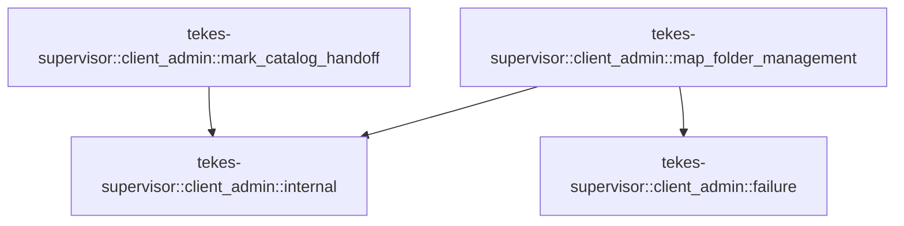

```mermaid
flowchart TD
  n0["schema::ijson::IJsonValue::parse"]
  n1["schema::ijson::IJsonValue::parse_str"]
  n2["tekes-supervisor::client_admin::ClientAdminRoutes::capabilities"]
  n3["tekes-supervisor::client_admin::ClientAdminRoutes::extension_method_class"]
  n4["tekes-supervisor::client_admin::ClientAdminRoutes::validate_extension_payload"]
  n5["tekes-supervisor::client_admin::ClientAdminRoutes::extension_failure_is_exact"]
  n6["tekes-supervisor::client_admin::ClientAdminRoutes::execute"]
  n7["tekes-supervisor::client_admin::EnvironmentView::from"]
  n8["tekes-supervisor::client_admin::profile::Environment::from"]
  n9["tekes-supervisor::client_admin::parse_environment_save"]
  n10["tekes-supervisor::client_admin::map_environment"]
  n11["tekes-supervisor::client_admin::parse"]
  n12["tekes-supervisor::client_admin::to_ijson"]
  n13["tekes-supervisor::client_admin::failure"]
  n14["tekes-supervisor::client_admin::internal"]
  n15["tekes-supervisor::client_admin::internal_profile"]
  n16["tekes-supervisor::client_admin::internal_daemon"]
  n17["tekes-supervisor::client_admin::stale"]
  n18["tekes-supervisor::client_admin::next_revision"]
  n19["tekes-supervisor::client_admin::map_workspace"]
  n20["tekes-supervisor::client_admin::map_policy"]
  n21["tekes-supervisor::client_admin::policy_candidate_failure"]
  n22["tekes-supervisor::endpoint_host::ProductionRouteFailure::new"]
  n4 --> n9
  n4 --> n11
  n4 --> n13
  n6 --> n9
  n6 --> n11
  n6 --> n13
  n9 --> n11
  n9 --> n13
  n10 --> n13
  n10 --> n15
  n10 --> n17
  n11 --> n13
  n12 --> n0
  n12 --> n14
  n13 --> n1
  n13 --> n12
  n13 --> n22
  n14 --> n13
  n15 --> n14
  n16 --> n14
  n17 --> n13
  n18 --> n13
  n19 --> n13
  n19 --> n15
  n20 --> n13
  n20 --> n17
  n21 --> n13
```

```mermaid
flowchart TD
  n0["store::atomic::AtomicPublisher::replace"]
  n1["store::management_root::retire_legacy_name"]
  n2["store::platform::NamedLock::exclusive"]
  n3["tekes-supervisor::client_admin::policy_result"]
  n4["tekes-supervisor::client_admin::AdminMutationJournal::open"]
  n5["tekes-supervisor::client_admin::AdminMutationJournal::begin"]
  n6["tekes-supervisor::client_admin::AdminMutationJournal::recover"]
  n7["tekes-supervisor::client_admin::AdminMutationJournal::commit"]
  n8["tekes-supervisor::client_admin::AdminMutationJournal::records"]
  n9["tekes-supervisor::client_admin::AdminMutationJournal::commit_record"]
  n10["tekes-supervisor::client_admin::AdminMutationJournal::abort"]
  n11["tekes-supervisor::client_admin::AdminMutationJournal::authority_digest"]
  n12["tekes-supervisor::client_admin::AdminMutationJournal::record_path"]
  n13["tekes-supervisor::client_admin::request_digest"]
  n14["tekes-supervisor::client_admin::sha256"]
  n15["tekes-supervisor::client_admin::read_record"]
  n16["tekes-supervisor::client_admin::publish_record"]
  n17["tekes-supervisor::client_admin::internal_store"]
  n18["tekes-supervisor::client_admin::internal_io"]
  n19["tekes-supervisor::client_admin::mark_handoff"]
  n20["tekes-supervisor::client_admin::management_request_hash"]
  n21["tekes-supervisor::client_admin::mark_management_handoff"]
  n22["tekes-supervisor::client_admin::map_catalog_relocation"]
  n23["tekes-supervisor::client_admin::to_ijson"]
  n24["tekes-supervisor::client_admin::failure"]
  n25["tekes-supervisor::client_admin::internal"]
  n26["tekes-supervisor::client_admin::internal_profile"]
  n3 --> n23
  n4 --> n0
  n4 --> n1
  n5 --> n2
  n5 --> n11
  n5 --> n12
  n5 --> n13
  n5 --> n14
  n5 --> n15
  n5 --> n16
  n5 --> n24
  n6 --> n2
  n6 --> n11
  n6 --> n12
  n6 --> n13
  n6 --> n15
  n6 --> n16
  n6 --> n24
  n7 --> n2
  n7 --> n11
  n7 --> n12
  n7 --> n13
  n7 --> n15
  n7 --> n16
  n7 --> n24
  n7 --> n25
  n8 --> n2
  n8 --> n15
  n8 --> n25
  n9 --> n2
  n9 --> n11
  n9 --> n12
  n9 --> n15
  n9 --> n16
  n9 --> n25
  n10 --> n2
  n10 --> n11
  n10 --> n12
  n10 --> n15
  n10 --> n25
  n11 --> n14
  n11 --> n18
  n11 --> n25
  n13 --> n14
  n13 --> n25
  n15 --> n18
  n15 --> n25
  n16 --> n0
  n16 --> n25
  n17 --> n25
  n18 --> n25
  n19 --> n25
  n20 --> n25
  n21 --> n25
  n22 --> n24
  n22 --> n26
```

# tekes-supervisor::client_admin

[Package atlas](index.md) · [Source](../../src/client_admin.rs)

## Declarations

Visibility is the declaration spelling; trait members and reexports require their enclosing interface. `cfg` is not evaluated.

| Symbol | Kind | Visibility | Test / cfg |
|---|---|---|---|
| [tekes-supervisor::client_admin::ENVIRONMENT_METHODS](../../src/client_admin.rs#L24) | const_item | `pub` |  |
| [tekes-supervisor::client_admin::WORKSPACE_POLICY_METHODS](../../src/client_admin.rs#L29) | const_item | `pub` |  |
| [tekes-supervisor::client_admin::WORKSPACE_FOLDER_METHODS](../../src/client_admin.rs#L34) | const_item | `pub` |  |
| [tekes-supervisor::client_admin::FOLDER_METHODS](../../src/client_admin.rs#L40) | const_item | `pub` |  |
| [tekes-supervisor::client_admin::ClientAdminRoutes](../../src/client_admin.rs#L45) | struct_item | `pub` |  |
| [tekes-supervisor::client_admin::ClientAdminRoutes::new](../../src/client_admin.rs#L54) | function_item | `pub` |  |
| [tekes-supervisor::client_admin::ClientAdminRoutes::routes](../../src/client_admin.rs#L72) | function_item | `pub` |  |
| [tekes-supervisor::client_admin::ClientAdminRoutes::recover_pending_intents](../../src/client_admin.rs#L102) | function_item | `private` |  |
| [tekes-supervisor::client_admin::ClientAdminRoutes::list_environments](../../src/client_admin.rs#L172) | function_item | `private` |  |
| [tekes-supervisor::client_admin::ClientAdminRoutes::save_environment](../../src/client_admin.rs#L187) | function_item | `private` |  |
| [tekes-supervisor::client_admin::ClientAdminRoutes::get_policy](../../src/client_admin.rs#L238) | function_item | `private` |  |
| [tekes-supervisor::client_admin::ClientAdminRoutes::set_policy](../../src/client_admin.rs#L247) | function_item | `private` |  |
| [tekes-supervisor::client_admin::ClientAdminRoutes::folder_inventory](../../src/client_admin.rs#L324) | function_item | `private` |  |
| [tekes-supervisor::client_admin::ClientAdminRoutes::relocate_folder](../../src/client_admin.rs#L361) | function_item | `private` |  |
| [tekes-supervisor::client_admin::ClientAdminRoutes::list_folders](../../src/client_admin.rs#L465) | function_item | `private` |  |
| [tekes-supervisor::client_admin::ClientAdminRoutes::change_folders](../../src/client_admin.rs#L483) | function_item | `private` |  |
| [tekes-supervisor::client_admin::ClientAdminRoutes::lock_management](../../src/client_admin.rs#L548) | function_item | `private` |  |
| [tekes-supervisor::client_admin::ClientAdminRoutes::management](../../src/client_admin.rs#L553) | function_item | `private` |  |
| [tekes-supervisor::client_admin::AdminCapabilityRoutes](../../src/client_admin.rs#L559) | struct_item | `private` |  |
| [tekes-supervisor::client_admin::AdminCapabilityRoutes::new](../../src/client_admin.rs#L566) | function_item | `private` |  |
| [tekes-supervisor::client_admin::AdminCapabilityRoutes::class](../../src/client_admin.rs#L578) | function_item | `private` |  |
| [tekes-supervisor::client_admin::AdminCapabilityRoutes::capabilities](../../src/client_admin.rs#L586) | function_item | `private` |  |
| [tekes-supervisor::client_admin::AdminCapabilityRoutes::extension_method_class](../../src/client_admin.rs#L593) | function_item | `private` |  |
| [tekes-supervisor::client_admin::AdminCapabilityRoutes::validate_extension_payload](../../src/client_admin.rs#L597) | function_item | `private` |  |
| [tekes-supervisor::client_admin::AdminCapabilityRoutes::extension_failure_is_exact](../../src/client_admin.rs#L613) | function_item | `private` |  |
| [tekes-supervisor::client_admin::AdminCapabilityRoutes::execute](../../src/client_admin.rs#L624) | function_item | `private` |  |
| [tekes-supervisor::client_admin::ClientAdminRoutes::capabilities](../../src/client_admin.rs#L642) | function_item | `private` |  |
| [tekes-supervisor::client_admin::ClientAdminRoutes::extension_method_class](../../src/client_admin.rs#L653) | function_item | `private` |  |
| [tekes-supervisor::client_admin::ClientAdminRoutes::validate_extension_payload](../../src/client_admin.rs#L663) | function_item | `private` |  |
| [tekes-supervisor::client_admin::ClientAdminRoutes::extension_failure_is_exact](../../src/client_admin.rs#L693) | function_item | `private` |  |
| [tekes-supervisor::client_admin::ClientAdminRoutes::execute](../../src/client_admin.rs#L748) | function_item | `private` |  |
| [tekes-supervisor::client_admin::EnvironmentsListRequest](../../src/client_admin.rs#L788) | struct_item | `private` |  |
| [tekes-supervisor::client_admin::EnvironmentView](../../src/client_admin.rs#L792) | struct_item | `private` |  |
| [tekes-supervisor::client_admin::EnvironmentView::from](../../src/client_admin.rs#L801) | function_item | `private` |  |
| [tekes-supervisor::client_admin::profile::Environment::from](../../src/client_admin.rs#L811) | function_item | `private` |  |
| [tekes-supervisor::client_admin::EnvironmentSaveRequest](../../src/client_admin.rs#L823) | struct_item | `private` |  |
| [tekes-supervisor::client_admin::parse_environment_save](../../src/client_admin.rs#L828) | function_item | `private` |  |
| [tekes-supervisor::client_admin::map_environment](../../src/client_admin.rs#L845) | function_item | `private` |  |
| [tekes-supervisor::client_admin::PolicyGetRequest](../../src/client_admin.rs#L860) | struct_item | `private` |  |
| [tekes-supervisor::client_admin::FoldersGetRequest](../../src/client_admin.rs#L865) | struct_item | `private` |  |
| [tekes-supervisor::client_admin::FolderRelocateRequest](../../src/client_admin.rs#L870) | struct_item | `private` |  |
| [tekes-supervisor::client_admin::FolderChangeRequest](../../src/client_admin.rs#L876) | struct_item | `private` |  |
| [tekes-supervisor::client_admin::PolicySetRequest](../../src/client_admin.rs#L882) | struct_item | `private` |  |
| [tekes-supervisor::client_admin::parse](../../src/client_admin.rs#L888) | function_item | `private` |  |
| [tekes-supervisor::client_admin::to_ijson](../../src/client_admin.rs#L897) | function_item | `private` |  |
| [tekes-supervisor::client_admin::failure](../../src/client_admin.rs#L903) | function_item | `private` |  |
| [tekes-supervisor::client_admin::internal](../../src/client_admin.rs#L910) | function_item | `private` |  |
| [tekes-supervisor::client_admin::internal_profile](../../src/client_admin.rs#L917) | function_item | `private` |  |
| [tekes-supervisor::client_admin::internal_daemon](../../src/client_admin.rs#L920) | function_item | `private` |  |
| [tekes-supervisor::client_admin::stale](../../src/client_admin.rs#L923) | function_item | `private` |  |
| [tekes-supervisor::client_admin::next_revision](../../src/client_admin.rs#L930) | function_item | `private` |  |
| [tekes-supervisor::client_admin::map_workspace](../../src/client_admin.rs#L942) | function_item | `private` |  |
| [tekes-supervisor::client_admin::map_policy](../../src/client_admin.rs#L950) | function_item | `private` |  |
| [tekes-supervisor::client_admin::policy_candidate_failure](../../src/client_admin.rs#L977) | function_item | `private` |  |
| [tekes-supervisor::client_admin::policy_result](../../src/client_admin.rs#L1008) | function_item | `private` |  |
| [tekes-supervisor::client_admin::AdminPhase](../../src/client_admin.rs#L1035) | enum_item | `private` |  |
| [tekes-supervisor::client_admin::AdminRecord](../../src/client_admin.rs#L1042) | struct_item | `private` |  |
| [tekes-supervisor::client_admin::AdminBegin](../../src/client_admin.rs#L1056) | enum_item | `private` |  |
| [tekes-supervisor::client_admin::CONFIG_ADMIN_DIR](../../src/client_admin.rs#L1062) | const_item | `private` |  |
| [tekes-supervisor::client_admin::LEGACY_CONFIG_ADMIN_DIR](../../src/client_admin.rs#L1064) | const_item | `private` |  |
| [tekes-supervisor::client_admin::AdminMutationJournal](../../src/client_admin.rs#L1066) | struct_item | `private` |  |
| [tekes-supervisor::client_admin::AdminMutationJournal::open](../../src/client_admin.rs#L1073) | function_item | `private` |  |
| [tekes-supervisor::client_admin::AdminMutationJournal::begin](../../src/client_admin.rs#L1089) | function_item | `private` |  |
| [tekes-supervisor::client_admin::AdminMutationJournal::recover](../../src/client_admin.rs#L1154) | function_item | `private` |  |
| [tekes-supervisor::client_admin::AdminMutationJournal::commit](../../src/client_admin.rs#L1182) | function_item | `private` |  |
| [tekes-supervisor::client_admin::AdminMutationJournal::records](../../src/client_admin.rs#L1206) | function_item | `private` |  |
| [tekes-supervisor::client_admin::AdminMutationJournal::commit_record](../../src/client_admin.rs#L1221) | function_item | `private` |  |
| [tekes-supervisor::client_admin::AdminMutationJournal::abort](../../src/client_admin.rs#L1235) | function_item | `private` |  |
| [tekes-supervisor::client_admin::AdminMutationJournal::authority_digest](../../src/client_admin.rs#L1252) | function_item | `private` |  |
| [tekes-supervisor::client_admin::AdminMutationJournal::record_path](../../src/client_admin.rs#L1268) | function_item | `private` |  |
| [tekes-supervisor::client_admin::request_digest](../../src/client_admin.rs#L1274) | function_item | `private` |  |
| [tekes-supervisor::client_admin::sha256](../../src/client_admin.rs#L1281) | function_item | `private` |  |
| [tekes-supervisor::client_admin::read_record](../../src/client_admin.rs#L1284) | function_item | `private` |  |
| [tekes-supervisor::client_admin::publish_record](../../src/client_admin.rs#L1304) | function_item | `private` |  |
| [tekes-supervisor::client_admin::internal_store](../../src/client_admin.rs#L1310) | function_item | `private` |  |
| [tekes-supervisor::client_admin::internal_io](../../src/client_admin.rs#L1313) | function_item | `private` |  |
| [tekes-supervisor::client_admin::mark_handoff](../../src/client_admin.rs#L1316) | function_item | `private` |  |
| [tekes-supervisor::client_admin::management_request_hash](../../src/client_admin.rs#L1330) | function_item | `private` |  |
| [tekes-supervisor::client_admin::mark_management_handoff](../../src/client_admin.rs#L1350) | function_item | `private` |  |
| [tekes-supervisor::client_admin::map_catalog_relocation](../../src/client_admin.rs#L1364) | function_item | `private` |  |
| [tekes-supervisor::client_admin::mark_catalog_handoff](../../src/client_admin.rs#L1377) | function_item | `private` |  |
| [tekes-supervisor::client_admin::map_folder_management](../../src/client_admin.rs#L1391) | function_item | `private` |  |
| [tekes-supervisor::client_admin::tests::fixture](../../src/client_admin.rs#L1447) | function_item | `private` | test; #[cfg(test)] |
| [tekes-supervisor::client_admin::tests::call](../../src/client_admin.rs#L1472) | function_item | `private` | test; #[cfg(test)] |
| [tekes-supervisor::client_admin::tests::folder_inventory_groups_session_cwds_and_relocation_preserves_genesis_and_trust_boundary](../../src/client_admin.rs#L1483) | function_item | `private` | test; #[cfg(test)] |
| [tekes-supervisor::client_admin::tests::folder_relocation_refuses_root_unknown_paths_and_ambiguous_owners](../../src/client_admin.rs#L1668) | function_item | `private` | test; #[cfg(test)] |
| [tekes-supervisor::client_admin::tests::environment_reads_are_pure_and_invalid_saves_publish_nothing](../../src/client_admin.rs#L1735) | function_item | `private` | test; #[cfg(test)] |
| [tekes-supervisor::client_admin::tests::environment_save_has_cas_and_exact_retries_after_later_edits](../../src/client_admin.rs#L1789) | function_item | `private` | test; #[cfg(test)] |
| [tekes-supervisor::client_admin::tests::environment_intents_recover_before_and_after_config_publication](../../src/client_admin.rs#L1828) | function_item | `private` | test; #[cfg(test)] |
| [tekes-supervisor::client_admin::tests::concurrent_environment_saves_have_one_cas_winner_and_no_loser_intent](../../src/client_admin.rs#L1883) | function_item | `private` | test; #[cfg(test)] |
| [tekes-supervisor::client_admin::tests::concurrent_named_environment_save_and_create_capture_one_complete_revision](../../src/client_admin.rs#L1929) | function_item | `private` | test; #[cfg(test)] |
| [tekes-supervisor::client_admin::tests::policy_replacement_can_relax_local_default_below_ceiling](../../src/client_admin.rs#L2079) | function_item | `private` | test; #[cfg(test)] |
| [tekes-supervisor::client_admin::tests::journal_rejects_wrong_bytes_for_the_same_rpc_id](../../src/client_admin.rs#L2100) | function_item | `private` | test; #[cfg(test)] |
| [tekes-supervisor::client_admin::tests::crash_before_publish_is_completed_before_an_unrelated_rpc](../../src/client_admin.rs#L2130) | function_item | `private` | test; #[cfg(test)] |
| [tekes-supervisor::client_admin::tests::startup_closes_policy_crashes_on_both_sides_of_the_side_effect](../../src/client_admin.rs#L2190) | function_item | `private` | test; #[cfg(test)] |
| [tekes-supervisor::client_admin::tests::k1_management_race::folder_fixture](../../src/client_admin.rs#L2265) | function_item | `private` | test; #[cfg(test)] |
| [tekes-supervisor::client_admin::tests::k1_management_race::policy_call](../../src/client_admin.rs#L2296) | function_item | `private` | test; #[cfg(test)] |
| [tekes-supervisor::client_admin::tests::k1_management_race::revision](../../src/client_admin.rs#L2306) | function_item | `private` | test; #[cfg(test)] |
| [tekes-supervisor::client_admin::tests::k1_management_race::policy_set_publishes_only_under_the_management_lock](../../src/client_admin.rs#L2317) | function_item | `private` | test; #[cfg(test)] |
| [tekes-supervisor::client_admin::tests::k1_management_race::recovered_policy_intent_publishes_only_under_the_management_lock](../../src/client_admin.rs#L2349) | function_item | `private` | test; #[cfg(test)] |
| [tekes-supervisor::client_admin::tests::k1_management_race::policy_set_racing_the_recovery_tick_never_corrupts_management](../../src/client_admin.rs#L2407) | function_item | `private` | test; #[cfg(test)] |
| [tekes-supervisor::client_admin::tests::k1_management_race::policy_set_racing_relocate_never_corrupts_management](../../src/client_admin.rs#L2453) | function_item | `private` | test; #[cfg(test)] |

## Imports / reexports

| Local name | Source path | Visibility |
|---|---|---|
| `BTreeSet` | `std::collections::BTreeSet` | `private` |
| `fs` | `std::fs` | `private` |
| `Path` | `std::path::Path` | `private` |
| `PathBuf` | `std::path::PathBuf` | `private` |
| `Arc` | `std::sync::Arc` | `private` |
| `Mutex` | `std::sync::Mutex` | `private` |
| `DurableHandoffProof` | `endpoint::DurableHandoffProof` | `private` |
| `EndpointHostCall` | `endpoint::EndpointHostCall` | `private` |
| `MethodClass` | `endpoint::MethodClass` | `private` |
| `RpcDurableIdentity` | `endpoint::RpcDurableIdentity` | `private` |
| `ConfigRepository` | `profile::ConfigRepository` | `private` |
| `WorkspacePolicy` | `profile::WorkspacePolicy` | `private` |
| `IJsonValue` | `schema::IJsonValue` | `private` |
| `Deserialize` | `serde::Deserialize` | `private` |
| `Serialize` | `serde::Serialize` | `private` |
| `Value` | `serde_json::Value` | `private` |
| `json` | `serde_json::json` | `private` |
| `Digest` | `sha2::Digest` | `private` |
| `Sha256` | `sha2::Sha256` | `private` |
| `AtomicPublisher` | `store::AtomicPublisher` | `private` |
| `NamedLock` | `store::NamedLock` | `private` |
| `ProductionEndpointRoutes` | `crate::endpoint_host::ProductionEndpointRoutes` | `private` |
| `ProductionRouteFailure` | `crate::endpoint_host::ProductionRouteFailure` | `private` |
| `MAX_REPORTED_TOOL_REFUSALS` | `crate::mcp_runtime::MAX_REPORTED_TOOL_REFUSALS` | `private` |
| `McpRefusedTool` | `crate::mcp_runtime::McpRefusedTool` | `private` |
| `refused_tool_json` | `crate::mcp_runtime::refused_tool_json` | `private` |
| `PolicyCandidateCause` | `crate::process_host::PolicyCandidateCause` | `private` |
| `PolicyCandidateError` | `crate::process_host::PolicyCandidateError` | `private` |
| `ProductionProcessHost` | `crate::process_host::ProductionProcessHost` | `private` |
| `SESSION_FOLDER_METHODS` | `session_folders::SESSION_FOLDER_METHODS` | `pub` |
| `*` | `super::*` | `private` |
| `DurableHandoffSignal` | `endpoint::DurableHandoffSignal` | `private` |
| `WorkspaceConfig` | `profile::WorkspaceConfig` | `private` |
| `TempDir` | `tempfile::TempDir` | `private` |
| `*` | `super::*` | `private` |
| `RecvTimeoutError` | `std::sync::mpsc::RecvTimeoutError` | `private` |
| `channel` | `std::sync::mpsc::channel` | `private` |
| `Duration` | `std::time::Duration` | `private` |

## Module declarations

| Module | Visibility | Attributes |
|---|---|---|
| `tekes-supervisor::client_admin::session_folders` | `private` |  |
| `tekes-supervisor::client_admin::tests` | `private` | #[cfg(test)] |
| `tekes-supervisor::client_admin::tests::k1_management_race` | `private` |  |

## Function call graphs

Edges below are syntactically resolved calls only, including private functions. Graphs partition callers into groups of 20; they are not execution order. All unresolved sites are listed below and in the JSON inventory.

```mermaid
flowchart TD
  n0["endpoint::management::ManagementStore::open_light"]
  n1["endpoint::management::ManagementStore::lock_exclusive"]
  n2["profile::config::EnvironmentsConfig::decode"]
  n3["profile::config::Environment::local"]
  n4["profile::config::ConfigRepository::open"]
  n5["profile::folder_catalog::FolderCatalog::new"]
  n6["store::platform::NamedLock::try_exclusive"]
  n7["tekes-supervisor::client_admin::policy_result"]
  n8["tekes-supervisor::client_admin::ClientAdminRoutes::recover_pending_intents"]
  n9["tekes-supervisor::client_admin::AdminMutationJournal::open"]
  n10["tekes-supervisor::client_admin::internal_store"]
  n11["tekes-supervisor::client_admin::mark_handoff"]
  n12["tekes-supervisor::client_admin::management_request_hash"]
  n13["tekes-supervisor::client_admin::mark_management_handoff"]
  n14["tekes-supervisor::client_admin::mark_catalog_handoff"]
  n15["tekes-supervisor::client_admin::map_folder_management"]
  n16["tekes-supervisor::client_admin::ClientAdminRoutes::list_environments"]
  n17["tekes-supervisor::client_admin::ClientAdminRoutes::save_environment"]
  n18["tekes-supervisor::client_admin::ClientAdminRoutes::get_policy"]
  n19["tekes-supervisor::client_admin::ClientAdminRoutes::set_policy"]
  n20["tekes-supervisor::client_admin::ClientAdminRoutes::folder_inventory"]
  n21["tekes-supervisor::client_admin::ClientAdminRoutes::relocate_folder"]
  n22["tekes-supervisor::client_admin::ClientAdminRoutes::list_folders"]
  n23["tekes-supervisor::client_admin::ClientAdminRoutes::change_folders"]
  n24["tekes-supervisor::client_admin::ClientAdminRoutes::lock_management"]
  n25["tekes-supervisor::client_admin::ClientAdminRoutes::new"]
  n26["tekes-supervisor::client_admin::ClientAdminRoutes::management"]
  n27["tekes-supervisor::client_admin::AdminCapabilityRoutes::new"]
  n28["tekes-supervisor::client_admin::AdminCapabilityRoutes::class"]
  n29["tekes-supervisor::client_admin::AdminCapabilityRoutes::capabilities"]
  n30["tekes-supervisor::client_admin::AdminCapabilityRoutes::extension_method_class"]
  n31["tekes-supervisor::client_admin::AdminCapabilityRoutes::validate_extension_payload"]
  n32["tekes-supervisor::client_admin::AdminCapabilityRoutes::extension_failure_is_exact"]
  n33["tekes-supervisor::client_admin::AdminCapabilityRoutes::execute"]
  n34["tekes-supervisor::client_admin::ClientAdminRoutes::routes"]
  n35["tekes-supervisor::client_admin::map_environment"]
  n36["tekes-supervisor::client_admin::to_ijson"]
  n37["tekes-supervisor::client_admin::failure"]
  n38["tekes-supervisor::client_admin::internal"]
  n39["tekes-supervisor::client_admin::stale"]
  n40["tekes-supervisor::client_admin::next_revision"]
  n41["tekes-supervisor::client_admin::map_policy"]
  n42["tekes-supervisor::process_host::workspace_quiescence_lock_path"]
  n43["tools::sandbox::kernel_protected_roots"]
  n44["tools::sandbox::protected_root_containing"]
  n8 --> n2
  n8 --> n24
  n8 --> n38
  n16 --> n3
  n16 --> n36
  n17 --> n8
  n17 --> n11
  n17 --> n35
  n17 --> n36
  n17 --> n38
  n17 --> n39
  n17 --> n40
  n18 --> n36
  n19 --> n7
  n19 --> n8
  n19 --> n11
  n19 --> n24
  n19 --> n38
  n19 --> n39
  n19 --> n40
  n19 --> n41
  n20 --> n26
  n20 --> n36
  n20 --> n38
  n21 --> n5
  n21 --> n6
  n21 --> n8
  n21 --> n10
  n21 --> n12
  n21 --> n13
  n21 --> n14
  n21 --> n15
  n21 --> n26
  n21 --> n36
  n21 --> n37
  n21 --> n38
  n21 --> n42
  n21 --> n43
  n21 --> n44
  n22 --> n26
  n22 --> n36
  n23 --> n6
  n23 --> n8
  n23 --> n10
  n23 --> n12
  n23 --> n13
  n23 --> n26
  n23 --> n36
  n23 --> n37
  n23 --> n38
  n23 --> n42
  n24 --> n1
  n24 --> n38
  n25 --> n4
  n25 --> n9
  n26 --> n0
  n26 --> n38
  n31 --> n37
  n33 --> n37
```

Functions 1–20: 59 direct edges

Functions 21–40: 27 direct edges

Functions 41–60: 56 direct edges

Functions 61–62: 3 direct edges

## Call sites

Includes test functions (marked in declarations). Receiver-type-required sites need type analysis/manual tracing. Calls in closures are attributed to their enclosing function; their occurrence here does not mean the closure executes immediately.

| Caller | Callee expression | Source lines | Target / classification |
|---|---|---|---|
| `new` | `root.as_ref` | [58](../../src/client_admin.rs#L58) | receiver-type-required |
| `new` | `root.to_path_buf` | [60](../../src/client_admin.rs#L60) | receiver-type-required |
| `new` | `ConfigRepository::open(root).map_err` | [61](../../src/client_admin.rs#L61) | receiver-type-required |
| `new` | `ConfigRepository::open` | [61](../../src/client_admin.rs#L61) | [profile::config::ConfigRepository::open](../../../profile/src/config.rs#L814) |
| `new` | `Mutex::new` | [63](../../src/client_admin.rs#L63) | external-constructor-callback-or-unresolved |
| `new` | `AdminMutationJournal::open(root).map_err` | [64](../../src/client_admin.rs#L64) | receiver-type-required |
| `new` | `AdminMutationJournal::open` | [64](../../src/client_admin.rs#L64) | [tekes-supervisor::client_admin::AdminMutationJournal::open](../../src/client_admin.rs#L1073) |
| `new` | `routes.recover_pending_intents` | [66](../../src/client_admin.rs#L66) | receiver-type-required |
| `new` | `Ok` | [67](../../src/client_admin.rs#L67) | external-constructor-callback-or-unresolved |
| `recover_pending_intents` | `self.journal.records` | [103](../../src/client_admin.rs#L103) | receiver-type-required |
| `recover_pending_intents` | `self.journal.authority_digest(&record.authority)?.as_deref` | [115](../../src/client_admin.rs#L115) | receiver-type-required |
| `recover_pending_intents` | `self.journal.authority_digest` | [115](../../src/client_admin.rs#L115) | receiver-type-required |
| `recover_pending_intents` | `Some` | [116](../../src/client_admin.rs#L116) | external-constructor-callback-or-unresolved |
| `recover_pending_intents` | `record.authority.as_str` | [118](../../src/client_admin.rs#L118) | receiver-type-required |
| `recover_pending_intents` | `profile::EnvironmentsConfig::decode(&record.desired)                             .map_err` | [120](../../src/client_admin.rs#L120) | receiver-type-required |
| `recover_pending_intents` | `profile::EnvironmentsConfig::decode` | [120](../../src/client_admin.rs#L120) | [profile::config::EnvironmentsConfig::decode](../../../profile/src/config.rs#L259) |
| `recover_pending_intents` | `self.repository                             .publish_environments(record.expected_revision, &desired)                             .map_err` | [122](../../src/client_admin.rs#L122) | receiver-type-required |
| `recover_pending_intents` | `self.repository                             .publish_environments` | [122](../../src/client_admin.rs#L122) | receiver-type-required |
| `recover_pending_intents` | `authority.starts_with` | [127](../../src/client_admin.rs#L127) | receiver-type-required |
| `recover_pending_intents` | `authority.ends_with` | [127](../../src/client_admin.rs#L127) | receiver-type-required |
| `recover_pending_intents` | `profile::WorkspaceConfig::decode(&record.desired)                             .map_err` | [129](../../src/client_admin.rs#L129) | receiver-type-required |
| `recover_pending_intents` | `profile::WorkspaceConfig::decode` | [129](../../src/client_admin.rs#L129), [164](../../src/client_admin.rs#L164) | external-constructor-callback-or-unresolved |
| `recover_pending_intents` | `self                             .repository                             .resolve(&desired.id)                             .map_err` | [131](../../src/client_admin.rs#L131) | receiver-type-required |
| `recover_pending_intents` | `self                             .repository                             .resolve` | [131](../../src/client_admin.rs#L131) | receiver-type-required |
| `recover_pending_intents` | `desired.policy.clone().unwrap_or_default` | [135](../../src/client_admin.rs#L135) | receiver-type-required |
| `recover_pending_intents` | `desired.policy.clone` | [135](../../src/client_admin.rs#L135) | receiver-type-required |
| `recover_pending_intents` | `self.lock_management` | [137](../../src/client_admin.rs#L137) | [tekes-supervisor::client_admin::ClientAdminRoutes::lock_management](../../src/client_admin.rs#L548) |
| `recover_pending_intents` | `self.repository                                 .publish_workspace_policy(                                     &desired.id,                                     record.expected_revision,                                     policy,                                 )                                 .map_err` | [138](../../src/client_admin.rs#L138) | receiver-type-required |
| `recover_pending_intents` | `self.repository                                 .publish_workspace_policy` | [138](../../src/client_admin.rs#L138) | receiver-type-required |
| `recover_pending_intents` | `published.canonical_bytes().map_err` | [146](../../src/client_admin.rs#L146) | receiver-type-required |
| `recover_pending_intents` | `published.canonical_bytes` | [146](../../src/client_admin.rs#L146) | receiver-type-required |
| `recover_pending_intents` | `Err` | [147](../../src/client_admin.rs#L147), [156](../../src/client_admin.rs#L156) | external-constructor-callback-or-unresolved |
| `recover_pending_intents` | `internal` | [147](../../src/client_admin.rs#L147), [156](../../src/client_admin.rs#L156) | [tekes-supervisor::client_admin::internal](../../src/client_admin.rs#L910) |
| `recover_pending_intents` | `self.process_host                             .workspace_policy_published(&desired.id, &previous)                             .map_err` | [151](../../src/client_admin.rs#L151) | receiver-type-required |
| `recover_pending_intents` | `self.process_host                             .workspace_policy_published` | [151](../../src/client_admin.rs#L151) | receiver-type-required |
| `recover_pending_intents` | `record.authority.starts_with` | [162](../../src/client_admin.rs#L162) | receiver-type-required |
| `recover_pending_intents` | `profile::WorkspaceConfig::decode(&record.desired).map_err` | [164](../../src/client_admin.rs#L164) | receiver-type-required |
| `recover_pending_intents` | `self.process_host.workspace_policy_recovered` | [165](../../src/client_admin.rs#L165) | receiver-type-required |
| `recover_pending_intents` | `self.journal.commit_record` | [167](../../src/client_admin.rs#L167) | receiver-type-required |
| `recover_pending_intents` | `Ok` | [169](../../src/client_admin.rs#L169) | external-constructor-callback-or-unresolved |
| `list_environments` | `self.repository.environments().map_err` | [173](../../src/client_admin.rs#L173) | receiver-type-required |
| `list_environments` | `self.repository.environments` | [173](../../src/client_admin.rs#L173) | receiver-type-required |
| `list_environments` | `config.environments.clone` | [174](../../src/client_admin.rs#L174) | receiver-type-required |
| `list_environments` | `environments             .iter()             .any` | [175](../../src/client_admin.rs#L175) | receiver-type-required |
| `list_environments` | `environments             .iter` | [175](../../src/client_admin.rs#L175) | receiver-type-required |
| `list_environments` | `environments.push` | [179](../../src/client_admin.rs#L179) | receiver-type-required |
| `list_environments` | `profile::Environment::local` | [179](../../src/client_admin.rs#L179) | [profile::config::Environment::local](../../../profile/src/config.rs#L296) |
| `list_environments` | `environments.sort_by` | [181](../../src/client_admin.rs#L181) | receiver-type-required |
| `list_environments` | `left.id.cmp` | [181](../../src/client_admin.rs#L181) | receiver-type-required |
| `list_environments` | `to_ijson` | [182](../../src/client_admin.rs#L182) | [tekes-supervisor::client_admin::to_ijson](../../src/client_admin.rs#L897) |
| `save_environment` | `self             .mutation_gate             .lock()             .map_err` | [192](../../src/client_admin.rs#L192) | receiver-type-required |
| `save_environment` | `self             .mutation_gate             .lock` | [192](../../src/client_admin.rs#L192) | receiver-type-required |
| `save_environment` | `internal` | [195](../../src/client_admin.rs#L195) | [tekes-supervisor::client_admin::internal](../../src/client_admin.rs#L910) |
| `save_environment` | `self.recover_pending_intents` | [196](../../src/client_admin.rs#L196) | [tekes-supervisor::client_admin::ClientAdminRoutes::recover_pending_intents](../../src/client_admin.rs#L102) |
| `save_environment` | `self.journal.recover` | [197](../../src/client_admin.rs#L197) | receiver-type-required |
| `save_environment` | `mark_handoff` | [198](../../src/client_admin.rs#L198), [234](../../src/client_admin.rs#L234) | [tekes-supervisor::client_admin::mark_handoff](../../src/client_admin.rs#L1316) |
| `save_environment` | `Ok` | [199](../../src/client_admin.rs#L199), [235](../../src/client_admin.rs#L235) | external-constructor-callback-or-unresolved |
| `save_environment` | `self.repository.environments().map_err` | [201](../../src/client_admin.rs#L201) | receiver-type-required |
| `save_environment` | `self.repository.environments` | [201](../../src/client_admin.rs#L201) | receiver-type-required |
| `save_environment` | `Err` | [203](../../src/client_admin.rs#L203), [229](../../src/client_admin.rs#L229) | external-constructor-callback-or-unresolved |
| `save_environment` | `stale` | [203](../../src/client_admin.rs#L203) | [tekes-supervisor::client_admin::stale](../../src/client_admin.rs#L923) |
| `save_environment` | `next_revision` | [205](../../src/client_admin.rs#L205) | [tekes-supervisor::client_admin::next_revision](../../src/client_admin.rs#L930) |
| `save_environment` | `input.environment.into` | [206](../../src/client_admin.rs#L206) | receiver-type-required |
| `save_environment` | `desired.environments.retain` | [207](../../src/client_admin.rs#L207) | receiver-type-required |
| `save_environment` | `desired.environments.push` | [208](../../src/client_admin.rs#L208) | receiver-type-required |
| `save_environment` | `environment.clone` | [208](../../src/client_admin.rs#L208) | receiver-type-required |
| `save_environment` | `desired             .environments             .sort_by` | [209](../../src/client_admin.rs#L209) | receiver-type-required |
| `save_environment` | `left.id.cmp` | [211](../../src/client_admin.rs#L211) | receiver-type-required |
| `save_environment` | `desired.canonical_bytes().map_err` | [213](../../src/client_admin.rs#L213) | receiver-type-required |
| `save_environment` | `desired.canonical_bytes` | [213](../../src/client_admin.rs#L213) | receiver-type-required |
| `save_environment` | `to_ijson` | [214](../../src/client_admin.rs#L214) | [tekes-supervisor::client_admin::to_ijson](../../src/client_admin.rs#L897) |
| `save_environment` | `self.journal.begin` | [216](../../src/client_admin.rs#L216) | receiver-type-required |
| `save_environment` | `self             .repository             .publish_environments` | [224](../../src/client_admin.rs#L224) | receiver-type-required |
| `save_environment` | `self.journal.abort` | [228](../../src/client_admin.rs#L228) | receiver-type-required |
| `save_environment` | `map_environment` | [229](../../src/client_admin.rs#L229) | [tekes-supervisor::client_admin::map_environment](../../src/client_admin.rs#L845) |
| `save_environment` | `self.journal.commit` | [233](../../src/client_admin.rs#L233) | receiver-type-required |
| `get_policy` | `self             .repository             .workspace(&input.workspace_id)             .map_err` | [239](../../src/client_admin.rs#L239) | receiver-type-required |
| `get_policy` | `self             .repository             .workspace` | [239](../../src/client_admin.rs#L239) | receiver-type-required |
| `get_policy` | `to_ijson` | [243](../../src/client_admin.rs#L243) | [tekes-supervisor::client_admin::to_ijson](../../src/client_admin.rs#L897) |
| `set_policy` | `self             .mutation_gate             .lock()             .map_err` | [252](../../src/client_admin.rs#L252) | receiver-type-required |
| `set_policy` | `self             .mutation_gate             .lock` | [252](../../src/client_admin.rs#L252) | receiver-type-required |
| `set_policy` | `internal` | [255](../../src/client_admin.rs#L255), [313](../../src/client_admin.rs#L313) | [tekes-supervisor::client_admin::internal](../../src/client_admin.rs#L910) |
| `set_policy` | `self.recover_pending_intents` | [256](../../src/client_admin.rs#L256) | [tekes-supervisor::client_admin::ClientAdminRoutes::recover_pending_intents](../../src/client_admin.rs#L102) |
| `set_policy` | `self.journal.recover` | [257](../../src/client_admin.rs#L257) | receiver-type-required |
| `set_policy` | `mark_handoff` | [258](../../src/client_admin.rs#L258), [318](../../src/client_admin.rs#L318) | [tekes-supervisor::client_admin::mark_handoff](../../src/client_admin.rs#L1316) |
| `set_policy` | `Ok` | [259](../../src/client_admin.rs#L259), [319](../../src/client_admin.rs#L319) | external-constructor-callback-or-unresolved |
| `set_policy` | `self             .repository             .workspace(&input.workspace_id)             .map_err` | [261](../../src/client_admin.rs#L261) | receiver-type-required |
| `set_policy` | `self             .repository             .workspace` | [261](../../src/client_admin.rs#L261) | receiver-type-required |
| `set_policy` | `Err` | [266](../../src/client_admin.rs#L266), [306](../../src/client_admin.rs#L306), [313](../../src/client_admin.rs#L313) | external-constructor-callback-or-unresolved |
| `set_policy` | `stale` | [266](../../src/client_admin.rs#L266) | [tekes-supervisor::client_admin::stale](../../src/client_admin.rs#L923) |
| `set_policy` | `self             .process_host             .validate_workspace_policy_candidate(&input.workspace_id, &input.policy)             .map_err` | [268](../../src/client_admin.rs#L268) | receiver-type-required |
| `set_policy` | `self             .process_host             .validate_workspace_policy_candidate` | [268](../../src/client_admin.rs#L268) | receiver-type-required |
| `set_policy` | `self             .repository             .resolve(&input.workspace_id)             .map_err` | [272](../../src/client_admin.rs#L272) | receiver-type-required |
| `set_policy` | `self             .repository             .resolve` | [272](../../src/client_admin.rs#L272) | receiver-type-required |
| `set_policy` | `workspace.clone` | [276](../../src/client_admin.rs#L276) | receiver-type-required |
| `set_policy` | `next_revision` | [277](../../src/client_admin.rs#L277) | [tekes-supervisor::client_admin::next_revision](../../src/client_admin.rs#L930) |
| `set_policy` | `Some` | [278](../../src/client_admin.rs#L278) | external-constructor-callback-or-unresolved |
| `set_policy` | `input.policy.clone` | [278](../../src/client_admin.rs#L278), [299](../../src/client_admin.rs#L299) | receiver-type-required |
| `set_policy` | `desired_workspace.canonical_bytes().map_err` | [279](../../src/client_admin.rs#L279) | receiver-type-required |
| `set_policy` | `desired_workspace.canonical_bytes` | [279](../../src/client_admin.rs#L279) | receiver-type-required |
| `set_policy` | `policy_result` | [280](../../src/client_admin.rs#L280) | [tekes-supervisor::client_admin::policy_result](../../src/client_admin.rs#L1008) |
| `set_policy` | `self.journal.begin` | [281](../../src/client_admin.rs#L281) | receiver-type-required |
| `set_policy` | `self.lock_management` | [295](../../src/client_admin.rs#L295) | [tekes-supervisor::client_admin::ClientAdminRoutes::lock_management](../../src/client_admin.rs#L548) |
| `set_policy` | `self.repository.publish_workspace_policy` | [296](../../src/client_admin.rs#L296) | receiver-type-required |
| `set_policy` | `self.journal.abort` | [305](../../src/client_admin.rs#L305) | receiver-type-required |
| `set_policy` | `map_policy` | [306](../../src/client_admin.rs#L306) | [tekes-supervisor::client_admin::map_policy](../../src/client_admin.rs#L950) |
| `set_policy` | `self.process_host             .workspace_policy_published(&input.workspace_id, &previous)             .map_err` | [309](../../src/client_admin.rs#L309) | receiver-type-required |
| `set_policy` | `self.process_host             .workspace_policy_published` | [309](../../src/client_admin.rs#L309) | receiver-type-required |
| `set_policy` | `self.journal.commit` | [317](../../src/client_admin.rs#L317) | receiver-type-required |
| `folder_inventory` | `self             .management()?             .folder_paths()             .map_err` | [326](../../src/client_admin.rs#L326) | receiver-type-required |
| `folder_inventory` | `self             .management()?             .folder_paths` | [326](../../src/client_admin.rs#L326) | receiver-type-required |
| `folder_inventory` | `self             .management` | [326](../../src/client_admin.rs#L326) | [tekes-supervisor::client_admin::ClientAdminRoutes::management](../../src/client_admin.rs#L553) |
| `folder_inventory` | `std::collections::BTreeMap::<String, Vec<String>>::new` | [330](../../src/client_admin.rs#L330) | external-constructor-callback-or-unresolved |
| `folder_inventory` | `paths.values` | [331](../../src/client_admin.rs#L331) | receiver-type-required |
| `folder_inventory` | `groups.entry(path.clone()).or_default` | [332](../../src/client_admin.rs#L332) | receiver-type-required |
| `folder_inventory` | `groups.entry` | [332](../../src/client_admin.rs#L332) | receiver-type-required |
| `folder_inventory` | `path.clone` | [332](../../src/client_admin.rs#L332) | receiver-type-required |
| `folder_inventory` | `Vec::new` | [334](../../src/client_admin.rs#L334) | external-constructor-callback-or-unresolved |
| `folder_inventory` | `self             .process_host             .inventory_items(true)             .ok_or_else(&#124;&#124; internal("session inventory unavailable"))?             .map_err` | [335](../../src/client_admin.rs#L335) | receiver-type-required |
| `folder_inventory` | `self             .process_host             .inventory_items(true)             .ok_or_else` | [335](../../src/client_admin.rs#L335) | receiver-type-required |
| `folder_inventory` | `self             .process_host             .inventory_items` | [335](../../src/client_admin.rs#L335) | receiver-type-required |
| `folder_inventory` | `internal` | [338](../../src/client_admin.rs#L338) | [tekes-supervisor::client_admin::internal](../../src/client_admin.rs#L910) |
| `folder_inventory` | `archived.push` | [342](../../src/client_admin.rs#L342) | receiver-type-required |
| `folder_inventory` | `groups                     .entry(session.resolved_cwd(&paths))                     .or_default()                     .push` | [344](../../src/client_admin.rs#L344) | receiver-type-required |
| `folder_inventory` | `groups                     .entry(session.resolved_cwd(&paths))                     .or_default` | [344](../../src/client_admin.rs#L344) | receiver-type-required |
| `folder_inventory` | `groups                     .entry` | [344](../../src/client_admin.rs#L344) | receiver-type-required |
| `folder_inventory` | `session.resolved_cwd` | [345](../../src/client_admin.rs#L345) | receiver-type-required |
| `folder_inventory` | `archived.sort` | [350](../../src/client_admin.rs#L350) | receiver-type-required |
| `folder_inventory` | `groups             .into_iter()             .map(&#124;(path, mut sessions)&#124; {                 sessions.sort();                 json!({"path":path,"sessionIds":sessions})             })             .collect::<Vec<_>>` | [351](../../src/client_admin.rs#L351) | receiver-type-required |
| `folder_inventory` | `groups             .into_iter()             .map` | [351](../../src/client_admin.rs#L351) | receiver-type-required |
| `folder_inventory` | `groups             .into_iter` | [351](../../src/client_admin.rs#L351) | receiver-type-required |
| `folder_inventory` | `sessions.sort` | [354](../../src/client_admin.rs#L354) | receiver-type-required |
| `folder_inventory` | `to_ijson` | [358](../../src/client_admin.rs#L358) | [tekes-supervisor::client_admin::to_ijson](../../src/client_admin.rs#L897) |
| `relocate_folder` | `self             .mutation_gate             .lock()             .map_err` | [366](../../src/client_admin.rs#L366) | receiver-type-required |
| `relocate_folder` | `self             .mutation_gate             .lock` | [366](../../src/client_admin.rs#L366) | receiver-type-required |
| `relocate_folder` | `internal` | [369](../../src/client_admin.rs#L369) | [tekes-supervisor::client_admin::internal](../../src/client_admin.rs#L910) |
| `relocate_folder` | `self.recover_pending_intents` | [370](../../src/client_admin.rs#L370) | [tekes-supervisor::client_admin::ClientAdminRoutes::recover_pending_intents](../../src/client_admin.rs#L102) |
| `relocate_folder` | `management_request_hash` | [371](../../src/client_admin.rs#L371) | [tekes-supervisor::client_admin::management_request_hash](../../src/client_admin.rs#L1330) |
| `relocate_folder` | `self.management` | [372](../../src/client_admin.rs#L372) | [tekes-supervisor::client_admin::ClientAdminRoutes::management](../../src/client_admin.rs#L553) |
| `relocate_folder` | `profile::FolderCatalog::new` | [373](../../src/client_admin.rs#L373) | [profile::folder_catalog::FolderCatalog::new](../../../profile/src/folder_catalog.rs#L68) |
| `relocate_folder` | `catalog             .relocation(&request.rpc_id, &hash, &input.previous_path)             .map_err` | [374](../../src/client_admin.rs#L374) | receiver-type-required |
| `relocate_folder` | `catalog             .relocation` | [374](../../src/client_admin.rs#L374) | receiver-type-required |
| `relocate_folder` | `logical.as_ref().is_some_and` | [377](../../src/client_admin.rs#L377) | receiver-type-required |
| `relocate_folder` | `logical.as_ref` | [377](../../src/client_admin.rs#L377) | receiver-type-required |
| `relocate_folder` | `mark_catalog_handoff` | [378](../../src/client_admin.rs#L378), [426](../../src/client_admin.rs#L426) | [tekes-supervisor::client_admin::mark_catalog_handoff](../../src/client_admin.rs#L1377) |
| `relocate_folder` | `to_ijson` | [379](../../src/client_admin.rs#L379), [431](../../src/client_admin.rs#L431), [462](../../src/client_admin.rs#L462) | [tekes-supervisor::client_admin::to_ijson](../../src/client_admin.rs#L897) |
| `relocate_folder` | `logical             .as_ref()             .map(&#124;(id, _)&#124; {                 NamedLock::try_exclusive(crate::process_host::workspace_quiescence_lock_path(                     &self.root,                     &format!("folder:{id}"),                 ))             })             .transpose()             .map_err` | [381](../../src/client_admin.rs#L381) | receiver-type-required |
| `relocate_folder` | `logical             .as_ref()             .map(&#124;(id, _)&#124; {                 NamedLock::try_exclusive(crate::process_host::workspace_quiescence_lock_path(                     &self.root,                     &format!("folder:{id}"),                 ))             })             .transpose` | [381](../../src/client_admin.rs#L381) | receiver-type-required |
| `relocate_folder` | `logical             .as_ref()             .map` | [381](../../src/client_admin.rs#L381) | receiver-type-required |
| `relocate_folder` | `logical             .as_ref` | [381](../../src/client_admin.rs#L381) | receiver-type-required |
| `relocate_folder` | `NamedLock::try_exclusive` | [384](../../src/client_admin.rs#L384), [435](../../src/client_admin.rs#L435) | [store::platform::NamedLock::try_exclusive](../../../store/src/platform.rs#L107) |
| `relocate_folder` | `crate::process_host::workspace_quiescence_lock_path` | [384](../../src/client_admin.rs#L384), [436](../../src/client_admin.rs#L436) | [tekes-supervisor::process_host::workspace_quiescence_lock_path](../../src/process_host.rs#L6541) |
| `relocate_folder` | `failure` | [391](../../src/client_admin.rs#L391), [411](../../src/client_admin.rs#L411), [439](../../src/client_admin.rs#L439) | [tekes-supervisor::client_admin::failure](../../src/client_admin.rs#L903) |
| `relocate_folder` | `internal_store` | [396](../../src/client_admin.rs#L396), [444](../../src/client_admin.rs#L444) | [tekes-supervisor::client_admin::internal_store](../../src/client_admin.rs#L1310) |
| `relocate_folder` | `management.relocation_workspace` | [399](../../src/client_admin.rs#L399) | receiver-type-required |
| `relocate_folder` | `logical.is_some` | [401](../../src/client_admin.rs#L401) | receiver-type-required |
| `relocate_folder` | `Path::new(&input.path).canonicalize().map_err` | [402](../../src/client_admin.rs#L402) | receiver-type-required |
| `relocate_folder` | `Path::new(&input.path).canonicalize` | [402](../../src/client_admin.rs#L402) | receiver-type-required |
| `relocate_folder` | `Path::new` | [402](../../src/client_admin.rs#L402) | external-constructor-callback-or-unresolved |
| `relocate_folder` | `canonical.is_dir` | [403](../../src/client_admin.rs#L403) | receiver-type-required |
| `relocate_folder` | `canonical.parent().is_none` | [404](../../src/client_admin.rs#L404) | receiver-type-required |
| `relocate_folder` | `canonical.parent` | [404](../../src/client_admin.rs#L404) | receiver-type-required |
| `relocate_folder` | `tools::protected_root_containing(                             &tools::kernel_protected_roots(&self.root),                             &canonical,                         )                         .is_some` | [405](../../src/client_admin.rs#L405) | receiver-type-required |
| `relocate_folder` | `tools::protected_root_containing` | [405](../../src/client_admin.rs#L405) | [tools::sandbox::protected_root_containing](../../../tools/src/sandbox.rs#L213) |
| `relocate_folder` | `tools::kernel_protected_roots` | [406](../../src/client_admin.rs#L406) | [tools::sandbox::kernel_protected_roots](../../../tools/src/sandbox.rs#L151) |
| `relocate_folder` | `Err` | [411](../../src/client_admin.rs#L411), [433](../../src/client_admin.rs#L433) | external-constructor-callback-or-unresolved |
| `relocate_folder` | `catalog                         .relocate(                             &request.rpc_id,                             &hash,                             &logical.expect("checked").0,                             &input.previous_path,                             &canonical.to_string_lossy(),                         )                         .map_err` | [417](../../src/client_admin.rs#L417) | receiver-type-required |
| `relocate_folder` | `catalog                         .relocate` | [417](../../src/client_admin.rs#L417) | receiver-type-required |
| `relocate_folder` | `logical.expect` | [421](../../src/client_admin.rs#L421) | receiver-type-required |
| `relocate_folder` | `canonical.to_string_lossy` | [423](../../src/client_admin.rs#L423) | receiver-type-required |
| `relocate_folder` | `crate::endpoint_host::SessionDeliveryAuthority::workspace_metadata_changed` | [427](../../src/client_admin.rs#L427), [458](../../src/client_admin.rs#L458) | external-constructor-callback-or-unresolved |
| `relocate_folder` | `self.process_host.as_ref` | [428](../../src/client_admin.rs#L428), [459](../../src/client_admin.rs#L459) | receiver-type-required |
| `relocate_folder` | `map_folder_management` | [433](../../src/client_admin.rs#L433) | [tekes-supervisor::client_admin::map_folder_management](../../src/client_admin.rs#L1391) |
| `relocate_folder` | `NamedLock::try_exclusive(             crate::process_host::workspace_quiescence_lock_path(&self.root, &workspace),         )         .map_err` | [435](../../src/client_admin.rs#L435) | receiver-type-required |
| `relocate_folder` | `chrono::Utc::now().to_rfc3339_opts` | [446](../../src/client_admin.rs#L446) | receiver-type-required |
| `relocate_folder` | `chrono::Utc::now` | [446](../../src/client_admin.rs#L446) | external-constructor-callback-or-unresolved |
| `relocate_folder` | `management             .relocate_workspace(                 &request.rpc_id,                 &hash,                 &workspace,                 &input.previous_path,                 &input.path,                 &timestamp,             )             .map_err` | [447](../../src/client_admin.rs#L447) | receiver-type-required |
| `relocate_folder` | `management             .relocate_workspace` | [447](../../src/client_admin.rs#L447) | receiver-type-required |
| `relocate_folder` | `mark_management_handoff` | [457](../../src/client_admin.rs#L457) | [tekes-supervisor::client_admin::mark_management_handoff](../../src/client_admin.rs#L1350) |
| `list_folders` | `self             .management()?             .workspace_folders(&input.workspace_id)             .map_err` | [466](../../src/client_admin.rs#L466) | receiver-type-required |
| `list_folders` | `self             .management()?             .workspace_folders` | [466](../../src/client_admin.rs#L466) | receiver-type-required |
| `list_folders` | `self             .management` | [466](../../src/client_admin.rs#L466) | [tekes-supervisor::client_admin::ClientAdminRoutes::management](../../src/client_admin.rs#L553) |
| `list_folders` | `to_ijson` | [470](../../src/client_admin.rs#L470) | [tekes-supervisor::client_admin::to_ijson](../../src/client_admin.rs#L897) |
| `change_folders` | `self             .mutation_gate             .lock()             .map_err` | [489](../../src/client_admin.rs#L489) | receiver-type-required |
| `change_folders` | `self             .mutation_gate             .lock` | [489](../../src/client_admin.rs#L489) | receiver-type-required |
| `change_folders` | `internal` | [492](../../src/client_admin.rs#L492) | [tekes-supervisor::client_admin::internal](../../src/client_admin.rs#L910) |
| `change_folders` | `self.recover_pending_intents` | [493](../../src/client_admin.rs#L493) | [tekes-supervisor::client_admin::ClientAdminRoutes::recover_pending_intents](../../src/client_admin.rs#L102) |
| `change_folders` | `Some` | [499](../../src/client_admin.rs#L499) | external-constructor-callback-or-unresolved |
| `change_folders` | `NamedLock::try_exclusive(crate::process_host::workspace_quiescence_lock_path(                     &self.root,                     &input.workspace_id,                 ))                 .map_err` | [500](../../src/client_admin.rs#L500) | receiver-type-required |
| `change_folders` | `NamedLock::try_exclusive` | [500](../../src/client_admin.rs#L500) | [store::platform::NamedLock::try_exclusive](../../../store/src/platform.rs#L107) |
| `change_folders` | `crate::process_host::workspace_quiescence_lock_path` | [500](../../src/client_admin.rs#L500) | [tekes-supervisor::process_host::workspace_quiescence_lock_path](../../src/process_host.rs#L6541) |
| `change_folders` | `failure` | [505](../../src/client_admin.rs#L505) | [tekes-supervisor::client_admin::failure](../../src/client_admin.rs#L903) |
| `change_folders` | `internal_store` | [510](../../src/client_admin.rs#L510) | [tekes-supervisor::client_admin::internal_store](../../src/client_admin.rs#L1310) |
| `change_folders` | `management_request_hash` | [514](../../src/client_admin.rs#L514) | [tekes-supervisor::client_admin::management_request_hash](../../src/client_admin.rs#L1330) |
| `change_folders` | `chrono::Utc::now().to_rfc3339_opts` | [515](../../src/client_admin.rs#L515) | receiver-type-required |
| `change_folders` | `chrono::Utc::now` | [515](../../src/client_admin.rs#L515) | external-constructor-callback-or-unresolved |
| `change_folders` | `self.management` | [516](../../src/client_admin.rs#L516) | [tekes-supervisor::client_admin::ClientAdminRoutes::management](../../src/client_admin.rs#L553) |
| `change_folders` | `if add {             management.add_workspace_folder(                 &request.rpc_id,                 &hash,                 &input.workspace_id,                 &input.path,                 &started_at,             )         } else {             management.remove_workspace_folder(                 &request.rpc_id,                 &hash,                 &input.workspace_id,                 &input.path,                 &started_at,             )         }         .map_err` | [517](../../src/client_admin.rs#L517) | receiver-type-required |
| `change_folders` | `management.add_workspace_folder` | [518](../../src/client_admin.rs#L518) | receiver-type-required |
| `change_folders` | `management.remove_workspace_folder` | [526](../../src/client_admin.rs#L526) | receiver-type-required |
| `change_folders` | `mark_management_handoff` | [535](../../src/client_admin.rs#L535) | [tekes-supervisor::client_admin::mark_management_handoff](../../src/client_admin.rs#L1350) |
| `change_folders` | `to_ijson` | [536](../../src/client_admin.rs#L536) | [tekes-supervisor::client_admin::to_ijson](../../src/client_admin.rs#L897) |
| `lock_management` | `endpoint::ManagementStore::lock_exclusive(&self.root)             .map_err` | [549](../../src/client_admin.rs#L549) | receiver-type-required |
| `lock_management` | `endpoint::ManagementStore::lock_exclusive` | [549](../../src/client_admin.rs#L549) | [endpoint::management::ManagementStore::lock_exclusive](../../../endpoint/src/management.rs#L608) |
| `lock_management` | `internal` | [550](../../src/client_admin.rs#L550) | [tekes-supervisor::client_admin::internal](../../src/client_admin.rs#L910) |
| `lock_management` | `error.to_string` | [550](../../src/client_admin.rs#L550) | receiver-type-required |
| `management` | `endpoint::ManagementStore::open_light(&self.root)             .map_err` | [554](../../src/client_admin.rs#L554) | receiver-type-required |
| `management` | `endpoint::ManagementStore::open_light` | [554](../../src/client_admin.rs#L554) | [endpoint::management::ManagementStore::open_light](../../../endpoint/src/management.rs#L536) |
| `management` | `internal` | [555](../../src/client_admin.rs#L555) | [tekes-supervisor::client_admin::internal](../../src/client_admin.rs#L910) |
| `management` | `error.to_string` | [555](../../src/client_admin.rs#L555) | receiver-type-required |
| `class` | `self.methods             .iter()             .find_map` | [579](../../src/client_admin.rs#L579) | receiver-type-required |
| `class` | `self.methods             .iter` | [579](../../src/client_admin.rs#L579) | receiver-type-required |
| `class` | `(*name == method).then_some` | [581](../../src/client_admin.rs#L581) | receiver-type-required |
| `capabilities` | `self.methods             .iter()             .map(&#124;(name, _)&#124; (*name).to_owned())             .collect` | [587](../../src/client_admin.rs#L587) | receiver-type-required |
| `capabilities` | `self.methods             .iter()             .map` | [587](../../src/client_admin.rs#L587) | receiver-type-required |
| `capabilities` | `self.methods             .iter` | [587](../../src/client_admin.rs#L587) | receiver-type-required |
| `capabilities` | `(*name).to_owned` | [589](../../src/client_admin.rs#L589) | receiver-type-required |
| `extension_method_class` | `self.class` | [594](../../src/client_admin.rs#L594) | receiver-type-required |
| `validate_extension_payload` | `self.class(operation).is_none` | [602](../../src/client_admin.rs#L602) | receiver-type-required |
| `validate_extension_payload` | `self.class` | [602](../../src/client_admin.rs#L602) | receiver-type-required |
| `validate_extension_payload` | `Err` | [603](../../src/client_admin.rs#L603) | external-constructor-callback-or-unresolved |
| `validate_extension_payload` | `failure` | [603](../../src/client_admin.rs#L603) | [tekes-supervisor::client_admin::failure](../../src/client_admin.rs#L903) |
| `validate_extension_payload` | `self.authority             .validate_extension_payload` | [609](../../src/client_admin.rs#L609) | receiver-type-required |
| `extension_failure_is_exact` | `self.class(operation).is_some` | [618](../../src/client_admin.rs#L618) | receiver-type-required |
| `extension_failure_is_exact` | `self.class` | [618](../../src/client_admin.rs#L618) | receiver-type-required |
| `extension_failure_is_exact` | `self                 .authority                 .extension_failure_is_exact` | [619](../../src/client_admin.rs#L619) | receiver-type-required |
| `execute` | `self.class(&request.operation).is_none` | [630](../../src/client_admin.rs#L630) | receiver-type-required |
| `execute` | `self.class` | [630](../../src/client_admin.rs#L630) | receiver-type-required |
| `execute` | `Err` | [631](../../src/client_admin.rs#L631) | external-constructor-callback-or-unresolved |
| `execute` | `failure` | [631](../../src/client_admin.rs#L631) | [tekes-supervisor::client_admin::failure](../../src/client_admin.rs#L903) |
| `execute` | `self.authority.execute` | [637](../../src/client_admin.rs#L637) | receiver-type-required |
| `capabilities` | `WORKSPACE_POLICY_METHODS             .into_iter()             .chain(WORKSPACE_FOLDER_METHODS)             .chain(ENVIRONMENT_METHODS)             .chain(FOLDER_METHODS)             .chain(SESSION_FOLDER_METHODS)             .map(&#124;(name, _)&#124; name.to_owned())             .collect` | [643](../../src/client_admin.rs#L643) | receiver-type-required |
| `capabilities` | `WORKSPACE_POLICY_METHODS             .into_iter()             .chain(WORKSPACE_FOLDER_METHODS)             .chain(ENVIRONMENT_METHODS)             .chain(FOLDER_METHODS)             .chain(SESSION_FOLDER_METHODS)             .map` | [643](../../src/client_admin.rs#L643) | receiver-type-required |
| `capabilities` | `WORKSPACE_POLICY_METHODS             .into_iter()             .chain(WORKSPACE_FOLDER_METHODS)             .chain(ENVIRONMENT_METHODS)             .chain(FOLDER_METHODS)             .chain` | [643](../../src/client_admin.rs#L643) | receiver-type-required |
| `capabilities` | `WORKSPACE_POLICY_METHODS             .into_iter()             .chain(WORKSPACE_FOLDER_METHODS)             .chain(ENVIRONMENT_METHODS)             .chain` | [643](../../src/client_admin.rs#L643) | receiver-type-required |
| `capabilities` | `WORKSPACE_POLICY_METHODS             .into_iter()             .chain(WORKSPACE_FOLDER_METHODS)             .chain` | [643](../../src/client_admin.rs#L643) | receiver-type-required |
| `capabilities` | `WORKSPACE_POLICY_METHODS             .into_iter()             .chain` | [643](../../src/client_admin.rs#L643) | receiver-type-required |
| `capabilities` | `WORKSPACE_POLICY_METHODS             .into_iter` | [643](../../src/client_admin.rs#L643) | receiver-type-required |
| `capabilities` | `name.to_owned` | [649](../../src/client_admin.rs#L649) | receiver-type-required |
| `extension_method_class` | `WORKSPACE_POLICY_METHODS             .into_iter()             .chain(WORKSPACE_FOLDER_METHODS)             .chain(ENVIRONMENT_METHODS)             .chain(FOLDER_METHODS)             .chain(SESSION_FOLDER_METHODS)             .find_map` | [654](../../src/client_admin.rs#L654) | receiver-type-required |
| `extension_method_class` | `WORKSPACE_POLICY_METHODS             .into_iter()             .chain(WORKSPACE_FOLDER_METHODS)             .chain(ENVIRONMENT_METHODS)             .chain(FOLDER_METHODS)             .chain` | [654](../../src/client_admin.rs#L654) | receiver-type-required |
| `extension_method_class` | `WORKSPACE_POLICY_METHODS             .into_iter()             .chain(WORKSPACE_FOLDER_METHODS)             .chain(ENVIRONMENT_METHODS)             .chain` | [654](../../src/client_admin.rs#L654) | receiver-type-required |
| `extension_method_class` | `WORKSPACE_POLICY_METHODS             .into_iter()             .chain(WORKSPACE_FOLDER_METHODS)             .chain` | [654](../../src/client_admin.rs#L654) | receiver-type-required |
| `extension_method_class` | `WORKSPACE_POLICY_METHODS             .into_iter()             .chain` | [654](../../src/client_admin.rs#L654) | receiver-type-required |
| `extension_method_class` | `WORKSPACE_POLICY_METHODS             .into_iter` | [654](../../src/client_admin.rs#L654) | receiver-type-required |
| `extension_method_class` | `(name == method).then_some` | [660](../../src/client_admin.rs#L660) | receiver-type-required |
| `validate_extension_payload` | `parse::<session_folders::SessionFoldersGet>(payload).map` | [670](../../src/client_admin.rs#L670) | receiver-type-required |
| `validate_extension_payload` | `parse::<session_folders::SessionFoldersGet>` | [670](../../src/client_admin.rs#L670) | [tekes-supervisor::client_admin::parse](../../src/client_admin.rs#L888) |
| `validate_extension_payload` | `parse::<session_folders::SessionFolderChange>(payload).map` | [673](../../src/client_admin.rs#L673) | receiver-type-required |
| `validate_extension_payload` | `parse::<session_folders::SessionFolderChange>` | [673](../../src/client_admin.rs#L673) | [tekes-supervisor::client_admin::parse](../../src/client_admin.rs#L888) |
| `validate_extension_payload` | `parse::<EnvironmentsListRequest>(payload).map` | [675](../../src/client_admin.rs#L675), [677](../../src/client_admin.rs#L677) | receiver-type-required |
| `validate_extension_payload` | `parse::<EnvironmentsListRequest>` | [675](../../src/client_admin.rs#L675), [677](../../src/client_admin.rs#L677) | [tekes-supervisor::client_admin::parse](../../src/client_admin.rs#L888) |
| `validate_extension_payload` | `parse::<FolderRelocateRequest>(payload).map` | [676](../../src/client_admin.rs#L676) | receiver-type-required |
| `validate_extension_payload` | `parse::<FolderRelocateRequest>` | [676](../../src/client_admin.rs#L676) | [tekes-supervisor::client_admin::parse](../../src/client_admin.rs#L888) |
| `validate_extension_payload` | `parse_environment_save(payload).map` | [678](../../src/client_admin.rs#L678) | receiver-type-required |
| `validate_extension_payload` | `parse_environment_save` | [678](../../src/client_admin.rs#L678) | [tekes-supervisor::client_admin::parse_environment_save](../../src/client_admin.rs#L828) |
| `validate_extension_payload` | `parse::<PolicyGetRequest>(payload).map` | [679](../../src/client_admin.rs#L679) | receiver-type-required |
| `validate_extension_payload` | `parse::<PolicyGetRequest>` | [679](../../src/client_admin.rs#L679) | [tekes-supervisor::client_admin::parse](../../src/client_admin.rs#L888) |
| `validate_extension_payload` | `parse::<PolicySetRequest>(payload).map` | [680](../../src/client_admin.rs#L680) | receiver-type-required |
| `validate_extension_payload` | `parse::<PolicySetRequest>` | [680](../../src/client_admin.rs#L680) | [tekes-supervisor::client_admin::parse](../../src/client_admin.rs#L888) |
| `validate_extension_payload` | `parse::<FoldersGetRequest>(payload).map` | [681](../../src/client_admin.rs#L681) | receiver-type-required |
| `validate_extension_payload` | `parse::<FoldersGetRequest>` | [681](../../src/client_admin.rs#L681) | [tekes-supervisor::client_admin::parse](../../src/client_admin.rs#L888) |
| `validate_extension_payload` | `parse::<FolderChangeRequest>(payload).map` | [683](../../src/client_admin.rs#L683) | receiver-type-required |
| `validate_extension_payload` | `parse::<FolderChangeRequest>` | [683](../../src/client_admin.rs#L683) | [tekes-supervisor::client_admin::parse](../../src/client_admin.rs#L888) |
| `validate_extension_payload` | `Err` | [685](../../src/client_admin.rs#L685) | external-constructor-callback-or-unresolved |
| `validate_extension_payload` | `failure` | [685](../../src/client_admin.rs#L685) | [tekes-supervisor::client_admin::failure](../../src/client_admin.rs#L903) |
| `extension_failure_is_exact` | `operation.starts_with` | [698](../../src/client_admin.rs#L698) | receiver-type-required |
| `extension_failure_is_exact` | `serde_json::to_value` | [703](../../src/client_admin.rs#L703) | external-constructor-callback-or-unresolved |
| `extension_failure_is_exact` | `failure.code.as_str` | [707](../../src/client_admin.rs#L707) | receiver-type-required |
| `extension_failure_is_exact` | `details.len` | [710](../../src/client_admin.rs#L710), [715](../../src/client_admin.rs#L715) | receiver-type-required |
| `extension_failure_is_exact` | `details.get("reason").is_some_and` | [711](../../src/client_admin.rs#L711) | receiver-type-required |
| `extension_failure_is_exact` | `details.get` | [711](../../src/client_admin.rs#L711), [718](../../src/client_admin.rs#L718) | receiver-type-required |
| `extension_failure_is_exact` | `["expected", "actual"]                                     .iter()                                     .all` | [716](../../src/client_admin.rs#L716) | receiver-type-required |
| `extension_failure_is_exact` | `["expected", "actual"]                                     .iter` | [716](../../src/client_admin.rs#L716) | receiver-type-required |
| `extension_failure_is_exact` | `details.get(*key).is_some_and` | [718](../../src/client_admin.rs#L718) | receiver-type-required |
| `execute` | `request.operation.as_str` | [754](../../src/client_admin.rs#L754) | receiver-type-required |
| `execute` | `self.session_folders` | [755](../../src/client_admin.rs#L755) | receiver-type-required |
| `execute` | `parse` | [755](../../src/client_admin.rs#L755), [757](../../src/client_admin.rs#L757), [760](../../src/client_admin.rs#L760), [763](../../src/client_admin.rs#L763), [766](../../src/client_admin.rs#L766), [768](../../src/client_admin.rs#L768), [772](../../src/client_admin.rs#L772), [773](../../src/client_admin.rs#L773), [774](../../src/client_admin.rs#L774), [775](../../src/client_admin.rs#L775), [776](../../src/client_admin.rs#L776) | [tekes-supervisor::client_admin::parse](../../src/client_admin.rs#L888) |
| `execute` | `self.change_session_folder` | [757](../../src/client_admin.rs#L757), [760](../../src/client_admin.rs#L760) | receiver-type-required |
| `execute` | `self.folder_inventory` | [764](../../src/client_admin.rs#L764) | receiver-type-required |
| `execute` | `self.relocate_folder` | [766](../../src/client_admin.rs#L766) | receiver-type-required |
| `execute` | `self.list_environments` | [769](../../src/client_admin.rs#L769) | receiver-type-required |
| `execute` | `self.save_environment` | [771](../../src/client_admin.rs#L771) | receiver-type-required |
| `execute` | `parse_environment_save` | [771](../../src/client_admin.rs#L771) | [tekes-supervisor::client_admin::parse_environment_save](../../src/client_admin.rs#L828) |
| `execute` | `self.get_policy` | [772](../../src/client_admin.rs#L772) | receiver-type-required |
| `execute` | `self.set_policy` | [773](../../src/client_admin.rs#L773) | receiver-type-required |
| `execute` | `self.list_folders` | [774](../../src/client_admin.rs#L774) | receiver-type-required |
| `execute` | `self.change_folders` | [775](../../src/client_admin.rs#L775), [776](../../src/client_admin.rs#L776) | receiver-type-required |
| `execute` | `Err` | [777](../../src/client_admin.rs#L777) | external-constructor-callback-or-unresolved |
| `execute` | `failure` | [777](../../src/client_admin.rs#L777) | [tekes-supervisor::client_admin::failure](../../src/client_admin.rs#L903) |
| `parse_environment_save` | `payload         .get("environment")         .and_then(&#124;value&#124; value.get("maxWallSeconds"))         .is_some_and` | [831](../../src/client_admin.rs#L831) | receiver-type-required |
| `parse_environment_save` | `payload         .get("environment")         .and_then` | [831](../../src/client_admin.rs#L831) | receiver-type-required |
| `parse_environment_save` | `payload         .get` | [831](../../src/client_admin.rs#L831) | receiver-type-required |
| `parse_environment_save` | `value.get` | [833](../../src/client_admin.rs#L833) | receiver-type-required |
| `parse_environment_save` | `Err` | [836](../../src/client_admin.rs#L836) | external-constructor-callback-or-unresolved |
| `parse_environment_save` | `failure` | [836](../../src/client_admin.rs#L836) | [tekes-supervisor::client_admin::failure](../../src/client_admin.rs#L903) |
| `parse_environment_save` | `parse` | [842](../../src/client_admin.rs#L842) | [tekes-supervisor::client_admin::parse](../../src/client_admin.rs#L888) |
| `map_environment` | `stale` | [847](../../src/client_admin.rs#L847) | [tekes-supervisor::client_admin::stale](../../src/client_admin.rs#L923) |
| `map_environment` | `failure` | [849](../../src/client_admin.rs#L849) | [tekes-supervisor::client_admin::failure](../../src/client_admin.rs#L903) |
| `map_environment` | `internal_profile` | [854](../../src/client_admin.rs#L854) | [tekes-supervisor::client_admin::internal_profile](../../src/client_admin.rs#L917) |
| `parse` | `serde_json::from_value(payload.clone()).map_err` | [889](../../src/client_admin.rs#L889) | receiver-type-required |
| `parse` | `serde_json::from_value` | [889](../../src/client_admin.rs#L889) | external-constructor-callback-or-unresolved |
| `parse` | `payload.clone` | [889](../../src/client_admin.rs#L889) | receiver-type-required |
| `parse` | `failure` | [890](../../src/client_admin.rs#L890) | [tekes-supervisor::client_admin::failure](../../src/client_admin.rs#L903) |
| `to_ijson` | `IJsonValue::parse(         &serde_json_canonicalizer::to_vec(value).map_err(&#124;error&#124; internal(error.to_string()))?,     )     .map_err` | [898](../../src/client_admin.rs#L898) | receiver-type-required |
| `to_ijson` | `IJsonValue::parse` | [898](../../src/client_admin.rs#L898) | [schema::ijson::IJsonValue::parse](../../../schema/src/ijson.rs#L16) |
| `to_ijson` | `serde_json_canonicalizer::to_vec(value).map_err` | [899](../../src/client_admin.rs#L899) | receiver-type-required |
| `to_ijson` | `serde_json_canonicalizer::to_vec` | [899](../../src/client_admin.rs#L899) | external-constructor-callback-or-unresolved |
| `to_ijson` | `internal` | [899](../../src/client_admin.rs#L899), [901](../../src/client_admin.rs#L901) | [tekes-supervisor::client_admin::internal](../../src/client_admin.rs#L910) |
| `to_ijson` | `error.to_string` | [899](../../src/client_admin.rs#L899), [901](../../src/client_admin.rs#L901) | receiver-type-required |
| `failure` | `ProductionRouteFailure::new` | [904](../../src/client_admin.rs#L904) | [tekes-supervisor::endpoint_host::ProductionRouteFailure::new](../../src/endpoint_host.rs#L517) |
| `failure` | `to_ijson(&details).unwrap_or_else` | [907](../../src/client_admin.rs#L907) | receiver-type-required |
| `failure` | `to_ijson` | [907](../../src/client_admin.rs#L907) | [tekes-supervisor::client_admin::to_ijson](../../src/client_admin.rs#L897) |
| `failure` | `IJsonValue::parse_str("{}").expect` | [907](../../src/client_admin.rs#L907) | receiver-type-required |
| `failure` | `IJsonValue::parse_str` | [907](../../src/client_admin.rs#L907) | [schema::ijson::IJsonValue::parse_str](../../../schema/src/ijson.rs#L23) |
| `internal` | `failure` | [911](../../src/client_admin.rs#L911) | [tekes-supervisor::client_admin::failure](../../src/client_admin.rs#L903) |
| `internal_profile` | `internal` | [918](../../src/client_admin.rs#L918) | [tekes-supervisor::client_admin::internal](../../src/client_admin.rs#L910) |
| `internal_daemon` | `internal` | [921](../../src/client_admin.rs#L921) | [tekes-supervisor::client_admin::internal](../../src/client_admin.rs#L910) |
| `stale` | `failure` | [924](../../src/client_admin.rs#L924) | [tekes-supervisor::client_admin::failure](../../src/client_admin.rs#L903) |
| `next_revision` | `value         .checked_add(1)         .filter(&#124;value&#124; *value <= 9_007_199_254_740_991)         .ok_or_else` | [931](../../src/client_admin.rs#L931) | receiver-type-required |
| `next_revision` | `value         .checked_add(1)         .filter` | [931](../../src/client_admin.rs#L931) | receiver-type-required |
| `next_revision` | `value         .checked_add` | [931](../../src/client_admin.rs#L931) | receiver-type-required |
| `next_revision` | `failure` | [935](../../src/client_admin.rs#L935) | [tekes-supervisor::client_admin::failure](../../src/client_admin.rs#L903) |
| `map_workspace` | `io.kind` | [944](../../src/client_admin.rs#L944) | receiver-type-required |
| `map_workspace` | `failure` | [945](../../src/client_admin.rs#L945) | [tekes-supervisor::client_admin::failure](../../src/client_admin.rs#L903) |
| `map_workspace` | `internal_profile` | [947](../../src/client_admin.rs#L947) | [tekes-supervisor::client_admin::internal_profile](../../src/client_admin.rs#L917) |
| `map_policy` | `stale` | [952](../../src/client_admin.rs#L952) | [tekes-supervisor::client_admin::stale](../../src/client_admin.rs#L923) |
| `map_policy` | `io.kind` | [953](../../src/client_admin.rs#L953) | receiver-type-required |
| `map_policy` | `failure` | [954](../../src/client_admin.rs#L954), [956](../../src/client_admin.rs#L956), [961](../../src/client_admin.rs#L961) | [tekes-supervisor::client_admin::failure](../../src/client_admin.rs#L903) |
| `policy_candidate_failure` | `failure` | [980](../../src/client_admin.rs#L980), [985](../../src/client_admin.rs#L985), [990](../../src/client_admin.rs#L990), [995](../../src/client_admin.rs#L995) | [tekes-supervisor::client_admin::failure](../../src/client_admin.rs#L903) |
| `policy_result` | `unavailable.is_empty` | [1014](../../src/client_admin.rs#L1014) | receiver-type-required |
| `policy_result` | `result.as_object_mut().expect` | [1015](../../src/client_admin.rs#L1015) | receiver-type-required |
| `policy_result` | `result.as_object_mut` | [1015](../../src/client_admin.rs#L1015) | receiver-type-required |
| `policy_result` | `object.insert` | [1016](../../src/client_admin.rs#L1016), [1027](../../src/client_admin.rs#L1027) | receiver-type-required |
| `policy_result` | `"unavailableTools".to_owned` | [1017](../../src/client_admin.rs#L1017) | receiver-type-required |
| `policy_result` | `Value::Array` | [1018](../../src/client_admin.rs#L1018) | external-constructor-callback-or-unresolved |
| `policy_result` | `unavailable                     .iter()                     .take(MAX_REPORTED_TOOL_REFUSALS)                     .map(refused_tool_json)                     .collect` | [1019](../../src/client_admin.rs#L1019) | receiver-type-required |
| `policy_result` | `unavailable                     .iter()                     .take(MAX_REPORTED_TOOL_REFUSALS)                     .map` | [1019](../../src/client_admin.rs#L1019) | receiver-type-required |
| `policy_result` | `unavailable                     .iter()                     .take` | [1019](../../src/client_admin.rs#L1019) | receiver-type-required |
| `policy_result` | `unavailable                     .iter` | [1019](../../src/client_admin.rs#L1019) | receiver-type-required |
| `policy_result` | `unavailable.len` | [1026](../../src/client_admin.rs#L1026) | receiver-type-required |
| `policy_result` | `"unavailableToolCount".to_owned` | [1027](../../src/client_admin.rs#L1027) | receiver-type-required |
| `policy_result` | `to_ijson` | [1030](../../src/client_admin.rs#L1030) | [tekes-supervisor::client_admin::to_ijson](../../src/client_admin.rs#L897) |
| `open` | `store::retire_legacy_name` | [1075](../../src/client_admin.rs#L1075) | [store::management_root::retire_legacy_name](../../../store/src/management_root.rs#L21) |
| `open` | `admin_root.join` | [1076](../../src/client_admin.rs#L1076), [1078](../../src/client_admin.rs#L1078) | receiver-type-required |
| `open` | `fs::create_dir_all` | [1077](../../src/client_admin.rs#L1077) | external-constructor-callback-or-unresolved |
| `open` | `lock.exists` | [1079](../../src/client_admin.rs#L1079) | receiver-type-required |
| `open` | `AtomicPublisher::replace` | [1080](../../src/client_admin.rs#L1080) | [store::atomic::AtomicPublisher::replace](../../../store/src/atomic.rs#L16) |
| `open` | `Ok` | [1082](../../src/client_admin.rs#L1082) | external-constructor-callback-or-unresolved |
| `open` | `authority_root.to_path_buf` | [1083](../../src/client_admin.rs#L1083) | receiver-type-required |
| `begin` | `NamedLock::exclusive(&self.lock).map_err` | [1098](../../src/client_admin.rs#L1098) | receiver-type-required |
| `begin` | `NamedLock::exclusive` | [1098](../../src/client_admin.rs#L1098) | [store::platform::NamedLock::exclusive](../../../store/src/platform.rs#L103) |
| `begin` | `request_digest` | [1099](../../src/client_admin.rs#L1099) | [tekes-supervisor::client_admin::request_digest](../../src/client_admin.rs#L1274) |
| `begin` | `self.record_path` | [1100](../../src/client_admin.rs#L1100) | [tekes-supervisor::client_admin::AdminMutationJournal::record_path](../../src/client_admin.rs#L1268) |
| `begin` | `read_record` | [1101](../../src/client_admin.rs#L1101) | [tekes-supervisor::client_admin::read_record](../../src/client_admin.rs#L1284) |
| `begin` | `Err` | [1106](../../src/client_admin.rs#L1106), [1119](../../src/client_admin.rs#L1119) | external-constructor-callback-or-unresolved |
| `begin` | `failure` | [1106](../../src/client_admin.rs#L1106), [1119](../../src/client_admin.rs#L1119) | [tekes-supervisor::client_admin::failure](../../src/client_admin.rs#L903) |
| `begin` | `sha256` | [1115](../../src/client_admin.rs#L1115), [1145](../../src/client_admin.rs#L1145) | [tekes-supervisor::client_admin::sha256](../../src/client_admin.rs#L1281) |
| `begin` | `self.authority_digest(&old.authority)?.as_deref` | [1126](../../src/client_admin.rs#L1126) | receiver-type-required |
| `begin` | `self.authority_digest` | [1126](../../src/client_admin.rs#L1126) | [tekes-supervisor::client_admin::AdminMutationJournal::authority_digest](../../src/client_admin.rs#L1252) |
| `begin` | `Some` | [1126](../../src/client_admin.rs#L1126) | external-constructor-callback-or-unresolved |
| `begin` | `publish_record` | [1129](../../src/client_admin.rs#L1129), [1150](../../src/client_admin.rs#L1150) | [tekes-supervisor::client_admin::publish_record](../../src/client_admin.rs#L1304) |
| `begin` | `Ok` | [1131](../../src/client_admin.rs#L1131), [1151](../../src/client_admin.rs#L1151) | external-constructor-callback-or-unresolved |
| `begin` | `request.rpc_id.clone` | [1139](../../src/client_admin.rs#L1139) | receiver-type-required |
| `begin` | `request.operation.clone` | [1140](../../src/client_admin.rs#L1140) | receiver-type-required |
| `begin` | `authority.to_owned` | [1142](../../src/client_admin.rs#L1142) | receiver-type-required |
| `begin` | `desired_bytes.to_vec` | [1146](../../src/client_admin.rs#L1146) | receiver-type-required |
| `begin` | `result.clone` | [1148](../../src/client_admin.rs#L1148) | receiver-type-required |
| `recover` | `NamedLock::exclusive(&self.lock).map_err` | [1158](../../src/client_admin.rs#L1158) | receiver-type-required |
| `recover` | `NamedLock::exclusive` | [1158](../../src/client_admin.rs#L1158) | [store::platform::NamedLock::exclusive](../../../store/src/platform.rs#L103) |
| `recover` | `self.record_path` | [1159](../../src/client_admin.rs#L1159) | [tekes-supervisor::client_admin::AdminMutationJournal::record_path](../../src/client_admin.rs#L1268) |
| `recover` | `read_record` | [1160](../../src/client_admin.rs#L1160) | [tekes-supervisor::client_admin::read_record](../../src/client_admin.rs#L1284) |
| `recover` | `Ok` | [1161](../../src/client_admin.rs#L1161), [1179](../../src/client_admin.rs#L1179) | external-constructor-callback-or-unresolved |
| `recover` | `request_digest` | [1165](../../src/client_admin.rs#L1165) | [tekes-supervisor::client_admin::request_digest](../../src/client_admin.rs#L1274) |
| `recover` | `Err` | [1167](../../src/client_admin.rs#L1167) | external-constructor-callback-or-unresolved |
| `recover` | `failure` | [1167](../../src/client_admin.rs#L1167) | [tekes-supervisor::client_admin::failure](../../src/client_admin.rs#L903) |
| `recover` | `self.authority_digest(&record.authority)?.as_deref` | [1174](../../src/client_admin.rs#L1174) | receiver-type-required |
| `recover` | `self.authority_digest` | [1174](../../src/client_admin.rs#L1174) | [tekes-supervisor::client_admin::AdminMutationJournal::authority_digest](../../src/client_admin.rs#L1252) |
| `recover` | `Some` | [1174](../../src/client_admin.rs#L1174) | external-constructor-callback-or-unresolved |
| `recover` | `publish_record` | [1177](../../src/client_admin.rs#L1177) | [tekes-supervisor::client_admin::publish_record](../../src/client_admin.rs#L1304) |
| `recover` | `(record.phase == AdminPhase::Committed).then_some` | [1179](../../src/client_admin.rs#L1179) | receiver-type-required |
| `commit` | `NamedLock::exclusive(&self.lock).map_err` | [1183](../../src/client_admin.rs#L1183) | receiver-type-required |
| `commit` | `NamedLock::exclusive` | [1183](../../src/client_admin.rs#L1183) | [store::platform::NamedLock::exclusive](../../../store/src/platform.rs#L103) |
| `commit` | `self.record_path` | [1184](../../src/client_admin.rs#L1184) | [tekes-supervisor::client_admin::AdminMutationJournal::record_path](../../src/client_admin.rs#L1268) |
| `commit` | `read_record(&path)?.ok_or_else` | [1186](../../src/client_admin.rs#L1186) | receiver-type-required |
| `commit` | `read_record` | [1186](../../src/client_admin.rs#L1186) | [tekes-supervisor::client_admin::read_record](../../src/client_admin.rs#L1284) |
| `commit` | `internal` | [1186](../../src/client_admin.rs#L1186), [1197](../../src/client_admin.rs#L1197) | [tekes-supervisor::client_admin::internal](../../src/client_admin.rs#L910) |
| `commit` | `request_digest` | [1187](../../src/client_admin.rs#L1187) | [tekes-supervisor::client_admin::request_digest](../../src/client_admin.rs#L1274) |
| `commit` | `Err` | [1190](../../src/client_admin.rs#L1190), [1197](../../src/client_admin.rs#L1197) | external-constructor-callback-or-unresolved |
| `commit` | `failure` | [1190](../../src/client_admin.rs#L1190) | [tekes-supervisor::client_admin::failure](../../src/client_admin.rs#L903) |
| `commit` | `self.authority_digest(&record.authority)?.as_deref` | [1196](../../src/client_admin.rs#L1196) | receiver-type-required |
| `commit` | `self.authority_digest` | [1196](../../src/client_admin.rs#L1196) | [tekes-supervisor::client_admin::AdminMutationJournal::authority_digest](../../src/client_admin.rs#L1252) |
| `commit` | `Some` | [1196](../../src/client_admin.rs#L1196) | external-constructor-callback-or-unresolved |
| `commit` | `publish_record` | [1202](../../src/client_admin.rs#L1202) | [tekes-supervisor::client_admin::publish_record](../../src/client_admin.rs#L1304) |
| `commit` | `Ok` | [1203](../../src/client_admin.rs#L1203) | external-constructor-callback-or-unresolved |
| `records` | `NamedLock::exclusive(&self.lock).map_err` | [1207](../../src/client_admin.rs#L1207) | receiver-type-required |
| `records` | `NamedLock::exclusive` | [1207](../../src/client_admin.rs#L1207) | [store::platform::NamedLock::exclusive](../../../store/src/platform.rs#L103) |
| `records` | `fs::read_dir(&self.root)             .map_err(internal_io)?             .collect::<Result<Vec<_>, _>>()             .map_err` | [1208](../../src/client_admin.rs#L1208) | receiver-type-required |
| `records` | `fs::read_dir(&self.root)             .map_err(internal_io)?             .collect::<Result<Vec<_>, _>>` | [1208](../../src/client_admin.rs#L1208) | receiver-type-required |
| `records` | `fs::read_dir(&self.root)             .map_err` | [1208](../../src/client_admin.rs#L1208) | receiver-type-required |
| `records` | `fs::read_dir` | [1208](../../src/client_admin.rs#L1208) | external-constructor-callback-or-unresolved |
| `records` | `entries.sort_by_key` | [1212](../../src/client_admin.rs#L1212) | receiver-type-required |
| `records` | `entries             .into_iter()             .map(&#124;entry&#124; {                 read_record(&entry.path())?.ok_or_else(&#124;&#124; internal("config journal entry vanished"))             })             .collect` | [1213](../../src/client_admin.rs#L1213) | receiver-type-required |
| `records` | `entries             .into_iter()             .map` | [1213](../../src/client_admin.rs#L1213) | receiver-type-required |
| `records` | `entries             .into_iter` | [1213](../../src/client_admin.rs#L1213) | receiver-type-required |
| `records` | `read_record(&entry.path())?.ok_or_else` | [1216](../../src/client_admin.rs#L1216) | receiver-type-required |
| `records` | `read_record` | [1216](../../src/client_admin.rs#L1216) | [tekes-supervisor::client_admin::read_record](../../src/client_admin.rs#L1284) |
| `records` | `entry.path` | [1216](../../src/client_admin.rs#L1216) | receiver-type-required |
| `records` | `internal` | [1216](../../src/client_admin.rs#L1216) | [tekes-supervisor::client_admin::internal](../../src/client_admin.rs#L910) |
| `commit_record` | `NamedLock::exclusive(&self.lock).map_err` | [1222](../../src/client_admin.rs#L1222) | receiver-type-required |
| `commit_record` | `NamedLock::exclusive` | [1222](../../src/client_admin.rs#L1222) | [store::platform::NamedLock::exclusive](../../../store/src/platform.rs#L103) |
| `commit_record` | `self.record_path` | [1223](../../src/client_admin.rs#L1223) | [tekes-supervisor::client_admin::AdminMutationJournal::record_path](../../src/client_admin.rs#L1268) |
| `commit_record` | `read_record(&path)?.ok_or_else` | [1225](../../src/client_admin.rs#L1225) | receiver-type-required |
| `commit_record` | `read_record` | [1225](../../src/client_admin.rs#L1225) | [tekes-supervisor::client_admin::read_record](../../src/client_admin.rs#L1284) |
| `commit_record` | `internal` | [1225](../../src/client_admin.rs#L1225), [1227](../../src/client_admin.rs#L1227) | [tekes-supervisor::client_admin::internal](../../src/client_admin.rs#L910) |
| `commit_record` | `self.authority_digest(&record.authority)?.as_deref` | [1226](../../src/client_admin.rs#L1226) | receiver-type-required |
| `commit_record` | `self.authority_digest` | [1226](../../src/client_admin.rs#L1226) | [tekes-supervisor::client_admin::AdminMutationJournal::authority_digest](../../src/client_admin.rs#L1252) |
| `commit_record` | `Some` | [1226](../../src/client_admin.rs#L1226) | external-constructor-callback-or-unresolved |
| `commit_record` | `Err` | [1227](../../src/client_admin.rs#L1227) | external-constructor-callback-or-unresolved |
| `commit_record` | `publish_record` | [1232](../../src/client_admin.rs#L1232) | [tekes-supervisor::client_admin::publish_record](../../src/client_admin.rs#L1304) |
| `abort` | `NamedLock::exclusive(&self.lock).map_err` | [1236](../../src/client_admin.rs#L1236) | receiver-type-required |
| `abort` | `NamedLock::exclusive` | [1236](../../src/client_admin.rs#L1236) | [store::platform::NamedLock::exclusive](../../../store/src/platform.rs#L103) |
| `abort` | `self.record_path` | [1237](../../src/client_admin.rs#L1237) | [tekes-supervisor::client_admin::AdminMutationJournal::record_path](../../src/client_admin.rs#L1268) |
| `abort` | `read_record` | [1238](../../src/client_admin.rs#L1238) | [tekes-supervisor::client_admin::read_record](../../src/client_admin.rs#L1284) |
| `abort` | `Ok` | [1239](../../src/client_admin.rs#L1239) | external-constructor-callback-or-unresolved |
| `abort` | `self.authority_digest(&record.authority)?.as_deref` | [1242](../../src/client_admin.rs#L1242) | receiver-type-required |
| `abort` | `self.authority_digest` | [1242](../../src/client_admin.rs#L1242) | [tekes-supervisor::client_admin::AdminMutationJournal::authority_digest](../../src/client_admin.rs#L1252) |
| `abort` | `Some` | [1242](../../src/client_admin.rs#L1242) | external-constructor-callback-or-unresolved |
| `abort` | `Err` | [1244](../../src/client_admin.rs#L1244) | external-constructor-callback-or-unresolved |
| `abort` | `internal` | [1244](../../src/client_admin.rs#L1244) | [tekes-supervisor::client_admin::internal](../../src/client_admin.rs#L910) |
| `abort` | `fs::remove_file(&path).map_err` | [1246](../../src/client_admin.rs#L1246) | receiver-type-required |
| `abort` | `fs::remove_file` | [1246](../../src/client_admin.rs#L1246) | external-constructor-callback-or-unresolved |
| `abort` | `fs::File::open(&self.root)             .and_then(&#124;directory&#124; directory.sync_all())             .map_err` | [1247](../../src/client_admin.rs#L1247) | receiver-type-required |
| `abort` | `fs::File::open(&self.root)             .and_then` | [1247](../../src/client_admin.rs#L1247) | receiver-type-required |
| `abort` | `fs::File::open` | [1247](../../src/client_admin.rs#L1247) | external-constructor-callback-or-unresolved |
| `abort` | `directory.sync_all` | [1248](../../src/client_admin.rs#L1248) | receiver-type-required |
| `authority_digest` | `authority.starts_with` | [1253](../../src/client_admin.rs#L1253) | receiver-type-required |
| `authority_digest` | `authority                 .split('/')                 .any` | [1254](../../src/client_admin.rs#L1254) | receiver-type-required |
| `authority_digest` | `authority                 .split` | [1254](../../src/client_admin.rs#L1254) | receiver-type-required |
| `authority_digest` | `Err` | [1258](../../src/client_admin.rs#L1258), [1264](../../src/client_admin.rs#L1264) | external-constructor-callback-or-unresolved |
| `authority_digest` | `internal` | [1258](../../src/client_admin.rs#L1258) | [tekes-supervisor::client_admin::internal](../../src/client_admin.rs#L910) |
| `authority_digest` | `self.authority_root.join` | [1260](../../src/client_admin.rs#L1260) | receiver-type-required |
| `authority_digest` | `fs::read` | [1261](../../src/client_admin.rs#L1261) | external-constructor-callback-or-unresolved |
| `authority_digest` | `Ok` | [1262](../../src/client_admin.rs#L1262), [1263](../../src/client_admin.rs#L1263) | external-constructor-callback-or-unresolved |
| `authority_digest` | `Some` | [1262](../../src/client_admin.rs#L1262) | external-constructor-callback-or-unresolved |
| `authority_digest` | `sha256` | [1262](../../src/client_admin.rs#L1262) | [tekes-supervisor::client_admin::sha256](../../src/client_admin.rs#L1281) |
| `authority_digest` | `error.kind` | [1263](../../src/client_admin.rs#L1263) | receiver-type-required |
| `authority_digest` | `internal_io` | [1264](../../src/client_admin.rs#L1264) | [tekes-supervisor::client_admin::internal_io](../../src/client_admin.rs#L1313) |
| `record_path` | `self.root             .join` | [1269](../../src/client_admin.rs#L1269) | receiver-type-required |
| `request_digest` | `serde_json_canonicalizer::to_vec(         &json!({"method":request.operation,"payload":request.payload}),     )     .map_err` | [1275](../../src/client_admin.rs#L1275) | receiver-type-required |
| `request_digest` | `serde_json_canonicalizer::to_vec` | [1275](../../src/client_admin.rs#L1275) | external-constructor-callback-or-unresolved |
| `request_digest` | `internal` | [1278](../../src/client_admin.rs#L1278) | [tekes-supervisor::client_admin::internal](../../src/client_admin.rs#L910) |
| `request_digest` | `error.to_string` | [1278](../../src/client_admin.rs#L1278) | receiver-type-required |
| `request_digest` | `Ok` | [1279](../../src/client_admin.rs#L1279) | external-constructor-callback-or-unresolved |
| `request_digest` | `sha256` | [1279](../../src/client_admin.rs#L1279) | [tekes-supervisor::client_admin::sha256](../../src/client_admin.rs#L1281) |
| `read_record` | `fs::read` | [1285](../../src/client_admin.rs#L1285) | external-constructor-callback-or-unresolved |
| `read_record` | `bytes.ends_with` | [1287](../../src/client_admin.rs#L1287) | receiver-type-required |
| `read_record` | `bytes[..bytes.len().saturating_sub(1)].contains` | [1287](../../src/client_admin.rs#L1287) | receiver-type-required |
| `read_record` | `bytes.len().saturating_sub` | [1287](../../src/client_admin.rs#L1287) | receiver-type-required |
| `read_record` | `bytes.len` | [1287](../../src/client_admin.rs#L1287) | receiver-type-required |
| `read_record` | `Err` | [1288](../../src/client_admin.rs#L1288), [1296](../../src/client_admin.rs#L1296), [1301](../../src/client_admin.rs#L1301) | external-constructor-callback-or-unresolved |
| `read_record` | `internal` | [1288](../../src/client_admin.rs#L1288), [1291](../../src/client_admin.rs#L1291), [1293](../../src/client_admin.rs#L1293), [1296](../../src/client_admin.rs#L1296) | [tekes-supervisor::client_admin::internal](../../src/client_admin.rs#L910) |
| `read_record` | `serde_json::from_slice(&bytes).map_err` | [1291](../../src/client_admin.rs#L1291) | receiver-type-required |
| `read_record` | `serde_json::from_slice` | [1291](../../src/client_admin.rs#L1291) | external-constructor-callback-or-unresolved |
| `read_record` | `error.to_string` | [1291](../../src/client_admin.rs#L1291), [1293](../../src/client_admin.rs#L1293) | receiver-type-required |
| `read_record` | `serde_json_canonicalizer::to_vec(&value)                 .map_err` | [1292](../../src/client_admin.rs#L1292) | receiver-type-required |
| `read_record` | `serde_json_canonicalizer::to_vec` | [1292](../../src/client_admin.rs#L1292) | external-constructor-callback-or-unresolved |
| `read_record` | `canonical.push` | [1294](../../src/client_admin.rs#L1294) | receiver-type-required |
| `read_record` | `Ok` | [1298](../../src/client_admin.rs#L1298), [1300](../../src/client_admin.rs#L1300) | external-constructor-callback-or-unresolved |
| `read_record` | `Some` | [1298](../../src/client_admin.rs#L1298) | external-constructor-callback-or-unresolved |
| `read_record` | `error.kind` | [1300](../../src/client_admin.rs#L1300) | receiver-type-required |
| `read_record` | `internal_io` | [1301](../../src/client_admin.rs#L1301) | [tekes-supervisor::client_admin::internal_io](../../src/client_admin.rs#L1313) |
| `publish_record` | `serde_json_canonicalizer::to_vec(record).map_err` | [1306](../../src/client_admin.rs#L1306) | receiver-type-required |
| `publish_record` | `serde_json_canonicalizer::to_vec` | [1306](../../src/client_admin.rs#L1306) | external-constructor-callback-or-unresolved |
| `publish_record` | `internal` | [1306](../../src/client_admin.rs#L1306) | [tekes-supervisor::client_admin::internal](../../src/client_admin.rs#L910) |
| `publish_record` | `error.to_string` | [1306](../../src/client_admin.rs#L1306) | receiver-type-required |
| `publish_record` | `bytes.push` | [1307](../../src/client_admin.rs#L1307) | receiver-type-required |
| `publish_record` | `AtomicPublisher::replace(path, &bytes).map_err` | [1308](../../src/client_admin.rs#L1308) | receiver-type-required |
| `publish_record` | `AtomicPublisher::replace` | [1308](../../src/client_admin.rs#L1308) | [store::atomic::AtomicPublisher::replace](../../../store/src/atomic.rs#L16) |
| `internal_store` | `internal` | [1311](../../src/client_admin.rs#L1311) | [tekes-supervisor::client_admin::internal](../../src/client_admin.rs#L910) |
| `internal_io` | `internal` | [1314](../../src/client_admin.rs#L1314) | [tekes-supervisor::client_admin::internal](../../src/client_admin.rs#L910) |
| `mark_handoff` | `request         .handoff         .mark_handed_off(DurableHandoffProof {             delivery: request.rpc_id.clone(),             durable_identity: Some(RpcDurableIdentity {                 kind: CONFIG_ADMIN_DIR.to_owned(),                 id: request.rpc_id.clone(),                 seq: None,             }),         })         .map_err` | [1317](../../src/client_admin.rs#L1317) | receiver-type-required |
| `mark_handoff` | `request         .handoff         .mark_handed_off` | [1317](../../src/client_admin.rs#L1317) | receiver-type-required |
| `mark_handoff` | `request.rpc_id.clone` | [1320](../../src/client_admin.rs#L1320), [1323](../../src/client_admin.rs#L1323) | receiver-type-required |
| `mark_handoff` | `Some` | [1321](../../src/client_admin.rs#L1321) | external-constructor-callback-or-unresolved |
| `mark_handoff` | `CONFIG_ADMIN_DIR.to_owned` | [1322](../../src/client_admin.rs#L1322) | receiver-type-required |
| `mark_handoff` | `internal` | [1327](../../src/client_admin.rs#L1327) | [tekes-supervisor::client_admin::internal](../../src/client_admin.rs#L910) |
| `mark_handoff` | `error.to_string` | [1327](../../src/client_admin.rs#L1327) | receiver-type-required |
| `management_request_hash` | `serde_json::from_slice(         &request             .payload             .canonical_bytes()             .map_err(&#124;error&#124; internal(error.to_string()))?,     )     .map_err` | [1331](../../src/client_admin.rs#L1331) | receiver-type-required |
| `management_request_hash` | `serde_json::from_slice` | [1331](../../src/client_admin.rs#L1331) | external-constructor-callback-or-unresolved |
| `management_request_hash` | `request             .payload             .canonical_bytes()             .map_err` | [1332](../../src/client_admin.rs#L1332) | receiver-type-required |
| `management_request_hash` | `request             .payload             .canonical_bytes` | [1332](../../src/client_admin.rs#L1332) | receiver-type-required |
| `management_request_hash` | `internal` | [1335](../../src/client_admin.rs#L1335), [1337](../../src/client_admin.rs#L1337), [1344](../../src/client_admin.rs#L1344) | [tekes-supervisor::client_admin::internal](../../src/client_admin.rs#L910) |
| `management_request_hash` | `error.to_string` | [1335](../../src/client_admin.rs#L1335), [1337](../../src/client_admin.rs#L1337), [1344](../../src/client_admin.rs#L1344) | receiver-type-required |
| `management_request_hash` | `serde_json_canonicalizer::to_vec(&json!({         "type":"client-request",         "rpcId":request.rpc_id,         "method":request.operation,         "payload":payload,     }))     .map_err` | [1338](../../src/client_admin.rs#L1338) | receiver-type-required |
| `management_request_hash` | `serde_json_canonicalizer::to_vec` | [1338](../../src/client_admin.rs#L1338) | external-constructor-callback-or-unresolved |
| `management_request_hash` | `Ok` | [1345](../../src/client_admin.rs#L1345) | external-constructor-callback-or-unresolved |
| `mark_management_handoff` | `request         .handoff         .mark_handed_off(DurableHandoffProof {             delivery: "management".to_owned(),             durable_identity: Some(RpcDurableIdentity {                 kind: "management-operation".to_owned(),                 id: request.rpc_id.clone(),                 seq: None,             }),         })         .map_err` | [1351](../../src/client_admin.rs#L1351) | receiver-type-required |
| `mark_management_handoff` | `request         .handoff         .mark_handed_off` | [1351](../../src/client_admin.rs#L1351) | receiver-type-required |
| `mark_management_handoff` | `"management".to_owned` | [1354](../../src/client_admin.rs#L1354) | receiver-type-required |
| `mark_management_handoff` | `Some` | [1355](../../src/client_admin.rs#L1355) | external-constructor-callback-or-unresolved |
| `mark_management_handoff` | `"management-operation".to_owned` | [1356](../../src/client_admin.rs#L1356) | receiver-type-required |
| `mark_management_handoff` | `request.rpc_id.clone` | [1357](../../src/client_admin.rs#L1357) | receiver-type-required |
| `mark_management_handoff` | `internal` | [1361](../../src/client_admin.rs#L1361) | [tekes-supervisor::client_admin::internal](../../src/client_admin.rs#L910) |
| `mark_management_handoff` | `error.to_string` | [1361](../../src/client_admin.rs#L1361) | receiver-type-required |
| `map_catalog_relocation` | `failure` | [1368](../../src/client_admin.rs#L1368) | [tekes-supervisor::client_admin::failure](../../src/client_admin.rs#L903) |
| `map_catalog_relocation` | `internal_profile` | [1374](../../src/client_admin.rs#L1374) | [tekes-supervisor::client_admin::internal_profile](../../src/client_admin.rs#L917) |
| `mark_catalog_handoff` | `request         .handoff         .mark_handed_off(DurableHandoffProof {             delivery: request.rpc_id.clone(),             durable_identity: Some(RpcDurableIdentity {                 kind: "folder-relocation".to_owned(),                 id: request.rpc_id.clone(),                 seq: None,             }),         })         .map_err` | [1378](../../src/client_admin.rs#L1378) | receiver-type-required |
| `mark_catalog_handoff` | `request         .handoff         .mark_handed_off` | [1378](../../src/client_admin.rs#L1378) | receiver-type-required |
| `mark_catalog_handoff` | `request.rpc_id.clone` | [1381](../../src/client_admin.rs#L1381), [1384](../../src/client_admin.rs#L1384) | receiver-type-required |
| `mark_catalog_handoff` | `Some` | [1382](../../src/client_admin.rs#L1382) | external-constructor-callback-or-unresolved |
| `mark_catalog_handoff` | `"folder-relocation".to_owned` | [1383](../../src/client_admin.rs#L1383) | receiver-type-required |
| `mark_catalog_handoff` | `internal` | [1388](../../src/client_admin.rs#L1388) | [tekes-supervisor::client_admin::internal](../../src/client_admin.rs#L910) |
| `mark_catalog_handoff` | `error.to_string` | [1388](../../src/client_admin.rs#L1388) | receiver-type-required |
| `map_folder_management` | `failure` | [1394](../../src/client_admin.rs#L1394), [1399](../../src/client_admin.rs#L1399), [1404](../../src/client_admin.rs#L1404), [1409](../../src/client_admin.rs#L1409), [1418](../../src/client_admin.rs#L1418), [1426](../../src/client_admin.rs#L1426), [1431](../../src/client_admin.rs#L1431) | [tekes-supervisor::client_admin::failure](../../src/client_admin.rs#L903) |
| `map_folder_management` | `internal` | [1436](../../src/client_admin.rs#L1436) | [tekes-supervisor::client_admin::internal](../../src/client_admin.rs#L910) |
| `map_folder_management` | `other.to_string` | [1436](../../src/client_admin.rs#L1436) | receiver-type-required |
| `fixture` | `TempDir::new().expect` | [1448](../../src/client_admin.rs#L1448) | receiver-type-required |
| `fixture` | `TempDir::new` | [1448](../../src/client_admin.rs#L1448) | external-constructor-callback-or-unresolved |
| `fixture` | `root.path().join` | [1449](../../src/client_admin.rs#L1449) | receiver-type-required |
| `fixture` | `root.path` | [1449](../../src/client_admin.rs#L1449), [1451](../../src/client_admin.rs#L1451), [1453](../../src/client_admin.rs#L1453), [1468](../../src/client_admin.rs#L1468) | receiver-type-required |
| `fixture` | `fs::create_dir_all(&agent).expect` | [1450](../../src/client_admin.rs#L1450) | receiver-type-required |
| `fixture` | `fs::create_dir_all` | [1450](../../src/client_admin.rs#L1450) | external-constructor-callback-or-unresolved |
| `fixture` | `ProductionProcessHost::open(root.path(), "/usr/bin/true", "test-build", &agent)             .expect` | [1451](../../src/client_admin.rs#L1451) | receiver-type-required |
| `fixture` | `ProductionProcessHost::open` | [1451](../../src/client_admin.rs#L1451) | external-constructor-callback-or-unresolved |
| `fixture` | `ConfigRepository::open(root.path()).expect` | [1453](../../src/client_admin.rs#L1453) | receiver-type-required |
| `fixture` | `ConfigRepository::open` | [1453](../../src/client_admin.rs#L1453) | external-constructor-callback-or-unresolved |
| `fixture` | `repository             .publish_workspace(                 0,                 &WorkspaceConfig {                     format: 1,                     revision: 1,                     id: "workspace-1".to_owned(),                     name: "Workspace".to_owned(),                     cwd: vec![root.path().to_string_lossy().into_owned()],                     folders: Vec::new(),                     policy: Some(WorkspacePolicy::default()),                 },             )             .expect` | [1454](../../src/client_admin.rs#L1454) | receiver-type-required |
| `fixture` | `repository             .publish_workspace` | [1454](../../src/client_admin.rs#L1454) | receiver-type-required |
| `fixture` | `"workspace-1".to_owned` | [1460](../../src/client_admin.rs#L1460) | receiver-type-required |
| `fixture` | `"Workspace".to_owned` | [1461](../../src/client_admin.rs#L1461) | receiver-type-required |
| `fixture` | `Vec::new` | [1463](../../src/client_admin.rs#L1463) | external-constructor-callback-or-unresolved |
| `fixture` | `Some` | [1464](../../src/client_admin.rs#L1464) | external-constructor-callback-or-unresolved |
| `fixture` | `WorkspacePolicy::default` | [1464](../../src/client_admin.rs#L1464) | external-constructor-callback-or-unresolved |
| `fixture` | `ClientAdminRoutes::new(root.path(), Arc::clone(&host)).expect` | [1468](../../src/client_admin.rs#L1468) | receiver-type-required |
| `fixture` | `ClientAdminRoutes::new` | [1468](../../src/client_admin.rs#L1468) | external-constructor-callback-or-unresolved |
| `fixture` | `Arc::clone` | [1468](../../src/client_admin.rs#L1468) | external-constructor-callback-or-unresolved |
| `call` | `rpc_id.to_owned` | [1474](../../src/client_admin.rs#L1474) | receiver-type-required |
| `call` | `operation.to_owned` | [1475](../../src/client_admin.rs#L1475) | receiver-type-required |
| `call` | `to_ijson(&payload).expect` | [1476](../../src/client_admin.rs#L1476) | receiver-type-required |
| `call` | `to_ijson` | [1476](../../src/client_admin.rs#L1476) | external-constructor-callback-or-unresolved |
| `call` | `DurableHandoffSignal::new` | [1478](../../src/client_admin.rs#L1478) | [endpoint::host::DurableHandoffSignal::new](../../../endpoint/src/host.rs#L202) |
| `folder_inventory_groups_session_cwds_and_relocation_preserves_genesis_and_trust_boundary` | `fixture` | [1485](../../src/client_admin.rs#L1485) | [tekes-supervisor::client_admin::tests::fixture](../../src/client_admin.rs#L1447) |
| `folder_inventory_groups_session_cwds_and_relocation_preserves_genesis_and_trust_boundary` | `TempDir::new().unwrap` | [1486](../../src/client_admin.rs#L1486), [1578](../../src/client_admin.rs#L1578) | receiver-type-required |
| `folder_inventory_groups_session_cwds_and_relocation_preserves_genesis_and_trust_boundary` | `TempDir::new` | [1486](../../src/client_admin.rs#L1486), [1578](../../src/client_admin.rs#L1578) | external-constructor-callback-or-unresolved |
| `folder_inventory_groups_session_cwds_and_relocation_preserves_genesis_and_trust_boundary` | `projects.path().join` | [1487](../../src/client_admin.rs#L1487), [1488](../../src/client_admin.rs#L1488), [1603](../../src/client_admin.rs#L1603) | receiver-type-required |
| `folder_inventory_groups_session_cwds_and_relocation_preserves_genesis_and_trust_boundary` | `projects.path` | [1487](../../src/client_admin.rs#L1487), [1488](../../src/client_admin.rs#L1488), [1603](../../src/client_admin.rs#L1603) | receiver-type-required |
| `folder_inventory_groups_session_cwds_and_relocation_preserves_genesis_and_trust_boundary` | `fs::create_dir(&first).unwrap` | [1489](../../src/client_admin.rs#L1489) | receiver-type-required |
| `folder_inventory_groups_session_cwds_and_relocation_preserves_genesis_and_trust_boundary` | `fs::create_dir` | [1489](../../src/client_admin.rs#L1489), [1490](../../src/client_admin.rs#L1490), [1585](../../src/client_admin.rs#L1585) | external-constructor-callback-or-unresolved |
| `folder_inventory_groups_session_cwds_and_relocation_preserves_genesis_and_trust_boundary` | `fs::create_dir(&second).unwrap` | [1490](../../src/client_admin.rs#L1490) | receiver-type-required |
| `folder_inventory_groups_session_cwds_and_relocation_preserves_genesis_and_trust_boundary` | `fs::canonicalize(first)             .unwrap()             .to_string_lossy()             .into_owned` | [1491](../../src/client_admin.rs#L1491) | receiver-type-required |
| `folder_inventory_groups_session_cwds_and_relocation_preserves_genesis_and_trust_boundary` | `fs::canonicalize(first)             .unwrap()             .to_string_lossy` | [1491](../../src/client_admin.rs#L1491) | receiver-type-required |
| `folder_inventory_groups_session_cwds_and_relocation_preserves_genesis_and_trust_boundary` | `fs::canonicalize(first)             .unwrap` | [1491](../../src/client_admin.rs#L1491) | receiver-type-required |
| `folder_inventory_groups_session_cwds_and_relocation_preserves_genesis_and_trust_boundary` | `fs::canonicalize` | [1491](../../src/client_admin.rs#L1491), [1495](../../src/client_admin.rs#L1495), [1605](../../src/client_admin.rs#L1605) | external-constructor-callback-or-unresolved |
| `folder_inventory_groups_session_cwds_and_relocation_preserves_genesis_and_trust_boundary` | `fs::canonicalize(second)             .unwrap()             .to_string_lossy()             .into_owned` | [1495](../../src/client_admin.rs#L1495) | receiver-type-required |
| `folder_inventory_groups_session_cwds_and_relocation_preserves_genesis_and_trust_boundary` | `fs::canonicalize(second)             .unwrap()             .to_string_lossy` | [1495](../../src/client_admin.rs#L1495) | receiver-type-required |
| `folder_inventory_groups_session_cwds_and_relocation_preserves_genesis_and_trust_boundary` | `fs::canonicalize(second)             .unwrap` | [1495](../../src/client_admin.rs#L1495) | receiver-type-required |
| `folder_inventory_groups_session_cwds_and_relocation_preserves_genesis_and_trust_boundary` | `routes             .repository             .publish_workspace(                 1,                 &WorkspaceConfig {                     format: 1,                     revision: 2,                     id: "workspace-1".into(),                     name: "Workspace".into(),                     cwd: Vec::new(),                     folders: vec![                         profile::WorkspaceFolder {                             id: "first".into(),                             path: first.clone(),                         },                         profile::WorkspaceFolder {                             id: "second".into(),                             path: second.clone(),                         },                     ],                     policy: Some(WorkspacePolicy::default()),                 },             )             .unwrap` | [1499](../../src/client_admin.rs#L1499) | receiver-type-required |
| `folder_inventory_groups_session_cwds_and_relocation_preserves_genesis_and_trust_boundary` | `routes             .repository             .publish_workspace` | [1499](../../src/client_admin.rs#L1499) | receiver-type-required |
| `folder_inventory_groups_session_cwds_and_relocation_preserves_genesis_and_trust_boundary` | `"workspace-1".into` | [1506](../../src/client_admin.rs#L1506) | receiver-type-required |
| `folder_inventory_groups_session_cwds_and_relocation_preserves_genesis_and_trust_boundary` | `"Workspace".into` | [1507](../../src/client_admin.rs#L1507) | receiver-type-required |
| `folder_inventory_groups_session_cwds_and_relocation_preserves_genesis_and_trust_boundary` | `Vec::new` | [1508](../../src/client_admin.rs#L1508), [1524](../../src/client_admin.rs#L1524) | external-constructor-callback-or-unresolved |
| `folder_inventory_groups_session_cwds_and_relocation_preserves_genesis_and_trust_boundary` | `Some` | [1519](../../src/client_admin.rs#L1519), [1531](../../src/client_admin.rs#L1531), [1532](../../src/client_admin.rs#L1532) | external-constructor-callback-or-unresolved |
| `folder_inventory_groups_session_cwds_and_relocation_preserves_genesis_and_trust_boundary` | `WorkspacePolicy::default` | [1519](../../src/client_admin.rs#L1519) | external-constructor-callback-or-unresolved |
| `folder_inventory_groups_session_cwds_and_relocation_preserves_genesis_and_trust_boundary` | `routes.management().unwrap` | [1523](../../src/client_admin.rs#L1523) | receiver-type-required |
| `folder_inventory_groups_session_cwds_and_relocation_preserves_genesis_and_trust_boundary` | `routes.management` | [1523](../../src/client_admin.rs#L1523) | receiver-type-required |
| `folder_inventory_groups_session_cwds_and_relocation_preserves_genesis_and_trust_boundary` | `[&first, &second].into_iter().enumerate` | [1525](../../src/client_admin.rs#L1525) | receiver-type-required |
| `folder_inventory_groups_session_cwds_and_relocation_preserves_genesis_and_trust_boundary` | `[&first, &second].into_iter` | [1525](../../src/client_admin.rs#L1525) | receiver-type-required |
| `folder_inventory_groups_session_cwds_and_relocation_preserves_genesis_and_trust_boundary` | `management                 .create_session(endpoint::SessionCreateOperation {                     rpc_id: &format!("create-folder-{index}"),                     request_sha256: &format!("{index}").repeat(64),                     requested_session_id: None,                     workspace_id: Some("workspace-1"),                     cwd: Some(cwd),                     environment: None,                     identity_profile: None,                     preset: None,                     preset_mcp: None,                     preset_models: None,                     user_agent_dir: &root.path().join("agent"),                     started_at: "2026-10-15T00:00:00.000Z",                     principal: "uid:1",                 })                 .unwrap` | [1526](../../src/client_admin.rs#L1526) | receiver-type-required |
| `folder_inventory_groups_session_cwds_and_relocation_preserves_genesis_and_trust_boundary` | `management                 .create_session` | [1526](../../src/client_admin.rs#L1526) | receiver-type-required |
| `folder_inventory_groups_session_cwds_and_relocation_preserves_genesis_and_trust_boundary` | `format!("{index}").repeat` | [1529](../../src/client_admin.rs#L1529) | receiver-type-required |
| `folder_inventory_groups_session_cwds_and_relocation_preserves_genesis_and_trust_boundary` | `root.path().join` | [1538](../../src/client_admin.rs#L1538), [1568](../../src/client_admin.rs#L1568) | receiver-type-required |
| `folder_inventory_groups_session_cwds_and_relocation_preserves_genesis_and_trust_boundary` | `root.path` | [1538](../../src/client_admin.rs#L1538), [1546](../../src/client_admin.rs#L1546), [1568](../../src/client_admin.rs#L1568), [1595](../../src/client_admin.rs#L1595), [1612](../../src/client_admin.rs#L1612), [1647](../../src/client_admin.rs#L1647) | receiver-type-required |
| `folder_inventory_groups_session_cwds_and_relocation_preserves_genesis_and_trust_boundary` | `host.reconcile_projection(&id).unwrap` | [1543](../../src/client_admin.rs#L1543) | receiver-type-required |
| `folder_inventory_groups_session_cwds_and_relocation_preserves_genesis_and_trust_boundary` | `host.reconcile_projection` | [1543](../../src/client_admin.rs#L1543) | receiver-type-required |
| `folder_inventory_groups_session_cwds_and_relocation_preserves_genesis_and_trust_boundary` | `ids.push` | [1544](../../src/client_admin.rs#L1544) | receiver-type-required |
| `folder_inventory_groups_session_cwds_and_relocation_preserves_genesis_and_trust_boundary` | `endpoint::NativeEndpoint::open(root.path()).unwrap` | [1546](../../src/client_admin.rs#L1546) | receiver-type-required |
| `folder_inventory_groups_session_cwds_and_relocation_preserves_genesis_and_trust_boundary` | `endpoint::NativeEndpoint::open` | [1546](../../src/client_admin.rs#L1546) | [endpoint::service::NativeEndpoint::open](../../../endpoint/src/service.rs#L342) |
| `folder_inventory_groups_session_cwds_and_relocation_preserves_genesis_and_trust_boundary` | `native.list_sessions(&Default::default()).unwrap` | [1547](../../src/client_admin.rs#L1547) | receiver-type-required |
| `folder_inventory_groups_session_cwds_and_relocation_preserves_genesis_and_trust_boundary` | `native.list_sessions` | [1547](../../src/client_admin.rs#L1547) | receiver-type-required |
| `folder_inventory_groups_session_cwds_and_relocation_preserves_genesis_and_trust_boundary` | `Default::default` | [1547](../../src/client_admin.rs#L1547) | external-constructor-callback-or-unresolved |
| `folder_inventory_groups_session_cwds_and_relocation_preserves_genesis_and_trust_boundary` | `serde_json::to_value(routes.folder_inventory().unwrap()).unwrap` | [1556](../../src/client_admin.rs#L1556), [1640](../../src/client_admin.rs#L1640) | receiver-type-required |
| `folder_inventory_groups_session_cwds_and_relocation_preserves_genesis_and_trust_boundary` | `serde_json::to_value` | [1556](../../src/client_admin.rs#L1556), [1571](../../src/client_admin.rs#L1571), [1581](../../src/client_admin.rs#L1581), [1640](../../src/client_admin.rs#L1640) | external-constructor-callback-or-unresolved |
| `folder_inventory_groups_session_cwds_and_relocation_preserves_genesis_and_trust_boundary` | `routes.folder_inventory().unwrap` | [1556](../../src/client_admin.rs#L1556), [1640](../../src/client_admin.rs#L1640) | receiver-type-required |
| `folder_inventory_groups_session_cwds_and_relocation_preserves_genesis_and_trust_boundary` | `routes.folder_inventory` | [1556](../../src/client_admin.rs#L1556), [1640](../../src/client_admin.rs#L1640) | receiver-type-required |
| `folder_inventory_groups_session_cwds_and_relocation_preserves_genesis_and_trust_boundary` | `value["items"]                 .as_array()                 .unwrap()                 .iter()                 .find(&#124;group&#124; group["path"] == path)                 .unwrap()["sessionIds"]                 .clone` | [1558](../../src/client_admin.rs#L1558) | receiver-type-required |
| `folder_inventory_groups_session_cwds_and_relocation_preserves_genesis_and_trust_boundary` | `value["items"]                 .as_array()                 .unwrap()                 .iter()                 .find(&#124;group&#124; group["path"] == path)                 .unwrap` | [1558](../../src/client_admin.rs#L1558) | receiver-type-required |
| `folder_inventory_groups_session_cwds_and_relocation_preserves_genesis_and_trust_boundary` | `value["items"]                 .as_array()                 .unwrap()                 .iter()                 .find` | [1558](../../src/client_admin.rs#L1558) | receiver-type-required |
| `folder_inventory_groups_session_cwds_and_relocation_preserves_genesis_and_trust_boundary` | `value["items"]                 .as_array()                 .unwrap()                 .iter` | [1558](../../src/client_admin.rs#L1558) | receiver-type-required |
| `folder_inventory_groups_session_cwds_and_relocation_preserves_genesis_and_trust_boundary` | `value["items"]                 .as_array()                 .unwrap` | [1558](../../src/client_admin.rs#L1558) | receiver-type-required |
| `folder_inventory_groups_session_cwds_and_relocation_preserves_genesis_and_trust_boundary` | `value["items"]                 .as_array` | [1558](../../src/client_admin.rs#L1558) | receiver-type-required |
| `folder_inventory_groups_session_cwds_and_relocation_preserves_genesis_and_trust_boundary` | `root.path().join("threads").join(&ids[1]).join` | [1568](../../src/client_admin.rs#L1568) | receiver-type-required |
| `folder_inventory_groups_session_cwds_and_relocation_preserves_genesis_and_trust_boundary` | `root.path().join("threads").join` | [1568](../../src/client_admin.rs#L1568) | receiver-type-required |
| `folder_inventory_groups_session_cwds_and_relocation_preserves_genesis_and_trust_boundary` | `fs::read(&ledger_path).unwrap` | [1569](../../src/client_admin.rs#L1569) | receiver-type-required |
| `folder_inventory_groups_session_cwds_and_relocation_preserves_genesis_and_trust_boundary` | `fs::read` | [1569](../../src/client_admin.rs#L1569) | external-constructor-callback-or-unresolved |
| `folder_inventory_groups_session_cwds_and_relocation_preserves_genesis_and_trust_boundary` | `store::read_genesis(&ledger_path).unwrap().unwrap` | [1570](../../src/client_admin.rs#L1570) | receiver-type-required |
| `folder_inventory_groups_session_cwds_and_relocation_preserves_genesis_and_trust_boundary` | `store::read_genesis(&ledger_path).unwrap` | [1570](../../src/client_admin.rs#L1570) | receiver-type-required |
| `folder_inventory_groups_session_cwds_and_relocation_preserves_genesis_and_trust_boundary` | `store::read_genesis` | [1570](../../src/client_admin.rs#L1570) | [store::tail::read_genesis](../../../store/src/tail.rs#L86) |
| `folder_inventory_groups_session_cwds_and_relocation_preserves_genesis_and_trust_boundary` | `serde_json::to_value(genesis.raw()).unwrap` | [1571](../../src/client_admin.rs#L1571) | receiver-type-required |
| `folder_inventory_groups_session_cwds_and_relocation_preserves_genesis_and_trust_boundary` | `genesis.raw` | [1571](../../src/client_admin.rs#L1571) | receiver-type-required |
| `folder_inventory_groups_session_cwds_and_relocation_preserves_genesis_and_trust_boundary` | `legacy.as_object_mut().unwrap().remove` | [1572](../../src/client_admin.rs#L1572) | receiver-type-required |
| `folder_inventory_groups_session_cwds_and_relocation_preserves_genesis_and_trust_boundary` | `legacy.as_object_mut().unwrap` | [1572](../../src/client_admin.rs#L1572) | receiver-type-required |
| `folder_inventory_groups_session_cwds_and_relocation_preserves_genesis_and_trust_boundary` | `legacy.as_object_mut` | [1572](../../src/client_admin.rs#L1572) | receiver-type-required |
| `folder_inventory_groups_session_cwds_and_relocation_preserves_genesis_and_trust_boundary` | `schema::Event::decode(&serde_json::to_vec(&legacy).unwrap()).unwrap` | [1573](../../src/client_admin.rs#L1573) | receiver-type-required |
| `folder_inventory_groups_session_cwds_and_relocation_preserves_genesis_and_trust_boundary` | `schema::Event::decode` | [1573](../../src/client_admin.rs#L1573) | [schema::event::Event::decode](../../../schema/src/event.rs#L163) |
| `folder_inventory_groups_session_cwds_and_relocation_preserves_genesis_and_trust_boundary` | `serde_json::to_vec(&legacy).unwrap` | [1573](../../src/client_admin.rs#L1573) | receiver-type-required |
| `folder_inventory_groups_session_cwds_and_relocation_preserves_genesis_and_trust_boundary` | `serde_json::to_vec` | [1573](../../src/client_admin.rs#L1573) | external-constructor-callback-or-unresolved |
| `folder_inventory_groups_session_cwds_and_relocation_preserves_genesis_and_trust_boundary` | `serde_json::to_value(legacy.raw()).unwrap()["config"]["digest"]             .as_str()             .unwrap()             .to_owned` | [1581](../../src/client_admin.rs#L1581) | receiver-type-required |
| `folder_inventory_groups_session_cwds_and_relocation_preserves_genesis_and_trust_boundary` | `serde_json::to_value(legacy.raw()).unwrap()["config"]["digest"]             .as_str()             .unwrap` | [1581](../../src/client_admin.rs#L1581) | receiver-type-required |
| `folder_inventory_groups_session_cwds_and_relocation_preserves_genesis_and_trust_boundary` | `serde_json::to_value(legacy.raw()).unwrap()["config"]["digest"]             .as_str` | [1581](../../src/client_admin.rs#L1581) | receiver-type-required |
| `folder_inventory_groups_session_cwds_and_relocation_preserves_genesis_and_trust_boundary` | `serde_json::to_value(legacy.raw()).unwrap` | [1581](../../src/client_admin.rs#L1581) | receiver-type-required |
| `folder_inventory_groups_session_cwds_and_relocation_preserves_genesis_and_trust_boundary` | `legacy.raw` | [1581](../../src/client_admin.rs#L1581) | receiver-type-required |
| `folder_inventory_groups_session_cwds_and_relocation_preserves_genesis_and_trust_boundary` | `fs::create_dir(missing_assets.path().join("assets")).unwrap` | [1585](../../src/client_admin.rs#L1585) | receiver-type-required |
| `folder_inventory_groups_session_cwds_and_relocation_preserves_genesis_and_trust_boundary` | `missing_assets.path().join` | [1585](../../src/client_admin.rs#L1585) | receiver-type-required |
| `folder_inventory_groups_session_cwds_and_relocation_preserves_genesis_and_trust_boundary` | `missing_assets.path` | [1585](../../src/client_admin.rs#L1585) | receiver-type-required |
| `folder_inventory_groups_session_cwds_and_relocation_preserves_genesis_and_trust_boundary` | `fs::write(             missing_assets                 .path()                 .join("assets")                 .join(format!("sha256-{digest}")),             b"{}",         )         .unwrap` | [1586](../../src/client_admin.rs#L1586) | receiver-type-required |
| `folder_inventory_groups_session_cwds_and_relocation_preserves_genesis_and_trust_boundary` | `fs::write` | [1586](../../src/client_admin.rs#L1586) | external-constructor-callback-or-unresolved |
| `folder_inventory_groups_session_cwds_and_relocation_preserves_genesis_and_trust_boundary` | `missing_assets                 .path()                 .join("assets")                 .join` | [1587](../../src/client_admin.rs#L1587) | receiver-type-required |
| `folder_inventory_groups_session_cwds_and_relocation_preserves_genesis_and_trust_boundary` | `missing_assets                 .path()                 .join` | [1587](../../src/client_admin.rs#L1587) | receiver-type-required |
| `folder_inventory_groups_session_cwds_and_relocation_preserves_genesis_and_trust_boundary` | `missing_assets                 .path` | [1587](../../src/client_admin.rs#L1587) | receiver-type-required |
| `folder_inventory_groups_session_cwds_and_relocation_preserves_genesis_and_trust_boundary` | `profile::FolderAuthorityStore::new` | [1595](../../src/client_admin.rs#L1595) | [profile::folder_authority::FolderAuthorityStore::new](../../../profile/src/folder_authority.rs#L86) |
| `folder_inventory_groups_session_cwds_and_relocation_preserves_genesis_and_trust_boundary` | `trust             .request("trust-request", 0, Path::new(&second))             .unwrap` | [1596](../../src/client_admin.rs#L1596) | receiver-type-required |
| `folder_inventory_groups_session_cwds_and_relocation_preserves_genesis_and_trust_boundary` | `trust             .request` | [1596](../../src/client_admin.rs#L1596) | receiver-type-required |
| `folder_inventory_groups_session_cwds_and_relocation_preserves_genesis_and_trust_boundary` | `Path::new` | [1597](../../src/client_admin.rs#L1597), [1644](../../src/client_admin.rs#L1644) | external-constructor-callback-or-unresolved |
| `folder_inventory_groups_session_cwds_and_relocation_preserves_genesis_and_trust_boundary` | `trust             .grant_from_host("trust-grant", 1, "trust-request")             .unwrap` | [1599](../../src/client_admin.rs#L1599) | receiver-type-required |
| `folder_inventory_groups_session_cwds_and_relocation_preserves_genesis_and_trust_boundary` | `trust             .grant_from_host` | [1599](../../src/client_admin.rs#L1599) | receiver-type-required |
| `folder_inventory_groups_session_cwds_and_relocation_preserves_genesis_and_trust_boundary` | `fs::rename(&second, &moved).unwrap` | [1604](../../src/client_admin.rs#L1604) | receiver-type-required |
| `folder_inventory_groups_session_cwds_and_relocation_preserves_genesis_and_trust_boundary` | `fs::rename` | [1604](../../src/client_admin.rs#L1604) | external-constructor-callback-or-unresolved |
| `folder_inventory_groups_session_cwds_and_relocation_preserves_genesis_and_trust_boundary` | `fs::canonicalize(moved)             .unwrap()             .to_string_lossy()             .into_owned` | [1605](../../src/client_admin.rs#L1605) | receiver-type-required |
| `folder_inventory_groups_session_cwds_and_relocation_preserves_genesis_and_trust_boundary` | `fs::canonicalize(moved)             .unwrap()             .to_string_lossy` | [1605](../../src/client_admin.rs#L1605) | receiver-type-required |
| `folder_inventory_groups_session_cwds_and_relocation_preserves_genesis_and_trust_boundary` | `fs::canonicalize(moved)             .unwrap` | [1605](../../src/client_admin.rs#L1605) | receiver-type-required |
| `folder_inventory_groups_session_cwds_and_relocation_preserves_genesis_and_trust_boundary` | `call` | [1610](../../src/client_admin.rs#L1610) | [tekes-supervisor::client_admin::tests::call](../../src/client_admin.rs#L1472) |
| `folder_inventory_groups_session_cwds_and_relocation_preserves_genesis_and_trust_boundary` | `payload.clone` | [1610](../../src/client_admin.rs#L1610) | receiver-type-required |
| `folder_inventory_groups_session_cwds_and_relocation_preserves_genesis_and_trust_boundary` | `NamedLock::shared(crate::process_host::workspace_quiescence_lock_path(             root.path(),             "workspace-1",         ))         .unwrap` | [1611](../../src/client_admin.rs#L1611) | receiver-type-required |
| `folder_inventory_groups_session_cwds_and_relocation_preserves_genesis_and_trust_boundary` | `NamedLock::shared` | [1611](../../src/client_admin.rs#L1611) | external-constructor-callback-or-unresolved |
| `folder_inventory_groups_session_cwds_and_relocation_preserves_genesis_and_trust_boundary` | `crate::process_host::workspace_quiescence_lock_path` | [1611](../../src/client_admin.rs#L1611) | [tekes-supervisor::process_host::workspace_quiescence_lock_path](../../src/process_host.rs#L6541) |
| `folder_inventory_groups_session_cwds_and_relocation_preserves_genesis_and_trust_boundary` | `drop` | [1623](../../src/client_admin.rs#L1623) | external-constructor-callback-or-unresolved |
| `folder_inventory_groups_session_cwds_and_relocation_preserves_genesis_and_trust_boundary` | `routes.execute(&request, &payload, "uid:1").unwrap` | [1624](../../src/client_admin.rs#L1624) | receiver-type-required |
| `folder_inventory_groups_session_cwds_and_relocation_preserves_genesis_and_trust_boundary` | `routes.execute` | [1624](../../src/client_admin.rs#L1624) | receiver-type-required |
| `folder_inventory_groups_session_cwds_and_relocation_preserves_genesis_and_trust_boundary` | `trust.status(Path::new(&moved)).unwrap` | [1644](../../src/client_admin.rs#L1644) | receiver-type-required |
| `folder_inventory_groups_session_cwds_and_relocation_preserves_genesis_and_trust_boundary` | `trust.status` | [1644](../../src/client_admin.rs#L1644) | receiver-type-required |
| `folder_inventory_groups_session_cwds_and_relocation_preserves_genesis_and_trust_boundary` | `profile::SessionScope::locate(root.path(), &ids[1]).unwrap` | [1647](../../src/client_admin.rs#L1647) | receiver-type-required |
| `folder_inventory_groups_session_cwds_and_relocation_preserves_genesis_and_trust_boundary` | `profile::SessionScope::locate` | [1647](../../src/client_admin.rs#L1647) | [profile::scope::SessionScope::locate](../../../profile/src/scope.rs#L34) |
| `folder_inventory_groups_session_cwds_and_relocation_preserves_genesis_and_trust_boundary` | `host.shutdown` | [1664](../../src/client_admin.rs#L1664) | receiver-type-required |
| `folder_relocation_refuses_root_unknown_paths_and_ambiguous_owners` | `fixture` | [1669](../../src/client_admin.rs#L1669) | [tekes-supervisor::client_admin::tests::fixture](../../src/client_admin.rs#L1447) |
| `folder_relocation_refuses_root_unknown_paths_and_ambiguous_owners` | `TempDir::new().unwrap` | [1670](../../src/client_admin.rs#L1670) | receiver-type-required |
| `folder_relocation_refuses_root_unknown_paths_and_ambiguous_owners` | `TempDir::new` | [1670](../../src/client_admin.rs#L1670) | external-constructor-callback-or-unresolved |
| `folder_relocation_refuses_root_unknown_paths_and_ambiguous_owners` | `fs::canonicalize(projects.path())             .unwrap()             .to_string_lossy()             .into_owned` | [1671](../../src/client_admin.rs#L1671) | receiver-type-required |
| `folder_relocation_refuses_root_unknown_paths_and_ambiguous_owners` | `fs::canonicalize(projects.path())             .unwrap()             .to_string_lossy` | [1671](../../src/client_admin.rs#L1671) | receiver-type-required |
| `folder_relocation_refuses_root_unknown_paths_and_ambiguous_owners` | `fs::canonicalize(projects.path())             .unwrap` | [1671](../../src/client_admin.rs#L1671) | receiver-type-required |
| `folder_relocation_refuses_root_unknown_paths_and_ambiguous_owners` | `fs::canonicalize` | [1671](../../src/client_admin.rs#L1671) | external-constructor-callback-or-unresolved |
| `folder_relocation_refuses_root_unknown_paths_and_ambiguous_owners` | `projects.path` | [1671](../../src/client_admin.rs#L1671) | receiver-type-required |
| `folder_relocation_refuses_root_unknown_paths_and_ambiguous_owners` | `routes.repository.workspace("workspace-1").unwrap` | [1675](../../src/client_admin.rs#L1675) | receiver-type-required |
| `folder_relocation_refuses_root_unknown_paths_and_ambiguous_owners` | `routes.repository.workspace` | [1675](../../src/client_admin.rs#L1675) | receiver-type-required |
| `folder_relocation_refuses_root_unknown_paths_and_ambiguous_owners` | `routes.repository.publish_workspace(1, &config).unwrap` | [1678](../../src/client_admin.rs#L1678) | receiver-type-required |
| `folder_relocation_refuses_root_unknown_paths_and_ambiguous_owners` | `routes.repository.publish_workspace` | [1678](../../src/client_admin.rs#L1678), [1703](../../src/client_admin.rs#L1703) | receiver-type-required |
| `folder_relocation_refuses_root_unknown_paths_and_ambiguous_owners` | `path.as_str` | [1680](../../src/client_admin.rs#L1680), [1684](../../src/client_admin.rs#L1684) | receiver-type-required |
| `folder_relocation_refuses_root_unknown_paths_and_ambiguous_owners` | `"workspace-2".into` | [1701](../../src/client_admin.rs#L1701) | receiver-type-required |
| `folder_relocation_refuses_root_unknown_paths_and_ambiguous_owners` | `routes.repository.publish_workspace(0, &config).unwrap` | [1703](../../src/client_admin.rs#L1703) | receiver-type-required |
| `folder_relocation_refuses_root_unknown_paths_and_ambiguous_owners` | `host.shutdown` | [1731](../../src/client_admin.rs#L1731) | receiver-type-required |
| `environment_reads_are_pure_and_invalid_saves_publish_nothing` | `fixture` | [1736](../../src/client_admin.rs#L1736) | [tekes-supervisor::client_admin::tests::fixture](../../src/client_admin.rs#L1447) |
| `environment_reads_are_pure_and_invalid_saves_publish_nothing` | `serde_json::to_value(routes.list_environments().unwrap()).unwrap` | [1737](../../src/client_admin.rs#L1737) | receiver-type-required |
| `environment_reads_are_pure_and_invalid_saves_publish_nothing` | `serde_json::to_value` | [1737](../../src/client_admin.rs#L1737) | external-constructor-callback-or-unresolved |
| `environment_reads_are_pure_and_invalid_saves_publish_nothing` | `routes.list_environments().unwrap` | [1737](../../src/client_admin.rs#L1737) | receiver-type-required |
| `environment_reads_are_pure_and_invalid_saves_publish_nothing` | `routes.list_environments` | [1737](../../src/client_admin.rs#L1737) | receiver-type-required |
| `environment_reads_are_pure_and_invalid_saves_publish_nothing` | `root.path().join` | [1743](../../src/client_admin.rs#L1743) | receiver-type-required |
| `environment_reads_are_pure_and_invalid_saves_publish_nothing` | `root.path` | [1743](../../src/client_admin.rs#L1743) | receiver-type-required |
| `environment_reads_are_pure_and_invalid_saves_publish_nothing` | `call` | [1752](../../src/client_admin.rs#L1752), [1770](../../src/client_admin.rs#L1770) | [tekes-supervisor::client_admin::tests::call](../../src/client_admin.rs#L1472) |
| `environment_reads_are_pure_and_invalid_saves_publish_nothing` | `payload.clone` | [1755](../../src/client_admin.rs#L1755), [1773](../../src/client_admin.rs#L1773) | receiver-type-required |
| `environment_reads_are_pure_and_invalid_saves_publish_nothing` | `routes.execute(&request, &payload, "uid:1").unwrap_err` | [1758](../../src/client_admin.rs#L1758) | receiver-type-required |
| `environment_reads_are_pure_and_invalid_saves_publish_nothing` | `routes.execute` | [1758](../../src/client_admin.rs#L1758) | receiver-type-required |
| `environment_save_has_cas_and_exact_retries_after_later_edits` | `fixture` | [1790](../../src/client_admin.rs#L1790) | [tekes-supervisor::client_admin::tests::fixture](../../src/client_admin.rs#L1447) |
| `environment_save_has_cas_and_exact_retries_after_later_edits` | `call` | [1792](../../src/client_admin.rs#L1792), [1796](../../src/client_admin.rs#L1796), [1808](../../src/client_admin.rs#L1808), [1816](../../src/client_admin.rs#L1816) | [tekes-supervisor::client_admin::tests::call](../../src/client_admin.rs#L1472) |
| `environment_save_has_cas_and_exact_retries_after_later_edits` | `payload.clone` | [1792](../../src/client_admin.rs#L1792), [1808](../../src/client_admin.rs#L1808) | receiver-type-required |
| `environment_save_has_cas_and_exact_retries_after_later_edits` | `routes.execute(&request, &payload, "uid:1").unwrap` | [1793](../../src/client_admin.rs#L1793) | receiver-type-required |
| `environment_save_has_cas_and_exact_retries_after_later_edits` | `routes.execute` | [1793](../../src/client_admin.rs#L1793), [1797](../../src/client_admin.rs#L1797) | receiver-type-required |
| `environment_save_has_cas_and_exact_retries_after_later_edits` | `changed.clone` | [1796](../../src/client_admin.rs#L1796), [1816](../../src/client_admin.rs#L1816) | receiver-type-required |
| `environment_save_has_cas_and_exact_retries_after_later_edits` | `routes.execute(&second, &changed, "uid:1").unwrap` | [1797](../../src/client_admin.rs#L1797) | receiver-type-required |
| `environment_intents_recover_before_and_after_config_publication` | `fixture` | [1830](../../src/client_admin.rs#L1830) | [tekes-supervisor::client_admin::tests::fixture](../../src/client_admin.rs#L1447) |
| `environment_intents_recover_before_and_after_config_publication` | `"offline".into` | [1832](../../src/client_admin.rs#L1832) | receiver-type-required |
| `environment_intents_recover_before_and_after_config_publication` | `Vec::new` | [1834](../../src/client_admin.rs#L1834) | external-constructor-callback-or-unresolved |
| `environment_intents_recover_before_and_after_config_publication` | `Some` | [1835](../../src/client_admin.rs#L1835) | external-constructor-callback-or-unresolved |
| `environment_intents_recover_before_and_after_config_publication` | `call` | [1843](../../src/client_admin.rs#L1843) | [tekes-supervisor::client_admin::tests::call](../../src/client_admin.rs#L1472) |
| `environment_intents_recover_before_and_after_config_publication` | `to_ijson(                 &json!({"format":1,"revision":1,"environment":EnvironmentView::from(environment)}),             )             .unwrap` | [1844](../../src/client_admin.rs#L1844) | receiver-type-required |
| `environment_intents_recover_before_and_after_config_publication` | `to_ijson` | [1844](../../src/client_admin.rs#L1844) | external-constructor-callback-or-unresolved |
| `environment_intents_recover_before_and_after_config_publication` | `routes                 .journal                 .begin(                     &request,                     "config/environments.json",                     0,                     1,                     &desired.canonical_bytes().unwrap(),                     &expected,                 )                 .unwrap` | [1848](../../src/client_admin.rs#L1848) | receiver-type-required |
| `environment_intents_recover_before_and_after_config_publication` | `routes                 .journal                 .begin` | [1848](../../src/client_admin.rs#L1848) | receiver-type-required |
| `environment_intents_recover_before_and_after_config_publication` | `desired.canonical_bytes().unwrap` | [1855](../../src/client_admin.rs#L1855) | receiver-type-required |
| `environment_intents_recover_before_and_after_config_publication` | `desired.canonical_bytes` | [1855](../../src/client_admin.rs#L1855) | receiver-type-required |
| `environment_intents_recover_before_and_after_config_publication` | `routes.repository.publish_environments(0, &desired).unwrap` | [1860](../../src/client_admin.rs#L1860) | receiver-type-required |
| `environment_intents_recover_before_and_after_config_publication` | `routes.repository.publish_environments` | [1860](../../src/client_admin.rs#L1860) | receiver-type-required |
| `environment_intents_recover_before_and_after_config_publication` | `drop` | [1862](../../src/client_admin.rs#L1862) | external-constructor-callback-or-unresolved |
| `environment_intents_recover_before_and_after_config_publication` | `ClientAdminRoutes::new(root.path(), host).unwrap` | [1863](../../src/client_admin.rs#L1863) | receiver-type-required |
| `environment_intents_recover_before_and_after_config_publication` | `ClientAdminRoutes::new` | [1863](../../src/client_admin.rs#L1863) | external-constructor-callback-or-unresolved |
| `environment_intents_recover_before_and_after_config_publication` | `root.path` | [1863](../../src/client_admin.rs#L1863) | receiver-type-required |
| `environment_intents_recover_before_and_after_config_publication` | `serde_json::to_value(&request.payload).unwrap` | [1868](../../src/client_admin.rs#L1868) | receiver-type-required |
| `environment_intents_recover_before_and_after_config_publication` | `serde_json::to_value` | [1868](../../src/client_admin.rs#L1868) | external-constructor-callback-or-unresolved |
| `concurrent_environment_saves_have_one_cas_winner_and_no_loser_intent` | `fixture` | [1884](../../src/client_admin.rs#L1884) | [tekes-supervisor::client_admin::tests::fixture](../../src/client_admin.rs#L1447) |
| `concurrent_environment_saves_have_one_cas_winner_and_no_loser_intent` | `Arc::new` | [1885](../../src/client_admin.rs#L1885), [1886](../../src/client_admin.rs#L1886) | external-constructor-callback-or-unresolved |
| `concurrent_environment_saves_have_one_cas_winner_and_no_loser_intent` | `std::sync::Barrier::new` | [1886](../../src/client_admin.rs#L1886) | external-constructor-callback-or-unresolved |
| `concurrent_environment_saves_have_one_cas_winner_and_no_loser_intent` | `std::thread::scope` | [1887](../../src/client_admin.rs#L1887) | external-constructor-callback-or-unresolved |
| `concurrent_environment_saves_have_one_cas_winner_and_no_loser_intent` | `["first", "second"].map` | [1888](../../src/client_admin.rs#L1888) | receiver-type-required |
| `concurrent_environment_saves_have_one_cas_winner_and_no_loser_intent` | `Arc::clone` | [1889](../../src/client_admin.rs#L1889), [1890](../../src/client_admin.rs#L1890) | external-constructor-callback-or-unresolved |
| `concurrent_environment_saves_have_one_cas_winner_and_no_loser_intent` | `scope.spawn` | [1891](../../src/client_admin.rs#L1891) | receiver-type-required |
| `concurrent_environment_saves_have_one_cas_winner_and_no_loser_intent` | `call` | [1894](../../src/client_admin.rs#L1894) | [tekes-supervisor::client_admin::tests::call](../../src/client_admin.rs#L1472) |
| `concurrent_environment_saves_have_one_cas_winner_and_no_loser_intent` | `payload.clone` | [1894](../../src/client_admin.rs#L1894) | receiver-type-required |
| `concurrent_environment_saves_have_one_cas_winner_and_no_loser_intent` | `barrier.wait` | [1895](../../src/client_admin.rs#L1895), [1899](../../src/client_admin.rs#L1899) | receiver-type-required |
| `concurrent_environment_saves_have_one_cas_winner_and_no_loser_intent` | `routes.execute` | [1896](../../src/client_admin.rs#L1896) | receiver-type-required |
| `concurrent_environment_saves_have_one_cas_winner_and_no_loser_intent` | `tasks.map` | [1900](../../src/client_admin.rs#L1900) | receiver-type-required |
| `concurrent_environment_saves_have_one_cas_winner_and_no_loser_intent` | `task.join().unwrap` | [1900](../../src/client_admin.rs#L1900) | receiver-type-required |
| `concurrent_environment_saves_have_one_cas_winner_and_no_loser_intent` | `task.join` | [1900](../../src/client_admin.rs#L1900) | receiver-type-required |
| `concurrent_environment_saves_have_one_cas_winner_and_no_loser_intent` | `outcomes             .iter()             .filter(&#124;(_, outcome)&#124; outcome.is_ok())             .collect::<Vec<_>>` | [1902](../../src/client_admin.rs#L1902) | receiver-type-required |
| `concurrent_environment_saves_have_one_cas_winner_and_no_loser_intent` | `outcomes             .iter()             .filter` | [1902](../../src/client_admin.rs#L1902), [1906](../../src/client_admin.rs#L1906) | receiver-type-required |
| `concurrent_environment_saves_have_one_cas_winner_and_no_loser_intent` | `outcomes             .iter` | [1902](../../src/client_admin.rs#L1902), [1906](../../src/client_admin.rs#L1906) | receiver-type-required |
| `concurrent_environment_saves_have_one_cas_winner_and_no_loser_intent` | `outcome.is_ok` | [1904](../../src/client_admin.rs#L1904) | receiver-type-required |
| `concurrent_environment_saves_have_one_cas_winner_and_no_loser_intent` | `outcomes             .iter()             .filter(&#124;(_, outcome)&#124; outcome.is_err())             .collect::<Vec<_>>` | [1906](../../src/client_admin.rs#L1906) | receiver-type-required |
| `concurrent_environment_saves_have_one_cas_winner_and_no_loser_intent` | `outcome.is_err` | [1908](../../src/client_admin.rs#L1908) | receiver-type-required |
| `concurrent_environment_saves_have_one_cas_winner_and_no_loser_intent` | `losers[0].1.as_ref().unwrap_err` | [1912](../../src/client_admin.rs#L1912) | receiver-type-required |
| `concurrent_environment_saves_have_one_cas_winner_and_no_loser_intent` | `losers[0].1.as_ref` | [1912](../../src/client_admin.rs#L1912) | receiver-type-required |
| `concurrent_environment_saves_have_one_cas_winner_and_no_loser_intent` | `routes.repository.environments().unwrap` | [1918](../../src/client_admin.rs#L1918) | receiver-type-required |
| `concurrent_environment_saves_have_one_cas_winner_and_no_loser_intent` | `routes.repository.environments` | [1918](../../src/client_admin.rs#L1918) | receiver-type-required |
| `concurrent_environment_saves_have_one_cas_winner_and_no_loser_intent` | `routes.journal.records().unwrap` | [1922](../../src/client_admin.rs#L1922) | receiver-type-required |
| `concurrent_environment_saves_have_one_cas_winner_and_no_loser_intent` | `routes.journal.records` | [1922](../../src/client_admin.rs#L1922) | receiver-type-required |
| `concurrent_named_environment_save_and_create_capture_one_complete_revision` | `fixture` | [1931](../../src/client_admin.rs#L1931) | [tekes-supervisor::client_admin::tests::fixture](../../src/client_admin.rs#L1447) |
| `concurrent_named_environment_save_and_create_capture_one_complete_revision` | `tempfile::tempdir().unwrap` | [1932](../../src/client_admin.rs#L1932) | receiver-type-required |
| `concurrent_named_environment_save_and_create_capture_one_complete_revision` | `tempfile::tempdir` | [1932](../../src/client_admin.rs#L1932) | external-constructor-callback-or-unresolved |
| `concurrent_named_environment_save_and_create_capture_one_complete_revision` | `project                 .path()                 .canonicalize()                 .unwrap()                 .to_string_lossy()                 .into_owned` | [1933](../../src/client_admin.rs#L1933) | receiver-type-required |
| `concurrent_named_environment_save_and_create_capture_one_complete_revision` | `project                 .path()                 .canonicalize()                 .unwrap()                 .to_string_lossy` | [1933](../../src/client_admin.rs#L1933) | receiver-type-required |
| `concurrent_named_environment_save_and_create_capture_one_complete_revision` | `project                 .path()                 .canonicalize()                 .unwrap` | [1933](../../src/client_admin.rs#L1933) | receiver-type-required |
| `concurrent_named_environment_save_and_create_capture_one_complete_revision` | `project                 .path()                 .canonicalize` | [1933](../../src/client_admin.rs#L1933) | receiver-type-required |
| `concurrent_named_environment_save_and_create_capture_one_complete_revision` | `project                 .path` | [1933](../../src/client_admin.rs#L1933) | receiver-type-required |
| `concurrent_named_environment_save_and_create_capture_one_complete_revision` | `project.path().join` | [1940](../../src/client_admin.rs#L1940) | receiver-type-required |
| `concurrent_named_environment_save_and_create_capture_one_complete_revision` | `project.path` | [1940](../../src/client_admin.rs#L1940) | receiver-type-required |
| `concurrent_named_environment_save_and_create_capture_one_complete_revision` | `fs::create_dir(&path).unwrap` | [1941](../../src/client_admin.rs#L1941) | receiver-type-required |
| `concurrent_named_environment_save_and_create_capture_one_complete_revision` | `fs::create_dir` | [1941](../../src/client_admin.rs#L1941) | external-constructor-callback-or-unresolved |
| `concurrent_named_environment_save_and_create_capture_one_complete_revision` | `path.canonicalize().unwrap().to_string_lossy().into_owned` | [1942](../../src/client_admin.rs#L1942) | receiver-type-required |
| `concurrent_named_environment_save_and_create_capture_one_complete_revision` | `path.canonicalize().unwrap().to_string_lossy` | [1942](../../src/client_admin.rs#L1942) | receiver-type-required |
| `concurrent_named_environment_save_and_create_capture_one_complete_revision` | `path.canonicalize().unwrap` | [1942](../../src/client_admin.rs#L1942) | receiver-type-required |
| `concurrent_named_environment_save_and_create_capture_one_complete_revision` | `path.canonicalize` | [1942](../../src/client_admin.rs#L1942) | receiver-type-required |
| `concurrent_named_environment_save_and_create_capture_one_complete_revision` | `make_toolchain` | [1944](../../src/client_admin.rs#L1944), [1945](../../src/client_admin.rs#L1945) | external-constructor-callback-or-unresolved |
| `concurrent_named_environment_save_and_create_capture_one_complete_revision` | `routes.repository.workspace("workspace-1").unwrap` | [1946](../../src/client_admin.rs#L1946) | receiver-type-required |
| `concurrent_named_environment_save_and_create_capture_one_complete_revision` | `routes.repository.workspace` | [1946](../../src/client_admin.rs#L1946) | receiver-type-required |
| `concurrent_named_environment_save_and_create_capture_one_complete_revision` | `Some` | [1949](../../src/client_admin.rs#L1949), [1952](../../src/client_admin.rs#L1952), [2003](../../src/client_admin.rs#L2003), [2005](../../src/client_admin.rs#L2005) | external-constructor-callback-or-unresolved |
| `concurrent_named_environment_save_and_create_capture_one_complete_revision` | `WorkspacePolicy::default` | [1953](../../src/client_admin.rs#L1953) | external-constructor-callback-or-unresolved |
| `concurrent_named_environment_save_and_create_capture_one_complete_revision` | `routes.repository.publish_workspace(1, &workspace).unwrap` | [1955](../../src/client_admin.rs#L1955) | receiver-type-required |
| `concurrent_named_environment_save_and_create_capture_one_complete_revision` | `routes.repository.publish_workspace` | [1955](../../src/client_admin.rs#L1955) | receiver-type-required |
| `concurrent_named_environment_save_and_create_capture_one_complete_revision` | `routes                 .repository                 .publish_environments(                     0,                     &profile::EnvironmentsConfig {                         format: 1,                         revision: 1,                         environments: vec![profile::Environment {                             id: "named".into(),                             network: false,                             toolchain_roots: vec![old_toolchain.clone()],                             max_wall_seconds: Some(60),                         }],                     },                 )                 .unwrap` | [1956](../../src/client_admin.rs#L1956) | receiver-type-required |
| `concurrent_named_environment_save_and_create_capture_one_complete_revision` | `routes                 .repository                 .publish_environments` | [1956](../../src/client_admin.rs#L1956) | receiver-type-required |
| `concurrent_named_environment_save_and_create_capture_one_complete_revision` | `endpoint::ManagementStore::open_light(root.path()).unwrap` | [1972](../../src/client_admin.rs#L1972) | receiver-type-required |
| `concurrent_named_environment_save_and_create_capture_one_complete_revision` | `endpoint::ManagementStore::open_light` | [1972](../../src/client_admin.rs#L1972) | [endpoint::management::ManagementStore::open_light](../../../endpoint/src/management.rs#L536) |
| `concurrent_named_environment_save_and_create_capture_one_complete_revision` | `root.path` | [1972](../../src/client_admin.rs#L1972), [1983](../../src/client_admin.rs#L1983), [2020](../../src/client_admin.rs#L2020), [2050](../../src/client_admin.rs#L2050), [2059](../../src/client_admin.rs#L2059) | receiver-type-required |
| `concurrent_named_environment_save_and_create_capture_one_complete_revision` | `Arc::new` | [1973](../../src/client_admin.rs#L1973) | external-constructor-callback-or-unresolved |
| `concurrent_named_environment_save_and_create_capture_one_complete_revision` | `std::sync::Barrier::new` | [1973](../../src/client_admin.rs#L1973) | external-constructor-callback-or-unresolved |
| `concurrent_named_environment_save_and_create_capture_one_complete_revision` | `call` | [1976](../../src/client_admin.rs#L1976) | [tekes-supervisor::client_admin::tests::call](../../src/client_admin.rs#L1472) |
| `concurrent_named_environment_save_and_create_capture_one_complete_revision` | `payload.clone` | [1979](../../src/client_admin.rs#L1979) | receiver-type-required |
| `concurrent_named_environment_save_and_create_capture_one_complete_revision` | `root.path().join` | [1983](../../src/client_admin.rs#L1983), [2020](../../src/client_admin.rs#L2020) | receiver-type-required |
| `concurrent_named_environment_save_and_create_capture_one_complete_revision` | `std::thread::scope` | [1984](../../src/client_admin.rs#L1984) | external-constructor-callback-or-unresolved |
| `concurrent_named_environment_save_and_create_capture_one_complete_revision` | `Arc::clone` | [1985](../../src/client_admin.rs#L1985), [1986](../../src/client_admin.rs#L1986) | external-constructor-callback-or-unresolved |
| `concurrent_named_environment_save_and_create_capture_one_complete_revision` | `scope.spawn` | [1990](../../src/client_admin.rs#L1990), [1997](../../src/client_admin.rs#L1997) | receiver-type-required |
| `concurrent_named_environment_save_and_create_capture_one_complete_revision` | `save_gate.wait` | [1991](../../src/client_admin.rs#L1991) | receiver-type-required |
| `concurrent_named_environment_save_and_create_capture_one_complete_revision` | `routes_ref.execute` | [1992](../../src/client_admin.rs#L1992) | receiver-type-required |
| `concurrent_named_environment_save_and_create_capture_one_complete_revision` | `create_gate.wait` | [1998](../../src/client_admin.rs#L1998) | receiver-type-required |
| `concurrent_named_environment_save_and_create_capture_one_complete_revision` | `management_ref.create_session` | [1999](../../src/client_admin.rs#L1999) | receiver-type-required |
| `concurrent_named_environment_save_and_create_capture_one_complete_revision` | `"a".repeat` | [2001](../../src/client_admin.rs#L2001) | receiver-type-required |
| `concurrent_named_environment_save_and_create_capture_one_complete_revision` | `barrier.wait` | [2015](../../src/client_admin.rs#L2015) | receiver-type-required |
| `concurrent_named_environment_save_and_create_capture_one_complete_revision` | `saved.join().unwrap` | [2016](../../src/client_admin.rs#L2016) | receiver-type-required |
| `concurrent_named_environment_save_and_create_capture_one_complete_revision` | `saved.join` | [2016](../../src/client_admin.rs#L2016) | receiver-type-required |
| `concurrent_named_environment_save_and_create_capture_one_complete_revision` | `created.join().unwrap` | [2016](../../src/client_admin.rs#L2016) | receiver-type-required |
| `concurrent_named_environment_save_and_create_capture_one_complete_revision` | `created.join` | [2016](../../src/client_admin.rs#L2016) | receiver-type-required |
| `concurrent_named_environment_save_and_create_capture_one_complete_revision` | `saved.expect` | [2018](../../src/client_admin.rs#L2018) | receiver-type-required |
| `concurrent_named_environment_save_and_create_capture_one_complete_revision` | `created.expect` | [2019](../../src/client_admin.rs#L2019) | receiver-type-required |
| `concurrent_named_environment_save_and_create_capture_one_complete_revision` | `root.path().join("threads").join` | [2020](../../src/client_admin.rs#L2020) | receiver-type-required |
| `concurrent_named_environment_save_and_create_capture_one_complete_revision` | `folder.join` | [2021](../../src/client_admin.rs#L2021), [2026](../../src/client_admin.rs#L2026) | receiver-type-required |
| `concurrent_named_environment_save_and_create_capture_one_complete_revision` | `fs::read(&ledger_path).unwrap` | [2022](../../src/client_admin.rs#L2022) | receiver-type-required |
| `concurrent_named_environment_save_and_create_capture_one_complete_revision` | `fs::read` | [2022](../../src/client_admin.rs#L2022), [2049](../../src/client_admin.rs#L2049) | external-constructor-callback-or-unresolved |
| `concurrent_named_environment_save_and_create_capture_one_complete_revision` | `store::read_genesis(&ledger_path).unwrap().unwrap` | [2023](../../src/client_admin.rs#L2023) | receiver-type-required |
| `concurrent_named_environment_save_and_create_capture_one_complete_revision` | `store::read_genesis(&ledger_path).unwrap` | [2023](../../src/client_admin.rs#L2023) | receiver-type-required |
| `concurrent_named_environment_save_and_create_capture_one_complete_revision` | `store::read_genesis` | [2023](../../src/client_admin.rs#L2023) | [store::tail::read_genesis](../../../store/src/tail.rs#L86) |
| `concurrent_named_environment_save_and_create_capture_one_complete_revision` | `serde_json::to_value(genesis.raw()).unwrap` | [2025](../../src/client_admin.rs#L2025) | receiver-type-required |
| `concurrent_named_environment_save_and_create_capture_one_complete_revision` | `serde_json::to_value` | [2025](../../src/client_admin.rs#L2025) | external-constructor-callback-or-unresolved |
| `concurrent_named_environment_save_and_create_capture_one_complete_revision` | `genesis.raw` | [2025](../../src/client_admin.rs#L2025) | receiver-type-required |
| `concurrent_named_environment_save_and_create_capture_one_complete_revision` | `store::AssetStore::new(folder.join("assets")).unwrap` | [2026](../../src/client_admin.rs#L2026) | receiver-type-required |
| `concurrent_named_environment_save_and_create_capture_one_complete_revision` | `store::AssetStore::new` | [2026](../../src/client_admin.rs#L2026) | [store::asset::AssetStore::new](../../../store/src/asset.rs#L27) |
| `concurrent_named_environment_save_and_create_capture_one_complete_revision` | `profile::ConfigSnapshot::decode(                 &assets                     .read_verified(&format!(                         "sha256-{}",                         raw["config"]["digest"].as_str().unwrap()                     ))                     .unwrap(),             )             .unwrap` | [2027](../../src/client_admin.rs#L2027) | receiver-type-required |
| `concurrent_named_environment_save_and_create_capture_one_complete_revision` | `profile::ConfigSnapshot::decode` | [2027](../../src/client_admin.rs#L2027) | [profile::config::ConfigSnapshot::decode](../../../profile/src/config.rs#L419) |
| `concurrent_named_environment_save_and_create_capture_one_complete_revision` | `assets                     .read_verified(&format!(                         "sha256-{}",                         raw["config"]["digest"].as_str().unwrap()                     ))                     .unwrap` | [2028](../../src/client_admin.rs#L2028) | receiver-type-required |
| `concurrent_named_environment_save_and_create_capture_one_complete_revision` | `assets                     .read_verified` | [2028](../../src/client_admin.rs#L2028) | receiver-type-required |
| `concurrent_named_environment_save_and_create_capture_one_complete_revision` | `snapshot.revisions.environments.unwrap` | [2037](../../src/client_admin.rs#L2037) | receiver-type-required |
| `concurrent_named_environment_save_and_create_capture_one_complete_revision` | `snapshot.workspace.policy.toolchain_roots.clone` | [2040](../../src/client_admin.rs#L2040) | receiver-type-required |
| `concurrent_named_environment_save_and_create_capture_one_complete_revision` | `sha256` | [2047](../../src/client_admin.rs#L2047) | external-constructor-callback-or-unresolved |
| `concurrent_named_environment_save_and_create_capture_one_complete_revision` | `create_rpc.as_bytes` | [2047](../../src/client_admin.rs#L2047) | receiver-type-required |
| `concurrent_named_environment_save_and_create_capture_one_complete_revision` | `serde_json::from_slice(                 &fs::read(                     root.path()                         .join("endpoint-management/operations")                         .join(&hash[..2])                         .join(format!("{hash}.json")),                 )                 .unwrap(),             )             .unwrap` | [2048](../../src/client_admin.rs#L2048) | receiver-type-required |
| `concurrent_named_environment_save_and_create_capture_one_complete_revision` | `serde_json::from_slice` | [2048](../../src/client_admin.rs#L2048) | external-constructor-callback-or-unresolved |
| `concurrent_named_environment_save_and_create_capture_one_complete_revision` | `fs::read(                     root.path()                         .join("endpoint-management/operations")                         .join(&hash[..2])                         .join(format!("{hash}.json")),                 )                 .unwrap` | [2049](../../src/client_admin.rs#L2049) | receiver-type-required |
| `concurrent_named_environment_save_and_create_capture_one_complete_revision` | `root.path()                         .join("endpoint-management/operations")                         .join(&hash[..2])                         .join` | [2050](../../src/client_admin.rs#L2050) | receiver-type-required |
| `concurrent_named_environment_save_and_create_capture_one_complete_revision` | `root.path()                         .join("endpoint-management/operations")                         .join` | [2050](../../src/client_admin.rs#L2050) | receiver-type-required |
| `concurrent_named_environment_save_and_create_capture_one_complete_revision` | `root.path()                         .join` | [2050](../../src/client_admin.rs#L2050) | receiver-type-required |
| `concurrent_named_environment_save_and_create_capture_one_complete_revision` | `profile::SessionScope::locate(root.path(), &id).unwrap` | [2059](../../src/client_admin.rs#L2059) | receiver-type-required |
| `concurrent_named_environment_save_and_create_capture_one_complete_revision` | `profile::SessionScope::locate` | [2059](../../src/client_admin.rs#L2059) | [profile::scope::SessionScope::locate](../../../profile/src/scope.rs#L34) |
| `concurrent_named_environment_save_and_create_capture_one_complete_revision` | `profile::LaunchProfile::resolve_and_publish_for_scope(                 &routes.repository,                 &session_scope,                 &agents,                 &assets,             )             .unwrap` | [2060](../../src/client_admin.rs#L2060) | receiver-type-required |
| `concurrent_named_environment_save_and_create_capture_one_complete_revision` | `profile::LaunchProfile::resolve_and_publish_for_scope` | [2060](../../src/client_admin.rs#L2060) | [profile::instruction::LaunchProfile::resolve_and_publish_for_scope](../../../profile/src/instruction.rs#L177) |
| `policy_replacement_can_relax_local_default_below_ceiling` | `fixture` | [2080](../../src/client_admin.rs#L2080) | [tekes-supervisor::client_admin::tests::fixture](../../src/client_admin.rs#L1447) |
| `policy_replacement_can_relax_local_default_below_ceiling` | `call` | [2081](../../src/client_admin.rs#L2081) | [tekes-supervisor::client_admin::tests::call](../../src/client_admin.rs#L1472) |
| `policy_replacement_can_relax_local_default_below_ceiling` | `serde_json::to_value(&request.payload).expect` | [2089](../../src/client_admin.rs#L2089) | receiver-type-required |
| `policy_replacement_can_relax_local_default_below_ceiling` | `serde_json::to_value` | [2089](../../src/client_admin.rs#L2089), [2093](../../src/client_admin.rs#L2093) | external-constructor-callback-or-unresolved |
| `policy_replacement_can_relax_local_default_below_ceiling` | `routes             .execute(&request, &payload, "uid:1")             .expect` | [2090](../../src/client_admin.rs#L2090) | receiver-type-required |
| `policy_replacement_can_relax_local_default_below_ceiling` | `routes             .execute` | [2090](../../src/client_admin.rs#L2090) | receiver-type-required |
| `policy_replacement_can_relax_local_default_below_ceiling` | `serde_json::to_value(result).expect` | [2093](../../src/client_admin.rs#L2093) | receiver-type-required |
| `journal_rejects_wrong_bytes_for_the_same_rpc_id` | `fixture` | [2101](../../src/client_admin.rs#L2101) | [tekes-supervisor::client_admin::tests::fixture](../../src/client_admin.rs#L1447) |
| `journal_rejects_wrong_bytes_for_the_same_rpc_id` | `call` | [2102](../../src/client_admin.rs#L2102), [2121](../../src/client_admin.rs#L2121) | [tekes-supervisor::client_admin::tests::call](../../src/client_admin.rs#L1472) |
| `journal_rejects_wrong_bytes_for_the_same_rpc_id` | `to_ijson(&json!({"format":1})).expect` | [2109](../../src/client_admin.rs#L2109) | receiver-type-required |
| `journal_rejects_wrong_bytes_for_the_same_rpc_id` | `to_ijson` | [2109](../../src/client_admin.rs#L2109) | external-constructor-callback-or-unresolved |
| `journal_rejects_wrong_bytes_for_the_same_rpc_id` | `routes             .journal             .recover(&changed)             .expect_err` | [2122](../../src/client_admin.rs#L2122) | receiver-type-required |
| `journal_rejects_wrong_bytes_for_the_same_rpc_id` | `routes             .journal             .recover` | [2122](../../src/client_admin.rs#L2122) | receiver-type-required |
| `crash_before_publish_is_completed_before_an_unrelated_rpc` | `fixture` | [2131](../../src/client_admin.rs#L2131) | [tekes-supervisor::client_admin::tests::fixture](../../src/client_admin.rs#L1447) |
| `crash_before_publish_is_completed_before_an_unrelated_rpc` | `routes             .repository             .workspace("workspace-1")             .expect` | [2132](../../src/client_admin.rs#L2132) | receiver-type-required |
| `crash_before_publish_is_completed_before_an_unrelated_rpc` | `routes             .repository             .workspace` | [2132](../../src/client_admin.rs#L2132) | receiver-type-required |
| `crash_before_publish_is_completed_before_an_unrelated_rpc` | `Some` | [2137](../../src/client_admin.rs#L2137) | external-constructor-callback-or-unresolved |
| `crash_before_publish_is_completed_before_an_unrelated_rpc` | `WorkspacePolicy::default` | [2139](../../src/client_admin.rs#L2139) | external-constructor-callback-or-unresolved |
| `crash_before_publish_is_completed_before_an_unrelated_rpc` | `call` | [2141](../../src/client_admin.rs#L2141), [2163](../../src/client_admin.rs#L2163) | [tekes-supervisor::client_admin::tests::call](../../src/client_admin.rs#L1472) |
| `crash_before_publish_is_completed_before_an_unrelated_rpc` | `policy_result(2, desired.policy.as_ref().expect("policy"), &[]).expect` | [2150](../../src/client_admin.rs#L2150) | receiver-type-required |
| `crash_before_publish_is_completed_before_an_unrelated_rpc` | `policy_result` | [2150](../../src/client_admin.rs#L2150) | external-constructor-callback-or-unresolved |
| `crash_before_publish_is_completed_before_an_unrelated_rpc` | `desired.policy.as_ref().expect` | [2150](../../src/client_admin.rs#L2150) | receiver-type-required |
| `crash_before_publish_is_completed_before_an_unrelated_rpc` | `desired.policy.as_ref` | [2150](../../src/client_admin.rs#L2150) | receiver-type-required |
| `crash_before_publish_is_completed_before_an_unrelated_rpc` | `serde_json::to_value(&unrelated.payload).expect` | [2171](../../src/client_admin.rs#L2171) | receiver-type-required |
| `crash_before_publish_is_completed_before_an_unrelated_rpc` | `serde_json::to_value` | [2171](../../src/client_admin.rs#L2171) | external-constructor-callback-or-unresolved |
| `crash_before_publish_is_completed_before_an_unrelated_rpc` | `routes             .execute(&unrelated, &payload, "uid:1")             .expect` | [2172](../../src/client_admin.rs#L2172) | receiver-type-required |
| `crash_before_publish_is_completed_before_an_unrelated_rpc` | `routes             .execute` | [2172](../../src/client_admin.rs#L2172) | receiver-type-required |
| `crash_before_publish_is_completed_before_an_unrelated_rpc` | `routes             .journal             .records()             .expect("records")             .into_iter()             .find(&#124;record&#124; record.rpc_id == "rpc-interrupted-policy")             .expect` | [2179](../../src/client_admin.rs#L2179) | receiver-type-required |
| `crash_before_publish_is_completed_before_an_unrelated_rpc` | `routes             .journal             .records()             .expect("records")             .into_iter()             .find` | [2179](../../src/client_admin.rs#L2179) | receiver-type-required |
| `crash_before_publish_is_completed_before_an_unrelated_rpc` | `routes             .journal             .records()             .expect("records")             .into_iter` | [2179](../../src/client_admin.rs#L2179) | receiver-type-required |
| `crash_before_publish_is_completed_before_an_unrelated_rpc` | `routes             .journal             .records()             .expect` | [2179](../../src/client_admin.rs#L2179) | receiver-type-required |
| `crash_before_publish_is_completed_before_an_unrelated_rpc` | `routes             .journal             .records` | [2179](../../src/client_admin.rs#L2179) | receiver-type-required |
| `startup_closes_policy_crashes_on_both_sides_of_the_side_effect` | `fixture` | [2192](../../src/client_admin.rs#L2192) | [tekes-supervisor::client_admin::tests::fixture](../../src/client_admin.rs#L1447) |
| `startup_closes_policy_crashes_on_both_sides_of_the_side_effect` | `call` | [2193](../../src/client_admin.rs#L2193) | [tekes-supervisor::client_admin::tests::call](../../src/client_admin.rs#L1472) |
| `startup_closes_policy_crashes_on_both_sides_of_the_side_effect` | `routes                 .repository                 .workspace("workspace-1")                 .expect` | [2205](../../src/client_admin.rs#L2205) | receiver-type-required |
| `startup_closes_policy_crashes_on_both_sides_of_the_side_effect` | `routes                 .repository                 .workspace` | [2205](../../src/client_admin.rs#L2205) | receiver-type-required |
| `startup_closes_policy_crashes_on_both_sides_of_the_side_effect` | `routes.repository.resolve("workspace-1").expect` | [2209](../../src/client_admin.rs#L2209) | receiver-type-required |
| `startup_closes_policy_crashes_on_both_sides_of_the_side_effect` | `routes.repository.resolve` | [2209](../../src/client_admin.rs#L2209) | receiver-type-required |
| `startup_closes_policy_crashes_on_both_sides_of_the_side_effect` | `Some` | [2211](../../src/client_admin.rs#L2211) | external-constructor-callback-or-unresolved |
| `startup_closes_policy_crashes_on_both_sides_of_the_side_effect` | `WorkspacePolicy::default` | [2213](../../src/client_admin.rs#L2213) | external-constructor-callback-or-unresolved |
| `startup_closes_policy_crashes_on_both_sides_of_the_side_effect` | `policy_result(2, desired.policy.as_ref().expect("policy"), &[]).expect` | [2216](../../src/client_admin.rs#L2216) | receiver-type-required |
| `startup_closes_policy_crashes_on_both_sides_of_the_side_effect` | `policy_result` | [2216](../../src/client_admin.rs#L2216) | external-constructor-callback-or-unresolved |
| `startup_closes_policy_crashes_on_both_sides_of_the_side_effect` | `desired.policy.as_ref().expect` | [2216](../../src/client_admin.rs#L2216) | receiver-type-required |
| `startup_closes_policy_crashes_on_both_sides_of_the_side_effect` | `desired.policy.as_ref` | [2216](../../src/client_admin.rs#L2216) | receiver-type-required |
| `startup_closes_policy_crashes_on_both_sides_of_the_side_effect` | `routes                 .journal                 .begin(                     &request,                     "workspaces/workspace-1/workspace.json",                     1,                     2,                     &desired.canonical_bytes().expect("desired"),                     &result,                 )                 .expect` | [2217](../../src/client_admin.rs#L2217) | receiver-type-required |
| `startup_closes_policy_crashes_on_both_sides_of_the_side_effect` | `routes                 .journal                 .begin` | [2217](../../src/client_admin.rs#L2217) | receiver-type-required |
| `startup_closes_policy_crashes_on_both_sides_of_the_side_effect` | `desired.canonical_bytes().expect` | [2224](../../src/client_admin.rs#L2224) | receiver-type-required |
| `startup_closes_policy_crashes_on_both_sides_of_the_side_effect` | `desired.canonical_bytes` | [2224](../../src/client_admin.rs#L2224) | receiver-type-required |
| `startup_closes_policy_crashes_on_both_sides_of_the_side_effect` | `routes                 .repository                 .publish_workspace_policy("workspace-1", 1, desired.policy.clone().expect("policy"))                 .expect` | [2228](../../src/client_admin.rs#L2228) | receiver-type-required |
| `startup_closes_policy_crashes_on_both_sides_of_the_side_effect` | `routes                 .repository                 .publish_workspace_policy` | [2228](../../src/client_admin.rs#L2228) | receiver-type-required |
| `startup_closes_policy_crashes_on_both_sides_of_the_side_effect` | `desired.policy.clone().expect` | [2230](../../src/client_admin.rs#L2230) | receiver-type-required |
| `startup_closes_policy_crashes_on_both_sides_of_the_side_effect` | `desired.policy.clone` | [2230](../../src/client_admin.rs#L2230) | receiver-type-required |
| `startup_closes_policy_crashes_on_both_sides_of_the_side_effect` | `host.workspace_policy_published("workspace-1", &previous)                     .expect` | [2233](../../src/client_admin.rs#L2233) | receiver-type-required |
| `startup_closes_policy_crashes_on_both_sides_of_the_side_effect` | `host.workspace_policy_published` | [2233](../../src/client_admin.rs#L2233) | receiver-type-required |
| `startup_closes_policy_crashes_on_both_sides_of_the_side_effect` | `drop` | [2236](../../src/client_admin.rs#L2236) | external-constructor-callback-or-unresolved |
| `startup_closes_policy_crashes_on_both_sides_of_the_side_effect` | `ClientAdminRoutes::new(root.path(), Arc::clone(&host)).expect` | [2238](../../src/client_admin.rs#L2238) | receiver-type-required |
| `startup_closes_policy_crashes_on_both_sides_of_the_side_effect` | `ClientAdminRoutes::new` | [2238](../../src/client_admin.rs#L2238) | external-constructor-callback-or-unresolved |
| `startup_closes_policy_crashes_on_both_sides_of_the_side_effect` | `root.path` | [2238](../../src/client_admin.rs#L2238) | receiver-type-required |
| `startup_closes_policy_crashes_on_both_sides_of_the_side_effect` | `Arc::clone` | [2238](../../src/client_admin.rs#L2238) | external-constructor-callback-or-unresolved |
| `startup_closes_policy_crashes_on_both_sides_of_the_side_effect` | `recovered                 .journal                 .records()                 .expect("records")                 .into_iter()                 .find(&#124;record&#124; record.rpc_id == request.rpc_id)                 .expect` | [2239](../../src/client_admin.rs#L2239) | receiver-type-required |
| `startup_closes_policy_crashes_on_both_sides_of_the_side_effect` | `recovered                 .journal                 .records()                 .expect("records")                 .into_iter()                 .find` | [2239](../../src/client_admin.rs#L2239) | receiver-type-required |
| `startup_closes_policy_crashes_on_both_sides_of_the_side_effect` | `recovered                 .journal                 .records()                 .expect("records")                 .into_iter` | [2239](../../src/client_admin.rs#L2239) | receiver-type-required |
| `startup_closes_policy_crashes_on_both_sides_of_the_side_effect` | `recovered                 .journal                 .records()                 .expect` | [2239](../../src/client_admin.rs#L2239) | receiver-type-required |
| `startup_closes_policy_crashes_on_both_sides_of_the_side_effect` | `recovered                 .journal                 .records` | [2239](../../src/client_admin.rs#L2239) | receiver-type-required |
| `folder_fixture` | `fixture` | [2271](../../src/client_admin.rs#L2271) | external-constructor-callback-or-unresolved |
| `folder_fixture` | `root.path().join` | [2272](../../src/client_admin.rs#L2272) | receiver-type-required |
| `folder_fixture` | `root.path` | [2272](../../src/client_admin.rs#L2272) | receiver-type-required |
| `folder_fixture` | `fs::create_dir(&project).expect` | [2273](../../src/client_admin.rs#L2273) | receiver-type-required |
| `folder_fixture` | `fs::create_dir` | [2273](../../src/client_admin.rs#L2273) | external-constructor-callback-or-unresolved |
| `folder_fixture` | `project.to_string_lossy().into_owned` | [2274](../../src/client_admin.rs#L2274) | receiver-type-required |
| `folder_fixture` | `project.to_string_lossy` | [2274](../../src/client_admin.rs#L2274) | receiver-type-required |
| `folder_fixture` | `routes                 .repository                 .publish_workspace(                     1,                     &WorkspaceConfig {                         format: 1,                         revision: 2,                         id: "workspace-1".to_owned(),                         name: "Workspace".to_owned(),                         cwd: Vec::new(),                         folders: vec![profile::WorkspaceFolder {                             id: "folder-0001".to_owned(),                             path: folder,                         }],                         policy: Some(WorkspacePolicy::default()),                     },                 )                 .expect` | [2275](../../src/client_admin.rs#L2275) | receiver-type-required |
| `folder_fixture` | `routes                 .repository                 .publish_workspace` | [2275](../../src/client_admin.rs#L2275) | receiver-type-required |
| `folder_fixture` | `"workspace-1".to_owned` | [2282](../../src/client_admin.rs#L2282) | receiver-type-required |
| `folder_fixture` | `"Workspace".to_owned` | [2283](../../src/client_admin.rs#L2283) | receiver-type-required |
| `folder_fixture` | `Vec::new` | [2284](../../src/client_admin.rs#L2284) | external-constructor-callback-or-unresolved |
| `folder_fixture` | `Some` | [2289](../../src/client_admin.rs#L2289) | external-constructor-callback-or-unresolved |
| `folder_fixture` | `WorkspacePolicy::default` | [2289](../../src/client_admin.rs#L2289) | external-constructor-callback-or-unresolved |
| `policy_call` | `call` | [2297](../../src/client_admin.rs#L2297) | external-constructor-callback-or-unresolved |
| `revision` | `routes                 .repository                 .workspace("workspace-1")                 .expect` | [2307](../../src/client_admin.rs#L2307) | receiver-type-required |
| `revision` | `routes                 .repository                 .workspace` | [2307](../../src/client_admin.rs#L2307) | receiver-type-required |
| `policy_set_publishes_only_under_the_management_lock` | `folder_fixture` | [2318](../../src/client_admin.rs#L2318) | [tekes-supervisor::client_admin::tests::k1_management_race::folder_fixture](../../src/client_admin.rs#L2265) |
| `policy_set_publishes_only_under_the_management_lock` | `revision` | [2319](../../src/client_admin.rs#L2319) | [tekes-supervisor::client_admin::tests::k1_management_race::revision](../../src/client_admin.rs#L2306) |
| `policy_set_publishes_only_under_the_management_lock` | `endpoint::ManagementStore::lock_exclusive(root.path()).expect` | [2320](../../src/client_admin.rs#L2320) | receiver-type-required |
| `policy_set_publishes_only_under_the_management_lock` | `endpoint::ManagementStore::lock_exclusive` | [2320](../../src/client_admin.rs#L2320) | [endpoint::management::ManagementStore::lock_exclusive](../../../endpoint/src/management.rs#L608) |
| `policy_set_publishes_only_under_the_management_lock` | `root.path` | [2320](../../src/client_admin.rs#L2320) | receiver-type-required |
| `policy_set_publishes_only_under_the_management_lock` | `channel` | [2321](../../src/client_admin.rs#L2321) | external-constructor-callback-or-unresolved |
| `policy_set_publishes_only_under_the_management_lock` | `std::thread::scope` | [2322](../../src/client_admin.rs#L2322) | external-constructor-callback-or-unresolved |
| `policy_set_publishes_only_under_the_management_lock` | `scope.spawn` | [2323](../../src/client_admin.rs#L2323) | receiver-type-required |
| `policy_set_publishes_only_under_the_management_lock` | `policy_call` | [2324](../../src/client_admin.rs#L2324) | [tekes-supervisor::client_admin::tests::k1_management_race::policy_call](../../src/client_admin.rs#L2296) |
| `policy_set_publishes_only_under_the_management_lock` | `serde_json::to_value(&request.payload).expect` | [2325](../../src/client_admin.rs#L2325) | receiver-type-required |
| `policy_set_publishes_only_under_the_management_lock` | `serde_json::to_value` | [2325](../../src/client_admin.rs#L2325) | external-constructor-callback-or-unresolved |
| `policy_set_publishes_only_under_the_management_lock` | `routes.execute` | [2326](../../src/client_admin.rs#L2326) | receiver-type-required |
| `policy_set_publishes_only_under_the_management_lock` | `sender.send(result.is_ok()).expect` | [2327](../../src/client_admin.rs#L2327) | receiver-type-required |
| `policy_set_publishes_only_under_the_management_lock` | `sender.send` | [2327](../../src/client_admin.rs#L2327) | receiver-type-required |
| `policy_set_publishes_only_under_the_management_lock` | `result.is_ok` | [2327](../../src/client_admin.rs#L2327) | receiver-type-required |
| `policy_set_publishes_only_under_the_management_lock` | `drop` | [2337](../../src/client_admin.rs#L2337) | external-constructor-callback-or-unresolved |
| `recovered_policy_intent_publishes_only_under_the_management_lock` | `folder_fixture` | [2350](../../src/client_admin.rs#L2350) | [tekes-supervisor::client_admin::tests::k1_management_race::folder_fixture](../../src/client_admin.rs#L2265) |
| `recovered_policy_intent_publishes_only_under_the_management_lock` | `revision` | [2351](../../src/client_admin.rs#L2351) | [tekes-supervisor::client_admin::tests::k1_management_race::revision](../../src/client_admin.rs#L2306) |
| `recovered_policy_intent_publishes_only_under_the_management_lock` | `policy_call` | [2352](../../src/client_admin.rs#L2352) | [tekes-supervisor::client_admin::tests::k1_management_race::policy_call](../../src/client_admin.rs#L2296) |
| `recovered_policy_intent_publishes_only_under_the_management_lock` | `routes                 .repository                 .workspace("workspace-1")                 .expect` | [2353](../../src/client_admin.rs#L2353) | receiver-type-required |
| `recovered_policy_intent_publishes_only_under_the_management_lock` | `routes                 .repository                 .workspace` | [2353](../../src/client_admin.rs#L2353) | receiver-type-required |
| `recovered_policy_intent_publishes_only_under_the_management_lock` | `Some` | [2358](../../src/client_admin.rs#L2358) | external-constructor-callback-or-unresolved |
| `recovered_policy_intent_publishes_only_under_the_management_lock` | `WorkspacePolicy::default` | [2360](../../src/client_admin.rs#L2360) | external-constructor-callback-or-unresolved |
| `recovered_policy_intent_publishes_only_under_the_management_lock` | `policy_result(                 desired.revision,                 desired.policy.as_ref().expect("policy"),                 &[],             )             .expect` | [2362](../../src/client_admin.rs#L2362) | receiver-type-required |
| `recovered_policy_intent_publishes_only_under_the_management_lock` | `policy_result` | [2362](../../src/client_admin.rs#L2362) | external-constructor-callback-or-unresolved |
| `recovered_policy_intent_publishes_only_under_the_management_lock` | `desired.policy.as_ref().expect` | [2364](../../src/client_admin.rs#L2364) | receiver-type-required |
| `recovered_policy_intent_publishes_only_under_the_management_lock` | `desired.policy.as_ref` | [2364](../../src/client_admin.rs#L2364) | receiver-type-required |
| `recovered_policy_intent_publishes_only_under_the_management_lock` | `routes                 .journal                 .begin(                     &request,                     "workspaces/workspace-1/workspace.json",                     before,                     desired.revision,                     &desired.canonical_bytes().expect("desired"),                     &result,                 )                 .expect` | [2368](../../src/client_admin.rs#L2368) | receiver-type-required |
| `recovered_policy_intent_publishes_only_under_the_management_lock` | `routes                 .journal                 .begin` | [2368](../../src/client_admin.rs#L2368) | receiver-type-required |
| `recovered_policy_intent_publishes_only_under_the_management_lock` | `desired.canonical_bytes().expect` | [2375](../../src/client_admin.rs#L2375) | receiver-type-required |
| `recovered_policy_intent_publishes_only_under_the_management_lock` | `desired.canonical_bytes` | [2375](../../src/client_admin.rs#L2375) | receiver-type-required |
| `recovered_policy_intent_publishes_only_under_the_management_lock` | `endpoint::ManagementStore::lock_exclusive(root.path()).expect` | [2379](../../src/client_admin.rs#L2379) | receiver-type-required |
| `recovered_policy_intent_publishes_only_under_the_management_lock` | `endpoint::ManagementStore::lock_exclusive` | [2379](../../src/client_admin.rs#L2379) | [endpoint::management::ManagementStore::lock_exclusive](../../../endpoint/src/management.rs#L608) |
| `recovered_policy_intent_publishes_only_under_the_management_lock` | `root.path` | [2379](../../src/client_admin.rs#L2379) | receiver-type-required |
| `recovered_policy_intent_publishes_only_under_the_management_lock` | `channel` | [2380](../../src/client_admin.rs#L2380) | external-constructor-callback-or-unresolved |
| `recovered_policy_intent_publishes_only_under_the_management_lock` | `std::thread::scope` | [2381](../../src/client_admin.rs#L2381) | external-constructor-callback-or-unresolved |
| `recovered_policy_intent_publishes_only_under_the_management_lock` | `scope.spawn` | [2382](../../src/client_admin.rs#L2382) | receiver-type-required |
| `recovered_policy_intent_publishes_only_under_the_management_lock` | `sender                         .send(routes.recover_pending_intents().is_ok())                         .expect` | [2383](../../src/client_admin.rs#L2383) | receiver-type-required |
| `recovered_policy_intent_publishes_only_under_the_management_lock` | `sender                         .send` | [2383](../../src/client_admin.rs#L2383) | receiver-type-required |
| `recovered_policy_intent_publishes_only_under_the_management_lock` | `routes.recover_pending_intents().is_ok` | [2384](../../src/client_admin.rs#L2384) | receiver-type-required |
| `recovered_policy_intent_publishes_only_under_the_management_lock` | `routes.recover_pending_intents` | [2384](../../src/client_admin.rs#L2384) | receiver-type-required |
| `recovered_policy_intent_publishes_only_under_the_management_lock` | `drop` | [2395](../../src/client_admin.rs#L2395) | external-constructor-callback-or-unresolved |
| `policy_set_racing_the_recovery_tick_never_corrupts_management` | `folder_fixture` | [2408](../../src/client_admin.rs#L2408) | [tekes-supervisor::client_admin::tests::k1_management_race::folder_fixture](../../src/client_admin.rs#L2265) |
| `policy_set_racing_the_recovery_tick_never_corrupts_management` | `std::sync::atomic::AtomicBool::new` | [2409](../../src/client_admin.rs#L2409) | external-constructor-callback-or-unresolved |
| `policy_set_racing_the_recovery_tick_never_corrupts_management` | `std::thread::scope` | [2410](../../src/client_admin.rs#L2410) | external-constructor-callback-or-unresolved |
| `policy_set_racing_the_recovery_tick_never_corrupts_management` | `scope.spawn` | [2411](../../src/client_admin.rs#L2411) | receiver-type-required |
| `policy_set_racing_the_recovery_tick_never_corrupts_management` | `endpoint::CompleteOperations::default` | [2412](../../src/client_admin.rs#L2412) | external-constructor-callback-or-unresolved |
| `policy_set_racing_the_recovery_tick_never_corrupts_management` | `done.load` | [2414](../../src/client_admin.rs#L2414) | receiver-type-required |
| `policy_set_racing_the_recovery_tick_never_corrupts_management` | `crate::endpoint_host::recover_pending_management(                             root.path(),                             &*host,                             &mut validated,                         )                         .is_err` | [2415](../../src/client_admin.rs#L2415) | receiver-type-required |
| `policy_set_racing_the_recovery_tick_never_corrupts_management` | `crate::endpoint_host::recover_pending_management` | [2415](../../src/client_admin.rs#L2415) | [tekes-supervisor::endpoint_host::recover_pending_management](../../src/endpoint_host.rs#L201) |
| `policy_set_racing_the_recovery_tick_never_corrupts_management` | `root.path` | [2416](../../src/client_admin.rs#L2416), [2443](../../src/client_admin.rs#L2443) | receiver-type-required |
| `policy_set_racing_the_recovery_tick_never_corrupts_management` | `policy_call` | [2431](../../src/client_admin.rs#L2431) | [tekes-supervisor::client_admin::tests::k1_management_race::policy_call](../../src/client_admin.rs#L2296) |
| `policy_set_racing_the_recovery_tick_never_corrupts_management` | `revision` | [2431](../../src/client_admin.rs#L2431) | [tekes-supervisor::client_admin::tests::k1_management_race::revision](../../src/client_admin.rs#L2306) |
| `policy_set_racing_the_recovery_tick_never_corrupts_management` | `serde_json::to_value(&request.payload).expect` | [2432](../../src/client_admin.rs#L2432) | receiver-type-required |
| `policy_set_racing_the_recovery_tick_never_corrupts_management` | `serde_json::to_value` | [2432](../../src/client_admin.rs#L2432) | external-constructor-callback-or-unresolved |
| `policy_set_racing_the_recovery_tick_never_corrupts_management` | `routes.execute(&request, &payload, "uid:1").is_ok` | [2433](../../src/client_admin.rs#L2433) | receiver-type-required |
| `policy_set_racing_the_recovery_tick_never_corrupts_management` | `routes.execute` | [2433](../../src/client_admin.rs#L2433) | receiver-type-required |
| `policy_set_racing_the_recovery_tick_never_corrupts_management` | `done.store` | [2437](../../src/client_admin.rs#L2437) | receiver-type-required |
| `policy_set_racing_the_recovery_tick_never_corrupts_management` | `ticker.join().expect` | [2438](../../src/client_admin.rs#L2438) | receiver-type-required |
| `policy_set_racing_the_recovery_tick_never_corrupts_management` | `ticker.join` | [2438](../../src/client_admin.rs#L2438) | receiver-type-required |
| `policy_set_racing_the_recovery_tick_never_corrupts_management` | `endpoint::ManagementStore::open_at_with_queue_driver(                 root.path(),                 "2026-10-13T06:00:06.000Z",                 None,             )             .expect` | [2442](../../src/client_admin.rs#L2442) | receiver-type-required |
| `policy_set_racing_the_recovery_tick_never_corrupts_management` | `endpoint::ManagementStore::open_at_with_queue_driver` | [2442](../../src/client_admin.rs#L2442) | [endpoint::management::ManagementStore::open_at_with_queue_driver](../../../endpoint/src/management.rs#L476) |
| `policy_set_racing_relocate_never_corrupts_management` | `folder_fixture` | [2454](../../src/client_admin.rs#L2454) | [tekes-supervisor::client_admin::tests::k1_management_race::folder_fixture](../../src/client_admin.rs#L2265) |
| `policy_set_racing_relocate_never_corrupts_management` | `tempfile::tempdir().expect` | [2456](../../src/client_admin.rs#L2456) | receiver-type-required |
| `policy_set_racing_relocate_never_corrupts_management` | `tempfile::tempdir` | [2456](../../src/client_admin.rs#L2456) | external-constructor-callback-or-unresolved |
| `policy_set_racing_relocate_never_corrupts_management` | `outside.path().join` | [2457](../../src/client_admin.rs#L2457), [2458](../../src/client_admin.rs#L2458) | receiver-type-required |
| `policy_set_racing_relocate_never_corrupts_management` | `outside.path` | [2457](../../src/client_admin.rs#L2457), [2458](../../src/client_admin.rs#L2458) | receiver-type-required |
| `policy_set_racing_relocate_never_corrupts_management` | `fs::create_dir(&first_dir).expect` | [2459](../../src/client_admin.rs#L2459) | receiver-type-required |
| `policy_set_racing_relocate_never_corrupts_management` | `fs::create_dir` | [2459](../../src/client_admin.rs#L2459), [2460](../../src/client_admin.rs#L2460) | external-constructor-callback-or-unresolved |
| `policy_set_racing_relocate_never_corrupts_management` | `fs::create_dir(&other).expect` | [2460](../../src/client_admin.rs#L2460) | receiver-type-required |
| `policy_set_racing_relocate_never_corrupts_management` | `fs::canonicalize(&first_dir)                 .expect("first")                 .to_string_lossy()                 .into_owned` | [2461](../../src/client_admin.rs#L2461) | receiver-type-required |
| `policy_set_racing_relocate_never_corrupts_management` | `fs::canonicalize(&first_dir)                 .expect("first")                 .to_string_lossy` | [2461](../../src/client_admin.rs#L2461) | receiver-type-required |
| `policy_set_racing_relocate_never_corrupts_management` | `fs::canonicalize(&first_dir)                 .expect` | [2461](../../src/client_admin.rs#L2461) | receiver-type-required |
| `policy_set_racing_relocate_never_corrupts_management` | `fs::canonicalize` | [2461](../../src/client_admin.rs#L2461), [2465](../../src/client_admin.rs#L2465) | external-constructor-callback-or-unresolved |
| `policy_set_racing_relocate_never_corrupts_management` | `fs::canonicalize(&other)                 .expect("second")                 .to_string_lossy()                 .into_owned` | [2465](../../src/client_admin.rs#L2465) | receiver-type-required |
| `policy_set_racing_relocate_never_corrupts_management` | `fs::canonicalize(&other)                 .expect("second")                 .to_string_lossy` | [2465](../../src/client_admin.rs#L2465) | receiver-type-required |
| `policy_set_racing_relocate_never_corrupts_management` | `fs::canonicalize(&other)                 .expect` | [2465](../../src/client_admin.rs#L2465) | receiver-type-required |
| `policy_set_racing_relocate_never_corrupts_management` | `std::sync::atomic::AtomicBool::new` | [2469](../../src/client_admin.rs#L2469) | external-constructor-callback-or-unresolved |
| `policy_set_racing_relocate_never_corrupts_management` | `std::thread::scope` | [2470](../../src/client_admin.rs#L2470) | external-constructor-callback-or-unresolved |
| `policy_set_racing_relocate_never_corrupts_management` | `scope.spawn` | [2471](../../src/client_admin.rs#L2471) | receiver-type-required |
| `policy_set_racing_relocate_never_corrupts_management` | `done.load` | [2474](../../src/client_admin.rs#L2474) | receiver-type-required |
| `policy_set_racing_relocate_never_corrupts_management` | `index.is_multiple_of` | [2475](../../src/client_admin.rs#L2475) | receiver-type-required |
| `policy_set_racing_relocate_never_corrupts_management` | `policy_call` | [2480](../../src/client_admin.rs#L2480) | [tekes-supervisor::client_admin::tests::k1_management_race::policy_call](../../src/client_admin.rs#L2296) |
| `policy_set_racing_relocate_never_corrupts_management` | `revision` | [2482](../../src/client_admin.rs#L2482) | [tekes-supervisor::client_admin::tests::k1_management_race::revision](../../src/client_admin.rs#L2306) |
| `policy_set_racing_relocate_never_corrupts_management` | `serde_json::to_value(&request.payload).expect` | [2485](../../src/client_admin.rs#L2485) | receiver-type-required |
| `policy_set_racing_relocate_never_corrupts_management` | `serde_json::to_value` | [2485](../../src/client_admin.rs#L2485) | external-constructor-callback-or-unresolved |
| `policy_set_racing_relocate_never_corrupts_management` | `routes.execute` | [2486](../../src/client_admin.rs#L2486) | receiver-type-required |
| `policy_set_racing_relocate_never_corrupts_management` | `project.to_string_lossy().into_owned` | [2495](../../src/client_admin.rs#L2495) | receiver-type-required |
| `policy_set_racing_relocate_never_corrupts_management` | `project.to_string_lossy` | [2495](../../src/client_admin.rs#L2495) | receiver-type-required |
| `policy_set_racing_relocate_never_corrupts_management` | `second.clone` | [2496](../../src/client_admin.rs#L2496), [2513](../../src/client_admin.rs#L2513) | receiver-type-required |
| `policy_set_racing_relocate_never_corrupts_management` | `endpoint::ManagementStore::open_light(root.path()).expect` | [2499](../../src/client_admin.rs#L2499) | receiver-type-required |
| `policy_set_racing_relocate_never_corrupts_management` | `endpoint::ManagementStore::open_light` | [2499](../../src/client_admin.rs#L2499) | [endpoint::management::ManagementStore::open_light](../../../endpoint/src/management.rs#L536) |
| `policy_set_racing_relocate_never_corrupts_management` | `root.path` | [2499](../../src/client_admin.rs#L2499), [2529](../../src/client_admin.rs#L2529) | receiver-type-required |
| `policy_set_racing_relocate_never_corrupts_management` | `store.relocate_workspace` | [2500](../../src/client_admin.rs#L2500) | receiver-type-required |
| `policy_set_racing_relocate_never_corrupts_management` | `"0".repeat` | [2502](../../src/client_admin.rs#L2502) | receiver-type-required |
| `policy_set_racing_relocate_never_corrupts_management` | `to.clone` | [2509](../../src/client_admin.rs#L2509) | receiver-type-required |
| `policy_set_racing_relocate_never_corrupts_management` | `first.clone` | [2511](../../src/client_admin.rs#L2511) | receiver-type-required |
| `policy_set_racing_relocate_never_corrupts_management` | `done.store` | [2520](../../src/client_admin.rs#L2520) | receiver-type-required |
| `policy_set_racing_relocate_never_corrupts_management` | `writer.join().expect` | [2521](../../src/client_admin.rs#L2521) | receiver-type-required |
| `policy_set_racing_relocate_never_corrupts_management` | `writer.join` | [2521](../../src/client_admin.rs#L2521) | receiver-type-required |
| `policy_set_racing_relocate_never_corrupts_management` | `endpoint::ManagementStore::open_at_with_queue_driver(                 root.path(),                 "2026-10-13T06:00:06.000Z",                 None,             )             .expect` | [2528](../../src/client_admin.rs#L2528) | receiver-type-required |
| `policy_set_racing_relocate_never_corrupts_management` | `endpoint::ManagementStore::open_at_with_queue_driver` | [2528](../../src/client_admin.rs#L2528) | [endpoint::management::ManagementStore::open_at_with_queue_driver](../../../endpoint/src/management.rs#L476) |
