```mermaid
flowchart TD
  n0["schema::ijson::IJsonValue::parse"]
  n1["schema::ijson::IJsonValue::parse_str"]
  n2["tekes-supervisor::client_admin::ClientAdminRoutes::capabilities"]
  n3["tekes-supervisor::client_admin::ClientAdminRoutes::extension_method_class"]
  n4["tekes-supervisor::client_admin::ClientAdminRoutes::validate_extension_payload"]
  n5["tekes-supervisor::client_admin::ClientAdminRoutes::extension_failure_is_exact"]
  n6["tekes-supervisor::client_admin::ClientAdminRoutes::execute"]
  n7["tekes-supervisor::client_admin::EnvironmentView::from"]
  n8["tekes-supervisor::client_admin::profile::Environment::from"]
  n9["tekes-supervisor::client_admin::parse_environment_save"]
  n10["tekes-supervisor::client_admin::map_environment"]
  n11["tekes-supervisor::client_admin::parse"]
  n12["tekes-supervisor::client_admin::to_ijson"]
  n13["tekes-supervisor::client_admin::failure"]
  n14["tekes-supervisor::client_admin::internal"]
  n15["tekes-supervisor::client_admin::internal_profile"]
  n16["tekes-supervisor::client_admin::internal_daemon"]
  n17["tekes-supervisor::client_admin::stale"]
  n18["tekes-supervisor::client_admin::next_revision"]
  n19["tekes-supervisor::client_admin::map_workspace"]
  n20["tekes-supervisor::client_admin::map_policy"]
  n21["tekes-supervisor::client_admin::policy_candidate_failure"]
  n22["tekes-supervisor::endpoint_host::ProductionRouteFailure::new"]
  n4 --> n9
  n4 --> n11
  n4 --> n13
  n6 --> n9
  n6 --> n11
  n6 --> n13
  n9 --> n11
  n9 --> n13
  n10 --> n13
  n10 --> n15
  n10 --> n17
  n11 --> n13
  n12 --> n0
  n12 --> n14
  n13 --> n1
  n13 --> n12
  n13 --> n22
  n14 --> n13
  n15 --> n14
  n16 --> n14
  n17 --> n13
  n18 --> n13
  n19 --> n13
  n19 --> n15
  n20 --> n13
  n20 --> n17
  n21 --> n13
```

# tekes-supervisor::client_admin

[Package atlas](index.md) · [Source](../../src/client_admin.rs)

## Declarations

Visibility is the declaration spelling; trait members and reexports require their enclosing interface. `cfg` is not evaluated.

| Symbol | Kind | Visibility | Test / cfg |
|---|---|---|---|
| [tekes-supervisor::client_admin::ENVIRONMENT_METHODS](../../src/client_admin.rs#L21) | const_item | `pub` |  |
| [tekes-supervisor::client_admin::WORKSPACE_POLICY_METHODS](../../src/client_admin.rs#L26) | const_item | `pub` |  |
| [tekes-supervisor::client_admin::WORKSPACE_FOLDER_METHODS](../../src/client_admin.rs#L31) | const_item | `pub` |  |
| [tekes-supervisor::client_admin::FOLDER_METHODS](../../src/client_admin.rs#L37) | const_item | `pub` |  |
| [tekes-supervisor::client_admin::ClientAdminRoutes](../../src/client_admin.rs#L42) | struct_item | `pub` |  |
| [tekes-supervisor::client_admin::ClientAdminRoutes::new](../../src/client_admin.rs#L51) | function_item | `pub` |  |
| [tekes-supervisor::client_admin::ClientAdminRoutes::routes](../../src/client_admin.rs#L69) | function_item | `pub` |  |
| [tekes-supervisor::client_admin::ClientAdminRoutes::recover_pending_intents](../../src/client_admin.rs#L94) | function_item | `private` |  |
| [tekes-supervisor::client_admin::ClientAdminRoutes::list_environments](../../src/client_admin.rs#L164) | function_item | `private` |  |
| [tekes-supervisor::client_admin::ClientAdminRoutes::save_environment](../../src/client_admin.rs#L179) | function_item | `private` |  |
| [tekes-supervisor::client_admin::ClientAdminRoutes::get_policy](../../src/client_admin.rs#L230) | function_item | `private` |  |
| [tekes-supervisor::client_admin::ClientAdminRoutes::set_policy](../../src/client_admin.rs#L239) | function_item | `private` |  |
| [tekes-supervisor::client_admin::ClientAdminRoutes::folder_inventory](../../src/client_admin.rs#L316) | function_item | `private` |  |
| [tekes-supervisor::client_admin::ClientAdminRoutes::relocate_folder](../../src/client_admin.rs#L353) | function_item | `private` |  |
| [tekes-supervisor::client_admin::ClientAdminRoutes::list_folders](../../src/client_admin.rs#L398) | function_item | `private` |  |
| [tekes-supervisor::client_admin::ClientAdminRoutes::change_folders](../../src/client_admin.rs#L416) | function_item | `private` |  |
| [tekes-supervisor::client_admin::ClientAdminRoutes::lock_management](../../src/client_admin.rs#L481) | function_item | `private` |  |
| [tekes-supervisor::client_admin::ClientAdminRoutes::management](../../src/client_admin.rs#L486) | function_item | `private` |  |
| [tekes-supervisor::client_admin::AdminCapabilityRoutes](../../src/client_admin.rs#L492) | struct_item | `private` |  |
| [tekes-supervisor::client_admin::AdminCapabilityRoutes::new](../../src/client_admin.rs#L499) | function_item | `private` |  |
| [tekes-supervisor::client_admin::AdminCapabilityRoutes::class](../../src/client_admin.rs#L511) | function_item | `private` |  |
| [tekes-supervisor::client_admin::AdminCapabilityRoutes::capabilities](../../src/client_admin.rs#L519) | function_item | `private` |  |
| [tekes-supervisor::client_admin::AdminCapabilityRoutes::extension_method_class](../../src/client_admin.rs#L526) | function_item | `private` |  |
| [tekes-supervisor::client_admin::AdminCapabilityRoutes::validate_extension_payload](../../src/client_admin.rs#L530) | function_item | `private` |  |
| [tekes-supervisor::client_admin::AdminCapabilityRoutes::extension_failure_is_exact](../../src/client_admin.rs#L546) | function_item | `private` |  |
| [tekes-supervisor::client_admin::AdminCapabilityRoutes::execute](../../src/client_admin.rs#L557) | function_item | `private` |  |
| [tekes-supervisor::client_admin::ClientAdminRoutes::capabilities](../../src/client_admin.rs#L575) | function_item | `private` |  |
| [tekes-supervisor::client_admin::ClientAdminRoutes::extension_method_class](../../src/client_admin.rs#L585) | function_item | `private` |  |
| [tekes-supervisor::client_admin::ClientAdminRoutes::validate_extension_payload](../../src/client_admin.rs#L594) | function_item | `private` |  |
| [tekes-supervisor::client_admin::ClientAdminRoutes::extension_failure_is_exact](../../src/client_admin.rs#L618) | function_item | `private` |  |
| [tekes-supervisor::client_admin::ClientAdminRoutes::execute](../../src/client_admin.rs#L673) | function_item | `private` |  |
| [tekes-supervisor::client_admin::EnvironmentsListRequest](../../src/client_admin.rs#L706) | struct_item | `private` |  |
| [tekes-supervisor::client_admin::EnvironmentView](../../src/client_admin.rs#L710) | struct_item | `private` |  |
| [tekes-supervisor::client_admin::EnvironmentView::from](../../src/client_admin.rs#L719) | function_item | `private` |  |
| [tekes-supervisor::client_admin::profile::Environment::from](../../src/client_admin.rs#L729) | function_item | `private` |  |
| [tekes-supervisor::client_admin::EnvironmentSaveRequest](../../src/client_admin.rs#L741) | struct_item | `private` |  |
| [tekes-supervisor::client_admin::parse_environment_save](../../src/client_admin.rs#L746) | function_item | `private` |  |
| [tekes-supervisor::client_admin::map_environment](../../src/client_admin.rs#L763) | function_item | `private` |  |
| [tekes-supervisor::client_admin::PolicyGetRequest](../../src/client_admin.rs#L778) | struct_item | `private` |  |
| [tekes-supervisor::client_admin::FoldersGetRequest](../../src/client_admin.rs#L783) | struct_item | `private` |  |
| [tekes-supervisor::client_admin::FolderRelocateRequest](../../src/client_admin.rs#L788) | struct_item | `private` |  |
| [tekes-supervisor::client_admin::FolderChangeRequest](../../src/client_admin.rs#L794) | struct_item | `private` |  |
| [tekes-supervisor::client_admin::PolicySetRequest](../../src/client_admin.rs#L800) | struct_item | `private` |  |
| [tekes-supervisor::client_admin::parse](../../src/client_admin.rs#L806) | function_item | `private` |  |
| [tekes-supervisor::client_admin::to_ijson](../../src/client_admin.rs#L815) | function_item | `private` |  |
| [tekes-supervisor::client_admin::failure](../../src/client_admin.rs#L821) | function_item | `private` |  |
| [tekes-supervisor::client_admin::internal](../../src/client_admin.rs#L828) | function_item | `private` |  |
| [tekes-supervisor::client_admin::internal_profile](../../src/client_admin.rs#L835) | function_item | `private` |  |
| [tekes-supervisor::client_admin::internal_daemon](../../src/client_admin.rs#L838) | function_item | `private` |  |
| [tekes-supervisor::client_admin::stale](../../src/client_admin.rs#L841) | function_item | `private` |  |
| [tekes-supervisor::client_admin::next_revision](../../src/client_admin.rs#L848) | function_item | `private` |  |
| [tekes-supervisor::client_admin::map_workspace](../../src/client_admin.rs#L860) | function_item | `private` |  |
| [tekes-supervisor::client_admin::map_policy](../../src/client_admin.rs#L868) | function_item | `private` |  |
| [tekes-supervisor::client_admin::policy_candidate_failure](../../src/client_admin.rs#L895) | function_item | `private` |  |
| [tekes-supervisor::client_admin::policy_result](../../src/client_admin.rs#L926) | function_item | `private` |  |
| [tekes-supervisor::client_admin::AdminPhase](../../src/client_admin.rs#L953) | enum_item | `private` |  |
| [tekes-supervisor::client_admin::AdminRecord](../../src/client_admin.rs#L960) | struct_item | `private` |  |
| [tekes-supervisor::client_admin::AdminBegin](../../src/client_admin.rs#L974) | enum_item | `private` |  |
| [tekes-supervisor::client_admin::CONFIG_ADMIN_DIR](../../src/client_admin.rs#L980) | const_item | `private` |  |
| [tekes-supervisor::client_admin::LEGACY_CONFIG_ADMIN_DIR](../../src/client_admin.rs#L982) | const_item | `private` |  |
| [tekes-supervisor::client_admin::AdminMutationJournal](../../src/client_admin.rs#L984) | struct_item | `private` |  |
| [tekes-supervisor::client_admin::AdminMutationJournal::open](../../src/client_admin.rs#L991) | function_item | `private` |  |
| [tekes-supervisor::client_admin::AdminMutationJournal::begin](../../src/client_admin.rs#L1007) | function_item | `private` |  |
| [tekes-supervisor::client_admin::AdminMutationJournal::recover](../../src/client_admin.rs#L1072) | function_item | `private` |  |
| [tekes-supervisor::client_admin::AdminMutationJournal::commit](../../src/client_admin.rs#L1100) | function_item | `private` |  |
| [tekes-supervisor::client_admin::AdminMutationJournal::records](../../src/client_admin.rs#L1124) | function_item | `private` |  |
| [tekes-supervisor::client_admin::AdminMutationJournal::commit_record](../../src/client_admin.rs#L1139) | function_item | `private` |  |
| [tekes-supervisor::client_admin::AdminMutationJournal::abort](../../src/client_admin.rs#L1153) | function_item | `private` |  |
| [tekes-supervisor::client_admin::AdminMutationJournal::authority_digest](../../src/client_admin.rs#L1170) | function_item | `private` |  |
| [tekes-supervisor::client_admin::AdminMutationJournal::record_path](../../src/client_admin.rs#L1186) | function_item | `private` |  |
| [tekes-supervisor::client_admin::request_digest](../../src/client_admin.rs#L1192) | function_item | `private` |  |
| [tekes-supervisor::client_admin::sha256](../../src/client_admin.rs#L1199) | function_item | `private` |  |
| [tekes-supervisor::client_admin::read_record](../../src/client_admin.rs#L1202) | function_item | `private` |  |
| [tekes-supervisor::client_admin::publish_record](../../src/client_admin.rs#L1222) | function_item | `private` |  |
| [tekes-supervisor::client_admin::internal_store](../../src/client_admin.rs#L1228) | function_item | `private` |  |
| [tekes-supervisor::client_admin::internal_io](../../src/client_admin.rs#L1231) | function_item | `private` |  |
| [tekes-supervisor::client_admin::mark_handoff](../../src/client_admin.rs#L1234) | function_item | `private` |  |
| [tekes-supervisor::client_admin::management_request_hash](../../src/client_admin.rs#L1248) | function_item | `private` |  |
| [tekes-supervisor::client_admin::mark_management_handoff](../../src/client_admin.rs#L1268) | function_item | `private` |  |
| [tekes-supervisor::client_admin::map_folder_management](../../src/client_admin.rs#L1282) | function_item | `private` |  |
| [tekes-supervisor::client_admin::tests::fixture](../../src/client_admin.rs#L1338) | function_item | `private` | test; #[cfg(test)] |
| [tekes-supervisor::client_admin::tests::call](../../src/client_admin.rs#L1363) | function_item | `private` | test; #[cfg(test)] |
| [tekes-supervisor::client_admin::tests::folder_inventory_groups_session_cwds_and_relocation_preserves_genesis_and_trust_boundary](../../src/client_admin.rs#L1374) | function_item | `private` | test; #[cfg(test)] |
| [tekes-supervisor::client_admin::tests::folder_relocation_refuses_root_unknown_paths_and_ambiguous_owners](../../src/client_admin.rs#L1559) | function_item | `private` | test; #[cfg(test)] |
| [tekes-supervisor::client_admin::tests::environment_reads_are_pure_and_invalid_saves_publish_nothing](../../src/client_admin.rs#L1626) | function_item | `private` | test; #[cfg(test)] |
| [tekes-supervisor::client_admin::tests::environment_save_has_cas_and_exact_retries_after_later_edits](../../src/client_admin.rs#L1680) | function_item | `private` | test; #[cfg(test)] |
| [tekes-supervisor::client_admin::tests::environment_intents_recover_before_and_after_config_publication](../../src/client_admin.rs#L1719) | function_item | `private` | test; #[cfg(test)] |
| [tekes-supervisor::client_admin::tests::concurrent_environment_saves_have_one_cas_winner_and_no_loser_intent](../../src/client_admin.rs#L1774) | function_item | `private` | test; #[cfg(test)] |
| [tekes-supervisor::client_admin::tests::concurrent_named_environment_save_and_create_capture_one_complete_revision](../../src/client_admin.rs#L1820) | function_item | `private` | test; #[cfg(test)] |
| [tekes-supervisor::client_admin::tests::policy_replacement_can_relax_local_default_below_ceiling](../../src/client_admin.rs#L1970) | function_item | `private` | test; #[cfg(test)] |
| [tekes-supervisor::client_admin::tests::journal_rejects_wrong_bytes_for_the_same_rpc_id](../../src/client_admin.rs#L1991) | function_item | `private` | test; #[cfg(test)] |
| [tekes-supervisor::client_admin::tests::crash_before_publish_is_completed_before_an_unrelated_rpc](../../src/client_admin.rs#L2021) | function_item | `private` | test; #[cfg(test)] |
| [tekes-supervisor::client_admin::tests::startup_closes_policy_crashes_on_both_sides_of_the_side_effect](../../src/client_admin.rs#L2081) | function_item | `private` | test; #[cfg(test)] |
| [tekes-supervisor::client_admin::tests::k1_management_race::folder_fixture](../../src/client_admin.rs#L2156) | function_item | `private` | test; #[cfg(test)] |
| [tekes-supervisor::client_admin::tests::k1_management_race::policy_call](../../src/client_admin.rs#L2187) | function_item | `private` | test; #[cfg(test)] |
| [tekes-supervisor::client_admin::tests::k1_management_race::revision](../../src/client_admin.rs#L2197) | function_item | `private` | test; #[cfg(test)] |
| [tekes-supervisor::client_admin::tests::k1_management_race::policy_set_publishes_only_under_the_management_lock](../../src/client_admin.rs#L2208) | function_item | `private` | test; #[cfg(test)] |
| [tekes-supervisor::client_admin::tests::k1_management_race::recovered_policy_intent_publishes_only_under_the_management_lock](../../src/client_admin.rs#L2240) | function_item | `private` | test; #[cfg(test)] |
| [tekes-supervisor::client_admin::tests::k1_management_race::policy_set_racing_the_recovery_tick_never_corrupts_management](../../src/client_admin.rs#L2298) | function_item | `private` | test; #[cfg(test)] |
| [tekes-supervisor::client_admin::tests::k1_management_race::policy_set_racing_relocate_never_corrupts_management](../../src/client_admin.rs#L2344) | function_item | `private` | test; #[cfg(test)] |

## Imports / reexports

| Local name | Source path | Visibility |
|---|---|---|
| `BTreeSet` | `std::collections::BTreeSet` | `private` |
| `fs` | `std::fs` | `private` |
| `Path` | `std::path::Path` | `private` |
| `PathBuf` | `std::path::PathBuf` | `private` |
| `Arc` | `std::sync::Arc` | `private` |
| `Mutex` | `std::sync::Mutex` | `private` |
| `DurableHandoffProof` | `endpoint::DurableHandoffProof` | `private` |
| `EndpointHostCall` | `endpoint::EndpointHostCall` | `private` |
| `MethodClass` | `endpoint::MethodClass` | `private` |
| `RpcDurableIdentity` | `endpoint::RpcDurableIdentity` | `private` |
| `ConfigRepository` | `profile::ConfigRepository` | `private` |
| `WorkspacePolicy` | `profile::WorkspacePolicy` | `private` |
| `IJsonValue` | `schema::IJsonValue` | `private` |
| `Deserialize` | `serde::Deserialize` | `private` |
| `Serialize` | `serde::Serialize` | `private` |
| `Value` | `serde_json::Value` | `private` |
| `json` | `serde_json::json` | `private` |
| `Digest` | `sha2::Digest` | `private` |
| `Sha256` | `sha2::Sha256` | `private` |
| `AtomicPublisher` | `store::AtomicPublisher` | `private` |
| `NamedLock` | `store::NamedLock` | `private` |
| `ProductionEndpointRoutes` | `crate::endpoint_host::ProductionEndpointRoutes` | `private` |
| `ProductionRouteFailure` | `crate::endpoint_host::ProductionRouteFailure` | `private` |
| `MAX_REPORTED_TOOL_REFUSALS` | `crate::mcp_runtime::MAX_REPORTED_TOOL_REFUSALS` | `private` |
| `McpRefusedTool` | `crate::mcp_runtime::McpRefusedTool` | `private` |
| `refused_tool_json` | `crate::mcp_runtime::refused_tool_json` | `private` |
| `PolicyCandidateCause` | `crate::process_host::PolicyCandidateCause` | `private` |
| `PolicyCandidateError` | `crate::process_host::PolicyCandidateError` | `private` |
| `ProductionProcessHost` | `crate::process_host::ProductionProcessHost` | `private` |
| `*` | `super::*` | `private` |
| `DurableHandoffSignal` | `endpoint::DurableHandoffSignal` | `private` |
| `WorkspaceConfig` | `profile::WorkspaceConfig` | `private` |
| `TempDir` | `tempfile::TempDir` | `private` |
| `*` | `super::*` | `private` |
| `RecvTimeoutError` | `std::sync::mpsc::RecvTimeoutError` | `private` |
| `channel` | `std::sync::mpsc::channel` | `private` |
| `Duration` | `std::time::Duration` | `private` |

## Module declarations

| Module | Visibility | Attributes |
|---|---|---|
| `tekes-supervisor::client_admin::tests` | `private` | #[cfg(test)] |
| `tekes-supervisor::client_admin::tests::k1_management_race` | `private` |  |

## Function call graphs

Edges below are syntactically resolved calls only, including private functions. Graphs partition callers into groups of 20; they are not execution order. All unresolved sites are listed below and in the JSON inventory.

```mermaid
flowchart TD
  n0["endpoint::management::ManagementStore::open_light"]
  n1["endpoint::management::ManagementStore::lock_exclusive"]
  n2["profile::config::EnvironmentsConfig::decode"]
  n3["profile::config::Environment::local"]
  n4["profile::config::ConfigRepository::open"]
  n5["store::platform::NamedLock::try_exclusive"]
  n6["tekes-supervisor::client_admin::internal_store"]
  n7["tekes-supervisor::client_admin::mark_handoff"]
  n8["tekes-supervisor::client_admin::management_request_hash"]
  n9["tekes-supervisor::client_admin::mark_management_handoff"]
  n10["tekes-supervisor::client_admin::ClientAdminRoutes::list_environments"]
  n11["tekes-supervisor::client_admin::ClientAdminRoutes::save_environment"]
  n12["tekes-supervisor::client_admin::ClientAdminRoutes::get_policy"]
  n13["tekes-supervisor::client_admin::ClientAdminRoutes::set_policy"]
  n14["tekes-supervisor::client_admin::ClientAdminRoutes::folder_inventory"]
  n15["tekes-supervisor::client_admin::ClientAdminRoutes::relocate_folder"]
  n16["tekes-supervisor::client_admin::ClientAdminRoutes::list_folders"]
  n17["tekes-supervisor::client_admin::ClientAdminRoutes::change_folders"]
  n18["tekes-supervisor::client_admin::ClientAdminRoutes::lock_management"]
  n19["tekes-supervisor::client_admin::ClientAdminRoutes::management"]
  n20["tekes-supervisor::client_admin::AdminCapabilityRoutes::new"]
  n21["tekes-supervisor::client_admin::AdminCapabilityRoutes::class"]
  n22["tekes-supervisor::client_admin::AdminCapabilityRoutes::capabilities"]
  n23["tekes-supervisor::client_admin::ClientAdminRoutes::new"]
  n24["tekes-supervisor::client_admin::AdminCapabilityRoutes::extension_method_class"]
  n25["tekes-supervisor::client_admin::AdminCapabilityRoutes::validate_extension_payload"]
  n26["tekes-supervisor::client_admin::AdminCapabilityRoutes::extension_failure_is_exact"]
  n27["tekes-supervisor::client_admin::AdminCapabilityRoutes::execute"]
  n28["tekes-supervisor::client_admin::ClientAdminRoutes::routes"]
  n29["tekes-supervisor::client_admin::map_environment"]
  n30["tekes-supervisor::client_admin::to_ijson"]
  n31["tekes-supervisor::client_admin::failure"]
  n32["tekes-supervisor::client_admin::internal"]
  n33["tekes-supervisor::client_admin::stale"]
  n34["tekes-supervisor::client_admin::next_revision"]
  n35["tekes-supervisor::client_admin::map_policy"]
  n36["tekes-supervisor::client_admin::policy_result"]
  n37["tekes-supervisor::client_admin::ClientAdminRoutes::recover_pending_intents"]
  n38["tekes-supervisor::client_admin::AdminMutationJournal::open"]
  n39["tekes-supervisor::process_host::workspace_quiescence_lock_path"]
  n10 --> n3
  n10 --> n30
  n11 --> n7
  n11 --> n29
  n11 --> n30
  n11 --> n32
  n11 --> n33
  n11 --> n34
  n11 --> n37
  n12 --> n30
  n13 --> n7
  n13 --> n18
  n13 --> n32
  n13 --> n33
  n13 --> n34
  n13 --> n35
  n13 --> n36
  n13 --> n37
  n14 --> n19
  n14 --> n30
  n14 --> n32
  n15 --> n5
  n15 --> n6
  n15 --> n8
  n15 --> n9
  n15 --> n19
  n15 --> n30
  n15 --> n31
  n15 --> n32
  n15 --> n37
  n15 --> n39
  n16 --> n19
  n16 --> n30
  n17 --> n5
  n17 --> n6
  n17 --> n8
  n17 --> n9
  n17 --> n19
  n17 --> n30
  n17 --> n31
  n17 --> n32
  n17 --> n37
  n17 --> n39
  n18 --> n1
  n18 --> n32
  n19 --> n0
  n19 --> n32
  n23 --> n4
  n23 --> n38
  n25 --> n31
  n27 --> n31
  n37 --> n2
  n37 --> n18
  n37 --> n32
```

Functions 1–20: 54 direct edges

Functions 21–40: 27 direct edges

Functions 41–60: 56 direct edges

```mermaid
flowchart TD
  n0["store::atomic::AtomicPublisher::replace"]
  n1["store::management_root::retire_legacy_name"]
  n2["store::platform::NamedLock::exclusive"]
  n3["tekes-supervisor::client_admin::AdminMutationJournal::begin"]
  n4["tekes-supervisor::client_admin::AdminMutationJournal::recover"]
  n5["tekes-supervisor::client_admin::AdminMutationJournal::commit"]
  n6["tekes-supervisor::client_admin::AdminMutationJournal::records"]
  n7["tekes-supervisor::client_admin::AdminMutationJournal::commit_record"]
  n8["tekes-supervisor::client_admin::AdminMutationJournal::abort"]
  n9["tekes-supervisor::client_admin::AdminMutationJournal::authority_digest"]
  n10["tekes-supervisor::client_admin::AdminMutationJournal::record_path"]
  n11["tekes-supervisor::client_admin::request_digest"]
  n12["tekes-supervisor::client_admin::sha256"]
  n13["tekes-supervisor::client_admin::read_record"]
  n14["tekes-supervisor::client_admin::publish_record"]
  n15["tekes-supervisor::client_admin::internal_store"]
  n16["tekes-supervisor::client_admin::internal_io"]
  n17["tekes-supervisor::client_admin::mark_handoff"]
  n18["tekes-supervisor::client_admin::management_request_hash"]
  n19["tekes-supervisor::client_admin::mark_management_handoff"]
  n20["tekes-supervisor::client_admin::map_folder_management"]
  n21["tekes-supervisor::client_admin::to_ijson"]
  n22["tekes-supervisor::client_admin::failure"]
  n23["tekes-supervisor::client_admin::internal"]
  n24["tekes-supervisor::client_admin::policy_result"]
  n25["tekes-supervisor::client_admin::AdminMutationJournal::open"]
  n3 --> n2
  n3 --> n9
  n3 --> n10
  n3 --> n11
  n3 --> n12
  n3 --> n13
  n3 --> n14
  n3 --> n22
  n4 --> n2
  n4 --> n9
  n4 --> n10
  n4 --> n11
  n4 --> n13
  n4 --> n14
  n4 --> n22
  n5 --> n2
  n5 --> n9
  n5 --> n10
  n5 --> n11
  n5 --> n13
  n5 --> n14
  n5 --> n22
  n5 --> n23
  n6 --> n2
  n6 --> n13
  n6 --> n23
  n7 --> n2
  n7 --> n9
  n7 --> n10
  n7 --> n13
  n7 --> n14
  n7 --> n23
  n8 --> n2
  n8 --> n9
  n8 --> n10
  n8 --> n13
  n8 --> n23
  n9 --> n12
  n9 --> n16
  n9 --> n23
  n11 --> n12
  n11 --> n23
  n13 --> n16
  n13 --> n23
  n14 --> n0
  n14 --> n23
  n15 --> n23
  n16 --> n23
  n17 --> n23
  n18 --> n23
  n19 --> n23
  n20 --> n22
  n20 --> n23
  n24 --> n21
  n25 --> n0
  n25 --> n1
```

## Call sites

Includes test functions (marked in declarations). Receiver-type-required sites need type analysis/manual tracing. Calls in closures are attributed to their enclosing function; their occurrence here does not mean the closure executes immediately.

| Caller | Callee expression | Source lines | Target / classification |
|---|---|---|---|
| `new` | `root.as_ref` | [55](../../src/client_admin.rs#L55) | receiver-type-required |
| `new` | `root.to_path_buf` | [57](../../src/client_admin.rs#L57) | receiver-type-required |
| `new` | `ConfigRepository::open(root).map_err` | [58](../../src/client_admin.rs#L58) | receiver-type-required |
| `new` | `ConfigRepository::open` | [58](../../src/client_admin.rs#L58) | [profile::config::ConfigRepository::open](../../../profile/src/config.rs#L814) |
| `new` | `Mutex::new` | [60](../../src/client_admin.rs#L60) | external-constructor-callback-or-unresolved |
| `new` | `AdminMutationJournal::open(root).map_err` | [61](../../src/client_admin.rs#L61) | receiver-type-required |
| `new` | `AdminMutationJournal::open` | [61](../../src/client_admin.rs#L61) | [tekes-supervisor::client_admin::AdminMutationJournal::open](../../src/client_admin.rs#L991) |
| `new` | `routes.recover_pending_intents` | [63](../../src/client_admin.rs#L63) | receiver-type-required |
| `new` | `Ok` | [64](../../src/client_admin.rs#L64) | external-constructor-callback-or-unresolved |
| `recover_pending_intents` | `self.journal.records` | [95](../../src/client_admin.rs#L95) | receiver-type-required |
| `recover_pending_intents` | `self.journal.authority_digest(&record.authority)?.as_deref` | [107](../../src/client_admin.rs#L107) | receiver-type-required |
| `recover_pending_intents` | `self.journal.authority_digest` | [107](../../src/client_admin.rs#L107) | receiver-type-required |
| `recover_pending_intents` | `Some` | [108](../../src/client_admin.rs#L108) | external-constructor-callback-or-unresolved |
| `recover_pending_intents` | `record.authority.as_str` | [110](../../src/client_admin.rs#L110) | receiver-type-required |
| `recover_pending_intents` | `profile::EnvironmentsConfig::decode(&record.desired)                             .map_err` | [112](../../src/client_admin.rs#L112) | receiver-type-required |
| `recover_pending_intents` | `profile::EnvironmentsConfig::decode` | [112](../../src/client_admin.rs#L112) | [profile::config::EnvironmentsConfig::decode](../../../profile/src/config.rs#L259) |
| `recover_pending_intents` | `self.repository                             .publish_environments(record.expected_revision, &desired)                             .map_err` | [114](../../src/client_admin.rs#L114) | receiver-type-required |
| `recover_pending_intents` | `self.repository                             .publish_environments` | [114](../../src/client_admin.rs#L114) | receiver-type-required |
| `recover_pending_intents` | `authority.starts_with` | [119](../../src/client_admin.rs#L119) | receiver-type-required |
| `recover_pending_intents` | `authority.ends_with` | [119](../../src/client_admin.rs#L119) | receiver-type-required |
| `recover_pending_intents` | `profile::WorkspaceConfig::decode(&record.desired)                             .map_err` | [121](../../src/client_admin.rs#L121) | receiver-type-required |
| `recover_pending_intents` | `profile::WorkspaceConfig::decode` | [121](../../src/client_admin.rs#L121), [156](../../src/client_admin.rs#L156) | external-constructor-callback-or-unresolved |
| `recover_pending_intents` | `self                             .repository                             .resolve(&desired.id)                             .map_err` | [123](../../src/client_admin.rs#L123) | receiver-type-required |
| `recover_pending_intents` | `self                             .repository                             .resolve` | [123](../../src/client_admin.rs#L123) | receiver-type-required |
| `recover_pending_intents` | `desired.policy.clone().unwrap_or_default` | [127](../../src/client_admin.rs#L127) | receiver-type-required |
| `recover_pending_intents` | `desired.policy.clone` | [127](../../src/client_admin.rs#L127) | receiver-type-required |
| `recover_pending_intents` | `self.lock_management` | [129](../../src/client_admin.rs#L129) | [tekes-supervisor::client_admin::ClientAdminRoutes::lock_management](../../src/client_admin.rs#L481) |
| `recover_pending_intents` | `self.repository                                 .publish_workspace_policy(                                     &desired.id,                                     record.expected_revision,                                     policy,                                 )                                 .map_err` | [130](../../src/client_admin.rs#L130) | receiver-type-required |
| `recover_pending_intents` | `self.repository                                 .publish_workspace_policy` | [130](../../src/client_admin.rs#L130) | receiver-type-required |
| `recover_pending_intents` | `published.canonical_bytes().map_err` | [138](../../src/client_admin.rs#L138) | receiver-type-required |
| `recover_pending_intents` | `published.canonical_bytes` | [138](../../src/client_admin.rs#L138) | receiver-type-required |
| `recover_pending_intents` | `Err` | [139](../../src/client_admin.rs#L139), [148](../../src/client_admin.rs#L148) | external-constructor-callback-or-unresolved |
| `recover_pending_intents` | `internal` | [139](../../src/client_admin.rs#L139), [148](../../src/client_admin.rs#L148) | [tekes-supervisor::client_admin::internal](../../src/client_admin.rs#L828) |
| `recover_pending_intents` | `self.process_host                             .workspace_policy_published(&desired.id, &previous)                             .map_err` | [143](../../src/client_admin.rs#L143) | receiver-type-required |
| `recover_pending_intents` | `self.process_host                             .workspace_policy_published` | [143](../../src/client_admin.rs#L143) | receiver-type-required |
| `recover_pending_intents` | `record.authority.starts_with` | [154](../../src/client_admin.rs#L154) | receiver-type-required |
| `recover_pending_intents` | `profile::WorkspaceConfig::decode(&record.desired).map_err` | [156](../../src/client_admin.rs#L156) | receiver-type-required |
| `recover_pending_intents` | `self.process_host.workspace_policy_recovered` | [157](../../src/client_admin.rs#L157) | receiver-type-required |
| `recover_pending_intents` | `self.journal.commit_record` | [159](../../src/client_admin.rs#L159) | receiver-type-required |
| `recover_pending_intents` | `Ok` | [161](../../src/client_admin.rs#L161) | external-constructor-callback-or-unresolved |
| `list_environments` | `self.repository.environments().map_err` | [165](../../src/client_admin.rs#L165) | receiver-type-required |
| `list_environments` | `self.repository.environments` | [165](../../src/client_admin.rs#L165) | receiver-type-required |
| `list_environments` | `config.environments.clone` | [166](../../src/client_admin.rs#L166) | receiver-type-required |
| `list_environments` | `environments             .iter()             .any` | [167](../../src/client_admin.rs#L167) | receiver-type-required |
| `list_environments` | `environments             .iter` | [167](../../src/client_admin.rs#L167) | receiver-type-required |
| `list_environments` | `environments.push` | [171](../../src/client_admin.rs#L171) | receiver-type-required |
| `list_environments` | `profile::Environment::local` | [171](../../src/client_admin.rs#L171) | [profile::config::Environment::local](../../../profile/src/config.rs#L296) |
| `list_environments` | `environments.sort_by` | [173](../../src/client_admin.rs#L173) | receiver-type-required |
| `list_environments` | `left.id.cmp` | [173](../../src/client_admin.rs#L173) | receiver-type-required |
| `list_environments` | `to_ijson` | [174](../../src/client_admin.rs#L174) | [tekes-supervisor::client_admin::to_ijson](../../src/client_admin.rs#L815) |
| `save_environment` | `self             .mutation_gate             .lock()             .map_err` | [184](../../src/client_admin.rs#L184) | receiver-type-required |
| `save_environment` | `self             .mutation_gate             .lock` | [184](../../src/client_admin.rs#L184) | receiver-type-required |
| `save_environment` | `internal` | [187](../../src/client_admin.rs#L187) | [tekes-supervisor::client_admin::internal](../../src/client_admin.rs#L828) |
| `save_environment` | `self.recover_pending_intents` | [188](../../src/client_admin.rs#L188) | [tekes-supervisor::client_admin::ClientAdminRoutes::recover_pending_intents](../../src/client_admin.rs#L94) |
| `save_environment` | `self.journal.recover` | [189](../../src/client_admin.rs#L189) | receiver-type-required |
| `save_environment` | `mark_handoff` | [190](../../src/client_admin.rs#L190), [226](../../src/client_admin.rs#L226) | [tekes-supervisor::client_admin::mark_handoff](../../src/client_admin.rs#L1234) |
| `save_environment` | `Ok` | [191](../../src/client_admin.rs#L191), [227](../../src/client_admin.rs#L227) | external-constructor-callback-or-unresolved |
| `save_environment` | `self.repository.environments().map_err` | [193](../../src/client_admin.rs#L193) | receiver-type-required |
| `save_environment` | `self.repository.environments` | [193](../../src/client_admin.rs#L193) | receiver-type-required |
| `save_environment` | `Err` | [195](../../src/client_admin.rs#L195), [221](../../src/client_admin.rs#L221) | external-constructor-callback-or-unresolved |
| `save_environment` | `stale` | [195](../../src/client_admin.rs#L195) | [tekes-supervisor::client_admin::stale](../../src/client_admin.rs#L841) |
| `save_environment` | `next_revision` | [197](../../src/client_admin.rs#L197) | [tekes-supervisor::client_admin::next_revision](../../src/client_admin.rs#L848) |
| `save_environment` | `input.environment.into` | [198](../../src/client_admin.rs#L198) | receiver-type-required |
| `save_environment` | `desired.environments.retain` | [199](../../src/client_admin.rs#L199) | receiver-type-required |
| `save_environment` | `desired.environments.push` | [200](../../src/client_admin.rs#L200) | receiver-type-required |
| `save_environment` | `environment.clone` | [200](../../src/client_admin.rs#L200) | receiver-type-required |
| `save_environment` | `desired             .environments             .sort_by` | [201](../../src/client_admin.rs#L201) | receiver-type-required |
| `save_environment` | `left.id.cmp` | [203](../../src/client_admin.rs#L203) | receiver-type-required |
| `save_environment` | `desired.canonical_bytes().map_err` | [205](../../src/client_admin.rs#L205) | receiver-type-required |
| `save_environment` | `desired.canonical_bytes` | [205](../../src/client_admin.rs#L205) | receiver-type-required |
| `save_environment` | `to_ijson` | [206](../../src/client_admin.rs#L206) | [tekes-supervisor::client_admin::to_ijson](../../src/client_admin.rs#L815) |
| `save_environment` | `self.journal.begin` | [208](../../src/client_admin.rs#L208) | receiver-type-required |
| `save_environment` | `self             .repository             .publish_environments` | [216](../../src/client_admin.rs#L216) | receiver-type-required |
| `save_environment` | `self.journal.abort` | [220](../../src/client_admin.rs#L220) | receiver-type-required |
| `save_environment` | `map_environment` | [221](../../src/client_admin.rs#L221) | [tekes-supervisor::client_admin::map_environment](../../src/client_admin.rs#L763) |
| `save_environment` | `self.journal.commit` | [225](../../src/client_admin.rs#L225) | receiver-type-required |
| `get_policy` | `self             .repository             .workspace(&input.workspace_id)             .map_err` | [231](../../src/client_admin.rs#L231) | receiver-type-required |
| `get_policy` | `self             .repository             .workspace` | [231](../../src/client_admin.rs#L231) | receiver-type-required |
| `get_policy` | `to_ijson` | [235](../../src/client_admin.rs#L235) | [tekes-supervisor::client_admin::to_ijson](../../src/client_admin.rs#L815) |
| `set_policy` | `self             .mutation_gate             .lock()             .map_err` | [244](../../src/client_admin.rs#L244) | receiver-type-required |
| `set_policy` | `self             .mutation_gate             .lock` | [244](../../src/client_admin.rs#L244) | receiver-type-required |
| `set_policy` | `internal` | [247](../../src/client_admin.rs#L247), [305](../../src/client_admin.rs#L305) | [tekes-supervisor::client_admin::internal](../../src/client_admin.rs#L828) |
| `set_policy` | `self.recover_pending_intents` | [248](../../src/client_admin.rs#L248) | [tekes-supervisor::client_admin::ClientAdminRoutes::recover_pending_intents](../../src/client_admin.rs#L94) |
| `set_policy` | `self.journal.recover` | [249](../../src/client_admin.rs#L249) | receiver-type-required |
| `set_policy` | `mark_handoff` | [250](../../src/client_admin.rs#L250), [310](../../src/client_admin.rs#L310) | [tekes-supervisor::client_admin::mark_handoff](../../src/client_admin.rs#L1234) |
| `set_policy` | `Ok` | [251](../../src/client_admin.rs#L251), [311](../../src/client_admin.rs#L311) | external-constructor-callback-or-unresolved |
| `set_policy` | `self             .repository             .workspace(&input.workspace_id)             .map_err` | [253](../../src/client_admin.rs#L253) | receiver-type-required |
| `set_policy` | `self             .repository             .workspace` | [253](../../src/client_admin.rs#L253) | receiver-type-required |
| `set_policy` | `Err` | [258](../../src/client_admin.rs#L258), [298](../../src/client_admin.rs#L298), [305](../../src/client_admin.rs#L305) | external-constructor-callback-or-unresolved |
| `set_policy` | `stale` | [258](../../src/client_admin.rs#L258) | [tekes-supervisor::client_admin::stale](../../src/client_admin.rs#L841) |
| `set_policy` | `self             .process_host             .validate_workspace_policy_candidate(&input.workspace_id, &input.policy)             .map_err` | [260](../../src/client_admin.rs#L260) | receiver-type-required |
| `set_policy` | `self             .process_host             .validate_workspace_policy_candidate` | [260](../../src/client_admin.rs#L260) | receiver-type-required |
| `set_policy` | `self             .repository             .resolve(&input.workspace_id)             .map_err` | [264](../../src/client_admin.rs#L264) | receiver-type-required |
| `set_policy` | `self             .repository             .resolve` | [264](../../src/client_admin.rs#L264) | receiver-type-required |
| `set_policy` | `workspace.clone` | [268](../../src/client_admin.rs#L268) | receiver-type-required |
| `set_policy` | `next_revision` | [269](../../src/client_admin.rs#L269) | [tekes-supervisor::client_admin::next_revision](../../src/client_admin.rs#L848) |
| `set_policy` | `Some` | [270](../../src/client_admin.rs#L270) | external-constructor-callback-or-unresolved |
| `set_policy` | `input.policy.clone` | [270](../../src/client_admin.rs#L270), [291](../../src/client_admin.rs#L291) | receiver-type-required |
| `set_policy` | `desired_workspace.canonical_bytes().map_err` | [271](../../src/client_admin.rs#L271) | receiver-type-required |
| `set_policy` | `desired_workspace.canonical_bytes` | [271](../../src/client_admin.rs#L271) | receiver-type-required |
| `set_policy` | `policy_result` | [272](../../src/client_admin.rs#L272) | [tekes-supervisor::client_admin::policy_result](../../src/client_admin.rs#L926) |
| `set_policy` | `self.journal.begin` | [273](../../src/client_admin.rs#L273) | receiver-type-required |
| `set_policy` | `self.lock_management` | [287](../../src/client_admin.rs#L287) | [tekes-supervisor::client_admin::ClientAdminRoutes::lock_management](../../src/client_admin.rs#L481) |
| `set_policy` | `self.repository.publish_workspace_policy` | [288](../../src/client_admin.rs#L288) | receiver-type-required |
| `set_policy` | `self.journal.abort` | [297](../../src/client_admin.rs#L297) | receiver-type-required |
| `set_policy` | `map_policy` | [298](../../src/client_admin.rs#L298) | [tekes-supervisor::client_admin::map_policy](../../src/client_admin.rs#L868) |
| `set_policy` | `self.process_host             .workspace_policy_published(&input.workspace_id, &previous)             .map_err` | [301](../../src/client_admin.rs#L301) | receiver-type-required |
| `set_policy` | `self.process_host             .workspace_policy_published` | [301](../../src/client_admin.rs#L301) | receiver-type-required |
| `set_policy` | `self.journal.commit` | [309](../../src/client_admin.rs#L309) | receiver-type-required |
| `folder_inventory` | `self             .management()?             .folder_paths()             .map_err` | [318](../../src/client_admin.rs#L318) | receiver-type-required |
| `folder_inventory` | `self             .management()?             .folder_paths` | [318](../../src/client_admin.rs#L318) | receiver-type-required |
| `folder_inventory` | `self             .management` | [318](../../src/client_admin.rs#L318) | [tekes-supervisor::client_admin::ClientAdminRoutes::management](../../src/client_admin.rs#L486) |
| `folder_inventory` | `std::collections::BTreeMap::<String, Vec<String>>::new` | [322](../../src/client_admin.rs#L322) | external-constructor-callback-or-unresolved |
| `folder_inventory` | `paths.values` | [323](../../src/client_admin.rs#L323) | receiver-type-required |
| `folder_inventory` | `groups.entry(path.clone()).or_default` | [324](../../src/client_admin.rs#L324) | receiver-type-required |
| `folder_inventory` | `groups.entry` | [324](../../src/client_admin.rs#L324) | receiver-type-required |
| `folder_inventory` | `path.clone` | [324](../../src/client_admin.rs#L324) | receiver-type-required |
| `folder_inventory` | `Vec::new` | [326](../../src/client_admin.rs#L326) | external-constructor-callback-or-unresolved |
| `folder_inventory` | `self             .process_host             .inventory_items(true)             .ok_or_else(&#124;&#124; internal("session inventory unavailable"))?             .map_err` | [327](../../src/client_admin.rs#L327) | receiver-type-required |
| `folder_inventory` | `self             .process_host             .inventory_items(true)             .ok_or_else` | [327](../../src/client_admin.rs#L327) | receiver-type-required |
| `folder_inventory` | `self             .process_host             .inventory_items` | [327](../../src/client_admin.rs#L327) | receiver-type-required |
| `folder_inventory` | `internal` | [330](../../src/client_admin.rs#L330) | [tekes-supervisor::client_admin::internal](../../src/client_admin.rs#L828) |
| `folder_inventory` | `archived.push` | [334](../../src/client_admin.rs#L334) | receiver-type-required |
| `folder_inventory` | `groups                     .entry(session.resolved_cwd(&paths))                     .or_default()                     .push` | [336](../../src/client_admin.rs#L336) | receiver-type-required |
| `folder_inventory` | `groups                     .entry(session.resolved_cwd(&paths))                     .or_default` | [336](../../src/client_admin.rs#L336) | receiver-type-required |
| `folder_inventory` | `groups                     .entry` | [336](../../src/client_admin.rs#L336) | receiver-type-required |
| `folder_inventory` | `session.resolved_cwd` | [337](../../src/client_admin.rs#L337) | receiver-type-required |
| `folder_inventory` | `archived.sort` | [342](../../src/client_admin.rs#L342) | receiver-type-required |
| `folder_inventory` | `groups             .into_iter()             .map(&#124;(path, mut sessions)&#124; {                 sessions.sort();                 json!({"path":path,"sessionIds":sessions})             })             .collect::<Vec<_>>` | [343](../../src/client_admin.rs#L343) | receiver-type-required |
| `folder_inventory` | `groups             .into_iter()             .map` | [343](../../src/client_admin.rs#L343) | receiver-type-required |
| `folder_inventory` | `groups             .into_iter` | [343](../../src/client_admin.rs#L343) | receiver-type-required |
| `folder_inventory` | `sessions.sort` | [346](../../src/client_admin.rs#L346) | receiver-type-required |
| `folder_inventory` | `to_ijson` | [350](../../src/client_admin.rs#L350) | [tekes-supervisor::client_admin::to_ijson](../../src/client_admin.rs#L815) |
| `relocate_folder` | `self             .mutation_gate             .lock()             .map_err` | [358](../../src/client_admin.rs#L358) | receiver-type-required |
| `relocate_folder` | `self             .mutation_gate             .lock` | [358](../../src/client_admin.rs#L358) | receiver-type-required |
| `relocate_folder` | `internal` | [361](../../src/client_admin.rs#L361) | [tekes-supervisor::client_admin::internal](../../src/client_admin.rs#L828) |
| `relocate_folder` | `self.recover_pending_intents` | [362](../../src/client_admin.rs#L362) | [tekes-supervisor::client_admin::ClientAdminRoutes::recover_pending_intents](../../src/client_admin.rs#L94) |
| `relocate_folder` | `management_request_hash` | [363](../../src/client_admin.rs#L363) | [tekes-supervisor::client_admin::management_request_hash](../../src/client_admin.rs#L1248) |
| `relocate_folder` | `self.management` | [364](../../src/client_admin.rs#L364) | [tekes-supervisor::client_admin::ClientAdminRoutes::management](../../src/client_admin.rs#L486) |
| `relocate_folder` | `management             .relocation_workspace(&request.rpc_id, &hash, &input.previous_path)             .map_err` | [365](../../src/client_admin.rs#L365) | receiver-type-required |
| `relocate_folder` | `management             .relocation_workspace` | [365](../../src/client_admin.rs#L365) | receiver-type-required |
| `relocate_folder` | `NamedLock::try_exclusive(             crate::process_host::workspace_quiescence_lock_path(&self.root, &workspace),         )         .map_err` | [368](../../src/client_admin.rs#L368) | receiver-type-required |
| `relocate_folder` | `NamedLock::try_exclusive` | [368](../../src/client_admin.rs#L368) | [store::platform::NamedLock::try_exclusive](../../../store/src/platform.rs#L107) |
| `relocate_folder` | `crate::process_host::workspace_quiescence_lock_path` | [369](../../src/client_admin.rs#L369) | [tekes-supervisor::process_host::workspace_quiescence_lock_path](../../src/process_host.rs#L6493) |
| `relocate_folder` | `failure` | [372](../../src/client_admin.rs#L372) | [tekes-supervisor::client_admin::failure](../../src/client_admin.rs#L821) |
| `relocate_folder` | `internal_store` | [377](../../src/client_admin.rs#L377) | [tekes-supervisor::client_admin::internal_store](../../src/client_admin.rs#L1228) |
| `relocate_folder` | `chrono::Utc::now().to_rfc3339_opts` | [379](../../src/client_admin.rs#L379) | receiver-type-required |
| `relocate_folder` | `chrono::Utc::now` | [379](../../src/client_admin.rs#L379) | external-constructor-callback-or-unresolved |
| `relocate_folder` | `management             .relocate_workspace(                 &request.rpc_id,                 &hash,                 &workspace,                 &input.previous_path,                 &input.path,                 &timestamp,             )             .map_err` | [380](../../src/client_admin.rs#L380) | receiver-type-required |
| `relocate_folder` | `management             .relocate_workspace` | [380](../../src/client_admin.rs#L380) | receiver-type-required |
| `relocate_folder` | `mark_management_handoff` | [390](../../src/client_admin.rs#L390) | [tekes-supervisor::client_admin::mark_management_handoff](../../src/client_admin.rs#L1268) |
| `relocate_folder` | `crate::endpoint_host::SessionDeliveryAuthority::workspace_metadata_changed` | [391](../../src/client_admin.rs#L391) | external-constructor-callback-or-unresolved |
| `relocate_folder` | `self.process_host.as_ref` | [392](../../src/client_admin.rs#L392) | receiver-type-required |
| `relocate_folder` | `to_ijson` | [395](../../src/client_admin.rs#L395) | [tekes-supervisor::client_admin::to_ijson](../../src/client_admin.rs#L815) |
| `list_folders` | `self             .management()?             .workspace_folders(&input.workspace_id)             .map_err` | [399](../../src/client_admin.rs#L399) | receiver-type-required |
| `list_folders` | `self             .management()?             .workspace_folders` | [399](../../src/client_admin.rs#L399) | receiver-type-required |
| `list_folders` | `self             .management` | [399](../../src/client_admin.rs#L399) | [tekes-supervisor::client_admin::ClientAdminRoutes::management](../../src/client_admin.rs#L486) |
| `list_folders` | `to_ijson` | [403](../../src/client_admin.rs#L403) | [tekes-supervisor::client_admin::to_ijson](../../src/client_admin.rs#L815) |
| `change_folders` | `self             .mutation_gate             .lock()             .map_err` | [422](../../src/client_admin.rs#L422) | receiver-type-required |
| `change_folders` | `self             .mutation_gate             .lock` | [422](../../src/client_admin.rs#L422) | receiver-type-required |
| `change_folders` | `internal` | [425](../../src/client_admin.rs#L425) | [tekes-supervisor::client_admin::internal](../../src/client_admin.rs#L828) |
| `change_folders` | `self.recover_pending_intents` | [426](../../src/client_admin.rs#L426) | [tekes-supervisor::client_admin::ClientAdminRoutes::recover_pending_intents](../../src/client_admin.rs#L94) |
| `change_folders` | `Some` | [432](../../src/client_admin.rs#L432) | external-constructor-callback-or-unresolved |
| `change_folders` | `NamedLock::try_exclusive(crate::process_host::workspace_quiescence_lock_path(                     &self.root,                     &input.workspace_id,                 ))                 .map_err` | [433](../../src/client_admin.rs#L433) | receiver-type-required |
| `change_folders` | `NamedLock::try_exclusive` | [433](../../src/client_admin.rs#L433) | [store::platform::NamedLock::try_exclusive](../../../store/src/platform.rs#L107) |
| `change_folders` | `crate::process_host::workspace_quiescence_lock_path` | [433](../../src/client_admin.rs#L433) | [tekes-supervisor::process_host::workspace_quiescence_lock_path](../../src/process_host.rs#L6493) |
| `change_folders` | `failure` | [438](../../src/client_admin.rs#L438) | [tekes-supervisor::client_admin::failure](../../src/client_admin.rs#L821) |
| `change_folders` | `internal_store` | [443](../../src/client_admin.rs#L443) | [tekes-supervisor::client_admin::internal_store](../../src/client_admin.rs#L1228) |
| `change_folders` | `management_request_hash` | [447](../../src/client_admin.rs#L447) | [tekes-supervisor::client_admin::management_request_hash](../../src/client_admin.rs#L1248) |
| `change_folders` | `chrono::Utc::now().to_rfc3339_opts` | [448](../../src/client_admin.rs#L448) | receiver-type-required |
| `change_folders` | `chrono::Utc::now` | [448](../../src/client_admin.rs#L448) | external-constructor-callback-or-unresolved |
| `change_folders` | `self.management` | [449](../../src/client_admin.rs#L449) | [tekes-supervisor::client_admin::ClientAdminRoutes::management](../../src/client_admin.rs#L486) |
| `change_folders` | `if add {             management.add_workspace_folder(                 &request.rpc_id,                 &hash,                 &input.workspace_id,                 &input.path,                 &started_at,             )         } else {             management.remove_workspace_folder(                 &request.rpc_id,                 &hash,                 &input.workspace_id,                 &input.path,                 &started_at,             )         }         .map_err` | [450](../../src/client_admin.rs#L450) | receiver-type-required |
| `change_folders` | `management.add_workspace_folder` | [451](../../src/client_admin.rs#L451) | receiver-type-required |
| `change_folders` | `management.remove_workspace_folder` | [459](../../src/client_admin.rs#L459) | receiver-type-required |
| `change_folders` | `mark_management_handoff` | [468](../../src/client_admin.rs#L468) | [tekes-supervisor::client_admin::mark_management_handoff](../../src/client_admin.rs#L1268) |
| `change_folders` | `to_ijson` | [469](../../src/client_admin.rs#L469) | [tekes-supervisor::client_admin::to_ijson](../../src/client_admin.rs#L815) |
| `lock_management` | `endpoint::ManagementStore::lock_exclusive(&self.root)             .map_err` | [482](../../src/client_admin.rs#L482) | receiver-type-required |
| `lock_management` | `endpoint::ManagementStore::lock_exclusive` | [482](../../src/client_admin.rs#L482) | [endpoint::management::ManagementStore::lock_exclusive](../../../endpoint/src/management.rs#L608) |
| `lock_management` | `internal` | [483](../../src/client_admin.rs#L483) | [tekes-supervisor::client_admin::internal](../../src/client_admin.rs#L828) |
| `lock_management` | `error.to_string` | [483](../../src/client_admin.rs#L483) | receiver-type-required |
| `management` | `endpoint::ManagementStore::open_light(&self.root)             .map_err` | [487](../../src/client_admin.rs#L487) | receiver-type-required |
| `management` | `endpoint::ManagementStore::open_light` | [487](../../src/client_admin.rs#L487) | [endpoint::management::ManagementStore::open_light](../../../endpoint/src/management.rs#L536) |
| `management` | `internal` | [488](../../src/client_admin.rs#L488) | [tekes-supervisor::client_admin::internal](../../src/client_admin.rs#L828) |
| `management` | `error.to_string` | [488](../../src/client_admin.rs#L488) | receiver-type-required |
| `class` | `self.methods             .iter()             .find_map` | [512](../../src/client_admin.rs#L512) | receiver-type-required |
| `class` | `self.methods             .iter` | [512](../../src/client_admin.rs#L512) | receiver-type-required |
| `class` | `(*name == method).then_some` | [514](../../src/client_admin.rs#L514) | receiver-type-required |
| `capabilities` | `self.methods             .iter()             .map(&#124;(name, _)&#124; (*name).to_owned())             .collect` | [520](../../src/client_admin.rs#L520) | receiver-type-required |
| `capabilities` | `self.methods             .iter()             .map` | [520](../../src/client_admin.rs#L520) | receiver-type-required |
| `capabilities` | `self.methods             .iter` | [520](../../src/client_admin.rs#L520) | receiver-type-required |
| `capabilities` | `(*name).to_owned` | [522](../../src/client_admin.rs#L522) | receiver-type-required |
| `extension_method_class` | `self.class` | [527](../../src/client_admin.rs#L527) | receiver-type-required |
| `validate_extension_payload` | `self.class(operation).is_none` | [535](../../src/client_admin.rs#L535) | receiver-type-required |
| `validate_extension_payload` | `self.class` | [535](../../src/client_admin.rs#L535) | receiver-type-required |
| `validate_extension_payload` | `Err` | [536](../../src/client_admin.rs#L536) | external-constructor-callback-or-unresolved |
| `validate_extension_payload` | `failure` | [536](../../src/client_admin.rs#L536) | [tekes-supervisor::client_admin::failure](../../src/client_admin.rs#L821) |
| `validate_extension_payload` | `self.authority             .validate_extension_payload` | [542](../../src/client_admin.rs#L542) | receiver-type-required |
| `extension_failure_is_exact` | `self.class(operation).is_some` | [551](../../src/client_admin.rs#L551) | receiver-type-required |
| `extension_failure_is_exact` | `self.class` | [551](../../src/client_admin.rs#L551) | receiver-type-required |
| `extension_failure_is_exact` | `self                 .authority                 .extension_failure_is_exact` | [552](../../src/client_admin.rs#L552) | receiver-type-required |
| `execute` | `self.class(&request.operation).is_none` | [563](../../src/client_admin.rs#L563) | receiver-type-required |
| `execute` | `self.class` | [563](../../src/client_admin.rs#L563) | receiver-type-required |
| `execute` | `Err` | [564](../../src/client_admin.rs#L564) | external-constructor-callback-or-unresolved |
| `execute` | `failure` | [564](../../src/client_admin.rs#L564) | [tekes-supervisor::client_admin::failure](../../src/client_admin.rs#L821) |
| `execute` | `self.authority.execute` | [570](../../src/client_admin.rs#L570) | receiver-type-required |
| `capabilities` | `WORKSPACE_POLICY_METHODS             .into_iter()             .chain(WORKSPACE_FOLDER_METHODS)             .chain(ENVIRONMENT_METHODS)             .chain(FOLDER_METHODS)             .map(&#124;(name, _)&#124; name.to_owned())             .collect` | [576](../../src/client_admin.rs#L576) | receiver-type-required |
| `capabilities` | `WORKSPACE_POLICY_METHODS             .into_iter()             .chain(WORKSPACE_FOLDER_METHODS)             .chain(ENVIRONMENT_METHODS)             .chain(FOLDER_METHODS)             .map` | [576](../../src/client_admin.rs#L576) | receiver-type-required |
| `capabilities` | `WORKSPACE_POLICY_METHODS             .into_iter()             .chain(WORKSPACE_FOLDER_METHODS)             .chain(ENVIRONMENT_METHODS)             .chain` | [576](../../src/client_admin.rs#L576) | receiver-type-required |
| `capabilities` | `WORKSPACE_POLICY_METHODS             .into_iter()             .chain(WORKSPACE_FOLDER_METHODS)             .chain` | [576](../../src/client_admin.rs#L576) | receiver-type-required |
| `capabilities` | `WORKSPACE_POLICY_METHODS             .into_iter()             .chain` | [576](../../src/client_admin.rs#L576) | receiver-type-required |
| `capabilities` | `WORKSPACE_POLICY_METHODS             .into_iter` | [576](../../src/client_admin.rs#L576) | receiver-type-required |
| `capabilities` | `name.to_owned` | [581](../../src/client_admin.rs#L581) | receiver-type-required |
| `extension_method_class` | `WORKSPACE_POLICY_METHODS             .into_iter()             .chain(WORKSPACE_FOLDER_METHODS)             .chain(ENVIRONMENT_METHODS)             .chain(FOLDER_METHODS)             .find_map` | [586](../../src/client_admin.rs#L586) | receiver-type-required |
| `extension_method_class` | `WORKSPACE_POLICY_METHODS             .into_iter()             .chain(WORKSPACE_FOLDER_METHODS)             .chain(ENVIRONMENT_METHODS)             .chain` | [586](../../src/client_admin.rs#L586) | receiver-type-required |
| `extension_method_class` | `WORKSPACE_POLICY_METHODS             .into_iter()             .chain(WORKSPACE_FOLDER_METHODS)             .chain` | [586](../../src/client_admin.rs#L586) | receiver-type-required |
| `extension_method_class` | `WORKSPACE_POLICY_METHODS             .into_iter()             .chain` | [586](../../src/client_admin.rs#L586) | receiver-type-required |
| `extension_method_class` | `WORKSPACE_POLICY_METHODS             .into_iter` | [586](../../src/client_admin.rs#L586) | receiver-type-required |
| `extension_method_class` | `(name == method).then_some` | [591](../../src/client_admin.rs#L591) | receiver-type-required |
| `validate_extension_payload` | `parse::<EnvironmentsListRequest>(payload).map` | [600](../../src/client_admin.rs#L600), [602](../../src/client_admin.rs#L602) | receiver-type-required |
| `validate_extension_payload` | `parse::<EnvironmentsListRequest>` | [600](../../src/client_admin.rs#L600), [602](../../src/client_admin.rs#L602) | [tekes-supervisor::client_admin::parse](../../src/client_admin.rs#L806) |
| `validate_extension_payload` | `parse::<FolderRelocateRequest>(payload).map` | [601](../../src/client_admin.rs#L601) | receiver-type-required |
| `validate_extension_payload` | `parse::<FolderRelocateRequest>` | [601](../../src/client_admin.rs#L601) | [tekes-supervisor::client_admin::parse](../../src/client_admin.rs#L806) |
| `validate_extension_payload` | `parse_environment_save(payload).map` | [603](../../src/client_admin.rs#L603) | receiver-type-required |
| `validate_extension_payload` | `parse_environment_save` | [603](../../src/client_admin.rs#L603) | [tekes-supervisor::client_admin::parse_environment_save](../../src/client_admin.rs#L746) |
| `validate_extension_payload` | `parse::<PolicyGetRequest>(payload).map` | [604](../../src/client_admin.rs#L604) | receiver-type-required |
| `validate_extension_payload` | `parse::<PolicyGetRequest>` | [604](../../src/client_admin.rs#L604) | [tekes-supervisor::client_admin::parse](../../src/client_admin.rs#L806) |
| `validate_extension_payload` | `parse::<PolicySetRequest>(payload).map` | [605](../../src/client_admin.rs#L605) | receiver-type-required |
| `validate_extension_payload` | `parse::<PolicySetRequest>` | [605](../../src/client_admin.rs#L605) | [tekes-supervisor::client_admin::parse](../../src/client_admin.rs#L806) |
| `validate_extension_payload` | `parse::<FoldersGetRequest>(payload).map` | [606](../../src/client_admin.rs#L606) | receiver-type-required |
| `validate_extension_payload` | `parse::<FoldersGetRequest>` | [606](../../src/client_admin.rs#L606) | [tekes-supervisor::client_admin::parse](../../src/client_admin.rs#L806) |
| `validate_extension_payload` | `parse::<FolderChangeRequest>(payload).map` | [608](../../src/client_admin.rs#L608) | receiver-type-required |
| `validate_extension_payload` | `parse::<FolderChangeRequest>` | [608](../../src/client_admin.rs#L608) | [tekes-supervisor::client_admin::parse](../../src/client_admin.rs#L806) |
| `validate_extension_payload` | `Err` | [610](../../src/client_admin.rs#L610) | external-constructor-callback-or-unresolved |
| `validate_extension_payload` | `failure` | [610](../../src/client_admin.rs#L610) | [tekes-supervisor::client_admin::failure](../../src/client_admin.rs#L821) |
| `extension_failure_is_exact` | `operation.starts_with` | [623](../../src/client_admin.rs#L623) | receiver-type-required |
| `extension_failure_is_exact` | `serde_json::to_value` | [628](../../src/client_admin.rs#L628) | external-constructor-callback-or-unresolved |
| `extension_failure_is_exact` | `failure.code.as_str` | [632](../../src/client_admin.rs#L632) | receiver-type-required |
| `extension_failure_is_exact` | `details.len` | [635](../../src/client_admin.rs#L635), [640](../../src/client_admin.rs#L640) | receiver-type-required |
| `extension_failure_is_exact` | `details.get("reason").is_some_and` | [636](../../src/client_admin.rs#L636) | receiver-type-required |
| `extension_failure_is_exact` | `details.get` | [636](../../src/client_admin.rs#L636), [643](../../src/client_admin.rs#L643) | receiver-type-required |
| `extension_failure_is_exact` | `["expected", "actual"]                                     .iter()                                     .all` | [641](../../src/client_admin.rs#L641) | receiver-type-required |
| `extension_failure_is_exact` | `["expected", "actual"]                                     .iter` | [641](../../src/client_admin.rs#L641) | receiver-type-required |
| `extension_failure_is_exact` | `details.get(*key).is_some_and` | [643](../../src/client_admin.rs#L643) | receiver-type-required |
| `execute` | `request.operation.as_str` | [679](../../src/client_admin.rs#L679) | receiver-type-required |
| `execute` | `parse` | [681](../../src/client_admin.rs#L681), [684](../../src/client_admin.rs#L684), [686](../../src/client_admin.rs#L686), [690](../../src/client_admin.rs#L690), [691](../../src/client_admin.rs#L691), [692](../../src/client_admin.rs#L692), [693](../../src/client_admin.rs#L693), [694](../../src/client_admin.rs#L694) | [tekes-supervisor::client_admin::parse](../../src/client_admin.rs#L806) |
| `execute` | `self.folder_inventory` | [682](../../src/client_admin.rs#L682) | receiver-type-required |
| `execute` | `self.relocate_folder` | [684](../../src/client_admin.rs#L684) | receiver-type-required |
| `execute` | `self.list_environments` | [687](../../src/client_admin.rs#L687) | receiver-type-required |
| `execute` | `self.save_environment` | [689](../../src/client_admin.rs#L689) | receiver-type-required |
| `execute` | `parse_environment_save` | [689](../../src/client_admin.rs#L689) | [tekes-supervisor::client_admin::parse_environment_save](../../src/client_admin.rs#L746) |
| `execute` | `self.get_policy` | [690](../../src/client_admin.rs#L690) | receiver-type-required |
| `execute` | `self.set_policy` | [691](../../src/client_admin.rs#L691) | receiver-type-required |
| `execute` | `self.list_folders` | [692](../../src/client_admin.rs#L692) | receiver-type-required |
| `execute` | `self.change_folders` | [693](../../src/client_admin.rs#L693), [694](../../src/client_admin.rs#L694) | receiver-type-required |
| `execute` | `Err` | [695](../../src/client_admin.rs#L695) | external-constructor-callback-or-unresolved |
| `execute` | `failure` | [695](../../src/client_admin.rs#L695) | [tekes-supervisor::client_admin::failure](../../src/client_admin.rs#L821) |
| `parse_environment_save` | `payload         .get("environment")         .and_then(&#124;value&#124; value.get("maxWallSeconds"))         .is_some_and` | [749](../../src/client_admin.rs#L749) | receiver-type-required |
| `parse_environment_save` | `payload         .get("environment")         .and_then` | [749](../../src/client_admin.rs#L749) | receiver-type-required |
| `parse_environment_save` | `payload         .get` | [749](../../src/client_admin.rs#L749) | receiver-type-required |
| `parse_environment_save` | `value.get` | [751](../../src/client_admin.rs#L751) | receiver-type-required |
| `parse_environment_save` | `Err` | [754](../../src/client_admin.rs#L754) | external-constructor-callback-or-unresolved |
| `parse_environment_save` | `failure` | [754](../../src/client_admin.rs#L754) | [tekes-supervisor::client_admin::failure](../../src/client_admin.rs#L821) |
| `parse_environment_save` | `parse` | [760](../../src/client_admin.rs#L760) | [tekes-supervisor::client_admin::parse](../../src/client_admin.rs#L806) |
| `map_environment` | `stale` | [765](../../src/client_admin.rs#L765) | [tekes-supervisor::client_admin::stale](../../src/client_admin.rs#L841) |
| `map_environment` | `failure` | [767](../../src/client_admin.rs#L767) | [tekes-supervisor::client_admin::failure](../../src/client_admin.rs#L821) |
| `map_environment` | `internal_profile` | [772](../../src/client_admin.rs#L772) | [tekes-supervisor::client_admin::internal_profile](../../src/client_admin.rs#L835) |
| `parse` | `serde_json::from_value(payload.clone()).map_err` | [807](../../src/client_admin.rs#L807) | receiver-type-required |
| `parse` | `serde_json::from_value` | [807](../../src/client_admin.rs#L807) | external-constructor-callback-or-unresolved |
| `parse` | `payload.clone` | [807](../../src/client_admin.rs#L807) | receiver-type-required |
| `parse` | `failure` | [808](../../src/client_admin.rs#L808) | [tekes-supervisor::client_admin::failure](../../src/client_admin.rs#L821) |
| `to_ijson` | `IJsonValue::parse(         &serde_json_canonicalizer::to_vec(value).map_err(&#124;error&#124; internal(error.to_string()))?,     )     .map_err` | [816](../../src/client_admin.rs#L816) | receiver-type-required |
| `to_ijson` | `IJsonValue::parse` | [816](../../src/client_admin.rs#L816) | [schema::ijson::IJsonValue::parse](../../../schema/src/ijson.rs#L16) |
| `to_ijson` | `serde_json_canonicalizer::to_vec(value).map_err` | [817](../../src/client_admin.rs#L817) | receiver-type-required |
| `to_ijson` | `serde_json_canonicalizer::to_vec` | [817](../../src/client_admin.rs#L817) | external-constructor-callback-or-unresolved |
| `to_ijson` | `internal` | [817](../../src/client_admin.rs#L817), [819](../../src/client_admin.rs#L819) | [tekes-supervisor::client_admin::internal](../../src/client_admin.rs#L828) |
| `to_ijson` | `error.to_string` | [817](../../src/client_admin.rs#L817), [819](../../src/client_admin.rs#L819) | receiver-type-required |
| `failure` | `ProductionRouteFailure::new` | [822](../../src/client_admin.rs#L822) | [tekes-supervisor::endpoint_host::ProductionRouteFailure::new](../../src/endpoint_host.rs#L517) |
| `failure` | `to_ijson(&details).unwrap_or_else` | [825](../../src/client_admin.rs#L825) | receiver-type-required |
| `failure` | `to_ijson` | [825](../../src/client_admin.rs#L825) | [tekes-supervisor::client_admin::to_ijson](../../src/client_admin.rs#L815) |
| `failure` | `IJsonValue::parse_str("{}").expect` | [825](../../src/client_admin.rs#L825) | receiver-type-required |
| `failure` | `IJsonValue::parse_str` | [825](../../src/client_admin.rs#L825) | [schema::ijson::IJsonValue::parse_str](../../../schema/src/ijson.rs#L23) |
| `internal` | `failure` | [829](../../src/client_admin.rs#L829) | [tekes-supervisor::client_admin::failure](../../src/client_admin.rs#L821) |
| `internal_profile` | `internal` | [836](../../src/client_admin.rs#L836) | [tekes-supervisor::client_admin::internal](../../src/client_admin.rs#L828) |
| `internal_daemon` | `internal` | [839](../../src/client_admin.rs#L839) | [tekes-supervisor::client_admin::internal](../../src/client_admin.rs#L828) |
| `stale` | `failure` | [842](../../src/client_admin.rs#L842) | [tekes-supervisor::client_admin::failure](../../src/client_admin.rs#L821) |
| `next_revision` | `value         .checked_add(1)         .filter(&#124;value&#124; *value <= 9_007_199_254_740_991)         .ok_or_else` | [849](../../src/client_admin.rs#L849) | receiver-type-required |
| `next_revision` | `value         .checked_add(1)         .filter` | [849](../../src/client_admin.rs#L849) | receiver-type-required |
| `next_revision` | `value         .checked_add` | [849](../../src/client_admin.rs#L849) | receiver-type-required |
| `next_revision` | `failure` | [853](../../src/client_admin.rs#L853) | [tekes-supervisor::client_admin::failure](../../src/client_admin.rs#L821) |
| `map_workspace` | `io.kind` | [862](../../src/client_admin.rs#L862) | receiver-type-required |
| `map_workspace` | `failure` | [863](../../src/client_admin.rs#L863) | [tekes-supervisor::client_admin::failure](../../src/client_admin.rs#L821) |
| `map_workspace` | `internal_profile` | [865](../../src/client_admin.rs#L865) | [tekes-supervisor::client_admin::internal_profile](../../src/client_admin.rs#L835) |
| `map_policy` | `stale` | [870](../../src/client_admin.rs#L870) | [tekes-supervisor::client_admin::stale](../../src/client_admin.rs#L841) |
| `map_policy` | `io.kind` | [871](../../src/client_admin.rs#L871) | receiver-type-required |
| `map_policy` | `failure` | [872](../../src/client_admin.rs#L872), [874](../../src/client_admin.rs#L874), [879](../../src/client_admin.rs#L879) | [tekes-supervisor::client_admin::failure](../../src/client_admin.rs#L821) |
| `policy_candidate_failure` | `failure` | [898](../../src/client_admin.rs#L898), [903](../../src/client_admin.rs#L903), [908](../../src/client_admin.rs#L908), [913](../../src/client_admin.rs#L913) | [tekes-supervisor::client_admin::failure](../../src/client_admin.rs#L821) |
| `policy_result` | `unavailable.is_empty` | [932](../../src/client_admin.rs#L932) | receiver-type-required |
| `policy_result` | `result.as_object_mut().expect` | [933](../../src/client_admin.rs#L933) | receiver-type-required |
| `policy_result` | `result.as_object_mut` | [933](../../src/client_admin.rs#L933) | receiver-type-required |
| `policy_result` | `object.insert` | [934](../../src/client_admin.rs#L934), [945](../../src/client_admin.rs#L945) | receiver-type-required |
| `policy_result` | `"unavailableTools".to_owned` | [935](../../src/client_admin.rs#L935) | receiver-type-required |
| `policy_result` | `Value::Array` | [936](../../src/client_admin.rs#L936) | external-constructor-callback-or-unresolved |
| `policy_result` | `unavailable                     .iter()                     .take(MAX_REPORTED_TOOL_REFUSALS)                     .map(refused_tool_json)                     .collect` | [937](../../src/client_admin.rs#L937) | receiver-type-required |
| `policy_result` | `unavailable                     .iter()                     .take(MAX_REPORTED_TOOL_REFUSALS)                     .map` | [937](../../src/client_admin.rs#L937) | receiver-type-required |
| `policy_result` | `unavailable                     .iter()                     .take` | [937](../../src/client_admin.rs#L937) | receiver-type-required |
| `policy_result` | `unavailable                     .iter` | [937](../../src/client_admin.rs#L937) | receiver-type-required |
| `policy_result` | `unavailable.len` | [944](../../src/client_admin.rs#L944) | receiver-type-required |
| `policy_result` | `"unavailableToolCount".to_owned` | [945](../../src/client_admin.rs#L945) | receiver-type-required |
| `policy_result` | `to_ijson` | [948](../../src/client_admin.rs#L948) | [tekes-supervisor::client_admin::to_ijson](../../src/client_admin.rs#L815) |
| `open` | `store::retire_legacy_name` | [993](../../src/client_admin.rs#L993) | [store::management_root::retire_legacy_name](../../../store/src/management_root.rs#L21) |
| `open` | `admin_root.join` | [994](../../src/client_admin.rs#L994), [996](../../src/client_admin.rs#L996) | receiver-type-required |
| `open` | `fs::create_dir_all` | [995](../../src/client_admin.rs#L995) | external-constructor-callback-or-unresolved |
| `open` | `lock.exists` | [997](../../src/client_admin.rs#L997) | receiver-type-required |
| `open` | `AtomicPublisher::replace` | [998](../../src/client_admin.rs#L998) | [store::atomic::AtomicPublisher::replace](../../../store/src/atomic.rs#L16) |
| `open` | `Ok` | [1000](../../src/client_admin.rs#L1000) | external-constructor-callback-or-unresolved |
| `open` | `authority_root.to_path_buf` | [1001](../../src/client_admin.rs#L1001) | receiver-type-required |
| `begin` | `NamedLock::exclusive(&self.lock).map_err` | [1016](../../src/client_admin.rs#L1016) | receiver-type-required |
| `begin` | `NamedLock::exclusive` | [1016](../../src/client_admin.rs#L1016) | [store::platform::NamedLock::exclusive](../../../store/src/platform.rs#L103) |
| `begin` | `request_digest` | [1017](../../src/client_admin.rs#L1017) | [tekes-supervisor::client_admin::request_digest](../../src/client_admin.rs#L1192) |
| `begin` | `self.record_path` | [1018](../../src/client_admin.rs#L1018) | [tekes-supervisor::client_admin::AdminMutationJournal::record_path](../../src/client_admin.rs#L1186) |
| `begin` | `read_record` | [1019](../../src/client_admin.rs#L1019) | [tekes-supervisor::client_admin::read_record](../../src/client_admin.rs#L1202) |
| `begin` | `Err` | [1024](../../src/client_admin.rs#L1024), [1037](../../src/client_admin.rs#L1037) | external-constructor-callback-or-unresolved |
| `begin` | `failure` | [1024](../../src/client_admin.rs#L1024), [1037](../../src/client_admin.rs#L1037) | [tekes-supervisor::client_admin::failure](../../src/client_admin.rs#L821) |
| `begin` | `sha256` | [1033](../../src/client_admin.rs#L1033), [1063](../../src/client_admin.rs#L1063) | [tekes-supervisor::client_admin::sha256](../../src/client_admin.rs#L1199) |
| `begin` | `self.authority_digest(&old.authority)?.as_deref` | [1044](../../src/client_admin.rs#L1044) | receiver-type-required |
| `begin` | `self.authority_digest` | [1044](../../src/client_admin.rs#L1044) | [tekes-supervisor::client_admin::AdminMutationJournal::authority_digest](../../src/client_admin.rs#L1170) |
| `begin` | `Some` | [1044](../../src/client_admin.rs#L1044) | external-constructor-callback-or-unresolved |
| `begin` | `publish_record` | [1047](../../src/client_admin.rs#L1047), [1068](../../src/client_admin.rs#L1068) | [tekes-supervisor::client_admin::publish_record](../../src/client_admin.rs#L1222) |
| `begin` | `Ok` | [1049](../../src/client_admin.rs#L1049), [1069](../../src/client_admin.rs#L1069) | external-constructor-callback-or-unresolved |
| `begin` | `request.rpc_id.clone` | [1057](../../src/client_admin.rs#L1057) | receiver-type-required |
| `begin` | `request.operation.clone` | [1058](../../src/client_admin.rs#L1058) | receiver-type-required |
| `begin` | `authority.to_owned` | [1060](../../src/client_admin.rs#L1060) | receiver-type-required |
| `begin` | `desired_bytes.to_vec` | [1064](../../src/client_admin.rs#L1064) | receiver-type-required |
| `begin` | `result.clone` | [1066](../../src/client_admin.rs#L1066) | receiver-type-required |
| `recover` | `NamedLock::exclusive(&self.lock).map_err` | [1076](../../src/client_admin.rs#L1076) | receiver-type-required |
| `recover` | `NamedLock::exclusive` | [1076](../../src/client_admin.rs#L1076) | [store::platform::NamedLock::exclusive](../../../store/src/platform.rs#L103) |
| `recover` | `self.record_path` | [1077](../../src/client_admin.rs#L1077) | [tekes-supervisor::client_admin::AdminMutationJournal::record_path](../../src/client_admin.rs#L1186) |
| `recover` | `read_record` | [1078](../../src/client_admin.rs#L1078) | [tekes-supervisor::client_admin::read_record](../../src/client_admin.rs#L1202) |
| `recover` | `Ok` | [1079](../../src/client_admin.rs#L1079), [1097](../../src/client_admin.rs#L1097) | external-constructor-callback-or-unresolved |
| `recover` | `request_digest` | [1083](../../src/client_admin.rs#L1083) | [tekes-supervisor::client_admin::request_digest](../../src/client_admin.rs#L1192) |
| `recover` | `Err` | [1085](../../src/client_admin.rs#L1085) | external-constructor-callback-or-unresolved |
| `recover` | `failure` | [1085](../../src/client_admin.rs#L1085) | [tekes-supervisor::client_admin::failure](../../src/client_admin.rs#L821) |
| `recover` | `self.authority_digest(&record.authority)?.as_deref` | [1092](../../src/client_admin.rs#L1092) | receiver-type-required |
| `recover` | `self.authority_digest` | [1092](../../src/client_admin.rs#L1092) | [tekes-supervisor::client_admin::AdminMutationJournal::authority_digest](../../src/client_admin.rs#L1170) |
| `recover` | `Some` | [1092](../../src/client_admin.rs#L1092) | external-constructor-callback-or-unresolved |
| `recover` | `publish_record` | [1095](../../src/client_admin.rs#L1095) | [tekes-supervisor::client_admin::publish_record](../../src/client_admin.rs#L1222) |
| `recover` | `(record.phase == AdminPhase::Committed).then_some` | [1097](../../src/client_admin.rs#L1097) | receiver-type-required |
| `commit` | `NamedLock::exclusive(&self.lock).map_err` | [1101](../../src/client_admin.rs#L1101) | receiver-type-required |
| `commit` | `NamedLock::exclusive` | [1101](../../src/client_admin.rs#L1101) | [store::platform::NamedLock::exclusive](../../../store/src/platform.rs#L103) |
| `commit` | `self.record_path` | [1102](../../src/client_admin.rs#L1102) | [tekes-supervisor::client_admin::AdminMutationJournal::record_path](../../src/client_admin.rs#L1186) |
| `commit` | `read_record(&path)?.ok_or_else` | [1104](../../src/client_admin.rs#L1104) | receiver-type-required |
| `commit` | `read_record` | [1104](../../src/client_admin.rs#L1104) | [tekes-supervisor::client_admin::read_record](../../src/client_admin.rs#L1202) |
| `commit` | `internal` | [1104](../../src/client_admin.rs#L1104), [1115](../../src/client_admin.rs#L1115) | [tekes-supervisor::client_admin::internal](../../src/client_admin.rs#L828) |
| `commit` | `request_digest` | [1105](../../src/client_admin.rs#L1105) | [tekes-supervisor::client_admin::request_digest](../../src/client_admin.rs#L1192) |
| `commit` | `Err` | [1108](../../src/client_admin.rs#L1108), [1115](../../src/client_admin.rs#L1115) | external-constructor-callback-or-unresolved |
| `commit` | `failure` | [1108](../../src/client_admin.rs#L1108) | [tekes-supervisor::client_admin::failure](../../src/client_admin.rs#L821) |
| `commit` | `self.authority_digest(&record.authority)?.as_deref` | [1114](../../src/client_admin.rs#L1114) | receiver-type-required |
| `commit` | `self.authority_digest` | [1114](../../src/client_admin.rs#L1114) | [tekes-supervisor::client_admin::AdminMutationJournal::authority_digest](../../src/client_admin.rs#L1170) |
| `commit` | `Some` | [1114](../../src/client_admin.rs#L1114) | external-constructor-callback-or-unresolved |
| `commit` | `publish_record` | [1120](../../src/client_admin.rs#L1120) | [tekes-supervisor::client_admin::publish_record](../../src/client_admin.rs#L1222) |
| `commit` | `Ok` | [1121](../../src/client_admin.rs#L1121) | external-constructor-callback-or-unresolved |
| `records` | `NamedLock::exclusive(&self.lock).map_err` | [1125](../../src/client_admin.rs#L1125) | receiver-type-required |
| `records` | `NamedLock::exclusive` | [1125](../../src/client_admin.rs#L1125) | [store::platform::NamedLock::exclusive](../../../store/src/platform.rs#L103) |
| `records` | `fs::read_dir(&self.root)             .map_err(internal_io)?             .collect::<Result<Vec<_>, _>>()             .map_err` | [1126](../../src/client_admin.rs#L1126) | receiver-type-required |
| `records` | `fs::read_dir(&self.root)             .map_err(internal_io)?             .collect::<Result<Vec<_>, _>>` | [1126](../../src/client_admin.rs#L1126) | receiver-type-required |
| `records` | `fs::read_dir(&self.root)             .map_err` | [1126](../../src/client_admin.rs#L1126) | receiver-type-required |
| `records` | `fs::read_dir` | [1126](../../src/client_admin.rs#L1126) | external-constructor-callback-or-unresolved |
| `records` | `entries.sort_by_key` | [1130](../../src/client_admin.rs#L1130) | receiver-type-required |
| `records` | `entries             .into_iter()             .map(&#124;entry&#124; {                 read_record(&entry.path())?.ok_or_else(&#124;&#124; internal("config journal entry vanished"))             })             .collect` | [1131](../../src/client_admin.rs#L1131) | receiver-type-required |
| `records` | `entries             .into_iter()             .map` | [1131](../../src/client_admin.rs#L1131) | receiver-type-required |
| `records` | `entries             .into_iter` | [1131](../../src/client_admin.rs#L1131) | receiver-type-required |
| `records` | `read_record(&entry.path())?.ok_or_else` | [1134](../../src/client_admin.rs#L1134) | receiver-type-required |
| `records` | `read_record` | [1134](../../src/client_admin.rs#L1134) | [tekes-supervisor::client_admin::read_record](../../src/client_admin.rs#L1202) |
| `records` | `entry.path` | [1134](../../src/client_admin.rs#L1134) | receiver-type-required |
| `records` | `internal` | [1134](../../src/client_admin.rs#L1134) | [tekes-supervisor::client_admin::internal](../../src/client_admin.rs#L828) |
| `commit_record` | `NamedLock::exclusive(&self.lock).map_err` | [1140](../../src/client_admin.rs#L1140) | receiver-type-required |
| `commit_record` | `NamedLock::exclusive` | [1140](../../src/client_admin.rs#L1140) | [store::platform::NamedLock::exclusive](../../../store/src/platform.rs#L103) |
| `commit_record` | `self.record_path` | [1141](../../src/client_admin.rs#L1141) | [tekes-supervisor::client_admin::AdminMutationJournal::record_path](../../src/client_admin.rs#L1186) |
| `commit_record` | `read_record(&path)?.ok_or_else` | [1143](../../src/client_admin.rs#L1143) | receiver-type-required |
| `commit_record` | `read_record` | [1143](../../src/client_admin.rs#L1143) | [tekes-supervisor::client_admin::read_record](../../src/client_admin.rs#L1202) |
| `commit_record` | `internal` | [1143](../../src/client_admin.rs#L1143), [1145](../../src/client_admin.rs#L1145) | [tekes-supervisor::client_admin::internal](../../src/client_admin.rs#L828) |
| `commit_record` | `self.authority_digest(&record.authority)?.as_deref` | [1144](../../src/client_admin.rs#L1144) | receiver-type-required |
| `commit_record` | `self.authority_digest` | [1144](../../src/client_admin.rs#L1144) | [tekes-supervisor::client_admin::AdminMutationJournal::authority_digest](../../src/client_admin.rs#L1170) |
| `commit_record` | `Some` | [1144](../../src/client_admin.rs#L1144) | external-constructor-callback-or-unresolved |
| `commit_record` | `Err` | [1145](../../src/client_admin.rs#L1145) | external-constructor-callback-or-unresolved |
| `commit_record` | `publish_record` | [1150](../../src/client_admin.rs#L1150) | [tekes-supervisor::client_admin::publish_record](../../src/client_admin.rs#L1222) |
| `abort` | `NamedLock::exclusive(&self.lock).map_err` | [1154](../../src/client_admin.rs#L1154) | receiver-type-required |
| `abort` | `NamedLock::exclusive` | [1154](../../src/client_admin.rs#L1154) | [store::platform::NamedLock::exclusive](../../../store/src/platform.rs#L103) |
| `abort` | `self.record_path` | [1155](../../src/client_admin.rs#L1155) | [tekes-supervisor::client_admin::AdminMutationJournal::record_path](../../src/client_admin.rs#L1186) |
| `abort` | `read_record` | [1156](../../src/client_admin.rs#L1156) | [tekes-supervisor::client_admin::read_record](../../src/client_admin.rs#L1202) |
| `abort` | `Ok` | [1157](../../src/client_admin.rs#L1157) | external-constructor-callback-or-unresolved |
| `abort` | `self.authority_digest(&record.authority)?.as_deref` | [1160](../../src/client_admin.rs#L1160) | receiver-type-required |
| `abort` | `self.authority_digest` | [1160](../../src/client_admin.rs#L1160) | [tekes-supervisor::client_admin::AdminMutationJournal::authority_digest](../../src/client_admin.rs#L1170) |
| `abort` | `Some` | [1160](../../src/client_admin.rs#L1160) | external-constructor-callback-or-unresolved |
| `abort` | `Err` | [1162](../../src/client_admin.rs#L1162) | external-constructor-callback-or-unresolved |
| `abort` | `internal` | [1162](../../src/client_admin.rs#L1162) | [tekes-supervisor::client_admin::internal](../../src/client_admin.rs#L828) |
| `abort` | `fs::remove_file(&path).map_err` | [1164](../../src/client_admin.rs#L1164) | receiver-type-required |
| `abort` | `fs::remove_file` | [1164](../../src/client_admin.rs#L1164) | external-constructor-callback-or-unresolved |
| `abort` | `fs::File::open(&self.root)             .and_then(&#124;directory&#124; directory.sync_all())             .map_err` | [1165](../../src/client_admin.rs#L1165) | receiver-type-required |
| `abort` | `fs::File::open(&self.root)             .and_then` | [1165](../../src/client_admin.rs#L1165) | receiver-type-required |
| `abort` | `fs::File::open` | [1165](../../src/client_admin.rs#L1165) | external-constructor-callback-or-unresolved |
| `abort` | `directory.sync_all` | [1166](../../src/client_admin.rs#L1166) | receiver-type-required |
| `authority_digest` | `authority.starts_with` | [1171](../../src/client_admin.rs#L1171) | receiver-type-required |
| `authority_digest` | `authority                 .split('/')                 .any` | [1172](../../src/client_admin.rs#L1172) | receiver-type-required |
| `authority_digest` | `authority                 .split` | [1172](../../src/client_admin.rs#L1172) | receiver-type-required |
| `authority_digest` | `Err` | [1176](../../src/client_admin.rs#L1176), [1182](../../src/client_admin.rs#L1182) | external-constructor-callback-or-unresolved |
| `authority_digest` | `internal` | [1176](../../src/client_admin.rs#L1176) | [tekes-supervisor::client_admin::internal](../../src/client_admin.rs#L828) |
| `authority_digest` | `self.authority_root.join` | [1178](../../src/client_admin.rs#L1178) | receiver-type-required |
| `authority_digest` | `fs::read` | [1179](../../src/client_admin.rs#L1179) | external-constructor-callback-or-unresolved |
| `authority_digest` | `Ok` | [1180](../../src/client_admin.rs#L1180), [1181](../../src/client_admin.rs#L1181) | external-constructor-callback-or-unresolved |
| `authority_digest` | `Some` | [1180](../../src/client_admin.rs#L1180) | external-constructor-callback-or-unresolved |
| `authority_digest` | `sha256` | [1180](../../src/client_admin.rs#L1180) | [tekes-supervisor::client_admin::sha256](../../src/client_admin.rs#L1199) |
| `authority_digest` | `error.kind` | [1181](../../src/client_admin.rs#L1181) | receiver-type-required |
| `authority_digest` | `internal_io` | [1182](../../src/client_admin.rs#L1182) | [tekes-supervisor::client_admin::internal_io](../../src/client_admin.rs#L1231) |
| `record_path` | `self.root             .join` | [1187](../../src/client_admin.rs#L1187) | receiver-type-required |
| `request_digest` | `serde_json_canonicalizer::to_vec(         &json!({"method":request.operation,"payload":request.payload}),     )     .map_err` | [1193](../../src/client_admin.rs#L1193) | receiver-type-required |
| `request_digest` | `serde_json_canonicalizer::to_vec` | [1193](../../src/client_admin.rs#L1193) | external-constructor-callback-or-unresolved |
| `request_digest` | `internal` | [1196](../../src/client_admin.rs#L1196) | [tekes-supervisor::client_admin::internal](../../src/client_admin.rs#L828) |
| `request_digest` | `error.to_string` | [1196](../../src/client_admin.rs#L1196) | receiver-type-required |
| `request_digest` | `Ok` | [1197](../../src/client_admin.rs#L1197) | external-constructor-callback-or-unresolved |
| `request_digest` | `sha256` | [1197](../../src/client_admin.rs#L1197) | [tekes-supervisor::client_admin::sha256](../../src/client_admin.rs#L1199) |
| `read_record` | `fs::read` | [1203](../../src/client_admin.rs#L1203) | external-constructor-callback-or-unresolved |
| `read_record` | `bytes.ends_with` | [1205](../../src/client_admin.rs#L1205) | receiver-type-required |
| `read_record` | `bytes[..bytes.len().saturating_sub(1)].contains` | [1205](../../src/client_admin.rs#L1205) | receiver-type-required |
| `read_record` | `bytes.len().saturating_sub` | [1205](../../src/client_admin.rs#L1205) | receiver-type-required |
| `read_record` | `bytes.len` | [1205](../../src/client_admin.rs#L1205) | receiver-type-required |
| `read_record` | `Err` | [1206](../../src/client_admin.rs#L1206), [1214](../../src/client_admin.rs#L1214), [1219](../../src/client_admin.rs#L1219) | external-constructor-callback-or-unresolved |
| `read_record` | `internal` | [1206](../../src/client_admin.rs#L1206), [1209](../../src/client_admin.rs#L1209), [1211](../../src/client_admin.rs#L1211), [1214](../../src/client_admin.rs#L1214) | [tekes-supervisor::client_admin::internal](../../src/client_admin.rs#L828) |
| `read_record` | `serde_json::from_slice(&bytes).map_err` | [1209](../../src/client_admin.rs#L1209) | receiver-type-required |
| `read_record` | `serde_json::from_slice` | [1209](../../src/client_admin.rs#L1209) | external-constructor-callback-or-unresolved |
| `read_record` | `error.to_string` | [1209](../../src/client_admin.rs#L1209), [1211](../../src/client_admin.rs#L1211) | receiver-type-required |
| `read_record` | `serde_json_canonicalizer::to_vec(&value)                 .map_err` | [1210](../../src/client_admin.rs#L1210) | receiver-type-required |
| `read_record` | `serde_json_canonicalizer::to_vec` | [1210](../../src/client_admin.rs#L1210) | external-constructor-callback-or-unresolved |
| `read_record` | `canonical.push` | [1212](../../src/client_admin.rs#L1212) | receiver-type-required |
| `read_record` | `Ok` | [1216](../../src/client_admin.rs#L1216), [1218](../../src/client_admin.rs#L1218) | external-constructor-callback-or-unresolved |
| `read_record` | `Some` | [1216](../../src/client_admin.rs#L1216) | external-constructor-callback-or-unresolved |
| `read_record` | `error.kind` | [1218](../../src/client_admin.rs#L1218) | receiver-type-required |
| `read_record` | `internal_io` | [1219](../../src/client_admin.rs#L1219) | [tekes-supervisor::client_admin::internal_io](../../src/client_admin.rs#L1231) |
| `publish_record` | `serde_json_canonicalizer::to_vec(record).map_err` | [1224](../../src/client_admin.rs#L1224) | receiver-type-required |
| `publish_record` | `serde_json_canonicalizer::to_vec` | [1224](../../src/client_admin.rs#L1224) | external-constructor-callback-or-unresolved |
| `publish_record` | `internal` | [1224](../../src/client_admin.rs#L1224) | [tekes-supervisor::client_admin::internal](../../src/client_admin.rs#L828) |
| `publish_record` | `error.to_string` | [1224](../../src/client_admin.rs#L1224) | receiver-type-required |
| `publish_record` | `bytes.push` | [1225](../../src/client_admin.rs#L1225) | receiver-type-required |
| `publish_record` | `AtomicPublisher::replace(path, &bytes).map_err` | [1226](../../src/client_admin.rs#L1226) | receiver-type-required |
| `publish_record` | `AtomicPublisher::replace` | [1226](../../src/client_admin.rs#L1226) | [store::atomic::AtomicPublisher::replace](../../../store/src/atomic.rs#L16) |
| `internal_store` | `internal` | [1229](../../src/client_admin.rs#L1229) | [tekes-supervisor::client_admin::internal](../../src/client_admin.rs#L828) |
| `internal_io` | `internal` | [1232](../../src/client_admin.rs#L1232) | [tekes-supervisor::client_admin::internal](../../src/client_admin.rs#L828) |
| `mark_handoff` | `request         .handoff         .mark_handed_off(DurableHandoffProof {             delivery: request.rpc_id.clone(),             durable_identity: Some(RpcDurableIdentity {                 kind: CONFIG_ADMIN_DIR.to_owned(),                 id: request.rpc_id.clone(),                 seq: None,             }),         })         .map_err` | [1235](../../src/client_admin.rs#L1235) | receiver-type-required |
| `mark_handoff` | `request         .handoff         .mark_handed_off` | [1235](../../src/client_admin.rs#L1235) | receiver-type-required |
| `mark_handoff` | `request.rpc_id.clone` | [1238](../../src/client_admin.rs#L1238), [1241](../../src/client_admin.rs#L1241) | receiver-type-required |
| `mark_handoff` | `Some` | [1239](../../src/client_admin.rs#L1239) | external-constructor-callback-or-unresolved |
| `mark_handoff` | `CONFIG_ADMIN_DIR.to_owned` | [1240](../../src/client_admin.rs#L1240) | receiver-type-required |
| `mark_handoff` | `internal` | [1245](../../src/client_admin.rs#L1245) | [tekes-supervisor::client_admin::internal](../../src/client_admin.rs#L828) |
| `mark_handoff` | `error.to_string` | [1245](../../src/client_admin.rs#L1245) | receiver-type-required |
| `management_request_hash` | `serde_json::from_slice(         &request             .payload             .canonical_bytes()             .map_err(&#124;error&#124; internal(error.to_string()))?,     )     .map_err` | [1249](../../src/client_admin.rs#L1249) | receiver-type-required |
| `management_request_hash` | `serde_json::from_slice` | [1249](../../src/client_admin.rs#L1249) | external-constructor-callback-or-unresolved |
| `management_request_hash` | `request             .payload             .canonical_bytes()             .map_err` | [1250](../../src/client_admin.rs#L1250) | receiver-type-required |
| `management_request_hash` | `request             .payload             .canonical_bytes` | [1250](../../src/client_admin.rs#L1250) | receiver-type-required |
| `management_request_hash` | `internal` | [1253](../../src/client_admin.rs#L1253), [1255](../../src/client_admin.rs#L1255), [1262](../../src/client_admin.rs#L1262) | [tekes-supervisor::client_admin::internal](../../src/client_admin.rs#L828) |
| `management_request_hash` | `error.to_string` | [1253](../../src/client_admin.rs#L1253), [1255](../../src/client_admin.rs#L1255), [1262](../../src/client_admin.rs#L1262) | receiver-type-required |
| `management_request_hash` | `serde_json_canonicalizer::to_vec(&json!({         "type":"client-request",         "rpcId":request.rpc_id,         "method":request.operation,         "payload":payload,     }))     .map_err` | [1256](../../src/client_admin.rs#L1256) | receiver-type-required |
| `management_request_hash` | `serde_json_canonicalizer::to_vec` | [1256](../../src/client_admin.rs#L1256) | external-constructor-callback-or-unresolved |
| `management_request_hash` | `Ok` | [1263](../../src/client_admin.rs#L1263) | external-constructor-callback-or-unresolved |
| `mark_management_handoff` | `request         .handoff         .mark_handed_off(DurableHandoffProof {             delivery: "management".to_owned(),             durable_identity: Some(RpcDurableIdentity {                 kind: "management-operation".to_owned(),                 id: request.rpc_id.clone(),                 seq: None,             }),         })         .map_err` | [1269](../../src/client_admin.rs#L1269) | receiver-type-required |
| `mark_management_handoff` | `request         .handoff         .mark_handed_off` | [1269](../../src/client_admin.rs#L1269) | receiver-type-required |
| `mark_management_handoff` | `"management".to_owned` | [1272](../../src/client_admin.rs#L1272) | receiver-type-required |
| `mark_management_handoff` | `Some` | [1273](../../src/client_admin.rs#L1273) | external-constructor-callback-or-unresolved |
| `mark_management_handoff` | `"management-operation".to_owned` | [1274](../../src/client_admin.rs#L1274) | receiver-type-required |
| `mark_management_handoff` | `request.rpc_id.clone` | [1275](../../src/client_admin.rs#L1275) | receiver-type-required |
| `mark_management_handoff` | `internal` | [1279](../../src/client_admin.rs#L1279) | [tekes-supervisor::client_admin::internal](../../src/client_admin.rs#L828) |
| `mark_management_handoff` | `error.to_string` | [1279](../../src/client_admin.rs#L1279) | receiver-type-required |
| `map_folder_management` | `failure` | [1285](../../src/client_admin.rs#L1285), [1290](../../src/client_admin.rs#L1290), [1295](../../src/client_admin.rs#L1295), [1300](../../src/client_admin.rs#L1300), [1309](../../src/client_admin.rs#L1309), [1317](../../src/client_admin.rs#L1317), [1322](../../src/client_admin.rs#L1322) | [tekes-supervisor::client_admin::failure](../../src/client_admin.rs#L821) |
| `map_folder_management` | `internal` | [1327](../../src/client_admin.rs#L1327) | [tekes-supervisor::client_admin::internal](../../src/client_admin.rs#L828) |
| `map_folder_management` | `other.to_string` | [1327](../../src/client_admin.rs#L1327) | receiver-type-required |
| `fixture` | `TempDir::new().expect` | [1339](../../src/client_admin.rs#L1339) | receiver-type-required |
| `fixture` | `TempDir::new` | [1339](../../src/client_admin.rs#L1339) | external-constructor-callback-or-unresolved |
| `fixture` | `root.path().join` | [1340](../../src/client_admin.rs#L1340) | receiver-type-required |
| `fixture` | `root.path` | [1340](../../src/client_admin.rs#L1340), [1342](../../src/client_admin.rs#L1342), [1344](../../src/client_admin.rs#L1344), [1359](../../src/client_admin.rs#L1359) | receiver-type-required |
| `fixture` | `fs::create_dir_all(&agent).expect` | [1341](../../src/client_admin.rs#L1341) | receiver-type-required |
| `fixture` | `fs::create_dir_all` | [1341](../../src/client_admin.rs#L1341) | external-constructor-callback-or-unresolved |
| `fixture` | `ProductionProcessHost::open(root.path(), "/usr/bin/true", "test-build", &agent)             .expect` | [1342](../../src/client_admin.rs#L1342) | receiver-type-required |
| `fixture` | `ProductionProcessHost::open` | [1342](../../src/client_admin.rs#L1342) | external-constructor-callback-or-unresolved |
| `fixture` | `ConfigRepository::open(root.path()).expect` | [1344](../../src/client_admin.rs#L1344) | receiver-type-required |
| `fixture` | `ConfigRepository::open` | [1344](../../src/client_admin.rs#L1344) | external-constructor-callback-or-unresolved |
| `fixture` | `repository             .publish_workspace(                 0,                 &WorkspaceConfig {                     format: 1,                     revision: 1,                     id: "workspace-1".to_owned(),                     name: "Workspace".to_owned(),                     cwd: vec![root.path().to_string_lossy().into_owned()],                     folders: Vec::new(),                     policy: Some(WorkspacePolicy::default()),                 },             )             .expect` | [1345](../../src/client_admin.rs#L1345) | receiver-type-required |
| `fixture` | `repository             .publish_workspace` | [1345](../../src/client_admin.rs#L1345) | receiver-type-required |
| `fixture` | `"workspace-1".to_owned` | [1351](../../src/client_admin.rs#L1351) | receiver-type-required |
| `fixture` | `"Workspace".to_owned` | [1352](../../src/client_admin.rs#L1352) | receiver-type-required |
| `fixture` | `Vec::new` | [1354](../../src/client_admin.rs#L1354) | external-constructor-callback-or-unresolved |
| `fixture` | `Some` | [1355](../../src/client_admin.rs#L1355) | external-constructor-callback-or-unresolved |
| `fixture` | `WorkspacePolicy::default` | [1355](../../src/client_admin.rs#L1355) | external-constructor-callback-or-unresolved |
| `fixture` | `ClientAdminRoutes::new(root.path(), Arc::clone(&host)).expect` | [1359](../../src/client_admin.rs#L1359) | receiver-type-required |
| `fixture` | `ClientAdminRoutes::new` | [1359](../../src/client_admin.rs#L1359) | external-constructor-callback-or-unresolved |
| `fixture` | `Arc::clone` | [1359](../../src/client_admin.rs#L1359) | external-constructor-callback-or-unresolved |
| `call` | `rpc_id.to_owned` | [1365](../../src/client_admin.rs#L1365) | receiver-type-required |
| `call` | `operation.to_owned` | [1366](../../src/client_admin.rs#L1366) | receiver-type-required |
| `call` | `to_ijson(&payload).expect` | [1367](../../src/client_admin.rs#L1367) | receiver-type-required |
| `call` | `to_ijson` | [1367](../../src/client_admin.rs#L1367) | external-constructor-callback-or-unresolved |
| `call` | `DurableHandoffSignal::new` | [1369](../../src/client_admin.rs#L1369) | [endpoint::host::DurableHandoffSignal::new](../../../endpoint/src/host.rs#L202) |
| `folder_inventory_groups_session_cwds_and_relocation_preserves_genesis_and_trust_boundary` | `fixture` | [1376](../../src/client_admin.rs#L1376) | [tekes-supervisor::client_admin::tests::fixture](../../src/client_admin.rs#L1338) |
| `folder_inventory_groups_session_cwds_and_relocation_preserves_genesis_and_trust_boundary` | `TempDir::new().unwrap` | [1377](../../src/client_admin.rs#L1377), [1469](../../src/client_admin.rs#L1469) | receiver-type-required |
| `folder_inventory_groups_session_cwds_and_relocation_preserves_genesis_and_trust_boundary` | `TempDir::new` | [1377](../../src/client_admin.rs#L1377), [1469](../../src/client_admin.rs#L1469) | external-constructor-callback-or-unresolved |
| `folder_inventory_groups_session_cwds_and_relocation_preserves_genesis_and_trust_boundary` | `projects.path().join` | [1378](../../src/client_admin.rs#L1378), [1379](../../src/client_admin.rs#L1379), [1494](../../src/client_admin.rs#L1494) | receiver-type-required |
| `folder_inventory_groups_session_cwds_and_relocation_preserves_genesis_and_trust_boundary` | `projects.path` | [1378](../../src/client_admin.rs#L1378), [1379](../../src/client_admin.rs#L1379), [1494](../../src/client_admin.rs#L1494) | receiver-type-required |
| `folder_inventory_groups_session_cwds_and_relocation_preserves_genesis_and_trust_boundary` | `fs::create_dir(&first).unwrap` | [1380](../../src/client_admin.rs#L1380) | receiver-type-required |
| `folder_inventory_groups_session_cwds_and_relocation_preserves_genesis_and_trust_boundary` | `fs::create_dir` | [1380](../../src/client_admin.rs#L1380), [1381](../../src/client_admin.rs#L1381), [1476](../../src/client_admin.rs#L1476) | external-constructor-callback-or-unresolved |
| `folder_inventory_groups_session_cwds_and_relocation_preserves_genesis_and_trust_boundary` | `fs::create_dir(&second).unwrap` | [1381](../../src/client_admin.rs#L1381) | receiver-type-required |
| `folder_inventory_groups_session_cwds_and_relocation_preserves_genesis_and_trust_boundary` | `fs::canonicalize(first)             .unwrap()             .to_string_lossy()             .into_owned` | [1382](../../src/client_admin.rs#L1382) | receiver-type-required |
| `folder_inventory_groups_session_cwds_and_relocation_preserves_genesis_and_trust_boundary` | `fs::canonicalize(first)             .unwrap()             .to_string_lossy` | [1382](../../src/client_admin.rs#L1382) | receiver-type-required |
| `folder_inventory_groups_session_cwds_and_relocation_preserves_genesis_and_trust_boundary` | `fs::canonicalize(first)             .unwrap` | [1382](../../src/client_admin.rs#L1382) | receiver-type-required |
| `folder_inventory_groups_session_cwds_and_relocation_preserves_genesis_and_trust_boundary` | `fs::canonicalize` | [1382](../../src/client_admin.rs#L1382), [1386](../../src/client_admin.rs#L1386), [1496](../../src/client_admin.rs#L1496) | external-constructor-callback-or-unresolved |
| `folder_inventory_groups_session_cwds_and_relocation_preserves_genesis_and_trust_boundary` | `fs::canonicalize(second)             .unwrap()             .to_string_lossy()             .into_owned` | [1386](../../src/client_admin.rs#L1386) | receiver-type-required |
| `folder_inventory_groups_session_cwds_and_relocation_preserves_genesis_and_trust_boundary` | `fs::canonicalize(second)             .unwrap()             .to_string_lossy` | [1386](../../src/client_admin.rs#L1386) | receiver-type-required |
| `folder_inventory_groups_session_cwds_and_relocation_preserves_genesis_and_trust_boundary` | `fs::canonicalize(second)             .unwrap` | [1386](../../src/client_admin.rs#L1386) | receiver-type-required |
| `folder_inventory_groups_session_cwds_and_relocation_preserves_genesis_and_trust_boundary` | `routes             .repository             .publish_workspace(                 1,                 &WorkspaceConfig {                     format: 1,                     revision: 2,                     id: "workspace-1".into(),                     name: "Workspace".into(),                     cwd: Vec::new(),                     folders: vec![                         profile::WorkspaceFolder {                             id: "first".into(),                             path: first.clone(),                         },                         profile::WorkspaceFolder {                             id: "second".into(),                             path: second.clone(),                         },                     ],                     policy: Some(WorkspacePolicy::default()),                 },             )             .unwrap` | [1390](../../src/client_admin.rs#L1390) | receiver-type-required |
| `folder_inventory_groups_session_cwds_and_relocation_preserves_genesis_and_trust_boundary` | `routes             .repository             .publish_workspace` | [1390](../../src/client_admin.rs#L1390) | receiver-type-required |
| `folder_inventory_groups_session_cwds_and_relocation_preserves_genesis_and_trust_boundary` | `"workspace-1".into` | [1397](../../src/client_admin.rs#L1397) | receiver-type-required |
| `folder_inventory_groups_session_cwds_and_relocation_preserves_genesis_and_trust_boundary` | `"Workspace".into` | [1398](../../src/client_admin.rs#L1398) | receiver-type-required |
| `folder_inventory_groups_session_cwds_and_relocation_preserves_genesis_and_trust_boundary` | `Vec::new` | [1399](../../src/client_admin.rs#L1399), [1415](../../src/client_admin.rs#L1415) | external-constructor-callback-or-unresolved |
| `folder_inventory_groups_session_cwds_and_relocation_preserves_genesis_and_trust_boundary` | `Some` | [1410](../../src/client_admin.rs#L1410), [1422](../../src/client_admin.rs#L1422), [1423](../../src/client_admin.rs#L1423) | external-constructor-callback-or-unresolved |
| `folder_inventory_groups_session_cwds_and_relocation_preserves_genesis_and_trust_boundary` | `WorkspacePolicy::default` | [1410](../../src/client_admin.rs#L1410) | external-constructor-callback-or-unresolved |
| `folder_inventory_groups_session_cwds_and_relocation_preserves_genesis_and_trust_boundary` | `routes.management().unwrap` | [1414](../../src/client_admin.rs#L1414) | receiver-type-required |
| `folder_inventory_groups_session_cwds_and_relocation_preserves_genesis_and_trust_boundary` | `routes.management` | [1414](../../src/client_admin.rs#L1414) | receiver-type-required |
| `folder_inventory_groups_session_cwds_and_relocation_preserves_genesis_and_trust_boundary` | `[&first, &second].into_iter().enumerate` | [1416](../../src/client_admin.rs#L1416) | receiver-type-required |
| `folder_inventory_groups_session_cwds_and_relocation_preserves_genesis_and_trust_boundary` | `[&first, &second].into_iter` | [1416](../../src/client_admin.rs#L1416) | receiver-type-required |
| `folder_inventory_groups_session_cwds_and_relocation_preserves_genesis_and_trust_boundary` | `management                 .create_session(endpoint::SessionCreateOperation {                     rpc_id: &format!("create-folder-{index}"),                     request_sha256: &format!("{index}").repeat(64),                     requested_session_id: None,                     workspace_id: Some("workspace-1"),                     cwd: Some(cwd),                     environment: None,                     identity_profile: None,                     preset: None,                     preset_mcp: None,                     preset_models: None,                     user_agent_dir: &root.path().join("agent"),                     started_at: "2026-10-15T00:00:00.000Z",                     principal: "uid:1",                 })                 .unwrap` | [1417](../../src/client_admin.rs#L1417) | receiver-type-required |
| `folder_inventory_groups_session_cwds_and_relocation_preserves_genesis_and_trust_boundary` | `management                 .create_session` | [1417](../../src/client_admin.rs#L1417) | receiver-type-required |
| `folder_inventory_groups_session_cwds_and_relocation_preserves_genesis_and_trust_boundary` | `format!("{index}").repeat` | [1420](../../src/client_admin.rs#L1420) | receiver-type-required |
| `folder_inventory_groups_session_cwds_and_relocation_preserves_genesis_and_trust_boundary` | `root.path().join` | [1429](../../src/client_admin.rs#L1429), [1459](../../src/client_admin.rs#L1459) | receiver-type-required |
| `folder_inventory_groups_session_cwds_and_relocation_preserves_genesis_and_trust_boundary` | `root.path` | [1429](../../src/client_admin.rs#L1429), [1437](../../src/client_admin.rs#L1437), [1459](../../src/client_admin.rs#L1459), [1486](../../src/client_admin.rs#L1486), [1503](../../src/client_admin.rs#L1503), [1538](../../src/client_admin.rs#L1538) | receiver-type-required |
| `folder_inventory_groups_session_cwds_and_relocation_preserves_genesis_and_trust_boundary` | `host.reconcile_projection(&id).unwrap` | [1434](../../src/client_admin.rs#L1434) | receiver-type-required |
| `folder_inventory_groups_session_cwds_and_relocation_preserves_genesis_and_trust_boundary` | `host.reconcile_projection` | [1434](../../src/client_admin.rs#L1434) | receiver-type-required |
| `folder_inventory_groups_session_cwds_and_relocation_preserves_genesis_and_trust_boundary` | `ids.push` | [1435](../../src/client_admin.rs#L1435) | receiver-type-required |
| `folder_inventory_groups_session_cwds_and_relocation_preserves_genesis_and_trust_boundary` | `endpoint::NativeEndpoint::open(root.path()).unwrap` | [1437](../../src/client_admin.rs#L1437) | receiver-type-required |
| `folder_inventory_groups_session_cwds_and_relocation_preserves_genesis_and_trust_boundary` | `endpoint::NativeEndpoint::open` | [1437](../../src/client_admin.rs#L1437) | [endpoint::service::NativeEndpoint::open](../../../endpoint/src/service.rs#L320) |
| `folder_inventory_groups_session_cwds_and_relocation_preserves_genesis_and_trust_boundary` | `native.list_sessions(&Default::default()).unwrap` | [1438](../../src/client_admin.rs#L1438) | receiver-type-required |
| `folder_inventory_groups_session_cwds_and_relocation_preserves_genesis_and_trust_boundary` | `native.list_sessions` | [1438](../../src/client_admin.rs#L1438) | receiver-type-required |
| `folder_inventory_groups_session_cwds_and_relocation_preserves_genesis_and_trust_boundary` | `Default::default` | [1438](../../src/client_admin.rs#L1438) | external-constructor-callback-or-unresolved |
| `folder_inventory_groups_session_cwds_and_relocation_preserves_genesis_and_trust_boundary` | `serde_json::to_value(routes.folder_inventory().unwrap()).unwrap` | [1447](../../src/client_admin.rs#L1447), [1531](../../src/client_admin.rs#L1531) | receiver-type-required |
| `folder_inventory_groups_session_cwds_and_relocation_preserves_genesis_and_trust_boundary` | `serde_json::to_value` | [1447](../../src/client_admin.rs#L1447), [1462](../../src/client_admin.rs#L1462), [1472](../../src/client_admin.rs#L1472), [1531](../../src/client_admin.rs#L1531) | external-constructor-callback-or-unresolved |
| `folder_inventory_groups_session_cwds_and_relocation_preserves_genesis_and_trust_boundary` | `routes.folder_inventory().unwrap` | [1447](../../src/client_admin.rs#L1447), [1531](../../src/client_admin.rs#L1531) | receiver-type-required |
| `folder_inventory_groups_session_cwds_and_relocation_preserves_genesis_and_trust_boundary` | `routes.folder_inventory` | [1447](../../src/client_admin.rs#L1447), [1531](../../src/client_admin.rs#L1531) | receiver-type-required |
| `folder_inventory_groups_session_cwds_and_relocation_preserves_genesis_and_trust_boundary` | `value["items"]                 .as_array()                 .unwrap()                 .iter()                 .find(&#124;group&#124; group["path"] == path)                 .unwrap()["sessionIds"]                 .clone` | [1449](../../src/client_admin.rs#L1449) | receiver-type-required |
| `folder_inventory_groups_session_cwds_and_relocation_preserves_genesis_and_trust_boundary` | `value["items"]                 .as_array()                 .unwrap()                 .iter()                 .find(&#124;group&#124; group["path"] == path)                 .unwrap` | [1449](../../src/client_admin.rs#L1449) | receiver-type-required |
| `folder_inventory_groups_session_cwds_and_relocation_preserves_genesis_and_trust_boundary` | `value["items"]                 .as_array()                 .unwrap()                 .iter()                 .find` | [1449](../../src/client_admin.rs#L1449) | receiver-type-required |
| `folder_inventory_groups_session_cwds_and_relocation_preserves_genesis_and_trust_boundary` | `value["items"]                 .as_array()                 .unwrap()                 .iter` | [1449](../../src/client_admin.rs#L1449) | receiver-type-required |
| `folder_inventory_groups_session_cwds_and_relocation_preserves_genesis_and_trust_boundary` | `value["items"]                 .as_array()                 .unwrap` | [1449](../../src/client_admin.rs#L1449) | receiver-type-required |
| `folder_inventory_groups_session_cwds_and_relocation_preserves_genesis_and_trust_boundary` | `value["items"]                 .as_array` | [1449](../../src/client_admin.rs#L1449) | receiver-type-required |
| `folder_inventory_groups_session_cwds_and_relocation_preserves_genesis_and_trust_boundary` | `root.path().join("threads").join(&ids[1]).join` | [1459](../../src/client_admin.rs#L1459) | receiver-type-required |
| `folder_inventory_groups_session_cwds_and_relocation_preserves_genesis_and_trust_boundary` | `root.path().join("threads").join` | [1459](../../src/client_admin.rs#L1459) | receiver-type-required |
| `folder_inventory_groups_session_cwds_and_relocation_preserves_genesis_and_trust_boundary` | `fs::read(&ledger_path).unwrap` | [1460](../../src/client_admin.rs#L1460) | receiver-type-required |
| `folder_inventory_groups_session_cwds_and_relocation_preserves_genesis_and_trust_boundary` | `fs::read` | [1460](../../src/client_admin.rs#L1460) | external-constructor-callback-or-unresolved |
| `folder_inventory_groups_session_cwds_and_relocation_preserves_genesis_and_trust_boundary` | `store::read_genesis(&ledger_path).unwrap().unwrap` | [1461](../../src/client_admin.rs#L1461) | receiver-type-required |
| `folder_inventory_groups_session_cwds_and_relocation_preserves_genesis_and_trust_boundary` | `store::read_genesis(&ledger_path).unwrap` | [1461](../../src/client_admin.rs#L1461) | receiver-type-required |
| `folder_inventory_groups_session_cwds_and_relocation_preserves_genesis_and_trust_boundary` | `store::read_genesis` | [1461](../../src/client_admin.rs#L1461) | [store::tail::read_genesis](../../../store/src/tail.rs#L86) |
| `folder_inventory_groups_session_cwds_and_relocation_preserves_genesis_and_trust_boundary` | `serde_json::to_value(genesis.raw()).unwrap` | [1462](../../src/client_admin.rs#L1462) | receiver-type-required |
| `folder_inventory_groups_session_cwds_and_relocation_preserves_genesis_and_trust_boundary` | `genesis.raw` | [1462](../../src/client_admin.rs#L1462) | receiver-type-required |
| `folder_inventory_groups_session_cwds_and_relocation_preserves_genesis_and_trust_boundary` | `legacy.as_object_mut().unwrap().remove` | [1463](../../src/client_admin.rs#L1463) | receiver-type-required |
| `folder_inventory_groups_session_cwds_and_relocation_preserves_genesis_and_trust_boundary` | `legacy.as_object_mut().unwrap` | [1463](../../src/client_admin.rs#L1463) | receiver-type-required |
| `folder_inventory_groups_session_cwds_and_relocation_preserves_genesis_and_trust_boundary` | `legacy.as_object_mut` | [1463](../../src/client_admin.rs#L1463) | receiver-type-required |
| `folder_inventory_groups_session_cwds_and_relocation_preserves_genesis_and_trust_boundary` | `schema::Event::decode(&serde_json::to_vec(&legacy).unwrap()).unwrap` | [1464](../../src/client_admin.rs#L1464) | receiver-type-required |
| `folder_inventory_groups_session_cwds_and_relocation_preserves_genesis_and_trust_boundary` | `schema::Event::decode` | [1464](../../src/client_admin.rs#L1464) | [schema::event::Event::decode](../../../schema/src/event.rs#L163) |
| `folder_inventory_groups_session_cwds_and_relocation_preserves_genesis_and_trust_boundary` | `serde_json::to_vec(&legacy).unwrap` | [1464](../../src/client_admin.rs#L1464) | receiver-type-required |
| `folder_inventory_groups_session_cwds_and_relocation_preserves_genesis_and_trust_boundary` | `serde_json::to_vec` | [1464](../../src/client_admin.rs#L1464) | external-constructor-callback-or-unresolved |
| `folder_inventory_groups_session_cwds_and_relocation_preserves_genesis_and_trust_boundary` | `serde_json::to_value(legacy.raw()).unwrap()["config"]["digest"]             .as_str()             .unwrap()             .to_owned` | [1472](../../src/client_admin.rs#L1472) | receiver-type-required |
| `folder_inventory_groups_session_cwds_and_relocation_preserves_genesis_and_trust_boundary` | `serde_json::to_value(legacy.raw()).unwrap()["config"]["digest"]             .as_str()             .unwrap` | [1472](../../src/client_admin.rs#L1472) | receiver-type-required |
| `folder_inventory_groups_session_cwds_and_relocation_preserves_genesis_and_trust_boundary` | `serde_json::to_value(legacy.raw()).unwrap()["config"]["digest"]             .as_str` | [1472](../../src/client_admin.rs#L1472) | receiver-type-required |
| `folder_inventory_groups_session_cwds_and_relocation_preserves_genesis_and_trust_boundary` | `serde_json::to_value(legacy.raw()).unwrap` | [1472](../../src/client_admin.rs#L1472) | receiver-type-required |
| `folder_inventory_groups_session_cwds_and_relocation_preserves_genesis_and_trust_boundary` | `legacy.raw` | [1472](../../src/client_admin.rs#L1472) | receiver-type-required |
| `folder_inventory_groups_session_cwds_and_relocation_preserves_genesis_and_trust_boundary` | `fs::create_dir(missing_assets.path().join("assets")).unwrap` | [1476](../../src/client_admin.rs#L1476) | receiver-type-required |
| `folder_inventory_groups_session_cwds_and_relocation_preserves_genesis_and_trust_boundary` | `missing_assets.path().join` | [1476](../../src/client_admin.rs#L1476) | receiver-type-required |
| `folder_inventory_groups_session_cwds_and_relocation_preserves_genesis_and_trust_boundary` | `missing_assets.path` | [1476](../../src/client_admin.rs#L1476) | receiver-type-required |
| `folder_inventory_groups_session_cwds_and_relocation_preserves_genesis_and_trust_boundary` | `fs::write(             missing_assets                 .path()                 .join("assets")                 .join(format!("sha256-{digest}")),             b"{}",         )         .unwrap` | [1477](../../src/client_admin.rs#L1477) | receiver-type-required |
| `folder_inventory_groups_session_cwds_and_relocation_preserves_genesis_and_trust_boundary` | `fs::write` | [1477](../../src/client_admin.rs#L1477) | external-constructor-callback-or-unresolved |
| `folder_inventory_groups_session_cwds_and_relocation_preserves_genesis_and_trust_boundary` | `missing_assets                 .path()                 .join("assets")                 .join` | [1478](../../src/client_admin.rs#L1478) | receiver-type-required |
| `folder_inventory_groups_session_cwds_and_relocation_preserves_genesis_and_trust_boundary` | `missing_assets                 .path()                 .join` | [1478](../../src/client_admin.rs#L1478) | receiver-type-required |
| `folder_inventory_groups_session_cwds_and_relocation_preserves_genesis_and_trust_boundary` | `missing_assets                 .path` | [1478](../../src/client_admin.rs#L1478) | receiver-type-required |
| `folder_inventory_groups_session_cwds_and_relocation_preserves_genesis_and_trust_boundary` | `profile::FolderAuthorityStore::new` | [1486](../../src/client_admin.rs#L1486) | [profile::folder_authority::FolderAuthorityStore::new](../../../profile/src/folder_authority.rs#L86) |
| `folder_inventory_groups_session_cwds_and_relocation_preserves_genesis_and_trust_boundary` | `trust             .request("trust-request", 0, Path::new(&second))             .unwrap` | [1487](../../src/client_admin.rs#L1487) | receiver-type-required |
| `folder_inventory_groups_session_cwds_and_relocation_preserves_genesis_and_trust_boundary` | `trust             .request` | [1487](../../src/client_admin.rs#L1487) | receiver-type-required |
| `folder_inventory_groups_session_cwds_and_relocation_preserves_genesis_and_trust_boundary` | `Path::new` | [1488](../../src/client_admin.rs#L1488), [1535](../../src/client_admin.rs#L1535) | external-constructor-callback-or-unresolved |
| `folder_inventory_groups_session_cwds_and_relocation_preserves_genesis_and_trust_boundary` | `trust             .grant_from_host("trust-grant", 1, "trust-request")             .unwrap` | [1490](../../src/client_admin.rs#L1490) | receiver-type-required |
| `folder_inventory_groups_session_cwds_and_relocation_preserves_genesis_and_trust_boundary` | `trust             .grant_from_host` | [1490](../../src/client_admin.rs#L1490) | receiver-type-required |
| `folder_inventory_groups_session_cwds_and_relocation_preserves_genesis_and_trust_boundary` | `fs::rename(&second, &moved).unwrap` | [1495](../../src/client_admin.rs#L1495) | receiver-type-required |
| `folder_inventory_groups_session_cwds_and_relocation_preserves_genesis_and_trust_boundary` | `fs::rename` | [1495](../../src/client_admin.rs#L1495) | external-constructor-callback-or-unresolved |
| `folder_inventory_groups_session_cwds_and_relocation_preserves_genesis_and_trust_boundary` | `fs::canonicalize(moved)             .unwrap()             .to_string_lossy()             .into_owned` | [1496](../../src/client_admin.rs#L1496) | receiver-type-required |
| `folder_inventory_groups_session_cwds_and_relocation_preserves_genesis_and_trust_boundary` | `fs::canonicalize(moved)             .unwrap()             .to_string_lossy` | [1496](../../src/client_admin.rs#L1496) | receiver-type-required |
| `folder_inventory_groups_session_cwds_and_relocation_preserves_genesis_and_trust_boundary` | `fs::canonicalize(moved)             .unwrap` | [1496](../../src/client_admin.rs#L1496) | receiver-type-required |
| `folder_inventory_groups_session_cwds_and_relocation_preserves_genesis_and_trust_boundary` | `call` | [1501](../../src/client_admin.rs#L1501) | [tekes-supervisor::client_admin::tests::call](../../src/client_admin.rs#L1363) |
| `folder_inventory_groups_session_cwds_and_relocation_preserves_genesis_and_trust_boundary` | `payload.clone` | [1501](../../src/client_admin.rs#L1501) | receiver-type-required |
| `folder_inventory_groups_session_cwds_and_relocation_preserves_genesis_and_trust_boundary` | `NamedLock::shared(crate::process_host::workspace_quiescence_lock_path(             root.path(),             "workspace-1",         ))         .unwrap` | [1502](../../src/client_admin.rs#L1502) | receiver-type-required |
| `folder_inventory_groups_session_cwds_and_relocation_preserves_genesis_and_trust_boundary` | `NamedLock::shared` | [1502](../../src/client_admin.rs#L1502) | external-constructor-callback-or-unresolved |
| `folder_inventory_groups_session_cwds_and_relocation_preserves_genesis_and_trust_boundary` | `crate::process_host::workspace_quiescence_lock_path` | [1502](../../src/client_admin.rs#L1502) | [tekes-supervisor::process_host::workspace_quiescence_lock_path](../../src/process_host.rs#L6493) |
| `folder_inventory_groups_session_cwds_and_relocation_preserves_genesis_and_trust_boundary` | `drop` | [1514](../../src/client_admin.rs#L1514) | external-constructor-callback-or-unresolved |
| `folder_inventory_groups_session_cwds_and_relocation_preserves_genesis_and_trust_boundary` | `routes.execute(&request, &payload, "uid:1").unwrap` | [1515](../../src/client_admin.rs#L1515) | receiver-type-required |
| `folder_inventory_groups_session_cwds_and_relocation_preserves_genesis_and_trust_boundary` | `routes.execute` | [1515](../../src/client_admin.rs#L1515) | receiver-type-required |
| `folder_inventory_groups_session_cwds_and_relocation_preserves_genesis_and_trust_boundary` | `trust.status(Path::new(&moved)).unwrap` | [1535](../../src/client_admin.rs#L1535) | receiver-type-required |
| `folder_inventory_groups_session_cwds_and_relocation_preserves_genesis_and_trust_boundary` | `trust.status` | [1535](../../src/client_admin.rs#L1535) | receiver-type-required |
| `folder_inventory_groups_session_cwds_and_relocation_preserves_genesis_and_trust_boundary` | `profile::SessionScope::locate(root.path(), &ids[1]).unwrap` | [1538](../../src/client_admin.rs#L1538) | receiver-type-required |
| `folder_inventory_groups_session_cwds_and_relocation_preserves_genesis_and_trust_boundary` | `profile::SessionScope::locate` | [1538](../../src/client_admin.rs#L1538) | [profile::scope::SessionScope::locate](../../../profile/src/scope.rs#L32) |
| `folder_inventory_groups_session_cwds_and_relocation_preserves_genesis_and_trust_boundary` | `host.shutdown` | [1555](../../src/client_admin.rs#L1555) | receiver-type-required |
| `folder_relocation_refuses_root_unknown_paths_and_ambiguous_owners` | `fixture` | [1560](../../src/client_admin.rs#L1560) | [tekes-supervisor::client_admin::tests::fixture](../../src/client_admin.rs#L1338) |
| `folder_relocation_refuses_root_unknown_paths_and_ambiguous_owners` | `TempDir::new().unwrap` | [1561](../../src/client_admin.rs#L1561) | receiver-type-required |
| `folder_relocation_refuses_root_unknown_paths_and_ambiguous_owners` | `TempDir::new` | [1561](../../src/client_admin.rs#L1561) | external-constructor-callback-or-unresolved |
| `folder_relocation_refuses_root_unknown_paths_and_ambiguous_owners` | `fs::canonicalize(projects.path())             .unwrap()             .to_string_lossy()             .into_owned` | [1562](../../src/client_admin.rs#L1562) | receiver-type-required |
| `folder_relocation_refuses_root_unknown_paths_and_ambiguous_owners` | `fs::canonicalize(projects.path())             .unwrap()             .to_string_lossy` | [1562](../../src/client_admin.rs#L1562) | receiver-type-required |
| `folder_relocation_refuses_root_unknown_paths_and_ambiguous_owners` | `fs::canonicalize(projects.path())             .unwrap` | [1562](../../src/client_admin.rs#L1562) | receiver-type-required |
| `folder_relocation_refuses_root_unknown_paths_and_ambiguous_owners` | `fs::canonicalize` | [1562](../../src/client_admin.rs#L1562) | external-constructor-callback-or-unresolved |
| `folder_relocation_refuses_root_unknown_paths_and_ambiguous_owners` | `projects.path` | [1562](../../src/client_admin.rs#L1562) | receiver-type-required |
| `folder_relocation_refuses_root_unknown_paths_and_ambiguous_owners` | `routes.repository.workspace("workspace-1").unwrap` | [1566](../../src/client_admin.rs#L1566) | receiver-type-required |
| `folder_relocation_refuses_root_unknown_paths_and_ambiguous_owners` | `routes.repository.workspace` | [1566](../../src/client_admin.rs#L1566) | receiver-type-required |
| `folder_relocation_refuses_root_unknown_paths_and_ambiguous_owners` | `routes.repository.publish_workspace(1, &config).unwrap` | [1569](../../src/client_admin.rs#L1569) | receiver-type-required |
| `folder_relocation_refuses_root_unknown_paths_and_ambiguous_owners` | `routes.repository.publish_workspace` | [1569](../../src/client_admin.rs#L1569), [1594](../../src/client_admin.rs#L1594) | receiver-type-required |
| `folder_relocation_refuses_root_unknown_paths_and_ambiguous_owners` | `path.as_str` | [1571](../../src/client_admin.rs#L1571), [1575](../../src/client_admin.rs#L1575) | receiver-type-required |
| `folder_relocation_refuses_root_unknown_paths_and_ambiguous_owners` | `"workspace-2".into` | [1592](../../src/client_admin.rs#L1592) | receiver-type-required |
| `folder_relocation_refuses_root_unknown_paths_and_ambiguous_owners` | `routes.repository.publish_workspace(0, &config).unwrap` | [1594](../../src/client_admin.rs#L1594) | receiver-type-required |
| `folder_relocation_refuses_root_unknown_paths_and_ambiguous_owners` | `host.shutdown` | [1622](../../src/client_admin.rs#L1622) | receiver-type-required |
| `environment_reads_are_pure_and_invalid_saves_publish_nothing` | `fixture` | [1627](../../src/client_admin.rs#L1627) | [tekes-supervisor::client_admin::tests::fixture](../../src/client_admin.rs#L1338) |
| `environment_reads_are_pure_and_invalid_saves_publish_nothing` | `serde_json::to_value(routes.list_environments().unwrap()).unwrap` | [1628](../../src/client_admin.rs#L1628) | receiver-type-required |
| `environment_reads_are_pure_and_invalid_saves_publish_nothing` | `serde_json::to_value` | [1628](../../src/client_admin.rs#L1628) | external-constructor-callback-or-unresolved |
| `environment_reads_are_pure_and_invalid_saves_publish_nothing` | `routes.list_environments().unwrap` | [1628](../../src/client_admin.rs#L1628) | receiver-type-required |
| `environment_reads_are_pure_and_invalid_saves_publish_nothing` | `routes.list_environments` | [1628](../../src/client_admin.rs#L1628) | receiver-type-required |
| `environment_reads_are_pure_and_invalid_saves_publish_nothing` | `root.path().join` | [1634](../../src/client_admin.rs#L1634) | receiver-type-required |
| `environment_reads_are_pure_and_invalid_saves_publish_nothing` | `root.path` | [1634](../../src/client_admin.rs#L1634) | receiver-type-required |
| `environment_reads_are_pure_and_invalid_saves_publish_nothing` | `call` | [1643](../../src/client_admin.rs#L1643), [1661](../../src/client_admin.rs#L1661) | [tekes-supervisor::client_admin::tests::call](../../src/client_admin.rs#L1363) |
| `environment_reads_are_pure_and_invalid_saves_publish_nothing` | `payload.clone` | [1646](../../src/client_admin.rs#L1646), [1664](../../src/client_admin.rs#L1664) | receiver-type-required |
| `environment_reads_are_pure_and_invalid_saves_publish_nothing` | `routes.execute(&request, &payload, "uid:1").unwrap_err` | [1649](../../src/client_admin.rs#L1649) | receiver-type-required |
| `environment_reads_are_pure_and_invalid_saves_publish_nothing` | `routes.execute` | [1649](../../src/client_admin.rs#L1649) | receiver-type-required |
| `environment_save_has_cas_and_exact_retries_after_later_edits` | `fixture` | [1681](../../src/client_admin.rs#L1681) | [tekes-supervisor::client_admin::tests::fixture](../../src/client_admin.rs#L1338) |
| `environment_save_has_cas_and_exact_retries_after_later_edits` | `call` | [1683](../../src/client_admin.rs#L1683), [1687](../../src/client_admin.rs#L1687), [1699](../../src/client_admin.rs#L1699), [1707](../../src/client_admin.rs#L1707) | [tekes-supervisor::client_admin::tests::call](../../src/client_admin.rs#L1363) |
| `environment_save_has_cas_and_exact_retries_after_later_edits` | `payload.clone` | [1683](../../src/client_admin.rs#L1683), [1699](../../src/client_admin.rs#L1699) | receiver-type-required |
| `environment_save_has_cas_and_exact_retries_after_later_edits` | `routes.execute(&request, &payload, "uid:1").unwrap` | [1684](../../src/client_admin.rs#L1684) | receiver-type-required |
| `environment_save_has_cas_and_exact_retries_after_later_edits` | `routes.execute` | [1684](../../src/client_admin.rs#L1684), [1688](../../src/client_admin.rs#L1688) | receiver-type-required |
| `environment_save_has_cas_and_exact_retries_after_later_edits` | `changed.clone` | [1687](../../src/client_admin.rs#L1687), [1707](../../src/client_admin.rs#L1707) | receiver-type-required |
| `environment_save_has_cas_and_exact_retries_after_later_edits` | `routes.execute(&second, &changed, "uid:1").unwrap` | [1688](../../src/client_admin.rs#L1688) | receiver-type-required |
| `environment_intents_recover_before_and_after_config_publication` | `fixture` | [1721](../../src/client_admin.rs#L1721) | [tekes-supervisor::client_admin::tests::fixture](../../src/client_admin.rs#L1338) |
| `environment_intents_recover_before_and_after_config_publication` | `"offline".into` | [1723](../../src/client_admin.rs#L1723) | receiver-type-required |
| `environment_intents_recover_before_and_after_config_publication` | `Vec::new` | [1725](../../src/client_admin.rs#L1725) | external-constructor-callback-or-unresolved |
| `environment_intents_recover_before_and_after_config_publication` | `Some` | [1726](../../src/client_admin.rs#L1726) | external-constructor-callback-or-unresolved |
| `environment_intents_recover_before_and_after_config_publication` | `call` | [1734](../../src/client_admin.rs#L1734) | [tekes-supervisor::client_admin::tests::call](../../src/client_admin.rs#L1363) |
| `environment_intents_recover_before_and_after_config_publication` | `to_ijson(                 &json!({"format":1,"revision":1,"environment":EnvironmentView::from(environment)}),             )             .unwrap` | [1735](../../src/client_admin.rs#L1735) | receiver-type-required |
| `environment_intents_recover_before_and_after_config_publication` | `to_ijson` | [1735](../../src/client_admin.rs#L1735) | external-constructor-callback-or-unresolved |
| `environment_intents_recover_before_and_after_config_publication` | `routes                 .journal                 .begin(                     &request,                     "config/environments.json",                     0,                     1,                     &desired.canonical_bytes().unwrap(),                     &expected,                 )                 .unwrap` | [1739](../../src/client_admin.rs#L1739) | receiver-type-required |
| `environment_intents_recover_before_and_after_config_publication` | `routes                 .journal                 .begin` | [1739](../../src/client_admin.rs#L1739) | receiver-type-required |
| `environment_intents_recover_before_and_after_config_publication` | `desired.canonical_bytes().unwrap` | [1746](../../src/client_admin.rs#L1746) | receiver-type-required |
| `environment_intents_recover_before_and_after_config_publication` | `desired.canonical_bytes` | [1746](../../src/client_admin.rs#L1746) | receiver-type-required |
| `environment_intents_recover_before_and_after_config_publication` | `routes.repository.publish_environments(0, &desired).unwrap` | [1751](../../src/client_admin.rs#L1751) | receiver-type-required |
| `environment_intents_recover_before_and_after_config_publication` | `routes.repository.publish_environments` | [1751](../../src/client_admin.rs#L1751) | receiver-type-required |
| `environment_intents_recover_before_and_after_config_publication` | `drop` | [1753](../../src/client_admin.rs#L1753) | external-constructor-callback-or-unresolved |
| `environment_intents_recover_before_and_after_config_publication` | `ClientAdminRoutes::new(root.path(), host).unwrap` | [1754](../../src/client_admin.rs#L1754) | receiver-type-required |
| `environment_intents_recover_before_and_after_config_publication` | `ClientAdminRoutes::new` | [1754](../../src/client_admin.rs#L1754) | external-constructor-callback-or-unresolved |
| `environment_intents_recover_before_and_after_config_publication` | `root.path` | [1754](../../src/client_admin.rs#L1754) | receiver-type-required |
| `environment_intents_recover_before_and_after_config_publication` | `serde_json::to_value(&request.payload).unwrap` | [1759](../../src/client_admin.rs#L1759) | receiver-type-required |
| `environment_intents_recover_before_and_after_config_publication` | `serde_json::to_value` | [1759](../../src/client_admin.rs#L1759) | external-constructor-callback-or-unresolved |
| `concurrent_environment_saves_have_one_cas_winner_and_no_loser_intent` | `fixture` | [1775](../../src/client_admin.rs#L1775) | [tekes-supervisor::client_admin::tests::fixture](../../src/client_admin.rs#L1338) |
| `concurrent_environment_saves_have_one_cas_winner_and_no_loser_intent` | `Arc::new` | [1776](../../src/client_admin.rs#L1776), [1777](../../src/client_admin.rs#L1777) | external-constructor-callback-or-unresolved |
| `concurrent_environment_saves_have_one_cas_winner_and_no_loser_intent` | `std::sync::Barrier::new` | [1777](../../src/client_admin.rs#L1777) | external-constructor-callback-or-unresolved |
| `concurrent_environment_saves_have_one_cas_winner_and_no_loser_intent` | `std::thread::scope` | [1778](../../src/client_admin.rs#L1778) | external-constructor-callback-or-unresolved |
| `concurrent_environment_saves_have_one_cas_winner_and_no_loser_intent` | `["first", "second"].map` | [1779](../../src/client_admin.rs#L1779) | receiver-type-required |
| `concurrent_environment_saves_have_one_cas_winner_and_no_loser_intent` | `Arc::clone` | [1780](../../src/client_admin.rs#L1780), [1781](../../src/client_admin.rs#L1781) | external-constructor-callback-or-unresolved |
| `concurrent_environment_saves_have_one_cas_winner_and_no_loser_intent` | `scope.spawn` | [1782](../../src/client_admin.rs#L1782) | receiver-type-required |
| `concurrent_environment_saves_have_one_cas_winner_and_no_loser_intent` | `call` | [1785](../../src/client_admin.rs#L1785) | [tekes-supervisor::client_admin::tests::call](../../src/client_admin.rs#L1363) |
| `concurrent_environment_saves_have_one_cas_winner_and_no_loser_intent` | `payload.clone` | [1785](../../src/client_admin.rs#L1785) | receiver-type-required |
| `concurrent_environment_saves_have_one_cas_winner_and_no_loser_intent` | `barrier.wait` | [1786](../../src/client_admin.rs#L1786), [1790](../../src/client_admin.rs#L1790) | receiver-type-required |
| `concurrent_environment_saves_have_one_cas_winner_and_no_loser_intent` | `routes.execute` | [1787](../../src/client_admin.rs#L1787) | receiver-type-required |
| `concurrent_environment_saves_have_one_cas_winner_and_no_loser_intent` | `tasks.map` | [1791](../../src/client_admin.rs#L1791) | receiver-type-required |
| `concurrent_environment_saves_have_one_cas_winner_and_no_loser_intent` | `task.join().unwrap` | [1791](../../src/client_admin.rs#L1791) | receiver-type-required |
| `concurrent_environment_saves_have_one_cas_winner_and_no_loser_intent` | `task.join` | [1791](../../src/client_admin.rs#L1791) | receiver-type-required |
| `concurrent_environment_saves_have_one_cas_winner_and_no_loser_intent` | `outcomes             .iter()             .filter(&#124;(_, outcome)&#124; outcome.is_ok())             .collect::<Vec<_>>` | [1793](../../src/client_admin.rs#L1793) | receiver-type-required |
| `concurrent_environment_saves_have_one_cas_winner_and_no_loser_intent` | `outcomes             .iter()             .filter` | [1793](../../src/client_admin.rs#L1793), [1797](../../src/client_admin.rs#L1797) | receiver-type-required |
| `concurrent_environment_saves_have_one_cas_winner_and_no_loser_intent` | `outcomes             .iter` | [1793](../../src/client_admin.rs#L1793), [1797](../../src/client_admin.rs#L1797) | receiver-type-required |
| `concurrent_environment_saves_have_one_cas_winner_and_no_loser_intent` | `outcome.is_ok` | [1795](../../src/client_admin.rs#L1795) | receiver-type-required |
| `concurrent_environment_saves_have_one_cas_winner_and_no_loser_intent` | `outcomes             .iter()             .filter(&#124;(_, outcome)&#124; outcome.is_err())             .collect::<Vec<_>>` | [1797](../../src/client_admin.rs#L1797) | receiver-type-required |
| `concurrent_environment_saves_have_one_cas_winner_and_no_loser_intent` | `outcome.is_err` | [1799](../../src/client_admin.rs#L1799) | receiver-type-required |
| `concurrent_environment_saves_have_one_cas_winner_and_no_loser_intent` | `losers[0].1.as_ref().unwrap_err` | [1803](../../src/client_admin.rs#L1803) | receiver-type-required |
| `concurrent_environment_saves_have_one_cas_winner_and_no_loser_intent` | `losers[0].1.as_ref` | [1803](../../src/client_admin.rs#L1803) | receiver-type-required |
| `concurrent_environment_saves_have_one_cas_winner_and_no_loser_intent` | `routes.repository.environments().unwrap` | [1809](../../src/client_admin.rs#L1809) | receiver-type-required |
| `concurrent_environment_saves_have_one_cas_winner_and_no_loser_intent` | `routes.repository.environments` | [1809](../../src/client_admin.rs#L1809) | receiver-type-required |
| `concurrent_environment_saves_have_one_cas_winner_and_no_loser_intent` | `routes.journal.records().unwrap` | [1813](../../src/client_admin.rs#L1813) | receiver-type-required |
| `concurrent_environment_saves_have_one_cas_winner_and_no_loser_intent` | `routes.journal.records` | [1813](../../src/client_admin.rs#L1813) | receiver-type-required |
| `concurrent_named_environment_save_and_create_capture_one_complete_revision` | `fixture` | [1822](../../src/client_admin.rs#L1822) | [tekes-supervisor::client_admin::tests::fixture](../../src/client_admin.rs#L1338) |
| `concurrent_named_environment_save_and_create_capture_one_complete_revision` | `tempfile::tempdir().unwrap` | [1823](../../src/client_admin.rs#L1823) | receiver-type-required |
| `concurrent_named_environment_save_and_create_capture_one_complete_revision` | `tempfile::tempdir` | [1823](../../src/client_admin.rs#L1823) | external-constructor-callback-or-unresolved |
| `concurrent_named_environment_save_and_create_capture_one_complete_revision` | `project                 .path()                 .canonicalize()                 .unwrap()                 .to_string_lossy()                 .into_owned` | [1824](../../src/client_admin.rs#L1824) | receiver-type-required |
| `concurrent_named_environment_save_and_create_capture_one_complete_revision` | `project                 .path()                 .canonicalize()                 .unwrap()                 .to_string_lossy` | [1824](../../src/client_admin.rs#L1824) | receiver-type-required |
| `concurrent_named_environment_save_and_create_capture_one_complete_revision` | `project                 .path()                 .canonicalize()                 .unwrap` | [1824](../../src/client_admin.rs#L1824) | receiver-type-required |
| `concurrent_named_environment_save_and_create_capture_one_complete_revision` | `project                 .path()                 .canonicalize` | [1824](../../src/client_admin.rs#L1824) | receiver-type-required |
| `concurrent_named_environment_save_and_create_capture_one_complete_revision` | `project                 .path` | [1824](../../src/client_admin.rs#L1824) | receiver-type-required |
| `concurrent_named_environment_save_and_create_capture_one_complete_revision` | `project.path().join` | [1831](../../src/client_admin.rs#L1831) | receiver-type-required |
| `concurrent_named_environment_save_and_create_capture_one_complete_revision` | `project.path` | [1831](../../src/client_admin.rs#L1831) | receiver-type-required |
| `concurrent_named_environment_save_and_create_capture_one_complete_revision` | `fs::create_dir(&path).unwrap` | [1832](../../src/client_admin.rs#L1832) | receiver-type-required |
| `concurrent_named_environment_save_and_create_capture_one_complete_revision` | `fs::create_dir` | [1832](../../src/client_admin.rs#L1832) | external-constructor-callback-or-unresolved |
| `concurrent_named_environment_save_and_create_capture_one_complete_revision` | `path.canonicalize().unwrap().to_string_lossy().into_owned` | [1833](../../src/client_admin.rs#L1833) | receiver-type-required |
| `concurrent_named_environment_save_and_create_capture_one_complete_revision` | `path.canonicalize().unwrap().to_string_lossy` | [1833](../../src/client_admin.rs#L1833) | receiver-type-required |
| `concurrent_named_environment_save_and_create_capture_one_complete_revision` | `path.canonicalize().unwrap` | [1833](../../src/client_admin.rs#L1833) | receiver-type-required |
| `concurrent_named_environment_save_and_create_capture_one_complete_revision` | `path.canonicalize` | [1833](../../src/client_admin.rs#L1833) | receiver-type-required |
| `concurrent_named_environment_save_and_create_capture_one_complete_revision` | `make_toolchain` | [1835](../../src/client_admin.rs#L1835), [1836](../../src/client_admin.rs#L1836) | external-constructor-callback-or-unresolved |
| `concurrent_named_environment_save_and_create_capture_one_complete_revision` | `routes.repository.workspace("workspace-1").unwrap` | [1837](../../src/client_admin.rs#L1837) | receiver-type-required |
| `concurrent_named_environment_save_and_create_capture_one_complete_revision` | `routes.repository.workspace` | [1837](../../src/client_admin.rs#L1837) | receiver-type-required |
| `concurrent_named_environment_save_and_create_capture_one_complete_revision` | `Some` | [1840](../../src/client_admin.rs#L1840), [1843](../../src/client_admin.rs#L1843), [1894](../../src/client_admin.rs#L1894), [1896](../../src/client_admin.rs#L1896) | external-constructor-callback-or-unresolved |
| `concurrent_named_environment_save_and_create_capture_one_complete_revision` | `WorkspacePolicy::default` | [1844](../../src/client_admin.rs#L1844) | external-constructor-callback-or-unresolved |
| `concurrent_named_environment_save_and_create_capture_one_complete_revision` | `routes.repository.publish_workspace(1, &workspace).unwrap` | [1846](../../src/client_admin.rs#L1846) | receiver-type-required |
| `concurrent_named_environment_save_and_create_capture_one_complete_revision` | `routes.repository.publish_workspace` | [1846](../../src/client_admin.rs#L1846) | receiver-type-required |
| `concurrent_named_environment_save_and_create_capture_one_complete_revision` | `routes                 .repository                 .publish_environments(                     0,                     &profile::EnvironmentsConfig {                         format: 1,                         revision: 1,                         environments: vec![profile::Environment {                             id: "named".into(),                             network: false,                             toolchain_roots: vec![old_toolchain.clone()],                             max_wall_seconds: Some(60),                         }],                     },                 )                 .unwrap` | [1847](../../src/client_admin.rs#L1847) | receiver-type-required |
| `concurrent_named_environment_save_and_create_capture_one_complete_revision` | `routes                 .repository                 .publish_environments` | [1847](../../src/client_admin.rs#L1847) | receiver-type-required |
| `concurrent_named_environment_save_and_create_capture_one_complete_revision` | `endpoint::ManagementStore::open_light(root.path()).unwrap` | [1863](../../src/client_admin.rs#L1863) | receiver-type-required |
| `concurrent_named_environment_save_and_create_capture_one_complete_revision` | `endpoint::ManagementStore::open_light` | [1863](../../src/client_admin.rs#L1863) | [endpoint::management::ManagementStore::open_light](../../../endpoint/src/management.rs#L536) |
| `concurrent_named_environment_save_and_create_capture_one_complete_revision` | `root.path` | [1863](../../src/client_admin.rs#L1863), [1874](../../src/client_admin.rs#L1874), [1911](../../src/client_admin.rs#L1911), [1941](../../src/client_admin.rs#L1941), [1950](../../src/client_admin.rs#L1950) | receiver-type-required |
| `concurrent_named_environment_save_and_create_capture_one_complete_revision` | `Arc::new` | [1864](../../src/client_admin.rs#L1864) | external-constructor-callback-or-unresolved |
| `concurrent_named_environment_save_and_create_capture_one_complete_revision` | `std::sync::Barrier::new` | [1864](../../src/client_admin.rs#L1864) | external-constructor-callback-or-unresolved |
| `concurrent_named_environment_save_and_create_capture_one_complete_revision` | `call` | [1867](../../src/client_admin.rs#L1867) | [tekes-supervisor::client_admin::tests::call](../../src/client_admin.rs#L1363) |
| `concurrent_named_environment_save_and_create_capture_one_complete_revision` | `payload.clone` | [1870](../../src/client_admin.rs#L1870) | receiver-type-required |
| `concurrent_named_environment_save_and_create_capture_one_complete_revision` | `root.path().join` | [1874](../../src/client_admin.rs#L1874), [1911](../../src/client_admin.rs#L1911) | receiver-type-required |
| `concurrent_named_environment_save_and_create_capture_one_complete_revision` | `std::thread::scope` | [1875](../../src/client_admin.rs#L1875) | external-constructor-callback-or-unresolved |
| `concurrent_named_environment_save_and_create_capture_one_complete_revision` | `Arc::clone` | [1876](../../src/client_admin.rs#L1876), [1877](../../src/client_admin.rs#L1877) | external-constructor-callback-or-unresolved |
| `concurrent_named_environment_save_and_create_capture_one_complete_revision` | `scope.spawn` | [1881](../../src/client_admin.rs#L1881), [1888](../../src/client_admin.rs#L1888) | receiver-type-required |
| `concurrent_named_environment_save_and_create_capture_one_complete_revision` | `save_gate.wait` | [1882](../../src/client_admin.rs#L1882) | receiver-type-required |
| `concurrent_named_environment_save_and_create_capture_one_complete_revision` | `routes_ref.execute` | [1883](../../src/client_admin.rs#L1883) | receiver-type-required |
| `concurrent_named_environment_save_and_create_capture_one_complete_revision` | `create_gate.wait` | [1889](../../src/client_admin.rs#L1889) | receiver-type-required |
| `concurrent_named_environment_save_and_create_capture_one_complete_revision` | `management_ref.create_session` | [1890](../../src/client_admin.rs#L1890) | receiver-type-required |
| `concurrent_named_environment_save_and_create_capture_one_complete_revision` | `"a".repeat` | [1892](../../src/client_admin.rs#L1892) | receiver-type-required |
| `concurrent_named_environment_save_and_create_capture_one_complete_revision` | `barrier.wait` | [1906](../../src/client_admin.rs#L1906) | receiver-type-required |
| `concurrent_named_environment_save_and_create_capture_one_complete_revision` | `saved.join().unwrap` | [1907](../../src/client_admin.rs#L1907) | receiver-type-required |
| `concurrent_named_environment_save_and_create_capture_one_complete_revision` | `saved.join` | [1907](../../src/client_admin.rs#L1907) | receiver-type-required |
| `concurrent_named_environment_save_and_create_capture_one_complete_revision` | `created.join().unwrap` | [1907](../../src/client_admin.rs#L1907) | receiver-type-required |
| `concurrent_named_environment_save_and_create_capture_one_complete_revision` | `created.join` | [1907](../../src/client_admin.rs#L1907) | receiver-type-required |
| `concurrent_named_environment_save_and_create_capture_one_complete_revision` | `saved.expect` | [1909](../../src/client_admin.rs#L1909) | receiver-type-required |
| `concurrent_named_environment_save_and_create_capture_one_complete_revision` | `created.expect` | [1910](../../src/client_admin.rs#L1910) | receiver-type-required |
| `concurrent_named_environment_save_and_create_capture_one_complete_revision` | `root.path().join("threads").join` | [1911](../../src/client_admin.rs#L1911) | receiver-type-required |
| `concurrent_named_environment_save_and_create_capture_one_complete_revision` | `folder.join` | [1912](../../src/client_admin.rs#L1912), [1917](../../src/client_admin.rs#L1917) | receiver-type-required |
| `concurrent_named_environment_save_and_create_capture_one_complete_revision` | `fs::read(&ledger_path).unwrap` | [1913](../../src/client_admin.rs#L1913) | receiver-type-required |
| `concurrent_named_environment_save_and_create_capture_one_complete_revision` | `fs::read` | [1913](../../src/client_admin.rs#L1913), [1940](../../src/client_admin.rs#L1940) | external-constructor-callback-or-unresolved |
| `concurrent_named_environment_save_and_create_capture_one_complete_revision` | `store::read_genesis(&ledger_path).unwrap().unwrap` | [1914](../../src/client_admin.rs#L1914) | receiver-type-required |
| `concurrent_named_environment_save_and_create_capture_one_complete_revision` | `store::read_genesis(&ledger_path).unwrap` | [1914](../../src/client_admin.rs#L1914) | receiver-type-required |
| `concurrent_named_environment_save_and_create_capture_one_complete_revision` | `store::read_genesis` | [1914](../../src/client_admin.rs#L1914) | [store::tail::read_genesis](../../../store/src/tail.rs#L86) |
| `concurrent_named_environment_save_and_create_capture_one_complete_revision` | `serde_json::to_value(genesis.raw()).unwrap` | [1916](../../src/client_admin.rs#L1916) | receiver-type-required |
| `concurrent_named_environment_save_and_create_capture_one_complete_revision` | `serde_json::to_value` | [1916](../../src/client_admin.rs#L1916) | external-constructor-callback-or-unresolved |
| `concurrent_named_environment_save_and_create_capture_one_complete_revision` | `genesis.raw` | [1916](../../src/client_admin.rs#L1916) | receiver-type-required |
| `concurrent_named_environment_save_and_create_capture_one_complete_revision` | `store::AssetStore::new(folder.join("assets")).unwrap` | [1917](../../src/client_admin.rs#L1917) | receiver-type-required |
| `concurrent_named_environment_save_and_create_capture_one_complete_revision` | `store::AssetStore::new` | [1917](../../src/client_admin.rs#L1917) | [store::asset::AssetStore::new](../../../store/src/asset.rs#L27) |
| `concurrent_named_environment_save_and_create_capture_one_complete_revision` | `profile::ConfigSnapshot::decode(                 &assets                     .read_verified(&format!(                         "sha256-{}",                         raw["config"]["digest"].as_str().unwrap()                     ))                     .unwrap(),             )             .unwrap` | [1918](../../src/client_admin.rs#L1918) | receiver-type-required |
| `concurrent_named_environment_save_and_create_capture_one_complete_revision` | `profile::ConfigSnapshot::decode` | [1918](../../src/client_admin.rs#L1918) | [profile::config::ConfigSnapshot::decode](../../../profile/src/config.rs#L419) |
| `concurrent_named_environment_save_and_create_capture_one_complete_revision` | `assets                     .read_verified(&format!(                         "sha256-{}",                         raw["config"]["digest"].as_str().unwrap()                     ))                     .unwrap` | [1919](../../src/client_admin.rs#L1919) | receiver-type-required |
| `concurrent_named_environment_save_and_create_capture_one_complete_revision` | `assets                     .read_verified` | [1919](../../src/client_admin.rs#L1919) | receiver-type-required |
| `concurrent_named_environment_save_and_create_capture_one_complete_revision` | `snapshot.revisions.environments.unwrap` | [1928](../../src/client_admin.rs#L1928) | receiver-type-required |
| `concurrent_named_environment_save_and_create_capture_one_complete_revision` | `snapshot.workspace.policy.toolchain_roots.clone` | [1931](../../src/client_admin.rs#L1931) | receiver-type-required |
| `concurrent_named_environment_save_and_create_capture_one_complete_revision` | `sha256` | [1938](../../src/client_admin.rs#L1938) | external-constructor-callback-or-unresolved |
| `concurrent_named_environment_save_and_create_capture_one_complete_revision` | `create_rpc.as_bytes` | [1938](../../src/client_admin.rs#L1938) | receiver-type-required |
| `concurrent_named_environment_save_and_create_capture_one_complete_revision` | `serde_json::from_slice(                 &fs::read(                     root.path()                         .join("endpoint-management/operations")                         .join(&hash[..2])                         .join(format!("{hash}.json")),                 )                 .unwrap(),             )             .unwrap` | [1939](../../src/client_admin.rs#L1939) | receiver-type-required |
| `concurrent_named_environment_save_and_create_capture_one_complete_revision` | `serde_json::from_slice` | [1939](../../src/client_admin.rs#L1939) | external-constructor-callback-or-unresolved |
| `concurrent_named_environment_save_and_create_capture_one_complete_revision` | `fs::read(                     root.path()                         .join("endpoint-management/operations")                         .join(&hash[..2])                         .join(format!("{hash}.json")),                 )                 .unwrap` | [1940](../../src/client_admin.rs#L1940) | receiver-type-required |
| `concurrent_named_environment_save_and_create_capture_one_complete_revision` | `root.path()                         .join("endpoint-management/operations")                         .join(&hash[..2])                         .join` | [1941](../../src/client_admin.rs#L1941) | receiver-type-required |
| `concurrent_named_environment_save_and_create_capture_one_complete_revision` | `root.path()                         .join("endpoint-management/operations")                         .join` | [1941](../../src/client_admin.rs#L1941) | receiver-type-required |
| `concurrent_named_environment_save_and_create_capture_one_complete_revision` | `root.path()                         .join` | [1941](../../src/client_admin.rs#L1941) | receiver-type-required |
| `concurrent_named_environment_save_and_create_capture_one_complete_revision` | `profile::SessionScope::locate(root.path(), &id).unwrap` | [1950](../../src/client_admin.rs#L1950) | receiver-type-required |
| `concurrent_named_environment_save_and_create_capture_one_complete_revision` | `profile::SessionScope::locate` | [1950](../../src/client_admin.rs#L1950) | [profile::scope::SessionScope::locate](../../../profile/src/scope.rs#L32) |
| `concurrent_named_environment_save_and_create_capture_one_complete_revision` | `profile::LaunchProfile::resolve_and_publish_for_scope(                 &routes.repository,                 &session_scope,                 &agents,                 &assets,             )             .unwrap` | [1951](../../src/client_admin.rs#L1951) | receiver-type-required |
| `concurrent_named_environment_save_and_create_capture_one_complete_revision` | `profile::LaunchProfile::resolve_and_publish_for_scope` | [1951](../../src/client_admin.rs#L1951) | [profile::instruction::LaunchProfile::resolve_and_publish_for_scope](../../../profile/src/instruction.rs#L177) |
| `policy_replacement_can_relax_local_default_below_ceiling` | `fixture` | [1971](../../src/client_admin.rs#L1971) | [tekes-supervisor::client_admin::tests::fixture](../../src/client_admin.rs#L1338) |
| `policy_replacement_can_relax_local_default_below_ceiling` | `call` | [1972](../../src/client_admin.rs#L1972) | [tekes-supervisor::client_admin::tests::call](../../src/client_admin.rs#L1363) |
| `policy_replacement_can_relax_local_default_below_ceiling` | `serde_json::to_value(&request.payload).expect` | [1980](../../src/client_admin.rs#L1980) | receiver-type-required |
| `policy_replacement_can_relax_local_default_below_ceiling` | `serde_json::to_value` | [1980](../../src/client_admin.rs#L1980), [1984](../../src/client_admin.rs#L1984) | external-constructor-callback-or-unresolved |
| `policy_replacement_can_relax_local_default_below_ceiling` | `routes             .execute(&request, &payload, "uid:1")             .expect` | [1981](../../src/client_admin.rs#L1981) | receiver-type-required |
| `policy_replacement_can_relax_local_default_below_ceiling` | `routes             .execute` | [1981](../../src/client_admin.rs#L1981) | receiver-type-required |
| `policy_replacement_can_relax_local_default_below_ceiling` | `serde_json::to_value(result).expect` | [1984](../../src/client_admin.rs#L1984) | receiver-type-required |
| `journal_rejects_wrong_bytes_for_the_same_rpc_id` | `fixture` | [1992](../../src/client_admin.rs#L1992) | [tekes-supervisor::client_admin::tests::fixture](../../src/client_admin.rs#L1338) |
| `journal_rejects_wrong_bytes_for_the_same_rpc_id` | `call` | [1993](../../src/client_admin.rs#L1993), [2012](../../src/client_admin.rs#L2012) | [tekes-supervisor::client_admin::tests::call](../../src/client_admin.rs#L1363) |
| `journal_rejects_wrong_bytes_for_the_same_rpc_id` | `to_ijson(&json!({"format":1})).expect` | [2000](../../src/client_admin.rs#L2000) | receiver-type-required |
| `journal_rejects_wrong_bytes_for_the_same_rpc_id` | `to_ijson` | [2000](../../src/client_admin.rs#L2000) | external-constructor-callback-or-unresolved |
| `journal_rejects_wrong_bytes_for_the_same_rpc_id` | `routes             .journal             .recover(&changed)             .expect_err` | [2013](../../src/client_admin.rs#L2013) | receiver-type-required |
| `journal_rejects_wrong_bytes_for_the_same_rpc_id` | `routes             .journal             .recover` | [2013](../../src/client_admin.rs#L2013) | receiver-type-required |
| `crash_before_publish_is_completed_before_an_unrelated_rpc` | `fixture` | [2022](../../src/client_admin.rs#L2022) | [tekes-supervisor::client_admin::tests::fixture](../../src/client_admin.rs#L1338) |
| `crash_before_publish_is_completed_before_an_unrelated_rpc` | `routes             .repository             .workspace("workspace-1")             .expect` | [2023](../../src/client_admin.rs#L2023) | receiver-type-required |
| `crash_before_publish_is_completed_before_an_unrelated_rpc` | `routes             .repository             .workspace` | [2023](../../src/client_admin.rs#L2023) | receiver-type-required |
| `crash_before_publish_is_completed_before_an_unrelated_rpc` | `Some` | [2028](../../src/client_admin.rs#L2028) | external-constructor-callback-or-unresolved |
| `crash_before_publish_is_completed_before_an_unrelated_rpc` | `WorkspacePolicy::default` | [2030](../../src/client_admin.rs#L2030) | external-constructor-callback-or-unresolved |
| `crash_before_publish_is_completed_before_an_unrelated_rpc` | `call` | [2032](../../src/client_admin.rs#L2032), [2054](../../src/client_admin.rs#L2054) | [tekes-supervisor::client_admin::tests::call](../../src/client_admin.rs#L1363) |
| `crash_before_publish_is_completed_before_an_unrelated_rpc` | `policy_result(2, desired.policy.as_ref().expect("policy"), &[]).expect` | [2041](../../src/client_admin.rs#L2041) | receiver-type-required |
| `crash_before_publish_is_completed_before_an_unrelated_rpc` | `policy_result` | [2041](../../src/client_admin.rs#L2041) | external-constructor-callback-or-unresolved |
| `crash_before_publish_is_completed_before_an_unrelated_rpc` | `desired.policy.as_ref().expect` | [2041](../../src/client_admin.rs#L2041) | receiver-type-required |
| `crash_before_publish_is_completed_before_an_unrelated_rpc` | `desired.policy.as_ref` | [2041](../../src/client_admin.rs#L2041) | receiver-type-required |
| `crash_before_publish_is_completed_before_an_unrelated_rpc` | `serde_json::to_value(&unrelated.payload).expect` | [2062](../../src/client_admin.rs#L2062) | receiver-type-required |
| `crash_before_publish_is_completed_before_an_unrelated_rpc` | `serde_json::to_value` | [2062](../../src/client_admin.rs#L2062) | external-constructor-callback-or-unresolved |
| `crash_before_publish_is_completed_before_an_unrelated_rpc` | `routes             .execute(&unrelated, &payload, "uid:1")             .expect` | [2063](../../src/client_admin.rs#L2063) | receiver-type-required |
| `crash_before_publish_is_completed_before_an_unrelated_rpc` | `routes             .execute` | [2063](../../src/client_admin.rs#L2063) | receiver-type-required |
| `crash_before_publish_is_completed_before_an_unrelated_rpc` | `routes             .journal             .records()             .expect("records")             .into_iter()             .find(&#124;record&#124; record.rpc_id == "rpc-interrupted-policy")             .expect` | [2070](../../src/client_admin.rs#L2070) | receiver-type-required |
| `crash_before_publish_is_completed_before_an_unrelated_rpc` | `routes             .journal             .records()             .expect("records")             .into_iter()             .find` | [2070](../../src/client_admin.rs#L2070) | receiver-type-required |
| `crash_before_publish_is_completed_before_an_unrelated_rpc` | `routes             .journal             .records()             .expect("records")             .into_iter` | [2070](../../src/client_admin.rs#L2070) | receiver-type-required |
| `crash_before_publish_is_completed_before_an_unrelated_rpc` | `routes             .journal             .records()             .expect` | [2070](../../src/client_admin.rs#L2070) | receiver-type-required |
| `crash_before_publish_is_completed_before_an_unrelated_rpc` | `routes             .journal             .records` | [2070](../../src/client_admin.rs#L2070) | receiver-type-required |
| `startup_closes_policy_crashes_on_both_sides_of_the_side_effect` | `fixture` | [2083](../../src/client_admin.rs#L2083) | [tekes-supervisor::client_admin::tests::fixture](../../src/client_admin.rs#L1338) |
| `startup_closes_policy_crashes_on_both_sides_of_the_side_effect` | `call` | [2084](../../src/client_admin.rs#L2084) | [tekes-supervisor::client_admin::tests::call](../../src/client_admin.rs#L1363) |
| `startup_closes_policy_crashes_on_both_sides_of_the_side_effect` | `routes                 .repository                 .workspace("workspace-1")                 .expect` | [2096](../../src/client_admin.rs#L2096) | receiver-type-required |
| `startup_closes_policy_crashes_on_both_sides_of_the_side_effect` | `routes                 .repository                 .workspace` | [2096](../../src/client_admin.rs#L2096) | receiver-type-required |
| `startup_closes_policy_crashes_on_both_sides_of_the_side_effect` | `routes.repository.resolve("workspace-1").expect` | [2100](../../src/client_admin.rs#L2100) | receiver-type-required |
| `startup_closes_policy_crashes_on_both_sides_of_the_side_effect` | `routes.repository.resolve` | [2100](../../src/client_admin.rs#L2100) | receiver-type-required |
| `startup_closes_policy_crashes_on_both_sides_of_the_side_effect` | `Some` | [2102](../../src/client_admin.rs#L2102) | external-constructor-callback-or-unresolved |
| `startup_closes_policy_crashes_on_both_sides_of_the_side_effect` | `WorkspacePolicy::default` | [2104](../../src/client_admin.rs#L2104) | external-constructor-callback-or-unresolved |
| `startup_closes_policy_crashes_on_both_sides_of_the_side_effect` | `policy_result(2, desired.policy.as_ref().expect("policy"), &[]).expect` | [2107](../../src/client_admin.rs#L2107) | receiver-type-required |
| `startup_closes_policy_crashes_on_both_sides_of_the_side_effect` | `policy_result` | [2107](../../src/client_admin.rs#L2107) | external-constructor-callback-or-unresolved |
| `startup_closes_policy_crashes_on_both_sides_of_the_side_effect` | `desired.policy.as_ref().expect` | [2107](../../src/client_admin.rs#L2107) | receiver-type-required |
| `startup_closes_policy_crashes_on_both_sides_of_the_side_effect` | `desired.policy.as_ref` | [2107](../../src/client_admin.rs#L2107) | receiver-type-required |
| `startup_closes_policy_crashes_on_both_sides_of_the_side_effect` | `routes                 .journal                 .begin(                     &request,                     "workspaces/workspace-1/workspace.json",                     1,                     2,                     &desired.canonical_bytes().expect("desired"),                     &result,                 )                 .expect` | [2108](../../src/client_admin.rs#L2108) | receiver-type-required |
| `startup_closes_policy_crashes_on_both_sides_of_the_side_effect` | `routes                 .journal                 .begin` | [2108](../../src/client_admin.rs#L2108) | receiver-type-required |
| `startup_closes_policy_crashes_on_both_sides_of_the_side_effect` | `desired.canonical_bytes().expect` | [2115](../../src/client_admin.rs#L2115) | receiver-type-required |
| `startup_closes_policy_crashes_on_both_sides_of_the_side_effect` | `desired.canonical_bytes` | [2115](../../src/client_admin.rs#L2115) | receiver-type-required |
| `startup_closes_policy_crashes_on_both_sides_of_the_side_effect` | `routes                 .repository                 .publish_workspace_policy("workspace-1", 1, desired.policy.clone().expect("policy"))                 .expect` | [2119](../../src/client_admin.rs#L2119) | receiver-type-required |
| `startup_closes_policy_crashes_on_both_sides_of_the_side_effect` | `routes                 .repository                 .publish_workspace_policy` | [2119](../../src/client_admin.rs#L2119) | receiver-type-required |
| `startup_closes_policy_crashes_on_both_sides_of_the_side_effect` | `desired.policy.clone().expect` | [2121](../../src/client_admin.rs#L2121) | receiver-type-required |
| `startup_closes_policy_crashes_on_both_sides_of_the_side_effect` | `desired.policy.clone` | [2121](../../src/client_admin.rs#L2121) | receiver-type-required |
| `startup_closes_policy_crashes_on_both_sides_of_the_side_effect` | `host.workspace_policy_published("workspace-1", &previous)                     .expect` | [2124](../../src/client_admin.rs#L2124) | receiver-type-required |
| `startup_closes_policy_crashes_on_both_sides_of_the_side_effect` | `host.workspace_policy_published` | [2124](../../src/client_admin.rs#L2124) | receiver-type-required |
| `startup_closes_policy_crashes_on_both_sides_of_the_side_effect` | `drop` | [2127](../../src/client_admin.rs#L2127) | external-constructor-callback-or-unresolved |
| `startup_closes_policy_crashes_on_both_sides_of_the_side_effect` | `ClientAdminRoutes::new(root.path(), Arc::clone(&host)).expect` | [2129](../../src/client_admin.rs#L2129) | receiver-type-required |
| `startup_closes_policy_crashes_on_both_sides_of_the_side_effect` | `ClientAdminRoutes::new` | [2129](../../src/client_admin.rs#L2129) | external-constructor-callback-or-unresolved |
| `startup_closes_policy_crashes_on_both_sides_of_the_side_effect` | `root.path` | [2129](../../src/client_admin.rs#L2129) | receiver-type-required |
| `startup_closes_policy_crashes_on_both_sides_of_the_side_effect` | `Arc::clone` | [2129](../../src/client_admin.rs#L2129) | external-constructor-callback-or-unresolved |
| `startup_closes_policy_crashes_on_both_sides_of_the_side_effect` | `recovered                 .journal                 .records()                 .expect("records")                 .into_iter()                 .find(&#124;record&#124; record.rpc_id == request.rpc_id)                 .expect` | [2130](../../src/client_admin.rs#L2130) | receiver-type-required |
| `startup_closes_policy_crashes_on_both_sides_of_the_side_effect` | `recovered                 .journal                 .records()                 .expect("records")                 .into_iter()                 .find` | [2130](../../src/client_admin.rs#L2130) | receiver-type-required |
| `startup_closes_policy_crashes_on_both_sides_of_the_side_effect` | `recovered                 .journal                 .records()                 .expect("records")                 .into_iter` | [2130](../../src/client_admin.rs#L2130) | receiver-type-required |
| `startup_closes_policy_crashes_on_both_sides_of_the_side_effect` | `recovered                 .journal                 .records()                 .expect` | [2130](../../src/client_admin.rs#L2130) | receiver-type-required |
| `startup_closes_policy_crashes_on_both_sides_of_the_side_effect` | `recovered                 .journal                 .records` | [2130](../../src/client_admin.rs#L2130) | receiver-type-required |
| `folder_fixture` | `fixture` | [2162](../../src/client_admin.rs#L2162) | external-constructor-callback-or-unresolved |
| `folder_fixture` | `root.path().join` | [2163](../../src/client_admin.rs#L2163) | receiver-type-required |
| `folder_fixture` | `root.path` | [2163](../../src/client_admin.rs#L2163) | receiver-type-required |
| `folder_fixture` | `fs::create_dir(&project).expect` | [2164](../../src/client_admin.rs#L2164) | receiver-type-required |
| `folder_fixture` | `fs::create_dir` | [2164](../../src/client_admin.rs#L2164) | external-constructor-callback-or-unresolved |
| `folder_fixture` | `project.to_string_lossy().into_owned` | [2165](../../src/client_admin.rs#L2165) | receiver-type-required |
| `folder_fixture` | `project.to_string_lossy` | [2165](../../src/client_admin.rs#L2165) | receiver-type-required |
| `folder_fixture` | `routes                 .repository                 .publish_workspace(                     1,                     &WorkspaceConfig {                         format: 1,                         revision: 2,                         id: "workspace-1".to_owned(),                         name: "Workspace".to_owned(),                         cwd: Vec::new(),                         folders: vec![profile::WorkspaceFolder {                             id: "folder-0001".to_owned(),                             path: folder,                         }],                         policy: Some(WorkspacePolicy::default()),                     },                 )                 .expect` | [2166](../../src/client_admin.rs#L2166) | receiver-type-required |
| `folder_fixture` | `routes                 .repository                 .publish_workspace` | [2166](../../src/client_admin.rs#L2166) | receiver-type-required |
| `folder_fixture` | `"workspace-1".to_owned` | [2173](../../src/client_admin.rs#L2173) | receiver-type-required |
| `folder_fixture` | `"Workspace".to_owned` | [2174](../../src/client_admin.rs#L2174) | receiver-type-required |
| `folder_fixture` | `Vec::new` | [2175](../../src/client_admin.rs#L2175) | external-constructor-callback-or-unresolved |
| `folder_fixture` | `Some` | [2180](../../src/client_admin.rs#L2180) | external-constructor-callback-or-unresolved |
| `folder_fixture` | `WorkspacePolicy::default` | [2180](../../src/client_admin.rs#L2180) | external-constructor-callback-or-unresolved |
| `policy_call` | `call` | [2188](../../src/client_admin.rs#L2188) | external-constructor-callback-or-unresolved |
| `revision` | `routes                 .repository                 .workspace("workspace-1")                 .expect` | [2198](../../src/client_admin.rs#L2198) | receiver-type-required |
| `revision` | `routes                 .repository                 .workspace` | [2198](../../src/client_admin.rs#L2198) | receiver-type-required |
| `policy_set_publishes_only_under_the_management_lock` | `folder_fixture` | [2209](../../src/client_admin.rs#L2209) | [tekes-supervisor::client_admin::tests::k1_management_race::folder_fixture](../../src/client_admin.rs#L2156) |
| `policy_set_publishes_only_under_the_management_lock` | `revision` | [2210](../../src/client_admin.rs#L2210) | [tekes-supervisor::client_admin::tests::k1_management_race::revision](../../src/client_admin.rs#L2197) |
| `policy_set_publishes_only_under_the_management_lock` | `endpoint::ManagementStore::lock_exclusive(root.path()).expect` | [2211](../../src/client_admin.rs#L2211) | receiver-type-required |
| `policy_set_publishes_only_under_the_management_lock` | `endpoint::ManagementStore::lock_exclusive` | [2211](../../src/client_admin.rs#L2211) | [endpoint::management::ManagementStore::lock_exclusive](../../../endpoint/src/management.rs#L608) |
| `policy_set_publishes_only_under_the_management_lock` | `root.path` | [2211](../../src/client_admin.rs#L2211) | receiver-type-required |
| `policy_set_publishes_only_under_the_management_lock` | `channel` | [2212](../../src/client_admin.rs#L2212) | external-constructor-callback-or-unresolved |
| `policy_set_publishes_only_under_the_management_lock` | `std::thread::scope` | [2213](../../src/client_admin.rs#L2213) | external-constructor-callback-or-unresolved |
| `policy_set_publishes_only_under_the_management_lock` | `scope.spawn` | [2214](../../src/client_admin.rs#L2214) | receiver-type-required |
| `policy_set_publishes_only_under_the_management_lock` | `policy_call` | [2215](../../src/client_admin.rs#L2215) | [tekes-supervisor::client_admin::tests::k1_management_race::policy_call](../../src/client_admin.rs#L2187) |
| `policy_set_publishes_only_under_the_management_lock` | `serde_json::to_value(&request.payload).expect` | [2216](../../src/client_admin.rs#L2216) | receiver-type-required |
| `policy_set_publishes_only_under_the_management_lock` | `serde_json::to_value` | [2216](../../src/client_admin.rs#L2216) | external-constructor-callback-or-unresolved |
| `policy_set_publishes_only_under_the_management_lock` | `routes.execute` | [2217](../../src/client_admin.rs#L2217) | receiver-type-required |
| `policy_set_publishes_only_under_the_management_lock` | `sender.send(result.is_ok()).expect` | [2218](../../src/client_admin.rs#L2218) | receiver-type-required |
| `policy_set_publishes_only_under_the_management_lock` | `sender.send` | [2218](../../src/client_admin.rs#L2218) | receiver-type-required |
| `policy_set_publishes_only_under_the_management_lock` | `result.is_ok` | [2218](../../src/client_admin.rs#L2218) | receiver-type-required |
| `policy_set_publishes_only_under_the_management_lock` | `drop` | [2228](../../src/client_admin.rs#L2228) | external-constructor-callback-or-unresolved |
| `recovered_policy_intent_publishes_only_under_the_management_lock` | `folder_fixture` | [2241](../../src/client_admin.rs#L2241) | [tekes-supervisor::client_admin::tests::k1_management_race::folder_fixture](../../src/client_admin.rs#L2156) |
| `recovered_policy_intent_publishes_only_under_the_management_lock` | `revision` | [2242](../../src/client_admin.rs#L2242) | [tekes-supervisor::client_admin::tests::k1_management_race::revision](../../src/client_admin.rs#L2197) |
| `recovered_policy_intent_publishes_only_under_the_management_lock` | `policy_call` | [2243](../../src/client_admin.rs#L2243) | [tekes-supervisor::client_admin::tests::k1_management_race::policy_call](../../src/client_admin.rs#L2187) |
| `recovered_policy_intent_publishes_only_under_the_management_lock` | `routes                 .repository                 .workspace("workspace-1")                 .expect` | [2244](../../src/client_admin.rs#L2244) | receiver-type-required |
| `recovered_policy_intent_publishes_only_under_the_management_lock` | `routes                 .repository                 .workspace` | [2244](../../src/client_admin.rs#L2244) | receiver-type-required |
| `recovered_policy_intent_publishes_only_under_the_management_lock` | `Some` | [2249](../../src/client_admin.rs#L2249) | external-constructor-callback-or-unresolved |
| `recovered_policy_intent_publishes_only_under_the_management_lock` | `WorkspacePolicy::default` | [2251](../../src/client_admin.rs#L2251) | external-constructor-callback-or-unresolved |
| `recovered_policy_intent_publishes_only_under_the_management_lock` | `policy_result(                 desired.revision,                 desired.policy.as_ref().expect("policy"),                 &[],             )             .expect` | [2253](../../src/client_admin.rs#L2253) | receiver-type-required |
| `recovered_policy_intent_publishes_only_under_the_management_lock` | `policy_result` | [2253](../../src/client_admin.rs#L2253) | external-constructor-callback-or-unresolved |
| `recovered_policy_intent_publishes_only_under_the_management_lock` | `desired.policy.as_ref().expect` | [2255](../../src/client_admin.rs#L2255) | receiver-type-required |
| `recovered_policy_intent_publishes_only_under_the_management_lock` | `desired.policy.as_ref` | [2255](../../src/client_admin.rs#L2255) | receiver-type-required |
| `recovered_policy_intent_publishes_only_under_the_management_lock` | `routes                 .journal                 .begin(                     &request,                     "workspaces/workspace-1/workspace.json",                     before,                     desired.revision,                     &desired.canonical_bytes().expect("desired"),                     &result,                 )                 .expect` | [2259](../../src/client_admin.rs#L2259) | receiver-type-required |
| `recovered_policy_intent_publishes_only_under_the_management_lock` | `routes                 .journal                 .begin` | [2259](../../src/client_admin.rs#L2259) | receiver-type-required |
| `recovered_policy_intent_publishes_only_under_the_management_lock` | `desired.canonical_bytes().expect` | [2266](../../src/client_admin.rs#L2266) | receiver-type-required |
| `recovered_policy_intent_publishes_only_under_the_management_lock` | `desired.canonical_bytes` | [2266](../../src/client_admin.rs#L2266) | receiver-type-required |
| `recovered_policy_intent_publishes_only_under_the_management_lock` | `endpoint::ManagementStore::lock_exclusive(root.path()).expect` | [2270](../../src/client_admin.rs#L2270) | receiver-type-required |
| `recovered_policy_intent_publishes_only_under_the_management_lock` | `endpoint::ManagementStore::lock_exclusive` | [2270](../../src/client_admin.rs#L2270) | [endpoint::management::ManagementStore::lock_exclusive](../../../endpoint/src/management.rs#L608) |
| `recovered_policy_intent_publishes_only_under_the_management_lock` | `root.path` | [2270](../../src/client_admin.rs#L2270) | receiver-type-required |
| `recovered_policy_intent_publishes_only_under_the_management_lock` | `channel` | [2271](../../src/client_admin.rs#L2271) | external-constructor-callback-or-unresolved |
| `recovered_policy_intent_publishes_only_under_the_management_lock` | `std::thread::scope` | [2272](../../src/client_admin.rs#L2272) | external-constructor-callback-or-unresolved |
| `recovered_policy_intent_publishes_only_under_the_management_lock` | `scope.spawn` | [2273](../../src/client_admin.rs#L2273) | receiver-type-required |
| `recovered_policy_intent_publishes_only_under_the_management_lock` | `sender                         .send(routes.recover_pending_intents().is_ok())                         .expect` | [2274](../../src/client_admin.rs#L2274) | receiver-type-required |
| `recovered_policy_intent_publishes_only_under_the_management_lock` | `sender                         .send` | [2274](../../src/client_admin.rs#L2274) | receiver-type-required |
| `recovered_policy_intent_publishes_only_under_the_management_lock` | `routes.recover_pending_intents().is_ok` | [2275](../../src/client_admin.rs#L2275) | receiver-type-required |
| `recovered_policy_intent_publishes_only_under_the_management_lock` | `routes.recover_pending_intents` | [2275](../../src/client_admin.rs#L2275) | receiver-type-required |
| `recovered_policy_intent_publishes_only_under_the_management_lock` | `drop` | [2286](../../src/client_admin.rs#L2286) | external-constructor-callback-or-unresolved |
| `policy_set_racing_the_recovery_tick_never_corrupts_management` | `folder_fixture` | [2299](../../src/client_admin.rs#L2299) | [tekes-supervisor::client_admin::tests::k1_management_race::folder_fixture](../../src/client_admin.rs#L2156) |
| `policy_set_racing_the_recovery_tick_never_corrupts_management` | `std::sync::atomic::AtomicBool::new` | [2300](../../src/client_admin.rs#L2300) | external-constructor-callback-or-unresolved |
| `policy_set_racing_the_recovery_tick_never_corrupts_management` | `std::thread::scope` | [2301](../../src/client_admin.rs#L2301) | external-constructor-callback-or-unresolved |
| `policy_set_racing_the_recovery_tick_never_corrupts_management` | `scope.spawn` | [2302](../../src/client_admin.rs#L2302) | receiver-type-required |
| `policy_set_racing_the_recovery_tick_never_corrupts_management` | `endpoint::CompleteOperations::default` | [2303](../../src/client_admin.rs#L2303) | external-constructor-callback-or-unresolved |
| `policy_set_racing_the_recovery_tick_never_corrupts_management` | `done.load` | [2305](../../src/client_admin.rs#L2305) | receiver-type-required |
| `policy_set_racing_the_recovery_tick_never_corrupts_management` | `crate::endpoint_host::recover_pending_management(                             root.path(),                             &*host,                             &mut validated,                         )                         .is_err` | [2306](../../src/client_admin.rs#L2306) | receiver-type-required |
| `policy_set_racing_the_recovery_tick_never_corrupts_management` | `crate::endpoint_host::recover_pending_management` | [2306](../../src/client_admin.rs#L2306) | [tekes-supervisor::endpoint_host::recover_pending_management](../../src/endpoint_host.rs#L201) |
| `policy_set_racing_the_recovery_tick_never_corrupts_management` | `root.path` | [2307](../../src/client_admin.rs#L2307), [2334](../../src/client_admin.rs#L2334) | receiver-type-required |
| `policy_set_racing_the_recovery_tick_never_corrupts_management` | `policy_call` | [2322](../../src/client_admin.rs#L2322) | [tekes-supervisor::client_admin::tests::k1_management_race::policy_call](../../src/client_admin.rs#L2187) |
| `policy_set_racing_the_recovery_tick_never_corrupts_management` | `revision` | [2322](../../src/client_admin.rs#L2322) | [tekes-supervisor::client_admin::tests::k1_management_race::revision](../../src/client_admin.rs#L2197) |
| `policy_set_racing_the_recovery_tick_never_corrupts_management` | `serde_json::to_value(&request.payload).expect` | [2323](../../src/client_admin.rs#L2323) | receiver-type-required |
| `policy_set_racing_the_recovery_tick_never_corrupts_management` | `serde_json::to_value` | [2323](../../src/client_admin.rs#L2323) | external-constructor-callback-or-unresolved |
| `policy_set_racing_the_recovery_tick_never_corrupts_management` | `routes.execute(&request, &payload, "uid:1").is_ok` | [2324](../../src/client_admin.rs#L2324) | receiver-type-required |
| `policy_set_racing_the_recovery_tick_never_corrupts_management` | `routes.execute` | [2324](../../src/client_admin.rs#L2324) | receiver-type-required |
| `policy_set_racing_the_recovery_tick_never_corrupts_management` | `done.store` | [2328](../../src/client_admin.rs#L2328) | receiver-type-required |
| `policy_set_racing_the_recovery_tick_never_corrupts_management` | `ticker.join().expect` | [2329](../../src/client_admin.rs#L2329) | receiver-type-required |
| `policy_set_racing_the_recovery_tick_never_corrupts_management` | `ticker.join` | [2329](../../src/client_admin.rs#L2329) | receiver-type-required |
| `policy_set_racing_the_recovery_tick_never_corrupts_management` | `endpoint::ManagementStore::open_at_with_queue_driver(                 root.path(),                 "2026-10-13T06:00:06.000Z",                 None,             )             .expect` | [2333](../../src/client_admin.rs#L2333) | receiver-type-required |
| `policy_set_racing_the_recovery_tick_never_corrupts_management` | `endpoint::ManagementStore::open_at_with_queue_driver` | [2333](../../src/client_admin.rs#L2333) | [endpoint::management::ManagementStore::open_at_with_queue_driver](../../../endpoint/src/management.rs#L476) |
| `policy_set_racing_relocate_never_corrupts_management` | `folder_fixture` | [2345](../../src/client_admin.rs#L2345) | [tekes-supervisor::client_admin::tests::k1_management_race::folder_fixture](../../src/client_admin.rs#L2156) |
| `policy_set_racing_relocate_never_corrupts_management` | `tempfile::tempdir().expect` | [2347](../../src/client_admin.rs#L2347) | receiver-type-required |
| `policy_set_racing_relocate_never_corrupts_management` | `tempfile::tempdir` | [2347](../../src/client_admin.rs#L2347) | external-constructor-callback-or-unresolved |
| `policy_set_racing_relocate_never_corrupts_management` | `outside.path().join` | [2348](../../src/client_admin.rs#L2348), [2349](../../src/client_admin.rs#L2349) | receiver-type-required |
| `policy_set_racing_relocate_never_corrupts_management` | `outside.path` | [2348](../../src/client_admin.rs#L2348), [2349](../../src/client_admin.rs#L2349) | receiver-type-required |
| `policy_set_racing_relocate_never_corrupts_management` | `fs::create_dir(&first_dir).expect` | [2350](../../src/client_admin.rs#L2350) | receiver-type-required |
| `policy_set_racing_relocate_never_corrupts_management` | `fs::create_dir` | [2350](../../src/client_admin.rs#L2350), [2351](../../src/client_admin.rs#L2351) | external-constructor-callback-or-unresolved |
| `policy_set_racing_relocate_never_corrupts_management` | `fs::create_dir(&other).expect` | [2351](../../src/client_admin.rs#L2351) | receiver-type-required |
| `policy_set_racing_relocate_never_corrupts_management` | `fs::canonicalize(&first_dir)                 .expect("first")                 .to_string_lossy()                 .into_owned` | [2352](../../src/client_admin.rs#L2352) | receiver-type-required |
| `policy_set_racing_relocate_never_corrupts_management` | `fs::canonicalize(&first_dir)                 .expect("first")                 .to_string_lossy` | [2352](../../src/client_admin.rs#L2352) | receiver-type-required |
| `policy_set_racing_relocate_never_corrupts_management` | `fs::canonicalize(&first_dir)                 .expect` | [2352](../../src/client_admin.rs#L2352) | receiver-type-required |
| `policy_set_racing_relocate_never_corrupts_management` | `fs::canonicalize` | [2352](../../src/client_admin.rs#L2352), [2356](../../src/client_admin.rs#L2356) | external-constructor-callback-or-unresolved |
| `policy_set_racing_relocate_never_corrupts_management` | `fs::canonicalize(&other)                 .expect("second")                 .to_string_lossy()                 .into_owned` | [2356](../../src/client_admin.rs#L2356) | receiver-type-required |
| `policy_set_racing_relocate_never_corrupts_management` | `fs::canonicalize(&other)                 .expect("second")                 .to_string_lossy` | [2356](../../src/client_admin.rs#L2356) | receiver-type-required |
| `policy_set_racing_relocate_never_corrupts_management` | `fs::canonicalize(&other)                 .expect` | [2356](../../src/client_admin.rs#L2356) | receiver-type-required |
| `policy_set_racing_relocate_never_corrupts_management` | `std::sync::atomic::AtomicBool::new` | [2360](../../src/client_admin.rs#L2360) | external-constructor-callback-or-unresolved |
| `policy_set_racing_relocate_never_corrupts_management` | `std::thread::scope` | [2361](../../src/client_admin.rs#L2361) | external-constructor-callback-or-unresolved |
| `policy_set_racing_relocate_never_corrupts_management` | `scope.spawn` | [2362](../../src/client_admin.rs#L2362) | receiver-type-required |
| `policy_set_racing_relocate_never_corrupts_management` | `done.load` | [2365](../../src/client_admin.rs#L2365) | receiver-type-required |
| `policy_set_racing_relocate_never_corrupts_management` | `index.is_multiple_of` | [2366](../../src/client_admin.rs#L2366) | receiver-type-required |
| `policy_set_racing_relocate_never_corrupts_management` | `policy_call` | [2371](../../src/client_admin.rs#L2371) | [tekes-supervisor::client_admin::tests::k1_management_race::policy_call](../../src/client_admin.rs#L2187) |
| `policy_set_racing_relocate_never_corrupts_management` | `revision` | [2373](../../src/client_admin.rs#L2373) | [tekes-supervisor::client_admin::tests::k1_management_race::revision](../../src/client_admin.rs#L2197) |
| `policy_set_racing_relocate_never_corrupts_management` | `serde_json::to_value(&request.payload).expect` | [2376](../../src/client_admin.rs#L2376) | receiver-type-required |
| `policy_set_racing_relocate_never_corrupts_management` | `serde_json::to_value` | [2376](../../src/client_admin.rs#L2376) | external-constructor-callback-or-unresolved |
| `policy_set_racing_relocate_never_corrupts_management` | `routes.execute` | [2377](../../src/client_admin.rs#L2377) | receiver-type-required |
| `policy_set_racing_relocate_never_corrupts_management` | `project.to_string_lossy().into_owned` | [2386](../../src/client_admin.rs#L2386) | receiver-type-required |
| `policy_set_racing_relocate_never_corrupts_management` | `project.to_string_lossy` | [2386](../../src/client_admin.rs#L2386) | receiver-type-required |
| `policy_set_racing_relocate_never_corrupts_management` | `second.clone` | [2387](../../src/client_admin.rs#L2387), [2404](../../src/client_admin.rs#L2404) | receiver-type-required |
| `policy_set_racing_relocate_never_corrupts_management` | `endpoint::ManagementStore::open_light(root.path()).expect` | [2390](../../src/client_admin.rs#L2390) | receiver-type-required |
| `policy_set_racing_relocate_never_corrupts_management` | `endpoint::ManagementStore::open_light` | [2390](../../src/client_admin.rs#L2390) | [endpoint::management::ManagementStore::open_light](../../../endpoint/src/management.rs#L536) |
| `policy_set_racing_relocate_never_corrupts_management` | `root.path` | [2390](../../src/client_admin.rs#L2390), [2420](../../src/client_admin.rs#L2420) | receiver-type-required |
| `policy_set_racing_relocate_never_corrupts_management` | `store.relocate_workspace` | [2391](../../src/client_admin.rs#L2391) | receiver-type-required |
| `policy_set_racing_relocate_never_corrupts_management` | `"0".repeat` | [2393](../../src/client_admin.rs#L2393) | receiver-type-required |
| `policy_set_racing_relocate_never_corrupts_management` | `to.clone` | [2400](../../src/client_admin.rs#L2400) | receiver-type-required |
| `policy_set_racing_relocate_never_corrupts_management` | `first.clone` | [2402](../../src/client_admin.rs#L2402) | receiver-type-required |
| `policy_set_racing_relocate_never_corrupts_management` | `done.store` | [2411](../../src/client_admin.rs#L2411) | receiver-type-required |
| `policy_set_racing_relocate_never_corrupts_management` | `writer.join().expect` | [2412](../../src/client_admin.rs#L2412) | receiver-type-required |
| `policy_set_racing_relocate_never_corrupts_management` | `writer.join` | [2412](../../src/client_admin.rs#L2412) | receiver-type-required |
| `policy_set_racing_relocate_never_corrupts_management` | `endpoint::ManagementStore::open_at_with_queue_driver(                 root.path(),                 "2026-10-13T06:00:06.000Z",                 None,             )             .expect` | [2419](../../src/client_admin.rs#L2419) | receiver-type-required |
| `policy_set_racing_relocate_never_corrupts_management` | `endpoint::ManagementStore::open_at_with_queue_driver` | [2419](../../src/client_admin.rs#L2419) | [endpoint::management::ManagementStore::open_at_with_queue_driver](../../../endpoint/src/management.rs#L476) |
