```mermaid
flowchart TD
  n0["schema::ijson::IJsonValue::parse"]
  n1["schema::ijson::IJsonValue::parse_str"]
  n2["store::atomic::AtomicPublisher::replace"]
  n3["store::management_root::retire_legacy_name"]
  n4["store::platform::NamedLock::exclusive"]
  n5["tekes-supervisor::client_admin::ClientAdminRoutes::execute"]
  n6["tekes-supervisor::client_admin::parse"]
  n7["tekes-supervisor::client_admin::to_ijson"]
  n8["tekes-supervisor::client_admin::failure"]
  n9["tekes-supervisor::client_admin::internal"]
  n10["tekes-supervisor::client_admin::internal_profile"]
  n11["tekes-supervisor::client_admin::internal_daemon"]
  n12["tekes-supervisor::client_admin::stale"]
  n13["tekes-supervisor::client_admin::next_revision"]
  n14["tekes-supervisor::client_admin::map_workspace"]
  n15["tekes-supervisor::client_admin::map_policy"]
  n16["tekes-supervisor::client_admin::policy_candidate_failure"]
  n17["tekes-supervisor::client_admin::policy_result"]
  n18["tekes-supervisor::client_admin::AdminMutationJournal::open"]
  n19["tekes-supervisor::client_admin::AdminMutationJournal::begin"]
  n20["tekes-supervisor::client_admin::AdminMutationJournal::recover"]
  n21["tekes-supervisor::client_admin::AdminMutationJournal::commit"]
  n22["tekes-supervisor::client_admin::AdminMutationJournal::records"]
  n23["tekes-supervisor::client_admin::AdminMutationJournal::commit_record"]
  n24["tekes-supervisor::client_admin::AdminMutationJournal::abort"]
  n25["tekes-supervisor::client_admin::AdminMutationJournal::authority_digest"]
  n26["tekes-supervisor::client_admin::AdminMutationJournal::record_path"]
  n27["tekes-supervisor::client_admin::request_digest"]
  n28["tekes-supervisor::client_admin::sha256"]
  n29["tekes-supervisor::client_admin::read_record"]
  n30["tekes-supervisor::client_admin::publish_record"]
  n31["tekes-supervisor::endpoint_host::ProductionRouteFailure::new"]
  n5 --> n6
  n5 --> n8
  n6 --> n8
  n7 --> n0
  n7 --> n9
  n8 --> n1
  n8 --> n7
  n8 --> n31
  n9 --> n8
  n10 --> n9
  n11 --> n9
  n12 --> n8
  n13 --> n8
  n14 --> n8
  n14 --> n10
  n15 --> n8
  n15 --> n12
  n16 --> n8
  n17 --> n7
  n18 --> n2
  n18 --> n3
  n19 --> n4
  n19 --> n8
  n19 --> n25
  n19 --> n26
  n19 --> n27
  n19 --> n28
  n19 --> n29
  n19 --> n30
  n20 --> n4
  n20 --> n8
  n20 --> n25
  n20 --> n26
  n20 --> n27
  n20 --> n29
  n20 --> n30
  n21 --> n4
  n21 --> n8
  n21 --> n9
  n21 --> n25
  n21 --> n26
  n21 --> n27
  n21 --> n29
  n21 --> n30
  n22 --> n4
  n22 --> n9
  n22 --> n29
  n23 --> n4
  n23 --> n9
  n23 --> n25
  n23 --> n26
  n23 --> n29
  n23 --> n30
  n24 --> n4
  n24 --> n9
  n24 --> n25
  n24 --> n26
  n24 --> n29
```

# tekes-supervisor::client_admin

[Package atlas](index.md) · [Source](../../src/client_admin.rs)

## Declarations

Visibility is the declaration spelling; trait members and reexports require their enclosing interface. `cfg` is not evaluated.

| Symbol | Kind | Visibility | Test / cfg |
|---|---|---|---|
| [tekes-supervisor::client_admin::WORKSPACE_POLICY_METHODS](../../src/client_admin.rs#L21) | const_item | `pub` |  |
| [tekes-supervisor::client_admin::WORKSPACE_FOLDER_METHODS](../../src/client_admin.rs#L26) | const_item | `pub` |  |
| [tekes-supervisor::client_admin::ClientAdminRoutes](../../src/client_admin.rs#L32) | struct_item | `pub` |  |
| [tekes-supervisor::client_admin::ClientAdminRoutes::new](../../src/client_admin.rs#L41) | function_item | `pub` |  |
| [tekes-supervisor::client_admin::ClientAdminRoutes::routes](../../src/client_admin.rs#L59) | function_item | `pub` |  |
| [tekes-supervisor::client_admin::ClientAdminRoutes::recover_pending_intents](../../src/client_admin.rs#L74) | function_item | `private` |  |
| [tekes-supervisor::client_admin::ClientAdminRoutes::get_policy](../../src/client_admin.rs#L137) | function_item | `private` |  |
| [tekes-supervisor::client_admin::ClientAdminRoutes::set_policy](../../src/client_admin.rs#L146) | function_item | `private` |  |
| [tekes-supervisor::client_admin::ClientAdminRoutes::list_folders](../../src/client_admin.rs#L223) | function_item | `private` |  |
| [tekes-supervisor::client_admin::ClientAdminRoutes::change_folders](../../src/client_admin.rs#L241) | function_item | `private` |  |
| [tekes-supervisor::client_admin::ClientAdminRoutes::lock_management](../../src/client_admin.rs#L306) | function_item | `private` |  |
| [tekes-supervisor::client_admin::ClientAdminRoutes::management](../../src/client_admin.rs#L311) | function_item | `private` |  |
| [tekes-supervisor::client_admin::AdminCapabilityRoutes](../../src/client_admin.rs#L317) | struct_item | `private` |  |
| [tekes-supervisor::client_admin::AdminCapabilityRoutes::new](../../src/client_admin.rs#L324) | function_item | `private` |  |
| [tekes-supervisor::client_admin::AdminCapabilityRoutes::class](../../src/client_admin.rs#L336) | function_item | `private` |  |
| [tekes-supervisor::client_admin::AdminCapabilityRoutes::capabilities](../../src/client_admin.rs#L344) | function_item | `private` |  |
| [tekes-supervisor::client_admin::AdminCapabilityRoutes::extension_method_class](../../src/client_admin.rs#L351) | function_item | `private` |  |
| [tekes-supervisor::client_admin::AdminCapabilityRoutes::validate_extension_payload](../../src/client_admin.rs#L355) | function_item | `private` |  |
| [tekes-supervisor::client_admin::AdminCapabilityRoutes::extension_failure_is_exact](../../src/client_admin.rs#L371) | function_item | `private` |  |
| [tekes-supervisor::client_admin::AdminCapabilityRoutes::execute](../../src/client_admin.rs#L382) | function_item | `private` |  |
| [tekes-supervisor::client_admin::ClientAdminRoutes::capabilities](../../src/client_admin.rs#L400) | function_item | `private` |  |
| [tekes-supervisor::client_admin::ClientAdminRoutes::extension_method_class](../../src/client_admin.rs#L408) | function_item | `private` |  |
| [tekes-supervisor::client_admin::ClientAdminRoutes::validate_extension_payload](../../src/client_admin.rs#L415) | function_item | `private` |  |
| [tekes-supervisor::client_admin::ClientAdminRoutes::extension_failure_is_exact](../../src/client_admin.rs#L435) | function_item | `private` |  |
| [tekes-supervisor::client_admin::ClientAdminRoutes::execute](../../src/client_admin.rs#L459) | function_item | `private` |  |
| [tekes-supervisor::client_admin::PolicyGetRequest](../../src/client_admin.rs#L482) | struct_item | `private` |  |
| [tekes-supervisor::client_admin::FoldersGetRequest](../../src/client_admin.rs#L487) | struct_item | `private` |  |
| [tekes-supervisor::client_admin::FolderChangeRequest](../../src/client_admin.rs#L492) | struct_item | `private` |  |
| [tekes-supervisor::client_admin::PolicySetRequest](../../src/client_admin.rs#L498) | struct_item | `private` |  |
| [tekes-supervisor::client_admin::parse](../../src/client_admin.rs#L504) | function_item | `private` |  |
| [tekes-supervisor::client_admin::to_ijson](../../src/client_admin.rs#L513) | function_item | `private` |  |
| [tekes-supervisor::client_admin::failure](../../src/client_admin.rs#L519) | function_item | `private` |  |
| [tekes-supervisor::client_admin::internal](../../src/client_admin.rs#L526) | function_item | `private` |  |
| [tekes-supervisor::client_admin::internal_profile](../../src/client_admin.rs#L533) | function_item | `private` |  |
| [tekes-supervisor::client_admin::internal_daemon](../../src/client_admin.rs#L536) | function_item | `private` |  |
| [tekes-supervisor::client_admin::stale](../../src/client_admin.rs#L539) | function_item | `private` |  |
| [tekes-supervisor::client_admin::next_revision](../../src/client_admin.rs#L546) | function_item | `private` |  |
| [tekes-supervisor::client_admin::map_workspace](../../src/client_admin.rs#L558) | function_item | `private` |  |
| [tekes-supervisor::client_admin::map_policy](../../src/client_admin.rs#L566) | function_item | `private` |  |
| [tekes-supervisor::client_admin::policy_candidate_failure](../../src/client_admin.rs#L593) | function_item | `private` |  |
| [tekes-supervisor::client_admin::policy_result](../../src/client_admin.rs#L624) | function_item | `private` |  |
| [tekes-supervisor::client_admin::AdminPhase](../../src/client_admin.rs#L651) | enum_item | `private` |  |
| [tekes-supervisor::client_admin::AdminRecord](../../src/client_admin.rs#L658) | struct_item | `private` |  |
| [tekes-supervisor::client_admin::AdminBegin](../../src/client_admin.rs#L672) | enum_item | `private` |  |
| [tekes-supervisor::client_admin::CONFIG_ADMIN_DIR](../../src/client_admin.rs#L678) | const_item | `private` |  |
| [tekes-supervisor::client_admin::LEGACY_CONFIG_ADMIN_DIR](../../src/client_admin.rs#L680) | const_item | `private` |  |
| [tekes-supervisor::client_admin::AdminMutationJournal](../../src/client_admin.rs#L682) | struct_item | `private` |  |
| [tekes-supervisor::client_admin::AdminMutationJournal::open](../../src/client_admin.rs#L689) | function_item | `private` |  |
| [tekes-supervisor::client_admin::AdminMutationJournal::begin](../../src/client_admin.rs#L705) | function_item | `private` |  |
| [tekes-supervisor::client_admin::AdminMutationJournal::recover](../../src/client_admin.rs#L770) | function_item | `private` |  |
| [tekes-supervisor::client_admin::AdminMutationJournal::commit](../../src/client_admin.rs#L798) | function_item | `private` |  |
| [tekes-supervisor::client_admin::AdminMutationJournal::records](../../src/client_admin.rs#L822) | function_item | `private` |  |
| [tekes-supervisor::client_admin::AdminMutationJournal::commit_record](../../src/client_admin.rs#L837) | function_item | `private` |  |
| [tekes-supervisor::client_admin::AdminMutationJournal::abort](../../src/client_admin.rs#L851) | function_item | `private` |  |
| [tekes-supervisor::client_admin::AdminMutationJournal::authority_digest](../../src/client_admin.rs#L868) | function_item | `private` |  |
| [tekes-supervisor::client_admin::AdminMutationJournal::record_path](../../src/client_admin.rs#L884) | function_item | `private` |  |
| [tekes-supervisor::client_admin::request_digest](../../src/client_admin.rs#L890) | function_item | `private` |  |
| [tekes-supervisor::client_admin::sha256](../../src/client_admin.rs#L897) | function_item | `private` |  |
| [tekes-supervisor::client_admin::read_record](../../src/client_admin.rs#L900) | function_item | `private` |  |
| [tekes-supervisor::client_admin::publish_record](../../src/client_admin.rs#L920) | function_item | `private` |  |
| [tekes-supervisor::client_admin::internal_store](../../src/client_admin.rs#L926) | function_item | `private` |  |
| [tekes-supervisor::client_admin::internal_io](../../src/client_admin.rs#L929) | function_item | `private` |  |
| [tekes-supervisor::client_admin::mark_handoff](../../src/client_admin.rs#L932) | function_item | `private` |  |
| [tekes-supervisor::client_admin::management_request_hash](../../src/client_admin.rs#L946) | function_item | `private` |  |
| [tekes-supervisor::client_admin::mark_management_handoff](../../src/client_admin.rs#L966) | function_item | `private` |  |
| [tekes-supervisor::client_admin::map_folder_management](../../src/client_admin.rs#L980) | function_item | `private` |  |
| [tekes-supervisor::client_admin::tests::fixture](../../src/client_admin.rs#L1036) | function_item | `private` | test; #[cfg(test)] |
| [tekes-supervisor::client_admin::tests::call](../../src/client_admin.rs#L1061) | function_item | `private` | test; #[cfg(test)] |
| [tekes-supervisor::client_admin::tests::policy_replacement_can_relax_local_default_below_ceiling](../../src/client_admin.rs#L1072) | function_item | `private` | test; #[cfg(test)] |
| [tekes-supervisor::client_admin::tests::journal_rejects_wrong_bytes_for_the_same_rpc_id](../../src/client_admin.rs#L1093) | function_item | `private` | test; #[cfg(test)] |
| [tekes-supervisor::client_admin::tests::crash_before_publish_is_completed_before_an_unrelated_rpc](../../src/client_admin.rs#L1123) | function_item | `private` | test; #[cfg(test)] |
| [tekes-supervisor::client_admin::tests::startup_closes_policy_crashes_on_both_sides_of_the_side_effect](../../src/client_admin.rs#L1183) | function_item | `private` | test; #[cfg(test)] |
| [tekes-supervisor::client_admin::tests::k1_management_race::folder_fixture](../../src/client_admin.rs#L1258) | function_item | `private` | test; #[cfg(test)] |
| [tekes-supervisor::client_admin::tests::k1_management_race::policy_call](../../src/client_admin.rs#L1289) | function_item | `private` | test; #[cfg(test)] |
| [tekes-supervisor::client_admin::tests::k1_management_race::revision](../../src/client_admin.rs#L1299) | function_item | `private` | test; #[cfg(test)] |
| [tekes-supervisor::client_admin::tests::k1_management_race::policy_set_publishes_only_under_the_management_lock](../../src/client_admin.rs#L1310) | function_item | `private` | test; #[cfg(test)] |
| [tekes-supervisor::client_admin::tests::k1_management_race::recovered_policy_intent_publishes_only_under_the_management_lock](../../src/client_admin.rs#L1342) | function_item | `private` | test; #[cfg(test)] |
| [tekes-supervisor::client_admin::tests::k1_management_race::policy_set_racing_the_recovery_tick_never_corrupts_management](../../src/client_admin.rs#L1400) | function_item | `private` | test; #[cfg(test)] |
| [tekes-supervisor::client_admin::tests::k1_management_race::policy_set_racing_relocate_never_corrupts_management](../../src/client_admin.rs#L1446) | function_item | `private` | test; #[cfg(test)] |

## Imports / reexports

| Local name | Source path | Visibility |
|---|---|---|
| `BTreeSet` | `std::collections::BTreeSet` | `private` |
| `fs` | `std::fs` | `private` |
| `Path` | `std::path::Path` | `private` |
| `PathBuf` | `std::path::PathBuf` | `private` |
| `Arc` | `std::sync::Arc` | `private` |
| `Mutex` | `std::sync::Mutex` | `private` |
| `DurableHandoffProof` | `endpoint::DurableHandoffProof` | `private` |
| `EndpointHostCall` | `endpoint::EndpointHostCall` | `private` |
| `MethodClass` | `endpoint::MethodClass` | `private` |
| `RpcDurableIdentity` | `endpoint::RpcDurableIdentity` | `private` |
| `ConfigRepository` | `profile::ConfigRepository` | `private` |
| `WorkspacePolicy` | `profile::WorkspacePolicy` | `private` |
| `IJsonValue` | `schema::IJsonValue` | `private` |
| `Deserialize` | `serde::Deserialize` | `private` |
| `Serialize` | `serde::Serialize` | `private` |
| `Value` | `serde_json::Value` | `private` |
| `json` | `serde_json::json` | `private` |
| `Digest` | `sha2::Digest` | `private` |
| `Sha256` | `sha2::Sha256` | `private` |
| `AtomicPublisher` | `store::AtomicPublisher` | `private` |
| `NamedLock` | `store::NamedLock` | `private` |
| `ProductionEndpointRoutes` | `crate::endpoint_host::ProductionEndpointRoutes` | `private` |
| `ProductionRouteFailure` | `crate::endpoint_host::ProductionRouteFailure` | `private` |
| `MAX_REPORTED_TOOL_REFUSALS` | `crate::mcp_runtime::MAX_REPORTED_TOOL_REFUSALS` | `private` |
| `McpRefusedTool` | `crate::mcp_runtime::McpRefusedTool` | `private` |
| `refused_tool_json` | `crate::mcp_runtime::refused_tool_json` | `private` |
| `PolicyCandidateCause` | `crate::process_host::PolicyCandidateCause` | `private` |
| `PolicyCandidateError` | `crate::process_host::PolicyCandidateError` | `private` |
| `ProductionProcessHost` | `crate::process_host::ProductionProcessHost` | `private` |
| `*` | `super::*` | `private` |
| `DurableHandoffSignal` | `endpoint::DurableHandoffSignal` | `private` |
| `WorkspaceConfig` | `profile::WorkspaceConfig` | `private` |
| `TempDir` | `tempfile::TempDir` | `private` |
| `*` | `super::*` | `private` |
| `RecvTimeoutError` | `std::sync::mpsc::RecvTimeoutError` | `private` |
| `channel` | `std::sync::mpsc::channel` | `private` |
| `Duration` | `std::time::Duration` | `private` |

## Module declarations

| Module | Visibility | Attributes |
|---|---|---|
| `tekes-supervisor::client_admin::tests` | `private` | #[cfg(test)] |
| `tekes-supervisor::client_admin::tests::k1_management_race` | `private` |  |

## Function call graphs

Edges below are syntactically resolved calls only, including private functions. Graphs partition callers into groups of 20; they are not execution order. All unresolved sites are listed below and in the JSON inventory.

```mermaid
flowchart TD
  n0["endpoint::management::ManagementStore::open_light"]
  n1["endpoint::management::ManagementStore::lock_exclusive"]
  n2["profile::config::ConfigRepository::open"]
  n3["store::platform::NamedLock::try_exclusive"]
  n4["tekes-supervisor::client_admin::ClientAdminRoutes::get_policy"]
  n5["tekes-supervisor::client_admin::ClientAdminRoutes::set_policy"]
  n6["tekes-supervisor::client_admin::ClientAdminRoutes::list_folders"]
  n7["tekes-supervisor::client_admin::ClientAdminRoutes::change_folders"]
  n8["tekes-supervisor::client_admin::ClientAdminRoutes::lock_management"]
  n9["tekes-supervisor::client_admin::ClientAdminRoutes::management"]
  n10["tekes-supervisor::client_admin::AdminCapabilityRoutes::new"]
  n11["tekes-supervisor::client_admin::AdminCapabilityRoutes::class"]
  n12["tekes-supervisor::client_admin::AdminCapabilityRoutes::capabilities"]
  n13["tekes-supervisor::client_admin::AdminCapabilityRoutes::extension_method_class"]
  n14["tekes-supervisor::client_admin::AdminCapabilityRoutes::validate_extension_payload"]
  n15["tekes-supervisor::client_admin::AdminCapabilityRoutes::extension_failure_is_exact"]
  n16["tekes-supervisor::client_admin::AdminCapabilityRoutes::execute"]
  n17["tekes-supervisor::client_admin::ClientAdminRoutes::capabilities"]
  n18["tekes-supervisor::client_admin::ClientAdminRoutes::extension_method_class"]
  n19["tekes-supervisor::client_admin::ClientAdminRoutes::validate_extension_payload"]
  n20["tekes-supervisor::client_admin::ClientAdminRoutes::new"]
  n21["tekes-supervisor::client_admin::ClientAdminRoutes::extension_failure_is_exact"]
  n22["tekes-supervisor::client_admin::parse"]
  n23["tekes-supervisor::client_admin::to_ijson"]
  n24["tekes-supervisor::client_admin::failure"]
  n25["tekes-supervisor::client_admin::internal"]
  n26["tekes-supervisor::client_admin::stale"]
  n27["tekes-supervisor::client_admin::next_revision"]
  n28["tekes-supervisor::client_admin::map_policy"]
  n29["tekes-supervisor::client_admin::ClientAdminRoutes::routes"]
  n30["tekes-supervisor::client_admin::policy_result"]
  n31["tekes-supervisor::client_admin::AdminMutationJournal::open"]
  n32["tekes-supervisor::client_admin::ClientAdminRoutes::recover_pending_intents"]
  n33["tekes-supervisor::client_admin::internal_store"]
  n34["tekes-supervisor::client_admin::mark_handoff"]
  n35["tekes-supervisor::client_admin::management_request_hash"]
  n36["tekes-supervisor::client_admin::mark_management_handoff"]
  n37["tekes-supervisor::process_host::workspace_quiescence_lock_path"]
  n4 --> n23
  n5 --> n8
  n5 --> n25
  n5 --> n26
  n5 --> n27
  n5 --> n28
  n5 --> n30
  n5 --> n32
  n5 --> n34
  n6 --> n9
  n6 --> n23
  n7 --> n3
  n7 --> n9
  n7 --> n23
  n7 --> n24
  n7 --> n25
  n7 --> n32
  n7 --> n33
  n7 --> n35
  n7 --> n36
  n7 --> n37
  n8 --> n1
  n8 --> n25
  n9 --> n0
  n9 --> n25
  n14 --> n24
  n16 --> n24
  n19 --> n22
  n19 --> n24
  n20 --> n2
  n20 --> n31
  n32 --> n8
  n32 --> n25
```

Functions 1–20: 33 direct edges

Functions 21–40: 58 direct edges

Functions 41–52: 16 direct edges

```mermaid
flowchart TD
  n0["store::atomic::AtomicPublisher::replace"]
  n1["tekes-supervisor::client_admin::failure"]
  n2["tekes-supervisor::client_admin::internal"]
  n3["tekes-supervisor::client_admin::AdminMutationJournal::authority_digest"]
  n4["tekes-supervisor::client_admin::AdminMutationJournal::record_path"]
  n5["tekes-supervisor::client_admin::request_digest"]
  n6["tekes-supervisor::client_admin::sha256"]
  n7["tekes-supervisor::client_admin::read_record"]
  n8["tekes-supervisor::client_admin::publish_record"]
  n9["tekes-supervisor::client_admin::internal_store"]
  n10["tekes-supervisor::client_admin::internal_io"]
  n11["tekes-supervisor::client_admin::mark_handoff"]
  n12["tekes-supervisor::client_admin::management_request_hash"]
  n13["tekes-supervisor::client_admin::mark_management_handoff"]
  n14["tekes-supervisor::client_admin::map_folder_management"]
  n3 --> n2
  n3 --> n6
  n3 --> n10
  n5 --> n2
  n5 --> n6
  n7 --> n2
  n7 --> n10
  n8 --> n0
  n8 --> n2
  n9 --> n2
  n10 --> n2
  n11 --> n2
  n12 --> n2
  n13 --> n2
  n14 --> n1
  n14 --> n2
```

## Call sites

Includes test functions (marked in declarations). Receiver-type-required sites need type analysis/manual tracing. Calls in closures are attributed to their enclosing function; their occurrence here does not mean the closure executes immediately.

| Caller | Callee expression | Source lines | Target / classification |
|---|---|---|---|
| `new` | `root.as_ref` | [45](../../src/client_admin.rs#L45) | receiver-type-required |
| `new` | `root.to_path_buf` | [47](../../src/client_admin.rs#L47) | receiver-type-required |
| `new` | `ConfigRepository::open(root).map_err` | [48](../../src/client_admin.rs#L48) | receiver-type-required |
| `new` | `ConfigRepository::open` | [48](../../src/client_admin.rs#L48) | [profile::config::ConfigRepository::open](../../../profile/src/config.rs#L688) |
| `new` | `Mutex::new` | [50](../../src/client_admin.rs#L50) | external-constructor-callback-or-unresolved |
| `new` | `AdminMutationJournal::open(root).map_err` | [51](../../src/client_admin.rs#L51) | receiver-type-required |
| `new` | `AdminMutationJournal::open` | [51](../../src/client_admin.rs#L51) | [tekes-supervisor::client_admin::AdminMutationJournal::open](../../src/client_admin.rs#L689) |
| `new` | `routes.recover_pending_intents` | [53](../../src/client_admin.rs#L53) | receiver-type-required |
| `new` | `Ok` | [54](../../src/client_admin.rs#L54) | external-constructor-callback-or-unresolved |
| `recover_pending_intents` | `self.journal.records` | [75](../../src/client_admin.rs#L75) | receiver-type-required |
| `recover_pending_intents` | `self.journal.authority_digest(&record.authority)?.as_deref` | [87](../../src/client_admin.rs#L87) | receiver-type-required |
| `recover_pending_intents` | `self.journal.authority_digest` | [87](../../src/client_admin.rs#L87) | receiver-type-required |
| `recover_pending_intents` | `Some` | [88](../../src/client_admin.rs#L88) | external-constructor-callback-or-unresolved |
| `recover_pending_intents` | `record.authority.as_str` | [90](../../src/client_admin.rs#L90) | receiver-type-required |
| `recover_pending_intents` | `authority.starts_with` | [92](../../src/client_admin.rs#L92) | receiver-type-required |
| `recover_pending_intents` | `authority.ends_with` | [92](../../src/client_admin.rs#L92) | receiver-type-required |
| `recover_pending_intents` | `profile::WorkspaceConfig::decode(&record.desired)                             .map_err` | [94](../../src/client_admin.rs#L94) | receiver-type-required |
| `recover_pending_intents` | `profile::WorkspaceConfig::decode` | [94](../../src/client_admin.rs#L94), [129](../../src/client_admin.rs#L129) | external-constructor-callback-or-unresolved |
| `recover_pending_intents` | `self                             .repository                             .resolve(&desired.id)                             .map_err` | [96](../../src/client_admin.rs#L96) | receiver-type-required |
| `recover_pending_intents` | `self                             .repository                             .resolve` | [96](../../src/client_admin.rs#L96) | receiver-type-required |
| `recover_pending_intents` | `desired.policy.clone().unwrap_or_default` | [100](../../src/client_admin.rs#L100) | receiver-type-required |
| `recover_pending_intents` | `desired.policy.clone` | [100](../../src/client_admin.rs#L100) | receiver-type-required |
| `recover_pending_intents` | `self.lock_management` | [102](../../src/client_admin.rs#L102) | [tekes-supervisor::client_admin::ClientAdminRoutes::lock_management](../../src/client_admin.rs#L306) |
| `recover_pending_intents` | `self.repository                                 .publish_workspace_policy(                                     &desired.id,                                     record.expected_revision,                                     policy,                                 )                                 .map_err` | [103](../../src/client_admin.rs#L103) | receiver-type-required |
| `recover_pending_intents` | `self.repository                                 .publish_workspace_policy` | [103](../../src/client_admin.rs#L103) | receiver-type-required |
| `recover_pending_intents` | `published.canonical_bytes().map_err` | [111](../../src/client_admin.rs#L111) | receiver-type-required |
| `recover_pending_intents` | `published.canonical_bytes` | [111](../../src/client_admin.rs#L111) | receiver-type-required |
| `recover_pending_intents` | `Err` | [112](../../src/client_admin.rs#L112), [121](../../src/client_admin.rs#L121) | external-constructor-callback-or-unresolved |
| `recover_pending_intents` | `internal` | [112](../../src/client_admin.rs#L112), [121](../../src/client_admin.rs#L121) | [tekes-supervisor::client_admin::internal](../../src/client_admin.rs#L526) |
| `recover_pending_intents` | `self.process_host                             .workspace_policy_published(&desired.id, &previous)                             .map_err` | [116](../../src/client_admin.rs#L116) | receiver-type-required |
| `recover_pending_intents` | `self.process_host                             .workspace_policy_published` | [116](../../src/client_admin.rs#L116) | receiver-type-required |
| `recover_pending_intents` | `record.authority.starts_with` | [127](../../src/client_admin.rs#L127) | receiver-type-required |
| `recover_pending_intents` | `profile::WorkspaceConfig::decode(&record.desired).map_err` | [129](../../src/client_admin.rs#L129) | receiver-type-required |
| `recover_pending_intents` | `self.process_host.workspace_policy_recovered` | [130](../../src/client_admin.rs#L130) | receiver-type-required |
| `recover_pending_intents` | `self.journal.commit_record` | [132](../../src/client_admin.rs#L132) | receiver-type-required |
| `recover_pending_intents` | `Ok` | [134](../../src/client_admin.rs#L134) | external-constructor-callback-or-unresolved |
| `get_policy` | `self             .repository             .workspace(&input.workspace_id)             .map_err` | [138](../../src/client_admin.rs#L138) | receiver-type-required |
| `get_policy` | `self             .repository             .workspace` | [138](../../src/client_admin.rs#L138) | receiver-type-required |
| `get_policy` | `to_ijson` | [142](../../src/client_admin.rs#L142) | [tekes-supervisor::client_admin::to_ijson](../../src/client_admin.rs#L513) |
| `set_policy` | `self             .mutation_gate             .lock()             .map_err` | [151](../../src/client_admin.rs#L151) | receiver-type-required |
| `set_policy` | `self             .mutation_gate             .lock` | [151](../../src/client_admin.rs#L151) | receiver-type-required |
| `set_policy` | `internal` | [154](../../src/client_admin.rs#L154), [212](../../src/client_admin.rs#L212) | [tekes-supervisor::client_admin::internal](../../src/client_admin.rs#L526) |
| `set_policy` | `self.recover_pending_intents` | [155](../../src/client_admin.rs#L155) | [tekes-supervisor::client_admin::ClientAdminRoutes::recover_pending_intents](../../src/client_admin.rs#L74) |
| `set_policy` | `self.journal.recover` | [156](../../src/client_admin.rs#L156) | receiver-type-required |
| `set_policy` | `mark_handoff` | [157](../../src/client_admin.rs#L157), [217](../../src/client_admin.rs#L217) | [tekes-supervisor::client_admin::mark_handoff](../../src/client_admin.rs#L932) |
| `set_policy` | `Ok` | [158](../../src/client_admin.rs#L158), [218](../../src/client_admin.rs#L218) | external-constructor-callback-or-unresolved |
| `set_policy` | `self             .repository             .workspace(&input.workspace_id)             .map_err` | [160](../../src/client_admin.rs#L160) | receiver-type-required |
| `set_policy` | `self             .repository             .workspace` | [160](../../src/client_admin.rs#L160) | receiver-type-required |
| `set_policy` | `Err` | [165](../../src/client_admin.rs#L165), [205](../../src/client_admin.rs#L205), [212](../../src/client_admin.rs#L212) | external-constructor-callback-or-unresolved |
| `set_policy` | `stale` | [165](../../src/client_admin.rs#L165) | [tekes-supervisor::client_admin::stale](../../src/client_admin.rs#L539) |
| `set_policy` | `self             .process_host             .validate_workspace_policy_candidate(&input.workspace_id, &input.policy)             .map_err` | [167](../../src/client_admin.rs#L167) | receiver-type-required |
| `set_policy` | `self             .process_host             .validate_workspace_policy_candidate` | [167](../../src/client_admin.rs#L167) | receiver-type-required |
| `set_policy` | `self             .repository             .resolve(&input.workspace_id)             .map_err` | [171](../../src/client_admin.rs#L171) | receiver-type-required |
| `set_policy` | `self             .repository             .resolve` | [171](../../src/client_admin.rs#L171) | receiver-type-required |
| `set_policy` | `workspace.clone` | [175](../../src/client_admin.rs#L175) | receiver-type-required |
| `set_policy` | `next_revision` | [176](../../src/client_admin.rs#L176) | [tekes-supervisor::client_admin::next_revision](../../src/client_admin.rs#L546) |
| `set_policy` | `Some` | [177](../../src/client_admin.rs#L177) | external-constructor-callback-or-unresolved |
| `set_policy` | `input.policy.clone` | [177](../../src/client_admin.rs#L177), [198](../../src/client_admin.rs#L198) | receiver-type-required |
| `set_policy` | `desired_workspace.canonical_bytes().map_err` | [178](../../src/client_admin.rs#L178) | receiver-type-required |
| `set_policy` | `desired_workspace.canonical_bytes` | [178](../../src/client_admin.rs#L178) | receiver-type-required |
| `set_policy` | `policy_result` | [179](../../src/client_admin.rs#L179) | [tekes-supervisor::client_admin::policy_result](../../src/client_admin.rs#L624) |
| `set_policy` | `self.journal.begin` | [180](../../src/client_admin.rs#L180) | receiver-type-required |
| `set_policy` | `self.lock_management` | [194](../../src/client_admin.rs#L194) | [tekes-supervisor::client_admin::ClientAdminRoutes::lock_management](../../src/client_admin.rs#L306) |
| `set_policy` | `self.repository.publish_workspace_policy` | [195](../../src/client_admin.rs#L195) | receiver-type-required |
| `set_policy` | `self.journal.abort` | [204](../../src/client_admin.rs#L204) | receiver-type-required |
| `set_policy` | `map_policy` | [205](../../src/client_admin.rs#L205) | [tekes-supervisor::client_admin::map_policy](../../src/client_admin.rs#L566) |
| `set_policy` | `self.process_host             .workspace_policy_published(&input.workspace_id, &previous)             .map_err` | [208](../../src/client_admin.rs#L208) | receiver-type-required |
| `set_policy` | `self.process_host             .workspace_policy_published` | [208](../../src/client_admin.rs#L208) | receiver-type-required |
| `set_policy` | `self.journal.commit` | [216](../../src/client_admin.rs#L216) | receiver-type-required |
| `list_folders` | `self             .management()?             .workspace_folders(&input.workspace_id)             .map_err` | [224](../../src/client_admin.rs#L224) | receiver-type-required |
| `list_folders` | `self             .management()?             .workspace_folders` | [224](../../src/client_admin.rs#L224) | receiver-type-required |
| `list_folders` | `self             .management` | [224](../../src/client_admin.rs#L224) | [tekes-supervisor::client_admin::ClientAdminRoutes::management](../../src/client_admin.rs#L311) |
| `list_folders` | `to_ijson` | [228](../../src/client_admin.rs#L228) | [tekes-supervisor::client_admin::to_ijson](../../src/client_admin.rs#L513) |
| `change_folders` | `self             .mutation_gate             .lock()             .map_err` | [247](../../src/client_admin.rs#L247) | receiver-type-required |
| `change_folders` | `self             .mutation_gate             .lock` | [247](../../src/client_admin.rs#L247) | receiver-type-required |
| `change_folders` | `internal` | [250](../../src/client_admin.rs#L250) | [tekes-supervisor::client_admin::internal](../../src/client_admin.rs#L526) |
| `change_folders` | `self.recover_pending_intents` | [251](../../src/client_admin.rs#L251) | [tekes-supervisor::client_admin::ClientAdminRoutes::recover_pending_intents](../../src/client_admin.rs#L74) |
| `change_folders` | `Some` | [257](../../src/client_admin.rs#L257) | external-constructor-callback-or-unresolved |
| `change_folders` | `NamedLock::try_exclusive(crate::process_host::workspace_quiescence_lock_path(                     &self.root,                     &input.workspace_id,                 ))                 .map_err` | [258](../../src/client_admin.rs#L258) | receiver-type-required |
| `change_folders` | `NamedLock::try_exclusive` | [258](../../src/client_admin.rs#L258) | [store::platform::NamedLock::try_exclusive](../../../store/src/platform.rs#L107) |
| `change_folders` | `crate::process_host::workspace_quiescence_lock_path` | [258](../../src/client_admin.rs#L258) | [tekes-supervisor::process_host::workspace_quiescence_lock_path](../../src/process_host.rs#L6369) |
| `change_folders` | `failure` | [263](../../src/client_admin.rs#L263) | [tekes-supervisor::client_admin::failure](../../src/client_admin.rs#L519) |
| `change_folders` | `internal_store` | [268](../../src/client_admin.rs#L268) | [tekes-supervisor::client_admin::internal_store](../../src/client_admin.rs#L926) |
| `change_folders` | `management_request_hash` | [272](../../src/client_admin.rs#L272) | [tekes-supervisor::client_admin::management_request_hash](../../src/client_admin.rs#L946) |
| `change_folders` | `chrono::Utc::now().to_rfc3339_opts` | [273](../../src/client_admin.rs#L273) | receiver-type-required |
| `change_folders` | `chrono::Utc::now` | [273](../../src/client_admin.rs#L273) | external-constructor-callback-or-unresolved |
| `change_folders` | `self.management` | [274](../../src/client_admin.rs#L274) | [tekes-supervisor::client_admin::ClientAdminRoutes::management](../../src/client_admin.rs#L311) |
| `change_folders` | `if add {             management.add_workspace_folder(                 &request.rpc_id,                 &hash,                 &input.workspace_id,                 &input.path,                 &started_at,             )         } else {             management.remove_workspace_folder(                 &request.rpc_id,                 &hash,                 &input.workspace_id,                 &input.path,                 &started_at,             )         }         .map_err` | [275](../../src/client_admin.rs#L275) | receiver-type-required |
| `change_folders` | `management.add_workspace_folder` | [276](../../src/client_admin.rs#L276) | receiver-type-required |
| `change_folders` | `management.remove_workspace_folder` | [284](../../src/client_admin.rs#L284) | receiver-type-required |
| `change_folders` | `mark_management_handoff` | [293](../../src/client_admin.rs#L293) | [tekes-supervisor::client_admin::mark_management_handoff](../../src/client_admin.rs#L966) |
| `change_folders` | `to_ijson` | [294](../../src/client_admin.rs#L294) | [tekes-supervisor::client_admin::to_ijson](../../src/client_admin.rs#L513) |
| `lock_management` | `endpoint::ManagementStore::lock_exclusive(&self.root)             .map_err` | [307](../../src/client_admin.rs#L307) | receiver-type-required |
| `lock_management` | `endpoint::ManagementStore::lock_exclusive` | [307](../../src/client_admin.rs#L307) | [endpoint::management::ManagementStore::lock_exclusive](../../../endpoint/src/management.rs#L561) |
| `lock_management` | `internal` | [308](../../src/client_admin.rs#L308) | [tekes-supervisor::client_admin::internal](../../src/client_admin.rs#L526) |
| `lock_management` | `error.to_string` | [308](../../src/client_admin.rs#L308) | receiver-type-required |
| `management` | `endpoint::ManagementStore::open_light(&self.root)             .map_err` | [312](../../src/client_admin.rs#L312) | receiver-type-required |
| `management` | `endpoint::ManagementStore::open_light` | [312](../../src/client_admin.rs#L312) | [endpoint::management::ManagementStore::open_light](../../../endpoint/src/management.rs#L489) |
| `management` | `internal` | [313](../../src/client_admin.rs#L313) | [tekes-supervisor::client_admin::internal](../../src/client_admin.rs#L526) |
| `management` | `error.to_string` | [313](../../src/client_admin.rs#L313) | receiver-type-required |
| `class` | `self.methods             .iter()             .find_map` | [337](../../src/client_admin.rs#L337) | receiver-type-required |
| `class` | `self.methods             .iter` | [337](../../src/client_admin.rs#L337) | receiver-type-required |
| `class` | `(*name == method).then_some` | [339](../../src/client_admin.rs#L339) | receiver-type-required |
| `capabilities` | `self.methods             .iter()             .map(&#124;(name, _)&#124; (*name).to_owned())             .collect` | [345](../../src/client_admin.rs#L345) | receiver-type-required |
| `capabilities` | `self.methods             .iter()             .map` | [345](../../src/client_admin.rs#L345) | receiver-type-required |
| `capabilities` | `self.methods             .iter` | [345](../../src/client_admin.rs#L345) | receiver-type-required |
| `capabilities` | `(*name).to_owned` | [347](../../src/client_admin.rs#L347) | receiver-type-required |
| `extension_method_class` | `self.class` | [352](../../src/client_admin.rs#L352) | receiver-type-required |
| `validate_extension_payload` | `self.class(operation).is_none` | [360](../../src/client_admin.rs#L360) | receiver-type-required |
| `validate_extension_payload` | `self.class` | [360](../../src/client_admin.rs#L360) | receiver-type-required |
| `validate_extension_payload` | `Err` | [361](../../src/client_admin.rs#L361) | external-constructor-callback-or-unresolved |
| `validate_extension_payload` | `failure` | [361](../../src/client_admin.rs#L361) | [tekes-supervisor::client_admin::failure](../../src/client_admin.rs#L519) |
| `validate_extension_payload` | `self.authority             .validate_extension_payload` | [367](../../src/client_admin.rs#L367) | receiver-type-required |
| `extension_failure_is_exact` | `self.class(operation).is_some` | [376](../../src/client_admin.rs#L376) | receiver-type-required |
| `extension_failure_is_exact` | `self.class` | [376](../../src/client_admin.rs#L376) | receiver-type-required |
| `extension_failure_is_exact` | `self                 .authority                 .extension_failure_is_exact` | [377](../../src/client_admin.rs#L377) | receiver-type-required |
| `execute` | `self.class(&request.operation).is_none` | [388](../../src/client_admin.rs#L388) | receiver-type-required |
| `execute` | `self.class` | [388](../../src/client_admin.rs#L388) | receiver-type-required |
| `execute` | `Err` | [389](../../src/client_admin.rs#L389) | external-constructor-callback-or-unresolved |
| `execute` | `failure` | [389](../../src/client_admin.rs#L389) | [tekes-supervisor::client_admin::failure](../../src/client_admin.rs#L519) |
| `execute` | `self.authority.execute` | [395](../../src/client_admin.rs#L395) | receiver-type-required |
| `capabilities` | `WORKSPACE_POLICY_METHODS             .into_iter()             .chain(WORKSPACE_FOLDER_METHODS)             .map(&#124;(name, _)&#124; name.to_owned())             .collect` | [401](../../src/client_admin.rs#L401) | receiver-type-required |
| `capabilities` | `WORKSPACE_POLICY_METHODS             .into_iter()             .chain(WORKSPACE_FOLDER_METHODS)             .map` | [401](../../src/client_admin.rs#L401) | receiver-type-required |
| `capabilities` | `WORKSPACE_POLICY_METHODS             .into_iter()             .chain` | [401](../../src/client_admin.rs#L401) | receiver-type-required |
| `capabilities` | `WORKSPACE_POLICY_METHODS             .into_iter` | [401](../../src/client_admin.rs#L401) | receiver-type-required |
| `capabilities` | `name.to_owned` | [404](../../src/client_admin.rs#L404) | receiver-type-required |
| `extension_method_class` | `WORKSPACE_POLICY_METHODS             .into_iter()             .chain(WORKSPACE_FOLDER_METHODS)             .find_map` | [409](../../src/client_admin.rs#L409) | receiver-type-required |
| `extension_method_class` | `WORKSPACE_POLICY_METHODS             .into_iter()             .chain` | [409](../../src/client_admin.rs#L409) | receiver-type-required |
| `extension_method_class` | `WORKSPACE_POLICY_METHODS             .into_iter` | [409](../../src/client_admin.rs#L409) | receiver-type-required |
| `extension_method_class` | `(name == method).then_some` | [412](../../src/client_admin.rs#L412) | receiver-type-required |
| `validate_extension_payload` | `parse::<PolicyGetRequest>(payload).map` | [421](../../src/client_admin.rs#L421) | receiver-type-required |
| `validate_extension_payload` | `parse::<PolicyGetRequest>` | [421](../../src/client_admin.rs#L421) | [tekes-supervisor::client_admin::parse](../../src/client_admin.rs#L504) |
| `validate_extension_payload` | `parse::<PolicySetRequest>(payload).map` | [422](../../src/client_admin.rs#L422) | receiver-type-required |
| `validate_extension_payload` | `parse::<PolicySetRequest>` | [422](../../src/client_admin.rs#L422) | [tekes-supervisor::client_admin::parse](../../src/client_admin.rs#L504) |
| `validate_extension_payload` | `parse::<FoldersGetRequest>(payload).map` | [423](../../src/client_admin.rs#L423) | receiver-type-required |
| `validate_extension_payload` | `parse::<FoldersGetRequest>` | [423](../../src/client_admin.rs#L423) | [tekes-supervisor::client_admin::parse](../../src/client_admin.rs#L504) |
| `validate_extension_payload` | `parse::<FolderChangeRequest>(payload).map` | [425](../../src/client_admin.rs#L425) | receiver-type-required |
| `validate_extension_payload` | `parse::<FolderChangeRequest>` | [425](../../src/client_admin.rs#L425) | [tekes-supervisor::client_admin::parse](../../src/client_admin.rs#L504) |
| `validate_extension_payload` | `Err` | [427](../../src/client_admin.rs#L427) | external-constructor-callback-or-unresolved |
| `validate_extension_payload` | `failure` | [427](../../src/client_admin.rs#L427) | [tekes-supervisor::client_admin::failure](../../src/client_admin.rs#L519) |
| `execute` | `request.operation.as_str` | [465](../../src/client_admin.rs#L465) | receiver-type-required |
| `execute` | `self.get_policy` | [466](../../src/client_admin.rs#L466) | receiver-type-required |
| `execute` | `parse` | [466](../../src/client_admin.rs#L466), [467](../../src/client_admin.rs#L467), [468](../../src/client_admin.rs#L468), [469](../../src/client_admin.rs#L469), [470](../../src/client_admin.rs#L470) | [tekes-supervisor::client_admin::parse](../../src/client_admin.rs#L504) |
| `execute` | `self.set_policy` | [467](../../src/client_admin.rs#L467) | receiver-type-required |
| `execute` | `self.list_folders` | [468](../../src/client_admin.rs#L468) | receiver-type-required |
| `execute` | `self.change_folders` | [469](../../src/client_admin.rs#L469), [470](../../src/client_admin.rs#L470) | receiver-type-required |
| `execute` | `Err` | [471](../../src/client_admin.rs#L471) | external-constructor-callback-or-unresolved |
| `execute` | `failure` | [471](../../src/client_admin.rs#L471) | [tekes-supervisor::client_admin::failure](../../src/client_admin.rs#L519) |
| `parse` | `serde_json::from_value(payload.clone()).map_err` | [505](../../src/client_admin.rs#L505) | receiver-type-required |
| `parse` | `serde_json::from_value` | [505](../../src/client_admin.rs#L505) | external-constructor-callback-or-unresolved |
| `parse` | `payload.clone` | [505](../../src/client_admin.rs#L505) | receiver-type-required |
| `parse` | `failure` | [506](../../src/client_admin.rs#L506) | [tekes-supervisor::client_admin::failure](../../src/client_admin.rs#L519) |
| `to_ijson` | `IJsonValue::parse(         &serde_json_canonicalizer::to_vec(value).map_err(&#124;error&#124; internal(error.to_string()))?,     )     .map_err` | [514](../../src/client_admin.rs#L514) | receiver-type-required |
| `to_ijson` | `IJsonValue::parse` | [514](../../src/client_admin.rs#L514) | [schema::ijson::IJsonValue::parse](../../../schema/src/ijson.rs#L16) |
| `to_ijson` | `serde_json_canonicalizer::to_vec(value).map_err` | [515](../../src/client_admin.rs#L515) | receiver-type-required |
| `to_ijson` | `serde_json_canonicalizer::to_vec` | [515](../../src/client_admin.rs#L515) | external-constructor-callback-or-unresolved |
| `to_ijson` | `internal` | [515](../../src/client_admin.rs#L515), [517](../../src/client_admin.rs#L517) | [tekes-supervisor::client_admin::internal](../../src/client_admin.rs#L526) |
| `to_ijson` | `error.to_string` | [515](../../src/client_admin.rs#L515), [517](../../src/client_admin.rs#L517) | receiver-type-required |
| `failure` | `ProductionRouteFailure::new` | [520](../../src/client_admin.rs#L520) | [tekes-supervisor::endpoint_host::ProductionRouteFailure::new](../../src/endpoint_host.rs#L513) |
| `failure` | `to_ijson(&details).unwrap_or_else` | [523](../../src/client_admin.rs#L523) | receiver-type-required |
| `failure` | `to_ijson` | [523](../../src/client_admin.rs#L523) | [tekes-supervisor::client_admin::to_ijson](../../src/client_admin.rs#L513) |
| `failure` | `IJsonValue::parse_str("{}").expect` | [523](../../src/client_admin.rs#L523) | receiver-type-required |
| `failure` | `IJsonValue::parse_str` | [523](../../src/client_admin.rs#L523) | [schema::ijson::IJsonValue::parse_str](../../../schema/src/ijson.rs#L23) |
| `internal` | `failure` | [527](../../src/client_admin.rs#L527) | [tekes-supervisor::client_admin::failure](../../src/client_admin.rs#L519) |
| `internal_profile` | `internal` | [534](../../src/client_admin.rs#L534) | [tekes-supervisor::client_admin::internal](../../src/client_admin.rs#L526) |
| `internal_daemon` | `internal` | [537](../../src/client_admin.rs#L537) | [tekes-supervisor::client_admin::internal](../../src/client_admin.rs#L526) |
| `stale` | `failure` | [540](../../src/client_admin.rs#L540) | [tekes-supervisor::client_admin::failure](../../src/client_admin.rs#L519) |
| `next_revision` | `value         .checked_add(1)         .filter(&#124;value&#124; *value <= 9_007_199_254_740_991)         .ok_or_else` | [547](../../src/client_admin.rs#L547) | receiver-type-required |
| `next_revision` | `value         .checked_add(1)         .filter` | [547](../../src/client_admin.rs#L547) | receiver-type-required |
| `next_revision` | `value         .checked_add` | [547](../../src/client_admin.rs#L547) | receiver-type-required |
| `next_revision` | `failure` | [551](../../src/client_admin.rs#L551) | [tekes-supervisor::client_admin::failure](../../src/client_admin.rs#L519) |
| `map_workspace` | `io.kind` | [560](../../src/client_admin.rs#L560) | receiver-type-required |
| `map_workspace` | `failure` | [561](../../src/client_admin.rs#L561) | [tekes-supervisor::client_admin::failure](../../src/client_admin.rs#L519) |
| `map_workspace` | `internal_profile` | [563](../../src/client_admin.rs#L563) | [tekes-supervisor::client_admin::internal_profile](../../src/client_admin.rs#L533) |
| `map_policy` | `stale` | [568](../../src/client_admin.rs#L568) | [tekes-supervisor::client_admin::stale](../../src/client_admin.rs#L539) |
| `map_policy` | `io.kind` | [569](../../src/client_admin.rs#L569) | receiver-type-required |
| `map_policy` | `failure` | [570](../../src/client_admin.rs#L570), [572](../../src/client_admin.rs#L572), [577](../../src/client_admin.rs#L577) | [tekes-supervisor::client_admin::failure](../../src/client_admin.rs#L519) |
| `policy_candidate_failure` | `failure` | [596](../../src/client_admin.rs#L596), [601](../../src/client_admin.rs#L601), [606](../../src/client_admin.rs#L606), [611](../../src/client_admin.rs#L611) | [tekes-supervisor::client_admin::failure](../../src/client_admin.rs#L519) |
| `policy_result` | `unavailable.is_empty` | [630](../../src/client_admin.rs#L630) | receiver-type-required |
| `policy_result` | `result.as_object_mut().expect` | [631](../../src/client_admin.rs#L631) | receiver-type-required |
| `policy_result` | `result.as_object_mut` | [631](../../src/client_admin.rs#L631) | receiver-type-required |
| `policy_result` | `object.insert` | [632](../../src/client_admin.rs#L632), [643](../../src/client_admin.rs#L643) | receiver-type-required |
| `policy_result` | `"unavailableTools".to_owned` | [633](../../src/client_admin.rs#L633) | receiver-type-required |
| `policy_result` | `Value::Array` | [634](../../src/client_admin.rs#L634) | external-constructor-callback-or-unresolved |
| `policy_result` | `unavailable                     .iter()                     .take(MAX_REPORTED_TOOL_REFUSALS)                     .map(refused_tool_json)                     .collect` | [635](../../src/client_admin.rs#L635) | receiver-type-required |
| `policy_result` | `unavailable                     .iter()                     .take(MAX_REPORTED_TOOL_REFUSALS)                     .map` | [635](../../src/client_admin.rs#L635) | receiver-type-required |
| `policy_result` | `unavailable                     .iter()                     .take` | [635](../../src/client_admin.rs#L635) | receiver-type-required |
| `policy_result` | `unavailable                     .iter` | [635](../../src/client_admin.rs#L635) | receiver-type-required |
| `policy_result` | `unavailable.len` | [642](../../src/client_admin.rs#L642) | receiver-type-required |
| `policy_result` | `"unavailableToolCount".to_owned` | [643](../../src/client_admin.rs#L643) | receiver-type-required |
| `policy_result` | `to_ijson` | [646](../../src/client_admin.rs#L646) | [tekes-supervisor::client_admin::to_ijson](../../src/client_admin.rs#L513) |
| `open` | `store::retire_legacy_name` | [691](../../src/client_admin.rs#L691) | [store::management_root::retire_legacy_name](../../../store/src/management_root.rs#L21) |
| `open` | `admin_root.join` | [692](../../src/client_admin.rs#L692), [694](../../src/client_admin.rs#L694) | receiver-type-required |
| `open` | `fs::create_dir_all` | [693](../../src/client_admin.rs#L693) | external-constructor-callback-or-unresolved |
| `open` | `lock.exists` | [695](../../src/client_admin.rs#L695) | receiver-type-required |
| `open` | `AtomicPublisher::replace` | [696](../../src/client_admin.rs#L696) | [store::atomic::AtomicPublisher::replace](../../../store/src/atomic.rs#L16) |
| `open` | `Ok` | [698](../../src/client_admin.rs#L698) | external-constructor-callback-or-unresolved |
| `open` | `authority_root.to_path_buf` | [699](../../src/client_admin.rs#L699) | receiver-type-required |
| `begin` | `NamedLock::exclusive(&self.lock).map_err` | [714](../../src/client_admin.rs#L714) | receiver-type-required |
| `begin` | `NamedLock::exclusive` | [714](../../src/client_admin.rs#L714) | [store::platform::NamedLock::exclusive](../../../store/src/platform.rs#L103) |
| `begin` | `request_digest` | [715](../../src/client_admin.rs#L715) | [tekes-supervisor::client_admin::request_digest](../../src/client_admin.rs#L890) |
| `begin` | `self.record_path` | [716](../../src/client_admin.rs#L716) | [tekes-supervisor::client_admin::AdminMutationJournal::record_path](../../src/client_admin.rs#L884) |
| `begin` | `read_record` | [717](../../src/client_admin.rs#L717) | [tekes-supervisor::client_admin::read_record](../../src/client_admin.rs#L900) |
| `begin` | `Err` | [722](../../src/client_admin.rs#L722), [735](../../src/client_admin.rs#L735) | external-constructor-callback-or-unresolved |
| `begin` | `failure` | [722](../../src/client_admin.rs#L722), [735](../../src/client_admin.rs#L735) | [tekes-supervisor::client_admin::failure](../../src/client_admin.rs#L519) |
| `begin` | `sha256` | [731](../../src/client_admin.rs#L731), [761](../../src/client_admin.rs#L761) | [tekes-supervisor::client_admin::sha256](../../src/client_admin.rs#L897) |
| `begin` | `self.authority_digest(&old.authority)?.as_deref` | [742](../../src/client_admin.rs#L742) | receiver-type-required |
| `begin` | `self.authority_digest` | [742](../../src/client_admin.rs#L742) | [tekes-supervisor::client_admin::AdminMutationJournal::authority_digest](../../src/client_admin.rs#L868) |
| `begin` | `Some` | [742](../../src/client_admin.rs#L742) | external-constructor-callback-or-unresolved |
| `begin` | `publish_record` | [745](../../src/client_admin.rs#L745), [766](../../src/client_admin.rs#L766) | [tekes-supervisor::client_admin::publish_record](../../src/client_admin.rs#L920) |
| `begin` | `Ok` | [747](../../src/client_admin.rs#L747), [767](../../src/client_admin.rs#L767) | external-constructor-callback-or-unresolved |
| `begin` | `request.rpc_id.clone` | [755](../../src/client_admin.rs#L755) | receiver-type-required |
| `begin` | `request.operation.clone` | [756](../../src/client_admin.rs#L756) | receiver-type-required |
| `begin` | `authority.to_owned` | [758](../../src/client_admin.rs#L758) | receiver-type-required |
| `begin` | `desired_bytes.to_vec` | [762](../../src/client_admin.rs#L762) | receiver-type-required |
| `begin` | `result.clone` | [764](../../src/client_admin.rs#L764) | receiver-type-required |
| `recover` | `NamedLock::exclusive(&self.lock).map_err` | [774](../../src/client_admin.rs#L774) | receiver-type-required |
| `recover` | `NamedLock::exclusive` | [774](../../src/client_admin.rs#L774) | [store::platform::NamedLock::exclusive](../../../store/src/platform.rs#L103) |
| `recover` | `self.record_path` | [775](../../src/client_admin.rs#L775) | [tekes-supervisor::client_admin::AdminMutationJournal::record_path](../../src/client_admin.rs#L884) |
| `recover` | `read_record` | [776](../../src/client_admin.rs#L776) | [tekes-supervisor::client_admin::read_record](../../src/client_admin.rs#L900) |
| `recover` | `Ok` | [777](../../src/client_admin.rs#L777), [795](../../src/client_admin.rs#L795) | external-constructor-callback-or-unresolved |
| `recover` | `request_digest` | [781](../../src/client_admin.rs#L781) | [tekes-supervisor::client_admin::request_digest](../../src/client_admin.rs#L890) |
| `recover` | `Err` | [783](../../src/client_admin.rs#L783) | external-constructor-callback-or-unresolved |
| `recover` | `failure` | [783](../../src/client_admin.rs#L783) | [tekes-supervisor::client_admin::failure](../../src/client_admin.rs#L519) |
| `recover` | `self.authority_digest(&record.authority)?.as_deref` | [790](../../src/client_admin.rs#L790) | receiver-type-required |
| `recover` | `self.authority_digest` | [790](../../src/client_admin.rs#L790) | [tekes-supervisor::client_admin::AdminMutationJournal::authority_digest](../../src/client_admin.rs#L868) |
| `recover` | `Some` | [790](../../src/client_admin.rs#L790) | external-constructor-callback-or-unresolved |
| `recover` | `publish_record` | [793](../../src/client_admin.rs#L793) | [tekes-supervisor::client_admin::publish_record](../../src/client_admin.rs#L920) |
| `recover` | `(record.phase == AdminPhase::Committed).then_some` | [795](../../src/client_admin.rs#L795) | receiver-type-required |
| `commit` | `NamedLock::exclusive(&self.lock).map_err` | [799](../../src/client_admin.rs#L799) | receiver-type-required |
| `commit` | `NamedLock::exclusive` | [799](../../src/client_admin.rs#L799) | [store::platform::NamedLock::exclusive](../../../store/src/platform.rs#L103) |
| `commit` | `self.record_path` | [800](../../src/client_admin.rs#L800) | [tekes-supervisor::client_admin::AdminMutationJournal::record_path](../../src/client_admin.rs#L884) |
| `commit` | `read_record(&path)?.ok_or_else` | [802](../../src/client_admin.rs#L802) | receiver-type-required |
| `commit` | `read_record` | [802](../../src/client_admin.rs#L802) | [tekes-supervisor::client_admin::read_record](../../src/client_admin.rs#L900) |
| `commit` | `internal` | [802](../../src/client_admin.rs#L802), [813](../../src/client_admin.rs#L813) | [tekes-supervisor::client_admin::internal](../../src/client_admin.rs#L526) |
| `commit` | `request_digest` | [803](../../src/client_admin.rs#L803) | [tekes-supervisor::client_admin::request_digest](../../src/client_admin.rs#L890) |
| `commit` | `Err` | [806](../../src/client_admin.rs#L806), [813](../../src/client_admin.rs#L813) | external-constructor-callback-or-unresolved |
| `commit` | `failure` | [806](../../src/client_admin.rs#L806) | [tekes-supervisor::client_admin::failure](../../src/client_admin.rs#L519) |
| `commit` | `self.authority_digest(&record.authority)?.as_deref` | [812](../../src/client_admin.rs#L812) | receiver-type-required |
| `commit` | `self.authority_digest` | [812](../../src/client_admin.rs#L812) | [tekes-supervisor::client_admin::AdminMutationJournal::authority_digest](../../src/client_admin.rs#L868) |
| `commit` | `Some` | [812](../../src/client_admin.rs#L812) | external-constructor-callback-or-unresolved |
| `commit` | `publish_record` | [818](../../src/client_admin.rs#L818) | [tekes-supervisor::client_admin::publish_record](../../src/client_admin.rs#L920) |
| `commit` | `Ok` | [819](../../src/client_admin.rs#L819) | external-constructor-callback-or-unresolved |
| `records` | `NamedLock::exclusive(&self.lock).map_err` | [823](../../src/client_admin.rs#L823) | receiver-type-required |
| `records` | `NamedLock::exclusive` | [823](../../src/client_admin.rs#L823) | [store::platform::NamedLock::exclusive](../../../store/src/platform.rs#L103) |
| `records` | `fs::read_dir(&self.root)             .map_err(internal_io)?             .collect::<Result<Vec<_>, _>>()             .map_err` | [824](../../src/client_admin.rs#L824) | receiver-type-required |
| `records` | `fs::read_dir(&self.root)             .map_err(internal_io)?             .collect::<Result<Vec<_>, _>>` | [824](../../src/client_admin.rs#L824) | receiver-type-required |
| `records` | `fs::read_dir(&self.root)             .map_err` | [824](../../src/client_admin.rs#L824) | receiver-type-required |
| `records` | `fs::read_dir` | [824](../../src/client_admin.rs#L824) | external-constructor-callback-or-unresolved |
| `records` | `entries.sort_by_key` | [828](../../src/client_admin.rs#L828) | receiver-type-required |
| `records` | `entries             .into_iter()             .map(&#124;entry&#124; {                 read_record(&entry.path())?.ok_or_else(&#124;&#124; internal("config journal entry vanished"))             })             .collect` | [829](../../src/client_admin.rs#L829) | receiver-type-required |
| `records` | `entries             .into_iter()             .map` | [829](../../src/client_admin.rs#L829) | receiver-type-required |
| `records` | `entries             .into_iter` | [829](../../src/client_admin.rs#L829) | receiver-type-required |
| `records` | `read_record(&entry.path())?.ok_or_else` | [832](../../src/client_admin.rs#L832) | receiver-type-required |
| `records` | `read_record` | [832](../../src/client_admin.rs#L832) | [tekes-supervisor::client_admin::read_record](../../src/client_admin.rs#L900) |
| `records` | `entry.path` | [832](../../src/client_admin.rs#L832) | receiver-type-required |
| `records` | `internal` | [832](../../src/client_admin.rs#L832) | [tekes-supervisor::client_admin::internal](../../src/client_admin.rs#L526) |
| `commit_record` | `NamedLock::exclusive(&self.lock).map_err` | [838](../../src/client_admin.rs#L838) | receiver-type-required |
| `commit_record` | `NamedLock::exclusive` | [838](../../src/client_admin.rs#L838) | [store::platform::NamedLock::exclusive](../../../store/src/platform.rs#L103) |
| `commit_record` | `self.record_path` | [839](../../src/client_admin.rs#L839) | [tekes-supervisor::client_admin::AdminMutationJournal::record_path](../../src/client_admin.rs#L884) |
| `commit_record` | `read_record(&path)?.ok_or_else` | [841](../../src/client_admin.rs#L841) | receiver-type-required |
| `commit_record` | `read_record` | [841](../../src/client_admin.rs#L841) | [tekes-supervisor::client_admin::read_record](../../src/client_admin.rs#L900) |
| `commit_record` | `internal` | [841](../../src/client_admin.rs#L841), [843](../../src/client_admin.rs#L843) | [tekes-supervisor::client_admin::internal](../../src/client_admin.rs#L526) |
| `commit_record` | `self.authority_digest(&record.authority)?.as_deref` | [842](../../src/client_admin.rs#L842) | receiver-type-required |
| `commit_record` | `self.authority_digest` | [842](../../src/client_admin.rs#L842) | [tekes-supervisor::client_admin::AdminMutationJournal::authority_digest](../../src/client_admin.rs#L868) |
| `commit_record` | `Some` | [842](../../src/client_admin.rs#L842) | external-constructor-callback-or-unresolved |
| `commit_record` | `Err` | [843](../../src/client_admin.rs#L843) | external-constructor-callback-or-unresolved |
| `commit_record` | `publish_record` | [848](../../src/client_admin.rs#L848) | [tekes-supervisor::client_admin::publish_record](../../src/client_admin.rs#L920) |
| `abort` | `NamedLock::exclusive(&self.lock).map_err` | [852](../../src/client_admin.rs#L852) | receiver-type-required |
| `abort` | `NamedLock::exclusive` | [852](../../src/client_admin.rs#L852) | [store::platform::NamedLock::exclusive](../../../store/src/platform.rs#L103) |
| `abort` | `self.record_path` | [853](../../src/client_admin.rs#L853) | [tekes-supervisor::client_admin::AdminMutationJournal::record_path](../../src/client_admin.rs#L884) |
| `abort` | `read_record` | [854](../../src/client_admin.rs#L854) | [tekes-supervisor::client_admin::read_record](../../src/client_admin.rs#L900) |
| `abort` | `Ok` | [855](../../src/client_admin.rs#L855) | external-constructor-callback-or-unresolved |
| `abort` | `self.authority_digest(&record.authority)?.as_deref` | [858](../../src/client_admin.rs#L858) | receiver-type-required |
| `abort` | `self.authority_digest` | [858](../../src/client_admin.rs#L858) | [tekes-supervisor::client_admin::AdminMutationJournal::authority_digest](../../src/client_admin.rs#L868) |
| `abort` | `Some` | [858](../../src/client_admin.rs#L858) | external-constructor-callback-or-unresolved |
| `abort` | `Err` | [860](../../src/client_admin.rs#L860) | external-constructor-callback-or-unresolved |
| `abort` | `internal` | [860](../../src/client_admin.rs#L860) | [tekes-supervisor::client_admin::internal](../../src/client_admin.rs#L526) |
| `abort` | `fs::remove_file(&path).map_err` | [862](../../src/client_admin.rs#L862) | receiver-type-required |
| `abort` | `fs::remove_file` | [862](../../src/client_admin.rs#L862) | external-constructor-callback-or-unresolved |
| `abort` | `fs::File::open(&self.root)             .and_then(&#124;directory&#124; directory.sync_all())             .map_err` | [863](../../src/client_admin.rs#L863) | receiver-type-required |
| `abort` | `fs::File::open(&self.root)             .and_then` | [863](../../src/client_admin.rs#L863) | receiver-type-required |
| `abort` | `fs::File::open` | [863](../../src/client_admin.rs#L863) | external-constructor-callback-or-unresolved |
| `abort` | `directory.sync_all` | [864](../../src/client_admin.rs#L864) | receiver-type-required |
| `authority_digest` | `authority.starts_with` | [869](../../src/client_admin.rs#L869) | receiver-type-required |
| `authority_digest` | `authority                 .split('/')                 .any` | [870](../../src/client_admin.rs#L870) | receiver-type-required |
| `authority_digest` | `authority                 .split` | [870](../../src/client_admin.rs#L870) | receiver-type-required |
| `authority_digest` | `Err` | [874](../../src/client_admin.rs#L874), [880](../../src/client_admin.rs#L880) | external-constructor-callback-or-unresolved |
| `authority_digest` | `internal` | [874](../../src/client_admin.rs#L874) | [tekes-supervisor::client_admin::internal](../../src/client_admin.rs#L526) |
| `authority_digest` | `self.authority_root.join` | [876](../../src/client_admin.rs#L876) | receiver-type-required |
| `authority_digest` | `fs::read` | [877](../../src/client_admin.rs#L877) | external-constructor-callback-or-unresolved |
| `authority_digest` | `Ok` | [878](../../src/client_admin.rs#L878), [879](../../src/client_admin.rs#L879) | external-constructor-callback-or-unresolved |
| `authority_digest` | `Some` | [878](../../src/client_admin.rs#L878) | external-constructor-callback-or-unresolved |
| `authority_digest` | `sha256` | [878](../../src/client_admin.rs#L878) | [tekes-supervisor::client_admin::sha256](../../src/client_admin.rs#L897) |
| `authority_digest` | `error.kind` | [879](../../src/client_admin.rs#L879) | receiver-type-required |
| `authority_digest` | `internal_io` | [880](../../src/client_admin.rs#L880) | [tekes-supervisor::client_admin::internal_io](../../src/client_admin.rs#L929) |
| `record_path` | `self.root             .join` | [885](../../src/client_admin.rs#L885) | receiver-type-required |
| `request_digest` | `serde_json_canonicalizer::to_vec(         &json!({"method":request.operation,"payload":request.payload}),     )     .map_err` | [891](../../src/client_admin.rs#L891) | receiver-type-required |
| `request_digest` | `serde_json_canonicalizer::to_vec` | [891](../../src/client_admin.rs#L891) | external-constructor-callback-or-unresolved |
| `request_digest` | `internal` | [894](../../src/client_admin.rs#L894) | [tekes-supervisor::client_admin::internal](../../src/client_admin.rs#L526) |
| `request_digest` | `error.to_string` | [894](../../src/client_admin.rs#L894) | receiver-type-required |
| `request_digest` | `Ok` | [895](../../src/client_admin.rs#L895) | external-constructor-callback-or-unresolved |
| `request_digest` | `sha256` | [895](../../src/client_admin.rs#L895) | [tekes-supervisor::client_admin::sha256](../../src/client_admin.rs#L897) |
| `read_record` | `fs::read` | [901](../../src/client_admin.rs#L901) | external-constructor-callback-or-unresolved |
| `read_record` | `bytes.ends_with` | [903](../../src/client_admin.rs#L903) | receiver-type-required |
| `read_record` | `bytes[..bytes.len().saturating_sub(1)].contains` | [903](../../src/client_admin.rs#L903) | receiver-type-required |
| `read_record` | `bytes.len().saturating_sub` | [903](../../src/client_admin.rs#L903) | receiver-type-required |
| `read_record` | `bytes.len` | [903](../../src/client_admin.rs#L903) | receiver-type-required |
| `read_record` | `Err` | [904](../../src/client_admin.rs#L904), [912](../../src/client_admin.rs#L912), [917](../../src/client_admin.rs#L917) | external-constructor-callback-or-unresolved |
| `read_record` | `internal` | [904](../../src/client_admin.rs#L904), [907](../../src/client_admin.rs#L907), [909](../../src/client_admin.rs#L909), [912](../../src/client_admin.rs#L912) | [tekes-supervisor::client_admin::internal](../../src/client_admin.rs#L526) |
| `read_record` | `serde_json::from_slice(&bytes).map_err` | [907](../../src/client_admin.rs#L907) | receiver-type-required |
| `read_record` | `serde_json::from_slice` | [907](../../src/client_admin.rs#L907) | external-constructor-callback-or-unresolved |
| `read_record` | `error.to_string` | [907](../../src/client_admin.rs#L907), [909](../../src/client_admin.rs#L909) | receiver-type-required |
| `read_record` | `serde_json_canonicalizer::to_vec(&value)                 .map_err` | [908](../../src/client_admin.rs#L908) | receiver-type-required |
| `read_record` | `serde_json_canonicalizer::to_vec` | [908](../../src/client_admin.rs#L908) | external-constructor-callback-or-unresolved |
| `read_record` | `canonical.push` | [910](../../src/client_admin.rs#L910) | receiver-type-required |
| `read_record` | `Ok` | [914](../../src/client_admin.rs#L914), [916](../../src/client_admin.rs#L916) | external-constructor-callback-or-unresolved |
| `read_record` | `Some` | [914](../../src/client_admin.rs#L914) | external-constructor-callback-or-unresolved |
| `read_record` | `error.kind` | [916](../../src/client_admin.rs#L916) | receiver-type-required |
| `read_record` | `internal_io` | [917](../../src/client_admin.rs#L917) | [tekes-supervisor::client_admin::internal_io](../../src/client_admin.rs#L929) |
| `publish_record` | `serde_json_canonicalizer::to_vec(record).map_err` | [922](../../src/client_admin.rs#L922) | receiver-type-required |
| `publish_record` | `serde_json_canonicalizer::to_vec` | [922](../../src/client_admin.rs#L922) | external-constructor-callback-or-unresolved |
| `publish_record` | `internal` | [922](../../src/client_admin.rs#L922) | [tekes-supervisor::client_admin::internal](../../src/client_admin.rs#L526) |
| `publish_record` | `error.to_string` | [922](../../src/client_admin.rs#L922) | receiver-type-required |
| `publish_record` | `bytes.push` | [923](../../src/client_admin.rs#L923) | receiver-type-required |
| `publish_record` | `AtomicPublisher::replace(path, &bytes).map_err` | [924](../../src/client_admin.rs#L924) | receiver-type-required |
| `publish_record` | `AtomicPublisher::replace` | [924](../../src/client_admin.rs#L924) | [store::atomic::AtomicPublisher::replace](../../../store/src/atomic.rs#L16) |
| `internal_store` | `internal` | [927](../../src/client_admin.rs#L927) | [tekes-supervisor::client_admin::internal](../../src/client_admin.rs#L526) |
| `internal_io` | `internal` | [930](../../src/client_admin.rs#L930) | [tekes-supervisor::client_admin::internal](../../src/client_admin.rs#L526) |
| `mark_handoff` | `request         .handoff         .mark_handed_off(DurableHandoffProof {             delivery: request.rpc_id.clone(),             durable_identity: Some(RpcDurableIdentity {                 kind: CONFIG_ADMIN_DIR.to_owned(),                 id: request.rpc_id.clone(),                 seq: None,             }),         })         .map_err` | [933](../../src/client_admin.rs#L933) | receiver-type-required |
| `mark_handoff` | `request         .handoff         .mark_handed_off` | [933](../../src/client_admin.rs#L933) | receiver-type-required |
| `mark_handoff` | `request.rpc_id.clone` | [936](../../src/client_admin.rs#L936), [939](../../src/client_admin.rs#L939) | receiver-type-required |
| `mark_handoff` | `Some` | [937](../../src/client_admin.rs#L937) | external-constructor-callback-or-unresolved |
| `mark_handoff` | `CONFIG_ADMIN_DIR.to_owned` | [938](../../src/client_admin.rs#L938) | receiver-type-required |
| `mark_handoff` | `internal` | [943](../../src/client_admin.rs#L943) | [tekes-supervisor::client_admin::internal](../../src/client_admin.rs#L526) |
| `mark_handoff` | `error.to_string` | [943](../../src/client_admin.rs#L943) | receiver-type-required |
| `management_request_hash` | `serde_json::from_slice(         &request             .payload             .canonical_bytes()             .map_err(&#124;error&#124; internal(error.to_string()))?,     )     .map_err` | [947](../../src/client_admin.rs#L947) | receiver-type-required |
| `management_request_hash` | `serde_json::from_slice` | [947](../../src/client_admin.rs#L947) | external-constructor-callback-or-unresolved |
| `management_request_hash` | `request             .payload             .canonical_bytes()             .map_err` | [948](../../src/client_admin.rs#L948) | receiver-type-required |
| `management_request_hash` | `request             .payload             .canonical_bytes` | [948](../../src/client_admin.rs#L948) | receiver-type-required |
| `management_request_hash` | `internal` | [951](../../src/client_admin.rs#L951), [953](../../src/client_admin.rs#L953), [960](../../src/client_admin.rs#L960) | [tekes-supervisor::client_admin::internal](../../src/client_admin.rs#L526) |
| `management_request_hash` | `error.to_string` | [951](../../src/client_admin.rs#L951), [953](../../src/client_admin.rs#L953), [960](../../src/client_admin.rs#L960) | receiver-type-required |
| `management_request_hash` | `serde_json_canonicalizer::to_vec(&json!({         "type":"client-request",         "rpcId":request.rpc_id,         "method":request.operation,         "payload":payload,     }))     .map_err` | [954](../../src/client_admin.rs#L954) | receiver-type-required |
| `management_request_hash` | `serde_json_canonicalizer::to_vec` | [954](../../src/client_admin.rs#L954) | external-constructor-callback-or-unresolved |
| `management_request_hash` | `Ok` | [961](../../src/client_admin.rs#L961) | external-constructor-callback-or-unresolved |
| `mark_management_handoff` | `request         .handoff         .mark_handed_off(DurableHandoffProof {             delivery: "management".to_owned(),             durable_identity: Some(RpcDurableIdentity {                 kind: "management-operation".to_owned(),                 id: request.rpc_id.clone(),                 seq: None,             }),         })         .map_err` | [967](../../src/client_admin.rs#L967) | receiver-type-required |
| `mark_management_handoff` | `request         .handoff         .mark_handed_off` | [967](../../src/client_admin.rs#L967) | receiver-type-required |
| `mark_management_handoff` | `"management".to_owned` | [970](../../src/client_admin.rs#L970) | receiver-type-required |
| `mark_management_handoff` | `Some` | [971](../../src/client_admin.rs#L971) | external-constructor-callback-or-unresolved |
| `mark_management_handoff` | `"management-operation".to_owned` | [972](../../src/client_admin.rs#L972) | receiver-type-required |
| `mark_management_handoff` | `request.rpc_id.clone` | [973](../../src/client_admin.rs#L973) | receiver-type-required |
| `mark_management_handoff` | `internal` | [977](../../src/client_admin.rs#L977) | [tekes-supervisor::client_admin::internal](../../src/client_admin.rs#L526) |
| `mark_management_handoff` | `error.to_string` | [977](../../src/client_admin.rs#L977) | receiver-type-required |
| `map_folder_management` | `failure` | [983](../../src/client_admin.rs#L983), [988](../../src/client_admin.rs#L988), [993](../../src/client_admin.rs#L993), [998](../../src/client_admin.rs#L998), [1007](../../src/client_admin.rs#L1007), [1015](../../src/client_admin.rs#L1015), [1020](../../src/client_admin.rs#L1020) | [tekes-supervisor::client_admin::failure](../../src/client_admin.rs#L519) |
| `map_folder_management` | `internal` | [1025](../../src/client_admin.rs#L1025) | [tekes-supervisor::client_admin::internal](../../src/client_admin.rs#L526) |
| `map_folder_management` | `other.to_string` | [1025](../../src/client_admin.rs#L1025) | receiver-type-required |
| `fixture` | `TempDir::new().expect` | [1037](../../src/client_admin.rs#L1037) | receiver-type-required |
| `fixture` | `TempDir::new` | [1037](../../src/client_admin.rs#L1037) | external-constructor-callback-or-unresolved |
| `fixture` | `root.path().join` | [1038](../../src/client_admin.rs#L1038) | receiver-type-required |
| `fixture` | `root.path` | [1038](../../src/client_admin.rs#L1038), [1040](../../src/client_admin.rs#L1040), [1042](../../src/client_admin.rs#L1042), [1057](../../src/client_admin.rs#L1057) | receiver-type-required |
| `fixture` | `fs::create_dir_all(&agent).expect` | [1039](../../src/client_admin.rs#L1039) | receiver-type-required |
| `fixture` | `fs::create_dir_all` | [1039](../../src/client_admin.rs#L1039) | external-constructor-callback-or-unresolved |
| `fixture` | `ProductionProcessHost::open(root.path(), "/usr/bin/true", "test-build", &agent)             .expect` | [1040](../../src/client_admin.rs#L1040) | receiver-type-required |
| `fixture` | `ProductionProcessHost::open` | [1040](../../src/client_admin.rs#L1040) | external-constructor-callback-or-unresolved |
| `fixture` | `ConfigRepository::open(root.path()).expect` | [1042](../../src/client_admin.rs#L1042) | receiver-type-required |
| `fixture` | `ConfigRepository::open` | [1042](../../src/client_admin.rs#L1042) | external-constructor-callback-or-unresolved |
| `fixture` | `repository             .publish_workspace(                 0,                 &WorkspaceConfig {                     format: 1,                     revision: 1,                     id: "workspace-1".to_owned(),                     name: "Workspace".to_owned(),                     cwd: vec![root.path().to_string_lossy().into_owned()],                     folders: Vec::new(),                     policy: Some(WorkspacePolicy::default()),                 },             )             .expect` | [1043](../../src/client_admin.rs#L1043) | receiver-type-required |
| `fixture` | `repository             .publish_workspace` | [1043](../../src/client_admin.rs#L1043) | receiver-type-required |
| `fixture` | `"workspace-1".to_owned` | [1049](../../src/client_admin.rs#L1049) | receiver-type-required |
| `fixture` | `"Workspace".to_owned` | [1050](../../src/client_admin.rs#L1050) | receiver-type-required |
| `fixture` | `Vec::new` | [1052](../../src/client_admin.rs#L1052) | external-constructor-callback-or-unresolved |
| `fixture` | `Some` | [1053](../../src/client_admin.rs#L1053) | external-constructor-callback-or-unresolved |
| `fixture` | `WorkspacePolicy::default` | [1053](../../src/client_admin.rs#L1053) | external-constructor-callback-or-unresolved |
| `fixture` | `ClientAdminRoutes::new(root.path(), Arc::clone(&host)).expect` | [1057](../../src/client_admin.rs#L1057) | receiver-type-required |
| `fixture` | `ClientAdminRoutes::new` | [1057](../../src/client_admin.rs#L1057) | external-constructor-callback-or-unresolved |
| `fixture` | `Arc::clone` | [1057](../../src/client_admin.rs#L1057) | external-constructor-callback-or-unresolved |
| `call` | `rpc_id.to_owned` | [1063](../../src/client_admin.rs#L1063) | receiver-type-required |
| `call` | `operation.to_owned` | [1064](../../src/client_admin.rs#L1064) | receiver-type-required |
| `call` | `to_ijson(&payload).expect` | [1065](../../src/client_admin.rs#L1065) | receiver-type-required |
| `call` | `to_ijson` | [1065](../../src/client_admin.rs#L1065) | external-constructor-callback-or-unresolved |
| `call` | `DurableHandoffSignal::new` | [1067](../../src/client_admin.rs#L1067) | [endpoint::host::DurableHandoffSignal::new](../../../endpoint/src/host.rs#L202) |
| `policy_replacement_can_relax_local_default_below_ceiling` | `fixture` | [1073](../../src/client_admin.rs#L1073) | [tekes-supervisor::client_admin::tests::fixture](../../src/client_admin.rs#L1036) |
| `policy_replacement_can_relax_local_default_below_ceiling` | `call` | [1074](../../src/client_admin.rs#L1074) | [tekes-supervisor::client_admin::tests::call](../../src/client_admin.rs#L1061) |
| `policy_replacement_can_relax_local_default_below_ceiling` | `serde_json::to_value(&request.payload).expect` | [1082](../../src/client_admin.rs#L1082) | receiver-type-required |
| `policy_replacement_can_relax_local_default_below_ceiling` | `serde_json::to_value` | [1082](../../src/client_admin.rs#L1082), [1086](../../src/client_admin.rs#L1086) | external-constructor-callback-or-unresolved |
| `policy_replacement_can_relax_local_default_below_ceiling` | `routes             .execute(&request, &payload, "uid:1")             .expect` | [1083](../../src/client_admin.rs#L1083) | receiver-type-required |
| `policy_replacement_can_relax_local_default_below_ceiling` | `routes             .execute` | [1083](../../src/client_admin.rs#L1083) | receiver-type-required |
| `policy_replacement_can_relax_local_default_below_ceiling` | `serde_json::to_value(result).expect` | [1086](../../src/client_admin.rs#L1086) | receiver-type-required |
| `journal_rejects_wrong_bytes_for_the_same_rpc_id` | `fixture` | [1094](../../src/client_admin.rs#L1094) | [tekes-supervisor::client_admin::tests::fixture](../../src/client_admin.rs#L1036) |
| `journal_rejects_wrong_bytes_for_the_same_rpc_id` | `call` | [1095](../../src/client_admin.rs#L1095), [1114](../../src/client_admin.rs#L1114) | [tekes-supervisor::client_admin::tests::call](../../src/client_admin.rs#L1061) |
| `journal_rejects_wrong_bytes_for_the_same_rpc_id` | `to_ijson(&json!({"format":1})).expect` | [1102](../../src/client_admin.rs#L1102) | receiver-type-required |
| `journal_rejects_wrong_bytes_for_the_same_rpc_id` | `to_ijson` | [1102](../../src/client_admin.rs#L1102) | external-constructor-callback-or-unresolved |
| `journal_rejects_wrong_bytes_for_the_same_rpc_id` | `routes             .journal             .recover(&changed)             .expect_err` | [1115](../../src/client_admin.rs#L1115) | receiver-type-required |
| `journal_rejects_wrong_bytes_for_the_same_rpc_id` | `routes             .journal             .recover` | [1115](../../src/client_admin.rs#L1115) | receiver-type-required |
| `crash_before_publish_is_completed_before_an_unrelated_rpc` | `fixture` | [1124](../../src/client_admin.rs#L1124) | [tekes-supervisor::client_admin::tests::fixture](../../src/client_admin.rs#L1036) |
| `crash_before_publish_is_completed_before_an_unrelated_rpc` | `routes             .repository             .workspace("workspace-1")             .expect` | [1125](../../src/client_admin.rs#L1125) | receiver-type-required |
| `crash_before_publish_is_completed_before_an_unrelated_rpc` | `routes             .repository             .workspace` | [1125](../../src/client_admin.rs#L1125) | receiver-type-required |
| `crash_before_publish_is_completed_before_an_unrelated_rpc` | `Some` | [1130](../../src/client_admin.rs#L1130) | external-constructor-callback-or-unresolved |
| `crash_before_publish_is_completed_before_an_unrelated_rpc` | `WorkspacePolicy::default` | [1132](../../src/client_admin.rs#L1132) | external-constructor-callback-or-unresolved |
| `crash_before_publish_is_completed_before_an_unrelated_rpc` | `call` | [1134](../../src/client_admin.rs#L1134), [1156](../../src/client_admin.rs#L1156) | [tekes-supervisor::client_admin::tests::call](../../src/client_admin.rs#L1061) |
| `crash_before_publish_is_completed_before_an_unrelated_rpc` | `policy_result(2, desired.policy.as_ref().expect("policy"), &[]).expect` | [1143](../../src/client_admin.rs#L1143) | receiver-type-required |
| `crash_before_publish_is_completed_before_an_unrelated_rpc` | `policy_result` | [1143](../../src/client_admin.rs#L1143) | external-constructor-callback-or-unresolved |
| `crash_before_publish_is_completed_before_an_unrelated_rpc` | `desired.policy.as_ref().expect` | [1143](../../src/client_admin.rs#L1143) | receiver-type-required |
| `crash_before_publish_is_completed_before_an_unrelated_rpc` | `desired.policy.as_ref` | [1143](../../src/client_admin.rs#L1143) | receiver-type-required |
| `crash_before_publish_is_completed_before_an_unrelated_rpc` | `serde_json::to_value(&unrelated.payload).expect` | [1164](../../src/client_admin.rs#L1164) | receiver-type-required |
| `crash_before_publish_is_completed_before_an_unrelated_rpc` | `serde_json::to_value` | [1164](../../src/client_admin.rs#L1164) | external-constructor-callback-or-unresolved |
| `crash_before_publish_is_completed_before_an_unrelated_rpc` | `routes             .execute(&unrelated, &payload, "uid:1")             .expect` | [1165](../../src/client_admin.rs#L1165) | receiver-type-required |
| `crash_before_publish_is_completed_before_an_unrelated_rpc` | `routes             .execute` | [1165](../../src/client_admin.rs#L1165) | receiver-type-required |
| `crash_before_publish_is_completed_before_an_unrelated_rpc` | `routes             .journal             .records()             .expect("records")             .into_iter()             .find(&#124;record&#124; record.rpc_id == "rpc-interrupted-policy")             .expect` | [1172](../../src/client_admin.rs#L1172) | receiver-type-required |
| `crash_before_publish_is_completed_before_an_unrelated_rpc` | `routes             .journal             .records()             .expect("records")             .into_iter()             .find` | [1172](../../src/client_admin.rs#L1172) | receiver-type-required |
| `crash_before_publish_is_completed_before_an_unrelated_rpc` | `routes             .journal             .records()             .expect("records")             .into_iter` | [1172](../../src/client_admin.rs#L1172) | receiver-type-required |
| `crash_before_publish_is_completed_before_an_unrelated_rpc` | `routes             .journal             .records()             .expect` | [1172](../../src/client_admin.rs#L1172) | receiver-type-required |
| `crash_before_publish_is_completed_before_an_unrelated_rpc` | `routes             .journal             .records` | [1172](../../src/client_admin.rs#L1172) | receiver-type-required |
| `startup_closes_policy_crashes_on_both_sides_of_the_side_effect` | `fixture` | [1185](../../src/client_admin.rs#L1185) | [tekes-supervisor::client_admin::tests::fixture](../../src/client_admin.rs#L1036) |
| `startup_closes_policy_crashes_on_both_sides_of_the_side_effect` | `call` | [1186](../../src/client_admin.rs#L1186) | [tekes-supervisor::client_admin::tests::call](../../src/client_admin.rs#L1061) |
| `startup_closes_policy_crashes_on_both_sides_of_the_side_effect` | `routes                 .repository                 .workspace("workspace-1")                 .expect` | [1198](../../src/client_admin.rs#L1198) | receiver-type-required |
| `startup_closes_policy_crashes_on_both_sides_of_the_side_effect` | `routes                 .repository                 .workspace` | [1198](../../src/client_admin.rs#L1198) | receiver-type-required |
| `startup_closes_policy_crashes_on_both_sides_of_the_side_effect` | `routes.repository.resolve("workspace-1").expect` | [1202](../../src/client_admin.rs#L1202) | receiver-type-required |
| `startup_closes_policy_crashes_on_both_sides_of_the_side_effect` | `routes.repository.resolve` | [1202](../../src/client_admin.rs#L1202) | receiver-type-required |
| `startup_closes_policy_crashes_on_both_sides_of_the_side_effect` | `Some` | [1204](../../src/client_admin.rs#L1204) | external-constructor-callback-or-unresolved |
| `startup_closes_policy_crashes_on_both_sides_of_the_side_effect` | `WorkspacePolicy::default` | [1206](../../src/client_admin.rs#L1206) | external-constructor-callback-or-unresolved |
| `startup_closes_policy_crashes_on_both_sides_of_the_side_effect` | `policy_result(2, desired.policy.as_ref().expect("policy"), &[]).expect` | [1209](../../src/client_admin.rs#L1209) | receiver-type-required |
| `startup_closes_policy_crashes_on_both_sides_of_the_side_effect` | `policy_result` | [1209](../../src/client_admin.rs#L1209) | external-constructor-callback-or-unresolved |
| `startup_closes_policy_crashes_on_both_sides_of_the_side_effect` | `desired.policy.as_ref().expect` | [1209](../../src/client_admin.rs#L1209) | receiver-type-required |
| `startup_closes_policy_crashes_on_both_sides_of_the_side_effect` | `desired.policy.as_ref` | [1209](../../src/client_admin.rs#L1209) | receiver-type-required |
| `startup_closes_policy_crashes_on_both_sides_of_the_side_effect` | `routes                 .journal                 .begin(                     &request,                     "workspaces/workspace-1/workspace.json",                     1,                     2,                     &desired.canonical_bytes().expect("desired"),                     &result,                 )                 .expect` | [1210](../../src/client_admin.rs#L1210) | receiver-type-required |
| `startup_closes_policy_crashes_on_both_sides_of_the_side_effect` | `routes                 .journal                 .begin` | [1210](../../src/client_admin.rs#L1210) | receiver-type-required |
| `startup_closes_policy_crashes_on_both_sides_of_the_side_effect` | `desired.canonical_bytes().expect` | [1217](../../src/client_admin.rs#L1217) | receiver-type-required |
| `startup_closes_policy_crashes_on_both_sides_of_the_side_effect` | `desired.canonical_bytes` | [1217](../../src/client_admin.rs#L1217) | receiver-type-required |
| `startup_closes_policy_crashes_on_both_sides_of_the_side_effect` | `routes                 .repository                 .publish_workspace_policy("workspace-1", 1, desired.policy.clone().expect("policy"))                 .expect` | [1221](../../src/client_admin.rs#L1221) | receiver-type-required |
| `startup_closes_policy_crashes_on_both_sides_of_the_side_effect` | `routes                 .repository                 .publish_workspace_policy` | [1221](../../src/client_admin.rs#L1221) | receiver-type-required |
| `startup_closes_policy_crashes_on_both_sides_of_the_side_effect` | `desired.policy.clone().expect` | [1223](../../src/client_admin.rs#L1223) | receiver-type-required |
| `startup_closes_policy_crashes_on_both_sides_of_the_side_effect` | `desired.policy.clone` | [1223](../../src/client_admin.rs#L1223) | receiver-type-required |
| `startup_closes_policy_crashes_on_both_sides_of_the_side_effect` | `host.workspace_policy_published("workspace-1", &previous)                     .expect` | [1226](../../src/client_admin.rs#L1226) | receiver-type-required |
| `startup_closes_policy_crashes_on_both_sides_of_the_side_effect` | `host.workspace_policy_published` | [1226](../../src/client_admin.rs#L1226) | receiver-type-required |
| `startup_closes_policy_crashes_on_both_sides_of_the_side_effect` | `drop` | [1229](../../src/client_admin.rs#L1229) | external-constructor-callback-or-unresolved |
| `startup_closes_policy_crashes_on_both_sides_of_the_side_effect` | `ClientAdminRoutes::new(root.path(), Arc::clone(&host)).expect` | [1231](../../src/client_admin.rs#L1231) | receiver-type-required |
| `startup_closes_policy_crashes_on_both_sides_of_the_side_effect` | `ClientAdminRoutes::new` | [1231](../../src/client_admin.rs#L1231) | external-constructor-callback-or-unresolved |
| `startup_closes_policy_crashes_on_both_sides_of_the_side_effect` | `root.path` | [1231](../../src/client_admin.rs#L1231) | receiver-type-required |
| `startup_closes_policy_crashes_on_both_sides_of_the_side_effect` | `Arc::clone` | [1231](../../src/client_admin.rs#L1231) | external-constructor-callback-or-unresolved |
| `startup_closes_policy_crashes_on_both_sides_of_the_side_effect` | `recovered                 .journal                 .records()                 .expect("records")                 .into_iter()                 .find(&#124;record&#124; record.rpc_id == request.rpc_id)                 .expect` | [1232](../../src/client_admin.rs#L1232) | receiver-type-required |
| `startup_closes_policy_crashes_on_both_sides_of_the_side_effect` | `recovered                 .journal                 .records()                 .expect("records")                 .into_iter()                 .find` | [1232](../../src/client_admin.rs#L1232) | receiver-type-required |
| `startup_closes_policy_crashes_on_both_sides_of_the_side_effect` | `recovered                 .journal                 .records()                 .expect("records")                 .into_iter` | [1232](../../src/client_admin.rs#L1232) | receiver-type-required |
| `startup_closes_policy_crashes_on_both_sides_of_the_side_effect` | `recovered                 .journal                 .records()                 .expect` | [1232](../../src/client_admin.rs#L1232) | receiver-type-required |
| `startup_closes_policy_crashes_on_both_sides_of_the_side_effect` | `recovered                 .journal                 .records` | [1232](../../src/client_admin.rs#L1232) | receiver-type-required |
| `folder_fixture` | `fixture` | [1264](../../src/client_admin.rs#L1264) | external-constructor-callback-or-unresolved |
| `folder_fixture` | `root.path().join` | [1265](../../src/client_admin.rs#L1265) | receiver-type-required |
| `folder_fixture` | `root.path` | [1265](../../src/client_admin.rs#L1265) | receiver-type-required |
| `folder_fixture` | `fs::create_dir(&project).expect` | [1266](../../src/client_admin.rs#L1266) | receiver-type-required |
| `folder_fixture` | `fs::create_dir` | [1266](../../src/client_admin.rs#L1266) | external-constructor-callback-or-unresolved |
| `folder_fixture` | `project.to_string_lossy().into_owned` | [1267](../../src/client_admin.rs#L1267) | receiver-type-required |
| `folder_fixture` | `project.to_string_lossy` | [1267](../../src/client_admin.rs#L1267) | receiver-type-required |
| `folder_fixture` | `routes                 .repository                 .publish_workspace(                     1,                     &WorkspaceConfig {                         format: 1,                         revision: 2,                         id: "workspace-1".to_owned(),                         name: "Workspace".to_owned(),                         cwd: Vec::new(),                         folders: vec![profile::WorkspaceFolder {                             id: "folder-0001".to_owned(),                             path: folder,                         }],                         policy: Some(WorkspacePolicy::default()),                     },                 )                 .expect` | [1268](../../src/client_admin.rs#L1268) | receiver-type-required |
| `folder_fixture` | `routes                 .repository                 .publish_workspace` | [1268](../../src/client_admin.rs#L1268) | receiver-type-required |
| `folder_fixture` | `"workspace-1".to_owned` | [1275](../../src/client_admin.rs#L1275) | receiver-type-required |
| `folder_fixture` | `"Workspace".to_owned` | [1276](../../src/client_admin.rs#L1276) | receiver-type-required |
| `folder_fixture` | `Vec::new` | [1277](../../src/client_admin.rs#L1277) | external-constructor-callback-or-unresolved |
| `folder_fixture` | `Some` | [1282](../../src/client_admin.rs#L1282) | external-constructor-callback-or-unresolved |
| `folder_fixture` | `WorkspacePolicy::default` | [1282](../../src/client_admin.rs#L1282) | external-constructor-callback-or-unresolved |
| `policy_call` | `call` | [1290](../../src/client_admin.rs#L1290) | external-constructor-callback-or-unresolved |
| `revision` | `routes                 .repository                 .workspace("workspace-1")                 .expect` | [1300](../../src/client_admin.rs#L1300) | receiver-type-required |
| `revision` | `routes                 .repository                 .workspace` | [1300](../../src/client_admin.rs#L1300) | receiver-type-required |
| `policy_set_publishes_only_under_the_management_lock` | `folder_fixture` | [1311](../../src/client_admin.rs#L1311) | [tekes-supervisor::client_admin::tests::k1_management_race::folder_fixture](../../src/client_admin.rs#L1258) |
| `policy_set_publishes_only_under_the_management_lock` | `revision` | [1312](../../src/client_admin.rs#L1312) | [tekes-supervisor::client_admin::tests::k1_management_race::revision](../../src/client_admin.rs#L1299) |
| `policy_set_publishes_only_under_the_management_lock` | `endpoint::ManagementStore::lock_exclusive(root.path()).expect` | [1313](../../src/client_admin.rs#L1313) | receiver-type-required |
| `policy_set_publishes_only_under_the_management_lock` | `endpoint::ManagementStore::lock_exclusive` | [1313](../../src/client_admin.rs#L1313) | [endpoint::management::ManagementStore::lock_exclusive](../../../endpoint/src/management.rs#L561) |
| `policy_set_publishes_only_under_the_management_lock` | `root.path` | [1313](../../src/client_admin.rs#L1313) | receiver-type-required |
| `policy_set_publishes_only_under_the_management_lock` | `channel` | [1314](../../src/client_admin.rs#L1314) | external-constructor-callback-or-unresolved |
| `policy_set_publishes_only_under_the_management_lock` | `std::thread::scope` | [1315](../../src/client_admin.rs#L1315) | external-constructor-callback-or-unresolved |
| `policy_set_publishes_only_under_the_management_lock` | `scope.spawn` | [1316](../../src/client_admin.rs#L1316) | receiver-type-required |
| `policy_set_publishes_only_under_the_management_lock` | `policy_call` | [1317](../../src/client_admin.rs#L1317) | [tekes-supervisor::client_admin::tests::k1_management_race::policy_call](../../src/client_admin.rs#L1289) |
| `policy_set_publishes_only_under_the_management_lock` | `serde_json::to_value(&request.payload).expect` | [1318](../../src/client_admin.rs#L1318) | receiver-type-required |
| `policy_set_publishes_only_under_the_management_lock` | `serde_json::to_value` | [1318](../../src/client_admin.rs#L1318) | external-constructor-callback-or-unresolved |
| `policy_set_publishes_only_under_the_management_lock` | `routes.execute` | [1319](../../src/client_admin.rs#L1319) | receiver-type-required |
| `policy_set_publishes_only_under_the_management_lock` | `sender.send(result.is_ok()).expect` | [1320](../../src/client_admin.rs#L1320) | receiver-type-required |
| `policy_set_publishes_only_under_the_management_lock` | `sender.send` | [1320](../../src/client_admin.rs#L1320) | receiver-type-required |
| `policy_set_publishes_only_under_the_management_lock` | `result.is_ok` | [1320](../../src/client_admin.rs#L1320) | receiver-type-required |
| `policy_set_publishes_only_under_the_management_lock` | `drop` | [1330](../../src/client_admin.rs#L1330) | external-constructor-callback-or-unresolved |
| `recovered_policy_intent_publishes_only_under_the_management_lock` | `folder_fixture` | [1343](../../src/client_admin.rs#L1343) | [tekes-supervisor::client_admin::tests::k1_management_race::folder_fixture](../../src/client_admin.rs#L1258) |
| `recovered_policy_intent_publishes_only_under_the_management_lock` | `revision` | [1344](../../src/client_admin.rs#L1344) | [tekes-supervisor::client_admin::tests::k1_management_race::revision](../../src/client_admin.rs#L1299) |
| `recovered_policy_intent_publishes_only_under_the_management_lock` | `policy_call` | [1345](../../src/client_admin.rs#L1345) | [tekes-supervisor::client_admin::tests::k1_management_race::policy_call](../../src/client_admin.rs#L1289) |
| `recovered_policy_intent_publishes_only_under_the_management_lock` | `routes                 .repository                 .workspace("workspace-1")                 .expect` | [1346](../../src/client_admin.rs#L1346) | receiver-type-required |
| `recovered_policy_intent_publishes_only_under_the_management_lock` | `routes                 .repository                 .workspace` | [1346](../../src/client_admin.rs#L1346) | receiver-type-required |
| `recovered_policy_intent_publishes_only_under_the_management_lock` | `Some` | [1351](../../src/client_admin.rs#L1351) | external-constructor-callback-or-unresolved |
| `recovered_policy_intent_publishes_only_under_the_management_lock` | `WorkspacePolicy::default` | [1353](../../src/client_admin.rs#L1353) | external-constructor-callback-or-unresolved |
| `recovered_policy_intent_publishes_only_under_the_management_lock` | `policy_result(                 desired.revision,                 desired.policy.as_ref().expect("policy"),                 &[],             )             .expect` | [1355](../../src/client_admin.rs#L1355) | receiver-type-required |
| `recovered_policy_intent_publishes_only_under_the_management_lock` | `policy_result` | [1355](../../src/client_admin.rs#L1355) | external-constructor-callback-or-unresolved |
| `recovered_policy_intent_publishes_only_under_the_management_lock` | `desired.policy.as_ref().expect` | [1357](../../src/client_admin.rs#L1357) | receiver-type-required |
| `recovered_policy_intent_publishes_only_under_the_management_lock` | `desired.policy.as_ref` | [1357](../../src/client_admin.rs#L1357) | receiver-type-required |
| `recovered_policy_intent_publishes_only_under_the_management_lock` | `routes                 .journal                 .begin(                     &request,                     "workspaces/workspace-1/workspace.json",                     before,                     desired.revision,                     &desired.canonical_bytes().expect("desired"),                     &result,                 )                 .expect` | [1361](../../src/client_admin.rs#L1361) | receiver-type-required |
| `recovered_policy_intent_publishes_only_under_the_management_lock` | `routes                 .journal                 .begin` | [1361](../../src/client_admin.rs#L1361) | receiver-type-required |
| `recovered_policy_intent_publishes_only_under_the_management_lock` | `desired.canonical_bytes().expect` | [1368](../../src/client_admin.rs#L1368) | receiver-type-required |
| `recovered_policy_intent_publishes_only_under_the_management_lock` | `desired.canonical_bytes` | [1368](../../src/client_admin.rs#L1368) | receiver-type-required |
| `recovered_policy_intent_publishes_only_under_the_management_lock` | `endpoint::ManagementStore::lock_exclusive(root.path()).expect` | [1372](../../src/client_admin.rs#L1372) | receiver-type-required |
| `recovered_policy_intent_publishes_only_under_the_management_lock` | `endpoint::ManagementStore::lock_exclusive` | [1372](../../src/client_admin.rs#L1372) | [endpoint::management::ManagementStore::lock_exclusive](../../../endpoint/src/management.rs#L561) |
| `recovered_policy_intent_publishes_only_under_the_management_lock` | `root.path` | [1372](../../src/client_admin.rs#L1372) | receiver-type-required |
| `recovered_policy_intent_publishes_only_under_the_management_lock` | `channel` | [1373](../../src/client_admin.rs#L1373) | external-constructor-callback-or-unresolved |
| `recovered_policy_intent_publishes_only_under_the_management_lock` | `std::thread::scope` | [1374](../../src/client_admin.rs#L1374) | external-constructor-callback-or-unresolved |
| `recovered_policy_intent_publishes_only_under_the_management_lock` | `scope.spawn` | [1375](../../src/client_admin.rs#L1375) | receiver-type-required |
| `recovered_policy_intent_publishes_only_under_the_management_lock` | `sender                         .send(routes.recover_pending_intents().is_ok())                         .expect` | [1376](../../src/client_admin.rs#L1376) | receiver-type-required |
| `recovered_policy_intent_publishes_only_under_the_management_lock` | `sender                         .send` | [1376](../../src/client_admin.rs#L1376) | receiver-type-required |
| `recovered_policy_intent_publishes_only_under_the_management_lock` | `routes.recover_pending_intents().is_ok` | [1377](../../src/client_admin.rs#L1377) | receiver-type-required |
| `recovered_policy_intent_publishes_only_under_the_management_lock` | `routes.recover_pending_intents` | [1377](../../src/client_admin.rs#L1377) | receiver-type-required |
| `recovered_policy_intent_publishes_only_under_the_management_lock` | `drop` | [1388](../../src/client_admin.rs#L1388) | external-constructor-callback-or-unresolved |
| `policy_set_racing_the_recovery_tick_never_corrupts_management` | `folder_fixture` | [1401](../../src/client_admin.rs#L1401) | [tekes-supervisor::client_admin::tests::k1_management_race::folder_fixture](../../src/client_admin.rs#L1258) |
| `policy_set_racing_the_recovery_tick_never_corrupts_management` | `std::sync::atomic::AtomicBool::new` | [1402](../../src/client_admin.rs#L1402) | external-constructor-callback-or-unresolved |
| `policy_set_racing_the_recovery_tick_never_corrupts_management` | `std::thread::scope` | [1403](../../src/client_admin.rs#L1403) | external-constructor-callback-or-unresolved |
| `policy_set_racing_the_recovery_tick_never_corrupts_management` | `scope.spawn` | [1404](../../src/client_admin.rs#L1404) | receiver-type-required |
| `policy_set_racing_the_recovery_tick_never_corrupts_management` | `endpoint::CompleteOperations::default` | [1405](../../src/client_admin.rs#L1405) | external-constructor-callback-or-unresolved |
| `policy_set_racing_the_recovery_tick_never_corrupts_management` | `done.load` | [1407](../../src/client_admin.rs#L1407) | receiver-type-required |
| `policy_set_racing_the_recovery_tick_never_corrupts_management` | `crate::endpoint_host::recover_pending_management(                             root.path(),                             &*host,                             &mut validated,                         )                         .is_err` | [1408](../../src/client_admin.rs#L1408) | receiver-type-required |
| `policy_set_racing_the_recovery_tick_never_corrupts_management` | `crate::endpoint_host::recover_pending_management` | [1408](../../src/client_admin.rs#L1408) | [tekes-supervisor::endpoint_host::recover_pending_management](../../src/endpoint_host.rs#L197) |
| `policy_set_racing_the_recovery_tick_never_corrupts_management` | `root.path` | [1409](../../src/client_admin.rs#L1409), [1436](../../src/client_admin.rs#L1436) | receiver-type-required |
| `policy_set_racing_the_recovery_tick_never_corrupts_management` | `policy_call` | [1424](../../src/client_admin.rs#L1424) | [tekes-supervisor::client_admin::tests::k1_management_race::policy_call](../../src/client_admin.rs#L1289) |
| `policy_set_racing_the_recovery_tick_never_corrupts_management` | `revision` | [1424](../../src/client_admin.rs#L1424) | [tekes-supervisor::client_admin::tests::k1_management_race::revision](../../src/client_admin.rs#L1299) |
| `policy_set_racing_the_recovery_tick_never_corrupts_management` | `serde_json::to_value(&request.payload).expect` | [1425](../../src/client_admin.rs#L1425) | receiver-type-required |
| `policy_set_racing_the_recovery_tick_never_corrupts_management` | `serde_json::to_value` | [1425](../../src/client_admin.rs#L1425) | external-constructor-callback-or-unresolved |
| `policy_set_racing_the_recovery_tick_never_corrupts_management` | `routes.execute(&request, &payload, "uid:1").is_ok` | [1426](../../src/client_admin.rs#L1426) | receiver-type-required |
| `policy_set_racing_the_recovery_tick_never_corrupts_management` | `routes.execute` | [1426](../../src/client_admin.rs#L1426) | receiver-type-required |
| `policy_set_racing_the_recovery_tick_never_corrupts_management` | `done.store` | [1430](../../src/client_admin.rs#L1430) | receiver-type-required |
| `policy_set_racing_the_recovery_tick_never_corrupts_management` | `ticker.join().expect` | [1431](../../src/client_admin.rs#L1431) | receiver-type-required |
| `policy_set_racing_the_recovery_tick_never_corrupts_management` | `ticker.join` | [1431](../../src/client_admin.rs#L1431) | receiver-type-required |
| `policy_set_racing_the_recovery_tick_never_corrupts_management` | `endpoint::ManagementStore::open_at_with_queue_driver(                 root.path(),                 "2026-10-13T06:00:06.000Z",                 None,             )             .expect` | [1435](../../src/client_admin.rs#L1435) | receiver-type-required |
| `policy_set_racing_the_recovery_tick_never_corrupts_management` | `endpoint::ManagementStore::open_at_with_queue_driver` | [1435](../../src/client_admin.rs#L1435) | [endpoint::management::ManagementStore::open_at_with_queue_driver](../../../endpoint/src/management.rs#L429) |
| `policy_set_racing_relocate_never_corrupts_management` | `folder_fixture` | [1447](../../src/client_admin.rs#L1447) | [tekes-supervisor::client_admin::tests::k1_management_race::folder_fixture](../../src/client_admin.rs#L1258) |
| `policy_set_racing_relocate_never_corrupts_management` | `root.path().join` | [1448](../../src/client_admin.rs#L1448) | receiver-type-required |
| `policy_set_racing_relocate_never_corrupts_management` | `root.path` | [1448](../../src/client_admin.rs#L1448), [1488](../../src/client_admin.rs#L1488), [1518](../../src/client_admin.rs#L1518) | receiver-type-required |
| `policy_set_racing_relocate_never_corrupts_management` | `fs::create_dir(&other).expect` | [1449](../../src/client_admin.rs#L1449) | receiver-type-required |
| `policy_set_racing_relocate_never_corrupts_management` | `fs::create_dir` | [1449](../../src/client_admin.rs#L1449) | external-constructor-callback-or-unresolved |
| `policy_set_racing_relocate_never_corrupts_management` | `fs::canonicalize(&project)                 .expect("first")                 .to_string_lossy()                 .into_owned` | [1450](../../src/client_admin.rs#L1450) | receiver-type-required |
| `policy_set_racing_relocate_never_corrupts_management` | `fs::canonicalize(&project)                 .expect("first")                 .to_string_lossy` | [1450](../../src/client_admin.rs#L1450) | receiver-type-required |
| `policy_set_racing_relocate_never_corrupts_management` | `fs::canonicalize(&project)                 .expect` | [1450](../../src/client_admin.rs#L1450) | receiver-type-required |
| `policy_set_racing_relocate_never_corrupts_management` | `fs::canonicalize` | [1450](../../src/client_admin.rs#L1450), [1454](../../src/client_admin.rs#L1454) | external-constructor-callback-or-unresolved |
| `policy_set_racing_relocate_never_corrupts_management` | `fs::canonicalize(&other)                 .expect("second")                 .to_string_lossy()                 .into_owned` | [1454](../../src/client_admin.rs#L1454) | receiver-type-required |
| `policy_set_racing_relocate_never_corrupts_management` | `fs::canonicalize(&other)                 .expect("second")                 .to_string_lossy` | [1454](../../src/client_admin.rs#L1454) | receiver-type-required |
| `policy_set_racing_relocate_never_corrupts_management` | `fs::canonicalize(&other)                 .expect` | [1454](../../src/client_admin.rs#L1454) | receiver-type-required |
| `policy_set_racing_relocate_never_corrupts_management` | `std::sync::atomic::AtomicBool::new` | [1458](../../src/client_admin.rs#L1458) | external-constructor-callback-or-unresolved |
| `policy_set_racing_relocate_never_corrupts_management` | `std::thread::scope` | [1459](../../src/client_admin.rs#L1459) | external-constructor-callback-or-unresolved |
| `policy_set_racing_relocate_never_corrupts_management` | `scope.spawn` | [1460](../../src/client_admin.rs#L1460) | receiver-type-required |
| `policy_set_racing_relocate_never_corrupts_management` | `done.load` | [1463](../../src/client_admin.rs#L1463) | receiver-type-required |
| `policy_set_racing_relocate_never_corrupts_management` | `index.is_multiple_of` | [1464](../../src/client_admin.rs#L1464) | receiver-type-required |
| `policy_set_racing_relocate_never_corrupts_management` | `policy_call` | [1469](../../src/client_admin.rs#L1469) | [tekes-supervisor::client_admin::tests::k1_management_race::policy_call](../../src/client_admin.rs#L1289) |
| `policy_set_racing_relocate_never_corrupts_management` | `revision` | [1471](../../src/client_admin.rs#L1471) | [tekes-supervisor::client_admin::tests::k1_management_race::revision](../../src/client_admin.rs#L1299) |
| `policy_set_racing_relocate_never_corrupts_management` | `serde_json::to_value(&request.payload).expect` | [1474](../../src/client_admin.rs#L1474) | receiver-type-required |
| `policy_set_racing_relocate_never_corrupts_management` | `serde_json::to_value` | [1474](../../src/client_admin.rs#L1474) | external-constructor-callback-or-unresolved |
| `policy_set_racing_relocate_never_corrupts_management` | `routes.execute` | [1475](../../src/client_admin.rs#L1475) | receiver-type-required |
| `policy_set_racing_relocate_never_corrupts_management` | `project.to_string_lossy().into_owned` | [1484](../../src/client_admin.rs#L1484) | receiver-type-required |
| `policy_set_racing_relocate_never_corrupts_management` | `project.to_string_lossy` | [1484](../../src/client_admin.rs#L1484) | receiver-type-required |
| `policy_set_racing_relocate_never_corrupts_management` | `second.clone` | [1485](../../src/client_admin.rs#L1485), [1502](../../src/client_admin.rs#L1502) | receiver-type-required |
| `policy_set_racing_relocate_never_corrupts_management` | `endpoint::ManagementStore::open_light(root.path()).expect` | [1488](../../src/client_admin.rs#L1488) | receiver-type-required |
| `policy_set_racing_relocate_never_corrupts_management` | `endpoint::ManagementStore::open_light` | [1488](../../src/client_admin.rs#L1488) | [endpoint::management::ManagementStore::open_light](../../../endpoint/src/management.rs#L489) |
| `policy_set_racing_relocate_never_corrupts_management` | `store.relocate_workspace` | [1489](../../src/client_admin.rs#L1489) | receiver-type-required |
| `policy_set_racing_relocate_never_corrupts_management` | `"0".repeat` | [1491](../../src/client_admin.rs#L1491) | receiver-type-required |
| `policy_set_racing_relocate_never_corrupts_management` | `to.clone` | [1498](../../src/client_admin.rs#L1498) | receiver-type-required |
| `policy_set_racing_relocate_never_corrupts_management` | `first.clone` | [1500](../../src/client_admin.rs#L1500) | receiver-type-required |
| `policy_set_racing_relocate_never_corrupts_management` | `done.store` | [1509](../../src/client_admin.rs#L1509) | receiver-type-required |
| `policy_set_racing_relocate_never_corrupts_management` | `writer.join().expect` | [1510](../../src/client_admin.rs#L1510) | receiver-type-required |
| `policy_set_racing_relocate_never_corrupts_management` | `writer.join` | [1510](../../src/client_admin.rs#L1510) | receiver-type-required |
| `policy_set_racing_relocate_never_corrupts_management` | `endpoint::ManagementStore::open_at_with_queue_driver(                 root.path(),                 "2026-10-13T06:00:06.000Z",                 None,             )             .expect` | [1517](../../src/client_admin.rs#L1517) | receiver-type-required |
| `policy_set_racing_relocate_never_corrupts_management` | `endpoint::ManagementStore::open_at_with_queue_driver` | [1517](../../src/client_admin.rs#L1517) | [endpoint::management::ManagementStore::open_at_with_queue_driver](../../../endpoint/src/management.rs#L429) |
